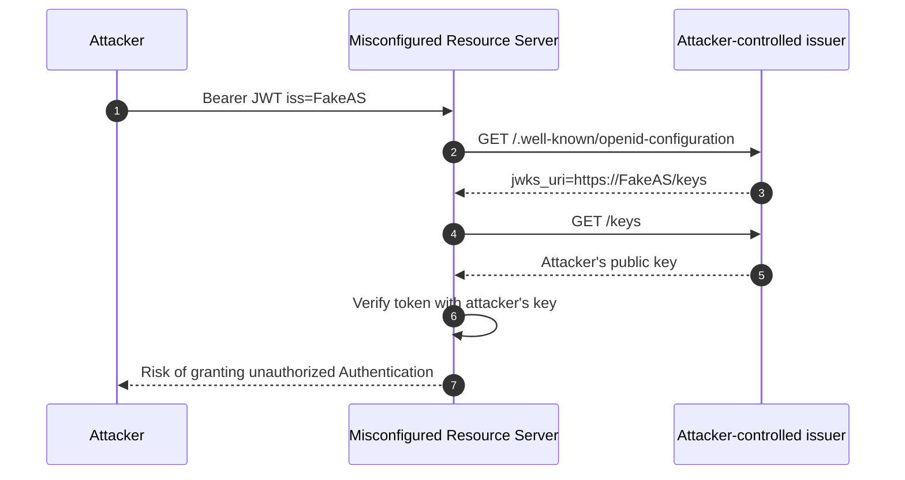

# Never perform arbitrary discovery from token-supplied URLs or issuers

In a **Spring Security OAuth 2.0 / OIDC Resource Server** serving **multiple tenants**, not all access tokens are issued by the same Authorization Server. Tenant A may use issuer `https://id-a.example.com/realms/a`, while tenant B uses `https://id-b.example.com/realms/b`; tenants might even belong to entirely separate identity organizations. The Resource Server must **select the right verification mechanism for each token**, yet must never equate "selecting an issuer" with "trusting any URL supplied by a token."

A seemingly convenient yet dangerous implementation looks like:

```text
Receive unverified JWT
    → read iss claim or jku header
    → automatically GET metadata from arbitrary issuer
    → fetch jwks_uri from metadata
    → verify JWT using the downloaded public key
    → accept the caller
```

If an attacker can choose their own issuer and host their own JWKS, they can **self-sign a JWT** and make the Resource Server download keys they publish. Beyond accepting forged tokens, sending HTTP requests to unapproved URLs creates **SSRF (Server-Side Request Forgery)** risks, internal network probing, information leakage, and resource exhaustion.

**The most important principle:** data supplied by an unverified token—including `iss`, `kid`, `jku`, `x5u`, `tid`, tenant paths, or header hostnames—**never has the authority to expand the set of trusted issuers or JWKS endpoints**. The Resource Server may read part of that data as a **routing hint into a trusted configuration list**, while the selected manager/decoder **must verify the signature, exact issuer, audience, and token constraints before authentication succeeds**.

This lesson belongs to the **Multi-tenancy** chapter, focusing on the trust boundary of **metadata discovery and key retrieval** in a multi-tenant JWT Resource Server, alongside handling opaque tokens, tenant mapping, operations, and security testing.

> **Illustrative context:** Orders API at `https://api.example.com` accepts JWT access tokens targeting the `orders-api` audience. Tenant `acme` trusts issuer `https://id.acme.example/realms/orders`; tenant `beta` trusts `https://identity.beta.example/tenant/orders`. The application uses Spring Boot 3.x / Spring Security 6.x; primary examples use Servlet, with a dedicated section for WebFlux. Hostnames, keys, and tokens are for learning only; verify exact APIs against your active Spring Security version.

## 1. Why does multi-tenancy turn metadata discovery into a security decision?

With a single issuer, configuration is straightforward:

```yaml
spring:
  security:
    oauth2:
      resourceserver:
        jwt:
          issuer-uri: https://id.acme.example/realms/orders
          audiences:
            - orders-api
```

The Resource Server learns the issuer from **operator-controlled configuration**. When discovering metadata or JWKS, it interacts only with a pre-defined source.

With multiple tenants, the API can receive:

```text
Request A: JWT iss = https://id.acme.example/realms/orders
Request B: JWT iss = https://identity.beta.example/tenant/orders
Request C: JWT iss = https://attacker-controlled.invalid/issuer
```

If a developer tries to "automatically support any tenant" by creating a decoder from every incoming `iss`, Request C can trigger an outbound network request to an attacker-chosen host. The fact that an attacker **supplies** an issuer never makes that issuer a trusted source.

### 1.1. Distinguishing tenant, issuer, and audience

| Attribute | Example | Meaning |
|---|---|---|
| **Application Tenant ID** | `acme` | Data/business boundary inside Orders API |
| **Issuer** (`iss`) | `https://id.acme.example/realms/orders` | Identity of the Authorization Server minting the token |
| **Audience** (`aud`) | `orders-api` | Which Resource Server the token is intended for |
| **OAuth client** (`client_id`/`azp` per contract) | `acme-portal` | Application that requested/received the token or authorized party |
| **Subject** (`sub`) | `user-42` | User/workload identity scoped to the issuer |
| **JWK key ID** (`kid`) | `key-2026-11` | Key-selection hint inside a trusted set |
| **Key set URL** (`jwks_uri`) | `https://id.acme.example/keys` | Endpoint publishing public keys |
| **Request tenant hint** | `/tenants/acme/orders` | Caller-supplied routing data, not permission |

**One issuer can serve many tenants**, and an application tenant can also migrate from an old issuer to a new one. Never establish tenant–issuer relationships through superficial hostname string comparisons. Maintain a **registry/contract** approved by administrators or a trusted onboarding system.

### 1.2. Three independent questions that must be answered

To handle `GET /tenants/acme/orders/42`, the Resource Server must determine:

1. **Which issuers' tokens are trusted?** Only issuers listed in an authorized registry.
2. **Is the token valid and meant for Orders API?** Verify signature, `iss`, `exp`, `nbf`, `aud`, algorithm, and token type/profile.
3. **Is the actor permitted to access tenant `acme` and order 42?** Check tenant mapping, scopes, subject/client, ownership, and business policy.

Answering question 1 or question 2 **does not automatically answer question 3**.

## 2. Why is the `iss` claim inside a JWT untrusted?

A compact JWT has the form:

```text
BASE64URL(protected-header).BASE64URL(payload).BASE64URL(signature)
```

The payload may contain:

```json
{
  "iss": "https://id.acme.example/realms/orders",
  "sub": "user-42",
  "aud": ["orders-api"],
  "scope": "orders.read",
  "tenant_id": "acme",
  "exp": 2000000000
}
```

Anyone can **Base64URL-decode the payload**, just as anyone can craft a new JWT containing those exact fields. Only after the signature and claims are verified by a decoder using **a trusted issuer's keys** may token data be used for authentication and authorization.

### 2.1. Reading to route is not reading to trust

In a multi-issuer system, the Resource Server sometimes needs to read `iss` **before** verifying the signature to know **which manager will verify the signature**. This is valid only under strict conditions:

```text
Unverified JWT iss
        |
        v
Lookup in approved issuer registry
        |
        +-- Absent -> REJECT; NO discovery
        |
        +-- Present -> Select pre-configured manager/decoder
                      |
                      v
                 Verify signature
                 Verify exact iss
                 Verify audience/time/algorithm/profile
                      |
                      v
                 Valid Authentication
```

The decisive distinction: an unverified `iss` value is only used as an **index into a finite allowlist**, never to construct a new Internet URL that the Resource Server blindly trusts.

### 2.2. JWT headers are also untrusted

Example:

```json
{
  "alg": "RS256",
  "kid": "key-a",
  "jku": "https://untrusted.example/keys.json"
}
```

- `alg` is declared by the token; the decoder must enforce the **trusted issuer's** algorithm allowlist.
- `kid` only hints at key selection inside a trusted JWKS; it is **not verification proof** and must never be interpolated directly into URLs or paths.
- `jku` may suggest a JWK Set location, yet you must **never automatically fetch URLs from an unverified JWT**.
- `x5u` or URLs pointing to certificates must never serve as arbitrary trust sources.

**Both the token header and payload are untrusted input until signature verification and validation complete.**

## 3. Threat 1: accepting attacker-issued JWTs automatically

Suppose the Resource Server receives:

```text
Token payload:
  iss = https://issuer.attacker.example
  aud = orders-api
  scope = orders.read orders.admin

Token header:
  kid = attacker-key
```

An attacker can:

1. Generate their own private/public key pair.
2. Publish metadata with `issuer=https://issuer.attacker.example` and a `jwks_uri` serving their public key.
3. Sign a JWT with the private key they hold.
4. Send the Bearer token to Orders API.

If Orders API decides **"whichever issuer the token names, discover and trust it,"** the signature will verify—**solely because the system trusted the attacker's own key**.



**The flaw is not a broken signature algorithm**, it is an **unbounded choice of trusted key sources**.

### 3.1. A valid signature does not mean the issuer is trusted

A JWT can be cleanly signed by the private key of an issuer that Orders API **is not permitted to trust**. A signature only proves the token was signed by the matching key, not that the issuer belongs to the API's trust anchors.

Validity requires:

```text
Trusted issuer
AND trusted JWKS/key source for that issuer
AND valid signature
AND allowed algorithm and token profile
AND matching issuer claim
AND correct audience
AND valid timestamps
AND required token claims
```

Missing any step can break authentication or let a token be misused on the wrong resource.

## 4. Threat 2: SSRF from issuer discovery

**SSRF** occurs when an application initiates HTTP requests to an address influenced by an untrusted party, potentially reaching network resources the attacker cannot reach directly.

For example, a forged token declares:

```json
{
  "iss": "http://169.254.169.254/latest/meta-data"
}
```

If the application constructs discovery URLs from arbitrary issuers, it risks probing link-local addresses or internal services. Not every URL like that serves valid issuer metadata; **the risk is forcing the server to open outbound connections outside allowed bounds**.

SSRF targets may include:

- Cloud infrastructure metadata services.
- Services listening only on `localhost` or internal networks.
- Control planes, admin APIs, or database HTTP endpoints.
- Non-public internal hosts.
- Proxy/redirect chains leading to private addresses.
- Endpoints with side effects or sensitive information disclosure.

### 4.1. Not only `iss`; `jwks_uri` can also cause SSRF

Suppose discovery JSON returns:

```json
{
  "issuer": "https://issuer.example",
  "jwks_uri": "http://127.0.0.1:8080/internal/admin"
}
```

Even when an issuer is on the allowlist, metadata could be misconfigured or the key provider unexpectedly altered. The Resource Server must **govern `jwks_uri` and egress policies** per the trust contract.

The JWKS does not have to share a hostname with the issuer; some providers use dedicated CDNs or key-hosting domains. However, distinct hosts **must be explicitly approved**, and metadata must originate from the configured issuer over an authenticated connection.

### 4.2. Redirects, DNS, and IPs are part of SSRF

An initially valid URL can return a `302 Location` to another host; DNS can resolve to a private IP or change after validation. Therefore:

- Do not follow arbitrary redirects in discovery/JWKS HTTP clients.
- Restrict `https` scheme, hostnames, and ports per policy.
- Configure egress/network policies to block arbitrary internal destinations.
- Account for DNS rebinding and IP/routing when onboarding external issuers.
- Never rely solely on domain regexes or string checks in place of network segmentation.
- Enforce timeouts, response size caps, and redirect limits.

**Input URL validation is necessary but not sufficient.** A safer model **never accepts new issuer URLs from requests**, using an approved registry and restricting outbound network traffic exclusively to authorized endpoints.

## 5. OIDC Discovery, OAuth metadata, and JWKS

A trusted issuer may publish metadata:

```json
{
  "issuer": "https://id.acme.example/realms/orders",
  "jwks_uri": "https://id.acme.example/realms/orders/keys",
  "authorization_endpoint": "https://id.acme.example/realms/orders/authorize",
  "token_endpoint": "https://id.acme.example/realms/orders/token"
}
```

For a JWT Resource Server, the two core fields are:

- `issuer`: must match the **exact trusted issuer** per contract.
- `jwks_uri`: the address publishing **public keys** for JWS verification.

### 5.1. Metadata is only valid when fetched from an appropriate trust anchor

Sound trust chain:

```text
Operator/config registry approves issuer X
               |
               v
Resource Server fetches X's metadata over trusted HTTPS
               |
               v
Metadata issuer == X per contract
               |
               v
Approved/controlled jwks_uri
               |
               v
Public keys from X's JWKS
               |
               v
Verify JWT iss=X, aud=orders-api
```

Broken chain:

```text
JWT self-declares iss=X
       |
       v
Resource Server accepts X as a trust anchor
       |
       v
X's metadata/JWKS trusted unconditionally
```

### 5.2. Well-known paths are not arbitrary URL concatenation

**OpenID Connect Discovery** uses well-known metadata `openid-configuration`; **RFC 8414** specifies `oauth-authorization-server` with URI construction rules that can differ when the issuer contains a path.

Example issuer:

```text
https://id.acme.example/realms/orders
```

An OIDC provider may serve:

```text
https://id.acme.example/realms/orders/.well-known/openid-configuration
```

Whereas OAuth Authorization Server Metadata rules (RFC 8414) can take the form:

```text
https://id.acme.example/.well-known/oauth-authorization-server/realms/orders
```

Spring Security uses endpoints/procedures matching your version and provider. Never concatenate `/keys` or `/.well-known/...` onto arbitrary token-supplied inputs. In multi-tenant deployments, metadata discovery must start **from a specific trusted issuer**, never from a caller-supplied URL.

### 5.3. JWKS does not hold secret keys

A JWKS contains public keys:

```json
{
  "keys": [
    {
      "kty": "RSA",
      "kid": "acme-key-2026",
      "use": "sig",
      "alg": "RS256",
      "n": "PUBLIC_RSA_MODULUS_EXAMPLE",
      "e": "AQAB"
    }
  ]
}
```

`n` in this example is a placeholder, not a real RSA key. Private keys must remain in the Authorization Server/HSM/KMS and never appear in a JWKS.

Even though public keys are public, **the publishing source and integrity of the JWKS** must be trusted. If an attacker can swap the public key used by the decoder, they can sign tokens with the corresponding private key.

## 6. Seven security invariants of a multi-tenant Resource Server

You can define these invariants for every request:

1. **Finite issuer trust set:** only issuers present in the approved registry are considered.
2. **No arbitrary discovery:** unverified tokens must never trigger HTTP GETs to issuer/JWKS URLs outside the registry.
3. **Exact issuer match:** the decoder/validator confirms `iss` equals the selected issuer; not merely "same domain."
4. **Bounded key sources:** JWKS are retrieved from the URI in the issuer config or trusted metadata, never from self-declared `jku`/`x5u`.
5. **Audience and token profile:** the token must target Orders API, not merely carry a valid issuer signature.
6. **Tenant binding:** the request's business tenant must match verified actor/tenant claims per registry and domain policy.
7. **Fail closed:** never skip signature, issuer, or tenant validation when keys or metadata are unreachable.

An order policy can be expressed as:

```text
ALLOW(request, token, order) =
    trustedIssuer(token.iss)
AND validSignature(token, trustedIssuerKeySet)
AND token.iss == selectedIssuer
AND token.aud contains "orders-api"
AND tokenTimeAndProfileValid
AND token.scope contains "orders.read"
AND authorizedTenantBinding(request.tenant, actor, token)
AND order.tenant == authorizedTenant
AND actorCanReadThisOrder(actor, order)
```

This is a **conceptual expression**, not a specific Spring Security API. Still, it captures the independent constraints the program must enforce.

## 7. Trusted registry: the authority deciding which issuers are accepted

Instead of:

```java
// DO NOT USE: a self-declared JWT issuer is not a trust anchor.
JwtDecoder decoder =
    JwtDecoders.fromIssuerLocation(unverifiedIssuerFromToken);
```

maintain a configuration list controlled by **operators or an administrative workflow**:

```yaml
orders:
  security:
    tenants:
      acme:
        issuer: https://id.acme.example/realms/orders
        jwks-uri: https://id.acme.example/realms/orders/keys
        audience: orders-api
      beta:
        issuer: https://identity.beta.example/tenant/orders
        jwks-uri: https://identity.beta.example/tenant/orders/keys
        audience: orders-api
```

This is an **illustrative application configuration**, not standard properties automatically bound to decoders by Spring Boot. To use it, define `@ConfigurationProperties` or an equivalent loader and construct managers/decoders from the validated data.

### 7.1. What should each entry contain?

| Field | Specification |
|---|---|
| `tenantId` | Unique internal ID, independent of caller-supplied hostnames |
| `issuer` | Exact approved issuer URI, HTTPS scheme |
| `jwksUri` | Approved JWKS URL or fetched strictly from trusted metadata |
| `allowedAlgorithms` | e.g., RS256 per contract, never read from the token |
| `audiences` | Audiences/resource values accepted by the API |
| `tokenProfile` | OAuth access token rules, e.g., RFC 9068 if applicable |
| `allowedClients` | OAuth client allowlist if required by business rules |
| `tenantBinding` | Relationship between issuer/tenant claim and internal tenant |
| `status` | ACTIVE/SUSPENDED/REVOKED per governance workflow |
| `updatedAt`/version | For auditing and controlled config updates |

A registry must not contain just an "issuer string" that implicitly grants everything. Supporting multiple tenants safely requires an **explicit policy bundle**.

### 7.2. Never rely on issuer prefixes or suffixes

Anti-pattern example:

```java
// INTENTIONALLY WRONG: checking hostname/issuer via substring.
if (issuer.contains("example.com")) {
    trust(issuer);
}
```

These issuers are not equivalent:

```text
https://id.example.com/tenant-a
https://id.example.com/tenant-b
https://id.example.com.evil.invalid/tenant-a
https://evil.example.com/tenant-a
http://id.example.com/tenant-a
```

Even a subdomain under `example.com` is not automatically permitted unless explicitly registered. Match the **exact canonical URI** per contract without arbitrarily rewriting tenant or realm paths.

### 7.3. "URL normalization" must not alter issuer identity

Many developers try calling:

```java
issuer.toLowerCase().replaceAll("/+$", "")
```

before comparing. That can alter case-sensitive paths or mutate the exact issuer string published by the JWT/metadata.

Instead:

- Define one canonical issuer value in the registry and pass that **exact value** to the validator.
- Handle trailing slashes, paths, and casing strictly per the AS contract without guessing.
- Use a URI parser to inspect scheme/host during **onboarding**, without replacing exact issuer-claim matching with fuzzy comparisons.
- Reject URLs containing user-info, fragments, or disallowed structures per policy.
- Prevent requests from aliasing issuers via encoding, Unicode, or mixed-case tricks.

## 8. Simplest safe option: a fixed issuer list

When issuers are known at deploy time, Spring Security provides a multi-issuer mechanism built for this scenario: **`JwtIssuerAuthenticationManagerResolver`** in the Servlet stack.

Concept:

```text
Unverified iss used only to select
    |
    +-- Trusted issuer A -> Manager A -> Verify with A's keys + validators
    +-- Trusted issuer B -> Manager B -> Verify with B's keys + validators
    +-- Other issuer     -> REJECT; never auto-create a manager
```

### 8.1. Spring Security Servlet example with trusted issuers

```java
package com.example.orders.security;

import jakarta.servlet.http.HttpServletRequest;
import org.springframework.context.annotation.Bean;
import org.springframework.context.annotation.Configuration;
import org.springframework.security.authentication.AuthenticationManagerResolver;
import org.springframework.security.config.annotation.web.builders.HttpSecurity;
import org.springframework.security.config.http.SessionCreationPolicy;
import org.springframework.security.oauth2.server.resource.authentication.JwtIssuerAuthenticationManagerResolver;
import org.springframework.security.web.SecurityFilterChain;

@Configuration
public class TrustedIssuerResourceServerSecurity {

    private static final String ACME_ISSUER =
        "https://id.acme.example/realms/orders";

    private static final String BETA_ISSUER =
        "https://identity.beta.example/tenant/orders";

    @Bean
    AuthenticationManagerResolver<HttpServletRequest> issuerResolver() {
        return JwtIssuerAuthenticationManagerResolver
            .fromTrustedIssuers(
                ACME_ISSUER,
                BETA_ISSUER
            );
    }

    @Bean
    SecurityFilterChain apiSecurity(
            HttpSecurity http,
            AuthenticationManagerResolver<HttpServletRequest>
                issuerResolver) throws Exception {

        return http
            .securityMatcher("/api/**")
            .authorizeHttpRequests(auth -> auth
                .requestMatchers("/api/public/**").permitAll()
                .anyRequest().authenticated()
            )
            .sessionManagement(session ->
                session.sessionCreationPolicy(
                    SessionCreationPolicy.STATELESS
                )
            )
            .oauth2ResourceServer(oauth2 -> oauth2
                .authenticationManagerResolver(issuerResolver)
            )
            .build();
    }
}
```

This example targets Spring Security versions providing `fromTrustedIssuers(...)`. Some versions provide different constructors or overloads; check the Javadoc for your exact dependency version when integrating.

**Core point:** the trusted issuer list comes from server configuration/code, **never from the JWT sent in the incoming request**.

### 8.2. What behavior is expected?

- Token with `iss=ACME_ISSUER`: the resolver picks Acme's manager, then the decoder verifies signature and issuer.
- Token with `iss=BETA_ISSUER`: the resolver picks Beta's manager.
- Token with `iss=https://random.example`: no manager is automatically created for this issuer.
- Token claiming issuer A yet signed with B's key: manager A **does not** accept the signature just because B is also in the registry.
- Validly signed token with wrong audience: must be rejected once an audience validator is attached.

**Note on audience:** default trusted-issuer setup can provide issuer, signature, and timestamp validation, yet **does not automatically enforce Orders API's specific audience and tenant policies**. When you need per-issuer audience or algorithm rules, use the explicit manager/decoder configuration in the next section.

### 8.3. Discovery happens only for permitted sources

Depending on the implementation, managers may be created lazily the first time a token for issuer A or B arrives. "Lazy discovery" is **not a security flaw** as long as the trust set is fixed and the decoder still verifies the token.

What matters is not "whether HTTP discovery happens," but **"who is allowed to designate an issuer as a discovery source?"** With a trusted allowlist, the answer is the controlled operator/registry, never the caller.

## 9. Dedicated managers per issuer to enforce audience, algorithms, and JWKS

When policy demands tighter control, configure an explicit `AuthenticationManager` per issuer from an **approved JWKS URI**, avoiding runtime discovery from tokens altogether.

### 9.1. Example initializing two managers with validators

```java
package com.example.orders.security;

import java.util.List;
import java.util.Map;

import jakarta.servlet.http.HttpServletRequest;

import org.springframework.context.annotation.Bean;
import org.springframework.context.annotation.Configuration;
import org.springframework.security.authentication.AuthenticationManager;
import org.springframework.security.authentication.AuthenticationManagerResolver;
import org.springframework.security.oauth2.core.DelegatingOAuth2TokenValidator;
import org.springframework.security.oauth2.core.OAuth2Error;
import org.springframework.security.oauth2.core.OAuth2TokenValidator;
import org.springframework.security.oauth2.core.OAuth2TokenValidatorResult;
import org.springframework.security.oauth2.jose.jws.SignatureAlgorithm;
import org.springframework.security.oauth2.jwt.Jwt;
import org.springframework.security.oauth2.jwt.JwtValidators;
import org.springframework.security.oauth2.jwt.NimbusJwtDecoder;
import org.springframework.security.oauth2.server.resource.authentication.JwtAuthenticationProvider;
import org.springframework.security.oauth2.server.resource.authentication.JwtIssuerAuthenticationManagerResolver;

@Configuration
public class PerIssuerManagerConfiguration {

    private static final String ACME =
        "https://id.acme.example/realms/orders";

    private static final String BETA =
        "https://identity.beta.example/tenant/orders";

    @Bean
    AuthenticationManagerResolver<HttpServletRequest>
            perIssuerAuthenticationManagerResolver() {

        Map<String, AuthenticationManager> managers = Map.of(
            ACME,
            managerFor(
                ACME,
                "https://id.acme.example/realms/orders/keys",
                "orders-api"
            ),
            BETA,
            managerFor(
                BETA,
                "https://identity.beta.example/tenant/orders/keys",
                "orders-api"
            )
        );

        // Resolver reads issuer as a hint but ONLY selects managers
        // already in the registry; never builds a manager from unknown URLs.
        return new JwtIssuerAuthenticationManagerResolver(
            managers::get
        );
    }

    private static AuthenticationManager managerFor(
            String issuer,
            String jwksUri,
            String audience) {

        NimbusJwtDecoder decoder =
            NimbusJwtDecoder.withJwkSetUri(jwksUri)
                .jwsAlgorithm(SignatureAlgorithm.RS256)
                .build();

        OAuth2TokenValidator<Jwt> issuerAndTime =
            JwtValidators.createDefaultWithIssuer(issuer);

        OAuth2TokenValidator<Jwt> audienceRule = jwt -> {
            if (jwt.getAudience() != null
                    && jwt.getAudience().contains(audience)) {
                return OAuth2TokenValidatorResult.success();
            }
            return OAuth2TokenValidatorResult.failure(
                new OAuth2Error(
                    "invalid_token",
                    "Required audience is missing",
                    null
                )
            );
        };

        decoder.setJwtValidator(
            new DelegatingOAuth2TokenValidator<>(
                List.of(issuerAndTime, audienceRule)
            )
        );

        JwtAuthenticationProvider provider =
            new JwtAuthenticationProvider(decoder);

        return provider::authenticate;
    }
}
```

**Usage:** pass this `perIssuerAuthenticationManagerResolver` bean into `oauth2ResourceServer(...authenticationManagerResolver(...))` in `SecurityFilterChain`, replacing the resolver bean from section 8. These are **two alternative configurations**; do not register two `AuthenticationManagerResolver<HttpServletRequest>` beans simultaneously without explicit qualifiers.

### 9.2. Why is this safer than dynamic discovery calls?

- The `managers` map holds a **finite** set of two issuers.
- Each issuer binds to an **application-configured** `jwksUri`, never derived from payloads.
- The decoder verifies JWTs using keys from that exact JWKS.
- The issuer validator still checks `iss` after signature verification.
- The audience validator enforces `orders-api`.
- `jwsAlgorithm(RS256)` restricts algorithms to the agreed contract; if an issuer uses another algorithm, update the policy explicitly.
- Issuers outside the map have no manager, leaving the resolver unable to authenticate them.

### 9.3. Why keep issuer validation even when mapped by `iss`?

Because the `iss` read for map lookup is an **unverified hint**. If you only choose a manager from the hint and verify with a shared key set without checking the exact issuer, tokens issued for another realm or tenant could slip through.

For example, an issuer might reuse public keys across multiple realms. A valid signature does not prove the token came from the chosen realm unless `iss` is checked. Thus every chosen manager must enforce an **exact issuer validator**.

### 9.4. Pay attention to token profiles

An RFC 9068 access token may require validating `typ=at+jwt` and specific profile claims. The snippet above illustrates issuer, audience, timestamps, and algorithm; it **does not implement a complete RFC 9068 validator**. If your contract mandates a token profile, add the matching validator and never accept ID tokens just because they share the same JWKS.

## 10. When one issuer serves multiple tenants

Multiple tenants do not always imply multiple issuers. Example:

```text
Acme tenant  ----+
                 +--> Shared issuer: https://login.example.com
Beta tenant  ----+
```

Here, the issuer can be a single trust source. The tenant lives in claims or business data attested by the Authorization Server, such as `tenant_id`, `organization_id`, or `realm_access` per provider contract.

A JWT:

```json
{
  "iss": "https://login.example.com",
  "sub": "user-42",
  "aud": ["orders-api"],
  "tenant_id": "acme",
  "scope": "orders.read"
}
```

When a request hits `/tenants/beta/orders/42`, the token **must not** be treated as Beta just because the path says `beta`. The service must cross-check the tenant claim (if trusted) and membership/authorization policy.

### 10.1. A tenant hint in the path is not an identity

```http
GET /tenants/beta/orders/42 HTTP/1.1
Authorization: Bearer JWT_FOR_ACME
```

`beta` in the URL is a **resource selector**, not proof of access. Authentication may succeed under the shared issuer, yet authorization must reject when the actor lacks permission in Beta.

### 10.2. What if a user belongs to multiple tenants?

A user may be a member of both Acme and Beta. In that case:

- The token may carry a specific tenant context or an organization list.
- The API must determine the **active tenant** per an approved workflow.
- If the request acts on Beta, verify Beta membership and permissions from a trusted source.
- Never infer full privileges from a shared `sub` or email.
- Never allow an Acme token to read Beta's orders just because the user shares the same email in both tenants.

**A shared issuer does not eliminate multi-tenant authorization.** It only simplifies multi-issuer decoder setup.

## 11. When one tenant accepts multiple issuers

A tenant may migrate identity providers from an old IdP to a new one:

```text
Tenant acme
  |
  +-- issuer-old: https://legacy-id.example/acme
  +-- issuer-new: https://new-id.example/acme
```

This is a time-bounded administrative decision, not a license to accept any issuer supplied by users.

In the registry, ensure:

- Both issuers are explicitly approved for tenant Acme during the migration window.
- Audience and client authorization for each issuer are checked individually.
- Subject mapping prevents `(iss, sub)` collisions.
- Accounts across the two issuers are linked through a trusted process (never by self-declared email).
- There is a clear cutoff date for retiring the old issuer.
- Auditing and rollback procedures are in place.

Never assume two tokens with the same email or `sub` across different `iss` values represent the same identity.

## 12. Routing by tenant hint: check bindings in both directions

You can use hostname, subdomain, or path to identify the **intended** tenant, such as:

```text
https://acme.api.example.com/orders/42
https://api.example.com/tenants/beta/orders/42
```

Still, that remains caller-controlled input. If you use it to pick a manager:

1. Accept only tenant IDs present in the known registry.
2. Map tenant ID → set of issuers allowed for that tenant.
3. Select a decoder with approved key sources.
4. Verify JWT signature, issuer, audience, and timestamps.
5. Cross-check tenant claims/membership against the tenant route.
6. Check resource-level permissions.

### 12.1. Decision matrix

| Tenant route | Verified issuer | Tenant claim/membership | Outcome |
|---|---|---|---|
| Acme | Acme issuer | Belongs to Acme | May proceed to scope/object policy |
| Acme | Beta issuer | Belongs only to Beta | Denied |
| Beta | Acme issuer | Belongs only to Acme | Denied |
| Acme | Unknown issuer | Any | Rejected at authentication |
| Unknown tenant | Valid issuer | Any | Rejected at tenant routing |
| Acme | Approved shared issuer | Has Acme membership | May proceed to policy |
| Beta | Approved shared issuer | Lacks Beta membership | Denied |

Never equate "issuer accepted system-wide" with "issuer authorized for every tenant." The **allowed issuers per tenant** mapping is part of your trust policy.

## 13. Why is the HTTP `Host` header not enough to choose a trusted issuer?

Some systems partition tenants by subdomain:

```http
Host: acme.api.example.com
```

This can be a valid routing hint behind a trusted reverse proxy. However, if a backend directly reads an unvalidated `Host` or `X-Forwarded-Host` header to construct an issuer URL, it invites host-header injection.

Unsafe example:

```java
// INTENTIONALLY WRONG: request Host does not establish issuer trust.
String issuer = "https://" + request.getHeader("Host") + "/issuer";
JwtDecoder decoder = JwtDecoders.fromIssuerLocation(issuer);
```

Protection requires:

- Ingress/proxy validates allowed hosts and routes to the right tenant.
- Backend trusts forwarded headers only from **trusted proxies**, never directly from the Internet.
- The route-derived tenant ID is still looked up in the **trusted registry**, never concatenated into arbitrary URLs.
- JWT issuer and audience are verified after selecting the route.
- Services check permissions against that specific tenant.

## 14. WebFlux Resource Server: same principles, reactive components

In **Spring WebFlux**, components differ from Servlet:

| Servlet | WebFlux |
|---|---|
| `SecurityFilterChain` | `SecurityWebFilterChain` |
| `HttpSecurity` | `ServerHttpSecurity` |
| `JwtDecoder` | `ReactiveJwtDecoder` |
| `AuthenticationManager` | `ReactiveAuthenticationManager` |
| `JwtIssuerAuthenticationManagerResolver` | `JwtIssuerReactiveAuthenticationManagerResolver` in supported versions |
| `AuthenticationManagerResolver<HttpServletRequest>` | Reactive resolver for `ServerWebExchange` |
| `SecurityContextHolder` | `ReactiveSecurityContextHolder` |

### 14.1. Trusted issuer resolver in WebFlux

Example using the reactive Spring Security API in versions supporting trusted issuers:

```java
package com.example.orders.security;

import org.springframework.context.annotation.Bean;
import org.springframework.context.annotation.Configuration;
import org.springframework.security.config.web.server.ServerHttpSecurity;
import org.springframework.security.oauth2.server.resource.authentication.JwtIssuerReactiveAuthenticationManagerResolver;
import org.springframework.security.web.server.SecurityWebFilterChain;

@Configuration
public class ReactiveTrustedIssuerSecurity {

    @Bean
    SecurityWebFilterChain ordersApi(ServerHttpSecurity http) {

        var resolver =
            JwtIssuerReactiveAuthenticationManagerResolver
                .fromTrustedIssuers(
                    "https://id.acme.example/realms/orders",
                    "https://identity.beta.example/tenant/orders"
                );

        return http
            .authorizeExchange(exchanges -> exchanges
                .pathMatchers("/api/public/**").permitAll()
                .anyExchange().authenticated()
            )
            .oauth2ResourceServer(oauth2 -> oauth2
                .authenticationManagerResolver(resolver)
            )
            .build();
    }
}
```

Depending on the Spring Security version, overload/constructor names may vary; consult your version's Javadoc. **Never replace this issuer list with values computed directly from incoming JWTs or request headers.**

### 14.2. Never use blocking discovery on the event loop

An inappropriate manual implementation:

```java
// DO NOT USE: blocking and trusting caller-supplied issuer URLs.
Mono<Authentication> authenticate(String unverifiedIssuer) {
    JwtDecoder decoder =
        JwtDecoders.fromIssuerLocation(unverifiedIssuer);
    // Creates decoders and runs arbitrary network discovery in reactive path.
    return Mono.empty();
}
```

WebFlux requires `ReactiveJwtDecoder` and a reactive HTTP client, and more importantly **the issuer source must be approved**. A non-blocking API does not make the app safe if it non-blockingly fetches attacker metadata.

### 14.3. `SecurityContext` does not fix issuer confusion

WebFlux places `Authentication` into the Reactor Context after authentication succeeds. If the authentication manager trusted the wrong key source, that context still holds a forged principal.

Therefore, resolve **trust selection** before creating an `Authentication`. `ReactiveSecurityContextHolder` merely propagates the already-created identity; it **does not re-verify** that the issuer belongs to an allowlist.

## 15. Opaque tokens in multi-tenant systems

With opaque tokens, the Resource Server normally queries the Authorization Server via introspection rather than downloading JWKS to verify JWTs locally. The same risk applies if `introspection-uri` is chosen from untrusted input.

Anti-pattern:

```text
Unverified opaque token text / URL header / tenant claim
       |
       v
Select arbitrary introspection endpoint
       |
       v
POST raw bearer token and introspection credentials
```

The consequences can be **worse than discovery SSRF** because outbound introspection requests carry:

- The caller's raw bearer access token.
- The Resource Server's client authentication credentials.
- Sensitive AS response metadata if proxied or logged poorly.

### 15.1. Sound design for opaque multi-tenancy

- Maintain a registry mapping tenants → approved introspection endpoints.
- Use dedicated credentials per issuer/tenant or resource boundary.
- Send bearer tokens only to endpoints valid for that issuer/token format per policy.
- Never "try every Authorization Server in turn" to see which returns `active=true`: that leaks tokens to unauthorized parties.
- Verify `active`, scopes, audience/resource, and issuer/client/tenant contracts.
- Never create a valid `OAuth2AuthenticatedPrincipal` if introspection errors or returns `active=false`.
- Harden HTTPS, proxies/redirects, secrets, and timeouts.

Because opaque tokens do not self-publish a trusted issuer, use a **pre-designed routing strategy**: verified API route/tenant context, an AS-contracted token prefix, or an authenticated gateway. Never decode arbitrary bytes of an opaque token and treat them as a real issuer.

## 16. Algorithm confusion and cross-issuer key reuse

A multi-issuer system might use:

- RS256 at Acme.
- ES256 at Beta.
- Separate JWKs or (less ideally) a shared public key across realms.

If a global decoder trusts multiple key sets and algorithms without binding strictly to the issuer, it can suffer **cross-issuer confusion**.

### 16.1. Never let `alg` in the token dictate trust policy

Wrong:

```text
JWT header alg = HS256/RS256/none
       |
       v
Application dynamically picks whichever algorithm the token declares
```

Right:

```text
Trusted issuer config
      |
      +-- Acme: allow RS256 + Acme JWKS
      +-- Beta: allow ES256 + Beta JWKS
      |
      v
JWT header alg must be in the selected issuer's allowlist
      |
      v
Verify signature with the matching key type
```

Never enable `alg=none`, never mix RSA public keys with symmetric HMAC secrets, and never select algorithms from unverified input.

### 16.2. Shared keys never justify dropping the issuer validator

An AS might configure multiple realms sharing the same public key. A token from realm B could then verify under the key held by realm A's manager. Without checking `iss`, the API could accept the wrong realm.

Hence **signature validation and exact issuer validation are two independent requirements**.

### 16.3. Key IDs can collide across issuers

`kid=main` at Acme and `kid=main` at Beta do not make the two keys equivalent. Never cache public keys globally by `kid` alone without an issuer/key-set namespace.

Your cache key strategy must isolate **trusted issuer/JWKS sources** and key selection. If a custom cache uses global key IDs, key collisions or verification mix-ups can occur.

## 17. Dynamic onboarding: adding tenants without redeploys still requires review

A common request: "Let new customers register their own issuer so Orders API accepts their tokens right away."

**Self-service onboarding** can be supported, yet **runtime request authentication must never equal runtime trust onboarding**.

### 17.1. Two stages that must remain separate

**Administrative stage (control plane):**

1. Customer/organization submits issuer details through an authenticated workflow.
2. Admins or trusted automated policies verify the organization owns/controls that issuer.
3. Validate issuer format, HTTPS, hostname, DNS/egress, and SSRF risks.
4. Fetch metadata from the permitted issuer through a controlled process.
5. Verify published `issuer` matches the expected URI.
6. Inspect `jwks_uri`, redirects, TLS, issuer metadata, algorithms, and token profile.
7. Confirm audience/client registration and tenant claim contract.
8. Run token tests in an isolated environment.
9. Approve and publish a versioned/audited registry record.
10. Only after publication does the **data plane** accept tokens from the new issuer.

**Request stage (data plane):**

```text
Incoming JWT
   |
   v
Read iss as untrusted lookup hint
   |
   v
Lookup pre-approved registry
   |
   +-- absent/suspended -> reject immediately
   |
   v
Manager for approved issuer
   |
   v
Verify signature + claims + tenant
   |
   v
Authorize request
```

### 17.2. Never let requests insert registry entries automatically

Specifically, never do:

```java
// DO NOT USE: automatically promotes unverified issuers to trusted.
authenticationManagers.computeIfAbsent(
    tokenIssuer,
    issuer -> {
        JwtDecoder decoder =
            JwtDecoders.fromIssuerLocation(issuer);
        return new JwtAuthenticationProvider(decoder)::authenticate;
    }
);
```

This snippet enables SSRF, creates an unbounded cache of random issuers, and lets attackers introduce their own trusted key sources.

**When using `computeIfAbsent`**, the key must **already be verified as present in the approved registry** and the manager factory must read endpoint URLs solely from the registry—never raw URLs from the JWT.

### 17.3. Registry updates and tenant revocation

When a tenant is locked or an issuer is compromised:

- Remove/disable the registry entry per workflow.
- Stop selecting managers for the revoked issuer/tenant.
- Evict cached decoders and keys as required by policy.
- Account for in-flight requests and cache invalidation.
- Audit who modified the trust registry.
- Never let a pod keep trusting a stale entry indefinitely after control-plane revocation.

A mutable registry needs **atomic updates, versioning, bounded caches, and cross-replica consistency**. Metadata discovery must never create new trust relationships when unknown tokens arrive.

## 18. Resource bounds: arbitrary issuers can also cause DoS

Suppose an attacker sends 100,000 distinct JWTs, each carrying a random `iss`:

```text
https://new-issuer-000001.attacker.invalid
https://new-issuer-000002.attacker.invalid
...
https://new-issuer-100000.attacker.invalid
```

If each issuer creates a decoder and fetches metadata:

- CPU is burned parsing tokens, building HTTP clients, and populating caches.
- DNS lookups spike.
- TCP/TLS connections and file descriptors are exhausted.
- Cache memory grows without bound.
- Thread pools or reactive event loops saturate with network tasks.
- API latency degrades and AS/network capacity suffers.

### 18.1. Reject non-allowlisted issuers before any outbound call

Expected flow:

```text
Parse bounded JWT header/payload for routing hint
    |
    v
Issuer in registry?
    |
    +-- NO -> fail without DNS/HTTP calls
    |
    +-- YES -> reuse manager/decoder for that issuer
```

There is no reason to GET metadata for 100,000 bogus issuers; a single map/registry lookup rejects them immediately.

### 18.2. Bounded parsing is another layer of defense

Even parsing an unverified JWT to extract `iss` can be abused with huge payloads or pathological structures. Therefore:

- Bound Bearer header/token sizes.
- Enforce JSON depth and size limits in parsers and frameworks.
- Avoid redundant token parsing passes.
- Never log raw tokens.
- Never send malformed tokens into a discovery-retry pipeline.
- Monitor unknown-issuer rates, malformed-token rates, and request rates.

**An allowlist does not replace rate limiting**, though it prevents an attacker request from opening outbound connections to arbitrary hosts.

## 19. TLS, egress, and truststores as additional guardrails

Even when the registry constrains issuers, networking can still be misconfigured:

- TLS certificates mismatching hostnames.
- Compromised DNS resolvers.
- Proxies returning unexpected redirects.
- JWKS URIs pointing to domains modified outside policy.
- Overly permissive outbound firewalls reaching management networks.

### 19.1. HTTPS authenticates the public-key distribution source

Public keys in a JWKS are not secrets, yet if an HTTP response can be tampered with, an attacker can feed their own public key into the decoder. Enforce:

- HTTPS for all metadata/JWKS endpoints.
- Proper certificate chain and hostname validation.
- Environment-appropriate CAs/truststores.
- No trust-all or always-true hostname verifiers.
- No automatic fallback to HTTP when HTTPS fails.

### 19.2. Egress policies disallowing arbitrary destinations

In Kubernetes or similar infrastructure:

- Allow the Resource Server to reach only the hostnames/services needed for metadata/JWKS.
- Block access to cloud metadata IPs, admin networks, and unapproved internal endpoints.
- Account for how egress firewalls handle hostname-to-IP resolution and DNS changes.
- When using an outbound proxy, restrict redirects and target URLs at the proxy.
- Enforce request timeouts, response body size caps, and connection concurrency limits.

Never rely solely on regexes to stop SSRF. **Defense in depth:** registry + URI validation + TLS + egress restrictions + bounded resources.

### 19.3. Fix AS configuration if metadata advertises internal URLs

Example public issuer:

```text
https://id.acme.example/realms/orders
```

yet metadata returns:

```json
{
  "issuer": "http://id-service.internal:8080/realms/orders",
  "jwks_uri": "http://id-service.internal:8080/keys"
}
```

This signals a misconfigured external URL or proxy on the AS. Never "work around" it by disabling issuer validation or TLS; fix the issuer metadata so it publishes the right URLs and satisfies trust policy.

## 20. Audience, `azp`/`client_id`, and token types in multi-issuer setups

A validly signed token from issuer A is not necessarily meant for Orders API.

```json
{
  "iss": "https://id.acme.example/realms/orders",
  "aud": ["billing-api"],
  "scope": "orders.read",
  "sub": "user-42"
}
```

If Orders API ignores `aud`, tokens issued for Billing API can be replayed against the wrong resource (token substitution / cross-resource misuse).

### 20.1. Enforcing audience per issuer

The registry should define expected audiences:

```text
issuer A -> allowed audiences: orders-api
issuer B -> allowed audiences: orders-api
```

Some issuers use audience URIs like `https://api.example.com/orders` instead of short names. What matters is approving the value per contract—never accept all audiences simply because the issuer is on the allowlist.

### 20.2. OAuth client identity and token profile

Depending on token type:

- `client_id` may identify the OAuth client granted the token, per profile/AS contract.
- `azp` in certain OIDC tokens has specific semantics and should not be assumed equivalent to `client_id` in every case.
- `sub` is the subject within the issuer's namespace; for `client_credentials` it may represent a workload.
- `typ=at+jwt` per RFC 9068 helps distinguish JWT access tokens when required by contract.

Never accept an **OIDC ID token** as an OAuth access token just because they share the same issuer and JWKS. ID tokens serve the OAuth/OIDC client, not Resource Servers by default.

### 20.3. A properly verified token still needs scopes and domain policies

A valid token with `SCOPE_orders.read` still has no right to read another tenant's orders if business policy forbids it. Relying purely on authentication and scopes causes **Broken Object Level Authorization (BOLA/IDOR)**.

## 21. Checking tenant membership and ownership in services

Suppose the API exposes:

```http
GET /api/tenants/acme/orders/42 HTTP/1.1
Authorization: Bearer <JWT>
```

Once the Security filter authenticates the token, the controller/service must pass the **verified actor context** and requested tenant/resource ID into the policy.

### 21.1. Actor context model

```java
package com.example.orders.security;

public record TrustedActor(
    String issuer,
    String subject,
    String tenantId,
    String clientId
) {}
```

`TrustedActor` must only be constructed from an **Authentication/JWT accepted by the decoder** and registry policy—never directly from HTTP headers or paths.

### 21.2. Extracting the actor after JWT verification

```java
package com.example.orders.security;

import org.springframework.security.access.AccessDeniedException;
import org.springframework.security.oauth2.jwt.Jwt;
import org.springframework.security.oauth2.server.resource.authentication.JwtAuthenticationToken;

public final class TrustedActorFactory {

    public TrustedActor from(JwtAuthenticationToken authentication) {
        Jwt jwt = authentication.getToken();

        if (!authentication.isAuthenticated()
                || jwt.getIssuer() == null
                || jwt.getSubject() == null) {
            throw new AccessDeniedException("Invalid actor context");
        }

        String tenant = jwt.getClaimAsString("tenant_id");
        if (tenant == null || tenant.isBlank()) {
            throw new AccessDeniedException("Tenant context required");
        }

        return new TrustedActor(
            jwt.getIssuer().toString(),
            jwt.getSubject(),
            tenant,
            jwt.getClaimAsString("client_id")
        );
    }
}
```

This example targets contracts with a string `tenant_id` claim. Not all ASs emit this claim; if absent, obtain mappings/memberships from another trusted source.

### 21.3. Cross-checking tenant and object

```java
package com.example.orders.security;

import org.springframework.security.access.AccessDeniedException;

public final class OrderAccessPolicy {

    public void assertCanRead(
            TrustedActor actor,
            String requestedTenant,
            Order order) {

        if (!actor.tenantId().equals(requestedTenant)) {
            throw new AccessDeniedException(
                "Tenant mismatch"
            );
        }

        if (!order.tenantId().equals(requestedTenant)) {
            throw new AccessDeniedException(
                "Resource belongs to another tenant"
            );
        }

        if (!order.ownerIssuer().equals(actor.issuer())
                || !order.ownerSubject().equals(actor.subject())) {
            throw new AccessDeniedException(
                "Actor does not own resource"
            );
        }
    }
}
```

`Order` is a hypothetical domain type with `tenantId()`, `ownerIssuer()`, and `ownerSubject()`. A real system might support admins or delegation; define those policies explicitly instead of dropping ownership checks.

**Note:** if one issuer serves multiple tenants or users can switch tenant contexts, enforce membership/authorization checks per contract; a single `tenant_id` claim does not prove all domain relationships on its own.

## 22. Troubleshooting a valid-issuer token for the wrong tenant

A request carrying a verified token from issuer A may still need to be rejected because:

- The URL targets tenant B.
- The tenant claim mismatches the route.
- The subject belongs to tenant A while the order belongs to tenant B.
- The OAuth client lacks permission for tenant B.
- The user/service lacks delegated rights.
- Resource state disallows the action.

Never "fix" this by adding issuer B to an allowlist or removing audience validation. The issue lies in **business authorization**, not metadata discovery.

### 22.1. Distinguishing 401 and 403

| Scenario | Error category | Typical response |
|---|---|---|
| Missing Bearer token | Authentication missing | **401** Bearer challenge |
| Bad JWT signature or untrusted issuer | Authentication failed | **401 invalid_token** |
| Expired JWT or wrong audience | Token invalid | **401 invalid_token** |
| Valid token missing `orders.read` | Insufficient scope | **403 insufficient_scope** |
| Valid token, wrong tenant/object | Domain authorization denied | **403** or **404** per policy |
| Metadata/JWKS endpoint timeout | Dependency failure | Fail closed; 5xx/401 HTTP mapping per config |
| Issuer outside registry | Not a trusted issuer | Rejected prior to discovery |
| Registry-suspended tenant | Disallowed for this tenant | Rejected per policy; never auto-re-enabled |

Exact HTTP codes for network errors depend on exception handlers and versions; **do not assume Spring always returns 503** when JWKS is unavailable. In every case, never convert failures into a successful authentication.

## 23. Metadata and JWKS caching: caches must never become the registry

There are two distinct caches:

1. **Registry/trust cache:** which issuers are permitted, plus audience/alg/tenant mappings.
2. **JWKS key cache:** public keys fetched from approved JWKS URIs.

The JWKS cache lets decoders verify many requests without GETting JWKS every time. However, **never** use a cache of "every issuer URL ever seen" as your trust registry.

### 23.1. The trust registry requires administrative governance

If an issuer has not been approved by an administrator, a successful JWKS fetch and passing signature check **are not enough to promote that issuer into the trust registry**.

The registry should support:

- Version/ETag or generation numbers.
- `ACTIVE`/`SUSPENDED` issuer status.
- Audits of who approved or revoked entries.
- Bounds on tenant/issuer counts.
- Atomic update and eviction rules.
- DNS/TLS/metadata verification decoupled from incoming traffic.

### 23.2. JWKS caches must isolate issuers

When multiple issuers use `kid=default`, caches must never mix keys across JWKS sources. Use per-issuer decoders/caches or explicit namespaced cache keys.

### 23.3. During AS key rotation

A common timeline:

```text
T0: AS A signs JWTs with kid=A1
T1: AS A publishes both A1 and A2 in JWKS
T2: AS A begins signing new tokens with A2
T3: RS fetches/refreshes issuer A's JWKS
T4: A1 is removed after old tokens expire per policy
```

**Never alter the issuer trust set** simply because a new key appears. Key rotation happens **within an already trusted issuer**, never as a reason to accept a new issuer.

## 24. Handling unknown `kid`, unknown issuer, and missing metadata

Three scenarios that all look like "JWT won't verify" yet require different handling:

### 24.1. Unknown issuer

```text
JWT iss = https://untrusted.example/issuer
Registry contains only Acme and Beta
```

Right behavior: **reject immediately**; make zero metadata/JWKS GET requests.

### 24.2. Known issuer, unknown `kid`

```text
JWT iss = trusted Acme
JWT kid = acme-key-new
Cache currently has acme-key-old
```

The decoder may refresh **Acme's JWKS** per policy to look for the new key. If absent or verification fails, reject. Never fetch URLs outside Acme's configuration.

### 24.3. Known issuer, metadata endpoint unavailable

```text
JWT iss = trusted Beta
Beta metadata/JWKS endpoint is down
```

If the decoder/key cache still holds valid trusted data, some requests may verify locally; if no key is available, fail closed. Never switch to issuer A to "see if its key works," and never let the token through temporarily.

## 25. Negative testing: catching discovery trust flaws

Multi-issuer tests cannot rely solely on `mockJwt()` or manually injected authenticated `Authentication`s. Send genuinely signed JWTs using **test keys** through the filter chain with fake metadata/JWKS servers in an isolated environment.

### 25.1. Key test matrix

| Case | Input | Required outcome |
|---|---|---|
| Valid token A | `iss=A`, signed A, `aud=orders-api` | Authentication succeeds when other policies pass |
| Valid token B | `iss=B`, signed B, `aud=orders-api` | Authentication succeeds when other policies pass |
| Unknown issuer C | `iss=C`, signed C, valid metadata/JWKS at C | **Rejected; zero GET requests sent to C** |
| Forged `iss=A`, signed with key B | `iss=A`, signature B | Rejected |
| Issuer A, billing audience | `iss=A`, `aud=billing-api` | Rejected |
| Issuer A, expired token | Past `exp` | Rejected |
| Issuer A, wrong `typ` profile | ID token or disallowed token class | Rejected per contract |
| Issuer A, `alg=none` | Invalid signature | Rejected |
| Issuer A, attacker `jku` | Header holds attacker URL | **Zero GETs to attacker URL** |
| Issuer A, attacker `x5u` | Header holds attacker URL | **Zero GETs to attacker URL** |
| Issuer A, URL-like `kid` | `kid` holds internal address | Never used as a network endpoint |
| Issuer A, unknown `kid` | Cache lacks new key | Refreshes **A's JWKS only** if policy allows |
| Token A on tenant B | Valid signature/audience for A | Rejected by tenant binding / domain policy |
| Unknown tenant route | Path tenant absent from registry | Rejected; no auto-onboarding |
| Suspended issuer | Registry marks blocked | Rejected despite valid JWT signature |
| JWKS A timeout | Network dependency failure | Fails closed; no Authentication produced |
| JWKS A redirects to internal IP | Internal 302 Location | Does not follow off-policy redirects |
| Metadata issuer mismatch | Response `issuer` differs from trusted config | Metadata rejected |
| 1,000 random issuers | JWTs each claim different `iss` | Never creates 1,000 decoders/HTTP requests |
| Two issuers sharing `kid` | Both A and B use `kid=main` | Public keys never mixed |
| Registry rollback | A removed, then A JWT sent | Does not restore A via discovery |

### 25.2. Tests must verify network side effects too

To prove "no arbitrary discovery," asserting HTTP `401` alone is **insufficient**. A buggy app can still send a GET to the attacker's host before returning 401.

Also assert:

- The fake malicious issuer server **received 0 requests**.
- Mock HTTP clients/egress logs show zero calls outside the allowlist.
- Unknown issuers add zero managers, decoders, or cache entries.
- Redirects to off-policy hosts are blocked.
- Zero requests target internal addresses from token headers or claims.
- Token A is never sent to JWKS/introspection endpoint B.

### 25.3. Example checking the resolver against an unlisted issuer

Conceptual test pseudocode:

```java
// TEST IDEA: sign a JWT with issuer C's private key;
// JWT payload claims iss=C, header kid=c-key.
// Registry contains only issuers A and B.

HttpResponse response = callOrdersApi(
    "Bearer " + signedTokenFromUntrustedIssuerC
);

assertThat(response.statusCode()).isEqualTo(401);
assertThat(fakeIssuerC.requestCount()).isZero();
```

This is **pseudocode**, not runnable Java as-is: `HttpResponse`, `callOrdersApi`, and `fakeIssuerC` are test fixtures you implement. The crux is the **negative network assertion**, not merely the status code.

### 25.4. Unit tests and integration tests address separate layers

- **Registry unit tests:** input issuer C → lookup fails; downloader never called.
- **Validator unit tests:** wrong issuer/audience/tenant → rejected.
- **Filter-chain integration tests:** signed JWTs A/B/C → proper authentication.
- **Network integration tests:** only allowlisted endpoints contacted, including redirects/timeouts.
- **End-to-end through gateway:** hostnames/tenant routes do not alter trust decisions unexpectedly.

`mockJwt()` in Spring Security Test is handy for testing `SCOPE_*` and object policies, yet it **skips signed-JWT verification and metadata discovery**, so it cannot replace the tests above.

## 26. Testing dynamic onboarding and trust changes

If the tenant registry changes at runtime, test additionally:

1. Unapproved issuer C → token C rejected, 0 network calls to C.
2. Admin runs onboarding via controlled control plane → metadata/TLS/JWKS verified, C approved.
3. New registry version published → valid C tokens begin verifying.
4. One pod still holds old registry → clear eventual consistency/rollout plan exists.
5. Issuer C suspended → all pods stop accepting C tokens within policy deadline.
6. C's cached decoder removed/disabled after revocation.
7. Audit logs record who approved, who disabled, and timestamps.
8. No API caller can mutate the trust registry via ordinary request paths.

**Never treat a successful metadata GET as tenant approval.** Discovery is a technical step; trust approval is a governance decision.

## 27. Production diagnostics: API returns 401 for one tenant

Possible causes:

- Issuer missing from allowlist or entry is suspended.
- Token `iss` differs from the canonical issuer in the registry.
- Misconfigured JWKS URI or AS changed endpoints.
- TLS certificate, truststore, proxy, or egress failure.
- AS rotated keys before publishing the new key in JWKS.
- Decoder allows only RS256 while the issuer switched to ES256.
- Audience is not `orders-api`.
- Token expired, future `nbf`, or clock skew.
- Custom token-profile validator blocking an ID token.
- Tenant claim/membership fails policy.

Never quick-fix with:

```java
JwtDecoders.fromIssuerLocation(jwt.getClaimAsString("iss"))
```

on incoming requests. Classify the root cause and fix **trusted configuration**, never opening the trust set arbitrarily.

### 27.1. Diagnosing without logging raw JWTs

A safe internal log might include:

```text
authentication_rejected
reason=unknown_issuer
requestId=abc...
tenantRoute=acme
endpoint=/api/orders
knownIssuerId=none
```

For trusted issuers, log the **internal issuer ID** or registry entry name rather than raw caller-supplied URLs. If logging an unverified `iss`, truncate/bound and escape it to prevent log injection and cardinality abuse.

Never log:

```text
Authorization: Bearer <token>
JWT payload with all PII claims
JWT signature raw bytes
Private key / client secret
```

### 27.2. Metrics to monitor

| Suggested metric | Purpose |
|---|---|
| `auth.unknown_issuer.count` | Detect tokens from non-allowlisted issuers |
| `auth.issuer_mismatch.count` | Detect `iss` claims mismatching selected manager |
| `auth.invalid_signature.count` | Crypto failures or key rotation issues |
| `auth.invalid_audience.count` | Tokens targeting the wrong resource |
| `auth.tenant_binding_denied.count` | Rejected tenant boundary crossings |
| `jwks.fetch.duration` | Public key retrieval latency |
| `jwks.fetch.failure.count` | DNS/TLS/HTTP/parse errors |
| `jwks.key_miss.count` | Unknown `kid` / key rotation |
| `trust_registry.version` | Track trust configuration rollout |
| `decoder.cache.entries` | Monitor issuer decoder counts |
| `egress.denied_destination.count` | Detect SSRF attempts |
| `security.401/403.rate` | Monitor authentication/authorization errors |

These are **suggested metric names**, not all emitted out of the box by Spring Security. Never use raw unverified `iss` or `kid` values as unbounded-cardinality metric labels.

## 28. Safe operational procedure when a provider changes metadata/JWKS

When trusted issuer A changes `jwks_uri`:

1. Provider communicates the change through an approved administrative channel.
2. Platform/security teams verify the new endpoint, HTTPS certificate, DNS, and egress.
3. Verify metadata `issuer` matches exact trusted issuer A.
4. Test JWTs signed with both current and new keys against the approved decoder config.
5. Update registry/config or discovery policy per workflow.
6. Canary rollout; watch for spikes in `unknown_kid`, `invalid_signature`, and JWKS failures.
7. Maintain public key overlap during key rotation per token TTL, except in emergency response.
8. Retire the old endpoint/key on schedule.

Issuer A changing keys **is never a reason to accept a new issuer B declared by a token**. Trust registries and key rotation are separate mechanisms.

### 28.1. What if the JWKS endpoint is unavailable?

- If the cache holds valid trusted public keys, the decoder may continue verifying locally per policy/version.
- If the cache is cold or the token carries an unknown `kid`, no trusted key exists so you **must reject**.
- Never probe any other issuer to find a key for that token.
- Never disable signature or issuer validation.
- You may surface dependency outages separately from invalid tokens for client/SRE clarity, while still failing closed.

## 29. Design checklist before enabling multi-tenancy

| Question | Requirement |
|---|---|
| Who may add issuers to the registry? | Only authenticated/audited control planes or admin workflows |
| Are issuers accepted from arbitrary JWTs? | **No**; used solely as a lookup hint into a trusted allowlist |
| Is exact `iss` checked post-verification? | **Yes** |
| Is `aud=orders-api` checked? | **Yes**, or another explicit resource contract |
| Are JWS algorithms restricted per issuer? | **Yes** |
| Are `jku`/`x5u` fetched from JWT headers? | **No**, unless governed by explicit trust policy |
| Where does JWKS URI come from? | Approved issuer config or trusted metadata |
| Metadata `issuer` mismatch? | **Reject** |
| Follow redirects to other hosts? | No, unless under strictly controlled redirect policy |
| HTTPS, CA, and hostname verification enabled? | **Yes** |
| Egress allowlist blocking internal services? | **Yes** |
| Bounded token parsing and manager caches? | **Yes** |
| `kid` scoped by issuer/JWKS namespace? | **Yes** |
| Token type / access-token profile checked? | Per AS/API contract |
| Tenant routing separated from tenant authorization? | **Yes** |
| Membership/owner/object policies enforced? | **Yes** |
| Suspended issuer handling implemented? | **Yes**, never auto-restored |
| Tested that unknown issuers trigger zero outbound requests? | **Yes** |
| Cross-issuer signature/audience/tenant tests present? | **Yes** |
| Key rotation and trust revocation plan in place? | **Yes** |
| 401/403/JWKS network errors categorized? | **Yes**, never granting access on error |
| Logs/metrics avoid leaking tokens or arbitrary attacker URLs? | **Yes** |

Checklists represent requirements to implement and verify in your specific environment, not a certification that an application already complies.

## 30. Summary of safe options

### Option A — Fixed issuers with discovery over a trusted set

Use `JwtIssuerAuthenticationManagerResolver.fromTrustedIssuers(...)` (Servlet) or the equivalent reactive resolver (WebFlux) when the issuer set is finite and pre-approved.

**Pros:** minimal custom code, zero discovery for unknown issuers.

**Must add:** audience, token profile, tenant binding, ownership, and contract-specific rules.

### Option B — Per-issuer managers with configured JWKS URLs

Use a registry mapping `issuer → (JWKS URI, audience, alg, validators)`; each issuer gets its own decoder and manager.

**Pros:** tight control over key sources, algorithm policies, and network egress; avoids runtime metadata discovery when JWKS URLs are known.

**Must add:** lifecycle/rotation, caching, registry updates, tenant isolation rules, and network failure tests.

### Option C — Dynamic onboarding via control plane

Allow adding new issuers, **only after an approval workflow**, never directly from an HTTP request bearing a new token.

**Pros:** supports new organizations without redeploying every time.

**Must add:** ownership verification, SSRF-safe onboarding, metadata validation, auditing, tenant mapping, suspend/revoke flows, and cross-pod registry sync.

**No option permits** taking an arbitrary issuer URL from a JWT and turning it into a trust anchor.

## 31. Mental traps to avoid

- **"A verifying signature means the issuer is trusted."** False: if the public key itself was attacker-supplied, verification carries zero trust value.
- **"The issuer is inside the JWT, so it's a fact."** False: unverified payloads are untrusted input.
- **"It only fetches metadata without granting access, so it's harmless."** False: the network request itself can be SSRF and DoS.
- **"Letting users enter an IdP URL and accepting immediately speeds up onboarding."** False: approval and validation workflows are mandatory.
- **"Hostnames with the same suffix are valid issuers."** False: trust must bind to exact approved issuers/realms.
- **"`kid` is a URL for fetching keys."** False: `kid` is only a key identifier inside a trusted JWKS.
- **"`jku` in the header points to the JWK so we should follow it."** False: URLs in unverified tokens are not trusted key sources.
- **"Signed with key A means issuer B is fine too."** False: `iss` and audience must still match.
- **"A token with `tenant_id=acme` selects Acme's decoder and grants access."** False: trust tenant claims only post-verification, and still check domain policies.
- **"Using WebFlux eliminates SSRF."** False: non-blocking HTTP can still perform SSRF.
- **"Any active opaque introspection response is trustworthy."** False: call only the approved AS and validate metadata/resources.
- **"When JWKS fails, fall back to another issuer's key."** False: fail closed, never cross-trust.
- **"Returning 401 proves SSRF is tested."** False: assert **zero outbound requests reached unknown hosts**.

## 32. References

- [RFC 8414 — OAuth 2.0 Authorization Server Metadata](https://www.rfc-editor.org/rfc/rfc8414): metadata, issuers, and well-known endpoints.
- [OpenID Connect Discovery 1.0](https://openid.net/specs/openid-connect-discovery-1_0.html): OpenID Provider metadata, `issuer`, and `jwks_uri`.
- [RFC 7517 — JSON Web Key (JWK)](https://www.rfc-editor.org/rfc/rfc7517): JWKS and key identifiers.
- [RFC 7515 — JSON Web Signature (JWS)](https://www.rfc-editor.org/rfc/rfc7515): signatures, protected headers, and key selection.
- [RFC 7519 — JSON Web Token (JWT)](https://www.rfc-editor.org/rfc/rfc7519): `iss`, `aud`, `sub`, `exp`, and claims.
- [RFC 8725 — JWT Best Current Practices](https://www.rfc-editor.org/rfc/rfc8725): algorithms, validation, key confusion, and token substitution.
- [RFC 9068 — JWT Profile for OAuth 2.0 Access Tokens](https://www.rfc-editor.org/rfc/rfc9068): JWT access token profile.
- [RFC 7662 — OAuth 2.0 Token Introspection](https://www.rfc-editor.org/rfc/rfc7662): token introspection and `active` state.
- [Spring Security — Multitenancy (Servlet)](https://docs.spring.io/spring-security/reference/servlet/oauth2/resource-server/multitenancy.html): `JwtIssuerAuthenticationManagerResolver` and trusted issuers.
- [Spring Security — Multitenancy (Reactive)](https://docs.spring.io/spring-security/reference/reactive/oauth2/resource-server/multitenancy.html): resolvers and authentication managers for WebFlux.
- [Spring Security — Resource Server JWT (Servlet)](https://docs.spring.io/spring-security/reference/servlet/oauth2/resource-server/jwt.html): issuer/JWKS/validators and custom decoders.
- [Spring Security — Resource Server JWT (Reactive)](https://docs.spring.io/spring-security/reference/reactive/oauth2/resource-server/jwt.html): `ReactiveJwtDecoder` and reactive security.
- [OWASP — Server-Side Request Forgery Prevention Cheat Sheet](https://cheatsheetseries.owasp.org/cheatsheets/Server_Side_Request_Forgery_Prevention_Cheat_Sheet.html): allowlists, egress, and URL/host validation.
- [OWASP API Security Top 10 — Broken Object Level Authorization](https://owasp.org/API-Security/editions/2023/en/0xa1-broken-object-level-authorization/): per-resource access control post-authentication.

**Conclusion:** A JWT can self-declare any `iss`, `kid`, or `jku` prior to verification. In a multi-tenant Resource Server, an unverified `iss` must serve solely as a **lookup hint into an approved issuer registry**, never as an instruction to "discover and trust this URL." After choosing a manager for a trusted issuer, the Resource Server must verify **signature, exact issuer, audience, algorithm, lifetime, and token profile**, and proceed to enforce **tenant binding, scopes, subject/client, and object-level permissions**. Separating **control-plane onboarding** from **data-plane authentication**, locking down egress, and testing that unknown issuers **trigger zero outbound HTTP calls** form the foundation for preventing both **issuer confusion** and **SSRF**.
