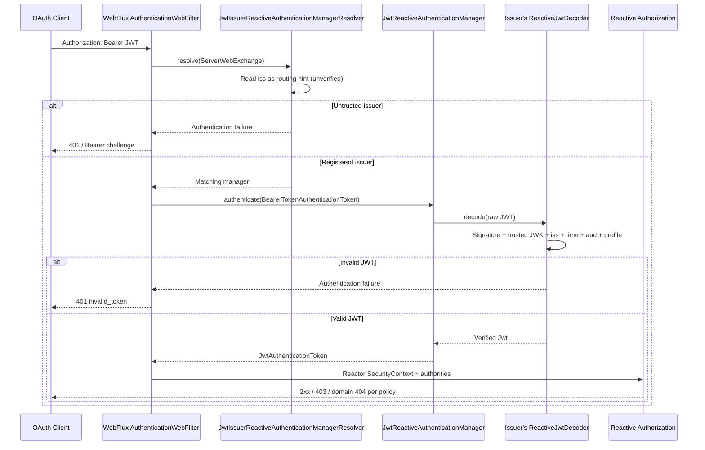

# JwtIssuerReactiveAuthenticationManagerResolver in WebFlux

## 1. Problem: a WebFlux Resource Server trusting multiple issuers

A **Spring Security OAuth 2.0/OIDC Resource Server** may serve multiple customers, organizations, or identity domains. In the simple model, every JWT access token comes from a single Authorization Server with a fixed `iss`. In a **multi-tenant** model, the API may accept JWTs from **multiple approved issuers**:

```text
Tenant A:
  iss = https://idp-a.example.test/realms/alpha
  aud = orders-api

Tenant B:
  iss = https://idp-b.example.test/realms/bravo
  aud = orders-api
```

Both tenants call the same endpoint:

```http
GET /api/orders/6a5c...
Host: api.example.test
Authorization: Bearer <access-token>
```

The API must:

1. Select the **right verification strategy** for the relevant issuer.
2. Trust only issuers in the **registered set**.
3. Verify **signature, keys, algorithms, issuer, lifetime, audience, and token profile** using the chosen issuer's decoder.
4. Convert valid tokens into an `Authentication` and authorities.
5. Prevent tenant A from accessing tenant B's data, even when both tokens carry the same scopes.

For **Spring WebFlux**, Spring Security provides:

```java
JwtIssuerReactiveAuthenticationManagerResolver
```

This resolver selects a `ReactiveAuthenticationManager` based on the JWT Bearer token's **`iss`** claim, fitting **multi-issuer JWT** scenarios.

> **Security principle:** `iss` in an unverified token **is only routing data for picking a candidate manager**. That value does not prove the issuer is trusted. The chosen manager/decoder must still verify the signature and require `iss` to match the **configured issuer** before the API treats the principal as authenticated.

## 2. Distinguishing multi-tenancy, multi-issuer, and multi-resource

Three related yet distinct concepts:

| Concept | Core question | Example |
| --- | --- | --- |
| **Multi-issuer** | Which Authorization Server issued which token? | `idp-a` and `idp-b` sign tokens using two distinct JWKS. |
| **Multi-tenant** | Which data space or organization does the principal belong to? | Tenant A's orders must never be returned to tenant B. |
| **Multi-resource** | Which API was the token issued to call? | `aud=orders-api` differs from `aud=payments-api`. |

One issuer can manage **multiple tenants**—for instance, a central realm emitting JWTs with `tenant_id`. Conversely, each tenant can have its own issuer. Therefore:

- `iss` can serve as a **lookup key for tenant configuration**, **yet is not always equal to the tenant ID**.
- `aud` is the resource identifier; never substitute `iss` for it.
- `sub` is a subject scoped to the issuer namespace; in multi-issuer setups, identify external identities by **`(verified iss, verified sub)`**, not `sub` alone.
- `scope` or `scp` typically describes functional privileges and never proves ownership or tenant membership on its own.
- `tenant_id` is usable for authorization decisions only when the **issuer contract establishes the meaning and trustworthiness** of that claim.

For example, two issuers both emitting `sub="user-42"` do not prove it is the same person. Two individuals can even share an email or display name while remaining independent principals.

## 3. Role of `JwtIssuerReactiveAuthenticationManagerResolver` in WebFlux

In Servlet, the counterpart is `JwtIssuerAuthenticationManagerResolver`, implementing `AuthenticationManagerResolver<HttpServletRequest>`. In WebFlux, the class to use is:

```java
org.springframework.security.oauth2.server.resource.authentication
    .JwtIssuerReactiveAuthenticationManagerResolver
```

It implements:

```java
ReactiveAuthenticationManagerResolver<ServerWebExchange>
```

with the core method:

```java
Mono<ReactiveAuthenticationManager> resolve(ServerWebExchange exchange);
```

A JWT manager is typically `JwtReactiveAuthenticationManager`, using a `ReactiveJwtDecoder` such as `NimbusReactiveJwtDecoder` to produce a `JwtAuthenticationToken`.

### 3.1. Authentication flow diagram



This diagram is a conceptual model. The key takeaway is that **the resolver picks the manager** while **the decoder verifies the token**. Never delegate full trust to simply reading `iss`.

### 3.2. Does the resolver do these tasks?

| Task | Guaranteed by resolver alone? | Which component is needed? |
| --- | --- | --- |
| Read issuer hint from Bearer JWT | Yes, per class mechanism. | `JwtIssuerReactiveAuthenticationManagerResolver`. |
| Check issuer belongs to allowlist | Yes when using `fromTrustedIssuers`; custom resolvers must enforce it themselves. | Trusted issuer registry/predicate. |
| Verify JWT signature and `alg` | **No**, not from manager selection alone. | `ReactiveJwtDecoder`. |
| Verify `iss` actually matches selected issuer | **Must be re-verified.** | `JwtValidators.createDefaultWithIssuer(...)` or equivalent decoder contract. |
| Check `exp` / `nbf` | Not handled by reading the routing hint. | JWT timestamp validators. |
| Check `aud=orders-api` | Not automatic in every config. | Dedicated resource audience validator. |
| Map scopes to `GrantedAuthority` | Performed by manager/converter. | `JwtAuthenticationConverter` and matching converters. |
| Check order owner/tenant | No. | Service/domain authorization and tenant-constrained queries. |

## 4. Setting up a Spring Boot WebFlux Resource Server

Gradle Groovy DSL example:

```gradle
dependencies {
    implementation("org.springframework.boot:spring-boot-starter-webflux")
    implementation("org.springframework.boot:spring-boot-starter-security")
    implementation("org.springframework.boot:spring-boot-starter-oauth2-resource-server")

    testImplementation("org.springframework.boot:spring-boot-starter-test")
    testImplementation("org.springframework.security:spring-security-test")
    testImplementation("io.projectreactor:reactor-test")
}
```

Spring Security JWT Resource Server needs the resource-server and JOSE modules; using the right Spring Boot starter arranges the related libraries via dependency management. When declaring dependencies manually, include `spring-security-oauth2-jose`.

**WebFlux note:** Do not use Servlet `HttpSecurity`, `SecurityFilterChain`, or `JwtDecoder` in these examples. WebFlux requires:

- `ServerHttpSecurity`;
- `SecurityWebFilterChain`;
- `ReactiveAuthenticationManager`;
- `ReactiveJwtDecoder`;
- `ReactiveSecurityContextHolder`.

If both `spring-boot-starter-web` and `spring-boot-starter-webflux` are present, verify which application type Boot selects. Having Reactor on the classpath **does not prove the application is running the WebFlux security chain**.

## 5. Simple configuration with a static list of trusted issuers

With Spring Security **6.2 and later**, use the factory:

```java
JwtIssuerReactiveAuthenticationManagerResolver.fromTrustedIssuers(...)
```

instead of the string/collection constructors deprecated in 6.2+. Example:

```java
import org.springframework.context.annotation.Bean;
import org.springframework.context.annotation.Configuration;
import org.springframework.security.config.annotation.web.reactive.EnableWebFluxSecurity;
import org.springframework.security.config.web.server.ServerHttpSecurity;
import org.springframework.security.oauth2.server.resource.authentication
        .JwtIssuerReactiveAuthenticationManagerResolver;
import org.springframework.security.web.server.SecurityWebFilterChain;

@Configuration
@EnableWebFluxSecurity
public class MultiIssuerSecurityConfiguration {

    @Bean
    SecurityWebFilterChain apiSecurity(ServerHttpSecurity http) {

        var resolver =
                JwtIssuerReactiveAuthenticationManagerResolver
                        .fromTrustedIssuers(
                                "https://idp-a.example.test/realms/alpha",
                                "https://idp-b.example.test/realms/bravo");

        return http
                .authorizeExchange(exchanges -> exchanges
                        .pathMatchers("/api/public/**").permitAll()
                        .pathMatchers("/api/**").authenticated()
                        .anyExchange().denyAll())
                .oauth2ResourceServer(oauth2 ->
                        oauth2.authenticationManagerResolver(resolver))
                .build();
    }
}
```

In a real API, both issuer strings must come from approved **trusted configuration** (such as deployment config or an IAM-governed registry), never from user requests.

The `/api/public/**` path is permitted at the URL layer. However, if a client **sends an invalid Bearer token**, the filter may still reject the request at authentication; `permitAll` does not mean every submitted Bearer credential is ignored.

### 5.1. What exactly does this factory do?

Per the Spring Security Reference and Javadoc, the resolver uses the trusted issuer list to choose the matching `JwtReactiveAuthenticationManager`. Manager creation and issuer initialization are **lazy**, typically occurring when the first request for that issuer arrives. This avoids requiring **every** Authorization Server to be online simultaneously at startup.

Example:

```text
Application startup:
  trustedIssuers = [A, B]
  No JWT processed yet.

First request from A:
  Match A in trusted allowlist.
  Initialize/lookup decoder and manager for A.
  Verify JWT with A's issuer/JWKS.

First request from B:
  Match B.
  Initialize/lookup decoder and manager for B.
  Verify JWT with B's issuer/JWKS.
```

**Lazy does not mean zero network dependency.** If issuer A's discovery/JWKS fails when A's first request arrives, that request can fail. Design readiness, latency budgets, monitoring, and key caching with this in mind.

### 5.2. API versions

| Spring Security | Compatibility notes |
| --- | --- |
| **5.3–6.1** | `JwtIssuerReactiveAuthenticationManagerResolver` exists since 5.3; historical APIs offer constructors taking trusted issuers. |
| **6.2+** | Static factories `fromTrustedIssuers(String...)`, `fromTrustedIssuers(Collection)`, and `fromTrustedIssuers(Predicate)` added. |
| **6.2–6.5** | String/collection constructors marked deprecated; factories recommended. |
| **7.x** | `fromTrustedIssuers` factories remain documented; constructor taking a custom issuer resolver continues to support custom manager creation. |

If your IDE says `fromTrustedIssuers` is missing on Spring Security 6.1, that is a **version difference**, not necessarily a wrong import. Do not randomly pull a Spring Security 7.x JAR into a 6.1-managed app just for the new API; use the matching constructor for your version or upgrade your dependency set consistently.

## 6. Why is the unverified `iss` claim still read?

The resolver needs to know **which manager** should verify the JWT. Yet verifying the signature requires knowing the issuer's public keys/JWKS. Therefore, the manager-selection step may read `iss` from the **unverified payload**.

For example, an attacker can craft a payload:

```json
{
  "iss": "https://idp-a.example.test/realms/alpha",
  "sub": "ceo",
  "aud": ["orders-api"],
  "scope": "orders:admin",
  "exp": 1893456000
}
```

Having the right `iss` in the payload **does not prove** issuer A signed the token. If the signature is invalid against A's key, A's `ReactiveJwtDecoder` must reject it.

This is the distinction between:

```text
unverified iss  →  SELECT candidate manager

verified iss + valid JWS + passing validators  →  TRUST identity/claims
```

### 6.1. Dangerous pattern: building a decoder for any URL in a token

Do not do this:

```java
// WRONG: issuerUri is extracted from an unverified JWT payload.
String issuerUri = parseUnverifiedIssuer(rawToken);

ReactiveJwtDecoder decoder =
        ReactiveJwtDecoders.fromIssuerLocation(issuerUri);
```

This can:

- Trigger HTTP discovery to an attacker-controlled domain (**SSRF**).
- Cause the API to trust unauthorized public keys/JWKS.
- Exhaust resources across unbounded distinct issuers.
- Accept access tokens from an AS never approved by the organization.

Specifically, **an attacker can stand up their own Authorization Server and sign completely valid JWTs for their server**. A JWT signature valid under *the attacker's* key is no reason for the API to trust that issuer.

### 6.2. Safe pattern

```text
Bearer token
  → read iss as routing hint
  → check exact match in trusted issuer registry
  → retrieve registered manager/decoder for that issuer
  → verify JWS against trusted keys
  → check iss, aud, exp, nbf, token type
  → create Authentication only when everything passes
```

**Never use prefix matching** such as `issuer.startsWith("https://idp.example.test")` because `https://idp.example.test.attacker.test` slips past. Use **full, exact issuer identifiers** with canonical values confirmed from AS metadata and agreed upon by the application.

## 7. Limits of the default factory: per-issuer audience and policy

`fromTrustedIssuers` works well when issuers are approved and default token verification meets requirements. Often, however, a Resource Server has specific demands:

- Every JWT must have `aud=orders-api`.
- Issuer A emits string `scope`, while issuer B emits list `scp`.
- Each issuer enforces its own JWS algorithm/key policy.
- Some issuers may only call `/api/read-only/**`.
- Tenant mappings and role grants differ.
- Access tokens must conform to **RFC 9068** or an agreed token profile.

When issuers need different validators or converters, **build and manage dedicated managers** and pass a trusted repository to the resolver.

## 8. Building a registry of per-issuer `ReactiveAuthenticationManager`s

A transparent design maps:

```text
issuer A -> JwtReactiveAuthenticationManager(decoder A)
issuer B -> JwtReactiveAuthenticationManager(decoder B)
```

With decoders:

```text
decoder A:
  trusted JWKS A
  expected iss A
  expected aud orders-api

decoder B:
  trusted JWKS B
  expected iss B
  expected aud orders-api
```

### 8.1. Trusted configuration DTO

```java
public record TrustedIssuer(
        String issuer,
        String jwksUri,
        String audience) {
}
```

`TrustedIssuer` is simply an application-defined domain/config record. Its values must come from **approved deployment configuration** or a protected tenant registry—never from unverified Bearer JWTs.

### 8.2. Building a JWT manager with issuer and audience validators

```java
import org.springframework.security.authentication.ReactiveAuthenticationManager;
import org.springframework.security.oauth2.core.DelegatingOAuth2TokenValidator;
import org.springframework.security.oauth2.core.OAuth2Error;
import org.springframework.security.oauth2.core.OAuth2TokenValidator;
import org.springframework.security.oauth2.core.OAuth2TokenValidatorResult;
import org.springframework.security.oauth2.jwt.Jwt;
import org.springframework.security.oauth2.jwt.JwtValidators;
import org.springframework.security.oauth2.jwt.NimbusReactiveJwtDecoder;
import org.springframework.security.oauth2.server.resource.authentication
        .JwtReactiveAuthenticationManager;

public final class TrustedJwtManagerFactory {

    private TrustedJwtManagerFactory() {
    }

    public static ReactiveAuthenticationManager create(
            TrustedIssuer settings) {

        NimbusReactiveJwtDecoder decoder =
                NimbusReactiveJwtDecoder
                        .withJwkSetUri(settings.jwksUri())
                        .build();

        OAuth2TokenValidator<Jwt> defaults =
                JwtValidators.createDefaultWithIssuer(settings.issuer());

        OAuth2TokenValidator<Jwt> audience = jwt ->
                jwt.getAudience().contains(settings.audience())
                        ? OAuth2TokenValidatorResult.success()
                        : OAuth2TokenValidatorResult.failure(
                                new OAuth2Error(
                                        "invalid_token",
                                        "Access token not accepted for this API",
                                        null));

        decoder.setJwtValidator(
                new DelegatingOAuth2TokenValidator<>(
                        defaults,
                        audience));

        return new JwtReactiveAuthenticationManager(decoder);
    }
}
```

Key takeaways:

- `withJwkSetUri(...)` sets the **trusted public key source** approved for the issuer.
- `JwtValidators.createDefaultWithIssuer(...)` preserves default claim checks (typically including `exp`/`nbf`) and **issuer validation**.
- The audience validator requires the JWT to target the right resource.
- `DelegatingOAuth2TokenValidator` composes rules; `setJwtValidator(...)` **replaces the current validator**. Passing only the audience validator risks losing default and issuer checks.
- `JwtReactiveAuthenticationManager` receives the decoded `Jwt` and creates a `JwtAuthenticationToken`; authority converters can be customized per issuer when needed.

**Not every decoder config automatically satisfies RFC 9068/token type, `client_id`, or tenant policies.** When the API requires them, add policies matching your Spring Security version and issuer contract.

### 8.3. Registry backed by an immutable Map

```java
import java.util.Map;
import org.springframework.context.annotation.Bean;
import org.springframework.context.annotation.Configuration;
import org.springframework.security.authentication.ReactiveAuthenticationManager;
import org.springframework.security.authentication
        .ReactiveAuthenticationManagerResolver;
import org.springframework.security.oauth2.server.resource.authentication
        .JwtIssuerReactiveAuthenticationManagerResolver;
import org.springframework.web.server.ServerWebExchange;
import reactor.core.publisher.Mono;

@Configuration
public class IssuerManagerRegistryConfiguration {

    @Bean
    JwtIssuerReactiveAuthenticationManagerResolver jwtIssuerResolver() {

        var alpha = new TrustedIssuer(
                "https://idp-a.example.test/realms/alpha",
                "https://idp-a.example.test/realms/alpha/certs",
                "orders-api");

        var bravo = new TrustedIssuer(
                "https://idp-b.example.test/realms/bravo",
                "https://idp-b.example.test/realms/bravo/certs",
                "orders-api");

        Map<String, ReactiveAuthenticationManager> managers = Map.of(
                alpha.issuer(), TrustedJwtManagerFactory.create(alpha),
                bravo.issuer(), TrustedJwtManagerFactory.create(bravo));

        ReactiveAuthenticationManagerResolver<String> byIssuer =
                issuer -> Mono.justOrEmpty(managers.get(issuer));

        return new JwtIssuerReactiveAuthenticationManagerResolver(
                byIssuer);
    }

    @Bean
    SecurityWebFilterChain apiSecurity(
            ServerHttpSecurity http,
            JwtIssuerReactiveAuthenticationManagerResolver jwtIssuerResolver) {
        return http
                .authorizeExchange(exchanges -> exchanges
                        .pathMatchers("/api/**").authenticated()
                        .anyExchange().denyAll())
                .oauth2ResourceServer(oauth2 ->
                        oauth2.authenticationManagerResolver(
                                jwtIssuerResolver))
                .build();
    }
}
```

This illustrates the configuration level, assuming the Spring imports from section 5 (such as `ServerHttpSecurity` and `SecurityWebFilterChain`). In a real project, move these URIs into **trusted application properties** or a protected registry. Never feed token-derived issuer/JWKS URIs into `new TrustedIssuer(...)`.

Each map key is an approved issuer, so `managers.get(issuer)` returns a manager only on an exact match. For issuers absent from the map, `Mono.justOrEmpty(...)` yields no manager. The framework handles the unresolved issuer; if policy wants a clearer authentication error, return a sanitized `Mono.error(...)` instead of adding a new issuer.

### 8.4. Why not share one decoder across all issuers?

When issuers have distinct JWKS or policies, a single decoder using the **union of all public keys** without strict issuer binding invites **cross-issuer token substitution**. Separating decoders/managers ensures:

- Key A verifies only issuer A's tokens per contract.
- Key B verifies only issuer B's tokens per contract.
- Each decoder validates its own `iss` and audience.
- Each policy can map scopes/roles per issuer.

Never trust token B just because its signature matches a public key in a global key pool if the token fails issuer/resource policy.

## 9. Multiple issuers on the same endpoint: choosing an authorization policy

After authentication, the API may see:

```text
Tenant A JWT -> authorities [SCOPE_orders:read]
Tenant B JWT -> authorities [SCOPE_orders:read]
```

Sharing `SCOPE_orders:read` only proves **both are allowed to invoke the read operation** per contract. It does not prove tenant A may read tenant B's records.

Separate:

```text
Authentication:
  Valid JWT + trusted iss + valid aud + valid exp/nbf

Functional authorization:
  Has SCOPE_orders:read

Data authorization:
  Which tenant does the internal actor belong to?
  Which orderIds is that tenant allowed to access?
  Do owner/membership/business rules pass?
```

### 9.1. Do not map a tenant claim to permissions without a contract

Example token:

```json
{
  "iss": "https://idp-a.example.test/realms/alpha",
  "sub": "user-42",
  "aud": ["orders-api"],
  "scope": "orders:read",
  "tenant_id": "tenant-a"
}
```

The `tenant_id` claim is trustworthy only if:

1. The token was verified under issuer A.
2. Issuer A guarantees the semantics and data type of `tenant_id`.
3. The API has an approved mapping between the external tenant and an **internal tenant**.
4. Membership, ownership, and actor lifecycle are checked where policy requires.

Never let an HTTP client send `X-Tenant-ID: tenant-b` and use it in place of verified tenant context. If the API lets a user switch among multiple memberships, **verify the user's membership** in that tenant rather than trusting a header as proof.

## 10. Reading the verified identity in WebFlux

Controller with JWT principal:

```java
import org.springframework.security.core.annotation.AuthenticationPrincipal;
import org.springframework.security.oauth2.jwt.Jwt;
import org.springframework.web.bind.annotation.GetMapping;
import org.springframework.web.bind.annotation.RestController;
import reactor.core.publisher.Mono;

@RestController
public class WhoAmIController {

    @GetMapping("/api/me")
    public Mono<SubjectInfo> me(@AuthenticationPrincipal Jwt jwt) {
        if (jwt.getIssuer() == null
                || jwt.getSubject() == null
                || jwt.getSubject().isBlank()) {
            return Mono.error(new IllegalStateException(
                    "Authenticated JWT is missing required identity"));
        }

        return Mono.just(new SubjectInfo(
                jwt.getIssuer().toString(),
                jwt.getSubject()));
    }

    public record SubjectInfo(String issuer, String subject) {
    }
}
```

This is an **illustrative academic example** showing how to read `iss` and `sub` post-decoding. Production responses must follow privacy contracts; never blindly expose all JWT claims or tenant details. If token profiles include service actors without `sub` in that format, design a dedicated `CurrentActor` abstraction for that actor type.

### 10.1. `ReactiveSecurityContextHolder`

In reactive services, read `Authentication` from the Reactor Context:

```java
public Mono<Jwt> currentJwt() {
    return ReactiveSecurityContextHolder.getContext()
            .map(SecurityContext::getAuthentication)
            .flatMap(authentication -> {
                if (authentication instanceof JwtAuthenticationToken jwtAuth) {
                    return Mono.just(jwtAuth.getToken());
                }
                return Mono.empty();
            });
}
```

When the principal type is unexpected, security-sensitive code must **fail cleanly**, never quietly falling back to a default "system admin" actor. `Mono.empty()` here is just an illustrative signal; production code needs an explicit contract for absent or unsupported principals.

**Never rely on Servlet's ThreadLocal `SecurityContextHolder` as the primary source in WebFlux**: reactive pipelines switch threads. Never spawn detached subscriptions with `subscribe()` expecting the security or request context to follow automatically.

## 11. Mapping external identities to internal actors and tenants

An illustrative SQL schema:

```sql
CREATE TABLE app_user (
    id UUID PRIMARY KEY,
    display_name VARCHAR(200)
);

CREATE TABLE external_identity (
    issuer VARCHAR(512) NOT NULL,
    subject VARCHAR(512) NOT NULL,
    app_user_id UUID NOT NULL REFERENCES app_user(id),
    PRIMARY KEY (issuer, subject)
);

CREATE TABLE tenant_membership (
    app_user_id UUID NOT NULL REFERENCES app_user(id),
    tenant_id UUID NOT NULL,
    membership_status VARCHAR(40) NOT NULL,
    PRIMARY KEY (app_user_id, tenant_id)
);

CREATE TABLE orders (
    id UUID PRIMARY KEY,
    tenant_id UUID NOT NULL,
    owner_user_id UUID NOT NULL REFERENCES app_user(id)
);
```

This schema is purely a SQL example; constraints, indexes, and multi-tenant partitioning must fit your real database.

**Why `PRIMARY KEY (issuer, subject)`?** Subjects are scoped to the issuer's namespace. `sub=user-42` from issuer A and `sub=user-42` from issuer B must never be merged automatically.

Reactive service example:

```java
@Service
public class OrderApplicationService {

    private final ReactiveCurrentActorService actorService;
    private final ReactiveOrderRepository orderRepository;

    public OrderApplicationService(
            ReactiveCurrentActorService actorService,
            ReactiveOrderRepository orderRepository) {
        this.actorService = actorService;
        this.orderRepository = orderRepository;
    }

    public Mono<OrderDto> readOwnOrder(UUID orderId) {
        return actorService.requireCurrentActor()
                .flatMap(actor -> orderRepository
                        .findByIdAndOwnerUserIdAndTenantId(
                                orderId,
                                actor.userId(),
                                actor.tenantId()))
                .switchIfEmpty(Mono.error(
                        new OrderNotFoundException(orderId)))
                .map(OrderDto::from);
    }
}
```

`ReactiveCurrentActorService`, `ReactiveOrderRepository`, `OrderDto`, and the exception are **application-implemented domain abstractions**. Crucially, the repository **filters by `orderId`, internal user, and tenant in the same query**, avoiding loading another tenant's record and hiding it afterward.

If the feature lets any member in a tenant read orders, the owner predicate changes per policy. Still, **every variant must enforce the tenant boundary**.

## 12. Distinguishing issuer trust from API usage permissions

An issuer on the allowlist only means the API **can verify tokens issued by that issuer**. It does not prove:

- The token was issued for `orders-api`.
- The token's OAuth client is allowed to call the endpoint.
- The principal holds `SCOPE_orders:read`.
- The principal holds membership in the requested tenant.
- The principal may access that specific order.
- The JWT is the right access token type (not an OIDC ID token).

Example security rule:

```java
return http
        .authorizeExchange(exchanges -> exchanges
                .pathMatchers(HttpMethod.GET, "/api/orders/**")
                    .hasAuthority("SCOPE_orders:read")
                .pathMatchers(HttpMethod.POST, "/api/orders/**")
                    .hasAuthority("SCOPE_orders:write")
                .anyExchange().authenticated())
        .oauth2ResourceServer(oauth2 ->
                oauth2.authenticationManagerResolver(jwtIssuerResolver))
        .build();
```

`hasAuthority(...)` runs **after authentication**. Method security or service policies must still protect owner/tenant queries.

### 12.1. Roles and scopes follow different conventions

In standard Spring Security JWT Resource Servers, a scope:

```json
{"scope": "orders:read orders:write"}
```

is typically mapped to:

```text
SCOPE_orders:read
SCOPE_orders:write
```

`hasRole("ADMIN")` checks for `ROLE_ADMIN`, not `SCOPE_orders:read`. When two issuers emit different `roles` claims, create an **issuer-specific converter/policy** instead of combining all role claims into global permissions.

### 12.2. Exact audience contracts

Under JWT, `aud` can be a string or an array. Spring's `Jwt.getAudience()` returns a list convenient for exact membership checks. Never check via substring:

```java
// WRONG: "orders-api-admin" can falsely match.
boolean accepted = jwt.getClaims()
        .get("aud").toString().contains("orders-api");
```

Use:

```java
boolean accepted = jwt.getAudience().contains("orders-api");
```

If an issuer uses a different resource identifier, configure that issuer's expected audience per contract instead of loosening checks with wildcards.

## 13. Dynamic tenants: adding issuers without restarting

A SaaS system may onboard new tenants at runtime. Spring Security supports a constructor accepting a **`ReactiveAuthenticationManagerResolver<String>`** to resolve managers by issuer:

```java
JwtIssuerReactiveAuthenticationManagerResolver resolver =
        new JwtIssuerReactiveAuthenticationManagerResolver(
                issuer -> Mono.justOrEmpty(managers.get(issuer)));
```

When `managers` is a registry holding only approved issuers, the application can add or remove entries through a **secure administrative workflow**.

### 13.1. Never auto-onboard from Bearer requests

Critical mistake:

```java
// WRONG: an issuer from an unverified token is added directly.
return issuer -> Mono.just(
        new JwtReactiveAuthenticationManager(
                ReactiveJwtDecoders.fromIssuerLocation(issuer)));
```

An attacker can specify their own host and make the API fetch their metadata/JWKS, continuously allocate new managers, or accept tokens outside the trust boundary.

**Issuer onboarding must be a control-plane operation**, isolated from user HTTP requests on the data plane.

### 13.2. Thread-safe registry and configuration identity

Skeleton example:

```java
import java.util.concurrent.ConcurrentHashMap;
import java.util.concurrent.ConcurrentMap;
import org.springframework.security.authentication.ReactiveAuthenticationManager;
import org.springframework.security.oauth2.server.resource.authentication
        .JwtIssuerReactiveAuthenticationManagerResolver;
import reactor.core.publisher.Mono;

public final class TrustedTenantManagerRegistry {

    private final ConcurrentMap<String, ReactiveAuthenticationManager>
            managers = new ConcurrentHashMap<>();

    public JwtIssuerReactiveAuthenticationManagerResolver resolver() {
        return new JwtIssuerReactiveAuthenticationManagerResolver(
                issuer -> Mono.justOrEmpty(managers.get(issuer)));
    }

    public void registerApprovedIssuer(
            TrustedIssuer reviewedSettings,
            ReactiveAuthenticationManager prebuiltManager) {
        // Only an authorized control plane may call this method.
        if (reviewedSettings == null || prebuiltManager == null) {
            throw new IllegalArgumentException("Missing approved registration");
        }
        managers.put(reviewedSettings.issuer(), prebuiltManager);
    }

    public void revokeApprovedIssuer(String issuer) {
        managers.remove(issuer);
    }
}
```

This is a **design skeleton**, not a public registration API or a complete security solution. External responsibilities include:

- Authenticating and authorizing issuer registration operations.
- Verifying the issuer belongs to an organization-approved tenant catalog.
- Validating HTTPS and trust anchors on issuer and JWKS URIs, never using attacker-selected URLs.
- Performing metadata discovery and key checks outside user HTTP requests, with timeouts and SSRF defenses.
- Testing new managers/decoders with valid test tokens before activation.
- Confirming resource audiences, algorithm/token profiles, scopes, and tenant mappings.
- Auditing registry versions and approvers.
- Synchronizing the registry across applications/pods, tracking versions and states.
- Handling old issuer revocation, cache/key lifecycles, and in-flight requests cleanly.

**`ConcurrentHashMap` only handles concurrent access inside one JVM**, not distributed registry consistency or tenant authentication.

### 13.3. Atomic publication and onboarding workflow

A safe sequence:

1. Administrator registers issuer B in the tenant management system.
2. Control plane verifies issuer B's approval, URLs/TLS, metadata/JWKS, audience, profile, and policies.
3. Build `ReactiveJwtDecoder`/`JwtReactiveAuthenticationManager` for B from trusted settings.
4. Run tests/health checks and verify B cannot exceed contracted privileges.
5. Publish manager B into each pod's registry with versioning and auditing.
6. Begin accepting B tokens on the request path.

Never publish a manager before approval hoping claim validation will "catch any issues later."

### 13.4. Revoking trust in an issuer

When a tenant is offboarded or an issuer is compromised:

- Block new requests for that issuer in the registry.
- Account for in-flight requests and cached token authentications.
- Revoke domain permissions/memberships and sessions/refresh tokens as appropriate.
- Check caches and downstream services retaining permissions for that issuer.
- Audit the issuer removal and retain investigation records per retention policy.

Removing a map entry does not automatically cancel transactions or background jobs already started. You need a **system-wide revocation policy**.

## 14. Lazy issuer discovery and availability

The `fromTrustedIssuers(...)` factory initializes each issuer's manager the first time that issuer appears. This is a major benefit:

```text
Startup does not require A, B, and C to all be online.
First A request may require A's issuer metadata/JWKS.
First B request may require B's issuer metadata/JWKS.
Subsequent requests reuse the created cache/manager.
```

Design considerations:

| Scenario | Impact | Management |
| --- | --- | --- |
| Issuer A offline at startup | Application can still start. | Measure readiness per tenant if required by SLA. |
| Issuer A offline on first request | A's authentication may fail or lag. | Timeouts, error classification, bounded retries. |
| JWKS A rotates `kid` | Decoder needs new public key from trusted source. | Key rotation runbooks and cache management. |
| Misconfigured metadata | Manager fails to build or verify. | Onboarding checks, registry config rollback. |
| Many tenants hit cold-start simultaneously | Discovery/cache init spikes load. | Controlled warm-up, concurrency caps, monitoring. |
| One issuer has an outage | Only that tenant is impacted. | Never accept unverified JWTs; isolate blast radius. |

**Lazy startup does not mean token verification needs no network.** JWT signature verification runs locally once trusted keys are cached, yet cache misses and rotations still need JWKS access.

### 14.1. Never fail open when JWKS errors

Do not do this:

```java
// WRONG: builds unverified auth when JWK fetch fails.
return jwtDecoder.decode(rawToken)
        .onErrorResume(error -> Mono.just(
                unverifiedJwtFromPayload(rawToken)));
```

Network errors never justify skipping signatures. When a token cannot be verified, the Resource Server must **fail closed** while classifying dependency errors for operations.

### 14.2. Egress and SSRF

Even when issuers are allowlisted, protect outbound HTTP calls to metadata/JWKS:

- Allow only approved HTTPS endpoints.
- Validate redirects, proxies, and TLS trust.
- Restrict hosts, ports, and routing per infrastructure config.
- Never let `jku`/`x5u` token headers dictate key sources.
- Enforce timeouts, connection limits, and payload size caps.
- Monitor unexpected changes in metadata URLs.

A misconfigured trusted issuer registration can still risk internal network connections, so onboarding must inspect actual URLs.

## 15. Per-issuer policies: validators and authorities

When issuers A and B differ in token profiles, dedicated managers let you enforce:

1. **Exact audience** per issuer.
2. **Allowed algorithms/JWKS** per issuer.
3. **Issuer validation** in the decoder.
4. **Token profile**: access token, `typ` (if required), `client_id`, `exp`, and mandatory claims.
5. **Authority converter** per scope/role claim contract.
6. **Tenant authorization** on the internal actor.

Example:

```text
Issuer A:
  scope claim = "orders:read orders:write"
  role semantics = none
  audience = "orders-api"

Issuer B:
  scp claim = ["orders.read", "orders.export"]
  role semantics = "org_admin" in namespace B
  audience = "https://api.example.test/orders"
```

Never treat B's `orders.read` as identical to A's `orders:read` without a **mapping contract**. When normalization is required, implement it in a dedicated converter with allowlists and regression tests.

### 15.1. Custom JWT converter per manager

Concept:

```java
JwtReactiveAuthenticationManager manager =
        new JwtReactiveAuthenticationManager(decoderForAlpha);

manager.setJwtAuthenticationConverter(converterForAlpha);
```

`converterForAlpha` must be a `Converter<Jwt, Mono<AbstractAuthenticationToken>>` per the manager API. If starting from a synchronous `JwtAuthenticationConverter`, you can wrap it with `ReactiveJwtAuthenticationConverterAdapter` where appropriate, while never running blocking JDBC or HTTP calls on the event loop inside the converter.

**Never map a `roles=["ADMIN"]` claim into a system-wide `ROLE_ADMIN`** just because it appears in the token. Privilege grants must follow the issuer, API, and tenant contracts.

### 15.2. Token types and OIDC ID tokens

An OIDC **ID token** may be signed by the same key set as an OAuth access token. ID tokens belong to the **OIDC client**, whereas a Resource Server must accept **access tokens with the matching audience/resource contract**.

Checking only signature and `iss` invites token confusion. Require:

- `aud` matching the API/resource.
- Matching token profile/`typ` if the issuer applies RFC 9068 or a custom profile.
- Mandatory claims per contract.
- Scopes and authorization for the API, never treating OIDC userinfo claims as permissions.

## 16. One API serving both human and machine clients

One issuer may mint JWTs via Authorization Code + PKCE for human users and tokens via **Client Credentials** for workloads.

| Attribute | Human token | Machine token |
| --- | --- | --- |
| Principal | User subject, issuer, membership. | Client/workload identity per grant contract. |
| Permissions | Scopes and user/tenant/owner policies. | Service-scoped permissions, allowed jobs/tasks. |
| Identity data | `sub`, agreed claims. | `client_id` and subject per token profile. |
| Common mistake | Using email/name as user ID. | Assuming machines have emails/user profiles. |

`JwtIssuerReactiveAuthenticationManagerResolver` **does not distinguish human from machine actors**. After authenticating the issuer and token, resource authorization must handle the appropriate actor type.

Do not apply an `email_verified`-based policy to a Client Credentials token when the contract omits email. Conversely, do not let a machine client read user-owned orders simply because it holds broad scopes.

## 17. Multi-issuer does not mean multi-tenant isolation

A common architectural flaw:

```java
@GetMapping("/api/orders/{id}")
public Mono<OrderDto> get(@PathVariable UUID id) {
    return orderRepository.findById(id).map(OrderDto::from);
}
```

Assuming URL authorization requires only `SCOPE_orders:read`, a user in tenant A guessing an `id` from tenant B can fetch B's data if the repository omits tenant constraints.

Design **tenant context from the verified principal**:

```text
Verified JWT (iss, sub, tenant claims)
  → External identity mapping
  → Internal actor + active tenant memberships
  → Scope/domain policy
  → Query where tenant_id = approvedInternalTenantId
  → Result
```

Never use unverified email, username, or `X-Tenant-ID` headers as the primary data-partitioning source.

### 17.1. One issuer managing multiple tenants

If issuer A issues JWTs for both `tenant-a` and `tenant-b`, the resolver picks **the same manager A**. To isolate data, the API also needs:

- An issuer-guaranteed tenant claim or tenant selection checked against membership.
- Mapping from external tenant to internal tenant.
- Owner/organization binding policies.
- Query filters or database row-level security by design.

If a user has rights in both tenants, switching tenants must be a verified action rather than merely changing a path parameter.

### 17.2. One tenant using multiple issuers

During an IdP migration, tenant A might trust both an old and a new issuer. Then the mapping:

```text
(iss-old, sub-old) ──┐
                    ├──> internal user id
(iss-new, sub-new) ──┘
```

must go through a **verified account-linking workflow**, never auto-merging accounts by display email or coincidental subject matches. Trusting two issuers never implies accounts sharing an email represent the same principal.

## 18. Difference from OAuth2/OIDC Login

The term "OIDC" appears frequently in multi-tenant architectures, yet **Resource Server JWT validation** differs from **OIDC client login**:

| Scenario | Primary component | How is the token used? |
| --- | --- | --- |
| Web app logging users in via OIDC | `oauth2Login()` / reactive OIDC client | ID token and authorization code drive client authentication flows. |
| WebFlux API accepting Bearer access tokens | `oauth2ResourceServer()` | API verifies access tokens targeting the resource. |
| API accepting access tokens from multiple JWT issuers | `JwtIssuerReactiveAuthenticationManagerResolver` | Selects manager by issuer and validates full JWT. |
| API accepting opaque tokens | `ReactiveOpaqueTokenIntrospector` | Calls AS per introspection contract instead of JWS issuer resolver. |

A validly signed ID token **must not be treated as an API access token** just because its issuer is on the trusted list.

## 19. Does this resolver support opaque tokens?

`JwtIssuerReactiveAuthenticationManagerResolver` reads `iss` from a **signed JWT (JWS)** per contract. With an opaque token such as:

```text
8NsP2s0Y43randomopaque
```

there is no JWT payload for the resolver to safely read an issuer from. For OAuth 2.0 Token Introspection:

```java
ReactiveOpaqueTokenIntrospector
OpaqueTokenReactiveAuthenticationManager
```

are the right components. If JWT and opaque tokens must coexist, build a **controlled alternative routing model**—for instance by endpoint or configured client registration/trust boundary—never guessing token types by counting dots.

**Never write a fallback like:**

```java
// WRONG: JWT failed → try opaque under a different policy.
return jwtManager.authenticate(authentication)
        .onErrorResume(error ->
                opaqueManager.authenticate(authentication));
```

This risks token confusion or accepting a token with the wrong audience on the fallback path. Allow both mechanisms only with clear rules for issuer source, routes, audiences, and negative tests.

## 20. HTTP 401, 403, and per-tenant dependency failures

| Scenario | Authentication | Typical HTTP outcome |
| --- | --- | --- |
| No Bearer token on protected endpoint | Missing credential. | **401 Unauthorized**, Bearer challenge. |
| Malformed JWT or unresolvable `iss` | Cannot pick a trusted manager. | **401 invalid_token** or appropriate Bearer error. |
| JWT `iss` absent from allowlist | Resolver rejects. | **401**. |
| Trusted `iss` but invalid signature | Decoder rejects. | **401 invalid_token**. |
| Issuer A JWT with `aud=payments-api` | Audience validation rejects. | **401 invalid_token**. |
| Valid issuer/audience, past `exp` | Timestamp validator rejects. | **401 invalid_token**. |
| Valid JWT missing `SCOPE_orders:read` | Authentication succeeds, authorization denies. | **403 Forbidden**, possibly `insufficient_scope`. |
| Valid JWT with scope, order in another tenant | Domain authorization denies. | **403** or **404** per API contract. |
| Issuer discovery/JWKS temporarily unreachable | Cannot verify token. | Fail closed; status may be 401/5xx/503 per exception handling. |
| Tenant recently offboarded | Issuer/tenant registry denies per policy. | 401 or 403 depending on authn/authz boundary. |

Typical response:

```http
HTTP/1.1 401 Unauthorized
WWW-Authenticate: Bearer error="invalid_token"
```

or:

```http
HTTP/1.1 403 Forbidden
WWW-Authenticate: Bearer error="insufficient_scope"
```

These illustrate the protocol; actual Spring handlers may differ in `realm`, `error_description`, or whether a domain-policy `403` includes a challenge. Never return raw JWTs, `Authorization` headers, trusted issuer/JWKS lists, or internal tenant details to clients.

### 20.1. Never turn key/discovery failures into access

If issuer A is unavailable:

- Never pick issuer B just because B is healthy.
- Never verify A's JWT using B's JWKs.
- Never use `onErrorResume(... -> Mono.just(adminAuthentication))`.
- Never extract a username from an unverified payload.
- Never remove issuer/audience validators to "stop the 401s."

When verification is impossible, **create no authenticated principal**. Operators may classify dependency errors, improve observability, or use trusted key caches where appropriate, without failing open.

## 21. Testing the factory with a trusted issuer allowlist

To prove security, do not test only "JWT from A works." Test **bad signatures, unknown issuers, wrong audiences, and cross-tenant access**.

### 21.1. Negative test matrix

| Input | Resolver | Decoder/policy | Expected |
| --- | --- | --- | --- |
| Valid JWT A, scope `orders:read` | Picks A | JWS/iss/aud/time all pass | Authenticates; allowed if domain policy passes. |
| Valid JWT B, scope `orders:read` | Picks B | JWS/iss/aud/time all pass | Authenticates; only B data per policy. |
| Unregistered issuer C JWT | No trusted manager | Never fetches C metadata | 401; no manager C created. |
| JWT payload claims `iss=A` signed with key B | Picks A from hint | A's key check fails | 401. |
| JWT signed with key A claiming `iss=B` | Picks B from hint | B's key/issuer policy fails | 401. |
| Validly signed JWT A with `aud=payments-api` | Picks A | Audience validator rejects | 401. |
| Expired JWT A | Picks A | Timestamp validator rejects | 401. |
| JWT A before `nbf` | Picks A | Timestamp validator rejects | 401. |
| Valid JWT A missing scope | Picks A | Authentication may succeed | Endpoint 403. |
| Valid JWT A with scope querying B's order | Picks A | Domain/tenant policy denies | 403/404. |
| ID token A sent to API | May pick A by issuer | Audience/type/profile validator rejects | 401. |
| Opaque token sent to JWT-only route | Cannot parse JWS issuer | No opaque fallback | 401. |
| A's JWKS unavailable on cache miss | Picks A, decoder cannot verify | Dependency failure | Fail closed, no Authentication created. |

Tests 4 and 5 are critical: **issuer hints never determine authenticity**. Only a manager with trusted keys and matching validators may produce a principal.

### 21.2. Testing that unverified `iss` is never trusted

A safe test scenario:

1. Build a JWS with payload `iss=A` signed using a private key **not belonging to A**.
2. Send it through the WebFlux Resource Server configured with `fromTrustedIssuers(A, B)`.
3. Assert HTTP 401 and zero access to domain services.
4. Confirm the resolver never fetches JWKS from an arbitrary URL inside the JWT.
5. Repeat with unregistered `iss=C`, asserting C is rejected **before** the API constructs any manager for C.

Use only test-environment private keys and simulated issuer endpoints.

## 22. Testing with `WebTestClient`: mock authorization vs. real decoder

In WebFlux, Spring Security Test offers `mockJwt()` to simulate an authenticated JWT:

```java
import static org.springframework.security.test.web.reactive.server
        .SecurityMockServerConfigurers.mockJwt;

import org.springframework.security.core.authority.SimpleGrantedAuthority;

webTestClient.mutateWith(
        mockJwt().authorities(
                new SimpleGrantedAuthority("SCOPE_orders:read")))
        .get()
        .uri("/api/orders")
        .exchange()
        .expectStatus().isOk();

webTestClient.mutateWith(
        mockJwt().authorities(
                new SimpleGrantedAuthority("SCOPE_orders:write")))
        .get()
        .uri("/api/orders")
        .exchange()
        .expectStatus().isForbidden();
```

Prerequisite: `WebTestClient` must be configured with Spring Security Test properly, and the mock endpoint returns success when authorized. `mockJwt()` is great for testing **authorization**, yet it **does not prove**:

- The resolver read issuer A/B.
- `ReactiveJwtDecoder` selected the right JWKS.
- The signature was verified.
- Issuer/audience/expiry validators ran.
- Tenant isolation actually works.

### 22.1. Full integration tests must use test-signed JWTs

A proper integration test suite for this lesson:

1. Generates **two separate key pairs** for test issuers A and B.
2. Configures mock issuer metadata/JWKS endpoints for A/B or dedicated decoders registered with trusted test public keys.
3. Mints signed JWTs A and B with matching issuers, audiences, scopes, and `exp`.
4. Uses `WebTestClient` to send **HTTP `Authorization: Bearer <signed-test-JWS>`**, without `mockJwt()`.
5. Asserts A selects the right manager and never verifies with B's public key.
6. Asserts unknown-issuer C JWTs are rejected without triggering dynamic registration.
7. Asserts invalid signature, audience, issuer, or expiry/nbf all return 401.
8. Asserts valid JWTs missing required scopes return 403.
9. Asserts A cannot read B's order even with the right scope.
10. Confirms responses and logs contain no raw tokens or internal JWKS secrets.

These tests can use `@SpringBootTest`, `WebTestClient`, and a mock HTTP server like WireMock/MockWebServer for issuer metadata. **This is a test-design guide, not a claim that tests were run here.**

### 22.2. Testing with `StepVerifier`

When testing a manager/decoder in isolation:

```java
Mono<Authentication> authentication =
        managerA.authenticate(
                new BearerTokenAuthenticationToken(
                        signedJwtA));

StepVerifier.create(authentication)
        .expectNextMatches(auth ->
                auth.isAuthenticated()
                && auth.getAuthorities().stream()
                        .anyMatch(a -> "SCOPE_orders:read"
                                .equals(a.getAuthority())))
        .verifyComplete();
```

Here, `managerA` must wrap a real decoder verifying the signed test JWS, and `signedJwtA` is a JWT signed with **test key A**. Replacing the decoder with `token -> Mono.just(jwtFixture)` only tests manager wiring, **not signature validation**.

### 22.3. Testing the resolver directly with `ServerWebExchange`

For a resolver backed by a custom registry, you can build a `MockServerWebExchange` with a Bearer header carrying a test JWT. However, `JwtIssuerReactiveAuthenticationManagerResolver.resolve(...)` only locates the manager—it **does not fully verify the token**. Therefore:

- Resolver unit tests: issuer A → manager A; B → manager B; C → no trusted manager.
- Decoder tests: A/B tokens with valid and invalid signatures/claims.
- HTTP integration tests: full filter chain and domain authorization.

Never conflate test layers and claim a resolver unit test verified everything.

## 23. Dynamic tenant registry tests

For a runtime-mutable registry:

| State | Action | Expected |
| --- | --- | --- |
| Only A trusted | Send JWT B | B rejected; B is not auto-added. |
| B recently approved | Registry publishes manager B | Valid JWT B authenticates. |
| B has wrong JWKS | Send JWT B signed with real key | Rejected; no fallback to key A. |
| B has wrong audience | Send JWT B `aud=another-api` | 401. |
| B offboarded | Registry removes B | New requests for B are rejected. |
| Two threads update registry | Versioned add/remove | No half-initialized entry or null manager. |
| Multiple pods | Only one pod has B | Inconsistent results; requires control-plane sync. |
| Unapproved issuer | Request with `iss=https://attacker.test` | Zero network calls to attacker host. |

### 23.1. Concurrent requests and warm-up

When a new tenant is published, bursts of requests for that issuer can arrive immediately. A registry must address:

- Who constructs the decoder/manager?
- Is the result cached?
- If initialization fails, is there a retry storm?
- Could a partially initialized manager be observed?
- Does the onboarding version propagate consistently?
- On revocation, might in-flight requests still use the old manager?

A `ConcurrentHashMap` plus an init callable **does not solve all of these on its own**. Build, test, and atomically publish managers, governing lifecycles in the control plane.

## 24. Monitoring and auditing across multiple issuers

In multi-issuer systems, categorizing errors by **trusted issuer identity** helps operations yet also creates information-exposure risks.

### 24.1. Useful metrics

| Metric | Values to use | Avoid |
| --- | --- | --- |
| Authentication outcome | `success`, `invalid_token`, `dependency_error`. | Raw JWTs. |
| Issuer ID | Internal ID from the **trusted registry**. | Unverified `iss` directly as a metric label. |
| Decoder/JWKS latency | Percentiles, cache misses, network failures. | Internal full JWKS URLs or Authorization headers in public logs. |
| Registry version | Approved version ID, active issuer count. | Secrets or private keys. |
| Scope authorization | 403 counts by route group. | Sensitive token scopes/roles lists. |
| Domain access | Allow/deny decisions, verified tenant context. | Emails, raw tokens, other tenants' IDs in client responses. |

Unverified `iss` in the JWT payload is caller-controlled. Using it raw as a metric label lets attackers create millions of values and cause high-cardinality explosions. For unregistered issuers, use a **`untrusted_issuer`** category. For verified issuers, attach the **internal registry ID** in policy-protected logs and traces.

### 24.2. Minimize error details sent to clients

Never return:

```json
{
  "error": "invalid_token",
  "untrustedIss": "https://idp-c.example.test",
  "trustedIssuers": [
    "https://idp-a.example.test/realms/alpha",
    "https://idp-b.example.test/realms/bravo"
  ],
  "jwksUri": "https://internal-idp/keys",
  "token": "eyJ..."
}
```

Return only the appropriate Bearer challenge/status plus a safely generated correlation ID if the client needs to contact support. Internal logs must scrub tokens, secrets, private keys, and unverified identifiers.

### 24.3. Pinpointing tenant-specific incidents

If tenant A's JWTs suddenly return 401 after key rotation, check:

1. Did issuer A publish the new public key?
2. Is decoder A using the right JWKS URL and key cache?
3. Do `kid` and `alg` match A's allowlist?
4. Does token A have valid `iss`, `aud`, and `exp`?
5. Was issuer A suspended in the registry?
6. Did tenant membership or data policies change?

Never modify manager B or disable global validation because of an A-specific incident.

## 25. Common mistakes and fixes

### 25.1. Trusting any issuer because it serves HTTPS and JWKS

Attackers can run valid HTTPS servers and JWKS. Only issuers in the **trusted allowlist/registry** may create managers. HTTPS protects transport, never conferring issuer trust.

### 25.2. Reading `iss` and treating the token as authenticated

The JWT payload may be read prior to signature verification to pick a manager, yet never use `sub`, `scope`, `tenant_id`, or roles for security decisions before the decoder verifies the token.

### 25.3. Forgetting issuer validation when building a decoder from JWKS URI

`NimbusReactiveJwtDecoder.withJwkSetUri(uri).build()` does not guarantee `iss` matches the trusted issuer. Attach `JwtValidators.createDefaultWithIssuer(issuer)` and a custom audience validator.

### 25.4. Calling `setJwtValidator(audienceOnly)`

The setter replaces the existing validator chain and drops defaults/issuer checks. Use `DelegatingOAuth2TokenValidator` combining defaults + issuer + audience + custom rules.

### 25.5. Treating `iss` as the tenant ID in every model

One issuer can mint tokens for multiple tenants; one tenant can use multiple issuers. Keep an independent internal tenant model and explicit identity mappings.

### 25.6. Treating scope as enough to read every record

`SCOPE_orders:read` does not guarantee ownership. Use data-layer queries constrained by tenant and owner plus method policies.

### 25.7. Confusing the WebFlux resolver with the Servlet resolver

`JwtIssuerReactiveAuthenticationManagerResolver` is for `ServerWebExchange`/`ReactiveAuthenticationManager`. `JwtIssuerAuthenticationManagerResolver` is for Servlet. Never pass the Servlet resolver into `ServerHttpSecurity`.

### 25.8. Using old constructors in Spring Security 6.2+

Constructors accepting issuer lists were deprecated in 6.2. Prefer `fromTrustedIssuers(...)` when supported by your version.

### 25.9. Inserting issuers into the map from Bearer requests

That is a **trust-on-first-use** flaw with SSRF risk. Onboarding must be an approved control-plane operation.

### 25.10. Treating `ADMIN` roles from any issuer as identical privileges

Issuers A and B can assign different semantics to `admin`. Map roles/scopes through explicit per-issuer policies rather than unioning privileges or making tenant A's admin an API-wide admin.

### 25.11. Falling back from JWT A to manager B after signature failure

A token failing A's signature must never "try its luck" against B. If a manager was picked from the issuer hint and the token fails A's validators, reject it.

### 25.12. Reading Servlet ThreadLocal `SecurityContextHolder` in WebFlux

WebFlux uses the Reactor Context; read `ReactiveSecurityContextHolder` or controller principals. Never expect a ThreadLocal to survive Reactor thread switches.

### 25.13. Using `mockJwt()` to prove multi-issuer trust

`mockJwt()` bypasses signature verification and the resolver. Use test-signed JWTs with separate issuers/JWKS in integration tests.

### 25.14. Removing an issuer from the map and assuming all access ends instantly

In-flight requests, caches, and downstream tokens may persist. Enforce a system-wide revocation/offboarding policy, auditing, and data-isolation strategy.

## 26. Practical scenarios

### Scenario A — SaaS with two Identity Providers

Customer Alpha uses issuer A; Bravo uses issuer B. The Resource Server uses `fromTrustedIssuers(A, B)` to verify tokens from both. It then maps external identities via `(iss, sub)`, checks membership, and filters `orders.tenant_id`. Both tenants share `SCOPE_orders:read` yet can never read each other's data.

### Scenario B — Unknown issuer token with a valid signature

An attacker spins up AS C, issues a token validly signed with key C, and sets `scope=orders:admin`. The resolver rejects it because C is not among trusted issuers. The API **never** downloads metadata/JWKS from C just because the token states `iss=C`.

### Scenario C — JWT claiming issuer A signed with key B

The resolver may select manager A from `iss=A`, yet decoder A must use A's trusted keys. Since the signature mismatches, the token is rejected. Never fall back to manager B.

### Scenario D — Onboarding a new tenant without restarting

Admin approves issuer D; the control plane checks metadata/JWKS and audience, constructs manager D, and publishes it to the registry. Only after publication are D's requests accepted. An attacker sending `iss=E` cannot trigger an E registration.

### Scenario E — One issuer minting tokens for multiple tenants

Issuer A emits JWTs with `tenant_id=alpha` or `beta`. The resolver holds only manager A; tenant isolation still lives in domain authorization. Never conclude from `iss=A` that every user belongs to tenant alpha.

### Scenario F — Migrating IdPs while keeping the internal user

Tenant Alpha moves from issuer A to A2. During the migration window, the API trusts both A and A2, while external identities are account-linked through a dedicated verification process. Never merge accounts by matching emails.

### Scenario G — Key rotation occurs at B

JWKS B publishes a new key and JWTs from B carry a new `kid`. Decoder B refreshes keys from its trusted source. Never alter JWKS A or accept JWT B solely because `aud=orders-api`.

### Scenario H — An OIDC ID token sent to the API

An ID token from issuer A carries a valid signature, yet its audience is usually the OIDC client ID. The Resource Server must check token type/profile and the API's own audience, rejecting ID tokens as access tokens.

### Scenario I — Offboarded tenant

Admin removes issuer B from the registry and revokes B's memberships. New requests from B must be rejected. Any background jobs or caches holding privileges must be handled via the offboarding protocol, not merely a `map.remove` call.

### Scenario J — Gateway sending `X-Tenant-ID`

A gateway adds `X-Tenant-ID=alpha` for routing/telemetry. That header is purely supplementary under a trust contract; the API still authenticates the JWT and checks the actor belongs to tenant alpha. External headers must never grant data access on their own.

## 27. Self-check questions

**1. Which stack uses `JwtIssuerReactiveAuthenticationManagerResolver`?** Spring Security **WebFlux**, selecting a `ReactiveAuthenticationManager` by the Bearer JWT's issuer.

**2. Which interface does this API implement?** `ReactiveAuthenticationManagerResolver<ServerWebExchange>`.

**3. Does the resolver itself prove the token was signed by the selected issuer?** No. It picks a manager from the `iss` hint; `ReactiveJwtDecoder` must verify the signature and validators.

**4. Why can an unverified `iss` still be read?** To select a **candidate** public key / trust domain prior to JWS verification; never use that data as an authenticated principal.

**5. Why must trusted issuers be restricted?** Anyone can run an AS/JWKS and sign valid JWTs for their own server; the API must trust only approved issuers.

**6. What is the recommended factory since 6.2?** `JwtIssuerReactiveAuthenticationManagerResolver.fromTrustedIssuers(...)`.

**7. What does lazy initialization accomplish?** Issuer managers and metadata can initialize on first use, making startup less dependent on every AS; it does not eliminate network errors on requests.

**8. When is a custom registry needed?** When tenants change at runtime or issuers need dedicated JWT decoders, audiences, algorithms, or authority converters.

**9. Can you create a manager from any `iss` URL in a request?** No; that invites trust confusion and SSRF. Only an approved control plane may register issuers.

**10. Does `JwtValidators.createDefaultWithIssuer(issuer)` replace JWT signature verification?** No. JWS verification belongs to the decoder/JOSE layer.

**11. Is `aud` automatically validated thoroughly when using `fromTrustedIssuers`?** Never assume so. The API must bind its expected resource audience per token contract.

**12. Why don't matching `sub` values from two issuers prove the same user?** Subjects are namespaced per issuer; map identities by `(verified iss, verified sub)`.

**13. Why isn't `iss` always equal to the tenant ID?** One issuer can serve multiple tenants, and one tenant can use multiple issuers.

**14. What HTTP status typically occurs for a valid JWT lacking `SCOPE_orders:read`?** Authentication succeeds and authorization denies: typically **403**.

**15. What happens for a JWT with an allowlisted `iss` and invalid signature?** The manager is selected, and the decoder rejects it, typically **401**.

**16. Can `mockJwt()` verify A/B signature trust?** No; `mockJwt()` mocks authentication. Signed-JWT integration tests are required.

**17. If B's JWKS is down, should you try manager A or build a principal from B's payload?** No. Fail closed and classify the dependency failure.

**18. Does a multi-issuer resolver protect tenant data by itself?** No. You need domain authorization, membership checks, and query-level tenant isolation.

**19. How does WebFlux access the security context?** Usually via `ReactiveSecurityContextHolder` and the Reactor Context, never assuming Servlet ThreadLocals.

**20. When offboarding a tenant, does removing the issuer from the registry complete all revocation?** No. You must account for in-flight requests, caches, memberships, and downstream services.

## 28. Official documentation and reference standards

- **Spring Security Reference — Reactive OAuth 2.0 Resource Server Multi-tenancy:** https://docs.spring.io/spring-security/reference/reactive/oauth2/resource-server/multitenancy.html
- **Spring Security API — JwtIssuerReactiveAuthenticationManagerResolver:** https://docs.spring.io/spring-security/reference/api/java/org/springframework/security/oauth2/server/resource/authentication/JwtIssuerReactiveAuthenticationManagerResolver.html
- **Spring Security Reference — Reactive OAuth 2.0 Resource Server JWT:** https://docs.spring.io/spring-security/reference/reactive/oauth2/resource-server/jwt.html
- **Spring Security API — JwtReactiveAuthenticationManager:** https://docs.spring.io/spring-security/reference/api/java/org/springframework/security/oauth2/server/resource/authentication/JwtReactiveAuthenticationManager.html
- **Spring Security API — ReactiveAuthenticationManagerResolver:** https://docs.spring.io/spring-security/reference/api/java/org/springframework/security/authentication/ReactiveAuthenticationManagerResolver.html
- **Spring Security API — NimbusReactiveJwtDecoder:** https://docs.spring.io/spring-security/reference/api/java/org/springframework/security/oauth2/jwt/NimbusReactiveJwtDecoder.html
- **Spring Security Reference — Reactive Method Security:** https://docs.spring.io/spring-security/reference/reactive/authorization/method.html
- **Spring Security Reference — Reactive Testing:** https://docs.spring.io/spring-security/reference/reactive/test/index.html
- **RFC 7519 — JSON Web Token (JWT):** https://www.rfc-editor.org/rfc/rfc7519
- **RFC 8725 — JWT Best Current Practices:** https://www.rfc-editor.org/rfc/rfc8725
- **RFC 9068 — JWT Profile for OAuth 2.0 Access Tokens:** https://www.rfc-editor.org/rfc/rfc9068
- **RFC 6750 — OAuth 2.0 Bearer Token Usage:** https://www.rfc-editor.org/rfc/rfc6750

## 29. Conclusion

**`JwtIssuerReactiveAuthenticationManagerResolver`** solves a concrete problem in a **Spring Security WebFlux Resource Server**: when an API accepts JWTs from multiple issuers, it selects the right `ReactiveAuthenticationManager` for the presented token. There are two primary models:

```java
// Fixed issuers, Spring Security 6.2+:
var resolver =
        JwtIssuerReactiveAuthenticationManagerResolver
                .fromTrustedIssuers(ISSUER_A, ISSUER_B);

// Application-approved manager registry:
var resolverWithRegistry =
        new JwtIssuerReactiveAuthenticationManagerResolver(
                issuer -> Mono.justOrEmpty(
                        trustedManagers.get(issuer)));
```

In both cases, **`iss` read from an unverified JWT is only a routing hint**. Every selected decoder must still verify **JWS signature, trusted keys, issuer, expiration/not-before, audience, and token profile**. Post-authentication, the API must enforce **scopes, roles, tenant membership, ownership, and query-level data isolation**.

A multi-issuer API is truly secure only when three independent decisions are right: **which issuers are trusted**, **which JWTs are valid for the resource**, and **what an authenticated principal may do on which tenant's data**. The resolver handles strategy selection; it never replaces the remaining checks.
