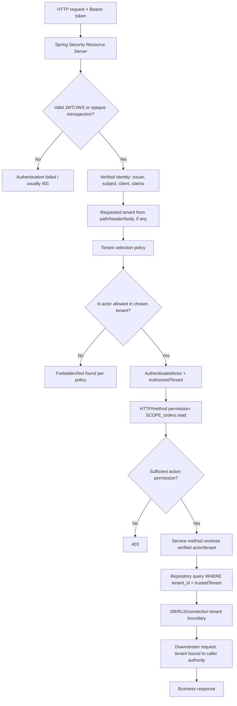

# Propagating a verified tenant down to queries and downstream services

In a **Spring Security OAuth 2.0/OIDC Resource Server**, a multi-tenant API must answer two independent questions: **who is the caller and is the token trustworthy?** and **which tenant and which objects is the caller permitted to act on?** If the API verifies only a JWT signature or opaque token status and then uses a `tenantId` taken straight from the URL, header, or request body to query the database, the application becomes vulnerable to **cross-tenant data leakage**.

A secure design establishes a **verified tenant context**, then **propagates that context across Controller → Service → Repository → Database → Downstream services** without allowing untrusted inputs to overwrite it.

Example:

```text
JWT access token (verified):
  iss       = https://login.example.test/realms/shop
  sub       = user-123
  aud       = orders-api
  tenant_id = shop-a
  scope     = orders.read

HTTP request:
  GET /api/tenants/shop-b/orders/order-99

Question:
  Should shop-b from the URL be used to query the Orders database?

Answer:
  No. shop-b is merely a caller-submitted choice.
  You must verify whether the caller is allowed to access shop-b.
  If the token only authorizes shop-a, reject before querying.
```

This lesson covers constructing and propagating a **verified tenant**, including JWT/opaque tokens, multi-issuer setups, tenant membership, JPA/SQL/R2DBC query layers, database-per-tenant, RLS, downstream OAuth, queues/async jobs, logging, and testing.

> **Guiding principle:** A Tenant ID is not a secret; **being able to state a tenant ID is never proof of rights inside that tenant**. Every data access must be constrained by a tenant context derived from authenticated identity and server-side membership/authorization policies.

## 1. Three tenant concepts that must not be conflated

In a multi-tenant API, the word "tenant" can refer to three distinct things.

| Concept | Source | Trustworthiness | Usage |
|---|---|---|---|
| **Token tenant** | Claim such as `tenant_id` in a verified JWT or introspection response from a trusted AS | Attested by the AS per contract at issuance/introspection time | Enforcing identity/token-wide policies |
| **Requested tenant** | Path `/tenants/{tenantId}`, `X-Tenant-Id`, or body | Caller-selected; not a permission | Strictly a *request to select a tenant* |
| **Authorized/active tenant** | Result of checking token claims **plus** membership, delegated policy, and tenant state | Verified by the server for the current operation | Used to query, mutate data, and call downstream |

With a single-tenant token and a single-active-tenant API policy, the authorized tenant may be the token's `tenant_id` **after** JWT/opaque authentication and validation succeed. When a user belongs to multiple tenants or memberships require immediate revocation, perform an additional authorization check for the chosen tenant.

### 1.1. "Verified signature" does not mean active membership

A JWT with a valid signature proves its claims were issued by a trusted issuer and not tampered with; **it does not guarantee organizational data remains valid right now**.

Example:

```text
09:00  AS issues JWT tenant_id=shop-a, exp=10:00
09:15  Admin revokes user's membership in shop-a
09:20  Caller calls API with the old JWT
```

If the Resource Server checks only signature and expiration, the token remains cryptographically valid. Systems requiring immediate membership revocation must check **current** status via a database/policy service, token revocation, or shorter token TTLs.

There is no single rule forcing "every request must query membership" for all apps; it is a security decision driven by data sensitivity, AS contract, TTLs, and revocation requirements.

### 1.2. Identity tenant vs. storage tenant

An enterprise may use:

```text
Identity tenant / realm:
  customers-identity

Data tenants:
  shop-a
  shop-b
  shop-c
```

Never assume `iss` (issuer) or a realm ID equals the data tenant. One issuer can mint tokens for many data tenants; conversely, one data tenant may accept multiple trusted issuers under a federation contract.

## 2. Threat model: altering the tenant in the request

Suppose Orders API receives:

```http
GET /api/tenants/shop-a/orders/order-1
Authorization: Bearer <TOKEN_USER_123>
```

Authenticated token:

```json
{
  "iss": "https://login.example.test/realms/shop",
  "sub": "user-123",
  "aud": ["orders-api"],
  "tenant_id": "shop-a",
  "scope": "orders.read"
}
```

Per policy, `user-123` can view `order-1` in `shop-a` if permissions and owner/ACL checks pass.

The caller modifies the request:

```http
GET /api/tenants/shop-b/orders/order-3
Authorization: Bearer <SAME_TOKEN_USER_123>
```

If the controller passes `shop-b` straight to the repository:

```java
@GetMapping("/api/tenants/{tenantId}/orders/{orderId}")
public OrderDto findOrder(
        @PathVariable String tenantId,
        @PathVariable String orderId) {

    return repository.findByTenantIdAndId(tenantId, orderId)
        .map(OrderDto::from)
        .orElseThrow(OrderNotFoundException::new);
}
```

then an attacker can read `shop-b` data if they know or guess an order ID. **Even though the SQL includes a tenant predicate, the tenant value is caller-controlled and unverified.**

### 2.1. This is Broken Object Level Authorization

This flaw belongs to **Broken Object Level Authorization (BOLA)** and can lead to:

- Reading orders, customers, or invoices from another tenant.
- Updating or deleting another tenant's records.
- System-wide searching and exporting.
- Returning aggregates or counts for unauthorized tenants.
- Sending notifications or creating jobs for another tenant.
- Calling downstream services under a tenant not belonging to the caller.
- Mixing cached data across tenants.

Hard-to-guess UUIDs and TLS do not replace tenant authorization. TLS protects transport; UUIDs reduce guessing; neither replaces permission checks.

## 3. Security flow from token to query

A design can be broken down as:



Exact ordering between tenant selection and action permission checks can vary by architecture, yet **another tenant's data must never enter results before permissions are verified**.

### 3.1. Four non-interchangeable check layers

| Layer | Example | What it does not prove on its own |
|---|---|---|
| Authentication | JWT signature, `iss`, `aud`, `exp` or opaque introspection `active` | Does not know who owns an order ID |
| Tenant authorization | Caller may operate in `shop-a` | Does not know whether caller holds `orders.delete` |
| Action permission | `SCOPE_orders.read` | Does not know whether caller may view `order-99` |
| Object permission | Owner/share/assignment of `order-99` | Does not replace token validation or business state |

A single order-read request may require **all four conditions** to pass together.

## 4. Trusted identity sources in a Resource Server

### 4.1. JWT access tokens

Illustrative JWT access token:

```json
{
  "iss": "https://login.example.test/realms/shop",
  "sub": "user-123",
  "aud": ["orders-api"],
  "scope": "orders.read",
  "tenant_id": "shop-a",
  "exp": 1900000000
}
```

The Spring Security JWT Resource Server must verify the JWS signature against trusted keys, issuer, expiration/not-before, audience, and contract claims. Only afterward should `sub` and `tenant_id` be read from the authenticated principal.

Never Base64URL-decode an unverified payload and treat it as a "decoded user context."

### 4.2. Opaque tokens

Opaque tokens typically have no claims the API can parse itself. The Resource Server calls the AS introspection endpoint. The response might contain:

```json
{
  "active": true,
  "sub": "user-123",
  "aud": ["orders-api"],
  "scope": "orders.read",
  "tenant_id": "shop-a"
}
```

Spring Security uses `OpaqueTokenIntrospector` (Servlet) or `ReactiveOpaqueTokenIntrospector` (WebFlux). If the AS omits a tenant claim in the introspection response, the API must never fill in the tenant from a header and treat it as verified.

When the contract requires a tenant, have the AS return the appropriate claim or fetch the tenant relationship from a protected server-side source.

### 4.3. Sources that must never count as tenant proof

| Input | What may it be used for? | What must it never do? |
|---|---|---|
| `/tenants/shop-b` | Caller requests selecting `shop-b` | Assert the caller belongs to `shop-b` |
| `X-Tenant-Id: shop-b` | Hint for active tenant/UI context | Bypass membership |
| Body `{"tenantId":"shop-b"}` | Target tenant in delegated-create use cases | Unchecked owner/tenant assignment |
| `Origin: https://shop-b.example.test` | Browser CORS decisions | Tenant authentication |
| `Host` or subdomain | Tenant routing hint per contract | Prove user membership |
| Unsigned cookie `tenant=shop-b` | Non-sensitive UI preference | Tenant authorization |
| Unverified JWT payload | Debugging untrusted data | Building `AuthenticatedActor` |

Subdomains or `Origin` can help **identify which tenant is being requested**, yet must still be checked against server-side identity and permissions.

## 5. Designing an immutable `AuthenticatedActor`

Instead of passing loose `tenantId` strings through multiple layers, define a value object:

```java
public record AuthenticatedActor(
    String issuer,
    String subject,
    String tenantId,
    Set<String> authorities
) {
    public AuthenticatedActor {
        Objects.requireNonNull(issuer, "issuer");
        Objects.requireNonNull(subject, "subject");
        Objects.requireNonNull(tenantId, "tenantId");
        authorities = Set.copyOf(authorities);

        if (issuer.isBlank()
                || subject.isBlank()
                || tenantId.isBlank()) {
            throw new IllegalArgumentException(
                "Verified actor fields must not be blank"
            );
        }
    }

    public boolean hasAuthority(String name) {
        return authorities.contains(name);
    }
}
```

Imports:

```java
import java.util.Objects;
import java.util.Set;
```

A record is a useful immutable container, yet **it carries no security magic**: a developer could still call `new AuthenticatedActor("trusted", "admin", "shop-b", ...)`. Trust comes from **where the object is constructed and the validation pipeline**, not from the type name `AuthenticatedActor`.

Agree that only the authentication/tenant-resolution adapter constructs actors for HTTP requests, from a Spring Security-authenticated principal checked by membership policies. Never bind JSON request bodies directly to this type.

### 5.1. Why retain both issuer and subject?

Multi-issuer setups can have two principals:

```text
issuer A:
  sub = user-123

issuer B:
  sub = user-123
```

Matching `sub` strings do not guarantee the same account. In federated identity systems, a principal key normally needs the **`(issuer, subject)` pair** or an internal account ID mapped from that pair.

Using `sub` alone as an owner ID across issuers risks allowing two distinct identities from different issuers to access each other's data.

### 5.2. Why store authorities on the actor?

Services can use the actor to enforce action-level policies whether invoked from HTTP, jobs, or another entry point. Still, never assign authorities from role names found in the request. Authorities must come strictly from the `Authentication` built by Spring Security from trusted tokens/claims via a contract-aligned converter.

A project may alternatively keep authorities off the domain actor and enforce scopes at the HTTP/method layer. What matters is consistent boundaries and ensuring internal entry points never bypass authorization.

## 6. Single-tenant tokens: cross-checking the token tenant against the URL

Suppose policy states an access token operates only within **one active tenant**. The token carries:

```text
tenant_id = shop-a
```

With endpoint:

```text
GET /api/tenants/{tenantId}/orders/{orderId}
```

The Resource Server must verify `{tenantId}` matches the token's tenant before invoking the repository.

Example adapter in Servlet Spring Security JWT:

```java
@Component
public class JwtActorFactory {

    public AuthenticatedActor requireActorForTenant(
            JwtAuthenticationToken authentication,
            String requestedTenant) {

        Jwt jwt = authentication.getToken();

        String issuer = jwt.getIssuer() == null
            ? null
            : jwt.getIssuer().toString();

        String subject = jwt.getSubject();
        String tokenTenant =
            jwt.getClaimAsString("tenant_id");

        if (issuer == null
                || subject == null
                || tokenTenant == null
                || tokenTenant.isBlank()) {
            throw new AccessDeniedException(
                "Incomplete authenticated identity"
            );
        }

        if (!tokenTenant.equals(requestedTenant)) {
            throw new AccessDeniedException(
                "Tenant not allowed for this token"
            );
        }

        Set<String> authorities = authentication
            .getAuthorities()
            .stream()
            .map(GrantedAuthority::getAuthority)
            .collect(Collectors.toUnmodifiableSet());

        return new AuthenticatedActor(
            issuer, subject, tokenTenant, authorities
        );
    }
}
```

Imports:

```java
import java.util.Set;
import java.util.stream.Collectors;
import org.springframework.security.access.AccessDeniedException;
import org.springframework.security.core.GrantedAuthority;
import org.springframework.security.oauth2.jwt.Jwt;
import org.springframework.security.oauth2.server.resource.authentication.JwtAuthenticationToken;
import org.springframework.stereotype.Component;
```

This class assumes `JwtAuthenticationToken` was produced by Spring Security after decoder verification. It does not replace signature, issuer, or audience checks. If `tenant_id` is missing or mistyped, a validator in `JwtDecoder` can also reject the token at authentication (401); the factory should still check defensively before using it.

### 6.1. Controller passes only the matched tenant

```java
@RestController
@RequestMapping("/api/tenants/{tenantId}/orders")
public class OrderController {

    private final OrderService service;
    private final JwtActorFactory actorFactory;

    public OrderController(
            OrderService service,
            JwtActorFactory actorFactory) {
        this.service = service;
        this.actorFactory = actorFactory;
    }

    @GetMapping("/{orderId}")
    public OrderDto read(
            @PathVariable String tenantId,
            @PathVariable String orderId,
            Authentication authentication) {

        if (!(authentication instanceof JwtAuthenticationToken jwtAuth)) {
            throw new AccessDeniedException(
                "JWT authentication required"
            );
        }

        AuthenticatedActor actor =
            actorFactory.requireActorForTenant(
                jwtAuth, tenantId
            );

        return service.readVisibleOrder(orderId, actor);
    }
}
```

Imports:

```java
import org.springframework.security.access.AccessDeniedException;
import org.springframework.security.core.Authentication;
import org.springframework.security.oauth2.server.resource.authentication.JwtAuthenticationToken;
import org.springframework.web.bind.annotation.GetMapping;
import org.springframework.web.bind.annotation.PathVariable;
import org.springframework.web.bind.annotation.RequestMapping;
import org.springframework.web.bind.annotation.RestController;
```

**Key takeaway:** the service never receives an arbitrary client-chosen `requestedTenant` alongside the actor and trusts `requestedTenant`. It receives only the factory-verified actor and uses `actor.tenantId()` in queries.

### 6.2. Syntactically validate URL tenant IDs

Tenant IDs may follow a convention such as lowercase ASCII with hyphens:

```text
shop-a
shop-b
enterprise-42
```

If tenant names use UUIDs or other characters, enforce matching rules. Separate:

- **Syntax validation:** is the tenant ID well-formed?
- **Membership/permission validation:** is the caller allowed to use that tenant ID?

A syntactically valid ID can still belong to someone else's tenant.

## 7. Multi-tenant tokens: caller belongs to multiple tenants

Not every access token carries only a single `tenant_id`. Some systems let users pick an active tenant from their membership list:

```json
{
  "iss": "https://login.example.test/realms/shop",
  "sub": "user-123",
  "aud": ["orders-api"],
  "scope": "orders.read",
  "tenant_ids": ["shop-a", "shop-b"]
}
```

This is a **contract-specific custom claim**, not a mandatory standard OAuth 2.0/OIDC claim.

Caller requests:

```http
GET /api/tenants/shop-b/orders/order-42
Authorization: Bearer <MULTI_TENANT_TOKEN>
```

A resolver can:

1. Extract issuer and subject from the authenticated principal.
2. Read tenant IDs per contract and validate data types.
3. Match `requestedTenant` against the issuer-permitted tenant IDs.
4. If live permissions are needed, check the caller's membership/role assignment in that tenant.
5. Build an `AuthenticatedActor` with **one single active tenant** for the use case.
6. Pass that active tenant down into every query.

### 7.1. Never pass an unchecked list of tenants into queries

Wrong:

```java
repository.findByTenantIdIn(tokenTenantIds);
```

when the endpoint serves only one active tenant. That mixes `shop-a` and `shop-b` data in responses, violates business logic, and breaks per-tenant authorization.

If a use case genuinely needs cross-tenant reporting, require a **dedicated permission**, explicitly define the permitted tenant set, and bound exports/aggregations accordingly.

### 7.2. Distinguish membership from operation permissions

A user holding `shop-b` membership does not automatically gain `orders.export` in `shop-b`. When roles are tenant-scoped, a `ROLE_ADMIN` authority in a token does not necessarily apply to every tenant.

A permission model might look like:

```text
Membership:
  user-123 is MEMBER of shop-a
  user-123 is SUPPORT of shop-b

Permissions:
  shop-a -> orders.read, orders.write
  shop-b -> orders.read
```

If the API uses tenant-specific roles, resolve authorities for the active tenant or verify per-tenant permissions in a policy service. Never take the highest privilege in tenant A and apply it by default to tenant B.

## 8. Server-side membership and live status checks

When tokens omit memberships or the system needs immediate revocation, query a membership table:

```sql
CREATE TABLE tenant_memberships (
    issuer        VARCHAR(255) NOT NULL,
    subject       VARCHAR(255) NOT NULL,
    tenant_id     VARCHAR(64) NOT NULL,
    role_code     VARCHAR(64) NOT NULL,
    status        VARCHAR(32) NOT NULL,
    PRIMARY KEY (issuer, subject, tenant_id)
);
```

Permission query:

```sql
SELECT 1
FROM tenant_memberships
WHERE issuer = :trustedIssuer
  AND subject = :trustedSubject
  AND tenant_id = :requestedTenant
  AND status = 'ACTIVE';
```

`trustedIssuer` and `trustedSubject` come from the verified Authentication. `requestedTenant` is still caller-chosen, yet **is promoted to active tenant only if the membership query permits it**.

### 8.1. Servlet service example

```java
@Service
public class TenantAccessService {

    private final TenantMembershipRepository memberships;

    public TenantAccessService(
            TenantMembershipRepository memberships) {
        this.memberships = memberships;
    }

    public AuthenticatedActor authorizeTenant(
            JwtAuthenticationToken authentication,
            String requestedTenant) {

        Jwt jwt = authentication.getToken();

        String issuer = jwt.getIssuer() == null
            ? null
            : jwt.getIssuer().toString();

        String subject = jwt.getSubject();

        if (issuer == null || subject == null) {
            throw new AccessDeniedException(
                "Missing verified identity"
            );
        }

        boolean active = memberships.existsActive(
            issuer, subject, requestedTenant
        );

        if (!active) {
            throw new AccessDeniedException(
                "Tenant access denied"
            );
        }

        Set<String> authorities = authentication
            .getAuthorities()
            .stream()
            .map(GrantedAuthority::getAuthority)
            .collect(Collectors.toUnmodifiableSet());

        return new AuthenticatedActor(
            issuer, subject, requestedTenant, authorities
        );
    }
}
```

`TenantMembershipRepository.existsActive(...)` is an illustrative domain method to implement per your database, transaction, and role policies.

### 8.2. "Having membership" can still be insufficient

For sensitive data, also check:

- Is the tenant still active, or suspended/deleted?
- Was the membership revoked or expired?
- Does the caller hold the action permission inside that tenant?
- Is there an approved delegation/impersonation?
- Are there project, branch, or data-region restrictions?
- Are there legal-hold or data-residency constraints?
- Are permissions evaluated as of token issuance or request time?

Never turn a membership table with just `user_id` and `tenant_id` into carte blanche for every action.

## 9. JWT validation: ensure the token is for this API before reading the tenant

A JWT with `tenant_id=shop-a` cannot be accepted simply because the claim is well-formed. Before building an actor, the API must verify all applicable conditions.

Spring Security Servlet example:

```java
@Configuration
public class JwtDecoderConfiguration {

    private static final String ISSUER =
        "https://login.example.test/realms/shop";

    private static final String JWKS =
        "https://login.example.test/realms/shop/protocol/openid-connect/certs";

    private static final String AUDIENCE = "orders-api";

    @Bean
    JwtDecoder jwtDecoder() {
        NimbusJwtDecoder decoder =
            NimbusJwtDecoder.withJwkSetUri(JWKS).build();

        OAuth2TokenValidator<Jwt> defaultValidators =
            JwtValidators.createDefaultWithIssuer(ISSUER);

        OAuth2TokenValidator<Jwt> audienceValidator = jwt ->
            jwt.getAudience().contains(AUDIENCE)
                ? OAuth2TokenValidatorResult.success()
                : OAuth2TokenValidatorResult.failure(
                    new OAuth2Error(
                        "invalid_token",
                        "Unexpected audience",
                        null
                    ));

        OAuth2TokenValidator<Jwt> tenantClaimValidator = jwt -> {
            Object tenant = jwt.getClaim("tenant_id");

            if (tenant instanceof String text && !text.isBlank()) {
                return OAuth2TokenValidatorResult.success();
            }

            return OAuth2TokenValidatorResult.failure(
                new OAuth2Error(
                    "invalid_token",
                    "Missing tenant claim",
                    null
                )
            );
        };

        decoder.setJwtValidator(
            new DelegatingOAuth2TokenValidator<>(
                defaultValidators,
                audienceValidator,
                tenantClaimValidator
            )
        );

        return decoder;
    }
}
```

Imports:

```java
import org.springframework.context.annotation.Bean;
import org.springframework.context.annotation.Configuration;
import org.springframework.security.oauth2.core.DelegatingOAuth2TokenValidator;
import org.springframework.security.oauth2.core.OAuth2Error;
import org.springframework.security.oauth2.core.OAuth2TokenValidator;
import org.springframework.security.oauth2.core.OAuth2TokenValidatorResult;
import org.springframework.security.oauth2.jwt.Jwt;
import org.springframework.security.oauth2.jwt.JwtDecoder;
import org.springframework.security.oauth2.jwt.JwtValidators;
import org.springframework.security.oauth2.jwt.NimbusJwtDecoder;
```

This example enforces three groups of conditions:

1. The JWS signature must verify against the issuer's trusted JWKS.
2. Default validators plus expected issuer must pass.
3. Audience must contain `orders-api`, and the contract requires a string tenant claim.

**Important note:** `tenant_id` is issuer-emitted data, not a "mandatory Spring Security standard." If a multi-tenant architecture uses server-side membership without a tenant claim in the token, omit that mandatory claim validator and verify identity and membership per your contract.

### 9.1. Do not replace defaults with only a tenant validator

Wrong:

```java
decoder.setJwtValidator(tenantClaimValidator);
```

Dropping default issuer and timestamp checks lets the app accept wrong-issuer or expired tokens. **Compose** validators properly.

### 9.2. Audience differs from OAuth client ID

```text
client_id = web-portal
aud       = orders-api
```

`client_id` typically identifies the OAuth client requesting the token, whereas `aud` identifies the target Resource Server. One OAuth client can request tokens for multiple APIs, so Orders API must never treat client ID as audience.

### 9.3. Never use an OIDC ID token in place of an access token

An ID token normally has the OIDC client as its audience, not Orders Resource Server. Even with `sub` and a tenant claim, it is not a bearer access credential for Orders API. Enforce token type/profile and expected audience per contract.

## 10. HTTP authorization configuration is still needed

Example:

```java
@Bean
SecurityFilterChain apiSecurity(HttpSecurity http) throws Exception {
    return http
        .authorizeHttpRequests(auth -> auth
            .requestMatchers(HttpMethod.GET, "/api/tenants/*/orders/**")
                .hasAuthority("SCOPE_orders.read")
            .requestMatchers(HttpMethod.POST, "/api/tenants/*/orders")
                .hasAuthority("SCOPE_orders.write")
            .anyRequest().denyAll()
        )
        .oauth2ResourceServer(oauth2 ->
            oauth2.jwt(Customizer.withDefaults())
        )
        .build();
}
```

Imports:

```java
import org.springframework.context.annotation.Bean;
import org.springframework.http.HttpMethod;
import org.springframework.security.config.Customizer;
import org.springframework.security.config.annotation.web.builders.HttpSecurity;
import org.springframework.security.web.SecurityFilterChain;
```

HTTP authorization checks scopes by HTTP method and URL; controllers and services must still enforce the **selected tenant** and **object-level permissions**. `hasAuthority("SCOPE_orders.read")` does not verify `{tenantId}` in the path against an issuer-attested claim.

### 10.1. Watch out for pattern precedence

If there is an export route:

```text
GET /api/tenants/shop-a/orders/export
```

it may require `SCOPE_orders.export` rather than merely `orders.read`. Place the more specific export matcher **before** the wildcard GET orders matcher if both could match the same request.

## 11. Passing the tenant down to services via explicit parameters

In an easily auditable system, services receive:

```java
public OrderDto readVisibleOrder(
    String orderId,
    AuthenticatedActor actor
) { ... }
```

rather than:

```java
public OrderDto readAnyOrder(
    String orderId,
    String tenantFromRequest
) { ... }
```

Example:

```java
@Service
public class OrderService {

    private final OrderRepository repository;

    public OrderService(OrderRepository repository) {
        this.repository = repository;
    }

    @Transactional(readOnly = true)
    public OrderDto readVisibleOrder(
            UUID orderId,
            AuthenticatedActor actor) {

        if (!actor.hasAuthority("SCOPE_orders.read")) {
            throw new AccessDeniedException(
                "Missing orders.read permission"
            );
        }

        Order order = repository
            .findVisibleOrder(
                orderId,
                actor.tenantId(),
                actor.issuer(),
                actor.subject()
            )
            .orElseThrow(OrderNotFoundException::new);

        return OrderDto.from(order);
    }
}
```

Imports:

```java
import java.util.UUID;
import org.springframework.security.access.AccessDeniedException;
import org.springframework.stereotype.Service;
import org.springframework.transaction.annotation.Transactional;
```

Here `OrderRepository`, `OrderDto`, and `OrderNotFoundException` are illustrative domain types. Most importantly, the **exact same verified actor** drives both permission checks and data queries—never reading the tenant from the request a second time.

### 11.1. Why are explicit parameters usually preferable?

- The tenant's path through Controller → Service → Repository is visible right in method signatures.
- Unit tests easily assert which tenant is passed.
- Zero reliance on `ThreadLocal` across async or reactive calls.
- Entry points like HTTP, batch jobs, and message consumers must supply a context with clear provenance.
- Missing tenants or untrusted inputs stand out immediately.
- Supports consistent auditing and downstream calls.

Trade-off: slightly longer parameter lists. You can group `actor`, `tenant`, and `requestContext` into value objects, provided they can never be arbitrarily constructed from JSON requests.

### 11.2. Never construct actors in the repository layer

Repositories must never read HTTP headers to figure out the tenant. They should receive a service-verified tenant or a context with a clear trust boundary. If repositories read global state directly, unit tests and async jobs can accidentally query the wrong tenant.

## 12. JPA Repositories: enforce the tenant right inside the query

Suppose an `Order` entity has:

```java
@Entity
@Table(name = "orders")
public class Order {

    @Id
    private UUID id;

    @Column(nullable = false, updatable = false)
    private String tenantId;

    @Column(nullable = false, updatable = false)
    private String ownerIssuer;

    @Column(nullable = false, updatable = false)
    private String ownerSubject;

    private String status;

    // getters, constructors, and domain methods...
}
```

JPA repository:

```java
public interface OrderRepository
        extends JpaRepository<Order, UUID> {

    @Query("""
        select o
        from Order o
        where o.id = :orderId
          and o.tenantId = :tenantId
          and o.ownerIssuer = :issuer
          and o.ownerSubject = :subject
        """)
    Optional<Order> findVisibleOrder(
        @Param("orderId") UUID orderId,
        @Param("tenantId") String tenantId,
        @Param("issuer") String issuer,
        @Param("subject") String subject
    );
}
```

Imports:

```java
import java.util.Optional;
import java.util.UUID;
import org.springframework.data.jpa.repository.JpaRepository;
import org.springframework.data.jpa.repository.Query;
import org.springframework.data.repository.query.Param;
```

Notable points:

- The query filters by `orderId` **and** tenant.
- For owner-only access, it also filters by issuer + subject.
- All parameter values come from the service without concatenating SQL strings.
- Rows with the wrong tenant or owner are never loaded into memory or returned.
- If ACL/shared access is allowed, expand the query/policy **strictly within the same tenant**.

### 12.1. Never call `findById` and check the tenant afterward

Risky example:

```java
Order order = repository.findById(orderId).orElseThrow();
return OrderDto.from(order);
// Tenant/owner check skipped.
```

Even if the controller checks afterward, another code path might forget, the entity might be logged, cached, or materialized, or side effects might trigger before authorization. Prefer **scoped queries** for every tenant-data use case.

### 12.2. Are Hibernate filters and `@Where` enough?

Some applications use Hibernate filters, multi-tenancy APIs, or entity listeners to inject tenant predicates automatically. These can serve as an extra safeguard, yet verify:

- Is the filter enabled on every session and transaction?
- Do native queries, bulk updates, joins, and projections always respect the filter?
- Are entity managers or caches ever reused across tenants?
- Do tests, services, or background jobs bypass the filter?
- Do any queries read global statistics?

Never treat an annotation alone as proof that every query is tenant-scoped. Critical queries should still state the tenant boundary explicitly or rely on independent database RLS / tenant routing.

## 13. SQL: SELECT, UPDATE, and DELETE all need tenant predicates

Read:

```sql
SELECT id, tenant_id, status, total_amount
FROM orders
WHERE id = :orderId
  AND tenant_id = :verifiedTenant
  AND owner_issuer = :verifiedIssuer
  AND owner_subject = :verifiedSubject;
```

Update:

```sql
UPDATE orders
SET shipping_address = :newAddress
WHERE id = :orderId
  AND tenant_id = :verifiedTenant
  AND owner_issuer = :verifiedIssuer
  AND owner_subject = :verifiedSubject
  AND status IN ('CREATED', 'CONFIRMED');
```

Delete (when allowed by business rules):

```sql
DELETE FROM orders
WHERE id = :orderId
  AND tenant_id = :verifiedTenant
  AND owner_issuer = :verifiedIssuer
  AND owner_subject = :verifiedSubject;
```

Tenant and owner conditions must appear on the **mutation statement itself** to avoid race conditions between check and update.

### 13.1. Check affected row counts

If `UPDATE` affects 0 rows, it could mean:

- The order does not exist.
- The order exists under a different tenant or owner.
- The order transitioned to a non-editable status.
- A concurrent update occurred.

Never tell an unauthorized caller "the order exists in shop-b but you lack access," as that leaks the existence of another tenant's object. Return 403/404/409 consistently per your disclosure policy.

### 13.2. Never omit tenant predicates in "internal" queries

Reporting jobs, batch updates, and admin endpoints are all code that requires a policy. "Backend-initiated query" never guarantees tenant scoping on its own.

## 14. List, search, count, and export: data leakage without IDs

Wrong:

```sql
SELECT * FROM orders ORDER BY created_at DESC;
```

Better for an owner-only policy:

```sql
SELECT *
FROM orders
WHERE tenant_id = :verifiedTenant
  AND owner_issuer = :verifiedIssuer
  AND owner_subject = :verifiedSubject
ORDER BY created_at DESC
LIMIT :pageSize OFFSET :offset;
```

An API might return filtered list items yet compute the total using an unscoped table count:

```sql
SELECT COUNT(*) FROM orders;
```

That still leaks other tenants' data via `totalElements`, `totalPages`, or summary reports. Count and aggregation queries must enforce **the exact same visibility policy** as list queries.

### 14.1. Exports are more sensitive than ordinary reads

```text
GET /api/tenants/shop-a/orders/export
```

may require all of:

- Caller authorized to act in `shop-a`.
- `SCOPE_orders.export`.
- Dataset restricted to orders visible in `shop-a`.
- Field-level filtering (omitting internal fraud scores).
- Auditing who exported, which tenant, and what scope.
- Never exporting cross-tenant data via a global reporting query.

**Export scope only authorizes the action type**; it does not grant permission to export every tenant.

## 15. Creation: always bind the tenant from the verified context

Caller sends:

```http
POST /api/tenants/shop-a/orders
Authorization: Bearer <ACCESS_TOKEN>
Content-Type: application/json

{
  "tenantId": "shop-b",
  "ownerSubject": "user-456",
  "items": [
    {"sku": "SKU-1", "quantity": 2}
  ]
}
```

If the endpoint lets customers create their own orders, the service must never use `tenantId` and `ownerSubject` from the request body.

Example:

```java
@Transactional
public OrderDto createOwnOrder(
        CreateOrderRequest request,
        AuthenticatedActor actor) {

    requireAuthority(actor, "SCOPE_orders.write");

    Order order = new Order(
        UUID.randomUUID(),
        actor.tenantId(),
        actor.issuer(),
        actor.subject(),
        validateItems(request.items())
    );

    return OrderDto.from(repository.save(order));
}
```

This is a domain example: implement `Order`'s constructor, `validateItems`, and `requireAuthority` accordingly.

Intent:

- Tenant is assigned from `actor.tenantId()`.
- Owner is assigned from verified issuer/subject.
- Clients cannot mass-assign owner or tenant.
- Delegated creation on someone else's behalf requires a **dedicated endpoint and permission** with a delegated-access policy.

### 15.1. Field-level authorization

Even when a caller may create or update an order, not every field is freely writable:

| Field | Valid source |
|---|---|
| `tenant_id` | Authorized tenant context |
| `owner_subject` | Verified identity or delegated business flow |
| `unit_price` | Server-side pricing service/catalog |
| `payment_status` | Trusted payment workflow |
| `shipping_address` | Validated user input allowed by business policy |
| `internal_note` | Authorized support/admin staff |

Never bind HTTP requests straight onto entities to update arbitrary fields.

## 16. Cross-tenant relationships: check both sides

An API may link resources:

```http
POST /api/tenants/shop-a/orders/order-42/payments
Content-Type: application/json

{"paymentId": "payment-9"}
```

Verify:

1. Does `order-42` belong to the permitted tenant?
2. Which tenant does `payment-9` belong to?
3. Is the caller allowed to link that payment?
4. Do the order and payment belong to the same tenant per policy?
5. Does the payment match the order, merchant, and currency?

Checking only the order's tenant and then calling a global `paymentRepository.findById("payment-9")` allows cross-tenant associations.

### 16.1. Foreign keys and composite keys

In a shared-table model, primary keys and unique constraints can include the tenant:

```sql
CREATE TABLE orders (
    tenant_id VARCHAR(64) NOT NULL,
    id UUID NOT NULL,
    owner_subject VARCHAR(255) NOT NULL,
    PRIMARY KEY (tenant_id, id)
);
```

On child tables, foreign keys can include both `tenant_id` and `order_id` so the DB prevents cross-tenant links:

```sql
CREATE TABLE order_items (
    tenant_id VARCHAR(64) NOT NULL,
    id UUID NOT NULL,
    order_id UUID NOT NULL,
    PRIMARY KEY (tenant_id, id),
    FOREIGN KEY (tenant_id, order_id)
        REFERENCES orders(tenant_id, id)
);
```

This is a conceptual SQL structure; adapt data types and migrations for your real database. Composite tenant keys prevent an entire class of mistakes, yet **do not replace authorization**.

### 16.2. Global IDs do not exempt tenant checks

Even when order IDs are globally unique UUID v4s, requests for those IDs must still be constrained by tenant and object policies. IDs leak through logs, URLs, exports, and integration callbacks.

## 17. Multi-tenant storage models

Three common architectural models:

| Model | Tenant data | Primary barrier | Risk |
|---|---|---|---|
| **Shared table, tenant discriminator** | One shared table with `tenant_id` column | Query predicates / RLS | Missing `WHERE tenant`, bad joins/caches |
| **Schema per tenant** | Dedicated schema per tenant | Schema routing / DB permissions | Wrong schema selection, pooled connection context |
| **Database per tenant** | Dedicated database/connection pool | Tenant → DB routing | Wrong resolver, default fallback, resource cost |

No model eliminates the need to verify tenant permissions. A client can request `shop-b`; if routing uses that raw value, the app will still query `shop-b`'s database even with isolated databases per tenant.

### 17.1. Shared tables require consistent tenant predicates

Example:

```sql
SELECT * FROM orders
WHERE tenant_id = :verifiedTenant
  AND id = :orderId;
```

Easy to operate, provided code enforces the tenant context on every query, update, delete, and aggregation.

### 17.2. Schema per tenant

Schema routing must use the authorized tenant—never take a raw URL value and concatenate a SQL identifier:

```java
// Unsafe if schemaName comes directly from the request.
String sql = "SET search_path TO " + requestedSchema;
```

Schema names are identifiers and usually cannot be bound as ordinary query parameters. When routing schemas, use a server-side allowlist mapping verified tenants to real schema names to prevent SQL injection and cross-tenant routing.

### 17.3. Database per tenant

A resolver can map:

```text
shop-a -> managed datasource A
shop-b -> managed datasource B
```

Mappings must be strictly governed. **When no mapping exists, fail closed**; never fall back to a "default tenant DB" where data could be written to the wrong tenant.

## 18. PostgreSQL Row-Level Security (RLS) as defense in depth

In PostgreSQL, Row-Level Security constrains rows at the DB level alongside query predicates.

Table example:

```sql
ALTER TABLE orders ENABLE ROW LEVEL SECURITY;
ALTER TABLE orders FORCE ROW LEVEL SECURITY;

CREATE POLICY orders_tenant_policy
ON orders
USING (
    tenant_id = current_setting('app.tenant_id', true)
)
WITH CHECK (
    tenant_id = current_setting('app.tenant_id', true)
);
```

Meaning:

- `USING` limits which rows can be seen, updated, or deleted under the policy.
- `WITH CHECK` ensures newly inserted or modified rows belong to the valid tenant.
- `current_setting(..., true)` returns null when unset; comparing against null matches zero rows, supporting fail-closed behavior.
- `FORCE ROW LEVEL SECURITY` applies policies to the table owner where appropriate, though **superusers and roles with `BYPASSRLS` still bypass it**. Application roles must never hold that privilege.

### 18.1. Setting the tenant context per transaction

Within a transaction, you can run:

```sql
SELECT set_config(
    'app.tenant_id',
    :verifiedTenant,
    true
);
```

The `true` argument scopes the setting locally to the PostgreSQL transaction. Subsequent queries in **the same transaction and connection** are filtered by RLS for that tenant.

Be careful to:

- Never use session-wide `SET` and forget to reset before returning connections to the pool.
- Never assume the context-setting query and the data query share a connection unless transaction/connection management guarantees it.
- Never set tenant context from an unverified `X-Tenant-Id`.
- Never grant the application DB role `BYPASSRLS`.
- Enforce default-deny when the setting is missing.
- Test `INSERT`/`UPDATE` in addition to `SELECT`.

RLS **does not replace service authorization**, because it knows the tenant without necessarily knowing owner, share, support permissions, or business state. Properly configured, however, RLS provides a strong extra layer against forgotten `WHERE tenant` clauses.

### 18.2. RLS with connection pooling

A classic bug:

```text
Request A sets tenant=shop-a on pooled connection
Request A returns connection
Request B (shop-b) reuses connection
Connection still has shop-a session setting
```

With unreset session-scoped settings, Request B reads or writes the wrong tenant. Use transaction-scoped settings and verify connection binding via ORM/driver, or use tested, controlled routing mechanisms.

## 19. Tenant-routing datasource in Servlet

For DB-per-tenant, you can use a routing abstraction such as `AbstractRoutingDataSource`:

```java
public final class TenantRoutingDataSource
        extends AbstractRoutingDataSource {

    @Override
    protected Object determineCurrentLookupKey() {
        // Must come from a backend-verified tenant context.
        // Never read X-Tenant-Id directly from the request.
        return VerifiedTenantHolder.requiredTenantId();
    }
}
```

Import:

```java
import org.springframework.jdbc.datasource.lookup.AbstractRoutingDataSource;
```

This is an **illustrative skeleton**, not a production-ready implementation of `VerifiedTenantHolder`.

### 19.1. Why does `ThreadLocal` demand extreme care?

In a synchronous Servlet flow, a `ThreadLocal`-backed holder can be convenient for routing. However:

- Every request must set the context from an authorized actor.
- Every request must clear it in `finally`, even on exceptions.
- `@Async`, executors, scheduled jobs, and `CompletableFuture` do not safely carry `ThreadLocal` automatically.
- Transactions may acquire a connection before the tenant is set.
- Thread reuse exposes prior tenants to subsequent requests if cleanup is missed.
- Desynchronized security context and routing context cause cross-tenant mix-ups.

Therefore, **passing the tenant explicitly** through services and repositories is easier to audit. If a holder is unavoidable for DB routing, enforce strict lifecycles, concurrency tests, and fail-closed errors when missing.

### 19.2. Never pick a default DB when the tenant is unknown

Wrong:

```java
return lookupTenantIdOrNull();
// When null, the framework falls back to the default datasource.
```

If the default DB holds real data, a context-propagation bug turns into cross-tenant access. Reject requests whenever the tenant is missing or lacks a valid mapping.

## 20. WebFlux: tenant context must follow Reactor Context or parameters

In WebFlux, requests are not pinned to one Servlet thread. You cannot assume a `ThreadLocal` holder works.

After opaque introspection or JWT authentication, read the reactive security context:

```java
Mono<Authentication> authentication =
    ReactiveSecurityContextHolder.getContext()
        .map(SecurityContext::getAuthentication);
```

Imports:

```java
import org.springframework.security.core.Authentication;
import org.springframework.security.core.context.ReactiveSecurityContextHolder;
import org.springframework.security.core.context.SecurityContext;
import reactor.core.publisher.Mono;
```

Construct an actor and pass it down to services:

```java
public Mono<OrderDto> readVisibleOrder(String orderId) {
    return currentActorProvider.currentActor()
        .flatMap(actor ->
            orderService.readVisibleOrder(orderId, actor)
        );
}
```

`currentActorProvider` must derive identity strictly from the trusted authenticated principal and enforce tenant authorization per contract. Never use `Mono.just(request.getHeaders().getFirst("X-Tenant-Id"))` to fabricate a verified tenant.

### 20.1. R2DBC repositories

An illustrative reactive repository:

```java
public Mono<Order> findVisibleOrder(
        UUID id,
        AuthenticatedActor actor) {

    return databaseClient.sql("""
            SELECT *
            FROM orders
            WHERE id = :id
              AND tenant_id = :tenant
              AND owner_issuer = :issuer
              AND owner_subject = :subject
            """)
        .bind("id", id)
        .bind("tenant", actor.tenantId())
        .bind("issuer", actor.issuer())
        .bind("subject", actor.subject())
        .map((row, metadata) -> mapOrder(row))
        .one();
}
```

Here `DatabaseClient` is Spring's R2DBC API; `mapOrder(row)` is a domain mapper you implement. This query enforces **tenant predicates via bound parameters**. Never concatenate `actor.tenantId()` into SQL strings.

### 20.2. Reactor Context instead of `ThreadLocal`

Reactor Context travels with the subscriber chain and is accessed via `ReactiveSecurityContextHolder`. Operators like `flatMap` and `publishOn` preserve context along the same chain.

Avoid:

```java
service.readVisibleOrder(orderId, actor)
    .subscribe(); // Detached subscription; caller does not await result.
```

That breaks context and error propagation and can return a response before business authorization finishes.

### 20.3. Transaction-scoped RLS in R2DBC

When using PostgreSQL RLS with R2DBC, setting `app.tenant_id` and running queries must occur **within the same reactive transaction and connection**. Never run `set_config` on connection A assuming a query on connection B sees it. Use `TransactionalOperator` / proper transaction management and verify connection binding in integration tests.

## 21. Opaque Resource Server: extracting the tenant from an introspected principal

In Servlet opaque tokens:

```java
if (!(authentication instanceof BearerTokenAuthentication bearer)) {
    throw new AccessDeniedException(
        "Opaque bearer authentication required"
    );
}

OAuth2AuthenticatedPrincipal principal = bearer.getPrincipal();
String subject = principal.getAttribute("sub");
String tenant = principal.getAttribute("tenant_id");
```

Imports:

```java
import org.springframework.security.oauth2.core.OAuth2AuthenticatedPrincipal;
import org.springframework.security.oauth2.server.resource.authentication.BearerTokenAuthentication;
```

Depending on the AS and Spring Security version, verify principal attribute types carefully. Never blindly cast to `String` if claims violate the contract; better yet, wrap the introspector to validate claims and return a principal only when valid.

### 21.1. Wrapper enforcing the token-wide contract

Example `OpaqueTokenIntrospector` decorator:

```java
public final class TenantCheckingIntrospector
        implements OpaqueTokenIntrospector {

    private final OpaqueTokenIntrospector delegate;

    public TenantCheckingIntrospector(
            OpaqueTokenIntrospector delegate) {
        this.delegate = delegate;
    }

    @Override
    public OAuth2AuthenticatedPrincipal introspect(String token) {
        OAuth2AuthenticatedPrincipal p =
            delegate.introspect(token);

        Object tenant = p.getAttribute("tenant_id");

        if (!(tenant instanceof String text)
                || text.isBlank()) {
            throw new BadOpaqueTokenException(
                "Missing required tenant claim"
            );
        }

        return p;
    }
}
```

Imports:

```java
import org.springframework.security.oauth2.core.OAuth2AuthenticatedPrincipal;
import org.springframework.security.oauth2.server.resource.introspection.BadOpaqueTokenException;
import org.springframework.security.oauth2.server.resource.introspection.OpaqueTokenIntrospector;
```

The delegate verifies `active`; the wrapper ensures the tenant claim matches the expected structure. Still, **having a tenant claim alone does not prove the caller may read a specific order**; object-level policies must still execute.

### 21.2. WebFlux opaque tokens

In WebFlux, the matching interface is `ReactiveOpaqueTokenIntrospector`, returning `Mono<OAuth2AuthenticatedPrincipal>`. The tenant check layer should use `map`/`flatMap`/`Mono.error` and fail closed, without manual `block()` or `subscribe()`.

## 22. Tenant context when calling downstream APIs

Suppose Orders API calls Payments API:

```text
Caller
  -> Orders API  [aud=orders-api]
      -> Payments API [aud=payments-api]
```

A request may carry:

```text
actor:
  issuer  = https://login.example.test/realms/shop
  subject = user-123
  tenant  = shop-a

action:
  pay order-42
```

Never do:

```java
webClient.post()
    .uri("https://payments.example.test/payments")
    .header("X-Tenant-Id", request.getHeader("X-Tenant-Id"))
    .retrieve();
```

because caller-supplied headers never prove tenant permissions. Downstream services must also never trust `X-Tenant-Id` merely because the header is present.

### 22.1. Three parts of a downstream contract

1. **Caller identity/delegation:** Payments API knows who is calling (Orders service, end user, delegated actor) via mTLS or an appropriate OAuth access token.
2. **Tenant binding:** the tenant is propagated from the verified `AuthenticatedActor`, and Payments API verifies the caller is permitted to act in that tenant.
3. **Resource/object authorization:** target payments, orders, and customers actually belong to that tenant and the caller may act on them.

An HTTP header such as `X-Verified-Tenant` can serve **as internal metadata** inside a strong trust boundary, yet **a header name itself is never a security signature**.

### 22.2. Avoid forwarding tokens with the wrong audience

Caller sends access token:

```json
{
  "aud": ["orders-api"],
  "scope": "orders.read"
}
```

Orders API must not blindly forward that token to Payments API expecting it to be accepted. Payments API needs a token targeting `payments-api` or delegated credentials from an AS-supported OAuth token-exchange / on-behalf-of flow, alongside matching scopes and tenant checks.

One possible pattern:

```text
Caller token for orders-api
  -> Orders API validates
  -> AS token exchange / approved delegation
  -> delegated token for payments-api
  -> Payments API validates issuer/audience/scope/tenant
```

OAuth token exchange (such as RFC 8693) applies only when the AS and APIs **actually support it**; never assume Spring Security Resource Server exchanges tokens automatically simply because a JWT decoder is configured.

### 22.3. Service credentials are not user authority

A service may use a Client Credentials grant:

```text
client_id=orders-service
scope=payments.create
aud=payments-api
```

This token represents the service principal, not proof that end user `user-123` authorized paying for `order-42`. When acting on a user's behalf, enforce delegated actor tracking, business policies, and auditing—never rely solely on broad technical service-account scopes.

## 23. `WebClient`: passing a verified tenant without relying on the original request

Example service accepting an explicit actor:

```java
@Service
public class PaymentsGateway {

    private final WebClient paymentsWebClient;
    private final ServiceTokenProvider tokenProvider;

    public PaymentsGateway(
            WebClient paymentsWebClient,
            ServiceTokenProvider tokenProvider) {
        this.paymentsWebClient = paymentsWebClient;
        this.tokenProvider = tokenProvider;
    }

    public Mono<PaymentResponse> createPayment(
            PaymentCommand command,
            AuthenticatedActor actor) {

        return tokenProvider.tokenForPayments(actor)
            .flatMap(paymentAccessToken ->
                paymentsWebClient.post()
                    .uri("/api/payments")
                    .headers(headers -> {
                        headers.setBearerAuth(paymentAccessToken);
                        headers.set("X-Tenant-Id", actor.tenantId());
                    })
                    .bodyValue(command)
                    .retrieve()
                    .bodyToMono(PaymentResponse.class)
            );
    }
}
```

Imports:

```java
import org.springframework.stereotype.Service;
import org.springframework.web.reactive.function.client.WebClient;
import reactor.core.publisher.Mono;
```

`ServiceTokenProvider` is an illustrative abstraction: it supplies a **valid token for Payments API** using client credentials or delegation per contract. `PaymentCommand` and `PaymentResponse` are domain types.

**Key point:** the tenant header comes from the verified `actor.tenantId()`, not raw request copying. Still, Payments API **must validate the caller's token and cross-check the tenant** per contract; if it blindly trusts the header, attackers calling it directly or via misconfigured integrations can spoof tenants.

### 23.1. Do not store raw Bearer tokens on the actor

Avoid placing raw access tokens inside `AuthenticatedActor` so any service can forward them freely. Access tokens are scoped, expiring credentials that must be managed separately and never logged. Domain actors should hold only what business authorization needs.

### 23.2. Overwrite headers server-side

If a gateway receives `X-Tenant-Id` from the Internet, strip or overwrite it at the trust boundary. An internal proxy forwarding signed or mTLS-authenticated tenant metadata can use a dedicated contract, yet downstream services must authenticate the header source rather than trusting arbitrary inputs.

## 24. Downstream services must re-check the tenant

There is no rule saying "Orders API already checked, so Payments API doesn't have to."

Payments API might be called by:

- Orders API.
- A billing worker.
- An admin console.
- An external partner.
- A brand-new integration.
- Direct requests bypassing Orders API.

Therefore Payments API must enforce its own policy:

```text
accept(request) if:
  caller access token valid for payments-api
  AND caller has payments.create
  AND tenant selection authorized for caller/delegation
  AND target order/payment belongs to that tenant
  AND payment state valid
```

Without a verified trust boundary, `X-Tenant-Id` is untrusted input. In distributed systems, **every service protects the resources it owns**.

### 24.1. Mapping tenants across services

Orders might use `tenant_id=shop-a` while Payments uses `merchant_account_id=merchant-17`. Never assume two IDs are interchangeable.

A trusted server-side mapping might be:

```text
shop-a -> merchant-17
shop-b -> merchant-29
```

A resolver must verify the mapping and actor's tenant access before calling Payments. If no mapping exists, **fail closed**. Never let a client submit a merchant account ID and treat it as proof of access.

## 25. Async jobs: do not depend on the HTTP request's `SecurityContext`

An export job:

```http
POST /api/tenants/shop-a/reports/export
Authorization: Bearer <ACCESS_TOKEN>
```

is enqueued and runs 30 minutes later. By the time the worker runs, the HTTP request has ended; the original Servlet `SecurityContext` or Reactor Context **does not automatically exist** in the queue consumer.

A job payload might look like:

```json
{
  "jobId": "job-123",
  "requestedTenant": "shop-a",
  "requestedBy": {
    "issuer": "https://login.example.test/realms/shop",
    "subject": "user-123"
  },
  "reportType": "orders-export"
}
```

However, the payload is trustworthy only if produced by an authenticated producer/service over a protected queue channel. Workers must never trust messages from arbitrary sources simply because fields are named `requestedBy`.

### 25.1. Job authorization model

1. The HTTP endpoint verifies the token, export scope, and tenant permission.
2. Enqueue the job command with actor/tenant taken from the server-side verified context.
3. Secure the queue and producer identities.
4. The worker verifies job type, tenant, and **re-checks permissions** if policy requires at execution time.
5. The worker queries strictly within the verified tenant.
6. Audit the run and protect the output report file; downloads also require authorization.
7. Never persist raw access tokens in queues unless a specifically designed protocol requires it.

### 25.2. Permission revocation while a job is queued

If membership is revoked after enqueuing and before execution, define a policy:

- Cancel/reject the job at execution time?
- Let it run because it was authorized at submission?
- Re-check only for sensitive report types?
- Revoke download access to already-generated export files?

This is an explicit business and security decision, never something to ignore just because the job carries a `tenantId`.

## 26. `@Async`, executors, and `ThreadLocal` tenant contexts

In the Servlet stack, some applications read the tenant from `SecurityContextHolder` or a `ThreadLocal`. With `@Async`:

```java
@Async
public void generateReport(String reportId) {
    // May run on a different thread from the request.
}
```

A `ThreadLocal`-based tenant context **does not automatically follow** this invocation. Falling back to a default tenant creates severe cross-tenant risk.

### 26.1. Pass explicit context to async workers

Better:

```java
@Async
public CompletableFuture<ReportResult> generateReport(
        String reportId,
        AuthenticatedActor authorizedActor) {

    ReportResult result =
        reportService.generateForTenant(
            reportId,
            authorizedActor
        );

    return CompletableFuture.completedFuture(result);
}
```

Illustrative domain types; ensure the actor is built from HTTP auth prior to enqueuing/scheduling and re-checked per your threat model.

Even when using framework utilities to propagate `SecurityContext` across executors, verify:

- Context is captured at the right moment.
- Context never leaks across tasks.
- Tenant routing context and `SecurityContext` share the same lifecycle.
- Tokens/credentials are not copied unnecessarily.
- Detached background runs without an HTTP request are cleanly handled.

## 27. Propagating tenants in caches and events

### 27.1. Cache keys must isolate tenants

Wrong:

```text
cache key = order:42
```

If order IDs overlap across tenants or cached DTOs depend on owner/tenant visibility, one tenant can read another tenant's cached data.

Safer when policy depends on tenant:

```text
cache key = tenant:shop-a:order:42
```

If responses also vary by owner, role, or field visibility, adding the tenant alone is **still insufficient**; authorize before serving cached entries or partition caches by exact identity/policy.

### 27.2. Eviction/invalidation must be tenant-scoped

A delete/update event:

```json
{
  "tenantId": "shop-a",
  "orderId": "42",
  "eventType": "ORDER_UPDATED"
}
```

must be source-authenticated and bound to the actual updated entity's tenant. Never let an arbitrary integration send a spoofed `tenantId` to evict caches or trigger actions in another tenant.

### 27.3. Event payloads are data, not Authentication

A message containing `"tenantId": "shop-a"` does not prove the producer is authorized in `shop-a`. Consumers must trust sources via transport/authentication, signed event/delegation contracts, or dedicated policy checks.

## 28. Multi-issuer setups: tenant namespaces and subject namespaces

Suppose Orders API trusts two issuers:

```text
Issuer A:
  https://login.example.test/realms/shop

Issuer B:
  https://partners.example.test/realms/partners
```

Both might emit:

```json
{"sub": "user-123", "tenant_id": "shop-a"}
```

Identical strings **do not guarantee the same identity or tenant**. The system needs a governed mapping:

```text
(issuer A, tenant_id=shop-a) -> internal_tenant_uuid=3c...
(issuer B, tenant_id=shop-a) -> internal_tenant_uuid=8f...
```

If the system defines global tenant IDs and trusts both issuers in the same namespace, document that contract explicitly rather than assuming it.

### 28.1. Resolvers must not blindly trust any `iss`

In a multi-issuer JWT Resource Server, a resolver may read the unverified issuer claim to **select within an allowlist** of configured authentication managers/decoders. If the issuer is absent from the allowlist, reject it without fetching JWKS from attacker-supplied URLs.

### 28.2. Tenant mapping is a server-side step

A mapping function:

```text
mapExternalTenant(issuer, externalTenantId)
    -> internalTenantId
```

must only be invoked with an authenticated issuer. Never take an issuer from a query parameter, feed it into a mapping table, and synthesize authorities.

## 29. When are tenant-specific scopes and roles needed?

A token carrying:

```json
{
  "scope": "orders.read",
  "tenant_ids": ["shop-a", "shop-b"]
}
```

may carry a global scope or a scope constrained to one tenant. The contract must answer:

- Does `orders.read` apply to every tenant in the token?
- Or is a per-tenant membership role required?
- Are some tenants read-only while others allow writes?
- In which tenants may support/admin act on an owner's behalf?
- When switching active tenants, must a new token be issued?
- Which set of tenants may a Client Credentials service account act in?

A policy example:

```text
Authorization:
  actor is active member of shop-a
  AND actor has orders.read in shop-a
  AND order is visible to actor in shop-a
```

When permissions are tenant-specific, mapping every `roles=["ADMIN"]` claim to a system-wide `ROLE_ADMIN` causes **privilege escalation**.

### 29.1. ABAC/ReBAC beyond plain RBAC

You may need:

- **RBAC:** user holds role `ORDER_MANAGER` in the tenant.
- **ABAC:** `order.tenant` matches `actor.activeTenant`.
- **ReBAC:** user was shared the order or assigned the support case.
- **Business state:** order is not locked/shipped yet.
- **Delegation:** cross-tenant admin authorized via an audited workflow.

Services and repositories must enforce the combined policy logic rather than trusting a single role string in a JWT.

## 30. Error policies and avoiding tenant disclosure

An HTTP matrix:

| Scenario | Error layer | Typical HTTP status |
|---|---|---|
| Missing bearer token on protected endpoint | Authentication | 401 |
| JWT invalid signature/issuer/audience/expiry | Authentication/token validation | 401 |
| Opaque introspection returns `active=false` | Authentication | 401 |
| Mandatory tenant claim missing/invalid | Token contract | Usually 401 if rejected by validator |
| Caller requests tenant outside allowed set | Tenant authorization | 403 or 404 per policy |
| Authorized for tenant, missing `orders.write` | Action authorization | 403 |
| Authorized for tenant and read scope, someone else's order | Object authorization | 403 or 404 |
| Order does not exist | Lookup | 404 |
| Authorized, order state forbids cancellation | Business state | 409 or domain error |
| Membership DB error/timeout | Cannot verify permissions | Fail closed; appropriate infra status |

### 30.1. Why return 404 instead of 403 in some cases?

If an API returns `403` when an order ID exists in another tenant and `404` when no order exists, attackers can enumerate valid object IDs. Many applications return **404 for all non-visible objects** to avoid revealing records in other tenants.

Keep policies consistent across detail, list, and search endpoints. Never include `ownerName`, `tenantName`, or object status in error bodies when the caller is unauthorized.

### 30.2. Do not return 401 for every tenant mismatch

A valid token may work in tenant A while being denied in tenant B. That is usually an **authorization failure**, not a "badly signed token." If using tenant-bound tokens where the contract explicitly declares the token invalid for the requested tenant, define error mapping clearly without arbitrarily masking all authorization policy failures as `invalid_token`.

## 31. Testing: HTTP, tenant resolution, repository, and downstream

A strong test suite spans multiple layers. If every test uses only one user and one tenant, missing `WHERE tenant` clauses or context leaks will pass unnoticed.

Minimal fixture:

```text
Issuer shop:
  user-123 member shop-a
  user-456 member shop-a
  user-789 member shop-b

Orders:
  order-a1: shop-a, owner=user-123
  order-a2: shop-a, owner=user-456
  order-b1: shop-b, owner=user-789
```

### 31.1. Request matrix

| Actor/token | Request | Expected |
|---|---|---|
| user-123, tenant shop-a, read scope | GET order-a1 in shop-a | Allowed |
| user-123, tenant shop-a, read scope | GET order-a2 in shop-a | Denied unless shared |
| user-123, tenant shop-a, read scope | GET order-b1 in shop-b | Denied |
| user-123, tenant shop-a, profile scope | GET order-a1 | 403 missing action permission |
| user-123, tenant shop-a, write scope | POST order with body tenant shop-b | Never creates a shop-b record |
| user-123, tenant shop-a, read scope | GET list | Returns only visible orders in shop-a |
| user-123, tenant shop-a, export scope | Export orders | Never exports shop-b or out-of-ACL objects |
| user-123, shop-a membership revoked | GET order-a1 with old JWT | Handled per live revocation policy |
| service client allowed for shop-a | Downstream create payment for shop-b | Denied |
| user-123 and user-789 concurrent | GET orders for both tenants | Never mixes data |

### 31.2. Unit testing `JwtActorFactory`

A test can build a synthetic authenticated JWT:

```java
@Test
void rejectsRequestedTenantDifferentFromToken() {
    Jwt jwt = Jwt.withTokenValue("test-token")
        .header("alg", "RS256")
        .issuer("https://login.example.test/realms/shop")
        .subject("user-123")
        .claim("tenant_id", "shop-a")
        .claim("scope", "orders.read")
        .build();

    JwtAuthenticationToken authentication =
        new JwtAuthenticationToken(
            jwt,
            List.of(new SimpleGrantedAuthority(
                "SCOPE_orders.read"))
        );

    JwtActorFactory factory = new JwtActorFactory();

    assertThrows(
        AccessDeniedException.class,
        () -> factory.requireActorForTenant(
            authentication, "shop-b")
    );
}
```

Imports:

```java
import static org.junit.jupiter.api.Assertions.assertThrows;
import java.util.List;
import org.junit.jupiter.api.Test;
import org.springframework.security.access.AccessDeniedException;
import org.springframework.security.core.authority.SimpleGrantedAuthority;
import org.springframework.security.oauth2.jwt.Jwt;
import org.springframework.security.oauth2.server.resource.authentication.JwtAuthenticationToken;
```

**Scope:** This test checks factory/tenant mismatch, **not real JWS signature verification**. `Jwt.withTokenValue(...)` creates a test `Jwt` object and does not represent a token processed by `NimbusJwtDecoder`.

### 31.3. MockMvc with Spring Security Test

You can simulate an authenticated principal with `jwt()`:

```java
mockMvc.perform(get(
            "/api/tenants/shop-b/orders/order-b1")
        .with(jwt().jwt(jwt ->
            jwt.claim("tenant_id", "shop-a")
               .subject("user-123")
               .issuer("https://login.example.test/realms/shop")
        ).authorities(new SimpleGrantedAuthority(
            "SCOPE_orders.read"
        ))))
    .andExpect(status().isForbidden());
```

This is an HTTP authorization test with fixtures. Spring Security Test's `jwt()` typically bypasses the real signature decoder, so add signed-JWT integration tests to verify issuer, audience, and timestamp checks.

### 31.4. Repository integration tests

Use clearly distinguishable multi-tenant data:

```text
shop-a: order-a1, order-a2
shop-b: order-b1
```

Assertions:

- Queries with `tenant=shop-a` never see `order-b1`.
- Queries for owner `user-123` never see `order-a2`.
- Count/search/export queries filter equally strictly.
- `UPDATE` targeting `order-b1` with verified `shop-a` affects 0 rows.
- Joins and nested resources never bypass the tenant.
- Zero connection/RLS context leakage across transactions.

### 31.5. Downstream contract tests

Use a fake Payments API and fake token provider:

- Orders service sends the tenant header from the authorized actor, never from raw requests.
- Downstream access tokens carry the expected Payments API audience.
- If the actor belongs only to `shop-a`, never send payments for `shop-b`.
- Payments API re-checks tenant authorization.
- When token exchange fails, never fall back to an unrestricted admin token.
- Never log raw bearer or access tokens.

## 32. Concurrency testing to catch tenant context mix-ups

A dangerous bug that often appears only under concurrent requests:

```text
Request A:
  principal = user-123
  tenant = shop-a

Request B:
  principal = user-789
  tenant = shop-b

Both requests:
  run at the same time
  share connection pool/thread pool/reactive scheduler
```

Tests must confirm:

1. A reads/writes only `shop-a` data.
2. B reads/writes only `shop-b` data.
3. No leftover `ThreadLocal` tenant remains after a request.
4. RLS settings never leak across pooled connections.
5. Cache keys never collide across tenants.
6. No shared mutable field like `currentTenant` exists in a singleton service.
7. Audit logs for A and B record accurate identities.
8. Downstream tenant headers are never swapped.

### 32.1. Never store current tenant in a singleton field

Wrong:

```java
@Service
public class CurrentTenantService {
    private String currentTenant; // Shared mutable state!
}
```

Concurrent requests share the singleton bean; the field can be overwritten, causing cross-tenant access. Use explicit actor arguments, properly managed request-scoped lifecycles, or Reactor Context in WebFlux.

### 32.2. Never assume async preserves context automatically

Servlet `@Async`/thread pools and detached WebFlux subscriptions can drop tenant context. Whenever no trusted tenant exists, **reject the work** rather than defaulting to `shop-a`.

## 33. Token security tests vs. tenant authorization tests

Keep the two groups separate:

**Token tests** use genuinely signed JWTs or an opaque introspection stub:

```text
- Invalid signature/JWKS -> reject
- Wrong issuer -> reject
- Wrong audience -> reject
- Expired/not-before -> reject
- Inactive opaque token -> reject
- Malformed required tenant claim -> reject
```

**Tenant authorization tests** use authenticated principal fixtures:

```text
- Requested tenant differs from allowed tenant -> deny
- Membership revoked -> deny per policy
- Tenant suspended -> deny
- Actor has membership but lacks role -> deny
- Resource belongs to another tenant -> deny
- List/export/count stay scoped
- Downstream receives only authorized tenant
```

MockMvc `jwt()` and WebTestClient `mockJwt()` are helpful for testing authorization, yet **must never be treated as testing real signature decoders or OAuth introspection**.

## 34. WebFlux unit test: context still reaches the service layer

A test can populate the reactive security context:

```java
Authentication authentication = /* fixture trusted for test */;

Mono<String> tenantFromService =
    currentActorProvider.currentActor()
        .map(AuthenticatedActor::tenantId);

StepVerifier.create(
        tenantFromService.contextWrite(
            ReactiveSecurityContextHolder
                .withAuthentication(authentication)
        )
    )
    .expectNext("shop-a")
    .verifyComplete();
```

Imports:

```java
import org.springframework.security.core.Authentication;
import org.springframework.security.core.context.ReactiveSecurityContextHolder;
import reactor.core.publisher.Mono;
import reactor.test.StepVerifier;
```

The `Authentication` fixture must contain realistic principal/claims and mocked membership; this test proves **propagation along the Reactor subscriber chain**, not that the AS validated the fixture token.

If the service uses reactive repositories, test `flatMap`/`publishOn` and concurrent multi-tenant requests. Avoid detached `subscribe()` reading global state.

## 35. Auditing: record the real actor and real tenant

A useful audit record:

```text
request_id      = req-42
issuer          = https://login.example.test/realms/shop
subject         = user-123
active_tenant   = shop-a
action          = READ_ORDER
target_order_id = order-a1
decision        = ALLOW
policy_version  = v7
```

With delegated admin/support actions, also record:

```text
acting_service       = orders-service
delegated_user       = user-123
target_tenant        = shop-a
delegation_reason    = support-ticket-123
```

Never log raw bearer tokens, refresh tokens, introspection client secrets, or unnecessary sensitive claims. Audits must use identity/tenant from the **trusted context**, never echoing client-supplied `X-User-Id` and `X-Tenant-Id` headers.

### 35.1. Business events and audits must match

If an order is created in `shop-a`, audit logs, domain events, and cache invalidations must all record `shop-a`. Code that resolves the tenant independently at each layer can persist `shop-a` in the database while emitting `shop-b` in an event, triggering downstream actions on the wrong tenant. That is why you should pass the exact same `AuthenticatedActor` or `AuthorizedTenant` through the entire use case.

## 36. Implementation checklist along the data path

Before shipping a multi-tenant Resource Server, walk through each question:

1. **Trusted issuers:** Which issuers/JWKS verify JWTs? Which opaque introspection endpoints are trusted?
2. **Expected audience:** Is the token genuinely meant for this API?
3. **Tenant contract:** Is a tenant claim required? String or list? Namespaced by issuer?
4. **Active tenant selection:** When a client chooses a tenant via URL/header, how is it authorized?
5. **Membership freshness:** Does membership revocation take effect immediately or after token/cache TTL?
6. **Tenant-specific permissions:** Are roles/scopes global or scoped per tenant?
7. **Trusted actor:** Who may construct `AuthenticatedActor`? Can it be bound from JSON?
8. **Service signatures:** Do services take the verified tenant/actor explicitly?
9. **Repository predicates:** Do SELECT, INSERT, UPDATE, DELETE, list, search, count, and export enforce tenant filters?
10. **Relationships:** Do joins, nested resources, and association sources/targets share the same tenant per policy?
11. **Database isolation:** If using schema/DB routing, are dangerous fallbacks eliminated?
12. **RLS:** Can the app role bypass it? Can connection settings leak across pool reuse?
13. **Caching:** Are cache keys, visibility, and invalidation partitioned by tenant and permissions?
14. **Downstream:** Are audience, token exchange, delegation, and tenant bindings right? Do downstream services reauthorize?
15. **Jobs/messages:** Are actor/tenant passed over trusted channels and re-checked when required?
16. **Concurrency:** Are there any global mutable `currentTenant` fields, `ThreadLocal` leaks, or Reactor Context losses?
17. **Error behavior:** Do 401/403/404 responses avoid leaking other tenants' data?
18. **Audit:** Do actor, action, tenant, object, and decision come from the trusted context?
19. **Tests:** Do tests cover at least two users, two tenants, revoked membership, wrong audience, missing tenant, and concurrent requests?
20. **Operations:** Can you detect cross-tenant access, sudden 403/401 spikes, routing bugs, and connection context leaks?

A checklist is a design tool; real assurance comes from the application's **architecture, code, tests, and operational policies**.

## 37. Common mistakes

### 37.1. Trusting a URL/header tenant ID like a signed claim

`X-Tenant-Id: shop-b` is merely client-sent, unlike a `tenant_id` claim inside a verified JWT. Use it only after cross-checking against trusted identity and membership.

### 37.2. Confusing JWT verification with live tenant rights

A validly signed JWT can still reflect revoked membership. Align TTLs, revocation, and membership freshness policies.

### 37.3. Ignoring expected audience

A token meant for Payments API with the right `tenant_id` must never be accepted at Orders API. Validate `aud` independently of `client_id`.

### 37.4. Checking the tenant only in the controller

Services, scheduled jobs, and message consumers may call repositories directly. Enforce boundaries in services and queries.

### 37.5. Global `findById` queries

A service missing a tenant filter can return another tenant's row. Use scoped lookups and RLS where appropriate.

### 37.6. Failing to tenant-scope COUNT, SEARCH, and EXPORT

Even when detail views are protected, aggregates and reports can leak data.

### 37.7. Tenant mass assignment during object creation

Client sends `tenantId=shop-b` in the body and the backend copies it onto the entity. Always populate tenant from the authorized context or enforce a delegated-create policy.

### 37.8. Treating tenant-A support/admin roles as system-wide privileges

Role claims may be tenant-scoped. Define explicit policies for cross-tenant admins.

### 37.9. Caching solely by object ID

Tenant A's data can be served to B. Partition and authorize caches by visibility.

### 37.10. Falling back to a default database/tenant

When context is lost or a mapping is absent, falling back writes to the wrong tenant. **Fail closed.**

### 37.11. Using `ThreadLocal` without cleanup

Thread pool reuse carries prior tenants forward. Prefer explicit actors, or enforce strict holder lifecycles if unavoidable.

### 37.12. Using `ThreadLocal` in WebFlux

Reactive execution hops threads. Use Reactor Context or explicit parameters.

### 37.13. Relying on an HTTP request's `SecurityContext` in background jobs

Jobs do not automatically retain HTTP contexts. Pass trusted actor/delegation details per message contract and reauthorize per policy.

### 37.14. Forwarding tokens downstream with the wrong audience

An `aud=orders-api` token is not valid at Payments API. Use proper service credentials, delegation, or token exchange.

### 37.15. Trusting `X-Verified-Tenant` from any caller

Headers cannot attest themselves. Downstream services must authenticate the source and tenant binding.

### 37.16. Keeping only one tenant in the test database

Single-tenant test data misses missing `WHERE tenant` clauses, context leaks, and cross-tenant caches. Add multi-tenant fixtures and concurrency tests.

### 37.17. Skipping owner/share checks once the tenant matches

User A and User B in the same tenant can still have distinct object-level permissions. Tenant isolation does not replace ACLs.

### 37.18. Unreset connection session variables with RLS

Pooled connections can retain the previous tenant. Use transaction-scoped settings and verify connection lifecycles.

### 37.19. Using `sub` without issuer in multi-issuer systems

Two users in two different realms can share the same `sub`. Keep identity namespacing explicit.

### 37.20. Returning errors that leak other tenants' names or owners

Never confirm the existence of unauthorized objects via error details. Keep 403/404 policies consistent.

## 38. End-to-end summary example: safely reading an order in `shop-a`

**Spring Security-authenticated inputs:**

```text
issuer    = https://login.example.test/realms/shop
subject   = user-123
tenant_id = shop-a
audience  = orders-api
authority = SCOPE_orders.read
```

**Request:**

```http
GET /api/tenants/shop-a/orders/order-a1
Authorization: Bearer <VALID_ACCESS_TOKEN>
```

**Policy decisions:**

```text
1. Token valid for orders-api?                     YES
2. Requested tenant shop-a matches authorized?     YES
3. Membership active (if required)?                YES
4. Authority SCOPE_orders.read?                    YES
5. Order belongs to shop-a?                        YES
6. User owner / ACL permits?                       YES
7. Field-level visibility?                         APPLY
8. Return OrderDto                                 ALLOW
```

**Service receives only the trusted actor:**

```java
OrderDto result =
    orderService.readVisibleOrder(
        orderId, authorizedActor
    );
```

**Repository enforces tenant and owner:**

```sql
SELECT *
FROM orders
WHERE id = :orderId
  AND tenant_id = :verifiedTenant
  AND owner_issuer = :verifiedIssuer
  AND owner_subject = :verifiedSubject;
```

**When calling downstream Payments API**, the service obtains an appropriate token for Payments, passes the tenant from the verified actor, and Payments independently authenticates and authorizes.

The exact same token sent to:

```http
GET /api/tenants/shop-b/orders/order-b1
```

must be rejected **before any `shop-b` data is exposed** when the user only has rights in `shop-a`. Never take `shop-b` from the URL and overwrite `actor.tenantId()`.

## 39. References

- [Spring Security — OAuth 2.0 Resource Server JWT (Servlet)](https://docs.spring.io/spring-security/reference/servlet/oauth2/resource-server/jwt.html): JWT verification, issuer, claims, and authorities.
- [Spring Security — Opaque Token Resource Server (Servlet)](https://docs.spring.io/spring-security/reference/servlet/oauth2/resource-server/opaque-token.html): introspection and principal.
- [Spring Security — Authorization HTTP Requests](https://docs.spring.io/spring-security/reference/servlet/authorization/authorize-http-requests.html): scope/role authorization at the HTTP layer.
- [Spring Security — Method Security](https://docs.spring.io/spring-security/reference/servlet/authorization/method-security.html): `@PreAuthorize` and service boundaries.
- [Spring Security — OAuth 2.0 Resource Server JWT (Reactive)](https://docs.spring.io/spring-security/reference/reactive/oauth2/resource-server/jwt.html): JWT Authentication in WebFlux.
- [Spring Security — Opaque Token Resource Server (Reactive)](https://docs.spring.io/spring-security/reference/reactive/oauth2/resource-server/opaque-token.html): reactive introspection and authorities.
- [Spring Security — Reactive SecurityContext](https://docs.spring.io/spring-security/reference/reactive/authorization/method.html): Reactor Context in reactive security.
- [Spring Data JPA Reference](https://docs.spring.io/spring-data/jpa/reference/): repository queries and transaction boundaries.
- [Spring Data R2DBC Reference](https://docs.spring.io/spring-data/relational/reference/r2dbc.html): reactive database access and `DatabaseClient`.
- [PostgreSQL — Row Security Policies](https://www.postgresql.org/docs/current/ddl-rowsecurity.html): `USING`, `WITH CHECK`, roles, and RLS behavior.
- [RFC 7519 — JSON Web Token](https://www.rfc-editor.org/rfc/rfc7519): JWT claims and signed token model.
- [RFC 9068 — JWT Profile for OAuth 2.0 Access Tokens](https://www.rfc-editor.org/rfc/rfc9068): audience, issuer, and JWT access tokens.
- [RFC 7662 — OAuth 2.0 Token Introspection](https://www.rfc-editor.org/rfc/rfc7662): opaque token validation.
- [RFC 8693 — OAuth 2.0 Token Exchange](https://www.rfc-editor.org/rfc/rfc8693): delegated/scope/audience token exchange.
- [OWASP API1:2023 — Broken Object Level Authorization](https://owasp.org/API-Security/editions/2023/en/0xa1-broken-object-level-authorization/): object-level authorization flaws.
- [OWASP Authorization Cheat Sheet](https://cheatsheetseries.owasp.org/cheatsheets/Authorization_Cheat_Sheet.html): least privilege, deny-by-default, and authorization checks.

**Conclusion:** In a multi-tenant Spring Security OAuth 2.0/OIDC Resource Server, data protection does not stop at checking whether a JWT carries `tenant_id` or introspection returns `active=true`. The application must verify the token, establish which tenant the caller is **genuinely permitted to act in**, and propagate a trusted actor/tenant context across **Controller → Service → Repository/DB → Downstream**. Every SELECT, INSERT, UPDATE, DELETE, list, count, export, cache, and async workflow must uphold tenant boundaries; downstream services must authenticate and authorize the tenant independently instead of trusting arbitrary headers. **The tenant from a URL or header is only a request; only the policy-verified tenant may scope data.**
