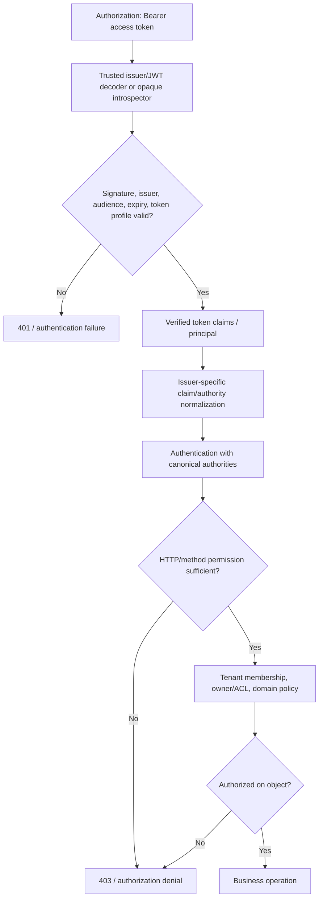
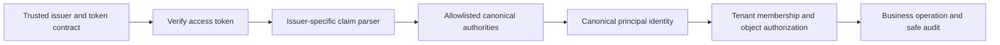

# Normalizing Scopes, Roles, and Principals Across Providers

In a **Spring Security OAuth 2.0 / OIDC Resource Server** integrated with multiple token issuers, signature verification or introspection only answers one question: **is the token accepted by a trusted issuer?** After that step, the API must still interpret claims into **functional permissions**, **application roles**, and **caller identity** according to each provider's contract. This is where security flaws commonly arise when moving from a single Identity Provider (IdP) to multiple IdPs.

For example, IdP A issues `scope: "orders.read"`, IdP B issues `scp: ["order:read"]`, and IdP C issues `permissions: ["read:orders"]`. All three values may represent the same application **capability**, yet they cannot automatically become the same authority without an **approved mapping table**. Similarly, a `roles: ["admin"]` claim from one provider does not automatically mean system-wide `ROLE_ADMIN`. And `sub: "42"` only identifies a subject **within the issuer's namespace**, which is insufficient to uniquely identify a user across multiple issuers.

This lesson belongs to the **Issuer Integration** chapter. We will design a **canonical principal + canonical authorities** contract, use Spring Security 6 converters in a Servlet JWT Resource Server, present WebFlux and opaque token variants, distinguish access tokens from ID Tokens, control tenant/owner boundaries, and cover testing and operations when an IdP changes claims. Examples use **Spring Boot 3, Spring Security 6, Java 17+**; provider-specific claim names are **common configurable patterns**, not a guarantee that every tenant or IdP version emits the exact same fields.

## 1. "Normalization" Does Not Mean Trusting Every Claim with a Similar Name

An `orders-api` may want a stable set of internal permissions:

```text
APP_orders.read
APP_orders.write
APP_orders.approve
APP_reports.export
```

While different issuers use external values:

```text
Issuer A: "orders.read"
Issuer B: "order:read"
Issuer C: "read:orders"
```

Normalization is an **authoritative decision** about which internal capability each external value maps to, **when coming from the right issuer, right audience, and right token profile**:

```text
(verifiedIssuer, sourceClaim, sourceValue, tokenProfile)
    -> approved mapping
    -> canonical authority
```

Do not use arbitrary string transformations such as "strip colons, uppercase, and prepend `ROLE_`." A mapping must represent **approved meaning**, not superficial name similarity.

**Goal:** business APIs check stable authorities while preserving each IdP's trust boundary.

## 2. Scope, Role, Permission, and Principal Are Distinct Concepts

| Concept | Typical Meaning | Example | What Must Not Be Inferred |
| --- | --- | --- | --- |
| **OAuth scope** | Scope of access granted to the client's access token. | `orders.read` | Access to every order or every tenant. |
| **Role** | Application or IdP group of responsibilities/semantics. | `support-agent` | That all roles share the same meaning across issuers. |
| **Permission/capability** | Specific action permitted by the application. | `reports.export` | That the permission applies to every object. |
| **Principal** | Authenticated caller. | `(iss, sub)` | That the principal is a human rather than a service account. |
| **Tenant** | Data space/organization being requested. | `acme` | That the issuer is the tenant, or that the caller belongs to the tenant. |
| **Audience** | Target protected resource of the token. | `orders-api` | That tokens intended for other APIs are also accepted. |

In Spring Security, values placed into `GrantedAuthority` are typically **strings**, such as `SCOPE_orders.read` or `APP_orders.read`. The framework does not inherently know which role corresponds to which permission. Generating and interpreting authorities is the **responsibility of the application contract**.

`hasAuthority("APP_orders.read")` checks the exact string; `hasRole("ADMIN")` applies the `ROLE_ADMIN` convention. Do not mix these conventions accidentally.

## 3. Three Layers That Must Be Separated in the Pipeline



The verification layer can be handled by `JwtDecoder`/`ReactiveJwtDecoder` or `OpaqueTokenIntrospector`/`ReactiveOpaqueTokenIntrospector`. The mapping layer must rely on a **verified issuer**, never accepting a new issuer from an unverified claim. Domain authorization must continue checking tenant, owner, and current membership status.

**A valid signature does not mean authority mapping is right; a valid authority does not mean object access is allowed.**

## 4. Validating Access Tokens Differs from OIDC Login and ID Tokens

An OIDC Client can receive:

```text
Authorization Code + PKCE
  -> ID Token for OIDC Client
  -> Access Token for protected resources
```

An **ID Token** is for the OIDC Client to authenticate the End-User under the OIDC contract; an **Access Token** is for accessing an OAuth Resource Server. Both may be JWTs with `iss`/`sub`, yet they do not share the same audience or purpose.

| Token | Typical Audience | Consumer | Used to Build API Authorities? |
| --- | --- | --- | --- |
| OIDC ID Token | OIDC Client ID | Web/BFF OAuth Client | **Do not use directly as an API access token.** |
| JWT access token | Protected resource/audience per IdP contract | Resource Server | Yes, **after verifying the right token profile**. |
| Opaque access token | Cannot be inferred from token string | Resource Server via introspection | Yes, per **trusted response** and policy. |
| Refresh token | Authorization Server token endpoint | Authorized OAuth Client | **Never** use as a credential to call business APIs. |

A token containing `roles: ["admin"]` in a web client's ID Token does not grant admin privileges to the Resource Server. Browser `.oauth2Login()` and API `.oauth2ResourceServer()` are two separate flows. **API** audience/token type validation must complete before normalizing authorities.

## 5. Claims Commonly Differ Across Providers

The following table shows **common examples**, not immutable vendor specifications:

| IdP / Deployment Type | Common Claims | Things to Check |
| --- | --- | --- |
| Keycloak | `scope`, `realm_access.roles`, `resource_access.{client}.roles` | Realm roles differ from client roles; do not map every realm admin to app admin. |
| Microsoft Entra ID | `scp` for delegated permissions, `roles` for app roles/application permissions in certain tokens | Distinguish delegated user tokens from app-only tokens; verify `tid`, `oid`, issuer, and audience per contract. |
| Okta | `scp`, `groups`, or custom claims depending on Authorization Server/configuration | Do not assume every access token contains groups; claim mapping must depend on the issuer/authorization server. |
| Auth0 | `scope`, `permissions` when corresponding features/settings are enabled, namespaced custom claims | API audience and permissions contract must be configured; avoid treating every custom claim as a global role. |
| Amazon Cognito User Pools | `scope`, `cognito:groups`, `client_id`, `token_use`, and profile-specific claims | Access token profile differs from ID Token; `aud` or client/resource binding must follow the token type. |
| Custom/OIDC-compliant IdP | Issuer-defined claims or introspection response | Never infer permissions solely from generic field names. |

Two tenants using the **same IdP product** can still differ in token profiles, mappings, client registrations, and audiences. Therefore, the right design is **issuer/profile-specific configuration**, not a single function that reads any claim named `role`.

## 6. Verify Issuer/Audience Before Normalizing

A JWT:

```json
{
  "iss": "https://issuer-a.example/realms/shop",
  "sub": "user-42",
  "aud": ["payments-api"],
  "scope": "orders.read"
}
```

may be validly signed by a trusted issuer yet intended for `payments-api`, **not `orders-api`**. If the API checks the scope while ignoring audience, that is a **cross-resource token substitution** vulnerability.

You must verify:

1. **Exact/trusted issuer:** accept only issuers in an approved list/configuration.
2. **Signature/JWK/algorithm:** public keys and algorithms match the issuer; never select keys from an arbitrary URL inside the token.
3. **Time:** `exp`, `nbf`, and clock skew per policy.
4. **Audience/resource binding:** the token is intended for this API; contracts may vary across IdPs.
5. **Token type/profile:** an access token rather than an ID Token or another token type.
6. **Authority claim contract:** only after the above steps should scope/role/permission claims be read as privileges.

When one issuer serves multiple tenants, a valid issuer/audience check still **does not** verify which tenant the user belongs to. Tenant grants/membership must be checked separately.

## 7. Unverified `iss` May Only Serve as a Lookup Hint

An attacker can craft a JWT payload:

```json
{
  "iss": "https://attacker.example",
  "sub": "system-admin",
  "roles": ["admin"]
}
```

A multi-issuer Resource Server may need to read `iss` first to **select** an AuthenticationManager, but that does not mean the token is trusted. `iss` may only be used as a **lookup key into a trusted issuer registry**, after which the selected manager must verify the signature and `iss`.

Do not do this:

```java
// ANTI-PATTERN: do not auto-trust a URL from an unverified JWT.
String issuer = readUnverifiedIssuer(rawToken);
JwtDecoder decoder = JwtDecoders.fromIssuerLocation(issuer);
return decoder.decode(rawToken);
```

Dynamically creating decoders/JWKS from arbitrary URLs in a token exposes the API to **SSRF, malicious issuer acceptance, resource exhaustion, and manager-cache poisoning**. Claim normalization must never run on an unverified token.

## 8. Application Canonical Authority Model

A good approach is to define internal authorities **independent of how IdPs name them**:

```text
APP_orders.read
APP_orders.write
APP_orders.approve
APP_reports.export
APP_tickets.manage
```

Naming conventions must be documented in the API authorization contract:

- The `APP_` prefix denotes a **canonical application permission**.
- An external scope maps to an internal permission only when the issuer is permitted to grant it.
- An external role may map to **one or more specific permissions**, if approved by policy.
- Privileged permissions such as `APP_platform.manage` must have **explicit trust scope and provisioning**, never inferred from the string `admin`.
- Tenant-specific authorities need tenant context or domain policy enforcement; `APP_orders.read` does not mean reading every order.

If a project already uses `SCOPE_` conventions, you may keep them, but distinguish between **preserving OAuth scope names** and **canonicalizing multiple equivalent scope sources**. Avoid changing prefixes arbitrarily and breaking `hasAuthority(...)` rules.

## 9. Mapping Tables Must Be Per Issuer and Token Profile

Organization-approved example:

| Verified Issuer | Claim | Raw Value | Canonical Authority |
| --- | --- | --- | --- |
| `issuer-a` | `scope` | `orders.read` | `APP_orders.read` |
| `issuer-a` | `scope` | `orders.write` | `APP_orders.write` |
| `issuer-b` | `scp` | `order:read` | `APP_orders.read` |
| `issuer-b` | `roles` | `OrdersApprover` | `APP_orders.approve` |
| `issuer-c` | `permissions` | `read:orders` | `APP_orders.read` |
| `issuer-c` | `permissions` | `export:reports` | `APP_reports.export` |
| `issuer-b` | `roles` | `GlobalAdmin` | **Do not map automatically** |

Never have a global rule like:

```text
If claim contains "admin" then add ROLE_ADMIN
```

because issuer B might grant the `GlobalAdmin` role in **system B**, which must not grant administrative privileges in **our platform**.

Mappings should have versioning, approvers, test criteria, and a rollout policy. When a provider changes claim semantics, updating a mapping is a **security change**, not just a parser tweak.

## 10. Distinguishing App-Only Tokens from User-Delegated Tokens

In OAuth 2.0, the principal is not always a human user:

```text
Authorization Code + PKCE -> typically represents user + client
Client Credentials       -> represents client/service, no end-user required
```

With some IdPs, app-only access tokens contain application roles in `roles` instead of delegated scopes in `scp`. If an app-only token lacks `scp`, **do not assume the token is invalid merely because it lacks delegated scopes**, yet still verify the caller kind and the permissions actually granted to the service.

Canonical callers can distinguish:

```text
CallerKind.USER
CallerKind.SERVICE
```

However, determination must rely on **verified issuer/token profile and defined claims**, not guessing from the presence or absence of `email`. A service account can have `sub`; a user token can have `client_id` or `azp`.

**Do not fabricate a human user principal from an application token's `client_id`**, or apply a user-only owner policy to service credentials without an M2M permission model.

## 11. Principals Must Have an Issuer Namespace

Example:

```text
Issuer A, sub="42" -> Alice
Issuer B, sub="42" -> Bob
```

Two identical subject strings are not necessarily the same person. A simple canonical principal key:

```java
public record PrincipalKey(
    String issuer,
    String subject
) {}
```

With a verified JWT:

```java
PrincipalKey principalKey(Jwt jwt) {
    if (jwt.getIssuer() == null
            || jwt.getSubject() == null
            || jwt.getSubject().isBlank()) {
        throw new BadCredentialsException(
            "Verified issuer and subject required");
    }

    return new PrincipalKey(
        jwt.getIssuer().toString(),
        jwt.getSubject());
}
```

`Jwt`, `BadCredentialsException`, and `PrincipalKey` require appropriate imports/definitions. If an access token profile **has no human subject**, design a dedicated canonical service identity; never invent a `sub` from email or a tenant header.

**Do not use `Authentication.getName()` as a global database key** when that name is configured to a mutable username/email. With multiple issuers, **`(verified iss, verified sub)` or a trusted linked internal ID** is the accurate choice for ownership and auditing.

## 12. `sub`, `oid`, `tid`, Email, and Username Have Different Meanings

Some IdPs also issue:

```json
{
  "sub": "pairwise-or-provider-subject",
  "oid": "provider-object-id",
  "tid": "provider-tenant-id",
  "email": "alice@example.com",
  "preferred_username": "alice"
}
```

Depending on the provider, `oid` may be a directory object ID and `tid` a tenant/directory identifier; `sub` may have client-pairwise semantics. **Do not interchange these values without understanding the exact token contract.**

| Field | Typically Appropriate For | Should Not Be Used Directly For |
| --- | --- | --- |
| `iss` | Issuer namespace. | Application tenant without a mapping. |
| `sub` | Subject within that issuer/profile. | Global user ID across IdPs. |
| `oid`/provider ID | Identity per provider contract. | Replacing `sub` across all providers. |
| `tid`/directory ID | Provider directory/issuer context. | Business tenant membership without policy. |
| `preferred_username` | Display/login hint. | Stable primary key. |
| `email` | Contact/display/controlled lookup. | Automatically linking two accounts across two issuers. |
| `client_id`/`azp` | Identifying OAuth client per profile. | Human subject or global role. |

If an `internalUserId` is needed, maintain an identity linking table:

```text
(issuer, externalSubject, profile)
    -> verified linking workflow
    -> internalUserId
```

Do not automatically link accounts solely because they share the same email, even if one side has `email_verified=true`, without a workflow matching the product and trust model.

## 13. `JwtAuthenticationToken.getName()` Is Not the Entire Identity

The default `JwtAuthenticationConverter` typically uses `sub` as the principal name. This can be changed:

```java
JwtAuthenticationConverter converter =
    new JwtAuthenticationConverter();
converter.setPrincipalClaimName("preferred_username");
```

This changes `Authentication.getName()` to the chosen claim; it **does not change `Jwt.getSubject()` or `Jwt.getIssuer()`** and does not make the username globally unique.

When downstream services need a stable identity:

```java
Authentication auth =
    SecurityContextHolder.getContext().getAuthentication();

if (!(auth instanceof JwtAuthenticationToken jwtAuth)) {
    throw new AccessDeniedException(
        "Verified JWT caller required");
}

Jwt jwt = jwtAuth.getToken();
PrincipalKey key = principalKey(jwt);
```

This snippet illustrates the Servlet stack with `SecurityContextHolder`, `JwtAuthenticationToken`, and `AccessDeniedException` imported accordingly. For opaque tokens, obtain the verified issuer/subject per the introspection contract; for WebFlux, read identity from the Reactor Context instead of ThreadLocal.

**Rule:** `getName()` may be a display name or `sub`; business canonical identity must have an explicit structure/namespace.

## 14. Spring Security's Default Scope Mapping

In a Spring Security JWT Resource Server, `JwtGrantedAuthoritiesConverter` typically looks for the **`scope` or `scp`** claim and creates authorities with the default `SCOPE_` prefix:

```json
{"scope": "orders.read orders.write"}
```

becomes:

```text
SCOPE_orders.read
SCOPE_orders.write
```

Another token:

```json
{"scp": ["orders.read", "reports.export"]}
```

typically becomes:

```text
SCOPE_orders.read
SCOPE_reports.export
```

`JwtGrantedAuthoritiesConverter` does not automatically read arbitrary provider claims like `roles`, `groups`, `realm_access`, or `permissions`. Supporting those claims requires **configuring the claim name** or writing a custom converter.

`hasAuthority("SCOPE_orders.read")` checks the exact string; `hasRole("ADMIN")` does not automatically match this scope. A `JwtAuthenticationToken` with valid authorities still does not determine the record's owner/tenant.

## 15. Using `JwtGrantedAuthoritiesConverter` for Simple Mappings

When an issuer emits `permissions` as a CSV string:

```json
{"permissions": "orders.read,orders.write,reports.export"}
```

Spring Security 6.1+ supports configurable delimiters:

```java
import org.springframework.security.oauth2.server.resource.authentication.JwtGrantedAuthoritiesConverter;
import org.springframework.security.oauth2.server.resource.authentication.JwtAuthenticationConverter;

JwtGrantedAuthoritiesConverter permissions =
    new JwtGrantedAuthoritiesConverter();

permissions.setAuthoritiesClaimName("permissions");
permissions.setAuthorityPrefix("PERM_");
permissions.setAuthoritiesClaimDelimiter("\\s*,\\s*");

JwtAuthenticationConverter converter =
    new JwtAuthenticationConverter();
converter.setJwtGrantedAuthoritiesConverter(permissions);
```

With this configuration, `permissions` becomes:

```text
PERM_orders.read
PERM_orders.write
PERM_reports.export
```

However, this is **syntactic normalization**, not semantic mapping across different meanings:

- `read:orders` does not automatically become `orders.read`.
- `role=admin` does not automatically become `APP_platform.manage`.
- `permissions` from an unauthorized issuer should still not be trusted for the API.
- Changing `setAuthoritiesClaimName` may cause the converter to **stop reading `scope`**; it does not merge two sources automatically.

When mapping across multiple claims/issuers is required, use a converter with an **explicit allowlist**.

## 16. Designing `ProviderClaimProfile`

An immutable profile can specify claims and mappings per issuer:

```java
import java.util.Map;

public record ProviderClaimProfile(
    String issuer,
    String scopeClaim,
    String roleClaim,
    Map<String, String> scopeToAuthority,
    Map<String, String> roleToAuthority
) {
    public ProviderClaimProfile {
        scopeToAuthority = Map.copyOf(scopeToAuthority);
        roleToAuthority = Map.copyOf(roleToAuthority);
    }
}
```

Example trusted configuration:

```java
ProviderClaimProfile acme = new ProviderClaimProfile(
    "https://issuer-a.example/realms/shop",
    "scope",
    "roles",
    Map.of(
        "orders.read", "APP_orders.read",
        "orders.write", "APP_orders.write"),
    Map.of(
        "OrdersApprover", "APP_orders.approve"));

ProviderClaimProfile beta = new ProviderClaimProfile(
    "https://issuer-b.example/tenant",
    "scp",
    "app_roles",
    Map.of(
        "order:read", "APP_orders.read"),
    Map.of(
        "ExportReports", "APP_reports.export"));
```

The claim names `roles` and `app_roles` here **belong to the example contract**, without asserting every issuer emits those exact fields. Profiles must be **approved by the control plane**, and tokens must already be verified against the corresponding issuer.

**Never read `scopeToAuthority` from a JSON claim inside the access token.** Mapping tables are server-side policy, not caller-controlled input.

## 17. A Fully Local Canonical Converter

The following example illustrates allowlisted mapping with claim type validation. It receives a **JWT already verified by the decoder** and performs no HTTP/DB I/O.

```java
import java.util.ArrayList;
import java.util.Collection;
import java.util.LinkedHashSet;
import java.util.List;
import java.util.Map;
import java.util.Set;

import org.springframework.core.convert.converter.Converter;
import org.springframework.security.authentication.AbstractAuthenticationToken;
import org.springframework.security.authentication.BadCredentialsException;
import org.springframework.security.core.GrantedAuthority;
import org.springframework.security.core.authority.SimpleGrantedAuthority;
import org.springframework.security.oauth2.jwt.Jwt;
import org.springframework.security.oauth2.server.resource.authentication.JwtAuthenticationToken;

public final class CanonicalJwtConverter
        implements Converter<Jwt, AbstractAuthenticationToken> {

    private final Map<String, ProviderClaimProfile> profiles;

    public CanonicalJwtConverter(
            Map<String, ProviderClaimProfile> profiles) {
        this.profiles = Map.copyOf(profiles);
    }

    @Override
    public AbstractAuthenticationToken convert(Jwt jwt) {
        if (jwt.getIssuer() == null
                || jwt.getSubject() == null
                || jwt.getSubject().isBlank()) {
            throw new BadCredentialsException(
                "Verified issuer and subject are required");
        }

        String issuer = jwt.getIssuer().toString();
        ProviderClaimProfile profile = profiles.get(issuer);
        if (profile == null) {
            throw new BadCredentialsException(
                "No trusted claim mapping for issuer");
        }

        Set<GrantedAuthority> authorities =
            new LinkedHashSet<>();

        for (String scope : values(jwt, profile.scopeClaim())) {
            String mapped = profile.scopeToAuthority().get(scope);
            if (mapped != null) {
                authorities.add(new SimpleGrantedAuthority(mapped));
            }
        }

        for (String role : values(jwt, profile.roleClaim())) {
            String mapped = profile.roleToAuthority().get(role);
            if (mapped != null) {
                authorities.add(new SimpleGrantedAuthority(mapped));
            }
        }

        return new JwtAuthenticationToken(jwt, authorities);
    }

    private static List<String> values(
            Jwt jwt, String claimName) {
        Object raw = jwt.getClaims().get(claimName);
        if (raw == null) {
            return List.of();
        }

        if (raw instanceof String string) {
            String trimmed = string.trim();
            return trimmed.isEmpty()
                ? List.of()
                : List.of(trimmed.split("\\s+"));
        }

        if (raw instanceof Collection<?> collection) {
            List<String> result = new ArrayList<>();
            for (Object value : collection) {
                if (!(value instanceof String string)
                        || string.isBlank()) {
                    throw new BadCredentialsException(
                        "Unexpected claim element");
                }
                result.add(string);
            }
            return result;
        }

        throw new BadCredentialsException(
            "Unexpected claim shape");
    }
}
```

The code uses Java 17 pattern matching for `instanceof`. `ProviderClaimProfile` from the previous section must reside in an appropriate package. The `values` helper here splits **strings on whitespace**, suitable for string or collection `scope`/`scp`; if a provider emits CSV or nested claims, a dedicated parser matching the **exact profile** is needed. Do not blindly accept arbitrary data types from a JWT.

When a mapping lacks a key, the converter **ignores the unapproved permission** without creating an authority. For an endpoint's required permissions, missing authorities lead to authorization denial. Ignoring unknown claims does not mean the API ignores **token validation errors**.

The code deliberately **does not collapse roles into a global `ROLE_ADMIN`**. Only mappings in the trusted profile are created; the app still enforces tenant/owner checks.

## 18. Why Local Converters Should Not Call DB/HTTP

A JWT authentication converter typically runs on the **authentication path of every protected request**. If it synchronously calls a database or HTTP client to fetch roles:

```java
// ANTI-PATTERN: blocking enrichment directly inside the converter.
Converter<Jwt, AbstractAuthenticationToken> bad =
    jwt -> loadUserAndRolesFromBlockingDatabase(jwt);
```

then every request is delayed by I/O, and in WebFlux this also risks blocking the event loop.

With `CanonicalJwtConverter`, the job is purely to **map verified claims** using an in-memory immutable table. Permissions that vary by tenant/owner can be checked **in the service** after authentication via the database/repository appropriate to the stack.

If external permission lookup is genuinely needed **before Authentication completes**, use a reactive converter in WebFlux or an appropriate policy service architecture; design timeouts, concurrency caps, fail-closed handling, and cache TTLs per security requirements. `ReactiveJwtAuthenticationConverterAdapter` only wraps a **non-blocking** imperative converter—it does not make blocking JDBC/HTTP clients non-blocking.

## 19. Wiring Converters with Per-Issuer `JwtAuthenticationProvider`

In a multi-issuer Servlet Resource Server, each manager can use its own converter:

```java
import org.springframework.security.authentication.AuthenticationManager;
import org.springframework.security.authentication.ProviderManager;
import org.springframework.security.oauth2.jwt.JwtDecoder;
import org.springframework.security.oauth2.server.resource.authentication.JwtAuthenticationProvider;

AuthenticationManager managerForIssuer(
        JwtDecoder trustedDecoder,
        ProviderClaimProfile profile) {

    CanonicalJwtConverter converter =
        new CanonicalJwtConverter(
            Map.of(profile.issuer(), profile));

    JwtAuthenticationProvider provider =
        new JwtAuthenticationProvider(trustedDecoder);
    provider.setJwtAuthenticationConverter(converter);

    return new ProviderManager(provider);
}
```

The `JwtDecoder` in this example must **verify signature/issuer/audience/token profile** using trusted keys/algorithms. It is a method dependency, not configured here.

To select a manager by `iss` from an approved list:

```java
import org.springframework.security.oauth2.server.resource.authentication.JwtIssuerAuthenticationManagerResolver;

Map<String, AuthenticationManager> managers = Map.of(
    acmeIssuer, acmeManager,
    betaIssuer, betaManager);

JwtIssuerAuthenticationManagerResolver resolver =
    new JwtIssuerAuthenticationManagerResolver(managers::get);
```

All `acmeIssuer`, `betaIssuer`, `acmeManager`, and `betaManager` entries must be constructed from a **trusted registry**, never from URLs read directly out of a JWT to instantiate freely.

**Never let a converter map claims of issuer B using issuer A's profile.** If the issuer is unknown, reject before mapping permissions.

## 20. Configuring `SecurityFilterChain` with Canonical Authorities

Servlet example:

```java
import jakarta.servlet.http.HttpServletRequest;
import org.springframework.context.annotation.Bean;
import org.springframework.http.HttpMethod;
import org.springframework.security.authentication.AuthenticationManagerResolver;
import org.springframework.security.config.annotation.web.builders.HttpSecurity;
import org.springframework.security.config.http.SessionCreationPolicy;
import org.springframework.security.web.SecurityFilterChain;

@Bean
SecurityFilterChain ordersApiSecurity(
        HttpSecurity http,
        AuthenticationManagerResolver<HttpServletRequest> resolver)
        throws Exception {

    return http
        .csrf(csrf -> csrf.disable())
        .sessionManagement(session -> session
            .sessionCreationPolicy(SessionCreationPolicy.STATELESS))
        .authorizeHttpRequests(auth -> auth
            .requestMatchers(
                HttpMethod.GET, "/api/tenants/{tenantId}/orders/**")
                .hasAuthority("APP_orders.read")
            .requestMatchers(
                HttpMethod.POST, "/api/tenants/{tenantId}/orders")
                .hasAuthority("APP_orders.write")
            .anyRequest().denyAll())
        .oauth2ResourceServer(oauth2 -> oauth2
            .authenticationManagerResolver(resolver))
        .build();
}
```

Order of execution:

1. The resolver selects the manager for an allowed issuer.
2. The decoder/introspector verifies the token matches the profile.
3. `CanonicalJwtConverter` maps scopes/roles to `APP_*`.
4. HTTP rules check canonical capabilities.
5. The service checks tenant membership and owner/ACL.

`STATELESS` only ensures web `HttpSession` is not used to restore Authentication. `csrf.disable()` is only reasonable for pure Bearer-header APIs that do not rely on automatically sent cookies; if a BFF/browser session is present, evaluate CSRF according to the architecture.

`anyRequest().denyAll()` is the fallback for this chain. Applications with multiple filter chains must ensure all URLs (docs, metrics, Actuator, admin) have explicit policies and do not fall outside protection.

## 21. Mapping Keycloak Realm Roles and Client Roles

A Keycloak access token may have illustrative nested claims:

```json
{
  "iss": "https://keycloak.example/realms/acme",
  "sub": "user-123",
  "aud": ["orders-api"],
  "scope": "openid orders.read",
  "realm_access": {
    "roles": ["default-roles-acme", "support"]
  },
  "resource_access": {
    "orders-api": {
      "roles": ["approver"]
    }
  }
}
```

**You cannot pass `setAuthoritiesClaimName("realm_access.roles")` and assume `JwtGrantedAuthoritiesConverter`'s default parser understands nested JSON.** That is a claim path, not a top-level claim name under the default converter's contract.

A custom converter can read nested structures using strict type checking:

```java
Object root = jwt.getClaims().get("resource_access");

if (root instanceof Map<?, ?> resources) {
    Object client = resources.get("orders-api");
    if (client instanceof Map<?, ?> clientData) {
        Object roles = clientData.get("roles");
        if (roles instanceof Collection<?> roleValues) {
            for (Object value : roleValues) {
                if ("approver".equals(value)) {
                    authorities.add(new SimpleGrantedAuthority(
                        "APP_orders.approve"));
                }
            }
        }
    }
}
```

This snippet is **logic inside a custom converter** with `jwt` and `authorities` already declared. In production, validate the `Collection` type, bound element counts, distinguish issuer/client role profiles, and **do not accept another client's roles as `orders-api` permissions**. You must also verify the token audience/profile and Keycloak issuer before reaching this step.

A Keycloak realm role `admin` **does not automatically mean** global application admin. There must be an approved mapping, ideally scoped by tenant/resource.

## 22. Microsoft Entra ID: Delegated Scopes and App Roles

Some Microsoft Entra ID access tokens contain:

```json
{
  "iss": "https://login.microsoftonline.com/<tenant-guid>/v2.0",
  "tid": "<tenant-guid>",
  "oid": "<object-guid>",
  "sub": "<subject-value>",
  "aud": "api://orders-api",
  "scp": "Orders.Read",
  "azp": "<client-app-id>"
}
```

An app-only token or a token using an app-role contract may use `roles` instead of delegated scopes:

```json
{
  "iss": "https://login.microsoftonline.com/<tenant-guid>/v2.0",
  "aud": "api://orders-api",
  "roles": ["Orders.Read.All"]
}
```

These claims merely illustrate **how token shapes can differ by endpoint version, tenant, client, and grant**. The Resource Server should not lump everything together as "user roles":

- `scp` usually represents **delegated scopes**; both a user and a client are in the trust context.
- `roles` may represent **application permissions/app roles** or profile-specific roles.
- `tid` is the Entra directory tenant; it is not automatically the SaaS business tenant.
- `oid` is the provider object identity per the issuer/directory contract, not a direct drop-in for a global user ID.
- `aud` must match the API resource; never accept tokens intended for Microsoft Graph or another API.

An example mapping table:

```text
Verified Entra issuer + scp "Orders.Read"
  -> APP_orders.read (delegated profile)

Verified Entra issuer + roles "Orders.Read.All"
  -> APP_orders.read (approved app-only profile)
```

Both cases yield the same authority only when **security policy permits services and users to share that capability**. If an endpoint is strictly for users or strictly for services, check **caller kind** in addition to the authority.

## 23. Okta, Auth0, and Cognito: Claim Contracts Must Be Confirmed

### Okta

An Authorization Server can emit `scp` or custom `groups`/claims depending on configuration. Do not assume `groups` is always present in every access token, or map every `Administrators` group to `ROLE_ADMIN`. Confirm the issuer, token audience, and claim source on the Authorization Server configured for the API.

### Auth0

An access token intended for an API may contain `scope`, `permissions` when the appropriate RBAC/permissions configuration is enabled, or custom namespaced claims. Do not rely on `permissions` on tokens not intended for the API, and do not automatically map a custom claim `is_admin=true` to global admin privileges unless the issuer is authorized to grant them.

### Amazon Cognito

User Pool access tokens can include `scope`, `cognito:groups`, `client_id`, `token_use`, and profile-specific claims. With Cognito, **read the exact token type/access-token contract** to confirm issuer, resource binding/audience, and client identity; never copy a JWT audience validator verbatim from another IdP if the access token profile has different semantics.

In all three cases, normalization must rely on the **specific contract of the issuer + authorization server/user pool + API registration**, not merely the IdP product name. When a migration changes claim sources or token versions, test the profile before activating new mappings.

## 24. Scope/Role Collisions: Same String Does Not Guarantee Same Meaning

Two tokens:

```json
{"scope": "admin"}
```

and:

```json
{"roles": ["admin"]}
```

are not automatically equivalent. API A's `admin` scope might administer reports, while IdP B's `admin` role might administer accounts **within system B**. Neither necessarily has anything to do with `APP_platform.manage`.

A solid policy explicitly specifies:

```text
issuer/profile, raw-claim, raw-value
    -> granted canonical permission
```

and **leaves unknown values unmapped** by default. Never do:

```java
new SimpleGrantedAuthority(
    "ROLE_" + rawRole.toUpperCase());
```

for every role from every issuer. That creates immediate privilege escalation whenever an issuer adds a role sharing a name with a privileged role in your application.

If issuer A's `support` role needs to translate into three internal permissions, use a one-to-many mapping:

```text
issuer A / role support
  -> APP_tickets.read
  -> APP_tickets.reply
  -> APP_orders.read
```

Do not grant `APP_orders.write` unless explicitly approved and backed by corresponding security tests.

## 25. Tenant Roles Are Not Global Roles

A user might be:

```text
Tenant Acme:  role = administrator
Tenant Beta:  role = viewer
```

If a converter creates a global `ROLE_ADMIN` merely upon seeing `administrator` in a tenant claim, the user could accidentally gain admin rights in Beta.

A stronger design:

```text
Trusted Authentication:
  principal = (iss, sub)
  canonical functional authorities = APP_orders.read, ...

Requested tenant = beta
Tenant authorization:
  membership(beta, principal)
  tenantRole(beta, principal)
  objectPolicy(beta, orderId, principal)
```

Alternatively, create tenant-scoped authorities with explicit tenant identifiers and enforce matching tenant checks, while avoiding **high-cardinality authorities**, stale role claims, and tenant-string spoofing risks. For rapidly changing permissions, domain service/database policies usually need to check current membership; an unexpired JWT can still hold a revoked role.

**Role normalization must never erase tenant boundaries.**

## 26. Canonical Identity Can Serve Both Users and Services, But Must Distinguish Kinds

An internal model:

```java
public enum CallerKind {
    USER, SERVICE
}

public record CanonicalCaller(
    PrincipalKey identity,
    CallerKind kind,
    String clientId
) {}
```

Contract:

- `identity` is built from the **verified token profile**.
- `kind` must be derived from grant/token type and trusted claims, not merely the presence/absence of email.
- `clientId` represents the OAuth client per the issuer's profile, not an equivalent of `sub`.
- Tenant membership/capabilities must be resolved separately.

If app-only access tokens use `sub` with different semantics than user tokens, a dedicated `ServicePrincipalKey` (verified issuer + verified client ID or workload identity per contract) may be necessary. Never force a service token into a human account to exercise a user's owner permissions.

In audit logs, record the caller kind and canonical identity cleanly; never log raw access tokens or full claims.

## 27. Opaque Tokens Need Normalization from the Introspection Response

For an opaque access token:

```http
POST /oauth2/introspect
Content-Type: application/x-www-form-urlencoded

token=<opaque-token>
```

The Resource Server receives a response from a **trusted configured introspection endpoint**, for example:

```json
{
  "active": true,
  "sub": "user-42",
  "client_id": "orders-web",
  "scope": "orders.read",
  "aud": ["orders-api"],
  "iss": "https://legacy-issuer.example"
}
```

`OpaqueTokenIntrospector` returns an `OAuth2AuthenticatedPrincipal` and Spring Security can map scopes. However, never assume all opaque responses from all IdPs share the same schema/semantics:

- Identify the token's **introspection authority/client identity** per the trusted routing contract.
- Only use valid `active:true` responses matching the expected token profile/audience.
- Map `scope`, `permissions`, and `roles` according to the **issuer-specific policy** if present.
- Derive the canonical principal from verified `iss`/`sub` or an authority-committed identity; if the issuer is absent from the response, the registry must supply the appropriate trusted namespace.
- Namespace caches by authority/introspection client and policy version.

**Timeouts, 429s, 5xx responses, and TLS errors are not `active:false`**. Never negative-cache them as "invalid token"; fail closed with telemetry distinguishing dependency outages from denied credentials.

`JwtAuthenticationConverter` is only for **JWTs**, not automatically applied to opaque tokens. You need a corresponding mapper inside the introspector or authentication conversion layer for the opaque profile.

## 28. Spring Security Principals Can Have Different Types

| Authentication Flow | Common Principal/Auth Type | What Must Not Be Assumed |
| --- | --- | --- |
| Servlet JWT Resource Server | `JwtAuthenticationToken` with `Jwt` | That principal is always `OidcUser`. |
| Servlet opaque Resource Server | `BearerTokenAuthentication` with `OAuth2AuthenticatedPrincipal` | That `getToken()` returns a JWT. |
| OIDC Client web login | OIDC/OAuth2 Client Authentication, possibly with `OidcUser` | That web login session is a Bearer access token for APIs. |
| WebFlux JWT Resource Server | Reactive Authentication stored in Reactor SecurityContext | That it can always be read via Servlet `SecurityContextHolder`. |
| Machine-to-machine | Service credential Authentication | That the caller is a human end-user. |

**Never cast every `Authentication.getPrincipal()` to `Jwt`.** Design a layer that extracts canonical identity based on Authentication type and profile, or pass the verified canonical identity from the security boundary into domain services.

In WebFlux, use `ReactiveSecurityContextHolder.getContext()` or the principal provided by WebFlux argument resolvers. Reactor Context differs from Servlet `ThreadLocal`; never call `.block()` to fetch Authentication while processing a reactive request.

## 29. WebFlux: Wrapping a Local Converter with an Adapter

If a mapping is purely in-memory like `CanonicalJwtConverter`, it can be reused in WebFlux:

```java
import org.springframework.core.convert.converter.Converter;
import org.springframework.security.authentication.AbstractAuthenticationToken;
import org.springframework.security.oauth2.jwt.Jwt;
import org.springframework.security.oauth2.server.resource.authentication.ReactiveJwtAuthenticationConverterAdapter;
import reactor.core.publisher.Mono;

Converter<Jwt, AbstractAuthenticationToken> imperative =
    new CanonicalJwtConverter(trustedProfiles);

Converter<Jwt, Mono<AbstractAuthenticationToken>> reactive =
    new ReactiveJwtAuthenticationConverterAdapter(imperative);
```

Attach to `ServerHttpSecurity`:

```java
.oauth2ResourceServer(oauth2 -> oauth2
    .jwt(jwt -> jwt.jwtAuthenticationConverter(reactive)))
```

The `trustedProfiles` and `reactive` variables in the example represent injected/configured dependencies. The adapter only wraps **non-blocking** imperative converters; it does not make JDBC, REST clients, or `.block()` non-blocking.

If permissions must be fetched from WebClient/R2DBC, use `ReactiveJwtAuthenticationConverter` with `Converter<Jwt, Flux<GrantedAuthority>>` or a genuinely reactive custom `Converter<Jwt, Mono<AbstractAuthenticationToken>>` with explicit timeouts, concurrency caps, and error policies. Consider keeping tenant/owner authorization in domain services rather than making network calls on **every authentication request**.

## 30. HTTP/Method Authorization Should Use Canonical Permissions

After mapping provider claims to `APP_orders.read`, HTTP rules stay stable:

```java
.authorizeHttpRequests(auth -> auth
    .requestMatchers(
        HttpMethod.GET,
        "/api/tenants/{tenantId}/orders/**")
        .hasAuthority("APP_orders.read")
    .anyRequest().denyAll())
```

Reactive variant:

```java
.authorizeExchange(exchanges -> exchanges
    .pathMatchers(
        HttpMethod.GET,
        "/api/tenants/{tenantId}/orders/**")
        .hasAuthority("APP_orders.read")
    .anyExchange().denyAll())
```

With method security:

```java
@PreAuthorize("hasAuthority('APP_orders.read')")
public OrderDto getOrder(String tenantId, long orderId) {
    return orderService.getVisibleOrder(tenantId, orderId);
}
```

This illustrates Servlet method security; in WebFlux, use `@EnableReactiveMethodSecurity` and methods returning publishers where appropriate. `@PreAuthorize` requires a Spring-managed proxy to operate via Spring AOP; direct `new Service()` instantiation or self-invocation may bypass the interceptor.

**Canonical permissions are only a functional gate.** `getVisibleOrder` must still check tenant membership, owner/ACL, and data update policies.

## 31. Domain Authorization Must Check Tenant and Object

Suppose the caller has:

```text
principal = (https://issuer-a.example, alice)
authority = APP_orders.read
requestedTenant = beta
orderId = 201
```

The API must verify:

```text
issuerAllowedForTenant(beta, verifiedIssuer)
AND activeMembership(beta, verifiedIssuer, verifiedSubject)
AND hasCapability(APP_orders.read)
AND orderVisibleToCaller(beta, 201, verifiedPrincipal)
```

An illustrative owner-only query:

```sql
SELECT *
FROM orders
WHERE id = :orderId
  AND tenant_id = :tenantId
  AND owner_issuer = :issuer
  AND owner_subject = :subject
```

If the business domain includes admins, shared access, or service roles, establish a dedicated reviewed ACL/policy. Never use an unscoped `findById(orderId)` and return data solely because `APP_orders.read` is present.

Authority normalization **does not replace** BOLA/IDOR boundaries, tenant membership, or current permission state.

## 32. When Token Claims Change or a Provider Upgrades

Changes that can happen:

```text
scope: "orders.read"
    -> scp: ["orders.read"]

roles: ["OrderApprover"]
    -> permissions: ["approve:order"]

sub: stable
    -> a new token profile with different subject semantics
```

Do not update parsers by "trying every claim until finding an admin role." That can accidentally escalate privileges if a new claim carries different semantics.

Migration workflow:

1. Identify the **verified issuer/profile** and the new token version.
2. Collect token fixtures provided over a secure channel, redacting secrets.
3. Confirm which claims are authoritative for the API's access tokens.
4. Write the new allowlist mapping in trusted configuration.
5. Test missing claims, wrong types, unrecognized roles, multi-issuer collisions, and owner isolation.
6. Use a canary rollout/feature flag if dual profiles are active.
7. Monitor authorization denials, unexpected authorities, and token validation failures.
8. Remove the old mapping after the deadline and update related documentation/policies.

A renamed claim must never lead to **disabling issuer/audience validation** "just to get tokens working again."

## 33. Missing Claims, Wrong Types, and Unrecognized Permissions

The converter should have an explicit policy:

| Scenario | Recommended Handling |
| --- | --- |
| JWT lacks `scope` while endpoint needs `APP_orders.read` | Grant no authority; authorization denies. |
| JWT has an unallowlisted scope | Ignore, emit safe telemetry if needed. |
| `roles` claim is a number/object instead of expected list | Reject per contract or report profile error; never coerce blindly. |
| Issuer has no trusted profile | Authentication/mapping failure; never fall back to a permissive default mapper. |
| Token has wrong audience/issuer/signature | Reject in decoder before converter. |
| App-only token lacks delegated scope | Handle per service-token profile; never invent user roles. |
| Nested claim differs from expected schema | Never call `.toString()` on arbitrary objects to mint authorities. |
| Required entitlement service times out | Fail closed; never assign default privileges. |

Never mint `APP_platform.manage` from an unknown raw string due to parser fallback. Conversely, not every new claim must reject the token; **strictness levels** should be defined by contract: unknown optional claims may be ignored, while token validation errors and malformed required claims must be handled explicitly.

## 34. Do Not Use Role Claims in Place of Identity Linking

A system might encounter:

```text
Issuer A: alice@example.com, roles=[support]
Issuer B: alice@example.com, roles=[support]
```

There is no proof these two accounts belong to the same person merely because email and roles match. Proper authorization requires:

```text
verified issuer + external subject
  -> explicit trusted linking
  -> internal user ID
  -> tenant membership / ACL
```

When account linking occurs:

- Require proof of identity control per policy.
- Audit the human or process approving the link.
- Handle unlinking/revocation when an IdP is removed.
- Never use roles from one issuer to expand permissions under another issuer unless policy explicitly grants it.
- Assess impact on historical ownership/audit records.

A canonical principal is an **identifier key with provenance**, not just a prettified username string.

## 35. Authorization Caching and Claim Freshness

A JWT token may remain unexpired after:

- Someone is removed from an IdP group.
- A tenant administrator revokes a role.
- A user is removed from a tenant in the database.
- A permission mapping is revoked in the control plane.

If the Resource Server relies solely on embedded JWT roles, permissions will not update until the token expires or another online check/revocation mechanism runs.

| Data | How to Manage Freshness |
| --- | --- |
| Signature/JWK | Cache by trusted issuer, key rotation policy. |
| JWT access token claims | Valid per expiry and revocation/token status requirements. |
| Canonical mapping profile | Registry version, atomic rollout, invalidate caches on policy change. |
| Tenant membership | Database/policy service, appropriate cache TTL/invalidation. |
| Opaque introspection | Cache `active`/principal per TTL and revocation policy, namespaced by issuer/client. |
| User linking | Controlled identity update/revocation workflow. |

**Do not cache global permissions by bare `sub` for performance.** At a minimum, namespace by issuer/subject/token profile, tenant when tenant-dependent, and policy version if mappings can change. Stale positive permission caches can cause privilege retention; define a revocation security SLO.

## 36. Unit Testing Local Converters with JUnit

A unit test can construct a `Jwt` without HTTP:

```java
import static org.assertj.core.api.Assertions.assertThat;

import java.util.Map;
import org.junit.jupiter.api.Test;
import org.springframework.security.core.GrantedAuthority;
import org.springframework.security.oauth2.jwt.Jwt;
import org.springframework.security.oauth2.server.resource.authentication.JwtAuthenticationToken;

class CanonicalJwtConverterTest {

    @Test
    void mapsOnlyApprovedScopeFromTrustedIssuer() {
        ProviderClaimProfile profile = new ProviderClaimProfile(
            "https://issuer-a.example",
            "scope",
            "roles",
            Map.of("orders.read", "APP_orders.read"),
            Map.of("OrderApprover", "APP_orders.approve"));

        CanonicalJwtConverter converter =
            new CanonicalJwtConverter(
                Map.of(profile.issuer(), profile));

        Jwt jwt = Jwt.withTokenValue("test-only")
            .header("alg", "RS256")
            .claim("iss", "https://issuer-a.example")
            .claim("sub", "alice")
            .claim("scope", "orders.read unknown.scope")
            .claim("roles", java.util.List.of("UnknownRole"))
            .build();

        JwtAuthenticationToken result =
            (JwtAuthenticationToken) converter.convert(jwt);

        assertThat(result.getAuthorities())
            .extracting(GrantedAuthority::getAuthority)
            .containsExactly("APP_orders.read");
    }
}
```

`Jwt.withTokenValue("test-only")` **does not verify JWT signatures**; this is a unit test for **mapping**, not cryptographic authentication. The test token fixture also does not strictly need `exp` here since the decoder is not invoked.

Other unit test cases:

- `scope` as a string, `scp` as an array.
- Missing `roles` claim.
- Malformed claim `roles=123`.
- Role `admin` from an unapproved issuer.
- Two issuers with the same raw scope but different mappings.
- Missing subject/issuer as required by profile.
- Duplicate scopes/roles do not produce duplicate authorities.
- One profile changes while another profile retains its mapping.

## 37. Multi-Issuer Tests Must Include Genuinely Signed JWTs

A `MockMvc` test with `.with(jwt())` or WebFlux `mockJwt()` typically **creates a simulated authentication** without running the production `JwtDecoder`; if `.authorities(...)` is passed, it can also **bypass the production converter**.

To test the trust boundary:

1. Create separate test issuers/JWK Sets for A and B.
2. Sign real JWTs with the corresponding test private keys.
3. Send tokens through the Resource Server using production-equivalent decoders/resolvers.
4. Verify `iss`/`aud`/signature/expiry/not-before/token type.
5. Confirm the right converter runs **after successful decoding**.
6. Confirm profile A does not apply B's admin mapping.
7. Send JWT A to tenant B and verify membership/owner checks are not bypassed.
8. Change `iss` to an attacker issuer and verify the API does not auto-fetch the attacker's JWKS.

Include **positive tests** proving correct mapping for trusted issuers, not only negative tests. A system with `denyAll()` on every route can make negative tests pass while failing its actual purpose.

## 38. Semantic Scope/Role/Principal Test Matrix

| # | Token/Source | Expected Decision |
| --- | --- | --- |
| 1 | Issuer A `scope=orders.read` | Grants `APP_orders.read`. |
| 2 | Issuer B `scp=order:read` | Grants `APP_orders.read` **only when mapping B approves it**. |
| 3 | Issuer C `permissions=read:orders` | Grants corresponding permission if profile C permits. |
| 4 | Issuer A `roles=["admin"]` not allowlisted | No global platform admin granted. |
| 5 | Issuer B `roles=["OrdersApprover"]` | Grants only `APP_orders.approve` per policy. |
| 6 | JWT wrong `aud` but valid raw scope | Authentication rejected before mapping. |
| 7 | Attacker-issued JWT with `scope=orders.read` | No Authentication created. |
| 8 | User and service tokens with identical role string | Permissions follow distinct caller kind/token profile. |
| 9 | Two issuers with identical `sub=42` | Two distinct `PrincipalKey` values. |
| 10 | Same issuer, two different tenants | Separate membership and object policies. |
| 11 | Opaque introspection inactive | No principal or permissions created. |
| 12 | Opaque introspection timeout | Fail closed, never negative-cached as inactive. |
| 13 | Malformed `roles` claim type | Handled per profile error policy; never mints permissions. |
| 14 | Provider renames claim | Versioned mapping; tested before rollout. |
| 15 | User membership revoked while JWT unexpired | Domain policy denies per security freshness requirement. |
| 16 | Two providers with same email, different subjects | Accounts not automatically linked. |
| 17 | Unapproved role prefixed with `ROLE_` | Not accepted as a privileged authority. |
| 18 | Colliding JWK `kid` across two issuers | Keys never confused during verification. |

These tests should separate **converter unit**, **JWT/opaque authentication integration**, **HTTP/method authorization**, and **domain service ownership tests** so failures pinpoint the exact layer.

## 39. Observability and Auditing Without Exposing Credentials

Useful signals:

```text
authentication_success_total{issuer_alias, token_profile}
authentication_failure_total{reason}
authority_mapping_unknown_claim_total{issuer_alias, profile}
authority_mapping_unrecognized_value_total{issuer_alias, claim_alias}
authorization_denied_total{category}
tenant_membership_denied_total{tenant_alias}
identity_linking_change_total{action}
issuer_mapping_policy_version{issuer_alias}
```

Use **issuer aliases and claim aliases from trusted configuration** to bound metric cardinality. Never use raw tokens, `sub`, emails, arbitrary `iss`, arbitrary role strings, or unbounded high-cardinality tenant IDs as metric labels.

Logs may contain request/trace ID, issuer alias, token profile, policy version, authentication/authorization outcome, and error codes. Never log full `Authorization` headers, access tokens, refresh tokens, client secrets, private keys, or sensitive introspection responses.

Avoid logging full authority lists if they contain personal data or tenant identifiers; use a whitelist or counts by category.

## 40. Runbook When an IdP Change Causes 401/403 Responses

1. **401 or 403?** 401 usually belongs to token verification; 403 belongs to authority/domain policy, though verify actual exception mapping.
2. **Check exact issuer:** which issuer/tenant sent the token? Is the profile registry active?
3. **Check audience/token type:** is the access token for `orders-api` or for another client/API?
4. **Check JWKS/algorithm:** key rotation, `kid`, TLS, metadata, and decoder cache.
5. **Inspect raw claim shape safely:** string `scope`, array `scp`, nested roles, or `permissions`?
6. **Check mapping:** which raw value maps to which authority? Is it allowlisted?
7. **Check prefixes:** do HTTP/method rules expect `APP_`, `SCOPE_`, `ROLE_`, or `PERM_`?
8. **Check principal semantics:** did `getName()` change to username/email? Does the domain still use `(iss, sub)` properly?
9. **Check caller kind:** is the token user-delegated or app-only? Did the IdP emit roles for that grant?
10. **Check tenant membership/owner:** is the JWT valid yet the caller lacks access to the tenant/object?
11. **If opaque:** introspection active/error, client credentials, audience, mapping, and cache namespace.
12. **Compare pods:** are policy versions, issuer registries, JWK caches, and profile rollouts consistent?
13. **Re-run positive and negative tests** for both old/new issuers; never disable validation as a temporary fix.

Never use `permitAll` or map every role to `ROLE_ADMIN` as an incident workaround. That can turn a claim-compatibility bug into a cross-tenant authorization vulnerability.

## 41. Pre-Production Normalization Design Checklist

1. **Trust registry:** all issuers are pre-approved; unverified `iss` is never auto-onboarded.
2. **Token validation:** signature, algorithms, issuer, `exp`/`nbf`, audience, access-token profile.
3. **Provider contract:** which claims are authoritative for scope, role, permission, caller kind?
4. **Canonical permissions:** stable naming, documented, with owner/approval.
5. **Allowlist mapping:** scoped by issuer + token profile, never by matching role names.
6. **Principal identity:** `(verified issuer, subject)` or canonical internal ID via trusted linking.
7. **Human vs. service:** never assign human user identity/permissions to application credentials.
8. **Tenant boundary:** issuer-to-tenant grants and membership/owner verified separately.
9. **Revocation/freshness:** TTL/token claims, DB membership, cache, and profile version.
10. **Converter behavior:** fast local mapping, no blocking I/O on the WebFlux event loop.
11. **Error handling:** malformed claims/unknown issuer/entitlement outages never elevate privileges.
12. **Unit tests:** claim shapes, unknown values, role collisions, principal collisions.
13. **Integration tests:** signed JWT, wrong audience, cross-issuer keys, opaque introspection.
14. **Operational controls:** audit mapping changes, multi-pod rollout, metrics without leaking tokens.

One way to visualize the lifecycle:



## 42. References

- [Spring Security — Servlet OAuth 2.0 Resource Server JWT](https://docs.spring.io/spring-security/reference/6.5/servlet/oauth2/resource-server/jwt.html): `JwtAuthenticationConverter`, scope/authority customization.
- [Spring Security — Servlet Resource Server Multi-tenancy](https://docs.spring.io/spring-security/reference/6.5/servlet/oauth2/resource-server/multitenancy.html): `JwtIssuerAuthenticationManagerResolver`, trusted issuers, and per-issuer managers.
- [Spring Security — Reactive JWT Resource Server](https://docs.spring.io/spring-security/reference/6.5/reactive/oauth2/resource-server/jwt.html): reactive converter contract and adapter.
- [Spring Security — Opaque Token Resource Server](https://docs.spring.io/spring-security/reference/6.5/servlet/oauth2/resource-server/opaque-token.html): introspection and `OAuth2AuthenticatedPrincipal`.
- [RFC 9068 — JWT Profile for OAuth 2.0 Access Tokens](https://www.rfc-editor.org/rfc/rfc9068.html): token type/profile and JWT access token claims.
- [RFC 7519 — JSON Web Token](https://www.rfc-editor.org/rfc/rfc7519): `iss`, `sub`, `aud`, `exp`.
- [RFC 7662 — OAuth 2.0 Token Introspection](https://www.rfc-editor.org/rfc/rfc7662.html): introspection response and `active`.
- [OpenID Connect Core](https://openid.net/specs/openid-connect-core-1_0.html): distinguishing ID Tokens and OAuth access tokens in OIDC flows.

## 43. Conclusion

Normalizing **scopes, roles, and principals across providers** is not merely renaming claims. It is a multi-step **trust and permission-interpretation model**:

- **Verify the access token** against the trusted issuer, audience, keys/algorithms, and token profile.
- **Interpret claims per provider contract**, never assuming identically named roles/scopes share the same meaning.
- **Use allowlist mappings** to produce canonical application permissions, never granting global admin automatically.
- **Maintain issuer-namespaced principals**, avoiding conflation of `sub`, username, email, and service identity.
- **Enforce tenant/owner authorization independently** of normalized functional authorities.
- **Test provider drift and cross-issuer privilege escalation** with unit tests, signed-token integration tests, and direct service tests.

`JwtGrantedAuthoritiesConverter` works well when only changing claim name, prefix, or delimiter. For multiple issuers, nested claims, or differing role semantics, use `JwtAuthenticationConverter` or a custom converter configured **specifically per verified profile**. For opaque tokens, normalize from the trusted introspection response; for WebFlux, use the proper reactive converter/adapter contract and keep blocking I/O off the event loop.

**Key takeaway:** *Only a token verified from a trusted issuer lets us trust its claims; only an approved permission mapping table and tenant/business policy determine what permissions those claims confer in the application.*