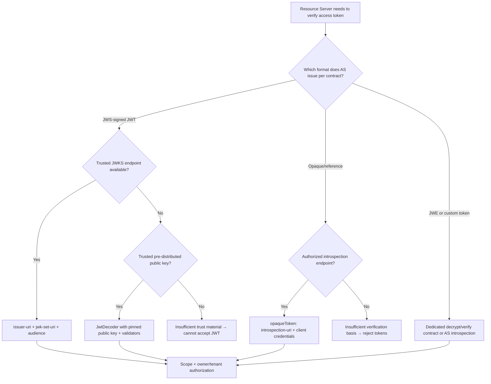
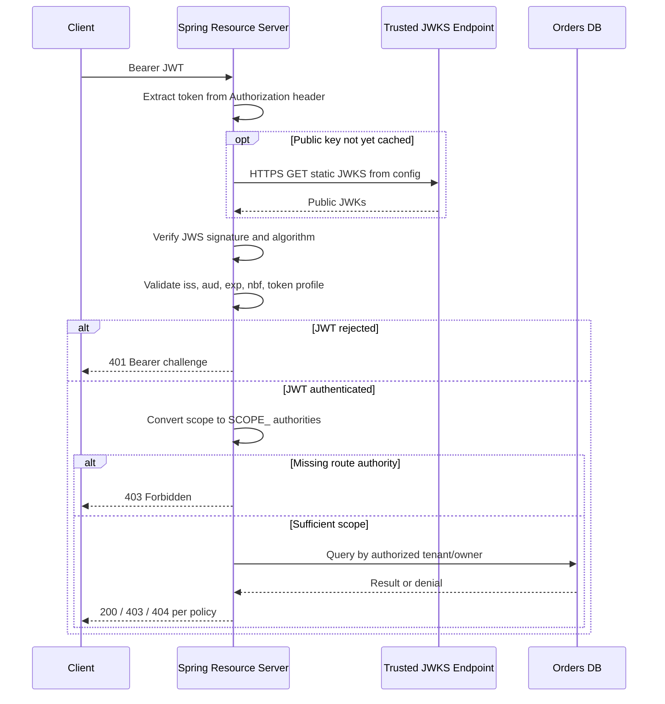
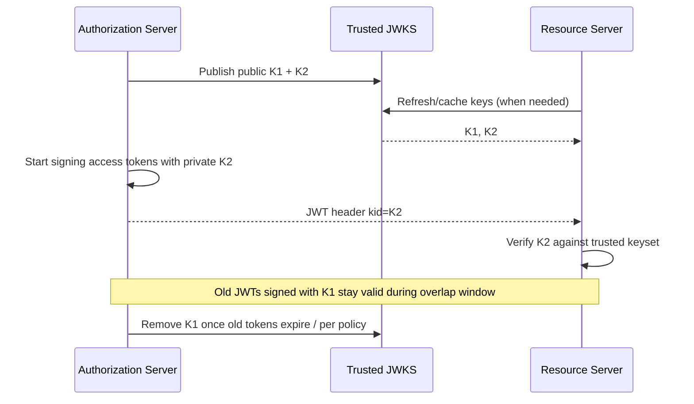

# Issuers Without Discovery and Explicit Configuration Options

## 1. Real-World Scenario: An Active Issuer That Publishes No Metadata

A **Spring Security OAuth 2.0 / OIDC Resource Server** receives access tokens from an Authorization Server (AS) and decides whether requests may enter the API. In typical examples, configuration can be as simple as:

```yaml
spring:
  security:
    oauth2:
      resourceserver:
        jwt:
          issuer-uri: https://id.example.test/realms/orders
```

When compatible metadata discovery exists, Spring Security uses `issuer-uri` to identify the issuer, locate the issuer's JWKS address, and wire an appropriate decoder. Yet not every system publishes metadata:

- A **legacy Authorization Server** only issues tokens and publishes JWKS at a manually documented URL.
- An **internal Identity Provider** has a stable issuer yet lacks OIDC Discovery or OAuth 2.0 Authorization Server Metadata.
- Metadata is blocked by a firewall/reverse proxy while the JWKS endpoint remains reachable.
- JWKS is not published over HTTP at all; public signing keys are distributed via internal config/PKI.
- The issuer only issues **opaque access tokens**, requiring the Resource Server to use introspection rather than JWT signature verification.
- Discovery exists yet is **untrusted or mismatched**: returning the wrong `issuer`, wrong `jwks_uri`, missing required fields, or redirecting to an unapproved source.

A very dangerous "fix" for missing discovery is **removing all issuer validation**, grabbing any public key to decode JWTs, or trusting an endpoint designated by the token itself. That can cause the API to accept tokens from other issuers/tenants/resources or forged tokens.

**Lesson goal:** select **explicit configurations that still preserve the full trust contract** for Spring Security Resource Server when an issuer lacks metadata discovery; understand impacts on startup, key rotation, JWT/opaque tokens, multi-issuer setups, testing, and operations.

Context used throughout:

| Role | Illustrative Value |
|---|---|
| Resource Server | `orders-api` |
| Nominal issuer | `https://id.example.test/realms/orders` |
| JWKS endpoint provided by Identity team | `https://keys.example.test/orders/jwks.json` |
| Introspection endpoint (if using opaque) | `https://id.example.test/oauth2/introspect` |
| Required JWT audience | `orders-api` |
| Read scope | `orders:read` |
| Write scope | `orders:write` |
| Example OAuth client | `web-portal` |

All domains/tokens/credentials are **examples**, not live systems. Reference code uses **Java 17+, Spring Boot 3.x, and Spring Security 6.x**, primarily on Servlet/Spring MVC. The WebFlux section presents dedicated reactive components.

> **Core message:** *No discovery* merely means the Resource Server **does not auto-locate metadata via a protocol endpoint**. It **does not** mean the issuer does not exist, signatures need not be checked, or any client-sent JWT can be trusted. We replace **automated configuration lookup** with **pre-supplied trust configuration**.

---

## 2. What Does Discovery Do and What Does It Not Do?

### 2.1. Two Common Metadata Families

**OpenID Connect Discovery 1.0** lets an OIDC Provider publish a discovery document commonly known as:

```text
.well-known/openid-configuration
```

**RFC 8414 — OAuth 2.0 Authorization Server Metadata** defines metadata for Authorization Servers, typically under `.well-known/oauth-authorization-server` following URL construction rules with the issuer.

URL construction syntax depends on the issuer path and the respective standard. **Do not blindly append `/.well-known/openid-configuration` to every issuer URL** and assume it is always right: issuers with paths, reverse proxies, and each spec follow specific rules. Frameworks support multiple discovery strategies depending on version.

An example metadata document:

```json
{
  "issuer": "https://id.example.test/realms/orders",
  "authorization_endpoint": "https://id.example.test/oauth2/authorize",
  "token_endpoint": "https://id.example.test/oauth2/token",
  "jwks_uri": "https://keys.example.test/orders/jwks.json"
}
```

Where:

- `issuer` is the issuer identity, compared against the trusted issuer.
- `jwks_uri` indicates **where to fetch public verification keys**; it never contains private signing keys.
- `authorization_endpoint`/`token_endpoint` are for OAuth/OIDC clients requesting tokens; **a Resource Server merely validating Bearer tokens typically never needs to call these endpoints**.
- Additional metadata on algorithms, response types, introspection/revocation, and scopes may appear depending on the standard and provider.

Discovery helps **locate configuration**, yet metadata alone never replaces:

1. Verifying the JWT signature.
2. Checking that `iss` in the JWT matches the expected issuer.
3. Checking `aud` targets the Resource Server.
4. Checking `exp`, `nbf`, and the access token profile.
5. Checking scopes/roles/owner/tenant during authorization.

### 2.2. Things Not to Conflate

| Concept | Meaning | Must It Depend on Discovery? |
|---|---|---|
| **Issuer** | Identifier of the issuing source (`iss`). | **No.** Can be pre-configured. |
| **OIDC/OAuth metadata discovery** | Method for discovering AS endpoints and properties. | No, if endpoints/trust are reliably configured. |
| **JWKS** | Public keys used to verify asymmetrically signed JWTs. | No; the JWKS URL can be configured explicitly. |
| **Static public key** | A public key distributed via trusted configuration. | No; does not even require HTTP JWKS. |
| **Opaque introspection** | AS returns token `active` status and metadata. | No; endpoint + auth method can be pre-configured. |
| **Audience** | Target resource/token recipient for which the JWT is issued. | No; the Resource Server knows its own audience. |
| **Scope authorization** | Permissions to invoke API operations. | No; a resource-side policy. |
| **OIDC login flow** | Client signs in users and receives ID Tokens. | Requires endpoints/metadata beyond a Resource Server; may need broader manual config. |

An Authorization Server **without OIDC discovery** can still issue **JWT access tokens**. Conversely, a provider with discovery does not guarantee **access tokens** are JWTs; format depends on the issuer.

### 2.3. Lack of Discovery Differs from Broken Discovery

Distinguish between:

- **Unsupported**: the AS confirms it does not implement a metadata endpoint. This can be a long-term contract.
- **Blocked/unreachable**: DNS, proxy, TLS, routing, network policy, or startup dependency is failing.
- **Returning invalid metadata**: `issuer` mismatch, invalid `jwks_uri`, wrong content/schema.
- **Spoofed metadata**: requests redirected to an untrusted source or HTTPS intercepted.

If metadata is supposed to exist yet is failing, do not immediately **delete `issuer-uri` and drop validation**. Diagnose the root cause, then decide whether **trusted explicit JWKS** or another operational fix is warranted.

---

## 3. What Information Does Explicit Configuration Need?

An adequate integration contract should be agreed upon by the **Identity/issuer team and API team**, versioned, and approved through trusted channels.

### 3.1. Minimum Contract for JWT Access Tokens

| Area | Question to Answer | Example `orders-api` |
|---|---|---|
| **Expected issuer** | What is the exact `iss` claim? | `https://id.example.test/realms/orders` |
| **Key trust source** | Which URL or artifact supplies public keys? | `https://keys.example.test/orders/jwks.json` |
| **JWS algorithms** | Which RS256/ES256/... algorithms are allowed? | RS256 |
| **Audience/resource** | What value must `aud` contain? | `orders-api` |
| **Token profile** | Is this an OAuth access token or ID Token? What `typ`/claims? | JWT access token, approved profile |
| **Time policy** | `exp`, `nbf`, clock skew, max lifetime? | Expiration per issuer and API policy |
| **Scopes** | Which claim holds scopes, in what format? | `scope="orders:read orders:write"` |
| **Subject/client** | How do user tokens differ from client credentials? | `sub`, `client_id` per profile |
| **Tenancy** | Are there custom `tenant_id`/roles? | Claims defined by issuer |
| **Rotation** | JWKS cache, new `kid`, overlap window? | Publish K2 before cutover |
| **Incident** | How to revoke if a signing key leaks? | Key removal, revocation, response plan |

**Protocols do not mandate the JWKS URL share the same hostname as the issuer**, yet it must be a source **confirmed as trusted by the issuer/operators**. Never manufacture trust merely because "domains look similar."

### 3.2. Minimum Contract for Opaque Access Tokens

| Area | Must Clarify |
|---|---|
| Introspection endpoint | Fixed HTTPS URL confirmed by the AS. |
| Authentication method | Client secret Basic, mTLS, `private_key_jwt`, etc., per AS. |
| Client identity | Which credentials does the Resource Server use to call introspection? |
| Token applicability | Does the AS only report active for this specific resource, or return `aud` for the API to check? |
| Response schema | `active` boolean; which optional claims are mandatory per API contract? |
| Scope mapping | `scope` string or vendor-defined claims accepted? |
| Status semantics | `active=false` vs. AS 401/403/429/5xx, timeout. |
| Cache/revocation | Are introspection results cached, and for what TTL? |
| Secret management | Credential rotation, never log secrets, least-privilege requester permissions. |

**Introspection does not require metadata discovery** once the Resource Server knows the endpoint and authentication method via contract. It still requires secure transport and requester authentication.

---

## 4. Overall Decision: JWT, Static Public Key, or Introspection?



**Never branch based on the number of dots in a token.** A JWT may be a three-part JWS or a five-part JWE; an opaque token may contain dots. Token format comes from the **AS–API contract**, not from self-reported token structure.

### 4.1. Configuration Priority Table

| Condition | Choice | What Must Still Be Checked |
|---|---|---|
| JWT issuer has working discovery | `issuer-uri`, plus audience and profile. | Issuer, audience, signature, lifetime, scopes. |
| JWT issuer **lacks discovery**, yet has trusted JWKS | **`issuer-uri + jwk-set-uri`**. | Issuer and audience must never be omitted. |
| JWT has JWKS yet API wants tighter validator/HTTP client control | Custom `JwtDecoder` using `withJwkSetUri`. | Explicitly attach issuer/time/audience/profile validators. |
| JWT lacks HTTP JWKS, has trusted public RSA key | Custom `JwtDecoder` using public key. | Issuer/aud/alg/time; manual rotation. |
| Opaque token, introspection endpoint available | `opaquetoken.introspection-uri` + credentials. | `active` and resource binding; scopes/tenant. |
| No trusted key/introspection source | **Accept no tokens**. | Finalize AS contract first. |
| Multiple issuers without discovery | Explicit registry/decoder/manager per issuer. | Strict issuer allowlist, resource/tenant binding. |

---

## 5. Option One: `issuer-uri` Plus `jwk-set-uri`

For **JWS-signed JWT access tokens**, this is usually the simplest configuration when the AS lacks discovery yet the Identity team provides a **trusted JWKS address**.

`application.yml`:

```yaml
spring:
  security:
    oauth2:
      resourceserver:
        jwt:
          issuer-uri: https://id.example.test/realms/orders
          jwk-set-uri: https://keys.example.test/orders/jwks.json
          audiences:
            - orders-api
```

Meaning:

1. **`issuer-uri`** sets the expected issuer that the JWT `iss` claim must match.
2. **`jwk-set-uri`** directly supplies where to fetch public signing keys; no discovery is needed to find `jwks_uri`.
3. **`audiences`** requires the JWT to target `orders-api`. This property is supported in appropriate Spring Boot lines; verify Boot version on older systems.
4. The decoder/validator also checks JWS signature and timestamps per configuration/framework.
5. Spring Security maps scopes to authorities, then applies authorization rules.

**Key distinction:** When configuring both `issuer-uri` and `jwk-set-uri` with supporting auto-configuration, the Resource Server can **avoid startup metadata discovery to locate JWKS**, while preserving **issuer validation**. This does not eliminate the network needed to fetch keys during token verification or cache refresh after rotation.

### 5.1. Why Not Use Only `jwk-set-uri`?

An incomplete configuration:

```yaml
spring:
  security:
    oauth2:
      resourceserver:
        jwt:
          jwk-set-uri: https://keys.example.test/orders/jwks.json
```

That config specifies **where to find keys to verify signatures**, yet **does not automatically infer an expected issuer** when no issuer validator is present. If the AS signs tokens for multiple realms/applications using the same keys, a JWT with the wrong `iss` will still pass signature verification.

Example:

```json
{
  "iss": "https://id.example.test/realms/payments",
  "aud": ["orders-api"],
  "scope": "orders:read"
}
```

If signature verification passes against the shared keyset while `iss` goes unchecked, the API can accept the wrong issuer. This is **token substitution**.

Therefore, **never drop issuer validation just to bypass discovery**. If you only configure `jwk-set-uri` for framework reasons, attach an explicit issuer validator on the decoder.

### 5.2. Why Can `issuer-uri` Alone Fail?

```yaml
spring:
  security:
    oauth2:
      resourceserver:
        jwt:
          issuer-uri: https://id.example.test/realms/orders
```

In auto-discovery mode, Spring Security needs to find `jwks_uri` by calling metadata. If the AS does not serve a valid metadata URL, initialization or token verification requests can fail depending on version/lazy initialization behavior.

Do not fix it by:

```yaml
# DO NOT USE as a way to skip issuer validation.
spring:
  security:
    oauth2:
      resourceserver:
        jwt:
          jwk-set-uri: https://keys.example.test/orders/jwks.json
# issuer-uri was deleted with no replacement validator
```

Instead, **keep the expected issuer** and supply the key source directly. Test your exact Boot/Security version in a real environment; startup behavior varies.

### 5.3. Issuer String Must Match Exactly

The AS may publish:

```text
https://id.example.test/realms/orders
```

The following values are **not automatically equivalent**:

```text
https://id.example.test/realms/orders/
https://id.example.test/realms/Orders
http://id.example.test/realms/orders
https://id.example.test/realms/payments
```

Issuer comparison typically checks the exact string value per contract. Do not strip slashes, alter schemes, or swap hosts "to make tokens work." If the AS emits a different issuer than configured, have the Identity team confirm/correct the contract.

### 5.4. JWKS Can Reside on a Different Domain from the Issuer

```text
Issuer:
  https://id.example.test/realms/orders

Trusted JWKS:
  https://keys.example.test/orders/jwks.json
```

This can be valid when the issuer publishes and operates `keys.example.test`. However:

- Verify the TLS certificate/hostname.
- Control DNS, network egress, and reverse proxies.
- Never follow redirects to untrusted hosts in a way that swaps the key source.
- Never read `jku`/`x5u` from JWT headers as an automatic key source.
- Document the owner and rotation procedure for the JWKS URL.

**Public keys are not secrets**, yet if an attacker swaps the trusted public key, they can make the Resource Server accept JWTs signed with their private key. Key-source integrity is a security requirement.

---

## 6. Configuring Spring Security Servlet for a JWT Resource Server

### 6.1. Dependencies

With Spring Boot parent/BOM managing versions:

```xml
<dependencies>
    <dependency>
        <groupId>org.springframework.boot</groupId>
        <artifactId>spring-boot-starter-web</artifactId>
    </dependency>

    <dependency>
        <groupId>org.springframework.boot</groupId>
        <artifactId>spring-boot-starter-security</artifactId>
    </dependency>

    <dependency>
        <groupId>org.springframework.boot</groupId>
        <artifactId>spring-boot-starter-oauth2-resource-server</artifactId>
    </dependency>

    <dependency>
        <groupId>org.springframework.boot</groupId>
        <artifactId>spring-boot-starter-test</artifactId>
        <scope>test</scope>
    </dependency>

    <dependency>
        <groupId>org.springframework.security</groupId>
        <artifactId>spring-security-test</artifactId>
        <scope>test</scope>
    </dependency>
</dependencies>
```

`spring-boot-starter-oauth2-resource-server` enables Resource Server support; JWT validation uses JOSE/JWT libraries governed by dependency management. Never mix Spring Security/Nimbus versions without verifying dependency compatibility.

### 6.2. A Simple `SecurityFilterChain`

```java
package com.example.orders.security;

import org.springframework.context.annotation.Bean;
import org.springframework.context.annotation.Configuration;
import org.springframework.http.HttpMethod;
import org.springframework.security.config.Customizer;
import org.springframework.security.config.annotation.web.builders.HttpSecurity;
import org.springframework.security.config.annotation.web.configurers.AbstractHttpConfigurer;
import org.springframework.security.config.http.SessionCreationPolicy;
import org.springframework.security.web.SecurityFilterChain;

@Configuration
public class OrdersApiSecurity {

    @Bean
    SecurityFilterChain securityFilterChain(HttpSecurity http)
            throws Exception {
        return http
            .csrf(AbstractHttpConfigurer::disable)
            .sessionManagement(session -> session
                .sessionCreationPolicy(SessionCreationPolicy.STATELESS))
            .authorizeHttpRequests(auth -> auth
                .requestMatchers(HttpMethod.GET, "/api/public/ping")
                    .permitAll()
                .requestMatchers(HttpMethod.GET, "/api/orders/**")
                    .hasAuthority("SCOPE_orders:read")
                .requestMatchers(HttpMethod.POST, "/api/orders")
                    .hasAuthority("SCOPE_orders:write")
                .anyRequest().denyAll())
            .oauth2ResourceServer(oauth ->
                oauth.jwt(Customizer.withDefaults()))
            .build();
    }
}
```

This is a pure Bearer-header API. Disabling CSRF is appropriate only when browser cookies/sessions are not used for authentication; applications combining web login need dedicated CSRF and multi-chain designs. **`STATELESS` does not establish issuer/JWKS trust**: that is `JwtDecoder`'s job.

### 6.3. Request Flow



There is no need to call `authorization_endpoint` or `token_endpoint` on every API request. JWT verification runs locally once public keys are cached; JWKS fetches occur only as required by cache/refresh policies.

---

## 7. Creating a Custom `JwtDecoder`: When and Why?

Auto-configuration from `issuer-uri + jwk-set-uri` covers many cases. Yet a custom decoder may be needed to:

- Allow only **RS256**, ES256, or an agreed algorithm set.
- Define audience validators in code.
- Add token type/profile validators, such as RFC 9068 JWT access tokens.
- Enforce required claims like `client_id`, `tenant_id`, or custom roles per contract.
- Customize HTTP clients, caches, or timeouts.
- Distribute public keys via files instead of HTTP JWKS.
- Organize multiple issuers with trusted configs.

**Critical risk:** When an application registers its own `JwtDecoder` bean, Spring Boot typically **backs off** from creating the default decoder. Validators you assumed Boot attached from YAML **may no longer take effect**. Actively ensure issuer, audience, timestamps, and token profile are enforced.

### 7.1. Example `NimbusJwtDecoder` from Trusted JWKS

```java
package com.example.orders.security;

import java.util.List;

import org.springframework.beans.factory.annotation.Value;
import org.springframework.context.annotation.Bean;
import org.springframework.context.annotation.Configuration;
import org.springframework.security.oauth2.core.DelegatingOAuth2TokenValidator;
import org.springframework.security.oauth2.core.OAuth2Error;
import org.springframework.security.oauth2.core.OAuth2TokenValidator;
import org.springframework.security.oauth2.core.OAuth2TokenValidatorResult;
import org.springframework.security.oauth2.jose.jws.SignatureAlgorithm;
import org.springframework.security.oauth2.jwt.Jwt;
import org.springframework.security.oauth2.jwt.JwtDecoder;
import org.springframework.security.oauth2.jwt.JwtValidators;
import org.springframework.security.oauth2.jwt.NimbusJwtDecoder;

@Configuration
public class ExplicitJwtDecoderConfig {

    @Bean
    JwtDecoder jwtDecoder(
            @Value("${app.security.issuer}") String issuer,
            @Value("${app.security.jwks-uri}") String jwksUri,
            @Value("${app.security.audience}") String audience) {

        NimbusJwtDecoder decoder =
            NimbusJwtDecoder.withJwkSetUri(jwksUri)
                // AS contract: accept RS256 only.
                .jwsAlgorithm(SignatureAlgorithm.RS256)
                .build();

        OAuth2TokenValidator<Jwt> issuerAndTime =
            JwtValidators.createDefaultWithIssuer(issuer);

        OAuth2TokenValidator<Jwt> audienceValidator = jwt -> {
            if (jwt.getAudience().contains(audience)) {
                return OAuth2TokenValidatorResult.success();
            }

            return OAuth2TokenValidatorResult.failure(
                new OAuth2Error(
                    "invalid_token",
                    "Required audience is missing",
                    null
                )
            );
        };

        decoder.setJwtValidator(
            new DelegatingOAuth2TokenValidator<>(
                issuerAndTime,
                audienceValidator
            )
        );

        return decoder;
    }
}
```

`application.yml` for this decoder:

```yaml
app:
  security:
    issuer: https://id.example.test/realms/orders
    jwks-uri: https://keys.example.test/orders/jwks.json
    audience: orders-api
```

Explanation:

1. **`withJwkSetUri(jwksUri)`:** fetches public keys from the configured address; no dynamic discovery.
2. **`jwsAlgorithm(RS256)`:** permits only the Resource Server's chosen algorithm; does not accept arbitrary `alg` values from JWTs.
3. **`JwtValidators.createDefaultWithIssuer(issuer)`:** includes appropriate default token validators plus expected issuer validation.
4. **Audience validator:** requires the token to target `orders-api`.
5. **`setJwtValidator`:** applies all conditions together.
6. **`SecurityFilterChain`:** after decoding, scope, tenant, and object authorization still apply.

This code is an **issuer/time/audience/RS256** pattern and does not claim to satisfy every requirement of every OAuth JWT access-token profile. If the issuer requires `typ=at+jwt`, actor type, maximum token lifetime, or custom claims, add validators compatible with **your Spring Security/Nimbus version**. In some versions, Nimbus checks JOSE `typ` before Spring validators run; design carefully to avoid overlapping/conflicting type policies.

### 7.2. Regarding `alg` and Key Types

A JWT header might contain:

```json
{
  "alg": "RS256",
  "kid": "orders-key-2026-11",
  "typ": "at+jwt"
}
```

The header is client-supplied data prior to verification, **not trust configuration**. The decoder must accept only allowed JWS algorithms/key types; `kid` merely helps locate a public key inside the **trusted keyset**. A `jku` or `x5u` in a JWT must never be used automatically as a URL to download attacker-chosen keys.

Never support `alg=none` for signed access-token contracts; never treat an RSA public key as an HMAC shared secret (algorithm confusion).

### 7.3. JWT Audience Can Be a String or List

Per JWT, `aud` can be a single audience string or an array of strings. Spring's `Jwt.getAudience()` usually provides a normalized list; policy should require an **exact audience match**:

```text
aud contains "orders-api"
```

Never do:

```java
// WRONG: can match "orders-api-dev" or object toString.
String.valueOf(jwt.getClaim("aud")).contains("orders-api")
```

A JWT for another resource signed with the same key remains invalid for this API.

---

## 8. JWT Without HTTP JWKS: Pinning a Confirmed Public Key

Some legacy issuers only provide public signing keys via PEM files or artifacts distributed by operations:

```text
-----BEGIN PUBLIC KEY-----
MIIBIjANBgkqhkiG9w0BAQEFAAOCAQ8A...
-----END PUBLIC KEY-----
```

If the API uses **a single fixed RSA public key** and the issuer commits to the signing algorithm, `NimbusJwtDecoder.withPublicKey(...)` can be used.

### 8.1. Loading a Public PEM in SubjectPublicKeyInfo Format

Example Java helper accepting **`BEGIN PUBLIC KEY` PEM** (X.509 SubjectPublicKeyInfo), not supporting every RSA PEM format:

```java
package com.example.orders.security;

import java.nio.charset.StandardCharsets;
import java.security.KeyFactory;
import java.security.interfaces.RSAPublicKey;
import java.security.spec.X509EncodedKeySpec;
import java.util.Base64;

import org.springframework.core.io.Resource;

public final class PublicKeyLoader {

    private PublicKeyLoader() {}

    public static RSAPublicKey loadRsaSpkiPem(Resource resource) {
        try (var input = resource.getInputStream()) {
            String pem = new String(
                input.readAllBytes(),
                StandardCharsets.US_ASCII
            );

            String base64 = pem
                .replace("-----BEGIN PUBLIC KEY-----", "")
                .replace("-----END PUBLIC KEY-----", "")
                .replaceAll("\\s", "");

            byte[] der = Base64.getDecoder().decode(base64);
            var keySpec = new X509EncodedKeySpec(der);

            return (RSAPublicKey) KeyFactory
                .getInstance("RSA")
                .generatePublic(keySpec);
        } catch (Exception ex) {
            // Fail startup: never skip an unreadable trust key.
            throw new IllegalStateException(
                "Cannot load configured RSA public key", ex);
        }
    }
}
```

**Format caveats:**

- `BEGIN PUBLIC KEY` holds an SPKI `SubjectPublicKeyInfo` structure.
- `BEGIN RSA PUBLIC KEY` holds PKCS#1 directly, which cannot be assumed compatible with `X509EncodedKeySpec`.
- `BEGIN CERTIFICATE` is an X.509 certificate; to extract the public key, parse the certificate and call `getPublicKey()` after verifying certificate provenance.
- A corrupted PEM must make the application **fail startup**, never fall back to "any key."
- Key files must only be updated through controlled, audited deployment/configuration pipelines.

Public keys are public data, yet **HTTP clients must never dictate them**. An attacker's public key will happily verify forged tokens signed by that attacker.

### 8.2. Decoder with a Static Public RSA Key

```java
package com.example.orders.security;

import java.security.interfaces.RSAPublicKey;

import org.springframework.beans.factory.annotation.Value;
import org.springframework.context.annotation.Bean;
import org.springframework.context.annotation.Configuration;
import org.springframework.core.io.Resource;
import org.springframework.security.oauth2.core.DelegatingOAuth2TokenValidator;
import org.springframework.security.oauth2.core.OAuth2Error;
import org.springframework.security.oauth2.core.OAuth2TokenValidator;
import org.springframework.security.oauth2.core.OAuth2TokenValidatorResult;
import org.springframework.security.oauth2.jose.jws.SignatureAlgorithm;
import org.springframework.security.oauth2.jwt.Jwt;
import org.springframework.security.oauth2.jwt.JwtDecoder;
import org.springframework.security.oauth2.jwt.JwtValidators;
import org.springframework.security.oauth2.jwt.NimbusJwtDecoder;

@Configuration
public class StaticPublicKeyJwtConfig {

    @Bean
    JwtDecoder jwtDecoder(
            @Value("${app.security.public-key}") Resource keyPem,
            @Value("${app.security.issuer}") String issuer,
            @Value("${app.security.audience}") String audience) {

        RSAPublicKey key = PublicKeyLoader.loadRsaSpkiPem(keyPem);

        NimbusJwtDecoder decoder =
            NimbusJwtDecoder.withPublicKey(key)
                .signatureAlgorithm(SignatureAlgorithm.RS256)
                .build();

        OAuth2TokenValidator<Jwt> audValidator = jwt ->
            jwt.getAudience().contains(audience)
                ? OAuth2TokenValidatorResult.success()
                : OAuth2TokenValidatorResult.failure(
                    new OAuth2Error(
                        "invalid_token", "Invalid audience", null));

        decoder.setJwtValidator(
            new DelegatingOAuth2TokenValidator<>(
                JwtValidators.createDefaultWithIssuer(issuer),
                audValidator
            )
        );

        return decoder;
    }
}
```

`application.yml`:

```yaml
app:
  security:
    issuer: https://id.example.test/realms/orders
    audience: orders-api
    public-key: classpath:trusted-keys/orders-rsa-public.pem
```

**This is an alternative to** `ExplicitJwtDecoderConfig`, not a second `@Bean JwtDecoder` registered alongside it uncontrollably. Never register two competing `@Bean JwtDecoder` definitions hoping Spring picks the right one.

### 8.3. What Are the Trade-offs of Static Keys?

| Benefits | Risks / Limitations |
|---|---|
| No JWKS fetch during verification. | Does not automatically pick up new keys when AS rotates. |
| Startup independent of metadata/JWKS network. | Must distribute keys via release/config pipelines. |
| Fewer moving parts in air-gapped environments. | A single key does not conveniently handle multiple `kid`s. |
| Provenance can be pinned cleanly. | If private signing key leaks, trusted key must be updated fast. |
| Easy to test with test keypairs. | Complex multi-issuer/rotation setups become harder to operate. |

When the AS uses multiple signing keys or rotates frequently, a **stable JWKS endpoint with overlapping keys** is generally better.

### 8.4. HMAC `HS256` Is Not Equivalent to Public-Key JWT Verification

If a legacy AS signs JWTs with a **shared secret** (HMAC), the Resource Server must hold the same secret to verify. This is a different trust model from RS256/ES256:

- Any party holding the HMAC secret **can sign tokens**, not only verify them.
- The secret must live in a Secret Manager/KMS/runtime injection, never committed to source code.
- Restrict who receives the secret, plus rotation and key IDs.
- Never "treat" an RSA public key as an HMAC secret to support both HS256 and RS256; that is **algorithm confusion**.

If a system strictly uses legacy HMAC, configure the decoder with a **separate algorithm allowlist and keying policy**—do not mix it into the RSA examples above.

---

## 9. JWT Token Profile: Do Not Mistake ID Tokens for Access Tokens

An issuer without discovery can still issue different JWT types using the **same RSA key**:

- OAuth 2.0 JWT access tokens for APIs.
- OIDC ID Tokens for client logins.
- Client assertions or `private_key_jwt` assertions.
- JWTs for email/one-time actions.
- Internal tokens for another resource.

A validly signed token **is not automatically an access token for `orders-api`**.

### 9.1. Example Frontend Token

```json
{
  "iss": "https://id.example.test/realms/orders",
  "aud": ["web-portal"],
  "sub": "alice-123",
  "exp": 1890003600,
  "nonce": "login-session-nonce"
}
```

This JWT may be valid for the OIDC Client `web-portal`, yet it is **not intended for `orders-api`**.

### 9.2. API Access Token

```json
{
  "iss": "https://id.example.test/realms/orders",
  "aud": ["orders-api"],
  "sub": "alice-123",
  "client_id": "web-portal",
  "scope": "orders:read",
  "exp": 1890003600
}
```

The Resource Server must define an access-token profile and validation rules that **do not mistakenly accept** ID Tokens. RFC 9068 uses a `typ` header like `at+jwt` and requires profile claims. Depending on the actual issuer and Spring Security version, verify/configure appropriate JOSE `typ` validation.

**Do not rely on a token having three JWS parts** or containing `sub`/`email` to infer it is an API access token. Being sent in `Authorization: Bearer` also does not make it fit for purpose.

---

## 10. No Discovery with Opaque Tokens: Manually Configured Introspection

When the AS issues **reference/opaque access tokens**, the Resource Server cannot verify them with JWS public keys from JWKS unless the issuer defines an agreed custom format/protocol. The standard mechanism is **RFC 7662 Token Introspection**.

### 10.1. Spring Boot Configuration

`application.yml`:

```yaml
spring:
  security:
    oauth2:
      resourceserver:
        opaquetoken:
          introspection-uri: https://id.example.test/oauth2/introspect
          client-id: ${INTROSPECTION_CLIENT_ID}
          client-secret: ${INTROSPECTION_CLIENT_SECRET}
```

The Resource Server already has the introspection address from the **trusted contract**; it needs no OIDC/OAuth metadata discovery to locate that URL.

The credentials here belong to the Resource Server's **introspection client** for authenticating to the AS. They are **different from** the caller's bearer access token and different from `client_id` returned inside the introspection response.

If the AS requires mTLS, `private_key_jwt`, or another method instead of Basic, customize the HTTP client per the **client authentication contract**. Never use Basic if the issuer does not support it, and never pass secrets in query strings.

### 10.2. An Introspection Request

```http
POST /oauth2/introspect HTTP/1.1
Host: id.example.test
Authorization: Basic <encoded-introspection-client-credentials>
Content-Type: application/x-www-form-urlencoded
Accept: application/json

token=<opaque-access-token>&token_type_hint=access_token
```

`token_type_hint` is only a hint to the AS, not proof the token is of the right type. The request body must be properly form-encoded; HTTPS/TLS is mandatory per trust policy.

A response might be:

```json
{
  "active": true,
  "iss": "https://id.example.test/realms/orders",
  "aud": ["orders-api"],
  "sub": "alice-123",
  "client_id": "web-portal",
  "scope": "orders:read",
  "exp": 1890003600
}
```

Distinguish carefully:

- **`active`** is a **required JSON boolean** in an RFC 7662 response.
- `iss`, `aud`, `sub`, `scope`, and `exp` are **optional metadata per RFC 7662**.
- `orders-api` may require several of those fields **by custom contract**, such as audience and issuer.
- If the AS restricts an introspection client to introspect only tokens meant for that specific Resource Server, the AS can guarantee resource binding without emitting `aud` in every response; this must be documented and tested.
- **`active=true` does not mean sufficient scopes or resource ownership**.

### 10.3. Invalid Responses and AS Errors

| AS Response | Meaning | API Behavior |
|---|---|---|
| `200 {"active":true,...}` | Token active; check metadata/policy. | Can authenticate if contract passes. |
| `200 {"active":false}` | Token inactive/not introspectable. | Reject token. |
| `200 {}` | Missing `active`. | Schema failure, fail closed. |
| `200 {"active":"true"}` | Wrong type for `active`. | Never coerce string to true. |
| `401` or `403` from AS | Introspection requester unauthenticated/unauthorized. | Integration error; block request. |
| `429`/`5xx`/timeout | AS/quota/network error. | Bounded retry if transient, then fail closed. |
| HTTP 200 returning HTML | Response violates contract. | Create no principal. |

An introspection connection failure **is not** "token active" and must never silently become "user logged in earlier." If the AS is unreachable, the API lacks verification proof and must deny the protected operation.

### 10.4. Spring Security DSL

```java
@Bean
SecurityFilterChain opaqueSecurity(HttpSecurity http)
        throws Exception {
    return http
        .sessionManagement(session -> session
            .sessionCreationPolicy(SessionCreationPolicy.STATELESS))
        .authorizeHttpRequests(auth -> auth
            .requestMatchers(HttpMethod.GET, "/api/orders/**")
                .hasAuthority("SCOPE_orders:read")
            .anyRequest().denyAll())
        .oauth2ResourceServer(oauth ->
            oauth.opaqueToken(Customizer.withDefaults()))
        .build();
}
```

This is an **alternative to JWT Resource Server**; never register both chains concurrently without explicit `securityMatcher`/policies. In Spring Security, `BearerTokenAuthenticationFilter` extracts the Bearer token and the configured mechanism determines handling—not dots in the token string.

---

## 11. Custom `OpaqueTokenIntrospector` to Enforce Issuer and Resource Contracts

If the Resource Server needs to verify specific `iss`/`aud` claims, **wrap the standard introspector** and inspect the returned principal.

Example:

```java
package com.example.orders.security;

import java.net.URI;
import java.net.URL;
import java.util.Collection;

import org.springframework.security.oauth2.core.OAuth2AuthenticatedPrincipal;
import org.springframework.security.oauth2.server.resource.introspection.BadOpaqueTokenException;
import org.springframework.security.oauth2.server.resource.introspection.OpaqueTokenIntrospector;

public final class ResourceBoundIntrospector
        implements OpaqueTokenIntrospector {

    private final OpaqueTokenIntrospector delegate;
    private final String expectedIssuer;
    private final String expectedAudience;

    public ResourceBoundIntrospector(
            OpaqueTokenIntrospector delegate,
            String expectedIssuer,
            String expectedAudience) {
        this.delegate = delegate;
        this.expectedIssuer = expectedIssuer;
        this.expectedAudience = expectedAudience;
    }

    @Override
    public OAuth2AuthenticatedPrincipal introspect(String token) {
        // Delegate performs HTTP request, client auth, and active check.
        OAuth2AuthenticatedPrincipal principal =
            delegate.introspect(token);

        if (!sameIssuer(principal.getAttribute("iss"))
                || !containsAudience(principal.getAttribute("aud"))) {
            throw new BadOpaqueTokenException(
                "Token not intended for orders-api");
        }

        return principal;
    }

    private boolean sameIssuer(Object value) {
        if (value instanceof String s) {
            return expectedIssuer.equals(s);
        }
        if (value instanceof URI uri) {
            return expectedIssuer.equals(uri.toString());
        }
        if (value instanceof URL url) {
            return expectedIssuer.equals(url.toString());
        }
        return false;
    }

    private boolean containsAudience(Object value) {
        if (value instanceof String s) {
            return expectedAudience.equals(s);
        }
        if (value instanceof Collection<?> values) {
            return !values.isEmpty()
                && values.stream().allMatch(x -> x instanceof String)
                && values.contains(expectedAudience);
        }
        return false;
    }
}
```

**Note:** the wrapper reads **`OAuth2AuthenticatedPrincipal` after the delegate has parsed it**, not raw JSON. Some libraries normalize `aud`, `iss`, and `scope` into internal types; design the wrapper around the **contract of your active delegate/version**. If you must strictly verify `active` is a JSON boolean or reject duplicate JSON keys, validate **at the HTTP/raw JSON boundary** rather than relying on the normalized principal.

Illustrative introspector bean for Spring Security 6.x lines supporting `NimbusOpaqueTokenIntrospector`:

```java
@Bean
OpaqueTokenIntrospector opaqueTokenIntrospector(
        @Value("${spring.security.oauth2.resourceserver.opaquetoken.introspection-uri}")
            String uri,
        @Value("${spring.security.oauth2.resourceserver.opaquetoken.client-id}")
            String clientId,
        @Value("${spring.security.oauth2.resourceserver.opaquetoken.client-secret}")
            String clientSecret) {

    OpaqueTokenIntrospector delegate =
        new NimbusOpaqueTokenIntrospector(
            uri, clientId, clientSecret
        );

    return new ResourceBoundIntrospector(
        delegate,
        "https://id.example.test/realms/orders",
        "orders-api"
    );
}
```

Add imports for `@Bean`, `@Value`, and both introspector classes as required. Depending on version, implementations/builders such as `SpringOpaqueTokenIntrospector` or alternatives may be recommended; check your project's library. Never hardcode `client-secret` in code; inject from a runtime secret source.

If the AS **omits `iss` or `aud`** yet guarantees resource binding by introspection requester, build a policy appropriate for that proof; do not copy this wrapper and "fix" it by letting missing values pass. **Lack of discovery is no excuse to skip contract validation.**

---

## 12. Multiple Issuers Without Discovery: Use a Trusted Registry

A system may support:

```text
Tenant Acme:
  issuer = https://id-a.example.test/realms/acme
  jwks   = https://keys-a.example.test/acme/jwks.json

Tenant Beta:
  issuer = https://id-b.example.test/realms/beta
  jwks   = https://keys-b.example.test/beta/jwks.json
```

If neither publishes discovery metadata, a single `issuer-uri` line cannot resolve them automatically. You need an approved **registry**:

| Tenant | Expected Issuer | Trusted Key Source | Required Audience |
|---|---|---|---|
| `t-acme` | `https://id-a.example.test/realms/acme` | `https://keys-a.example.test/acme/jwks.json` | `orders-api` |
| `t-beta` | `https://id-b.example.test/realms/beta` | `https://keys-b.example.test/beta/jwks.json` | `orders-api` |

### 12.1. Distinguish Routing Hints from Trust

You may read an issuer hint from an unverified JWT to **select from a pre-existing allowlist**, yet never:

```java
// DO NOT USE: attacker supplies arbitrary issuer.
String issuer = readUnverifiedJwtClaim(token, "iss");
JwtDecoder decoder = JwtDecoders.fromIssuerLocation(issuer);
return decoder.decode(token);
```

That code fetches metadata/JWKS from a token-supplied URL, causing **SSRF and authentication bypass** without an allowlist.

A sound design:

```text
extract unverified issuer hint
        ↓
issuer in pre-approved trusted registry?
    ├─ no → deny
    └─ yes → select pre-built JwtDecoder for that issuer
                    ↓
              verify JWS signature using trusted key source
                    ↓
              validate iss == registry expected issuer
                    ↓
              validate audience + time + token profile
                    ↓
              authorize scope/tenant/object
```

If the issuer is selected from a **tenant hostname/path**, that host/path is also request input; use it solely to select a **registered policy**, never as proof of tenant membership. The token must verify against the exact issuer required by the tenant.

### 12.2. Why Not "Try Every Decoder Until One Succeeds"?

Suppose a token carries an unverified `iss` for A, yet the system tries A, B, and C sequentially and accepts the token if **any** decoder succeeds. That can:

- Cause unnecessary JWKS/AS load.
- Create ambiguity when `kid`/keysets collide.
- Mask issuer/audience mismatches.
- Turn a weaker issuer into a bypass into resources guarded by another issuer.
- Complicate auditing which mechanism established the authenticated principal.

A better solution is an **explicit issuer -> decoder mapping**, re-checking expected issuer, audience, and tenant after verification. If a token is ambiguous, fail closed.

### 12.3. Same `sub` Does Not Mean Same User

`sub=alice-123` from issuer A and `sub=alice-123` from issuer B can represent two different subjects. When storing owners/identities, namespace by `(issuer, subject)` or map to a controlled internal identity.

Never merge identities merely because issuer URLs look similar. Even when an issuer rotates signing keys, preserve isolation by issuer and tenant namespaces.

---

## 13. No Discovery and the Relationship with OIDC Clients

A common misconception is that a Resource Server and an **OIDC login client** need the exact same set of configured endpoints.

### 13.1. Resource Servers Only Verify Bearer Access Tokens

A JWT Resource Server typically needs:

- Expected issuer.
- Trusted JWKS/public signing key.
- Allowed algorithms and token profile.
- Audience/time validators.
- Scope mapping and API authorization.

It does not necessarily need `authorization_endpoint`, `token_endpoint`, `userinfo_endpoint`, or `end_session_endpoint` to verify JWT access tokens per HTTP request.

An Opaque Resource Server needs:

- Trusted introspection URI.
- Client authentication to the AS.
- Response metadata/resource binding contract.
- Scope/authorization.

### 13.2. OIDC Login Clients Need Additional Endpoints

An application using `oauth2Login()`/OIDC login typically redirects to an authorization endpoint and exchanges codes at a token endpoint. OIDC ID Tokens also enforce issuer, audience, nonce, signature, and potentially UserInfo checks. **Lack of discovery** may require manually configuring `ClientRegistration`/provider details outside Resource Server scope.

Do not copy a manual JWT Resource Server config thinking it configures a complete OIDC login flow. And **never use an ID Token from a login client as an access token sent to the API** merely because it is a JWT signed by the same issuer.

### 13.3. Missing Endpoints Cannot Be Guessed from the Issuer URL

An issuer:

```text
https://id.example.test/realms/orders
```

does not let you reliably guess:

```text
/token
/authorize
/userinfo
/jwks
/introspect
```

Every AS routes endpoints differently. Any needed endpoint must come from a **trusted documented contract** or valid discovery, never arbitrary string concatenation.

---

## 14. JWT Without Discovery: Checking Startup Behavior

### 14.1. Three Moments Network Calls Can Happen

| Moment | What May Be Needed? | Consequence |
|---|---|---|
| **Application startup** | Discovery metadata if using an issuer-derived decoder; or loading local PEM keys. | A broken metadata endpoint may fail startup depending on version. |
| **First JWT request** | Fetching JWKS if no keys are cached yet. | Can make the first request slower or fail. |
| **After key rotation** | Refreshing JWKS to find the new `kid`. | If JWKS has not published K2 yet, new JWTs may return 401. |

When configuring only `issuer-uri` and discovery fails, startup/initialization can fail. When configuring `issuer-uri + jwk-set-uri`, the API needs no discovery to find the keyset; however, **that does not mean completely offline**. Account for the JWKS dependency.

### 14.2. Startup-Independent Does Not Mean Fail-Open

If the JWKS endpoint goes unreachable:

- Tokens signed by already-cached keys may still verify depending on cache implementation.
- Tokens using new uncached keys cannot be verified.
- The API must never skip signature checks to preserve availability.
- Never fall back to accepting client-asserted claims when public keys are unavailable.

**Fail closed** preserves security: without valid proof, no authenticated principal is created. The HTTP status returned to clients may be 401 or 5xx depending on where failure occurs and exception handlers; operators must distinguish invalid tokens from dependency outages.

### 14.3. Never Allow Infinite Network Timeouts

JWKS HTTP fetches and introspection requests require:

- Finite connect and read/response timeouts.
- Total request deadline bounds aligned with API SLAs/SLOs.
- Bounded retries solely for transient failures, avoiding retry storms.
- Connection pooling/rate limits and circuit breakers where needed.
- Egress allowlists and DNS/TLS policies.
- Alerts on JWKS/introspection failures.

A custom decoder using a blocking HTTP client must never be run carelessly on a WebFlux event loop; the reactive stack has dedicated decoders/WebClient.

---

## 15. Key Rotation: Rotation Still Works Without Discovery

No discovery **does not mean** public keys stay static forever. With a pre-configured trusted JWKS URI, the AS can still publish multiple public JWKs.

Initially:

```json
{
  "keys": [
    {
      "kty": "RSA",
      "kid": "orders-key-K1",
      "use": "sig",
      "alg": "RS256",
      "n": "PUBLIC_MODULUS_K1_PLACEHOLDER",
      "e": "AQAB"
    }
  ]
}
```

Later:

```json
{
  "keys": [
    {
      "kty": "RSA",
      "kid": "orders-key-K1",
      "use": "sig",
      "alg": "RS256",
      "n": "PUBLIC_MODULUS_K1_PLACEHOLDER",
      "e": "AQAB"
    },
    {
      "kty": "RSA",
      "kid": "orders-key-K2",
      "use": "sig",
      "alg": "RS256",
      "n": "PUBLIC_MODULUS_K2_PLACEHOLDER",
      "e": "AQAB"
    }
  ]
}
```

The `n` placeholders above are not valid RSA moduli; they merely illustrate JWKS structure.

### 15.1. Safe Rotation Flow



Key points:

1. Publish **public K2 before issuing JWTs signed with K2**.
2. Retain K1 in JWKS during an overlap window long enough for old tokens to remain valid.
3. Begin issuing new tokens with `kid=K2`.
4. Let the decoder refresh from the **trusted JWK Set URI**.
5. Monitor unknown `kid` counts, JWKS cache behavior, and 401 rates.
6. Retire K1 only when policy permits, or handle differently if private K1 was compromised.
7. Never let a JWT `jku` header point to another source when `kid` is missing.

### 15.2. When Public Keys Are Statically Pinned

Without a JWKS URL, rotation becomes a configuration/deployment change:

- Distribute the new key with verified provenance.
- Support multiple trusted public keys during the overlap window if needed; a single `withPublicKey` does not handle that automatically.
- Ensure all replicas hold the new trust material before the issuer switches signing keys.
- Have a rollback strategy if the new key causes failures.
- Maintain an emergency revocation plan if a private key leaks.

**Never accept new keys by "fetching a public key from a URL inside the JWT"** to skip rollouts. That is a trust-boundary violation.

### 15.3. JWKS Cache Differs from Token Cache

A JWKS cache stores **public keys**, not assertions that "token A is permitted." JWT verification must still run per policy; caching public keys never grants user permissions.

An opaque introspection cache stores **active metadata** and can delay reflecting revocations. Both caches have distinct threat models and TTLs; never assume "JWTs automatically revoke immediately" just because introspection is not used.

---

## 16. TLS, Secrets, and Trusted Configuration Sources

### 16.1. `jwk-set-uri` Is Not a Token-Supplied URL

A JWT header can send:

```json
{
  "alg": "RS256",
  "kid": "attacker-key",
  "jku": "https://attacker.example.test/jwks.json"
}
```

If custom code fetches `jku` and verifies against it, an attacker can sign a JWT with their own private key and host their public key on their website. The Resource Server has then **let the token pick its own source of trust**.

You must use:

```text
Trusted config: expected issuer, JWK source, algorithm allowlist
                        ↓
        JwtDecoder from reviewed configuration
                        ↓
         Verify token submitted by caller
```

Never use:

```text
Caller JWT header → arbitrary jku/iss URL → download keys → trust JWT
```

Besides authentication bypass, this anti-pattern introduces **SSRF** into internal networks.

### 16.2. Pin TLS Trust Properly

When calling JWKS/introspection over HTTPS:

- Verify certificate chains and hostnames.
- If using a private CA, distribute managed CAs/truststores.
- Never disable SSL validation just to get through staging.
- Apply appropriate egress restrictions.
- Never automatically follow redirects to untrusted hosts with new semantics.
- Monitor certificate expirations and DNS ownership.
- Never forward the caller's Bearer token to the **JWKS public key endpoint**; JWT verification only needs the local token and public keys.

### 16.3. Introspection Credentials Differ from Signing Keys

Opaque introspection may require `client-id` and `client-secret`. Private signing keys belong to the **AS**; the Resource Server **never** needs them to verify RSA/ECDSA JWTs.

A dangerous mistake is having the AS hand a **private RSA key** to an API "to decode JWTs" when only the public key is needed. Without a separate JWE decryption requirement, sharing private signing keys expands token-forgery blast radius if the API is compromised.

### 16.4. Never Log Tokens While Debugging Discovery

Never record:

```text
Authorization: Bearer eyJ...
client_secret=...
private_key=...
introspection response body with user PII
```

Use reason codes, request correlation IDs, issuer configuration IDs, and upstream HTTP statuses. `issuer`/`jwk-set-uri` are operational configuration data to protect integrity-wise; they are not cryptographic secrets, yet attackers must not be able to alter them.

---

## 17. Handling JWTs with Wrong Issuer, Audience, and Keys in Manual Mode

Example JWT:

```json
{
  "iss": "https://id.example.test/realms/orders",
  "sub": "alice-123",
  "aud": ["payments-api"],
  "scope": "orders:read",
  "exp": 1890003600
}
```

Even if the JWT has a valid signature matching a public key in the trusted JWKS, because `aud=payments-api`, `orders-api` must **reject** it. Never drop audience checks just because "there is no discovery."

### 17.1. Common Error Matrix

| Case | Decoder / Contract | Typical Outcome |
|---|---|---|
| Token lacks valid signature | JWS verification fails | 401, Bearer `invalid_token`. |
| Token uses `alg` outside allowlist | JWS algorithm policy fails | 401. |
| Token has wrong `iss` | Expected issuer validator fails | 401. |
| Token has `aud` for another API | Resource binding validator fails | 401. |
| Token `exp` has expired | Time validator fails | 401. |
| Token `nbf` is in the future | Time validator fails | 401. |
| Token has unknown `kid`, key absent from JWKS | Signature cannot be verified | 401, or dependency error on JWKS outage; never pass. |
| Token has wrong `typ`/profile | Contract token-type validator | Rejected. |
| Valid verified token missing `SCOPE_orders:read` | Authorization fails | 403. |
| Valid scope yet order belongs to another user/tenant | Object authorization fails | 403/404 per policy. |

**401 differs from 403**: rejecting an unaccepted credential is an authentication failure; an accepted credential lacking operation privileges is typically an authorization failure. Exact HTTP responses depend on Spring Security handlers and configuration.

### 17.2. Never Build Authentication from an Unverified Payload

```java
// DO NOT USE:
String subject = parseJwtPayloadWithoutSignatureCheck(token)
    .get("sub")
    .toString();

return new UsernamePasswordAuthenticationToken(
    subject, null, List.of(new SimpleGrantedAuthority("ROLE_ADMIN")));
```

Base64URL decoding is not cryptographic verification. A token self-declaring a valid `iss`, `sub`, or `scope=admin` proves no privileges whatsoever.

---

## 18. WebFlux When the Issuer Lacks Discovery

In **Spring WebFlux**, the equivalents are not Servlet `HttpSecurity`/`JwtDecoder`, but:

| Spring MVC/Servlet | Spring WebFlux/Reactive |
|---|---|
| `SecurityFilterChain` | **`SecurityWebFilterChain`** |
| `HttpSecurity` | **`ServerHttpSecurity`** |
| `JwtDecoder` | **`ReactiveJwtDecoder`** |
| `NimbusJwtDecoder` | **`NimbusReactiveJwtDecoder`** |
| `OpaqueTokenIntrospector` | **`ReactiveOpaqueTokenIntrospector`** |
| `SecurityContextHolder` | **`ReactiveSecurityContextHolder`** |
| `MockMvc` | **`WebTestClient`** |

### 18.1. Boot Configuration Follows the Same Mindset

```yaml
spring:
  security:
    oauth2:
      resourceserver:
        jwt:
          issuer-uri: https://id.example.test/realms/orders
          jwk-set-uri: https://keys.example.test/orders/jwks.json
          audiences:
            - orders-api
```

When the app is genuinely a WebFlux Resource Server, Boot configures the reactive decoder via matching auto-configuration. Having Servlet `spring-boot-starter-web` alongside WebFlux can alter the detected application type unexpectedly; verify the active stack.

### 18.2. `SecurityWebFilterChain`

```java
package com.example.orders.security;

import org.springframework.context.annotation.Bean;
import org.springframework.context.annotation.Configuration;
import org.springframework.http.HttpMethod;
import org.springframework.security.config.Customizer;
import org.springframework.security.config.annotation.web.reactive.EnableWebFluxSecurity;
import org.springframework.security.config.web.server.ServerHttpSecurity;
import org.springframework.security.web.server.SecurityWebFilterChain;

@Configuration
@EnableWebFluxSecurity
public class ReactiveOrdersSecurity {

    @Bean
    SecurityWebFilterChain springSecurityFilterChain(
            ServerHttpSecurity http) {
        return http
            .csrf(ServerHttpSecurity.CsrfSpec::disable)
            .authorizeExchange(exchange -> exchange
                .pathMatchers(HttpMethod.GET,
                    "/api/orders/**")
                    .hasAuthority("SCOPE_orders:read")
                .anyExchange().denyAll())
            .oauth2ResourceServer(oauth ->
                oauth.jwt(Customizer.withDefaults()))
            .build();
    }
}
```

Disabling CSRF here is appropriate only for APIs not using cookie/session authentication. WebFlux security context lives in Reactor Context; never rely on Servlet thread-local `SecurityContextHolder` in reactive handlers.

### 18.3. Custom `ReactiveJwtDecoder` from a JWKS URL

```java
package com.example.orders.security;

import org.springframework.beans.factory.annotation.Value;
import org.springframework.context.annotation.Bean;
import org.springframework.context.annotation.Configuration;
import org.springframework.security.oauth2.core.DelegatingOAuth2TokenValidator;
import org.springframework.security.oauth2.core.OAuth2Error;
import org.springframework.security.oauth2.core.OAuth2TokenValidator;
import org.springframework.security.oauth2.core.OAuth2TokenValidatorResult;
import org.springframework.security.oauth2.jose.jws.SignatureAlgorithm;
import org.springframework.security.oauth2.jwt.Jwt;
import org.springframework.security.oauth2.jwt.JwtValidators;
import org.springframework.security.oauth2.jwt.NimbusReactiveJwtDecoder;
import org.springframework.security.oauth2.jwt.ReactiveJwtDecoder;

@Configuration
public class ReactiveNoDiscoveryDecoderConfig {

    @Bean
    ReactiveJwtDecoder reactiveJwtDecoder(
        @Value("${app.security.issuer}") String issuer,
        @Value("${app.security.jwks-uri}") String jwksUri,
        @Value("${app.security.audience}") String audience) {

        NimbusReactiveJwtDecoder decoder =
            NimbusReactiveJwtDecoder.withJwkSetUri(jwksUri)
                .jwsAlgorithm(SignatureAlgorithm.RS256)
                .build();

        OAuth2TokenValidator<Jwt> audienceValidator = jwt ->
            jwt.getAudience().contains(audience)
                ? OAuth2TokenValidatorResult.success()
                : OAuth2TokenValidatorResult.failure(
                    new OAuth2Error(
                        "invalid_token", "Invalid audience", null));

        decoder.setJwtValidator(
            new DelegatingOAuth2TokenValidator<>(
                JwtValidators.createDefaultWithIssuer(issuer),
                audienceValidator
            )
        );

        return decoder;
    }
}
```

This **replaces auto-configuration**. Do not register this bean alongside other decoder configurations without clear selection; never expect Boot to attach extra audience validators after you define your own bean.

### 18.4. Avoid Blocking I/O in Reactive Verification

Never call:

```java
// DO NOT USE on the reactive event loop:
Mono<Jwt> decode(String token) {
    Jwt jwt = blockingHttpClient.fetchJwksAndVerify(token);
    return Mono.just(jwt);
}
```

A blocking HTTP client on the event loop increases latency and risks thread starvation. Prefer `NimbusReactiveJwtDecoder` and the reactive HTTP stack, or schedule genuinely blocking integrations onto appropriate schedulers. Never call `.block()` inside a reactive authentication flow.

For opaque tokens, use a reactive introspector/client connecting to the **trusted introspection URI**—never swap in a blocking Servlet introspector on the event loop.

---

## 19. Testing: "No Discovery" Must Be an Active Test Condition

A simple test using `.with(jwt())` does not prove `JwtDecoder` works when an issuer lacks discovery, because the test post-processor **synthesizes a mock authenticated principal** and bypasses cryptographic verification.

Split tests into at least two groups:

1. **Authorization tests**: Spring Security Test `jwt()` or `opaqueToken()` to verify scopes, routes, and tenant/owner logic.
2. **Real verification tests**: send signed JWTs or opaque tokens via the Bearer header, executing the real decoder/introspector against test JWKS/AS servers.

### 19.1. Metadata-Free Test Environment

Stand up a local server serving:

```text
GET /jwks.json               → 200 + valid test JWKS
GET /.well-known/...         → 404 or never called
POST /introspect             → fixture response if opaque
```

Ensure tests configure explicitly:

```yaml
spring:
  security:
    oauth2:
      resourceserver:
        jwt:
          issuer-uri: https://issuer-without-metadata.example.test/orders
          jwk-set-uri: http://127.0.0.1:<test-port>/jwks.json
          audiences:
            - orders-api
```

**Local HTTP** on `127.0.0.1` is strictly for loopback testing. Production must use HTTPS/proper truststores; never ship `http://...` to real environments. Inject `test-port` via dynamic properties from the test harness rather than leaving placeholders in YAML that might run in production.

The test aims to prove:

- Resource Server initialization **does not need to call discovery endpoints** to find JWKS.
- When receiving a JWT signed by the test key, the decoder fetches the exact **configured JWKS URL**.
- `iss` is still checked against the configured value even without discovery.
- `aud` is still enforced.
- Unknown `kid`/bad JWS signatures are rejected.
- `scope` permissions still pass through authorization.

### 19.2. JWT Negative Test Matrix

| Test | Input | Expected |
|---|---|---|
| Explicit config, discovery 404 | Valid JWKS, validly signed JWT | App verifies tokens without relying on metadata discovery. |
| Valid signature, right issuer, right audience | RS256/key in test JWKS | Authentication succeeds; proceeds to scope/business policy. |
| Valid signature yet wrong issuer | `iss=other` | 401; issuer validation not skipped. |
| Valid signature yet wrong audience | `aud=payments-api` | 401. |
| Valid signature, past `exp` | Expired claims | 401. |
| Valid signature, future `nbf` | Not yet valid | 401. |
| Payload altered keeping old signature | Signature mismatch | 401. |
| JWT signed with attacker private key | Key not in trusted JWKS | 401. |
| JWT with `jku` pointing to attacker | Untrusted header | Attacker JWKS never fetched, token rejected. |
| JWT with `alg=none` or HS256 using RSA key | Disallowed algorithm | 401. |
| JWT with new unpublished `kid` | Unknown key in JWKS | Signature never bypassed; bounded refresh. |
| Valid signature yet ID Token | Mismatched audience/type/profile | Rejected per access-token policy. |
| Valid/verified JWT lacking read scope | `scope=orders:write` | 403 on GET orders route. |
| Valid read scope yet order belongs to another user | Cross-object access | 403/404 per domain policy. |
| JWKS HTTP 503/timeout when uncached | Key unavailable | Request blocked; status depends on handler. |

Token type/profile tests require explicit policies: if your implementation does not automatically check `typ=at+jwt`, add a validator or custom code rather than asserting 401 assuming the framework enforces it.

### 19.3. Testing Discovery-Independent Startup

A valuable test:

```text
Given:
  expected issuer configured
  explicit jwk-set-uri configured
  metadata discovery endpoint returns 404

When:
  Spring Boot application starts

Then:
  Startup succeeds without needing issuer metadata discovery
  (as supported by selected Boot/Security version)

And:
  First signed JWT request is validated with explicit JWKS
  iss/aud/exp/signature checks are still enforced
```

Use an HTTP mock server spy to assert **zero metadata requests** during startup rather than just checking for "application started" in logs. Confirm bootstrap behavior on the exact running dependency versions.

### 19.4. Opaque Introspection Integration Tests

With opaque tokens and no discovery, mock the AS returning:

```json
{"active":false}
```

and:

```json
{
  "active":true,
  "iss":"https://id.example.test/realms/orders",
  "aud":["orders-api"],
  "scope":"orders:read",
  "sub":"alice-123"
}
```

Verify:

1. HTTP `POST` hits the exact configured URI, without discovery.
2. `Content-Type: application/x-www-form-urlencoded` and `token` are properly encoded.
3. Requests use the contract-specified client auth without logging secrets.
4. `active=false` is always rejected.
5. `active=true` with matching issuer/resource/scope enters the read route.
6. `active=true` with wrong audience is rejected per API contract.
7. String/null/missing `active` is never treated as active.
8. AS `401` due to bad introspection client credentials is classified as an integration failure.
9. AS `503`/timeout never turns into a valid principal.
10. Unrecognized tokens are never treated as JWTs merely because they contain dots.

### 19.5. `MockMvc` Authorization Tests Do Not Replace Decoder Tests

```java
import static org.springframework.security.test.web.servlet.request
    .SecurityMockMvcRequestPostProcessors.jwt;

mvc.perform(get("/api/orders/42")
        .with(jwt().authorities(
            new SimpleGrantedAuthority("SCOPE_orders:write"))))
    .andExpect(status().isForbidden());
```

This example tests **route authorization**, not metadata/JWKS/signatures. To test an issuer without discovery, send **real signed Bearer JWTs** through a decoder trusting the test JWKS URL.

With `MockMvc` setups involving sessions or custom filters, verify the security filter chain is actually active. Never treat an HTTP 200 from a controller test alone as proof of a sound trust root.

---

## 20. Instrumentation and Monitoring in Production

Without metadata discovery, manual misconfigurations often surface only during signing key rotation or issuer domain changes. Instrument **by verification path** instead of lumping all 401s into a single bucket.

### 20.1. Suggested Metrics

| Metric/Event | Meaning |
|---|---|
| `jwt_validation_failure_total{reason=...}` | Signature, issuer, audience, time, token type. |
| `jwks_fetch_failure_total{class=...}` | TLS, DNS, 404, 429, 5xx, timeout. |
| `jwks_cache_refresh_total{result=...}` | Keyset refreshes and key rotations. |
| `jwt_unknown_kid_total{issuer_config_id=...}` | New tokens signed by keys not yet in cache/AS JWKS. |
| `introspection_request_total{result=...}` | Active, inactive, HTTP errors, invalid schemas. |
| `introspection_duration_seconds` | p95/p99 latency of opaque token validation. |
| `oauth_bearer_denied_total{kind=...}` | Authentication vs. authorization denials. |
| `jwt_configuration_change_total` | Audit key-source/issuer policy changes across deployments (if applicable). |

These metric names are **not built into Spring Security by default**; they are observability suggestions. Never use raw access tokens, `sub`, `jti`, or untrusted claims as metric labels due to cardinality and privacy risks.

### 20.2. Startup and Runtime Alerts

Alert on:

- JWKS endpoint unreachable from any region/pod.
- Spike in unknown `kid`s following an AS rotation.
- Spike in issuer mismatches after a migration.
- Abnormal spike in token audience mismatches.
- Introspection HTTP 401/403 (client credentials/permissions).
- Introspection HTTP 429/5xx and timeouts.
- Routes returning 302 login redirects instead of 401 Bearer challenges.
- 403 spikes after AS scope/claim converter changes.

Never alert based on "whether a JWT has two dots"; that is not a trust signal.

---

## 21. Runbook When an Issuer Lacks Discovery and API Returns 401 / Fails to Start

### Step 1 — Confirm Access Token Format per Contract

Have the Identity team confirm whether the AS issues **JWS-signed JWTs**, **opaque references**, **JWEs**, or a custom format. Never guess from dot counts.

If JWT, you need JWKS/public keys and expected issuer. If opaque, you need the introspection URI and authentication method. If the AS cannot provide a trustworthy verification method, **it is not ready for integration**.

### Step 2 — Classify Discovery, Key Fetch, or Validation Errors

Inspect internal error codes:

```text
METADATA_DISCOVERY_UNAVAILABLE
JWKS_SOURCE_UNAVAILABLE
JWT_SIGNATURE_INVALID
JWT_ISSUER_MISMATCH
JWT_AUDIENCE_MISMATCH
JWT_TIME_INVALID
TOKEN_PROFILE_INVALID
INTROSPECTION_CLIENT_UNAUTHORIZED
INTROSPECTION_UPSTREAM_UNAVAILABLE
SCOPE_INSUFFICIENT
```

Never log raw Bearer tokens. For issuer-only startup failures, determine whether the AS genuinely lacks discovery or TLS/proxy/network is broken.

### Step 3 — Confirm Trust Material from an Authoritative Source

Have the Identity team provide exact values:

```text
expected issuer
trusted JWKS URI or public key fingerprint
allowed JWS algorithms
required audience
token type/profile
rotation plan
```

Never take a JWKS URL from token headers. If redirects or alternate domains exist, confirm they are URLs managed by the issuer.

### Step 4 — Select the Right Explicit Configuration

For JWT + JWKS:

```yaml
jwt:
  issuer-uri: https://id.example.test/realms/orders
  jwk-set-uri: https://keys.example.test/orders/jwks.json
  audiences:
    - orders-api
```

For JWT + pinned key, use a custom decoder with complete validators. For opaque tokens, use `opaquetoken.introspection-uri` + client credentials.

### Step 5 — Check HTTP/TLS Sources

Check:

- Certificate chain, hostname, truststore.
- DNS/egress policy and proxy configuration.
- Valid JWKS JSON with matching key type/`kid`/alg.
- Whether cache TTL or CDN JWKS already serves the new key.
- Introspection method/credentials/quotas.
- No redirects followed to untrusted hosts.

### Step 6 — Reproduce with Test Tokens

Generate a test-key-signed JWT or opaque reference token in staging. Test bad signature, wrong issuer, wrong audience, expired, inactive, and missing scope. Never use production tokens/secrets in fixtures or CI logs.

### Step 7 — Remediate via Configuration/Contract, Not Weakened Security

Never do:

```text
Disable issuer validation
Disable signature verification
Accept any alg
Trust any jku
Treat every active=true as all permissions
Fallback to old web session
Permit all protected routes
```

Trust-material failures must be fixed at the **provider/configuration**. If failing closed during an outage, report dependency errors per API policy and coordinate with SRE.

### Step 8 — Post-Recovery

Monitor 401/403 rates, JWKS fetch latency, introspection upstream errors, scopes, and object access. Add regression tests for "discovery 404 yet configured JWKS valid," key rotation, and token substitution.

---

## 22. Misconceptions That Lead to Bypasses

| Misconception | Why It Is Wrong | Right Approach |
|---|---|---|
| "AS lacks discovery, so there is no issuer." | Issuer is an identity claim/contract, not a discovery endpoint. | Configure expected issuer explicitly. |
| "Having a JWKS URL is enough." | Does not guarantee `iss`/`aud`/token type checks. | Add issuer/audience/profile validators. |
| "Just removing `issuer-uri` avoids startup errors." | Can drop issuer validation altogether. | `issuer-uri + jwk-set-uri` or custom validator. |
| "`jwks_uri` must share the issuer's domain." | Not an absolute requirement; many ASs use dedicated key hosts. | Trusted config/metadata, TLS, ownership. |
| "Public keys are not secret so source does not matter." | Attackers can swap public keys to validate forged tokens. | Protect key-source provenance and integrity. |
| "It has two dots so validate as JWT." | Opaque tokens can contain dots; JWS can be forged. | Policy chooses format, then verifies properly. |
| "Validly signed ID Token is an access token." | ID Tokens target OIDC clients, different audience from API. | Check access-token type/audience/profile. |
| "Custom `JwtDecoder` inherits every YAML validator." | Auto-config backs off when a custom bean exists. | Explicitly attach issuer/aud/time/profile. |
| "Without discovery, all JWTs must be introspected." | Not required; trusted JWKS/public keys work fine. | Choose per AS–API contract. |
| "Opaque introspection needs OIDC metadata." | The endpoint can be configured manually. | URI + client auth + response contract. |
| "`active=true` means full permissions." | Authentication differs from authorization. | Check scopes/owner/tenant. |
| "`kid` in JWT suffices to choose key source." | `kid` is only a hint within a trusted keyset. | Pin JWKS/public key source in config. |
| "If key fetch fails, temporarily skip verification." | Failing open lets forged tokens through. | Fail closed and resolve the outage. |
| "Read unverified `iss` to download arbitrary JWKS." | SSRF/authentication bypass. | Allowlist/pre-built decoders. |
| "Static public keys auto-update on rotation." | There is no JWKS refresh. | Deployment/overlap rotation plan. |
| "Shared issuer means any access token works on any API." | Resource audiences must still be distinguished. | Require `aud=orders-api`. |
| "Valid JWT signature suffices to read any order." | Scopes and object-level policies are still required. | Check tenant/owner/ACL. |
| "`jwt()` unit test proves JWT signature security." | Test post-processor bypasses the decoder. | Signed JWT + trusted test JWKS. |

---

## 23. Checklist for Integrating an Issuer Without Discovery

Before deploying to production, ensure clear answers exist for:

| Question | Must Confirm |
|---|---|
| **Token format?** | JWS JWT, opaque, JWE, or custom format; documented profile. |
| **Issuer identity?** | Exact and consistent `iss`. |
| **Trust source?** | Approved `jwks-uri`/pinned public key/introspection URI. |
| **Algorithm/key type?** | RS256/ES256/... matching issuer; allowlist, never accept `none` arbitrarily. |
| **Audience?** | `orders-api` enforced across every mechanism. |
| **Token type?** | Access token, not confused with ID Tokens or client assertions. |
| **Time claims?** | `exp`/`nbf` and clock skew policy. |
| **Scope/authorities?** | Proper `SCOPE_...` mapping; no default admin. |
| **Tenant/object policy?** | Never omit per-record/resource permissions. |
| **Discovery coupling?** | Startup does not call discovery endpoints in the chosen explicit config. |
| **JWKS fetch?** | TLS, timeouts, caching, refresh, proxy/egress restrictions. |
| **Key rotation?** | Publish overlap, unknown `kid`, emergency revocation. |
| **Opaque client auth?** | Secret/mTLS/`private_key_jwt` and introspection permissions. |
| **Opaque schema?** | `active` boolean, contract for other metadata. |
| **Multi-issuer?** | Registry allowlist, never trust arbitrary `iss`. |
| **WebFlux vs. Servlet?** | Matching `JwtDecoder`/`ReactiveJwtDecoder` and security chain. |
| **Errors?** | 401 authentication, 403 authorization, upstream fail-closed. |
| **Tests?** | Discovery unavailable, signed JWT, wrong iss/aud, mock AS, rotation. |
| **Observability?** | No logged tokens/secrets, bounded-cardinality metrics. |
| **Operational owner?** | Who updates JWKS/public keys, handles rollbacks, rotation, and incident response? |

---

## 24. Summary Across Three Scenarios

### Scenario A — JWT, No Discovery, JWKS Available

```yaml
spring:
  security:
    oauth2:
      resourceserver:
        jwt:
          issuer-uri: https://id.example.test/realms/orders
          jwk-set-uri: https://keys.example.test/orders/jwks.json
          audiences:
            - orders-api
```

**Desired outcome:** Spring Resource Server needs no discovery to locate the JWKS URL while still verifying issuer and audience. When tokens arrive, signatures are verified with public keys from the trusted JWKS, followed by scope/resource authorization.

### Scenario B — JWT, No Discovery, No HTTP JWKS

```text
Trusted public RSA key → Custom NimbusJwtDecoder.withPublicKey(...)
                       → issuer/time validators
                       → audience validator
                       → token profile checks
                       → scope + object authorization
```

**Desired outcome:** No metadata/JWKS network dependency, yet requires clear public key provenance and a rotation/deployment plan.

### Scenario C — Opaque Token, No Discovery

```yaml
spring:
  security:
    oauth2:
      resourceserver:
        opaquetoken:
          introspection-uri: https://id.example.test/oauth2/introspect
          client-id: ${INTROSPECTION_CLIENT_ID}
          client-secret: ${INTROSPECTION_CLIENT_SECRET}
```

**Desired outcome:** Each token is confirmed active with metadata by the AS via introspection per contract, without discovery, while still enforcing AS/resource binding, scopes, and tenant/owner checks.

---

## 25. References

- [Spring Security — OAuth 2.0 Resource Server JWT (Servlet)](https://docs.spring.io/spring-security/reference/servlet/oauth2/resource-server/jwt.html): issuer discovery, trusted JWKS URL, `JwtDecoder`, and validators.
- [Spring Security — OAuth 2.0 Resource Server Opaque Tokens](https://docs.spring.io/spring-security/reference/servlet/oauth2/resource-server/opaque-token.html): introspection endpoint, principal, and authorities.
- [Spring Security — Multitenancy for Resource Servers](https://docs.spring.io/spring-security/reference/servlet/oauth2/resource-server/multitenancy.html): trusted issuers and manager resolution.
- [Spring Security — Reactive JWT Resource Server](https://docs.spring.io/spring-security/reference/reactive/oauth2/resource-server/jwt.html): `ReactiveJwtDecoder`, JWKS, and WebFlux security.
- [Spring Security API — NimbusJwtDecoder](https://docs.spring.io/spring-security/site/docs/current/api/org/springframework/security/oauth2/jwt/NimbusJwtDecoder.html): trusted JWK Set URI/public-key decoders.
- [Spring Security API — NimbusReactiveJwtDecoder](https://docs.spring.io/spring-security/site/docs/current/api/org/springframework/security/oauth2/jwt/NimbusReactiveJwtDecoder.html): reactive JWK sources and validators.
- [Spring Boot — Security Documentation](https://docs.spring.io/spring-boot/reference/web/spring-security.html): Resource Server auto-configuration, property versioning.
- [RFC 8414 — OAuth 2.0 Authorization Server Metadata](https://www.rfc-editor.org/rfc/rfc8414.html): OAuth metadata `issuer`, `jwks_uri`, and endpoints.
- [OpenID Connect Discovery 1.0](https://openid.net/specs/openid-connect-discovery-1_0.html): OIDC provider metadata discovery.
- [RFC 7517 — JSON Web Key (JWK)](https://www.rfc-editor.org/rfc/rfc7517.html): public JWK and JWK Set.
- [RFC 7515 — JSON Web Signature](https://www.rfc-editor.org/rfc/rfc7515.html): JWS headers, signatures, and key IDs.
- [RFC 7519 — JSON Web Token](https://www.rfc-editor.org/rfc/rfc7519.html): issuer/audience/time claims.
- [RFC 8725 — JWT Best Current Practices](https://www.rfc-editor.org/rfc/rfc8725.html): trusted algorithms, issuer/audience, and cross-JWT confusion.
- [RFC 9068 — JWT Profile for OAuth 2.0 Access Tokens](https://www.rfc-editor.org/rfc/rfc9068.html): access-token JWT profile, avoiding ID Token confusion.
- [RFC 7662 — OAuth 2.0 Token Introspection](https://www.rfc-editor.org/rfc/rfc7662.html): request/response and `active` for opaque access tokens.
- [RFC 6750 — OAuth 2.0 Bearer Token Usage](https://www.rfc-editor.org/rfc/rfc6750.html): Bearer token HTTP authentication and error responses.
- [OWASP — JSON Web Token Cheat Sheet for Java](https://cheatsheetseries.owasp.org/cheatsheets/JSON_Web_Token_for_Java_Cheat_Sheet.html): JWT implementation risks.
- [OWASP — Authorization Cheat Sheet](https://cheatsheetseries.owasp.org/cheatsheets/Authorization_Cheat_Sheet.html): least privilege, deny-by-default, object-level authorization.

**Conclusion:** An issuer **without discovery** can still be integrated securely with Spring Security OAuth 2.0 Resource Server given a **trusted configuration contract**. For JWTs, typically use **`issuer-uri + jwk-set-uri + audience`** or an explicit `JwtDecoder` with a public key and full validators; for opaque tokens, use **trusted introspection URI + client authentication + response contract**. **Never sacrifice issuer validation, signature verification, audience, token profile, or authorization** just to avoid a non-existent metadata endpoint. Manual configuration increases responsibility for managing trust/rotation and testing—it never lowers security standards.