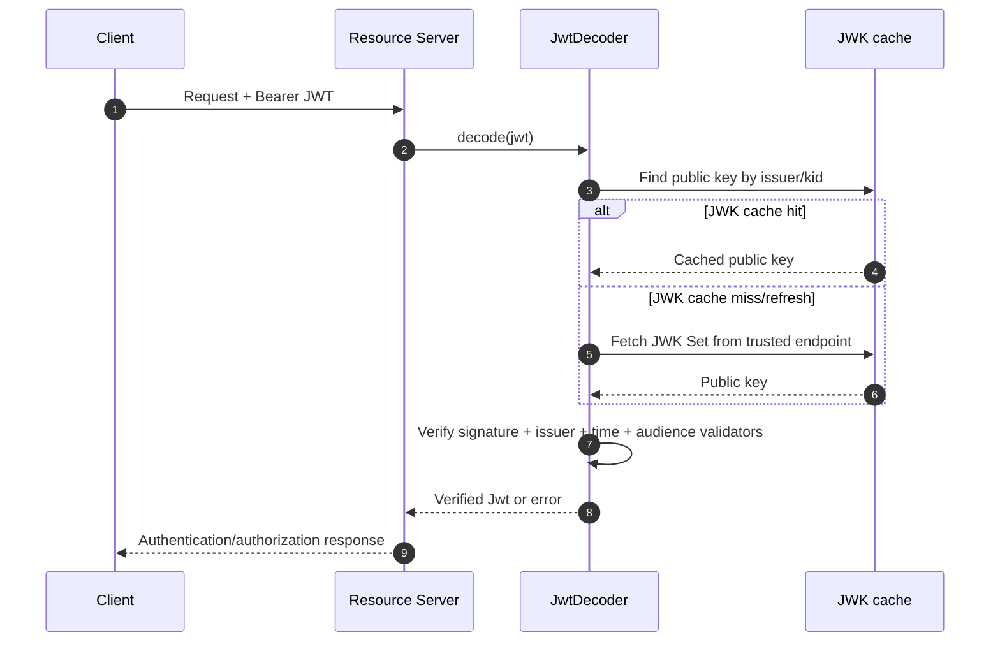
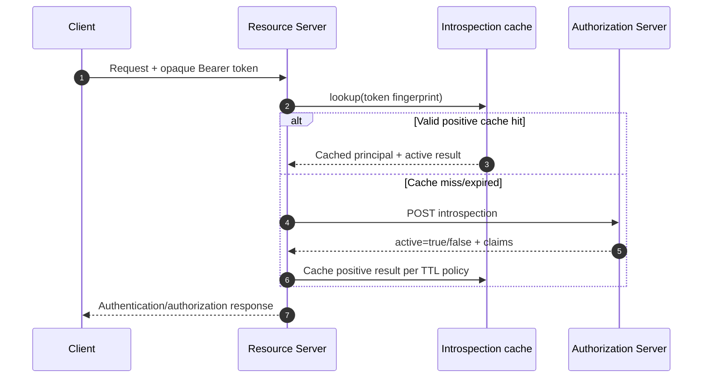

# How Verification Result Caching Changes the Token Acceptance Window

In a **Spring Security OAuth 2.0 Resource Server**, caching reduces the cost of reading JWK Sets, calling the introspection endpoint, and repeatedly processing the same access token. However, a security cache is not just a performance optimization: **it determines how long an old "valid token" decision continues to be used after the token's state, keys, permissions, or policies have changed**.

For example, an opaque token returns `active=true` from introspection. Immediately afterward, the user is revoked, yet the Resource Server keeps the positive result in cache for another 60 seconds. During that window, the token can continue to be accepted. For JWTs, caching a JWK Set only holds public keys; it **does not mean** the Resource Server caches token verification results. If an application caches the `Authentication` or validation result itself, it may inadvertently bypass `exp`, key rotation, issuer disablement, or policy changes.

This lesson distinguishes **JWK caches**, **opaque introspection caches**, and **JWT verification-result caches**; calculates the acceptance window upon revocation; designs TTLs around expiry and clock skew; handles distributed caches, invalidation, outages, and key rotation; and presents Spring Security examples for safer introspection caching. Examples use **Spring Boot 3 / Spring Security 6** and Java 17+. Any TTL numbers in this lesson are illustrative only, not universal recommendations for every system.

## 1. How Does Caching Change Security Decisions?

A verification cache typically stores a result computed at an earlier time:

```text
Request t0:
  token -> verify/introspect -> valid -> cache positive

Request t1:
  token -> cache hit -> valid

During t0..t1:
  token may have been revoked
  issuer may have been disabled
  permissions/membership may have changed
  signing key may have been removed from JWKS
```

When the cache returns a stale result, the API does not re-query the authoritative source on the current request. **The cache TTL therefore becomes part of the credential acceptance time policy.**

Without a positive cache, the API may still accept the token according to its lifetime and validators. With a cache, the token can be accepted under **an old decision** until the cache expires or is invalidated. If a cache entry lives longer than the token's lifetime and a cache hit skips expiry validation, that is a serious bug.

## 2. Distinguishing Three Commonly Confused Cache Types

| Cache type | Stored content | What cost does it reduce? | Revocation impact |
| --- | --- | --- | --- |
| **JWK Set / public-key cache** | Public keys per issuer/JWK Set, usually keyed by `kid`. | Reduces discovery/JWKS network fetches. | A key removed from JWKS may still be used while the cache is stale. |
| **Opaque introspection-result cache** | Principal/claims and `active=true` result from introspection. | Reduces Authorization Server calls on every request. | Positive entries may keep accepting the token after revocation. |
| **JWT verification-result cache** | Decode/validation result or `Authentication` for a token. | Can reduce repeated signature/claim validation. | May bypass expiry, key removal, issuer disablement, and policy updates if not bounded/invalidated. |

These three cache types do not replace each other. **A JWK cache does not store a decision that a specific token is still active**; an introspection cache is not a JWK cache; caching `Authentication` can bypass more checks than either of the other two.

## 3. JWT Flow Without Token-Result Caching

In a typical JWT Resource Server:



On this path, every request still goes through the decoder and validators; caching mainly reduces public key downloads. A token revoked at the Authorization Server **does not automatically lose validity** if the Resource Server only checks signatures and claims offline. The token can still be accepted until `exp` per clock-skew policy, unless a denylist, online status check, or another revocation mechanism exists.

## 4. Opaque Token Flow with Introspection Caching

Opaque tokens typically require the Resource Server to call an introspection endpoint:



If the cache returns a positive principal, the Resource Server may skip querying the Authorization Server on that request. A token revoked right after a successful introspection can still be accepted for the **remaining TTL**.

## 5. Self-Contained JWTs Do Not Have Real-Time Revocation Automatically

A JWT access token:

```json
{
  "iss": "https://identity.example.com/realms/shop",
  "sub": "user-123",
  "aud": ["orders-api"],
  "scope": "orders.read",
  "exp": 1900000000
}
```

Once signed, the token can be verified using a public key without contacting the Authorization Server. If a user loses a role or logs out, an offline Resource Server **does not automatically know about that change**.

With offline JWT validation:
- `exp` defines the token's time limit.
- `nbf` prevents acceptance before the token becomes valid.
- Clock skew may extend a small configurable acceptance margin.
- The JWK cache holds keys for verifying signatures.
- Only a token denylist or online policy provides additional revocation state.

**Having no token-result cache still does not mean real-time revocation.** That is an inherent property of self-contained JWTs and how the Resource Server validates them.

## 6. JWK Cache Is Not a Token Status Cache

A JWK Set may contain:

```json
{
  "keys": [
    {
      "kty": "RSA",
      "kid": "signing-key-2026-01",
      "use": "sig",
      "alg": "RS256",
      "n": "...",
      "e": "AQAB"
    }
  ]
}
```

The Resource Server caches the public key to verify many JWTs. When a request arrives, the decoder still needs to:
1. Select the appropriate key by issuer/JWK Set and `kid`.
2. Verify the token's own signature.
3. Run issuer, expiry, not-before, audience, and token profile validators.
4. Build `Authentication` from the verified claims.

A JWK cache **must not** be interpreted as "once a JWT is verified the first time, subsequent requests can skip checking `exp`." If an application adds a token-result cache outside the decoder, that is a separate layer needing its own TTL and invalidation.

## 7. How Does Key Rotation Affect the Acceptance Window?

Suppose:

```text
t0: Issuer issues token signed with key K1
t1: Resource Server fetches JWKS, caches K1
t2: Issuer issues new token with K2 and begins rotation
t3: Issuer removes K1 from JWKS because K1 was compromised
t4: Resource Server refreshes JWKS and no longer has K1
```

If the Resource Server still caches K1, tokens signed by K1 can continue passing signature checks until the key cache is refreshed/evicted, **if the decoder continues using the old key**. However, every request must still pass `exp`/audience/issuer validators unless a token-result cache exists.

The acceptance window when a key is revoked depends on:
- Cache TTL/refresh policy of the JWK provider.
- Whether unknown `kid` triggers a forced refresh.
- Whether stale-if-error behavior applies when the IdP/JWKS endpoint is unavailable.
- Token `exp` and clock skew.
- Whether another `Authentication`/verification-result cache exists.

If the cache/provider is configured to use stale keys when refresh fails, never assume `JWKS TTL` is an absolute upper bound. You must verify **the actual behavior of the library and version in use**.

## 8. Opaque Introspection Positive Cache Creates a Stale-Acceptance Window

Suppose the Resource Server receives:

```json
{
  "active": true,
  "sub": "user-123",
  "scope": "orders.read",
  "exp": 1900000000
}
```

and caches the positive result for 60 seconds.

```text
10:00:00  Introspection returns active=true
10:00:01  Cache stores positive result, TTL 60s
10:00:10  Admin revokes token at Authorization Server
10:00:20  Request using token -> cache hit -> still authenticated
10:01:01  Cache entry expires
10:01:02  Next request calls introspection, receives inactive
```

In this example, the token remains accepted for roughly **51 seconds after revocation**. This is a deliberate trade-off to cut network calls. If faster revocation is required, a 60-second TTL is too long or invalidation/online checks are needed.

## 9. Acceptance Window Estimation Formula

Define:
- `r`: time when the token is revoked.
- `t_c`: time when the positive cache entry was created or most recently refreshed.
- `T`: positive-cache TTL.
- `E`: token `exp`.
- `S`: allowed clock skew in token validation.
- `P`: lag from revocation until the introspection authority reflects inactive status.

If the cache entry **is properly capped at the token's expiration time**, the latest time the cache can continue accepting is:

\[
t_{\text{accept-end}} = \min(t_c + T,\ E + S)
\]

If the token is revoked after the cache entry was created, the remaining acceptance window is:

\[
W = \max(0,\ t_{\text{accept-end}} - r)
\]

With positive caching and introspection propagation delay, since a final refresh could happen right before the introspection source reflects the revocation, a conservative estimate is:

\[
W \lesssim \min(P + T,\ E + S - r)
\]

This is an **idealized model**: it assumes TTL is strictly enforced, the cache does not serve stale-if-error indefinitely, no longer-lived positive cache exists elsewhere, and `E + S` is actually enforced. Invalidation lag, stale fallback, clock drift, replication, or another token-result cache at a different layer can extend actual duration.

### Example

| Parameter | Value |
| --- | ---: |
| Revoked at `r` | 10:00:10 |
| Positive cache created at `t_c` | 10:00:00 |
| TTL `T` | 60 seconds |
| Introspection propagation `P` | 0 seconds |
| Token `exp + skew` | 10:15:00 |

The cache expires at 10:01:00. The token can still be accepted for about 50 seconds after revocation. If the TTL were 5 seconds, that post-revocation window would drop to roughly 0 seconds because the cache entry would have expired beforehand.

## 10. Clock Skew Is Also Part of the Acceptance Window

A JWT validator may allow clock skew to compensate for clock drift between the issuer and Resource Server. If a token has `exp=10:00:00` and policy allows 30 seconds of skew, the token can remain accepted up to nearly `10:00:30` by the verifier's clock.

Thus, token lifetime, allowed clock skew, stale positive verification caches, source revocation propagation, and invalidation/replication delays can all influence the final acceptance time. Do not mechanically add all of them if bounds overlap; determine **which layer governs the final acceptance cutoff**.

Servers must synchronize time via NTP/chrony or equivalent infrastructure. Never configure an excessively wide clock skew just to hide clock errors. Cache expiry should rely on the cache library's reliable monotonic/clock mechanism; when comparing token `exp`, understand data types and timezones.

## 11. If Caching JWT Authentication, TTL Must Be Capped by Expiry

Suppose an application adds a custom cache:

```text
JWT -> decode + verify -> JwtAuthenticationToken
                  -> cache Authentication for 10 minutes
```

The token expires in 2 minutes. If a request hits the cache at minute 8 and the code does not re-run the expiry validator, the stale `Authentication` can be used for 6 extra minutes.

**A fixed TTL is insufficient.** If there is a special reason to cache token results:
- The cache entry must expire **no later than** `exp` plus the exact clock-skew policy.
- `nbf` and all time-based validators must be respected on every cache hit, or the entry lifetime must guarantee their outcome cannot change.
- The cache key must bind issuer, audience, token profile, and policy version.
- Token/issuer/user revocation must invalidate entries or be bounded by TTL.
- Any policy update that can affect acceptance must bump the version or evict entries.
- Never cache `SecurityContext` per session/thread or share a mutable `Authentication` across requests.

In most cases, let `JwtDecoder` verify every request and only use JWK caching. Token-result caching is a specialized optimization requiring a threat model and thorough verification.

## 12. Comparing Acceptance Windows Across Strategies

| Strategy | After token revocation | Governing factors |
| --- | --- | --- |
| Offline JWT, no token-result cache | Typically remains accepted until `exp + skew`. | JWT lifetime, validators, denylist/online check if present. |
| Offline JWT + JWK cache | JWK cache mainly affects knowing a key was removed; tokens remain bounded by time validators if run per request. | Key cache freshness, stale behavior, token expiry. |
| JWT + positive verification-result cache | May be accepted until cache expiry or token acceptance deadline, whichever comes first if enforced properly. | Result TTL, `exp`, skew, invalidation, policy version. |
| Opaque introspection per request | Once the IdP reflects revocation, the next request can be rejected. | Revocation propagation, network availability. |
| Opaque + positive introspection cache | Token may remain accepted for the remaining TTL after revocation. | Propagation `P`, positive TTL `T`, expiry cap, invalidation. |
| Token denylist / online revocation check | Can reject earlier than expiry/cache TTL. | Freshness of the denylist/status source and its cache. |

No single strategy is optimal for every system. The decision must rest on **the risk of a revoked token continuing to be accepted**, not merely reducing IdP call counts.
## 13. `jti` Denylist Adds Revocation to JWTs

If an access token contains `jti` and the issuer/API has a reliable revocation mechanism, the Resource Server can check a denylist:

```text
verified JWT
  -> validate signature/iss/aud/exp
  -> extract issuer + jti
  -> denylist lookup
  -> if revoked: reject
  -> else authorize
```

A denylist cache must **fail closed per policy** when required state cannot be checked. If the denylist is optional/best-effort, document that the acceptance window can expand when the service fails.

Denylist keys should be namespaced:

```text
issuer + jti
```

Do not use a bare `jti`, because two issuers can generate the same identifier. Entries should persist at least until the token can no longer be accepted, typically `exp + skew` or per policy.

If a JWT has no `jti` or the issuer does not emit reliable revocation events, design another mechanism such as short-lived tokens, token versions, or online status checks.

## 14. Revoking a Signing Key Differs from Revoking an Access Token

| Action | Scope | Impact |
| --- | --- | --- |
| Revoke one token | One credential/token | Offline JWT needs denylist/online check or waiting for expiry. |
| Revoke refresh token | Ability to issue new access tokens under the grant | Previously issued access tokens may remain valid. |
| Revoke user/session | A session or user per issuer policy | Does not automatically revoke copied JWTs if the API is offline. |
| Remove signing key from JWKS | Many tokens signed by that key | Decoders still caching the key may keep verifying during stale periods. |
| Disable issuer | All tokens from that authority | Resolvers/registries and caches must be updated on every pod. |

Revoking a signing key can affect far more tenants/users than revoking a single token. It requires a dedicated incident procedure, priority cache invalidation, and consideration of propagation delays while the issuer stops serving the old key.

## 15. Positive Caching and Negative Caching Carry Different Risks

**Positive caching** stores valid token results:
- Reduces introspection/validation cost.
- Can accept tokens after revocation.
- TTL and expiry cap directly govern stale acceptance.

**Negative caching** stores invalid token results:
- Can reduce repeated introspection for inactive/invalid tokens.
- If timeouts/429/5xx are mistakenly cached as inactive, valid callers may be rejected longer.
- If cache keys lack namespacing, a token rejected by authority A could wrongly affect authority B.
- Without bounded cardinality, an attacker can send endless invalid tokens to bloat the cache.

Typically, **use a short-TTL positive cache, very short or no negative caching for confirmed inactive tokens**, and never cache dependency errors. Negative caching requires a clear justification and a maximum size.

## 16. Never Turn Introspection Errors into Inactive or Valid

Three distinct outcomes:

| Upstream result | Meaning | Cache |
| --- | --- | --- |
| `active=true` and valid response | Token accepted by introspection at that moment. | May positive-cache per policy. |
| `active=false` | Introspection confirms token is inactive. | May negative-cache very briefly if needed. |
| Timeout, 429, 5xx, TLS/client error, malformed response | Unable to verify token status. | Never cache as valid or inactive. |

Do not do this:

```java
// ANTI-PATTERN: network error turned into a positive result.
return introspector.introspect(token)
    .onErrorResume(error -> Mono.just(defaultAdminPrincipal));
```

or:

```java
// ANTI-PATTERN: all errors recorded as inactive token.
catch (Exception ex) {
    negativeCache.put(tokenKey, INVALID);
    throw invalidToken();
}
```

You must separate **invalid credential** from **authority unavailable**. Neither should grant access, yet their telemetry, retry behavior, HTTP mapping, and cache semantics differ.

## 17. Cache Keys Must Bind to the Trust Context

Never use raw tokens as keys in distributed caches or logs. If the same token string is sent across two introspection authorities or client identities, outcomes may differ.

A safer namespaced cache key:

```text
namespace =
  issuerAlias
  + introspectionAuthorityId
  + clientIdentityId
  + audiencePolicy
  + tokenProfileVersion

fingerprint = HMAC-SHA256(cacheSecret, rawToken)

cacheKey = namespace + ":" + fingerprint
```

An HMAC fingerprint prevents raw bearer credentials from appearing directly in cache keys; the secret must be managed securely. Never use a plain unsalted hash to expose token fingerprints if token entropy might be low or the cache could be exposed.

For a JWT verification-result cache, the namespace must include **issuer/decoder profile, audience, validator version, and authority mapping version**. For domain authorization caches, it also needs the appropriate tenant/object/subject/policy scope. Never share a single `Authentication` cache entry across all routes or tenants.

## 18. Principal Caching and Authorization Caching Are Two Separate Layers

An application may cache:
1. **Authentication result:** issuer/subject/authorities from the token.
2. **Tenant membership:** whether the user belongs to tenant X.
3. **Object authorization:** whether the user may read order Y.

| Cache | Minimum key components to consider | What makes it stale |
| --- | --- | --- |
| Token principal | issuer + token fingerprint/profile | revoke, `exp`, key/policy changes |
| Membership | issuer + subject + tenant | user removed, tenant suspended |
| Object ACL | tenant + object + principal + policy | owner/ACL changed, object moved tenant |
| Role mapping | issuer/profile version + raw role | policy mapping updated |

Do not cache a boolean `authorized=true` at the HTTP layer and reuse it for another object or tenant. **A still-valid token does not keep membership or ACLs valid.**

## 19. TTL Should Derive from Revocation Requirements

Do not pick a TTL merely because "60 seconds sounds reasonable." Determine:
- If a token is revoked right after a cache refresh, what is the maximum extra time the application can tolerate?
- How long does the Authorization Server take to reflect revocation (`P`)?
- Are there reliable invalidation events? What is their delivery SLO?
- Is token expiry checked on cache hits?
- How much clock skew is configured?
- Are there multi-level caches?
- Does an outage permit using stale positive results?
- Does the token grant access to sensitive data or low-risk operations?

Illustrative examples:

| Target revocation window after source reflection | Maximum positive TTL to consider |
| --- | ---: |
| Near real-time, a few seconds | 1–3 seconds or no positive cache; measure network latency. |
| Within ~10 seconds | TTL plus propagation/invalidation must fit inside that budget. |
| Within ~1 minute | Choose a TTL shorter than 60 seconds to leave budget for propagation/skew. |
| Only needs effect when access token expires | Cache may live longer but must cap at token acceptance deadline; requires accepting token lifetime. |

These are examples of reasoning, **not universal recommendations**. If a requirement says "revoked tokens must stop working within 5 seconds" while the IdP has an 8-second propagation delay, no cache TTL alone can meet that requirement.

## 20. Cap Positive Caches with Token Expiry

When an introspection response includes `exp`, the entry should expire no later than when the token is allowed to be accepted. A straightforward policy:

```text
cacheValidUntil = min(
    introspectionTime + configuredPositiveTtl,
    tokenExp + allowedClockSkew
)
```

If the system wants **never to accept past `exp` even if another decoder allows skew**, cap directly at `exp`; that is a stricter policy. Stay consistent with token validators and operational requirements.

If the opaque introspection contract does not return expiry and the Resource Server has no reliable way to know token lifetime, consider **no positive caching** or a very short TTL approved via security review. Never infer expiry from cache insertion time or client-provided data.

Never cache a principal without `exp` hoping `NimbusOpaqueTokenIntrospector` or the framework will re-check it on a cache hit: when the cache returns the principal, the delegate introspector usually does not run.

## 21. Example Caching `OpaqueTokenIntrospector` Decorator

Spring Security allows wrapping an `OpaqueTokenIntrospector` with a decorator. Concept:

```java
public final class CachingOpaqueTokenIntrospector
        implements OpaqueTokenIntrospector {

    private final OpaqueTokenIntrospector delegate;
    private final Cache<String, CacheEntry> cache;
    private final Duration positiveTtl;
    private final String authorityNamespace;
    private final Function<OAuth2AuthenticatedPrincipal,
        Optional<Instant>> acceptedUntilExtractor;

    @Override
    public OAuth2AuthenticatedPrincipal introspect(String token) {
        String key = authorityNamespace + ":" + hmacFingerprint(token);
        Instant now = Instant.now();

        CacheEntry entry = cache.getIfPresent(key);
        if (entry != null && now.isBefore(entry.validUntil())) {
            return entry.principal();
        }
        if (entry != null) {
            cache.invalidate(key);
        }

        // Only cache when delegate introspection succeeds.
        OAuth2AuthenticatedPrincipal principal =
            delegate.introspect(token);

        Optional<Instant> acceptedUntil =
            acceptedUntilExtractor.apply(principal);
        if (acceptedUntil.isEmpty()) {
            return principal; // Unknown safe expiry: do not cache.
        }

        Instant checkedAt = Instant.now();
        Instant cacheDeadline = checkedAt.plus(positiveTtl);
        Instant validUntil = cacheDeadline.isBefore(
                acceptedUntil.get())
            ? cacheDeadline
            : acceptedUntil.get();

        if (validUntil.isAfter(checkedAt)) {
            cache.put(key, new CacheEntry(principal, validUntil));
        }
        return principal;
    }

    private record CacheEntry(
        OAuth2AuthenticatedPrincipal principal,
        Instant validUntil) {}
}
```

This is an **implementation skeleton**: it needs a constructor, imports, cache library, HMAC helper, `token` validation, a thread-safe cache, and expiry extraction matching the introspection contract. `acceptedUntilExtractor` must return **the latest time policy permits accepting the principal**, such as `exp` plus clock skew if policy allows; if undeterminable, do not cache.

Key points:
- Only cache **positive results** once the delegate confirms the token.
- Propagate delegate exceptions; never record them as inactive or valid.
- The cache deadline is the minimum of the TTL and the token's acceptance deadline.
- Namespace distinguishes issuer/introspection authority/client/profile.
- `hmacFingerprint` must be HMAC-SHA-256 with a managed secret; never store raw tokens as keys.
- The cache must have **maximum size/eviction**, not just a TTL.

## 22. Caffeine Cache for the Decorator

With Caffeine, you can create a bounded cache:

```java
import com.github.benmanes.caffeine.cache.Cache;
import com.github.benmanes.caffeine.cache.Caffeine;

Cache<String, CacheEntry> cache =
    Caffeine.newBuilder()
        .maximumSize(50_000)
        .expireAfterWrite(Duration.ofSeconds(30))
        .build();
```

`expireAfterWrite` acts as an **additional hard upper bound**; `CacheEntry.validUntil` above also checks each token's individual deadline. If `validUntil` is earlier than Caffeine's TTL, the lookup explicitly invalidates the entry once the deadline passes. `maximumSize` prevents token spraying from growing the cache indefinitely.

The numbers 50,000 and 30 seconds are illustrative only. Size capacity for traffic/heap budgets, set positive TTL per revocation SLO, and measure hit ratio, evictions, memory, and upstream calls. With a distributed cache like Redis, you still need namespacing, TTLs, and invalidation policies; a shared cache does not keep results fresh automatically.

## 23. Computing an HMAC Fingerprint Instead of a Raw Token Key

An illustrative helper:

```java
import java.nio.charset.StandardCharsets;
import java.security.GeneralSecurityException;
import java.util.HexFormat;
import javax.crypto.Mac;
import javax.crypto.spec.SecretKeySpec;

String hmacFingerprint(String token, byte[] cacheSecret) {
    try {
        Mac mac = Mac.getInstance("HmacSHA256");
        mac.init(new SecretKeySpec(cacheSecret, "HmacSHA256"));
        byte[] digest = mac.doFinal(
            token.getBytes(StandardCharsets.UTF_8));
        return HexFormat.of().formatHex(digest);
    } catch (GeneralSecurityException ex) {
        throw new IllegalStateException(
            "Cannot calculate token cache fingerprint", ex);
    }
}
```

In production code, `cacheSecret` must come from a protected secret manager/configuration, never hardcoded in source. Bound token length before computing the HMAC. When rotating the HMAC secret, the fingerprint namespace changes and old cache entries miss; that is safe behavior, though you must plan for the sudden spike in introspection load.

An HMAC fingerprint is still **sensitive data capable of correlating requests**; do not log it, do not use it as a metric label, and restrict cache access.

## 24. Negative Caching Must Have Its Own Limits

If delegate introspection confirms `active=false`, a system may negative-cache briefly to reduce repeated calls with the same token. However:
- Only cache **confirmed inactive** according to the introspector's exact exception/result semantics.
- Never cache timeouts, DNS, TLS, client authentication failures, 429s, 5xxs, or malformed responses as inactive.
- Negative TTL should be shorter than positive TTL if caching is justified.
- Use HMAC keys, namespace by introspection authority, and bound capacity.
- Never allow random tokens to create unbounded negative entries.
- Never share negative results between two different IdPs/clients.

Typically, **use a short-TTL positive cache, very short or no negative caching for confirmed inactive tokens**, and never cache dependency errors. Negative caching requires a clear justification and a maximum size.
## 25. Do Not Use `@Cacheable` While Forgetting Token Expiry and Security Context

Easy to write, but missing policy:

```java
@Cacheable("introspection")
public OAuth2AuthenticatedPrincipal introspect(String token) {
    return delegate.introspect(token);
}
```

Merely adding the annotation does not address:
- The cache key containing the raw token.
- The TTL not being capped by `exp`.
- The cache potentially lacking issuer/client/audience namespacing.
- Lacking invalidation when a token is revoked.
- Whether the cache stores exceptions depending on provider/configuration.
- Whether cache size/cardinality is bounded.
- Whether multi-pod caches are consistent.

If using Spring Cache, explicitly define the **key generator, cache TTL, expiry deadline, bounded storage, error semantics, and eviction**. Never treat `@Cacheable` as a security policy.

## 26. JWK Rotation and Stale Public Keys

An issuer may perform:

```text
K1 active -> publish K1
K2 introduced -> publish K1 + K2
Start signing with K2
Retire K1 -> publish K2 only
```

The K1/K2 overlap gives Resource Servers time to download K2 before new tokens are signed. When K1 is compromised, the issuer may need to remove K1 faster than normal rotation allows.

If a Resource Server still caches K1:
- New tokens using K2 may fail if the cache has not refreshed and unknown `kid` is not handled properly.
- Old tokens signed with K1 may continue verifying while the key remains cached.
- If the JWKS endpoint errors and the library falls back to stale keys, the window may exceed the expected TTL.

Verify JWK cache lifetime/refresh behavior, unknown `kid` handling, JWKS outage behavior, token expiry/clock skew, and any separate token-result cache. Never force a JWKS refresh on every invalid token, or an attacker can send random `kid` values to cause network amplification.

## 27. Disabling an Issuer and Per-Issuer Cache Managers

In a multi-issuer Resource Server, removing an issuer from a trusted registry does not automatically ensure every pod stops using **cached `AuthenticationManager`/decoder instances**.

A dynamic registry must manage:
- Issuer policy version.
- Active managers/decoders in use.
- JWK/introspection caches attached to each manager.
- In-flight requests at revocation time.
- Invalidation events to all pods.
- Maximum duration from admin disablement until every instance rejects.

If a manager resolver maintains an internal cache, understand how to clear, rebuild, or swap snapshots. Do not just delete a database row and assume runtime state changed. **Trust revocation requires end-to-end invalidation**, including resolver caches, token-result caches, and associated JWK/opaque state.

## 28. Local Caches and Distributed Caches Have Different Trade-Offs

| Cache type | Advantages | Security / operational drawbacks |
| --- | --- | --- |
| Local in-memory | Fast, no network dependency. | Each pod sees results at different times; revoke events need fan-out. |
| Distributed Redis | Can share entries and invalidations. | Adds network/dependency; consistency, outages, and ACLs must be designed. |
| Hybrid local + Redis | Cuts latency on local hits, shares across pods. | Multiple TTL layers; invalidation and stale windows are more complex. |
| No positive cache | Introspection revocation is visible on the next request after propagation. | Increases latency, IdP load, and availability dependency. |

With a hybrid cache:

```text
Request -> L1 local cache -> L2 distributed cache -> Introspection
```

The acceptance window is governed by **the longest-lived positive cache layer capable of returning stale results**, plus any propagation or stale-fallback behavior. A short L1 TTL does not help if L2 holds a long positive entry and L1 refreshes from L2 right before L2 expires.

Establish an overall stale budget rather than picking individual TTLs without analyzing their combination.

## 29. Invalidation Events Do Not Replace TTL Fallbacks

A system may receive events:

```text
Authorization Server
  -> token revoked event
  -> message broker
  -> Resource Server pods
  -> evict token fingerprint from positive caches
```

This can shrink the acceptance window down near event delivery time. However, you must account for:
- Lost events or disconnected consumers.
- Pod restarts mid-processing.
- Duplicate or out-of-order events.
- Cache key namespace mismatches.
- Distributed cache update failures.
- Events revoking only the token while membership/role caches stay stale.

**TTL remains the safety bound when invalidation events do not arrive**, provided TTL is enforced and no other stale fallback overrides it. Never set an infinite positive TTL just because "we have revoke events."

## 30. Outages: Serve Stale Positive Cache or Fail Closed?

When the introspection endpoint is unavailable, two policies are commonly discussed:

**Fail closed**
- Cache misses or expired entries cannot verify the token and reject the request.
- Keeps the trust boundary tight.
- May impact API availability during an IdP outage.

**Stale-if-error**
- Uses old positive results within a configured grace period.
- Temporarily improves availability.
- **Extends the post-revocation acceptance window** and weakens revocation guarantees.

If using stale-if-error:
- Apply only to entries previously verified successfully.
- Enforce an absolute stale grace limit.
- Never exceed token expiry or acceptance deadlines.
- Apply only to clearly classified upstream outages, never wrong credentials.
- Audit and emit metrics whenever stale results are used.
- Explicitly define which endpoints/data permit it.

No single default fits all systems. For financial operations, admin actions, sensitive data, or rapid revocation requirements, stale positive results may be unacceptable.

## 31. Cache Policy and Tenant Isolation

If authority mapping or introspection clients differ by tenant, cache keys must reflect the appropriate tenant/trust profile. An `active=true` entry from issuer A **must never be reused** as a result for issuer B.

Example:

```text
cache namespace:
  issuerAlias = acme
  audience = orders-api
  introspectionClient = resource-acme
  tokenProfile = v3
  mappingVersion = 12
```

With a shared issuer serving multiple tenants, the authentication result may be shared if the token contract is shared; **tenant membership and object authorization caches must remain per-tenant**. Never stash a boolean `tenant=acme authorized` in a shared principal cache and reuse it for Beta.

When a mapping version changes, old cached principals may still hold authorities generated under the old policy. Bump the version in the key or invalidate entries by issuer/profile. Short TTLs are only a fallback; critical policy updates may require faster invalidation.

## 32. Caching Authority Mapping Is Not Caching Introspection Results

An immutable `Map`:

```text
issuer + raw scope -> canonical authority
```

is a **configuration cache**/lookup table, not a token validity cache. If mapping profiles are governed and versioned, in-memory lookups are generally safe and fast.

Conversely, caching:

```text
raw token -> Authentication
```

retains a verification decision for a specific token, carrying stale-acceptance risk.

When policy mapping changes:
- New mapping lookups must take effect.
- Old authentication result caches must be invalidated or versioned.
- Tenant/object authorization caches must be reviewed.
- In-flight requests may finish under the old policy; define a transition window.

Do not label every cache a "token cache" and ignore differences in data, freshness, and trust.
## 25. Do Not Use `@Cacheable` While Forgetting Token Expiry and Security Context

Easy to write, but missing policy:

```java
@Cacheable("introspection")
public OAuth2AuthenticatedPrincipal introspect(String token) {
    return delegate.introspect(token);
}
```

Merely adding the annotation does not address:
- The cache key containing the raw token.
- The TTL not being capped by `exp`.
- The cache potentially lacking issuer/client/audience namespacing.
- Lacking invalidation when a token is revoked.
- Whether the cache stores exceptions depending on provider/configuration.
- Whether cache size/cardinality is bounded.
- Whether multi-pod caches are consistent.

If using Spring Cache, explicitly define the **key generator, cache TTL, expiry deadline, bounded storage, error semantics, and eviction**. Never treat `@Cacheable` as a security policy.

## 26. JWK Rotation and Stale Public Keys

An issuer may perform:

```text
K1 active -> publish K1
K2 introduced -> publish K1 + K2
Start signing with K2
Retire K1 -> publish K2 only
```

The K1/K2 overlap gives Resource Servers time to download K2 before new tokens are signed. When K1 is compromised, the issuer may need to remove K1 faster than normal rotation allows.

If a Resource Server still caches K1:
- New tokens using K2 may fail if the cache has not refreshed and unknown `kid` is not handled properly.
- Old tokens signed with K1 may continue verifying while the key remains cached.
- If the JWKS endpoint errors and the library falls back to stale keys, the window may exceed the expected TTL.

Verify JWK cache lifetime/refresh behavior, unknown `kid` handling, JWKS outage behavior, token expiry/clock skew, and any separate token-result cache. Never force a JWKS refresh on every invalid token, or an attacker can send random `kid` values to cause network amplification.

## 27. Disabling an Issuer and Per-Issuer Cache Managers

In a multi-issuer Resource Server, removing an issuer from a trusted registry does not automatically ensure every pod stops using **cached `AuthenticationManager`/decoder instances**.

A dynamic registry must manage:
- Issuer policy version.
- Active managers/decoders in use.
- JWK/introspection caches attached to each manager.
- In-flight requests at revocation time.
- Invalidation events to all pods.
- Maximum duration from admin disablement until every instance rejects.

If a manager resolver maintains an internal cache, understand how to clear, rebuild, or swap snapshots. Do not just delete a database row and assume runtime state changed. **Trust revocation requires end-to-end invalidation**, including resolver caches, token-result caches, and associated JWK/opaque state.

## 28. Local Caches and Distributed Caches Have Different Trade-Offs

| Cache type | Advantages | Security / operational drawbacks |
| --- | --- | --- |
| Local in-memory | Fast, no network dependency. | Each pod sees results at different times; revoke events need fan-out. |
| Distributed Redis | Can share entries and invalidations. | Adds network/dependency; consistency, outages, and ACLs must be designed. |
| Hybrid local + Redis | Cuts latency on local hits, shares across pods. | Multiple TTL layers; invalidation and stale windows are more complex. |
| No positive cache | Introspection revocation is visible on the next request after propagation. | Increases latency, IdP load, and availability dependency. |

With a hybrid cache:

```text
Request -> L1 local cache -> L2 distributed cache -> Introspection
```

The acceptance window is governed by **the longest-lived positive cache layer capable of returning stale results**, plus any propagation or stale-fallback behavior. A short L1 TTL does not help if L2 holds a long positive entry and L1 refreshes from L2 right before L2 expires.

Establish an overall stale budget rather than picking individual TTLs without analyzing their combination.

## 29. Invalidation Events Do Not Replace TTL Fallbacks

A system may receive events:

```text
Authorization Server
  -> token revoked event
  -> message broker
  -> Resource Server pods
  -> evict token fingerprint from positive caches
```

This can shrink the acceptance window down near event delivery time. However, you must account for:
- Lost events or disconnected consumers.
- Pod restarts mid-processing.
- Duplicate or out-of-order events.
- Cache key namespace mismatches.
- Distributed cache update failures.
- Events revoking only the token while membership/role caches stay stale.

**TTL remains the safety bound when invalidation events do not arrive**, provided TTL is enforced and no other stale fallback overrides it. Never set an infinite positive TTL just because "we have revoke events."

## 30. Outages: Serve Stale Positive Cache or Fail Closed?

When the introspection endpoint is unavailable, two policies are commonly discussed:

**Fail closed**
- Cache misses or expired entries cannot verify the token and reject the request.
- Keeps the trust boundary tight.
- May impact API availability during an IdP outage.

**Stale-if-error**
- Uses old positive results within a configured grace period.
- Temporarily improves availability.
- **Extends the post-revocation acceptance window** and weakens revocation guarantees.

If using stale-if-error:
- Apply only to entries previously verified successfully.
- Enforce an absolute stale grace limit.
- Never exceed token expiry or acceptance deadlines.
- Apply only to clearly classified upstream outages, never wrong credentials.
- Audit and emit metrics whenever stale results are used.
- Explicitly define which endpoints/data permit it.

No single default fits all systems. For financial operations, admin actions, sensitive data, or rapid revocation requirements, stale positive results may be unacceptable.

## 31. Cache Policy and Tenant Isolation

If authority mapping or introspection clients differ by tenant, cache keys must reflect the appropriate tenant/trust profile. An `active=true` entry from issuer A **must never be reused** as a result for issuer B.

Example:

```text
cache namespace:
  issuerAlias = acme
  audience = orders-api
  introspectionClient = resource-acme
  tokenProfile = v3
  mappingVersion = 12
```

With a shared issuer serving multiple tenants, the authentication result may be shared if the token contract is shared; **tenant membership and object authorization caches must remain per-tenant**. Never stash a boolean `tenant=acme authorized` in a shared principal cache and reuse it for Beta.

When a mapping version changes, old cached principals may still hold authorities generated under the old policy. Bump the version in the key or invalidate entries by issuer/profile. Short TTLs are only a fallback; critical policy updates may require faster invalidation.

## 32. Caching Authority Mapping Is Not Caching Introspection Results

An immutable `Map`:

```text
issuer + raw scope -> canonical authority
```

is a **configuration cache**/lookup table, not a token validity cache. If mapping profiles are governed and versioned, in-memory lookups are generally safe and fast.

Conversely, caching:

```text
raw token -> Authentication
```

retains a verification decision for a specific token, carrying stale-acceptance risk.

When policy mapping changes:
- New mapping lookups must take effect.
- Old authentication result caches must be invalidated or versioned.
- Tenant/object authorization caches must be reviewed.
- In-flight requests may finish under the old policy; define a transition window.

Do not label every cache a "token cache" and ignore differences in data, freshness, and trust.
## 33. `exp` Does Not Replace Revocation, Refresh Tokens, and Logout

Three lifecycles:

| Component | Role | Upon revocation |
| --- | --- | --- |
| Access token | Credential for calling the Resource Server. | Offline JWT may live until expiry; opaque requires introspection/denylist. |
| Refresh token | Used at the Authorization Server to issue new access tokens. | Revoking refresh prevents new issuances, but old access tokens may remain valid. |
| Browser session | Maintains login state at the Client/BFF. | Invalidating session does not automatically revoke already-issued access token copies. |

Web logout, refresh token revocation, and access token revocation are separate operations. Caching does not replace the token lifecycle. If the product requires "upon logout, old tokens stop working immediately," you need a revocation/status/denylist mechanism or short-lived access tokens with an acceptable acceptance window.

## 34. Short-Lived JWTs and Positive Caches

Short-lived access tokens reduce the maximum time an offline JWT can be used after revocation. However, if a positive token-result cache has a TTL longer than the token's lifetime and does not cap by `exp`, the token can still be accepted erroneously.

Example:

```text
JWT lifetime = 5 minutes
Authentication cache TTL = 15 minutes
```

If cache hits do not re-run time validators, the cache can retain `Authentication` longer than the token itself. **Cache TTLs must be capped by the token's acceptance deadline**, even when token lifetimes are short.

For offline JWTs without a result cache, post-revocation acceptance is primarily bounded by `exp + skew`; short-lived tokens help shrink that window. In return, clients need an appropriate refresh flow and the Authorization Server may see higher token issuance load.

## 35. Caches Must Not Hold a Global Per-User `SecurityContext`

Do not do this:

```java
// ANTI-PATTERN: shared Authentication state across requests.
static Authentication currentAuthentication;
```

or:

```java
// ANTI-PATTERN: caching request context as a global session.
static SecurityContext lastSecurityContext;
```

Shared variables can mix identities, tenants, and authorities across concurrent requests. In Servlet, `SecurityContextHolder` follows a per-request/thread lifecycle strategy; in WebFlux, `ReactiveSecurityContextHolder` uses Reactor Context per subscription.

Caching a verified principal keyed by token fingerprint is a separate decision that can be implemented under strict control, yet still requires TTL/expiry/revocation. **Never use a global field in place of a cache with explicit keys and lifecycle.**

## 36. Testing the Acceptance Window with a Fake Clock

Do not test TTLs with `Thread.sleep(60_000)`. Use a controllable `Clock`:

```java
Clock clock = Clock.fixed(
    Instant.parse("2026-11-15T10:00:00Z"),
    ZoneOffset.UTC);
```

In your implementation, inject `Clock` into the cache class so you can:
1. Introspect the token and cache positively at `t0`.
2. Mark the token revoked at the fake introspection authority.
3. Verify requests before `t0 + T` still hit the positive cache per policy.
4. Advance the fake clock to the exact deadline.
5. Verify a cache miss re-invokes the delegate.
6. Have the delegate return inactive and assert the request is rejected.
7. Verify that token expiry occurring **before** the TTL also stops the cache entry from being used.

This tests cache policy behavior; testing real JWT decoders and key rotation requires dedicated fixtures/JWK servers.

## 37. Cache and Revocation Test Matrix

| Scenario | Expected result |
| --- | --- |
| Opaque token active, cache miss | Calls introspector, caches positive if policy permits. |
| Same token, positive entry within TTL | Cache hit, does not call IdP. |
| Token revoked after cache write | Remains accepted only within the defined stale window. |
| Positive TTL expired | Re-calls introspector. |
| Token `exp` before cache TTL | Not accepted past `exp`/skew deadline policy. |
| Introspection timeout | Fails closed; never cached as active or inactive. |
| Introspection `active=false` | Rejected; negative cache only if policy allows. |
| Two issuers with same raw token string in test | Cache namespaces do not mix results. |
| Two different introspection clients | Do not share principal/active state across trust boundaries. |
| Policy version changes | Entries for old version miss or are invalidated. |
| Local L1 + Redis L2 | Combined stale window obeys the defined budget. |
| Invalidation event lost | TTL still bounds stale acceptance. |
| Issuer disabled | Resolvers and caches on all pods reject within SLO. |
| JWT `exp` passed while result cache still has entry | Never returns `Authentication` past expiry. |
| JWK K1 removed | Refresh/stale behavior matches policy; never verifies with revoked key past allowed limit. |
| JWKS endpoint outage | Never assume stale keys live forever; verify library behavior. |

## 38. Testing JWT Decoder, JWK Cache, and Result Cache Separately

A JWK cache test should observe:
1. Request with JWT signed by K1 and `kid=K1` while JWKS contains K1.
2. JWKS switches to K2 or removes K1.
3. How long does the decoder cache still hold K1?
4. Does a request with a new `kid` trigger a refresh?
5. When the JWKS endpoint fails, does the decoder fail or use stale keys?
6. Is an old JWT signed by K1 with valid `exp` still accepted?
7. Does clock skew keep a token valid after `exp`?

If the application adds a token-result cache, tests must confirm that **removing a key from JWKS or changing a policy version** does not let cached `Authentication` entries remain accepted beyond budget.

Use a test JWK server and test private keys; never rely on `Jwt.withTokenValue(...)` to prove signature verification. Manually constructed `Jwt` objects bypass the decoder.

## 39. Metrics to Understand Whether Caching Extends the Acceptance Window

Useful metrics:

```text
introspection_cache_hit_total{issuer_alias}
introspection_cache_miss_total{issuer_alias}
introspection_cache_entry_age_seconds{issuer_alias}
introspection_cache_eviction_total{issuer_alias}
introspection_request_duration_seconds{issuer_alias}
introspection_error_total{issuer_alias,reason}
jwk_refresh_total{issuer_alias,result}
jwk_cache_age_seconds{issuer_alias}
revocation_invalidation_lag_seconds{issuer_alias}
stale_positive_used_total{issuer_alias}
token_result_cache_hit_total{issuer_alias,policy_version}
```

Never use raw tokens, `sub`, email, or `jti` as metric labels. `issuer_alias` must come from trusted configuration to bound cardinality. If using stale-if-error, `stale_positive_used_total` should be easy to alert on because it directly shows the API is accepting stale decisions.

Dashboards should display **cache age/hit ratio alongside revocation latency**, not hit ratio alone. A high hit ratio is not necessarily good if revoked tokens stay valid for too long.

## 40. Runbook When a Revoked Token Is Still Accepted

1. Determine whether the credential is an offline JWT or opaque introspection.
2. Check for any custom token-result/`Authentication` cache outside the framework.
3. For opaque tokens, inspect positive cache TTL, entry age, expiry caps, and introspection propagation.
4. Inspect L1/L2 caches, invalidation event delivery, and stale-if-error settings.
5. For JWTs, inspect token `exp`, clock skew, and decoder validators.
6. Inspect the JWK cache: was the key removed, and what are cache refresh / unknown `kid` behaviors?
7. Check issuer/token/tenant registry versions across all pods.
8. Check denylist/token status caches and namespacing (`issuer`, `jti`).
9. Check whether policy mapping/membership caches hold stale permissions.
10. Compare the actual acceptance deadline against the security SLO.
11. If incident response requires it, revoke/invalidate targeted cache namespaces rather than wiping all caches and causing overload.
12. Afterward, re-test positive, revoked, expired, upstream outage, and multi-pod paths.

Never look at `active=false` on the IdP and immediately assume the Resource Server must be rejecting right away: an old positive cache entry may still be live. Conversely, if caches have expired and the token is still accepted, inspect **another cache/result store** or offline JWT validation.

## 41. Designing an Acceptance Budget

Before production, document an explicit budget:

| Component | Value to determine |
| --- | --- |
| Access token maximum lifetime | `L` |
| Allowed clock skew | `S` |
| IdP revocation propagation | `P` |
| Positive introspection TTL | `T` |
| Invalidation event delivery SLO | `D` |
| Local L1 TTL | `T1` |
| Distributed L2 TTL | `T2` |
| JWKS cache/refresh behavior | `K` and stale-if-error |
| Token-result cache | Present/absent, TTL, policy version |
| Membership/ACL cache | TTL, invalidation, and tenant scope |

Define the **max acceptable stale authorization window** per product requirements. For opaque introspection, start estimating from `P + T`, then factor in token expiry, invalidation, and multi-level caches. For offline JWTs, start from `exp + S - revokeTime`, then factor in denylist/online checks, key-cache stale behavior, and result caches.

Never sum TTLs blindly if layers share the same deadline path; draw a timeline to identify which layer can refresh stale data and which layer cuts off acceptance first.

## 42. References

- [Spring Security 6.5 — JWT Resource Server](https://docs.spring.io/spring-security/reference/6.5/servlet/oauth2/resource-server/jwt.html): JWT decoder, issuer validation, JWK Set, and custom validators.
- [Spring Security 6.5 — Opaque Token Resource Server](https://docs.spring.io/spring-security/reference/6.5/servlet/oauth2/resource-server/opaque-token.html): introspection and `OpaqueTokenIntrospector`.
- [Spring Security — Resource Server Multi-tenancy](https://docs.spring.io/spring-security/reference/6.5/servlet/oauth2/resource-server/multitenancy.html): per-issuer managers/resolvers and cache/trust boundaries.
- [RFC 7662 — OAuth 2.0 Token Introspection](https://www.rfc-editor.org/rfc/rfc7662.html): `active` and introspection responses.
- [RFC 7519 — JSON Web Token](https://www.rfc-editor.org/rfc/rfc7519.html): `exp`, `nbf`, `iss`, `aud`, `jti`.
- [RFC 7009 — OAuth 2.0 Token Revocation](https://www.rfc-editor.org/rfc/rfc7009.html): token revocation endpoint and semantics.
- [RFC 9068 — JWT Profile for OAuth 2.0 Access Tokens](https://www.rfc-editor.org/rfc/rfc9068.html): JWT access-token profile.

## 43. Conclusion

Caching in a Resource Server does not just determine **fast vs. slow**. It determines **how long an old verification result remains trusted**. Distinguish clearly:

- **JWK caches** hold public keys; the decoder still needs to verify signatures and claims per request as configured.
- **Opaque introspection caches** hold principal/active results; positive TTLs can extend acceptance after revocation.
- **JWT verification-result caches** can bypass expiry, key, issuer, and policy changes if not properly capped and invalidated.
- **Membership/ACL caches** govern tenant/object permissions and have a stale window separate from token authentication.

The acceptance window must be calculated from token expiry, clock skew, revocation propagation, positive-cache TTL, invalidation lag, key refresh, and every cache layer capable of returning stale results. Cache keys must be namespaced by issuer, introspection authority/client, audience, token profile, and policy version; caches must be bounded, never store raw tokens, and never turn upstream errors into positive or negative decisions.

**Core takeaway:** *Every positive cache entry is a security decision with an expiration date. Its TTL, expiry cap, and invalidation must reflect the maximum time the product can tolerate a revoked token continuing to work.*
