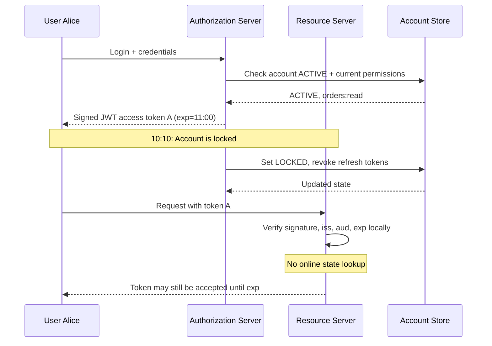
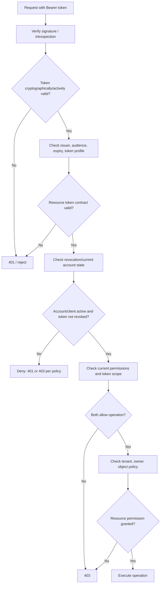

# Account Locks, Permission Changes, and Still-Live Tokens

## 1. Why Does Locking an Account Not Automatically Stop an Access Token?

A Spring Security OAuth 2.0 Resource Server application receives an access token and verifies it before allowing a request into the API. Suppose Alice logs in and receives a JWT valid for one hour:

```json
{
  "iss": "https://auth.example.test/realms/orders",
  "sub": "alice-123",
  "aud": ["orders-api"],
  "scope": "orders:read orders:write",
  "iat": 1890000000,
  "exp": 1890003600,
  "jti": "access-7f2d",
  "authz_ver": 12
}
```

Ten minutes later, an administrator discovers Alice's account was compromised and **locks the account**. Or Alice has order-reading permissions removed, is removed from a tenant, or loses administrative privileges.

If the Resource Server only verifies the JWT signature, issuer, audience, and expiration, that token can still be accepted until `exp` passes. The signature is still valid; the payload is unaltered; the token has not expired. **Self-contained JWTs do not automatically learn that account state changed in a database or Authorization Server.**

This is the problem of **a still-live token with stale permissions**.

This lesson belongs to the **Lifecycle and Revocation** chapter of the **Spring Security OAuth 2.0 OIDC Resource Server** module. It explains how to handle locked accounts and changed permissions while access tokens remain unexpired; how to coordinate the Authorization Server (AS) and Resource Server (RS); revocation strategies; and how to implement and test them in Spring Security.

Example context:

- User: Alice, subject `alice-123`.
- Resource Server: `orders-api`.
- Issuer: `https://auth.example.test/realms/orders`.
- Audience: `orders-api`.
- Scope: `orders:read` and `orders:write`.
- Custom authorization version: `authz_ver`.
- JWT ID: `jti`.

Domains, tokens, IDs, and timestamps are illustrative data. Code examples use Java 17+, Spring Boot 3.x, and Spring Security 6.x; exact APIs may vary across minor versions.

> **Core takeaway:** Locking an account, changing permissions, or revoking a token are **state events**. A signed JWT only carries a snapshot of claims at issuance time. If the Resource Server has no mechanism to observe changes, it cannot infer the new state from the signature and `exp` alone.

---

## 2. Separating Four States Often Lumped Together as "Token Valid"

When an API receives a Bearer token, distinguish four questions:

| Layer | Question | Example |
|---|---|---|
| **Cryptographic validity** | Was the token signed by a trusted key and left unaltered? | Valid RS256 signature. |
| **Token validity** | Are issuer, audience, timestamps, and token type/profile valid? | Valid `iss`/`aud`/`exp`. |
| **Current account/entitlement state** | Is the user/client still active and still holding current permissions? | Alice is not locked and still has `orders:read`. |
| **Resource authorization** | Does the caller have permission on the specific object? | Alice may read order 42 belonging to her tenant. |

An access token can pass the first two layers and fail at the third or fourth.

### 2.1. Timeline Example

```text
10:00  Alice is issued access token A:
       sub=alice-123
       scope=orders:read orders:write
       exp=11:00
       authz_ver=12

10:10  Admin locks Alice's account:
       account.status=LOCKED
       account.authorization_version=13
       refresh tokens revoked

10:11  Alice resends token A:
       JWT signature: valid
       iss/aud/exp: valid
       token authz_ver: 12
       current account version: 13
       Outcome per policy: DENY
```

If the Resource Server only runs an offline JWT decoder, it will not know about step 10:10. With introspection, a denylist, an account-state lookup, or push revocation, it can reject the token before expiration.

### 2.2. Unexpired Does Not Mean Permitted

```text
exp > now
```

only indicates that the token has not passed its expiration claim under clock policy. It **does not prove**:

- The account has not been locked.
- The user has not been removed from the tenant.
- The role/scope has not been revoked.
- The OAuth client has not been disabled.
- The token has not been revoked.
- The originating login session has not ended.
- The object still belongs to that user.
- Risk/fraud policies have not changed.

Expiration is an important bound, yet it does not replace revocation and current authorization.

---

## 3. Distinguishing Lifecycle Events

Not every change requires the same action.

| Event | Changed state | Impact to consider |
|---|---|---|
| **Account lock** | User is no longer allowed to operate. | Block new tokens, refresh tokens, and live access tokens per policy. |
| **Account disable** | User disabled long-term or until re-enabled. | Similar to lock; requires auditing and version bump. |
| **Account deletion** | Identity no longer exists or is anonymized. | Reject old tokens; handle data retention and subject mapping. |
| **Password change** | Login credential changed. | May revoke refresh tokens/sessions per policy; does not auto-invalidate offline JWTs. |
| **Mandatory MFA enabled** | Login assurance level changed. | Old tokens may lack required assurance; require claim/profile check or re-authentication. |
| **Role removed** | Entitlements decreased. | Prevent stale roles in JWTs from granting access until expiry if fast change is needed. |
| **Role added** | Entitlements increased. | Old tokens may lack new permissions; usually requires a new token or current-entitlement lookup. |
| **User removed from tenant** | Membership changed. | Block access on that tenant even if JWT still carries old tenant/scope claims. |
| **Single token revoked** | One credential invalidated. | Denylist by `(iss,jti)` or introspection `active=false`. |
| **All user tokens revoked** | Subject's credentials in chosen scope. | Version bump, revoke refresh tokens, status check, or revocation event. |
| **OAuth client disabled** | Workload/client credentials disallowed. | Block client token issuance/refresh and old tokens per policy. |
| **Signing key compromise** | Trust root affected. | Emergency key removal/rotation; may affect many users simultaneously. |

A well-designed system defines the **revocation scope** for each event: one access token, one browser session, all tokens of one user, one tenant membership, one OAuth client, or an entire issuer key.

### 3.1. User Accounts and OAuth Clients Are Distinct Principals

In the Client Credentials flow, an access token may represent a workload:

```json
{
  "iss": "https://auth.example.test/realms/orders",
  "sub": "orders-importer",
  "client_id": "orders-importer",
  "aud": ["orders-api"],
  "scope": "orders:import"
}
```

There is no user `alice-123` in this token. Locking Alice's account should not affect the workload; conversely, disabling the `orders-importer` OAuth client must affect that client's tokens. Distinguish **user status**, **client status**, **actor type**, and delegated permissions.

Never assume every `sub` is a human user just because the token has a `sub` claim.

---

## 4. Why Do Offline JWTs Not Revoke Immediately on Their Own?

A signed JWS JWT contains claims and a signature. The Resource Server can verify it with a cached public key from JWKS without calling the AS on every request.



This is not necessarily a JWT bug. It is the **trade-off of self-contained tokens**:

- Fewer network calls per request.
- RS can verify tokens while the AS is temporarily unavailable if public keys are cached.
- Claims can be inspected locally.
- However, post-issuance account/entitlement changes are not automatically reflected.
- A leaked JWT can be used until expiration unless an additional revocation mechanism exists.

### 4.1. A Signature Is Not Invalidated by Database Updates

Suppose a token was signed with private key `K1`. When Alice is locked, the AS updates the database without changing the token bytes or signing key. The signature still verifies against public key `K1`.

There is no built-in message in a compact JWT that automatically tells every Resource Server "Alice was just locked." To propagate changes, the system must add **online state checks**, **revocation data**, **introspection**, **push events**, or shorten lifetimes to bound the risk window.

### 4.2. Key Rotation Is Not How You Lock One User

You could remove public key K1 from JWKS to reject all JWTs signed by K1. Yet if K1 signed tokens for thousands of users and clients, that action invalidates **all** tokens under that key, including active users.

Key rotation and emergency key revocation operate at the **signing-key trust boundary**, not as a tool for revoking a single account. Use them only for key compromise or incidents warranting that blast radius.

---

## 5. Strategy 1: Short-Lived Access Tokens and Revocable Refresh Tokens

This is a common choice for JWT Resource Servers needing high performance and accepting a **bounded maximum revocation window**.

### 5.1. How It Works

- Access tokens have a short lifetime, e.g., 5–10 minutes per threat model.
- Refresh tokens live longer, but are stored/tracked at the AS.
- When an account is locked or permissions change, the AS stops issuing new tokens and revokes related refresh tokens/sessions.
- Already-issued JWT access tokens may keep working until expiration if the RS verifies offline only.
- Client refresh attempts are rejected and must trigger re-authentication or sign-out.

```text
10:00  Issue JWT access token, exp=10:10
10:03  Account locked; refresh token revoked
10:04  Existing JWT may still be accepted by offline RS
10:10  JWT expires
10:11  Refresh attempt -> denied
```

### 5.2. Benefits and Limitations

| Benefit | Limitation |
|---|---|
| No database/introspection call on every API request. | Old tokens stay alive until `exp`. |
| Simpler than global revocation state. | Unsuitable when revocation must take effect within seconds. |
| Shrinks window where a leaked token can be used. | Short tokens increase refresh frequency and AS load. |
| Works with offline JWKS caching. | Revoking a refresh token does not auto-revoke issued JWT access tokens. |

**Access token lifetime must be chosen based on risk and SLA**, not just to "make JWTs fast." A payment or admin operation may demand higher freshness than a low-sensitivity read endpoint.

### 5.3. Account Locks Must Block Refreshes, Not Just Login

A common bug is rejecting a locked account at the login endpoint while the refresh token grant keeps issuing new access tokens. The AS must check account status on **every grant/refresh path** capable of minting tokens:

- Authorization Code exchange per policy.
- Refresh Token grant.
- Device Authorization flow.
- Token exchange/delegation.
- Client Credentials when an OAuth client is disabled.
- Custom grants or service token minting.

For a locked user account, old refresh tokens must be revoked or the refresh path must check current status and deny. For a disabled client, client authentication and token grants must be rejected.

### 5.4. Choosing TTL by Revocation Objective

Example internal policy:

| API class | Illustrative access token TTL | Additional mechanism |
|---|---:|---|
| Public catalog/read-only | 10–15 minutes | TTL + scope/owner checks |
| User profile/order read | 5–10 minutes | TTL + current membership when needed |
| Sensitive admin | 1–5 minutes | Online status/version check |
| Payment/privileged operation | Short per risk | Online authorization/introspection or transaction-time policy |

These are guiding examples only, not mandatory standard values. Balance AS load, clock skew, client refreshes, user experience, offline behavior, and incident response.

---

## 6. Strategy 2: OAuth 2.0 Token Revocation (RFC 7009)

**RFC 7009 — OAuth 2.0 Token Revocation** defines an endpoint for clients to ask the Authorization Server to revoke a token. The AS may revoke the access token, refresh token, or related tokens per implementation/policy.

A typical request:

```http
POST /oauth2/revoke HTTP/1.1
Host: auth.example.test
Authorization: Basic <client-credentials>
Content-Type: application/x-www-form-urlencoded

token=<refresh-token>&token_type_hint=refresh_token
```

### 6.1. What Does the Revocation Endpoint Do?

- The client sends the token to revoke over HTTPS.
- The AS authenticates the client/request per policy.
- The AS processes the token and updates state.
- Responses are designed to avoid leaking too much about whether a token exists.
- Which related tokens are also revoked depends on AS semantics.

**Do not infer** that every Resource Server verifying JWTs offline immediately knows the token was revoked just because `/revoke` returned success. RFC 7009 defines revocation between the client and AS; for the RS to learn about it, introspection, a denylist, event propagation, or another mechanism is required.

### 6.2. Revoking Refresh Tokens Differs from Revoking Access Tokens

When an account is locked:

1. Revoke refresh tokens so clients cannot obtain new access tokens.
2. If supported by the AS, revoke specific access tokens or all tokens in the session/grant.
3. The RS must have a way to know old access tokens are no longer allowed if immediate revocation is required.
4. Clients must delete credentials per policy and stop retrying refreshes endlessly.

If only the refresh token is revoked, already-issued access JWTs can remain valid until `exp`. This is frequently misunderstood.

### 6.3. Revocation Does Not Replace Account-State Checks

A user may be locked due to fraud/risk before their tokens are revoked. Or a refresh token is revoked while another access token still exists. Therefore, an important policy can require that **account status must always be active for sensitive requests**, independently of whether a given token is already in a denylist.

---

## 7. Strategy 3: Token Introspection (RFC 7662)

If the Resource Server uses **opaque/reference tokens**, it typically calls the introspection endpoint to check whether a token is active. The AS can return `active=false` right after an account/token is locked or revoked, depending on AS semantics and propagation.

```http
POST /oauth2/introspect HTTP/1.1
Host: auth.example.test
Authorization: Basic <resource-server-credentials>
Content-Type: application/x-www-form-urlencoded

token=<access-token>&token_type_hint=access_token
```

Active response:

```json
{
  "active": true,
  "iss": "https://auth.example.test/realms/orders",
  "sub": "alice-123",
  "aud": ["orders-api"],
  "scope": "orders:read",
  "exp": 1890003600,
  "client_id": "web-portal"
}
```

After Alice is locked, the AS may return:

```json
{
  "active": false
}
```

### 7.1. How Can Introspection Solve Still-Live Tokens?

If the RS queries the AS on every request and the AS has up-to-date state, a revoked token or locked subject can be rejected even before `exp`. This provides **online validation** rather than offline-only JWT verification.

Some AS implementations also support introspecting JWT access tokens, though not every provider does. Check the contract and introspection client permissions. Do not assume JWTs can be introspected simply because an endpoint exists.

### 7.2. Trade-Offs

| Benefit | Cost / risk |
|---|---|
| AS can reflect fresh account/token state. | Adds network dependency per request if uncached. |
| Can revoke a single token without waiting for JWT `exp`. | Latency and AS throughput. |
| Can return current scopes/tenant/actor per contract. | RS depends on availability and response schema. |
| Opaque tokens require no public key distribution. | Needs credentials and protection for introspection endpoint. |
| Supports centralized token status. | Caching can delay revocation propagation. |

### 7.3. `active=true` Does Not Mean Operation Permissions Are Sufficient

Introspection only returns token status and metadata per contract. The API must still verify:

- Audience/resource binding.
- Issuer/token type if required by the contract.
- Scope and authorities.
- Tenant membership.
- Object owner/ACL.
- Current account status or entitlements if not guaranteed by the AS within `active`.

Per RFC 7662, `active` is the only required boolean; other metadata like `iss`, `aud`, `sub`, `scope`, and `exp` are optional in the protocol. If the API relies on them, establish an **explicit contract** or ensure the AS restricts tokens to the right resource/introspection caller.

### 7.4. Introspection Caching Alters the Revocation SLA

Suppose the RS caches `active=true` for 60 seconds. Alice is locked at 10:00:10, yet a pod's cache refreshed at 10:00:05. That pod can continue accepting the token until 10:01:05 unless invalidated.

```text
Revocation propagation delay
  ≈ introspection cache TTL
  + event delivery / invalidation delay
  + request in-flight duration
```

This is an approximate model for SLA design; actual times depend on caching, networking, replicas, and request concurrency. If revocation is required within 5 seconds, a 60-second cache fails even if the AS updates immediately.

---

## 8. Strategy 4: Denylist by `jti`

A JWT can carry a `jti` claim — JWT ID — to identify a specific token. The RS maintains a **revocation/denylist store** containing revoked tokens.

Example JWT:

```json
{
  "iss": "https://auth.example.test/realms/orders",
  "sub": "alice-123",
  "aud": ["orders-api"],
  "jti": "access-7f2d",
  "exp": 1890003600
}
```

When the token is revoked, the AS/RS records:

```text
revoked-token:<issuer-id>:<jti>
TTL = exp - current_time
```

Every request passing signature/issuer/audience/time verification checks whether `(issuer,jti)` is in the denylist.

### 8.1. Why Must the Key Include the Issuer?

Two different issuers can issue identical `jti` values from independent namespaces. Using `jti` alone risks collisions or cross-source confusion. Keys should include a **canonical issuer identifier** or internal issuer ID:

```text
revoked:<trusted-issuer-id>:<jti>
```

Never put raw JWTs in keys. Never use `sub` as a token-specific key if you only want to revoke one access token, or you may accidentally revoke all tokens of the user.

### 8.2. Denylist Check Pseudocode

```java
public boolean isTokenRevoked(Jwt jwt) {
    String issuer = jwt.getIssuer().toString();
    String jti = jwt.getId();

    if (jti == null || jti.isBlank()) {
        // If the token contract requires jti, a missing jti must be rejected.
        return true;
    }

    return revocationStore.contains(issuer, jti);
}
```

This code is illustrative logic. A real API must explicitly define:

- Which tokens require `jti`.
- Store consistency/availability.
- TTL up to `exp`, with an appropriate clock-skew margin.
- Atomic writes and idempotency.
- Multi-region replication.
- Fail-closed behavior if the store is unavailable.
- Not logging raw tokens or token IDs if policy treats `jti` as sensitive data.

### 8.3. `jti` Does Not Automatically Make a Token Revocable

A JWT with a `jti` claim, where no Resource Server checks a denylist, is still accepted until `exp`. The claim is just an identifier. **Revocation requires state and enforcement logic.**

### 8.4. Denylist vs. Allowlist

- **Denylist:** tokens are valid by default if the decoder passes and they are absent from the revoked list. Easy to pair with JWTs, though revoked-token state must be managed.
- **Allowlist:** only tokens recorded as active in the store are accepted. Can provide tight control, yet sacrifices many stateless benefits and requires synchronized issuance/replication.

Do not confuse a denylist with an introspection cache. A denylist only holds revocation entries; introspection returns current token state from the AS.

---

## 9. Strategy 5: Authorization Version / Security Version

To revoke **all older tokens of a user or client**, you can use a custom version claim.

Example account record:

```text
issuer: https://auth.example.test/realms/orders
subject: alice-123
status: ACTIVE
authorization_version: 12
```

Issued access token:

```json
{
  "iss": "https://auth.example.test/realms/orders",
  "sub": "alice-123",
  "aud": ["orders-api"],
  "scope": "orders:read orders:write",
  "authz_ver": 12,
  "exp": 1890003600
}
```

When Alice is locked or a role is removed, the account service increments the version:

```text
status: LOCKED
authorization_version: 13
```

The Resource Server compares:

```text
token.authz_ver == currentAccount.authorization_version
```

Version 12 tokens are rejected even though the signature is valid and `exp` is still in the future.

### 9.1. Version Claims Are Custom Contracts

`authz_ver` is not a mandatory JWT/OAuth/OIDC claim. The AS and RS must agree on:

- Claim name and data type (e.g., integer).
- Which events increment the version.
- Whether the version belongs to user, client, tenant membership, or session.
- How tokens missing the claim are handled.
- When new tokens pick up the version.
- Where services fetch the current version.
- Cache invalidation and maximum propagation delay.

Never emit string `"12"` in one place and number `12` in another and cast loosely. Invalid schemas must be rejected.

### 9.2. Versions Can Apply at Multiple Scopes

| Version scope | Used to revoke | Example key |
|---|---|---|
| **User authorization version** | All access tokens of a user within an issuer. | `(iss, sub)` |
| **Client security version** | Tokens of an OAuth client/workload. | `(iss, client_id)` |
| **Tenant membership version** | Tokens/permissions of a user within one tenant. | `(iss, sub, tenant_id)` |
| **Session/grant version** | Tokens from a specific session/grant. | `(iss, sub, sid)` or grant ID per contract |
| **Global issuer version** | A broad group of tokens when policy/trust changes. | Internal issuer policy version |

Choose the right scope. If a user belongs to two tenants and is only removed from Acme, bumping the **global user version** unnecessarily invalidates Beta tokens. If permissions changed across the entire user, a global version may be appropriate.

### 9.3. When Should Versions Bump?

Versions can increment when:

- An account is locked, disabled, or deleted.
- Password reset or credential compromise occurs per policy.
- MFA enrollment/assurance policy changes and old tokens no longer meet requirements.
- A role or permission is removed.
- Tenant membership is revoked.
- An admin revokes all tokens of a user.
- Client secrets/private keys or workload authorizations change.
- A risk engine decides to revoke the session.

You do not necessarily need to increment the version for every profile field change (e.g., display name) that does not affect authorization. A version is a **security invalidation signal**, so which events bump it must be defined and audited.

### 9.4. When New Permissions Are Added

Suppose Alice has a version 12 token with `orders:read`. An admin adds `orders:export` and increments the version to 13.

Old version 12 tokens are rejected under strict version equality; the client must obtain a new token. This is safe, though potentially disruptive.

A variant avoids bumping the version on pure permission additions and instead uses online current-permission intersection; the new permission is only granted once the token also carries the required scope. Choose consistent semantics.

---

## 10. Permission Changes: JWT Scopes Are a Snapshot, Not a Live Database

An access token typically contains scopes/roles granted at issuance time.

10:00:

```json
{
  "sub": "alice-123",
  "scope": "orders:read orders:write orders:export"
}
```

At 10:10, an administrator removes export permission from Alice. If the RS merely maps token claims to authorities, `SCOPE_orders:export` stays in `Authentication` until the token expires.

### 10.1. Three Permission Models

| Model | How permissions are decided | Freshness |
|---|---|---|
| **Token snapshot** | Uses scopes/roles inside the token. | Updates only upon a new token. |
| **Online entitlement** | Queries current permissions from store/service per request. | Can be near real-time. |
| **Hybrid intersection** | Effective permissions = token permissions ∩ current permissions. | Fast revocation; new grants usually require a new token. |

### 10.2. Hybrid Intersection Blocks Stale Permissions

Example:

```text
Token scopes:
  orders:read
  orders:write
  orders:export

Current account permissions:
  orders:read
  orders:write

Effective permissions:
  orders:read
  orders:write
```

If the token has `orders:read` while the database removed read, the intersection no longer grants read. If the database adds `orders:admin` while the token lacks it, the intersection does not grant admin either. This is **fail-closed** for privilege escalation: the client needs a new token carrying the new scope.

### 10.3. Never Let Current Database Permissions Exceed the Token Scope Cap

A loose design might query the database and allow all current permissions regardless of what scopes the token holds. That can turn a narrowly scoped token into a higher-privileged credential.

A common safe pattern:

```text
effectiveAuthority =
    tokenGrantedAuthority
    AND currentEntitlement
    AND resourcePolicy
```

If an architecture uses the token strictly as an identity credential and checks all permissions online, establish a different explicit contract: token audience/actor/tenant must still be valid and the online policy must be the source of truth. Never mix the two models without defining it.

### 10.4. Adding vs. Removing Permissions Is Asymmetric

- **Removing permissions:** for fast effect, use online checks, version bumps, denylists, or introspection.
- **Adding permissions:** can usually wait for the client to refresh the access token to pick up the new scope.
- **Removing tenant membership:** must check current membership or per-tenant version.
- **Changing sensitive roles:** should invalidate token/authorization caches per policy.
- **Changing client permissions:** check client status/version rather than user accounts.

An API can tolerate slightly slower propagation of newly added permissions, but should not tolerate retaining revoked permissions for long if risk policy requires prompt revocation.

---

## 11. Checking Account Status and Current Permissions in Spring Security

A default JWT Resource Server verifies the token and maps claims/authorities. It **does not automatically know** whether an application's database user table has status `LOCKED` or whether permissions just changed, unless you integrate that logic.

There are several enforcement points:

1. **At token issuance/refresh in the AS:** block minting new tokens.
2. **At the authentication boundary in the RS:** reject revoked/locked credentials if state lookup is performed there.
3. **At the authorization boundary:** check current account status, version, and entitlements for protected operations.
4. **At the data layer:** query tenant/owner/resource under current policies.

In this example, we use **method security** to illustrate checking current state at the service boundary.

### 11.1. Basic JWT Resource Server Configuration

`application.yml`:

```yaml
spring:
  security:
    oauth2:
      resourceserver:
        jwt:
          issuer-uri: https://auth.example.test/realms/orders
          jwk-set-uri: https://auth.example.test/realms/orders/protocol/openid-connect/certs
          audiences:
            - orders-api
```

Configuring `issuer-uri` + `jwk-set-uri` avoids metadata discovery for the key endpoint in supported Boot versions while retaining the expected issuer. Audience validation must be enforced properly; if declaring a custom `JwtDecoder` bean, attach the corresponding validators yourself.

### 11.2. HTTP Security Chain

```java
package com.example.orders.security;

import org.springframework.context.annotation.Bean;
import org.springframework.context.annotation.Configuration;
import org.springframework.http.HttpMethod;
import org.springframework.security.config.Customizer;
import org.springframework.security.config.annotation.web.builders.HttpSecurity;
import org.springframework.security.config.annotation.web.configurers.AbstractHttpConfigurer;
import org.springframework.security.config.http.SessionCreationPolicy;
import org.springframework.security.web.SecurityFilterChain;
import org.springframework.security.web.savedrequest.NullRequestCache;

@Configuration
public class OrdersApiSecurityConfig {

    @Bean
    SecurityFilterChain apiSecurity(HttpSecurity http)
            throws Exception {
        return http
            .sessionManagement(session -> session
                .sessionCreationPolicy(SessionCreationPolicy.STATELESS))
            .requestCache(cache ->
                cache.requestCache(new NullRequestCache()))
            .csrf(AbstractHttpConfigurer::disable)
            .authorizeHttpRequests(auth -> auth
                .requestMatchers(HttpMethod.GET, "/api/orders/**")
                    .hasAuthority("SCOPE_orders:read")
                .requestMatchers(HttpMethod.POST, "/api/orders")
                    .hasAuthority("SCOPE_orders:write")
                .anyRequest().denyAll())
            .oauth2ResourceServer(oauth ->
                oauth.jwt(Customizer.withDefaults()))
            .build();
    }
}
```

This API uses Bearer headers only, with no cookies/sessions for authentication. If the app also has web login, separate filter chains and keep CSRF enabled for cookie-authenticated routes per threat model. `STATELESS` does not perform current account-state checks; method security below does that.

### 11.3. Enable Method Security

```java
package com.example.orders.security;

import org.springframework.context.annotation.Configuration;
import org.springframework.security.config.annotation.method.configuration.EnableMethodSecurity;

@Configuration
@EnableMethodSecurity
public class MethodSecurityConfig {
}
```

Method security lets you place policies at service methods rather than protecting only a single controller. Ensure all entry points are invoked through Spring-managed proxies and that method security configuration is loaded.

### 11.4. Account Security State Model

Example domain record:

```java
package com.example.orders.account;

import java.util.Set;

public record AccountSecurityState(
    String issuer,
    String subject,
    AccountStatus status,
    long authorizationVersion,
    Set<String> permissions
) {}
```

Enum:

```java
package com.example.orders.account;

public enum AccountStatus {
    ACTIVE,
    LOCKED,
    DISABLED,
    DELETED,
    PENDING
}
```

Repository contract:

```java
package com.example.orders.account;

import java.util.Optional;

public interface AccountSecurityStateRepository {

    Optional<AccountSecurityState> findByIssuerAndSubject(
        String issuer,
        String subject
    );
}
```

**Issuer must be part of the identity key.** `sub` is only unique within an issuer's namespace; two issuers can both emit `sub=123` for two different principals. For multi-tenant membership, the repository may also need `tenantId`/membership ID.

### 11.5. Policy Checking Current Status and Permissions

```java
package com.example.orders.security;

import java.util.Objects;

import com.example.orders.account.AccountSecurityState;
import com.example.orders.account.AccountSecurityStateRepository;
import com.example.orders.account.AccountStatus;

import org.springframework.security.core.Authentication;
import org.springframework.security.oauth2.jwt.Jwt;
import org.springframework.stereotype.Component;

@Component("currentAccountPolicy")
public class CurrentAccountPolicy {

    private final AccountSecurityStateRepository repository;

    public CurrentAccountPolicy(
            AccountSecurityStateRepository repository) {
        this.repository = repository;
    }

    public boolean allows(
            Authentication authentication,
            String requiredPermission) {

        if (authentication == null || !authentication.isAuthenticated()) {
            return false;
        }

        if (!(authentication.getPrincipal() instanceof Jwt jwt)) {
            return false;
        }

        if (jwt.getIssuer() == null
                || jwt.getSubject() == null
                || requiredPermission == null
                || requiredPermission.isBlank()) {
            return false;
        }

        String issuer = jwt.getIssuer().toString();
        String subject = jwt.getSubject();

        AccountSecurityState state = repository
            .findByIssuerAndSubject(issuer, subject)
            .orElse(null);

        if (state == null || state.status() != AccountStatus.ACTIVE) {
            return false;
        }

        Object rawVersion = jwt.getClaims().get("authz_ver");
        if (!(rawVersion instanceof Number number)
                || number.longValue() != state.authorizationVersion()) {
            return false;
        }

        // Token scope is the upper bound of granted permissions.
        boolean tokenAllows = authentication.getAuthorities().stream()
            .anyMatch(authority -> Objects.equals(
                authority.getAuthority(),
                "SCOPE_" + requiredPermission
            ));

        // Current entitlement allows revoking changed permissions.
        boolean currentAccountAllows =
            state.permissions().contains(requiredPermission);

        // Only allow when both token and current state agree.
        return tokenAllows && currentAccountAllows;
    }
}
```

This is a **synchronous pattern for Spring MVC/Servlet**. In production, the repository needs proper query/cache performance and exception handling. If the account-state store is unreachable, never return `true` by default; operations requiring current-state checks must **fail closed** per policy.

Key notes:

- `authz_ver` is a **custom claim** emitted by the issuer. Missing or mistyped claims are rejected per contract.
- `permissions` in the record are current entitlements, not token scopes.
- `issuer + subject` avoids conflating principals across multiple issuers.
- `authentication.getAuthorities()` is built from verified claims, typically via a scope converter.
- The policy applies the **intersection** between token scope and current permissions.
- This example checks account-level permissions only; owner/tenant/resource checks must still occur in domain queries.
- If a token represents client credentials, the principal may not map to a user record; apply a dedicated workload policy rather than blindly rejecting or forcing it into a user record.

### 11.6. Applying the Policy in the Service

```java
package com.example.orders.service;

import com.example.orders.api.OrderDto;
import com.example.orders.account.OrderRepository;

import org.springframework.security.access.prepost.PreAuthorize;
import org.springframework.stereotype.Service;

@Service
public class OrderService {

    private final OrderRepository repository;

    public OrderService(OrderRepository repository) {
        this.repository = repository;
    }

    @PreAuthorize(
        "@currentAccountPolicy.allows(authentication, 'orders:read')"
    )
    public OrderDto readOrder(String orderId) {
        // Query below must still be tenant/owner-scoped.
        return repository.findVisibleOrderForCurrentActor(orderId)
            .map(OrderDto::from)
            .orElseThrow(OrderNotFoundException::new);
    }

    @PreAuthorize(
        "@currentAccountPolicy.allows(authentication, 'orders:write')"
    )
    public void updateOrder(String orderId, UpdateOrderCommand command) {
        repository.updateVisibleOrderForCurrentActor(orderId, command);
    }
}
```

`findVisibleOrderForCurrentActor` and `updateVisibleOrderForCurrentActor` are **illustrative repository methods**; a real app must explicitly pass canonical actor/tenant context. Never rely on method naming to magically secure queries.

With proxy-based method security, self-invocations (`this.readOrder(...)`) within the same bean bypass the proxy and skip annotations. Place authorization at public service boundaries called from other beans, or structure beans so the interceptor actually runs.

### 11.7. Current Account Policy Can Return 403 Even When the JWT Is Still Valid

In this example, JWT signature/issuer/audience/timestamps are valid, yet account status is `LOCKED` or the version mismatches. `@PreAuthorize` rejects the method invocation; the outcome is typically handled as **access denied (403)** by web security exception handling.

If the design intends to treat a revoked token as an invalid credential returning **401 `invalid_token`**, place the revocation check at the authentication boundary, decoder/introspector, or a custom authentication manager. Distinguish **credential no longer accepted** from **authenticated principal lacks current permission** and keep error semantics consistent.

---

## 12. Current Account Lookup: Synchronous, Cached, and Performance

Checking account state on every request reflects locks and permission changes promptly, yet adds a dependency on the database or entitlement service.

### 12.1. Three Options

| Option | Approach | Freshness | Cost |
|---|---|---|---|
| DB lookup per request | Query account status/version/permissions. | Closest to DB consistency. | DB load and latency. |
| Short-lived cache | Cache state by `(iss, sub[, tenant])`. | Lag up to TTL if uninvalidated. | Cache memory/network and stale window. |
| Event invalidation + cache | AS emits events; RS updates/evicts cache. | Fast when event delivery is healthy. | Event infrastructure, ordering/recovery complexity. |

You can combine caching with event invalidation, provided you define the **maximum stale time** if an event is lost.

### 12.2. Properly Namespaced Cache Keys

Never cache solely by `sub`:

```text
account-state:alice-123
```

Because `sub` is not necessarily unique across issuers or tenants. Keys can look like:

```text
account-state:<trusted-issuer-id>:<subject>
membership-state:<issuer-id>:<subject>:<tenant-id>
```

Never use raw JWTs or token secrets as keys. Consider subject privacy and use internal pseudonymous IDs where appropriate.

### 12.3. TTL Is Part of the Revocation SLA

Suppose account state is cached for 30 seconds without event invalidation. A user locked right after a cache refresh can continue being accepted until the next refresh.

```text
Approximate maximum stale window
  <= cache TTL + replication lag + request in-flight time
```

This is a design estimate, not a guarantee if replica lag or prolonged cache refresh errors occur. If the SLA requires locking within 5 seconds, a 30-second TTL fails. Use event invalidation, direct lookups, a shorter TTL, or another mechanism.

### 12.4. When the Account Store Fails

Three responses are typically considered:

- **Fail closed:** disallow operations requiring current state when state cannot be read.
- **Use bounded last-known-good state:** reuse cached state only within an approved freshness limit, suited to low-risk endpoints.
- **Fail open:** allow solely based on token claims.

For account locks, admin privileges, payments, and sensitive data, fail-open is generally unacceptable. If using a bounded stale mode, specify duration, endpoints, risk owner, and alerting. Never catch exceptions and return `true` just to preserve availability.

### 12.5. Avoiding N+1 Account Checks

One HTTP request can invoke multiple services/repositories. Never re-query account state for every order line item. You can:

- Resolve the authorization context once at the request/service boundary.
- Cache within request scope using an appropriate mechanism, not an ad-hoc global `ThreadLocal`.
- Use a single joined query/transaction to fetch state + data per policy.
- Use batch APIs for multiple subjects when workload tokens act on many actors.
- Be cautious caching post-authorization results because permissions can change.

---

## 13. Event-Driven Revocation: Rapidly Updating Many Resource Servers

A microservices system with many Resource Servers may not want every request calling the AS or identity database. The AS can publish events when state changes:

```json
{
  "event_type": "account.locked",
  "issuer_id": "orders-idp",
  "subject": "alice-123",
  "authorization_version": 13,
  "occurred_at": "2026-11-15T10:10:00Z",
  "event_id": "evt-8f13"
}
```

Or a single-token revocation event:

```json
{
  "event_type": "token.revoked",
  "issuer_id": "orders-idp",
  "jti": "access-7f2d",
  "expires_at": "2026-11-15T11:00:00Z",
  "event_id": "evt-8f14"
}
```

These are **illustrative internal schemas**, not standard OAuth event formats.

### 13.1. What Does the Resource Server Do on Receiving an Event?

- Evict the subject's account/entitlement cache.
- Update the current authorization version.
- Add `(issuer,jti)` to the denylist.
- Invalidate a tenant's membership cache.
- Block related tokens/sessions/grants per event scope.
- Audit the received event and when it took effect.

### 13.2. An Event Bus Is Not the Sole Source of Truth

You must handle:

| Failure mode | Design approach |
|---|---|
| Lost messages | Durable topics, retries, replay, or periodic reconciliation with source of truth. |
| Duplicate delivery | Idempotency by `event_id`/version. |
| Out-of-order | Monotonic versions; old events never overwrite newer state. |
| Consumer outage | Retention/replay and readiness gating while consumer catches up. |
| One pod receives, another has not | Shared store or guaranteed fan-out to every instance. |
| Multi-region delay | Define propagation SLA and fail closed on high-risk actions. |
| Poison messages | Dead-letter queues, alerts, and safe manual handling. |
| Forged events | Authenticate producer, authorize topic, TLS/signing, and validate schema. |

Never trust an event simply because JSON contains `event_type=account.locked`. Accept events only from **authenticated producers** over channels with integrity and access control.

### 13.3. Monotonic Versions Prevent Stale Events

Example:

```text
Event A: authz_ver=13 (LOCKED)
Event B: authz_ver=14 (DISABLED)
Event C: authz_ver=12 (old replay)
```

Consumers only apply state with a newer version. Event C must never revert the account to version 12 or `ACTIVE`. Versions increase monotonically and state reconciles against the authoritative store.

### 13.4. Outbox Pattern

If the account DB update commits but event publishing fails, RSs miss the change. A common solution is the **transactional outbox**:

1. Within the same database transaction, update account status/version.
2. In the same transaction, write an outbox record.
3. A background publisher reads the outbox and publishes the event.
4. Mark the record published or rely on idempotency.
5. Consumers process at-least-once and deduplicate.
6. Reconciliation monitors event lag.

This is an architectural pattern, not an automatic Spring Security feature. Ensure account state changes and event records never diverge.

---

## 14. Revoking One Token or All Tokens?

### 14.1. A Specific Token

Use a `jti` denylist or AS introspection/revocation state. Suitable when:

- One access token was leaked.
- A user signs out of one device/session while keeping other sessions active.
- An admin revokes one specific grant.
- One token triggers a dedicated risk signal.

### 14.2. All Tokens of a User

Use account status/version or revoke all sessions/refresh tokens. Suitable when:

- Account lock/disablement.
- Credential compromise.
- User removed from organization.
- Admin "sign out all devices."
- Password/MFA reset per policy.

### 14.3. One Tenant Membership

Use membership-specific version/state:

```text
(issuer, subject, tenant=t-acme) -> membership_version=8, status=REVOKED
```

When a user is removed from Acme, Beta tokens can remain functional if policy permits. However, Acme requests must be rejected as soon as current membership state updates/propagates.

### 14.4. One OAuth Client / Workload

Use `client_id`/internal client ID and a client security version. When a workload is disabled:

- Block client authentication.
- Stop issuing client credentials tokens.
- Revoke refresh/long-lived credentials if any exist.
- Introspection or online version checks block old access tokens.
- Rotate client secrets/private keys per incident plan.

Never use user account status to manage workload tokens when the true principal is a client.

### 14.5. Entire Issuer / Signing Key

Only when the trust root is compromised or emergency key removal is required. Blast radius is large; coordinate rollout, key overlap, cache refreshes, and API owner notifications. Never use this for a routine user lock.

---

## 15. Logout, Revocation, and Account Lock Are Not the Same Operation

These concepts are frequently conflated behind a "Logout" UI.

| Action | Meaning | Automatically invalidates offline JWTs? |
|---|---|---|
| **Clear client token storage** | Client deletes tokens from browser/device. | No. Copied tokens remain usable. |
| **Browser logout** | Ends local app session or OIDC RP session. | Not necessarily. |
| **OIDC provider logout** | Ends OP session per protocol/implementation. | Does not auto-revoke all issued access JWTs. |
| **Refresh token revoke** | Prevents obtaining new access tokens from refresh credentials. | Does not necessarily affect live access JWTs. |
| **Access token revoke** | AS marks token revoked per supported mechanism. | Only visible to RS if online/push/denylist exists. |
| **Account lock** | Account no longer allowed to log in/operate. | No for an RS doing offline JWT verification only. |
| **Permission removal** | Entitlements changed. | Token snapshots may retain old scopes until `exp`. |

### 15.1. "Logout Succeeded" Does Not Mean "Every Token Is Dead"

A client deleting a token only stops **that client** from sending it again. If the token was exfiltrated, an attacker can still use it until expiration or until revoked and observed by the RS.

A logout flow should specify:

- Which tokens are deleted at the client?
- Is the browser session ended at the OP?
- Are refresh tokens revoked?
- Are access tokens revoked?
- Does the RS detect revocation via introspection, denylist, or version check?
- How long do replicas/caches take to update?
- Are in-flight requests canceled?

Never promise "instant logout across all services" if the system only clears local storage and validates JWTs offline.

---

## 16. Account Locks at the Authorization Server and Resource Server

### 16.1. AS Checks Account Status When Issuing Tokens

The AS must check current status on every token-minting path:

```text
User login:
  authenticate credential
  -> account status ACTIVE?
  -> assurance/MFA policy satisfied?
  -> issue access + refresh token

Refresh:
  validate refresh token
  -> refresh token not revoked?
  -> account status ACTIVE?
  -> grant/consent still valid?
  -> issue new access token

Client Credentials:
  authenticate OAuth client
  -> client status ACTIVE?
  -> client grant/scope still allowed?
  -> issue workload access token
```

Do not block password login while ignoring the refresh grant. If a locked user's refresh token still mints new access tokens, the lock policy is incomplete.

### 16.2. The RS Does Not Necessarily Share a User Database with the AS

In microservices, an RS may have no access to the identity DB. It then needs a **state contract**:

- Introspection.
- Revocation events.
- Version/state API.
- Denylist service.
- Gateway authorization service.
- Short access token TTLs scaled to risk.

Avoid having every microservice query the AS's internal database directly or replicate all identity data without clear ownership and availability contracts.

### 16.3. Blocking at the AS Is Not Enough If the RS Is Offline

```text
AS:
  account LOCKED
  refresh revoked
  new token issuance denied

RS:
  cached public key
  validates old JWT locally
  no state lookup
  -> still accepts until exp
```

This is expected behavior under offline verification and must either be accepted as a bounded risk or addressed by design. Claiming "immediate account lock" is only accurate if **every Resource Server has a fast enough way to observe state**.

---

## 17. Multi-Tenancy and Permission Changes

In a multi-tenant application, a user may belong to multiple organizations. A token may carry one tenant or a list of entitlements.

Example:

```json
{
  "iss": "https://auth.example.test/realms/orders",
  "sub": "alice-123",
  "aud": ["orders-api"],
  "tenant_id": "t-acme",
  "scope": "orders:read",
  "authz_ver": 12
}
```

If Alice is removed from Acme yet stays in Beta:

- Old Acme tokens must be rejected by membership/version checks.
- Beta tokens can remain valid if the version/membership model is per-tenant.
- Database queries must filter by `tenant_id`.
- Cache keys must be namespaced by tenant.
- `sub` must be namespaced by issuer.
- `membership.revoked` events should carry subject + tenant ID + membership version.

### 17.1. Dedicated Membership Versions

Example store:

```text
(issuer, subject, tenant=t-acme) -> membership_version=8, status=REVOKED
(issuer, subject, tenant=t-beta) -> membership_version=3, status=ACTIVE
```

Acme tokens carry `membership_ver=7`; Beta tokens carry `membership_ver=3`. When Acme is revoked, only Acme tokens mismatch. This shrinks the blast radius compared to a global account version when the user remains active in other tenants.

### 17.2. Never Let a Scope Union Override Tenant-Specific Grants

If a token carries a generic `orders:read` scope while current permissions only allow reading Beta, Acme requests must be denied. Effective permissions must bind to the specific tenant:

```text
token scope permits operation
AND current membership for requested tenant is ACTIVE
AND current permission for tenant includes operation
AND object belongs to requested tenant
```

Never combine a `roles` list aggregated across all tenants into global permissions.

---

## 18. Spring Security with Opaque Tokens: The AS Can Reflect Locks Faster

If the API uses opaque tokens, `OpaqueTokenIntrospector` can reflect active status per the AS. When an account is locked, the AS can return `active=false` for affected tokens.

`application.yml`:

```yaml
spring:
  security:
    oauth2:
      resourceserver:
        opaquetoken:
          introspection-uri: https://auth.example.test/oauth2/introspect
          client-id: ${INTROSPECTION_CLIENT_ID}
          client-secret: ${INTROSPECTION_CLIENT_SECRET}
```

And the filter chain:

```java
@Bean
SecurityFilterChain apiSecurity(HttpSecurity http)
        throws Exception {
    return http
        .sessionManagement(session -> session
            .sessionCreationPolicy(SessionCreationPolicy.STATELESS))
        .authorizeHttpRequests(auth -> auth
            .requestMatchers(HttpMethod.GET, "/api/orders/**")
                .hasAuthority("SCOPE_orders:read")
            .anyRequest().denyAll())
        .oauth2ResourceServer(oauth ->
            oauth.opaqueToken(Customizer.withDefaults()))
        .build();
}
```

### 18.1. Do Not Cache `active=true` for Too Long

If introspection results are cached for 5 minutes, an account lock can be delayed up to 5 minutes at the RS. Cache TTLs must tie to the revocation SLA. Cache active metadata more briefly or invalidate via events, depending on AS capabilities and scale.

### 18.2. AS Outage

If the introspection endpoint is unavailable, the RS has no evidence that the token is currently active. For protected routes, fail closed. You can return 503 if classified as a dependency outage; do not automatically return 401 `invalid_token` for every upstream failure, since the token itself may be fine while the AS is temporarily unreachable.

### 18.3. The Introspection Requester Must Be Protected

- Use dedicated credentials for the Resource Server.
- Grant permission to introspect only necessary tokens/resources.
- Rotate secrets/certificates.
- Verify TLS properly.
- Never log token bodies or client secrets.
- Rate-limit and monitor the endpoint.
- Never send tokens to URLs specified by untrusted requests or JWTs.

---

## 19. Token Revocation with JWTs: Denylist and Version Check Patterns

Multiple mechanisms can be combined:

```text
JWT signature + issuer + audience + time
       AND jti not in denylist
       AND account status ACTIVE
       AND authz_ver == current version
       AND token scope contains required authority
       AND current permission still allows
       AND object/tenant policy allows
```

Not every API needs all of these. Choose based on risk, but explicitly specify which mechanism handles single-token, per-user, and per-tenant revocation.

### 19.1. Service Managing Account Changes

Pseudo-service when locking an account:

```java
@Transactional
public void lockAccount(String issuer, String subject, String reason) {
    AccountSecurityState state =
        repository.findByIssuerAndSubjectForUpdate(issuer, subject)
            .orElseThrow(AccountNotFoundException::new);

    state.lock();
    state.incrementAuthorizationVersion();

    refreshTokenRepository.revokeAllForSubject(issuer, subject);

    outboxRepository.append(
        AccountLockedEvent.of(
            issuer,
            subject,
            state.authorizationVersion(),
            reason
        )
    );
}
```

This illustrates a domain API. `lock()`, `incrementAuthorizationVersion()`, and repository methods must be implemented in the real model. The transaction should persist the state change and outbox record together; **never call a message broker directly assuming a database transaction rollback will undo the published message**.

### 19.2. Permission Removal

```java
@Transactional
public void removePermission(
        String issuer,
        String subject,
        String permission) {

    AccountSecurityState state =
        repository.findByIssuerAndSubjectForUpdate(issuer, subject)
            .orElseThrow(AccountNotFoundException::new);

    state.removePermission(permission);
    state.incrementAuthorizationVersion();

    refreshTokenRepository.revokeAllForSubject(issuer, subject);

    outboxRepository.append(
        PermissionsChangedEvent.of(
            issuer,
            subject,
            state.authorizationVersion()
        )
    );
}
```

If the version increments on every permission change, old tokens may be invalidated completely, even for unrelated scopes. That is the strict and simple choice; refine to per-permission or per-tenant versions if availability demands it.

### 19.3. Do Not Revoke Refresh Tokens on Cosmetic Changes

Changing an avatar or display name, for instance, need not invalidate all tokens. Bump authorization/security versions only for changes that **affect trust or access policy**. Distinguish profile updates from security events.

---

## 20. 401, 403, and Responses When a Token Is Still Live but the Account Is Locked

HTTP status codes depend on where detection occurs and the API contract.

| Scenario | Authentication | Authorization | Common response |
|---|---|---|---|
| Invalid JWT signature | Failed | Not evaluated | 401 |
| Expired JWT | Failed | Not evaluated | 401 |
| AS introspection `active=false` | Failed | Not evaluated | 401 |
| Denylisted token treated as revoked credential | Failed | Not evaluated | 401 `invalid_token` |
| Valid JWT, account currently `LOCKED` at service policy | Token cryptographically valid | Not permitted to act | Usually 403 or 404 per policy |
| Valid JWT, version mismatch treated as stale token | Credential may be considered no longer accepted | Failed | 401 or 403 depending on enforcement point |
| Valid token, missing scope | Succeeded | Failed | 403, optionally `insufficient_scope` |
| Valid token, sufficient scope, owner mismatch | Succeeded | Failed | 403/404 |
| Current-state store unavailable | Insufficient current info | Must not permit | 503 or deny per handler/policy |
| Wrong API audience on token | Not accepted for resource | Not evaluated | 401 |

Do not force every system to use the exact same status code for account locks; stay consistent with semantics:

- If the AS/decoder declares the credential no longer valid, 401 is appropriate.
- If the RS authenticated the principal yet current policy forbids the action, 403/404 may fit.
- If a required state dependency is experiencing an outage, 503 may describe it more accurately than 401.
- Never leak sensitive reasons (e.g., account under investigation) in error bodies.

### 20.1. Bearer Challenge

A token rejected as invalid/revoked may return:

```http
HTTP/1.1 401 Unauthorized
WWW-Authenticate: Bearer error="invalid_token"
```

Missing scope may return:

```http
HTTP/1.1 403 Forbidden
WWW-Authenticate: Bearer error="insufficient_scope"
```

Per RFC 6750, error parameters and challenges depend on the situation. Never expose raw account state or internal risk reasons to clients.

---

## 21. Testing: Old Tokens Must Be Rejected After an Account Lock

A test checking only `exp` or JWT signatures does not prove revocation. You must test **the exact same token** before and after the state change.

### 21.1. The Most Important Scenario

```text
Given:
  Alice account ACTIVE, authorization_version=12
  access token A has authz_ver=12, exp in future
  token has orders:read

When:
  GET /api/orders/42 with token A

Then:
  permitted (if owner/tenant policy also passes)

When:
  admin locks Alice
  account status=LOCKED
  authorization_version=13

Then:
  GET /api/orders/42 with the SAME token A
  denied even though JWT exp is still in the future
```

This test proves the current state/version check works. A test that mints a new token after locking only proves the AS blocks new issuance, **not that old tokens are revoked**.

### 21.2. Permission Change Scenario

```text
Initial:
  token scope = orders:read orders:export
  current permissions = orders:read orders:export

Change:
  remove orders:export
  current permissions = orders:read
  token remains unexpired

Expected:
  GET/read remains permitted
  export is denied
```

If the system strictly bumps a global authorization version on permission changes, the old token may be rejected altogether; in that case the test expects read to also require a refresh. Choose and document versioning semantics.

### 21.3. MockMvc with Current-State Policy

A test using `jwt()` can exercise method authorization while bypassing the JWT decoder. To focus on **current state**, you can mock the repository:

```java
@SpringBootTest
@AutoConfigureMockMvc
class AccountRevocationAuthorizationTest {

    @Autowired
    MockMvc mvc;

    @MockBean
    AccountSecurityStateRepository accountRepository;

    @Test
    void lockedAccountCannotUseStillLiveJwt() throws Exception {
        var state = new AccountSecurityState(
            "https://auth.example.test/realms/orders",
            "alice-123",
            AccountStatus.LOCKED,
            13,
            Set.of("orders:read")
        );

        when(accountRepository.findByIssuerAndSubject(
            "https://auth.example.test/realms/orders",
            "alice-123"
        )).thenReturn(Optional.of(state));

        mvc.perform(get("/api/orders/42")
                .with(jwt().jwt(j -> j
                    .issuer(URI.create(
                        "https://auth.example.test/realms/orders"))
                    .subject("alice-123")
                    .claim("aud", List.of("orders-api"))
                    .claim("authz_ver", 12))
                    .authorities(new SimpleGrantedAuthority(
                        "SCOPE_orders:read"))))
            .andExpect(status().isForbidden());
    }
}
```

This is an **illustrative skeleton**: it needs JUnit/Mockito/Spring Security Test imports, an endpoint/service annotated with `@PreAuthorize` as shown earlier, and a Spring Boot version supporting `@MockBean`. Because `jwt()` constructs a mock `Jwt`, **it does not test signatures, JWKS, issuer validators, or expiry**. It only tests current-account-state logic. If the endpoint uses handler concealment, expect 404 instead of 403.

### 21.4. Testing Version Mismatch

```java
@Test
void staleAuthorizationVersionIsDenied() throws Exception {
    when(accountRepository.findByIssuerAndSubject(
        "https://auth.example.test/realms/orders",
        "alice-123"
    )).thenReturn(Optional.of(new AccountSecurityState(
        "https://auth.example.test/realms/orders",
        "alice-123",
        AccountStatus.ACTIVE,
        13,
        Set.of("orders:read")
    )));

    mvc.perform(get("/api/orders/42")
            .with(jwt().jwt(j -> j
                .issuer(URI.create(
                    "https://auth.example.test/realms/orders"))
                .subject("alice-123")
                .claim("authz_ver", 12)
                .claim("aud", List.of("orders-api")))
                .authorities(new SimpleGrantedAuthority(
                    "SCOPE_orders:read"))))
        .andExpect(status().isForbidden());
}
```

Token version is 12, current version is 13. Even though the account is active and the scope remains, the token is denied under strict version policy.

### 21.5. Testing Permission Removal with Intersection

```java
@Test
void removedPermissionIsDeniedEvenWhenTokenStillContainsScope()
        throws Exception {
    when(accountRepository.findByIssuerAndSubject(
        "https://auth.example.test/realms/orders",
        "alice-123"
    )).thenReturn(Optional.of(new AccountSecurityState(
        "https://auth.example.test/realms/orders",
        "alice-123",
        AccountStatus.ACTIVE,
        12,
        Set.of("orders:read")
    )));

    mvc.perform(post("/api/orders/42/export")
            .with(jwt().jwt(j -> j
                .issuer(URI.create(
                    "https://auth.example.test/realms/orders"))
                .subject("alice-123")
                .claim("authz_ver", 12)
                .claim("aud", List.of("orders-api")))
                .authorities(new SimpleGrantedAuthority(
                    "SCOPE_orders:export"))))
        .andExpect(status().isForbidden());
}
```

This test assumes the export endpoint is protected by the `orders:export` policy and current state no longer holds that permission. The token still has the scope, yet the current permission was removed, so the intersection returns false.

### 21.6. Testing the Real Decoder Is a Separate Layer

To prove a token is properly signed and unexpired:

- Generate a test RSA keypair.
- Sign a JWT access token with a future `exp` using the private key.
- Serve the test public key via a trusted JWKS.
- Configure issuer/audience validators.
- Send the raw Bearer token through MockMvc or an embedded server.
- Lock the account in the repository after the first request.
- Send **the exact same raw token** a second time.
- Assert the second request is rejected.

`jwt()` tests only evaluate policy with a mock `Authentication`; signed-token integration tests prove the real decoder also runs.

### 21.7. Lifecycle Test Matrix

| # | Initial state | Change | Token/request | Expectation |
|---:|---|---|---|---|
| 1 | Alice ACTIVE, version 12 | None | JWT v12, read scope | Permitted if owner/tenant matches. |
| 2 | Alice ACTIVE, version 12 | LOCKED, version 13 | Same JWT v12 | Denied. |
| 3 | Alice ACTIVE, version 12 | DISABLED | Same JWT v12 | Denied. |
| 4 | Alice ACTIVE, version 12 | DELETE/identity unavailable | Same JWT v12 | Denied. |
| 5 | Alice ACTIVE, version 12 | Remove read, version unchanged | Token still has read | Current permission check denies read. |
| 6 | Alice ACTIVE, version 12 | Remove export | Token still has export | Export denied; read may remain allowed if policy doesn't bump global version. |
| 7 | Alice ACTIVE | Add export | Old token lacks export | Not auto-granted; needs new token if token scope is ceiling. |
| 8 | Alice ACTIVE | Revoke refresh token | Unexpired JWT access token | Offline token may stay alive; new refresh denied. |
| 9 | Alice ACTIVE | Revoke access token `jti=A` | Token A | Denylist/introspection must reject. |
| 10 | Alice has two sessions | Revoke session A | Session B token | B continues if policy revokes per session. |
| 11 | Alice removed from Acme | Membership version bumped | Old Acme token | Acme denied. |
| 12 | Alice removed from Acme | Beta membership still active | Beta token | May continue in Beta per policy. |
| 13 | OAuth client active | Client disabled | Old Client Credentials token | Denied via client status/version/introspection. |
| 14 | Key K1 active | K1 compromised/removed | Token signed with K1 | Denied per emergency key policy; may affect many users. |
| 15 | Introspection active | Account locked | Same opaque token | AS returns inactive per contract; RS denies. |
| 16 | Introspection cache active | Account locked | Cache not yet invalidated | Rejected within SLA or measured stale window. |
| 17 | Revocation event received | Duplicate event | Same version/event ID | Idempotent; causes no invalid state. |
| 18 | Version 14 applied | Stale version 13 event arrives late | Old event | Does not roll back state. |
| 19 | Account store unavailable | Unexpired JWT | Protected action | Fail closed/503 per policy. |
| 20 | Token missing `authz_ver` | Contract requires version | Protected request | Denied. |
| 21 | Token has mistyped version | `"12"` instead of number | Protected request | Rejected per schema. |
| 22 | Sufficient token scope | Order owned by another user | Read request | 403/404 per object policy. |
| 23 | Account active but tenant membership revoked | Token still has tenant claim | Tenant route request | Tenant denied. |
| 24 | User active | Stale permission cache | Post-revocation request | Events/TTL must meet SLA. |

---

## 22. Testing with Opaque Tokens and Introspection

For opaque tokens, you can mock the introspection server.

### 22.1. Before Lock

```json
{
  "active": true,
  "iss": "https://auth.example.test/realms/orders",
  "sub": "alice-123",
  "aud": ["orders-api"],
  "scope": "orders:read"
}
```

### 22.2. After Lock

```json
{
  "active": false
}
```

Tests should:

1. Send the opaque token in the Authorization header.
2. Verify the Resource Server calls the right introspection URI.
3. Verify the first request returns 200 when active with sufficient scope.
4. Update the mock AS to return `active=false`.
5. Send **the same token** again.
6. Verify the request is rejected.
7. Check caching: if enabled, measure time until `active=false` takes effect.
8. Verify AS 503/timeout does not permit requests.

If the introspection cache has a TTL, tests must actively check the stale period or event invalidation. Never stub `active=false` from the beginning and conclude account locks revoke old tokens.

---

## 23. Testing Event Propagation and Concurrency

### 23.1. Event Delivery

Verify:

- Account DB and outbox commit atomically.
- Events include `event_id`/version and exact subject/issuer.
- Consumers authenticate the producer and validate schema.
- Duplicate events cause no harmful side effects.
- Stale events do not overwrite newer versions.
- Consumer restarts replay/catch up.
- All pods/regions converge on new state within SLA.
- When events fail to arrive, reconciliation or TTL still bounds the stale window.

### 23.2. Multiple Resource Server Replicas

Example with three pods:

```text
orders-api pod A: cache authz_ver=12
orders-api pod B: cache authz_ver=12
orders-api pod C: cache authz_ver=12

Account lock -> version=13

Event delivery:
  pod A receives event -> 13
  pod B receives event -> 13
  pod C offline -> still 12 until replay/reconcile
```

If pod C continues serving requests, the revocation SLA is violated. You need consumer readiness/lag monitoring, a shared revocation store, or traffic shedding from unsynchronized pods per policy.

### 23.3. Requests In-Flight During an Account Lock

A request may pass authorization checks before the lock event arrives, with its transaction/response completing afterward. You cannot always "instantly abort" every in-flight request via token revocation alone.

For sensitive operations like payments, **re-check permissions at the commit/transaction boundary** or use optimistic version checks inside the transaction:

```text
check account version before operation
perform domain work
verify version/authorization still current at commit boundary
commit only if policy remains valid
```

This is a business/consistency decision. Do not promise instant revocation for operations that already committed before the lock event arrived.

---

## 24. Permission Changes Mid-Business-Transaction

Suppose Alice has export permission at 10:00. An admin removes the permission at 10:01. An export job was enqueued at 10:00:30 and executes at 10:02.

Decide whether jobs are evaluated by:

- **Permissions at enqueue time:** the job was legitimately authorized when created and may proceed.
- **Permissions at execution time:** the job must re-check current permissions; if revoked, abort.
- **Both:** the job records actor/version at enqueue time and compares against current version at execution; a mismatch requires approval or cancellation.

For sensitive data exports, re-checking at execution time is usually safer. For already-approved workflows or financial operations, an authorization snapshot/audit record and explicit post-commit change policy may be appropriate.

Never let background workers read principals from a leftover HTTP `SecurityContextHolder` or reuse expired JWTs. Pass explicit actor context, verify job provenance, and re-check policy appropriately.

---

## 25. OIDC Sessions, Refresh Tokens, and Logout

In an OIDC system, multiple session layers can coexist:

- Session at the **Relying Party (RP)** / web app.
- Session at the **OpenID Provider (OP)** / Authorization Server.
- Refresh token grant/session.
- Access token.
- Browser cookie.
- Native/mobile app token storage.

Ending one session does not automatically guarantee tokens at every layer are invalidated.

### 25.1. RP Logout

The app deletes the local session/cookie. If an access JWT was copied by a client or stored elsewhere, the RS can still accept that token.

### 25.2. OP Logout

The OP can terminate the browser SSO session. Already-issued tokens still follow their own semantics; they require token revocation/introspection/back-channel notification or lifetime policies.

### 25.3. Back-Channel Logout

OIDC Back-Channel Logout notifies RPs of session logout. This is a protocol for **OIDC RP sessions**, not automatically a JWT access token revocation system for all Resource Servers. If RSs must block access tokens, map logout events explicitly to revocation state/subject/session policies.

### 25.4. Refresh Token Rotation

Refresh token rotation issues a new token on every refresh and can detect reuse of older tokens. When an account is locked or reuse is detected, the AS can revoke the token family/grant per policy. However, already-issued access tokens still require TTLs or RS revocation mechanisms.

---

## 26. Security and Privacy of Revocation State

Revocation systems often handle sensitive identifiers:

- `sub`, `jti`, session IDs.
- Tenant IDs and memberships.
- Client IDs.
- Account lock reasons.
- Device/session metadata.
- Timestamps and actors behind admin actions.

### 26.1. Never Store Raw Access Tokens in a Denylist

JWTs can contain PII; opaque tokens are bearer credentials. Storing raw tokens increases impact if a database, cache, or log is exposed.

Prefer:

- `(trusted issuer ID, jti)` when tokens have unique `jti`.
- Server-secret-keyed token hashes if identifying specific opaque tokens is needed, with proper key management.
- Internal subject IDs/pseudonyms.
- TTLs matching token expiry and retention policy.

### 26.2. Auditing Account Locks

An internal event might contain:

```text
event_id
actor_admin_id
target_issuer_id
target_subject_id
action=ACCOUNT_LOCKED
reason_code
authorization_version_before
authorization_version_after
occurred_at
correlation_id
```

Do not dump full investigation details or PII into the event bus or metrics. Restrict who can read or consume account lock events.

### 26.3. Preventing Replay / Out-of-Order Issues

- Unique `event_id`.
- Monotonic authorization versions.
- Consumer idempotency.
- Timestamps for observability only; never as the sole ordering source over versions.
- Signed/authenticated producer channels.
- Durable retention/replay.
- Dead-letter handling and reconciliation.

Never rely on a single machine's wall-clock time as the ordering source of truth when clocks across services can drift.

---

## 27. Choosing a Strategy by Sensitivity Level

No single revocation mechanism fits every API. You can combine them:

| Requirement | Suitable strategy | Notes |
|---|---|---|
| Tolerate old tokens living for a few minutes | Short-lived JWT + revoke refresh | Simple, scales easily. |
| Rapidly revoke one specific token | `jti` denylist or introspection | Requires state lookup at the RS. |
| Lock a user across many services | Account status/version + event propagation | Needs cache freshness and reconciliation. |
| Scope changes must take effect quickly | Current entitlement intersection or version bump | Adds lookup/cache; new grants may need new tokens. |
| Opaque tokens needing centralized state | Introspection | AS availability/latency becomes a dependency. |
| Independent tenant membership changes | Per-tenant membership version/state | Namespace by issuer/subject/tenant. |
| Disabled workload client | Client status/version + credential revocation | Do not rely on user accounts. |
| Compromised signing key | Emergency key rotation/removal | Impacts many tokens signed by the same key. |
| Payment/admin transactions | Online authorization at request/commit | Account for races with in-flight transactions. |

### 27.1. Defining a Revocation SLA

A policy should state explicitly, for example:

```text
Account lock:
  - stop new token issuance: immediate at AS
  - revoke refresh tokens: within transaction
  - RS denial: within 5 seconds
  - in-flight transactions: checked at commit for privileged actions

Permission removal:
  - admin/API role removal: within 10 seconds
  - new grants: require new access token
  - stale cache: maximum 5 seconds

Single token revoke:
  - jti denylist propagation: within 2 seconds
```

These are **illustrative SLAs only**, not framework defaults. Every target must be agreed upon with SRE, security, and product, and verified via integration tests and production telemetry.

### 27.2. Never Claim "Immediate" If Relying Only on TTL

If a JWT has a 15-minute TTL and no online state checks, the maximum exposure window can approach 15 minutes (plus clock/request behavior). Describe it accurately: **"revocation effective by access-token expiry,"** not "revoked immediately."

---

## 28. Implementation Checklist

Before enabling account locks/permission revocation in production:

| Item | What to confirm |
|---|---|
| **Account state source** | Single authoritative source for ACTIVE/LOCKED/DISABLED/DELETED. |
| **Token issuance** | All grant/refresh/token exchange paths check account/client status. |
| **Refresh revocation** | Refresh tokens/sessions/grants revoked at the right scope. |
| **Access token strategy** | TTL, introspection, denylist, version check, or events. |
| **JWT claims** | `iss`, `aud`, `exp`, `nbf`, `sub`, `jti`, custom version per contract. |
| **Current permissions** | Mechanism exists to revoke stale scopes/roles when required. |
| **Versioning scope** | Global user, client, session, and tenant memberships separated. |
| **Cache TTL** | Never exceeds revocation SLA; event invalidation/reconciliation present. |
| **Failure mode** | Fail closed or approved bounded stale policy when account/revocation store is down. |
| **Multi-issuer** | Identity key includes issuer + subject. |
| **Workload tokens** | Client status/version separate from user accounts. |
| **Data access** | Tenant/owner/object checks enforced in services/repositories. |
| **In-flight operations** | Permissions re-checked at commit boundaries when needed. |
| **Event delivery** | Authenticated producers, durable outbox, idempotency, monotonic versions. |
| **Logout semantics** | RP/OP logout, refresh revocation, and access revocation distinguished. |
| **HTTP errors** | 401 invalid/revoked credential, 403 permission denial, 503 dependency outage per contract. |
| **Audit/privacy** | No raw tokens/secrets logged; controlled event access. |
| **Tests** | Same token before/after lock, permission removal, cache/event lag, replicas, concurrency. |
| **Monitoring** | Revoke propagation lag, stale caches, introspection failures, denied requests. |

---

## 29. Runbook: User Is Locked Yet the API Still Returns 200

If an admin locks Alice yet Alice keeps accessing the API with an old token, investigate in order:

1. **Inspect the token:** confirm issuer, subject, audience, `jti`, `exp`; never log raw tokens.
2. **Verify the lock transaction:** did the account status commit? Did the version increment?
3. **Verify AS issuance:** were refresh tokens revoked? Are any grant/token-exchange paths still minting access tokens?
4. **Identify the RS strategy:** offline-only JWT verification, introspection, denylist, version lookup, or event cache?
5. **Check stale state:** which pods/regions missed events? What are cache TTLs and replication lag?
6. **Check route coverage:** did an endpoint bypass method security or policy checks? Is there an alternate route or gateway path?
7. **Check object/data layer:** do repositories filter by tenant/owner and current permissions?
8. **Check client credentials:** does the token actually represent a workload rather than a user?
9. **Revoke appropriately:** denylist the specific token, bump user version, revoke refresh family, or update account status.
10. **Verify after remediation:** resend **the exact same old token** across all RS replicas/regions and confirm rejection within SLA.
11. **Check in-flight operations:** did the transaction commit before the lock or was it still running?
12. **Record audit and regression tests:** do not merely tweak a TTL and declare the incident resolved.

If no current-state check exists and the JWT is unexpired, a 200 may be **working as designed for offline verification** while failing the business expectation of an "instant lock." That requires changing architecture/policy, not just tweaking status codes.

---

## 30. Common Misconceptions

| Misconception | Accurate understanding |
|---|---|
| "Once an account is LOCKED, JWTs are automatically invalid." | Offline JWTs do not read databases; tokens can verify until `exp`. |
| "Revoking a refresh token revokes access tokens." | Refresh revocation stops new tokens; old access JWTs can remain alive. |
| "Browser logout deletes every token." | Client local storage/sessions are separate from token copies elsewhere. |
| "A valid signature means the account is active." | A signature proves who signed it, not current state. |
| "JWT scopes always reflect the latest permissions." | Scopes are a snapshot at issuance time. |
| "Adding a role in the DB gives old tokens the new role." | Old tokens do not auto-update; usually requires refresh/new token. |
| "Removing a role immediately strips it from JWTs." | Requires current permission checks, versions, introspection, or denylists. |
| "Having `jti` means revocation works automatically." | `jti` is just an identifier; the RS must check a revocation store. |
| "RFC 7009 guarantees offline RSs know a token was revoked." | RSs need introspection, denylists, events, or another mechanism. |
| "Introspection `active=true` allows every endpoint." | Audience, scope, tenant, and object policies still apply. |
| "Caching active responses for 5 minutes is still instant revocation." | Cache TTL creates a stale window up to the configured duration. |
| "Removing the signing public key is how you lock one user." | Rejects all tokens signed by that key; huge blast radius. |
| "A subject is globally unique." | `sub` is scoped to an issuer; use `(iss, sub)`. |
| "Locking a user account locks client credentials." | Workloads/clients have independent lifecycles. |
| "Every service must query the AS database directly." | Use introspection, state APIs, or event contracts respecting ownership. |
| "Publishing an event successfully means every pod revoked." | Account for delivery, consumer lag, replay, and reconciliation. |
| "Requests past auth are automatically aborted on lock." | In-flight work may continue; sensitive transactions need commit-time checks. |
| "Fail-open when state store errors keeps the API available." | Lets stale tokens through; choose fail behavior per risk/SLA. |
| "403 and 401 are the same." | 401 is an unaccepted credential; 403 is usually insufficient permissions for a principal. |
| "Every permission change must revoke all tokens." | Pick appropriate versioning scope; profile updates aren't necessarily security changes. |

---

## 31. Decision Map for Still-Live Tokens



A JWT may pass signature verification yet fail at account state. An opaque token may return `active=true` yet lack scope. A token with the right scope still cannot read someone else's order. These are distinct steps and should have corresponding tests and telemetry.

---

## 32. Technical References

- [Spring Security — OAuth 2.0 Resource Server JWT (Servlet)](https://docs.spring.io/spring-security/reference/servlet/oauth2/resource-server/jwt.html): JWT validation, decoders, issuers, and authorities.
- [Spring Security — OAuth 2.0 Resource Server Opaque Token](https://docs.spring.io/spring-security/reference/servlet/oauth2/resource-server/opaque-token.html): introspection and active metadata.
- [Spring Security — Method Security](https://docs.spring.io/spring-security/reference/servlet/authorization/method-security.html): `@PreAuthorize` and method-level authorization.
- [Spring Security — Authorize HTTP Requests](https://docs.spring.io/spring-security/reference/servlet/authorization/authorize-http-requests.html): route-level policies and deny-by-default.
- [Spring Security — Reactive Resource Server JWT](https://docs.spring.io/spring-security/reference/reactive/oauth2/resource-server/jwt.html): decoders and reactive authentication.
- [RFC 7009 — OAuth 2.0 Token Revocation](https://www.rfc-editor.org/rfc/rfc7009.html): revocation endpoint and semantics.
- [RFC 7662 — OAuth 2.0 Token Introspection](https://www.rfc-editor.org/rfc/rfc7662.html): `active` status and introspection metadata.
- [RFC 6750 — OAuth 2.0 Bearer Token Usage](https://www.rfc-editor.org/rfc/rfc6750.html): Bearer challenges, `invalid_token`, `insufficient_scope`.
- [RFC 7519 — JSON Web Token (JWT)](https://www.rfc-editor.org/rfc/rfc7519.html): `exp`, `iat`, `jti`, `iss`, `sub` claims.
- [RFC 9068 — JWT Profile for OAuth 2.0 Access Tokens](https://www.rfc-editor.org/rfc/rfc9068.html): access token profile and claims.
- [OpenID Connect Back-Channel Logout 1.0](https://openid.net/specs/openid-connect-backchannel-1_0.html): session logout notifications to RPs.
- [OWASP — Session Management Cheat Sheet](https://cheatsheetseries.owasp.org/cheatsheets/Session_Management_Cheat_Sheet.html): session lifecycle and invalidation.
- [OWASP — Authorization Cheat Sheet](https://cheatsheetseries.owasp.org/cheatsheets/Authorization_Cheat_Sheet.html): least privilege, deny-by-default, per-request authorization.
- [OWASP — JSON Web Token Cheat Sheet for Java](https://cheatsheetseries.owasp.org/cheatsheets/JSON_Web_Token_for_Java_Cheat_Sheet.html): JWT lifecycle and implementation risks.

**Conclusion:** Locking an account or removing permissions does not alter the contents of an already-issued access token. For offline JWTs, the signature remains valid until expiration or until the Resource Server obtains additional revocation information. To meet rapid revocation requirements, combine **blocking new tokens/refreshes at the Authorization Server** with a mechanism the Resource Server actually checks: **introspection, `jti` denylist, authorization-version/current-account lookups, or event-driven revocation**. When permissions change, apply current entitlements capped by the granted scopes, and continue enforcing tenant/owner checks at the data layer. Finally, define and measure a **revocation SLA**, because caching, event propagation, and in-flight requests determine when changes truly take effect.
