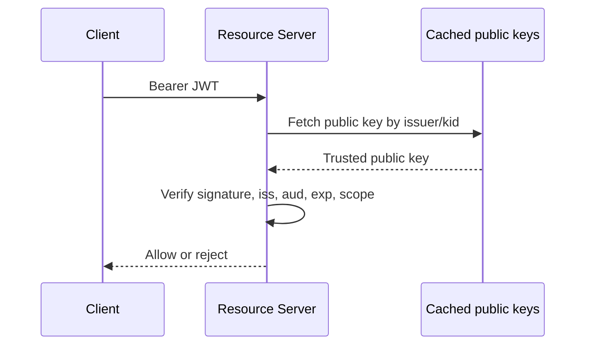
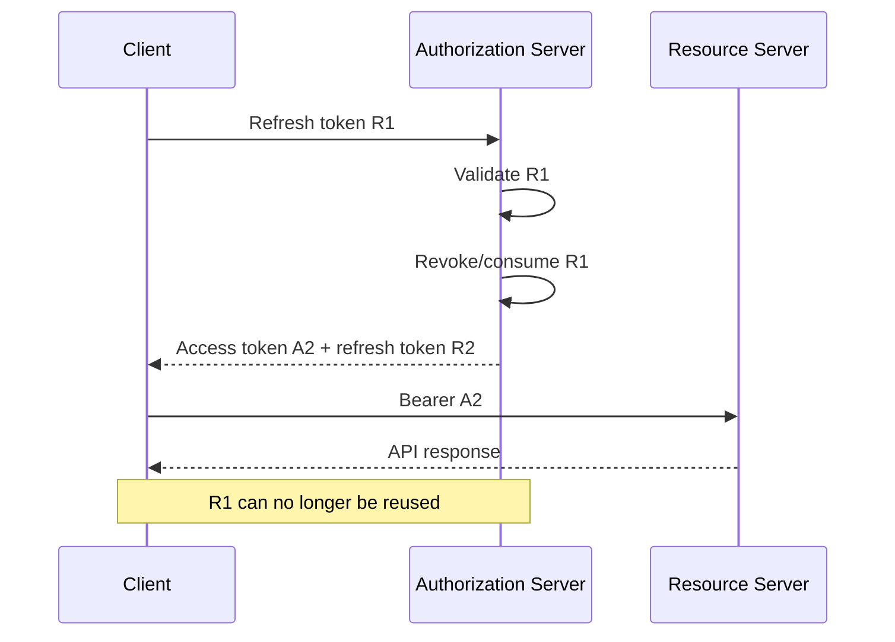

# Short-Lived Tokens, Revocation Lists, and Resource Server State Trade-Offs

## 1. The Problem: A Validly Signed JWT Whose User Just Lost Access

A Spring Security OAuth 2.0 Resource Server application receives a JWT access token:

```http
GET /api/orders/42 HTTP/1.1
Host: orders.example.com
Authorization: Bearer <access-token>
```

The Resource Server verifies the signature using the Authorization Server's public key and checks `iss`, `aud`, `exp`, and other token conditions. When the token is valid and carries `SCOPE_orders.read`, the API lets the request proceed.

Then an event occurs:

- The user's account is locked.
- An administrator revokes the login session.
- An employee leaves the tenant.
- A device is lost or the access token is exposed.
- A client is disabled.
- A signing key is suspected of compromise.

The Authorization Server may have already revoked the token or refresh-token family. However, **a self-contained JWT can still be verified locally by the Resource Server until the token expires**, unless the API also checks revocation state.

This is the core trade-off:

- **Short-lived, locally verified JWTs:** minimal network dependency and easy scaling, yet revoked permissions can stay effective until token expiration.
- **Revocation lists or session state:** can block tokens before expiration, yet the Resource Server must maintain or query state.
- **Opaque tokens with introspection:** the Authorization Server decides whether a token is still active at check time, yet the API depends on AS availability and cache freshness.
- **Combining multiple strategies:** cap exposure with short-lived tokens, manage refresh tokens tightly, and use revocation state where rapid reaction is required.

No single lifetime or revocation mechanism suits every API. Design must reflect data sensitivity, desired revocation reaction time, system load, and tolerance for infrastructure dependencies.

### Learning Objectives

After this lesson, you will be able to:

1. Explain why revoking a JWT at the Authorization Server does not automatically cause every Resource Server to reject it immediately.
2. Distinguish access-token lifetime, refresh-token lifetime, token revocation, session logout, and key rotation.
3. Understand the roles of RFC 7009 (revocation) and RFC 7662 (introspection).
4. Design short-lived access tokens and refresh-token rotation to bound token exposure windows.
5. Build a `(iss, jti)` denylist, set TTLs until token expiry, and avoid storing raw Bearer tokens.
6. Compare denylists, token versions, per-user/tenant revocation epochs, introspection, and signing-key rotation.
7. Understand the costs of stateful lookups, caching, replication, consistency, and fail-closed behavior.
8. Integrate revocation checks into Spring Security Servlet and WebFlux matching their execution models.
9. Write tests for expired tokens, revoked tokens, refresh-token reuse, cache propagation, and revocation store outages.
10. Choose a solution balancing rapid revocation against Resource Server availability.

## 2. Concepts That Must Be Separated

### 2.1. Access Token

An access token is the credential a Client presents to a Resource Server to access APIs. A token can be:

- **JWT access token:** carries claims, is signed; the Resource Server can verify it locally with public keys.
- **Opaque access token:** reference string; the Resource Server typically queries the Authorization Server via introspection.

Access tokens should have the audience and scopes suited to the API. Never use an OIDC ID token in place of an access token.

### 2.2. Refresh Token

A refresh token is used by the Client with the Authorization Server to request new access tokens under the granted authorization/flow. It typically has a longer lifetime than an access token and requires stricter protection.

A refresh token **is not a credential for calling Resource Servers**. Never send refresh tokens to `/api/orders/**` or store them unnecessarily in logs or API responses.

If a refresh token leaks, an attacker can keep requesting new access tokens until it is revoked, expires, or is disabled under AS policy.

### 2.3. Token Expiration

The `exp` claim defines when a JWT is no longer valid according to the validator. Once expired, the Resource Server must reject it even if the signature remains valid.

Expiration is the token's **natural time bound**. It is not an active revocation operation.

### 2.4. Token Revocation

Revocation is the action that stops a token or group of credentials from being accepted before natural expiration.

Depending on the Authorization Server and token model, revocation may affect:

- The specified token.
- The refresh token and related access tokens.
- The entire token family/authorization grant.
- The corresponding session or consent.

Never assume every AS revokes all related access tokens identically. Verify the provider's contract and token types.

### 2.5. Logout

Logout may only end a session on a website or OpenID Provider. It does not inherently revoke all issued access tokens.

An application may have separate states:

```text
Web session active?
OIDC Provider session active?
Refresh token active?
Access token active?
Resource Server denylist contains token?
```

These states are related, not identical.

### 2.6. Signing-Key Rotation

Rotation replaces JWT signing keys. When a Resource Server stops trusting an old key after JWKS/caches update, all tokens signed with that key can be rejected.

This operates at **key scope**, typically carrying a much larger blast radius than revoking one token or one user. Never use routine key rotation as a way to revoke an individual access token.

## 3. Why Are Stateless JWTs Hard to Revoke Immediately?

### 3.1. Resource Server Verifies JWTs Locally

A typical flow:



If the signature is valid and claims meet requirements, the Resource Server does not need to call the Authorization Server on each request.

This delivers performance and availability when the AS is temporarily unreachable. Yet the Resource Server **does not automatically know** that the AS just marked a token revoked unless an extra state propagation mechanism or online check exists.

### 3.2. Revocation Events Do Not Modify Already-Issued JWTs

Suppose:

```text
10:00  AS issues JWT:
       sub=user-417
       jti=token-abc
       exp=10:30

10:05  Admin revokes token-abc at AS

10:06  Client resends JWT token-abc to orders-api
```

If `orders-api` only checks signatures and `exp`, the token can remain valid until 10:30. Recording that the token is revoked at the AS does not alter the payload or signature of the JWT copy held by the Client.

This is the critical difference between **revocation at the issuer** and **revocation visibility at the consumer**.

### 3.3. Statelessness Is an Architectural Choice, Not an Absolute Property

A JWT Resource Server may store no HTTP sessions yet still remain stateful via:

- A token denylist.
- User token versions.
- Tenant/user revocation epochs.
- Introspection.
- Entitlement caches.
- Signing key policies.
- An authorization database.

Adding any such check makes authentication decisions partly dependent on external state. That may be right for security requirements; what matters is understanding the costs and failure behavior.

## 4. Short-Lived Access Tokens: Shrinking the Exposure Window

### 4.1. Principle

If an access token lives only briefly, a stolen token has a usage window bounded by its expiration time, even without a denylist.

Illustrative example:

```text
Access token A:
  issued_at = 10:00
  expires_at = 10:10

Token compromised at 10:04:
  without online revocation,
  token may still be used until 10:10
```

Short-lived tokens shrink the **maximum exposure window**. They do not stop an attacker from using the token immediately after theft, nor replace audience/scope/tenant checks.

### 4.2. There Is No Single Standard Lifetime for Every System

Lifetimes should weigh:

- Sensitivity of APIs and data.
- Maximum duration the organization can tolerate a compromised token remaining active.
- AS capacity to issue new tokens.
- Token endpoint load and user experience.
- Whether mobile/offline clients can refresh frequently.
- Clock drift and clock skew between AS and RS.
- In-flight request duration and mid-flight expiry impact.

You can pick a short interval in a lab for illustration, but **never treat a fixed minute count as a mandatory standard**. Organizations must choose lifetimes based on threat models and operations.

### 4.3. Short-Lived Tokens Have Costs

If access tokens are too short-lived:

- Clients must refresh more frequently.
- The Authorization Server handles more token requests.
- Mobile apps may hit more failures while offline.
- Concurrent requests may refresh the same credential simultaneously, causing races.
- Refresh-token rotation may trigger false reuse detection if Clients do not synchronize refreshes.
- Users may experience disruptions when the AS is unavailable.

Hence, shorter is not always better. Lifetime choices must balance refresh flows and resilience.

### 4.4. Time Checks at the Resource Server

For JWTs, the Resource Server must verify `exp` and may check `nbf`. Some implementations allow clock skew to compensate for clock drift.

Clock skew means a token can be accepted for a small margin around configured time boundaries. When calculating denylist TTLs, caches, or entry cleanup times, account for **this time acceptance margin**.

Never use huge clock skews to compensate for unsynchronized clock infrastructure.

### 4.5. Access Tokens Should Not Carry Unnecessary Sensitive Data

Short-lived tokens are still readable if they are signed-only JWTs without encryption. Avoid placing passwords, refresh tokens, secrets, unnecessary personal data, or complex business permission matrices inside claims.

A short token lifetime does not make the payload confidential.

## 5. Refresh Tokens and Rotation: Managing Long-Lived Credentials

### 5.1. Why Do Refresh Tokens Need Different Protection from Access Tokens?

Access tokens are sent to Resource Servers. Refresh tokens are sent to the Authorization Server / token endpoint. A refresh token lets Clients mint new access tokens, so it usually lives longer and needs stronger protection.

Do not:

- Send refresh tokens to business APIs.
- Write refresh tokens to logs.
- Put refresh tokens in URLs.
- Store refresh tokens where scripts or other apps can read them if safer options exist.
- Share one refresh token across multiple Clients/devices unless the AS explicitly supports it.

### 5.2. Refresh-Token Rotation

With rotation, when a Client uses the current refresh token to obtain a new access token, the AS issues the next refresh token and invalidates the old one per policy.



If an attacker copied `R1` and tries to reuse it after the Client rotated to `R2`, the AS can detect **refresh-token reuse** and revoke the entire token family/authorization grant depending on implementation.

### 5.3. Refresh-Token Reuse Detection

An example:

```text
R1 → valid use → R2
R1 → appears again
       ↓
AS detects reuse
       ↓
May revoke token family and require re-authentication
```

This detects copied credentials. However, Clients must handle refresh concurrency properly: if two concurrent requests use `R1`, one succeeds while the other looks like reuse.

Clients need single-flight refreshes or synchronized refresh-token exchange, atomically persisting the new token before subsequent requests use it.

### 5.4. Rotation Does Not Automatically Revoke All Old JWTs Immediately

The AS can invalidate the old refresh token, yet previously issued access tokens may remain valid until `exp` if the Resource Server verifies JWTs locally only.

To block old access tokens early, you need introspection, a denylist, version/epoch checks, or an equivalent state mechanism.

### 5.5. Token Families and Revocation Scope

If the AS supports token families:

- A refresh token belongs to a family/grant.
- Rotation creates a new token within the family.
- Reuse can revoke the current token and related tokens.
- Revoking a family may affect multiple sessions/devices per policy.

Never assume every AS supports family reuse detection. Check AS documentation and test real behavior.

## 6. RFC 7009: Token Revocation Endpoint

### 6.1. Purpose

RFC 7009 defines OAuth 2.0 Token Revocation. Clients send a token to the **Authorization Server** to request credential revocation.

Example:

```http
POST /oauth2/revoke HTTP/1.1
Host: id.example.com
Authorization: Basic <client-authentication>
Content-Type: application/x-www-form-urlencoded

token=<refresh-token>&token_type_hint=refresh_token
```

In this example, the Client asks the AS to revoke a refresh token. Other client authentication methods such as private-key JWT or mTLS may apply per contract.

### 6.2. `token_type_hint` Is Only a Hint

`token_type_hint` tells the AS which token type the Client believes it is sending, such as `access_token` or `refresh_token`. It is a **hint**, not proof of the token's actual type.

The AS must still identify the token using its own mechanisms and apply revocation policies.

### 6.3. Why Can the Response Be HTTP 200 Even When the Token Is Invalid?

RFC 7009 defines a success response for revocation requests; the AS can return HTTP 200 when a token is already revoked or invalid/non-existent. This prevents creating an oracle endpoint where Clients can probe which tokens exist.

Example:

```http
HTTP/1.1 200 OK
```

Clients must not rely on the response body to infer whether the token previously existed.

If the AS cannot process the revocation request due to an infrastructure failure, an appropriate service error response may be returned; the Client must distinguish **revocation request processed** from **unknown outcome due to server unavailable** per the AS contract.

### 6.4. The Revocation Endpoint Is Not the Introspection Endpoint

Two distinct flows:

```text
RFC 7009 — Revocation:
  Client → Authorization Server
  "Please revoke this token"

RFC 7662 — Introspection:
  Resource Server → Authorization Server
  "Is this token currently active?"
```

Revocation mutates state at the AS. Introspection queries that state so the Resource Server can make a decision at request time.

### 6.5. Does Revocation Guarantee Every Resource Server Knows Immediately?

Not by default. For opaque tokens, the next introspection call can return `active=false` once the AS applies revocation. For self-contained JWTs, Resource Servers may not query the AS and thus keep accepting old tokens until `exp` unless supplemental revocation state exists.

A system with multiple Resource Servers must define how revocation propagates and its convergence time.

## 7. RFC 7662: Introspection and Active Status

### 7.1. Resource Server Queries the Authorization Server

For opaque tokens:

```http
POST /oauth2/introspect HTTP/1.1
Host: id.example.com
Authorization: Basic <resource-server-client-auth>
Content-Type: application/x-www-form-urlencoded

token=<opaque-access-token>
```

The AS may return:

```json
{
  "active": true,
  "scope": "orders.read",
  "client_id": "shop-web",
  "sub": "user-417",
  "aud": ["orders-api"],
  "exp": 1893456000
}
```

After the token is revoked:

```json
{
  "active": false
}
```

The Resource Server should accept the token only when both introspection and additional policies succeed.

### 7.2. Introspection Can Provide Near-Real-Time Revocation

If the Resource Server queries the AS on every request and the AS updates revocation state immediately, the next request can receive `active=false`. Still, "near-real-time" depends on:

- Time for the AS to update state.
- Replication across AS nodes.
- Introspection caching at the Resource Server.
- Network latency.
- Requests already in flight before revocation completed.

If the API caches `active=true` for a period, a revoked token can still be accepted until the cache expires.

### 7.3. Per-Request Introspection Has Costs

- Adds an outbound HTTP call to every API request.
- Makes the AS a runtime dependency on the request path.
- Increases latency and connection consumption.
- AS outages can impact all protected traffic.
- Requires timeouts, rate limits, connection pools, and concurrency limits.
- Requires protecting introspection credentials and access tokens.

This is the trade-off between **observing fresh token status** and **Resource Server independence and performance**.

### 7.4. Do Not Misinterpret HTTP 200

The introspection endpoint can return HTTP 200 with `{"active":false}`. HTTP 200 only means the AS processed the introspection request, not that the token is accepted.

### 7.5. Audience and Scope Must Still Be Checked

`active=true` does not automatically mean the token is intended for the current API or has sufficient permissions.

Example:

```json
{
  "active": true,
  "aud": ["billing-api"],
  "scope": "orders.read"
}
```

If the API requires `orders-api`, the token must be rejected under the audience contract. Scope and audience are independent conditions.

## 8. Common JWT Revocation Strategies

### 8.1. Comparison Table

| Strategy | Revoke before `exp` | State at RS | Per-request cost | Blast radius |
|---|---|---|---|---|
| Short-lived JWT only | Not immediate | No denylist needed | Low | Single token expires naturally |
| `jti` denylist | Yes | Yes | State lookup | Single token |
| Per-user token version | Yes | Yes | Version lookup/cache | Many tokens of one user |
| Per-tenant revocation epoch | Yes | Yes | Version lookup/cache | Old tokens of a tenant |
| Introspection | Yes per AS state | AS is source of state | Network call or cache | Token per AS policy |
| Opaque token + introspection | Yes per AS state | Stateful online | Network call or cache | Token per AS |
| Signing-key rotation | Yes after RS updates key trust | JWKS/cache state | Usually no per-token lookup | All tokens signed by removed key |
| Refresh-token rotation | Blocks old/reused refresh tokens | Mostly at AS | Token endpoint | Refresh family/grant |
| Hybrid strategies | Layered | Selective | Medium to high | Granular and flexible |

No strategy is free. Choose according to **the unit to revoke**: a token, a user, a tenant, a Client, a grant, or an entire issuer signing key.

## 9. `jti` Denylist: Revoking a Specific JWT

### 9.1. What Is `jti`?

A JWT can include `jti` (JWT ID), a token identifier:

```json
{
  "iss": "https://id.example.com/realms/shop",
  "sub": "user-417",
  "aud": ["orders-api"],
  "jti": "9d1d3a6e-7c8f-4d15-8c4a-2e9f01d91a72",
  "iat": 1893455100,
  "exp": 1893456000
}
```

If the token contract requires per-token revocation, the AS must emit a `jti` unique within the issuer's scope. The Resource Server can store a denylist entry to reject that exact token.

**Not every JWT has a `jti`.** If your architecture relies on a `jti` denylist, make that claim mandatory in the token contract; never silently ignore a missing `jti`.

### 9.2. Denylist Keys Should Combine Issuer and Token ID

Do not store:

```text
denylist["token-123"] = revoked
```

because two issuers could generate the same `jti`. A better logical key:

```text
revocation key = (issuer, jti)
```

You can add environment/tenant namespaces if the storage model calls for it. `iss` must be the verified issuer and `jti` must come from the verified JWT.

### 9.3. Never Store Raw Bearer Tokens

A raw access token is a replayable credential. A denylist only needs an identifier sufficient to match the token:

- `(iss, jti)` when the issuer guarantees unique `jti`.
- A hash/HMAC of the token if the contract lacks `jti` and must match the token string.
- An AS-issued token reference ID.

Never put raw tokens into Redis keys, DB rows, logs, or metrics. If using a hash/HMAC, manage HMAC keys and versioning properly; never treat hashing as a substitute for access controls on denylist data.

### 9.4. TTL Until Token Expiration

If a token expires at `exp`, the denylist entry does not need to live forever. Set TTL until `exp` plus the clock skew tolerated by the Resource Server.

Example:

```text
token exp:             10:30:00
accepted clock skew:   00:00:30
denylist TTL until:    10:30:30
```

After that point, the token is already rejected by the validator; the entry can expire automatically.

If a token lacks `exp` or a finite lifetime in a system requiring denylist TTLs, define an explicit policy and consider rejecting such tokens.

### 9.5. Denylist Growth

A denylist grows with the number of revoked tokens. TTLs clean up expired entries automatically, yet the system still needs:

- Clear capacity limits and eviction policies.
- Appropriate index/key schemas.
- Accurate TTLs.
- Revocation rate limits.
- Entry count, throughput, and latency monitoring.
- Replication and persistence as needed.

Never use a cache with arbitrary eviction if eviction could drop an active revocation entry and let a revoked token back in.

## 10. Token Versions and Revocation Epochs: Group Revocation

### 10.1. Per-User Token Version

A user record holds:

```text
user_id = user-417
token_version = 7
```

When the AS issues a JWT, it includes the claim:

```json
{
  "sub": "user-417",
  "token_version": 7
}
```

When an admin wants to invalidate all older tokens for the user, the system increments:

```text
token_version = 8
```

The Resource Server compares the claim in the token against the current value. Version 7 tokens are rejected; new tokens are issued with version 8.

### 10.2. Pros and Cons

Advantages:

- No need to store an entry per token.
- Revokes all older tokens of a user with one update.
- Useful for password resets, account disablement, or security events.

Drawbacks:

- Must look up or cache the current version.
- May also log out other valid devices/sessions of the user.
- Stale caches let old tokens keep working.
- New tokens must be minted with the new version.
- Must distinguish subjects across multiple issuers.

### 10.3. Tenant Revocation Epoch

The same pattern applies per tenant:

```text
tenant alpha:
  revocation_epoch = 12
```

JWTs carry `tenant_epoch=12`. To revoke all tokens predating an incident, bump the epoch to 13. Older tokens with epoch 12 are rejected.

This revokes a broad group of tokens, though it is unsuitable for revoking a single token. It also requires a lookup/cached state and update policy across Resource Servers.

### 10.4. A Version Claim Does Not Create Current State on Its Own

If the Resource Server only reads `token_version` from the JWT without comparing against a current source, it cannot know the version bumped. **A version claim only provides revocation when compared against an authoritative state source.**

## 11. Denylist and Token-State Lookups in Spring Security Servlet

### 11.1. State Store Contract

Simple interface example:

```java
package com.example.orders.security;

public interface RevocationStore {

    boolean isRevoked(String issuer, String tokenId);
}
```

A real implementation can use Redis, a database, or an internal service. The code below assumes lookups are **fast and synchronous**; never make slow blocking Redis calls directly on the WebFlux event loop.

### 11.2. Validator Checking `jti`

```java
package com.example.orders.security;

import org.springframework.security.oauth2.core.OAuth2Error;
import org.springframework.security.oauth2.core.OAuth2TokenValidator;
import org.springframework.security.oauth2.core.OAuth2TokenValidatorResult;
import org.springframework.security.oauth2.jwt.Jwt;

public final class RevokedJwtValidator
        implements OAuth2TokenValidator<Jwt> {

    private final RevocationStore store;

    public RevokedJwtValidator(RevocationStore store) {
        this.store = store;
    }

    @Override
    public OAuth2TokenValidatorResult validate(Jwt jwt) {
        String issuer = jwt.getIssuer() == null
            ? null : jwt.getIssuer().toString();
        String tokenId = jwt.getId();

        if (issuer == null || issuer.isBlank()
                || tokenId == null || tokenId.isBlank()) {
            return OAuth2TokenValidatorResult.failure(
                new OAuth2Error(
                    "invalid_token",
                    "Required token identifiers are missing",
                    null));
        }

        if (store.isRevoked(issuer, tokenId)) {
            return OAuth2TokenValidatorResult.failure(
                new OAuth2Error(
                    "invalid_token",
                    "Token has been revoked",
                    null));
        }

        return OAuth2TokenValidatorResult.success();
    }
}
```

This validator only checks whether the token ID has been revoked. It does not replace signature, issuer, expiry, audience, or scope validation.

### 11.3. Combining with Default Validators

Example creating a decoder with an explicit JWKS URI:

```java
package com.example.orders.security;

import org.springframework.context.annotation.Bean;
import org.springframework.context.annotation.Configuration;
import org.springframework.security.oauth2.core.DelegatingOAuth2TokenValidator;
import org.springframework.security.oauth2.jwt.JwtDecoder;
import org.springframework.security.oauth2.jwt.JwtValidators;
import org.springframework.security.oauth2.jwt.NimbusJwtDecoder;

@Configuration
public class JwtDecoderConfig {

    @Bean
    JwtDecoder jwtDecoder(RevocationStore revocationStore) {
        String issuer =
            "https://id.example.com/realms/shop";
        String jwksUri =
            "https://id.example.com/realms/shop/protocol/openid-connect/certs";

        NimbusJwtDecoder decoder =
            NimbusJwtDecoder.withJwkSetUri(jwksUri).build();

        decoder.setJwtValidator(
            new DelegatingOAuth2TokenValidator<>(
                JwtValidators.createDefaultWithIssuer(issuer),
                new RevokedJwtValidator(revocationStore)));

        return decoder;
    }
}
```

This is a Servlet/JWT example. Add an audience validator and token profile checks per the API contract. If using `issuer-uri` auto-discovery instead of an explicit JWKS URI, still attach the revocation validator to the appropriate decoder.

### 11.4. Important Limitation of Synchronous Validators

`OAuth2TokenValidator<Jwt>` is a synchronous API. A `ConcurrentHashMap` or local in-memory store checks quickly; however, if `RevocationStore` makes a synchronous Redis/HTTP call, the thread decoding the token blocks waiting.

In Servlet, blocking lookups still consume request threads and connection pools; configure timeouts, bulkheads, connection limits, and load-test. In WebFlux, never perform blocking lookups directly from a validator running on the event loop. Section 13 covers reactive integration.

### 11.5. Why Not Check `jti` Only Inside Controllers?

If each Controller checks the denylist manually, a new endpoint can easily omit it. Revoked tokens could still slip through unchecked routes.

Placing token-level revocation in the authentication pipeline ensures **every protected endpoint shares the exact same enforcement**. Business permissions like tenant/owner still belong in authorization/services.

## 12. In-Memory Denylists vs. Distributed Denylists

### 12.1. When Does an In-Memory Store Fit?

Example:

```java
package com.example.orders.security;

import java.util.Set;
import java.util.concurrent.ConcurrentHashMap;

public final class InMemoryRevocationStore
        implements RevocationStore {

    private final Set<String> revoked = ConcurrentHashMap.newKeySet();

    @Override
    public boolean isRevoked(String issuer, String tokenId) {
        return revoked.contains(issuer + "|" + tokenId);
    }

    public void revoke(String issuer, String tokenId) {
        revoked.add(issuer + "|" + tokenId);
    }
}
```

This illustrates a **single-process** store. It is insufficient for multi-pod systems:

- A token revoked on node A is unknown to node B.
- Restarts lose state unless persisted.
- Scaling out creates independent denylists.
- A stale node can continue accepting revoked tokens.

Never use an in-memory set as the authoritative revocation source in a production cluster without proper replication/consistency mechanisms.

### 12.2. Distributed Stores

A shared Redis or database lets multiple Resource Servers observe the same state. Design for:

- Namespacing by environment/issuer.
- Keys containing `issuer + jti` or token hash.
- TTLs matching `exp`/clock skew.
- Appropriate persistence/replication.
- Dedicated access controls for revoking vs. reading.
- Network TLS and credentials.
- Backup/recovery if required.
- Latency, error, and entry-count metrics.

A distributed store solves shared state yet introduces a new dependency on the authentication path.

### 12.3. Multi-Region Consistency

If Resource Servers span multiple regions, revocation events may propagate slowly. Define a **revocation propagation SLA**:

```text
Revocation accepted at AS
  → publish event
  → regional store update
  → Resource Server cache invalidation
  → all regions reject token
```

If policy demands near-instant blocking, eventual consistency with unbounded propagation is insufficient. You need a stronger lookup source or explicit acknowledgments.

### 12.4. Never Let Eviction Drop Active Revocations

If using a capacity-bounded cache, an LRU eviction policy can evict a revocation entry before `exp`. The token would then be accepted again.

Denylists require store semantics that never drop entries prematurely, or a fallback authoritative source to check. Never equate a performance-only cache with a security state store.

## 13. Checking Revocation in WebFlux Without Blocking the Event Loop

### 13.1. Why Not Use a Synchronous Validator with Reactive Redis?

In WebFlux, using `OAuth2TokenValidator<Jwt>` with synchronous JDBC/Redis calls can block the event loop. Changing a method return type to `Mono` is not enough if operations inside remain synchronous.

To query revocation state from a reactive store, place the check inside a **ReactiveAuthenticationManager** wrapping the JWT authentication manager.

### 13.2. Reactive Store Contract

```java
package com.example.orders.security;

import reactor.core.publisher.Mono;

public interface ReactiveRevocationStore {

    Mono<Boolean> isRevoked(String issuer, String tokenId);
}
```

Implementations should use a truly reactive client (e.g., reactive Redis) returning `Mono<Boolean>`. Never wrap JDBC with `Mono.just(...)`.

### 13.3. ReactiveAuthenticationManager Wrapper

```java
package com.example.orders.security;

import org.springframework.security.authentication.ReactiveAuthenticationManager;
import org.springframework.security.core.Authentication;
import org.springframework.security.oauth2.core.OAuth2AuthenticationException;
import org.springframework.security.oauth2.core.OAuth2Error;
import org.springframework.security.oauth2.server.resource.authentication.JwtAuthenticationToken;
import reactor.core.publisher.Mono;

public final class RevocationCheckingAuthenticationManager
        implements ReactiveAuthenticationManager {

    private final ReactiveAuthenticationManager delegate;
    private final ReactiveRevocationStore revocations;

    public RevocationCheckingAuthenticationManager(
            ReactiveAuthenticationManager delegate,
            ReactiveRevocationStore revocations) {
        this.delegate = delegate;
        this.revocations = revocations;
    }

    @Override
    public Mono<Authentication> authenticate(
            Authentication authentication) {

        return delegate.authenticate(authentication)
            .flatMap(authenticated -> {
                if (!(authenticated instanceof JwtAuthenticationToken jwtAuth)) {
                    return Mono.just(authenticated);
                }

                String issuer =
                    jwtAuth.getToken().getIssuer().toString();
                String tokenId = jwtAuth.getToken().getId();

                if (tokenId == null || tokenId.isBlank()) {
                    return Mono.error(
                        new OAuth2AuthenticationException(
                            new OAuth2Error(
                                "invalid_token",
                                "Token identifier is missing",
                                null)));
                }

                return revocations.isRevoked(issuer, tokenId)
                    .flatMap(revoked -> {
                        if (revoked) {
                            return Mono.error(
                                new OAuth2AuthenticationException(
                                    new OAuth2Error(
                                        "invalid_token",
                                        "Token has been revoked",
                                        null)));
                        }
                        return Mono.just(authenticated);
                    });
            });
    }
}
```

`delegate` performs the real JWT authentication (`ReactiveJwtDecoder`, signature, and claims validation). The wrapper simply adds a revocation check after the token is verified. If the revocation store errors, propagate the error per fail-closed policy; never convert it to `false`.

### 13.4. Wiring into WebFlux Security

Manager configuration example:

```java
@Bean
ReactiveAuthenticationManager jwtAuthenticationManager(
        ReactiveJwtDecoder decoder,
        ReactiveRevocationStore revocations) {

    ReactiveAuthenticationManager jwtManager =
        new JwtReactiveAuthenticationManager(decoder);

    return new RevocationCheckingAuthenticationManager(
        jwtManager, revocations);
}
```

Wiring into the WebFlux chain:

```java
@Bean
SecurityWebFilterChain apiSecurity(
        ServerHttpSecurity http,
        ReactiveAuthenticationManager jwtAuthenticationManager) {

    return http
        .authorizeExchange(exchanges -> exchanges
            .pathMatchers("/api/public/**").permitAll()
            .pathMatchers(HttpMethod.GET, "/api/orders/**")
                .hasAuthority("SCOPE_orders.read")
            .anyExchange().denyAll())
        .oauth2ResourceServer(oauth2 -> oauth2
            .jwt(jwt -> jwt
                .authenticationManager(jwtAuthenticationManager)))
        .build();
}
```

This is an illustrative WebFlux configuration; use imports and APIs matching your project's Spring Security version. The decoder must be configured with issuer, audience, time, and algorithm validators before being passed to the manager.

### 13.5. Timeout and Failure Semantics

For a reactive revocation store:

- Configure lookup timeouts.
- Do not retry infinitely.
- Bound concurrency.
- Monitor latency and errors.
- When the store cannot verify state, never grant `Authentication` by default.

If the revocation lookup is mandatory to accept a token, an unavailable store must stop the request **from proceeding**. The API can return an appropriate service error (such as 503) rather than pretending the token is definitively invalid; exact mapping depends on the application's exception handling.

## 14. Opaque Tokens and Denylists: Does the Resource Server Need Extra State?

### 14.1. Introspection Is Already an Online State Check

With opaque tokens, the Resource Server queries the AS:

```json
{"active": true, "scope": "orders.read"}
```

After revocation:

```json
{"active": false}
```

If every request introspects and positive results are not cached too long, the AS can serve as the primary state source. The Resource Server usually needs no separate denylist for the same token unless another internal policy requires one.

### 14.2. Caching Alters Revocation Delay

Suppose the Resource Server caches `active=true` for a period. A token is revoked right after a cache entry is created, yet the API can keep accepting it until the entry expires.

Therefore:

```text
Revocation delay ≈ AS propagation delay
                 + positive-cache remaining TTL
                 + Resource Server cache propagation
```

This is an analytical estimation model, not an exact timing formula across every implementation.

### 14.3. Caching Negative vs. Positive Results Differs

- **Positive results** (`active=true`): caching too long lets revoked tokens continue being accepted.
- **Negative results** (`active=false`): can be cached until the token is guaranteed expired to cut repeated calls, though consider whether the AS allows reactivation or differing semantics.
- **AS errors/timeouts:** never cache as `active=true`; infrastructure failures are not proof a token is active.

If fast revocation is required, shrink positive TTL or disable positive caching. If reducing AS load is higher priority, accept a longer TTL and document the revocation SLA explicitly.

### 14.4. Introspection Credentials and Token Confidentiality

The Resource Server must authenticate to the introspection endpoint per contract. Never send access tokens to Client-chosen URLs and never log raw tokens, Basic headers, or Client secrets.

With multiple issuers, never spray the same opaque token across every AS to see which returns `active=true`. Route to the trusted authority beforehand.

## 15. Token Version, Denylist, and Key Rotation: Picking the Right Revocation Scope

### 15.1. Comparison by Goal

| Event | Typically appropriate mechanism |
|---|---|
| Single access token exposed | `(iss, jti)` denylist or AS introspection/token revocation |
| User resets password; block old tokens | User token version or token family revocation |
| Device lost | Revoke session/refresh-token family or device token set |
| User leaves a tenant | Revoke tenant membership/entitlement; need not revoke tokens for other tenants |
| Client application compromised | Disable Client, revoke grants/refresh tokens, check access-token status |
| Signing key exposed | Emergency removal of key from trust, refresh caches, handle tokens signed by that key |
| Tenant offboarded | Disable tenant authorization and revoke at tenant scope |
| API needs near-real-time status | Opaque introspection or suitable online state check |

### 15.2. Key Rotation Has a Large Blast Radius

Removing a key from JWKS can reject every JWT signed by that key once Resource Servers pick up the update. This may be necessary on key compromise, yet affects other valid tokens too.

If only a single token leaked, revoking its `jti` is usually far more surgical than rotating keys.

### 15.3. Token Versions Have User/Tenant Blast Radius

Incrementing a user version revokes all older tokens of that user across devices. Incrementing a tenant epoch revokes a group of tokens in that tenant.

This is straightforward when policy genuinely wants **group revocation**, but should not be used to revoke a single token if you do not want to log out other sessions.

### 15.4. User/Tenant Membership May Be an Independent State

A token may still be active and unrevoked even after the user left the tenant. The Resource Server must check membership/entitlements per policy, not just a token denylist.

This highlights that revocation does not replace object-level authorization. A token can be a valid credential while having zero permission on the target data.

## 16. Caching and Propagation: Real-World Revocation Time Bounds

### 16.1. Layers Where State Can Become Stale

A request may traverse multiple caches:

```text
Authorization Server token state
       ↓
Revocation event bus
       ↓
Distributed denylist / token-version store
       ↓
Local Resource Server cache
       ↓
Authentication/authorization result
```

Each layer can introduce its own lag. A node that has not yet received an event can keep accepting the token.

### 16.2. Caching Negative Lookups

If the Resource Server caches a `not revoked` result, a newly revoked token can remain accepted until that negative-cache entry expires.

Example:

```text
10:00:00  RS cache: token-abc is not revoked
10:00:10  AS/admin revokes token-abc
10:00:25  RS cache entry expires
10:00:26  RS reads revocation store and rejects
```

Here, propagation and negative caching create lag. TTLs must follow the **revocation SLA**, not performance alone.

### 16.3. Caching Positive Revocations

Once a token is confirmed revoked, caching the positive revocation result until `exp` is generally safer than caching negative lookups for long, because a "revoked" verdict should not disappear before the token expires.

If reactivation exists (rarely advisable for the same token), define an explicit contract. More commonly, revoked tokens are never reactivated; new tokens are issued instead.

### 16.4. Event-Driven Invalidation

The AS or control plane can emit events:

```json
{
  "event": "token.revoked",
  "issuer": "https://id.example.com/realms/shop",
  "jti": "token-abc",
  "occurred_at": "2026-11-15T10:00:00Z"
}
```

Resource Server consumers update local caches/denylists. Event payloads must verify origin, resist replay, carry appropriate versions/sequences, and omit raw access tokens.

An event bus speeds up propagation, yet events can still be lost, delayed, or duplicated. You need idempotency, periodic reconciliation, or an authoritative source to restore state.

### 16.5. Do Not Rely Solely on Best-Effort Pub/Sub

If a revoke event is lost without reconciliation, a local cache can keep allowing the token beyond the SLA. Decide:

- Is event delivery durable?
- Are sequences/versions present to detect gaps?
- Do consumers have retries and dead-letter queues?
- Do restarting nodes reload state?
- Is there full sync or periodic reconciliation?
- How does the API behave during a bus outage?

A system needing strong revocation must govern both **event propagation and authoritative state**.

## 17. Fail-Open or Fail-Closed When the Revocation Store Is Unavailable?

### 17.1. Fail-Open

Fail-open means that if the revocation store cannot be reached, the Resource Server lets the token pass as if unrevoked.

Advantages:

- Preserves availability.
- Prevents a Redis/AS failure from taking down the whole API.

Risks:

- Revoked tokens remain accepted.
- Attackers can exploit outages to keep accessing resources.
- The revocation SLA is no longer upheld.

### 17.2. Fail-Closed

Fail-closed means that if a mandatory revocation check cannot complete, the request is not authorized.

Advantages:

- Never accepts tokens when security state is unverified.
- Suits sensitive operations or systems demanding strict revocation.

Costs:

- Redis/AS outages can make protected APIs unavailable.
- Requires HA, timeouts, capacity planning, and incident response.

### 17.3. Risk-Based Policies

Not every endpoint needs the same policy:

| API | Policy to consider |
|---|---|
| Public content reads | No revocation lookup needed |
| Sensitive data reads | Fail-closed when revocation status is mandatory |
| Money transfers / privilege changes | Strong state checks, no stale caches |
| Low-sensitivity reports | May tolerate an approved propagation window |
| Admin / security operations | Prefer verifying freshest state |

If a system uses different policies, enforce them explicitly per endpoint/operation. Never write a global `onErrorResume(... -> allow)`.

### 17.4. Distinguish "Token Revoked" from "Unable to Check"

- **Confirmed revoked:** token invalid; usually returns `401` with an appropriate Bearer error.
- **Unable to reach store/AS:** unknown whether the token is revoked; this is an infrastructure/indeterminate state error. Return `503 Service Unavailable` or follow your designed error mapping.
- **Valid token missing scope:** usually `403`.

Never misreport `invalid_token` when the AS actually timed out if doing so prevents operations from distinguishing credential issues from service outages.

## 18. Multi-Tenant Revocation: Keep One Tenant's State from Affecting Another

### 18.1. Namespacing Denylists

With multiple issuers, keys must distinguish issuers:

```text
revoked:{issuer-id}:{jti}
```

Never use `jti` alone if issuers can collide on token IDs.

If one issuer serves multiple tenants, `jti` may still identify the token, while tenant/user policies may need extra namespacing for group revocation lookups. Never replace verified issuer identity with a tenant ID from a URL.

### 18.2. Per-Tenant Revocation

When tenant Beta is offboarded, options include:

- Disabling Beta in the trusted tenant registry.
- Rejecting Beta tenant claims/entitlements.
- Bumping the tenant revocation epoch.
- Revoking refresh-token grants belonging to Beta if supported by the AS.
- Invalidating tenant membership caches.
- Blocking Beta data access in repositories.

If multiple tenants share an issuer, do not remove trust for the entire issuer just to disable one tenant; that would disrupt Alpha and Gamma.

### 18.3. Users Belonging to Multiple Tenants

A user may have:

```text
user-417:
  alpha: ADMIN
  beta: VIEWER
```

If the user leaves Alpha yet remains in Beta, bumping a **global token version** could also revoke tokens serving Beta. You may need tenant-scoped membership versions/epochs to contain the impact.

### 18.4. Subjects Must Have Issuer Context

In multi-issuer setups, safe user identification usually requires `(iss, sub)` or a mapped internal user ID. Never use `sub` alone to revoke all tokens sharing the same subject string across different issuers.

### 18.5. Data Access Still Requires Tenant Predicates

Even when a token is not revoked, the API must still query by tenant/owner:

```sql
SELECT id, order_no, total_amount
FROM orders
WHERE id = :order_id
  AND tenant_id = :verified_tenant_id
  AND owner_subject = :verified_subject;
```

Revocation checks answer whether the token is still accepted. Tenant/owner predicates answer whether the caller owns the record. The two layers do not replace each other.

## 19. Limits of Signing-Key Rotation as a Revocation Mechanism

### 19.1. Removing a Key from JWKS

When the AS removes an old public key from JWKS, Resource Servers may keep that key cached for some time. Thus tokens signed with the old key may still verify until caches refresh or expire per implementation.

### 19.2. Key Caching and Key Compromise

If a key is compromised, you must:

- Stop signing tokens with that key.
- Remove the key from trust sources per incident policy.
- Force JWKS cache refreshes/invalidations across Resource Servers.
- Consider supplemental denylists, token versions, or introspection.
- Audit tokens already issued with that key and accessed data.
- Monitor nodes still holding stale keys.

### 19.3. Do Not Rely on Routine Cache TTLs for Emergencies

Normal TTLs may be far too long for a key compromise. You need an emergency mechanism to invalidate/propagate across nodes.

Conversely, setting JWKS TTLs aggressively low all the time can overload the AS. Separate **routine rotation** from **emergency key revocation**.

### 19.4. Do Not Share One Signing Key Across All Tenants If Compromise Isolation Is Needed

Sharing a signing key reduces operational overhead, yet widens compromise impact. If tenant trust boundaries demand strict isolation, consider separate keys per issuer/tenant or profile.

Even with dedicated keys, the Resource Server must still verify issuer, audience, and tenant. Dedicated keys do not replace policy.

## 20. Configuring Spring Security: Combining JWT, Expiry, and Denylists

### 20.1. Basic Resource Server Configuration

Servlet example:

```java
@Bean
SecurityFilterChain apiSecurity(HttpSecurity http) throws Exception {
    return http
        .csrf(csrf -> csrf.disable())
        .sessionManagement(session -> session
            .sessionCreationPolicy(SessionCreationPolicy.STATELESS))
        .authorizeHttpRequests(auth -> auth
            .requestMatchers("/api/public/**").permitAll()
            .requestMatchers(HttpMethod.GET, "/api/orders/**")
                .hasAuthority("SCOPE_orders.read")
            .anyRequest().denyAll())
        .oauth2ResourceServer(oauth2 ->
            oauth2.jwt(Customizer.withDefaults()))
        .build();
}
```

`STATELESS` fits the pure Bearer-header API in this example. Disabling CSRF is only appropriate when browsers do not automatically attach cookie/session credentials to authenticate API requests; if using cookies, evaluate CSRF separately.

### 20.2. Wiring Default Validators and the Denylist

Section 11 showed `NimbusJwtDecoder` with `RevokedJwtValidator`. Add an audience validator while retaining default issuer/time validators:

```java
OAuth2TokenValidator<Jwt> audience = jwt ->
    jwt.getAudience().contains("orders-api")
        ? OAuth2TokenValidatorResult.success()
        : OAuth2TokenValidatorResult.failure(
            new OAuth2Error(
                "invalid_token",
                "Invalid audience",
                null));

decoder.setJwtValidator(
    new DelegatingOAuth2TokenValidator<>(
        JwtValidators.createDefaultWithIssuer(issuer),
        audience,
        new RevokedJwtValidator(revocationStore)));
```

This configures **the same decoder bean**, adding the audience illustration to Section 11's validator. Never declare two competing `JwtDecoder` beans of the same type.

### 20.3. Denylist Lookups Must Happen at the Right Time

The denylist validator runs when the JWT is decoded. If a request finishes authenticating and the token is revoked moments later, the executing request may continue. Revocation does not automatically abort an already-running business transaction.

For sensitive operations requiring the freshest state right before commit, add an **in-transaction business authorization check** or suitable locking/versioning. You cannot guarantee mid-request revocation with a single check at the top of the filter chain.

### 20.4. A Request May Have Started Before the Revocation Event

```text
T0  API authenticates token successfully
T1  Admin revokes token
T2  API is executing query/transaction
T3  API returns response
```

The system must define semantics: does revocation block **new requests** after state updates, or must it also abort running requests/transactions? Typically, token revocation does not automatically cancel already-authenticated in-flight requests. For critical/financial actions, verify entitlements at commit time.

## 21. Denylist Caching and Designing a Revocation SLA

### 21.1. Define Targets Before Choosing TTLs

Key questions:

- After an admin clicks revoke, what is the maximum time before every node must reject the token?
- Can one node remain stale during replication?
- Which tokens require rapid revocation: admin users, payments, exports, or all APIs?
- When Redis/AS fails, which endpoints must fail closed?
- Is audit evidence required showing the token was rejected?

Illustrative SLA example:

```text
High-risk operation:
  revocation propagation target = near real-time
  positive authorization cache = disabled or very short

General read API:
  bounded propagation delay may be acceptable
  if approved by risk policy
```

These are organizational design policies, not OAuth defaults.

### 21.2. Estimating Revocation Time

You can break it down:

```text
Total revocation delay =
    AS revoke processing
  + event/replication propagation
  + local cache remaining TTL
  + any in-flight request/transaction duration
```

With uncached introspection, the cache term approaches zero, though AS propagation and network/request timing remain. With local-only JWT validation and no state lookup, revocation delay approaches the access token's remaining lifetime.

### 21.3. Separate Cache Policy from Token Lifetime

A token with a short `exp` paired with a long-lived negative denylist cache can still produce a longer revocation delay than expected. Conversely, a longer-lived token paired with consistent online state lookups can be revoked rapidly.

**Token lifetime and revocation cache TTL are two independent control knobs.**

### 21.4. Never Cache Authorization Results Globally

If a cache key is simply `/api/orders/42`, a request from Alpha could serve cached results to Beta.

Authorization and data caches must partition by all relevant attributes: issuer, subject, tenant, scope/policy version, and required filters/queries. Never put raw tokens into cache keys or logs.

## 22. Logout, OIDC Sessions, and Back-Channel Events

### 22.1. Local Logout

A web app can invalidate `HttpSession` when a user logs out. That stops the session cookie from working on the web chain, yet **does not automatically revoke JWT access tokens** already obtained by the Client.

### 22.2. OIDC Logout

OIDC RP-Initiated Logout or other logout flows can end the session at the OpenID Provider per contract. Still, access token and refresh token lifecycles must be managed separately.

### 22.3. Back-Channel Logout

Some systems use OIDC Back-Channel Logout to notify relying parties that a session ended. Applications can map logout events to their session/token-family state or denylist.

Never assume back-channel logout automatically makes every Resource Server reject JWTs if the Resource Server neither receives nor processes that event.

### 22.4. Session Identifiers in Tokens

Some tokens carry a `sid` or profile-defined session identifier. This can help tie tokens to sessions and revoke by session—but only when the AS emits a trustworthy claim, semantics are defined, and the Resource Server has a state store to check against.

Never assume `sid` is a standard claim present in every OAuth access token.

## 23. Sender-Constrained Tokens Reduce Replay Risk but Do Not Replace Revocation

### 23.1. Bearer Tokens

Bearer tokens have a core property: whoever holds the token can try using it. If copied, an attacker can replay it while it remains accepted.

### 23.2. mTLS-Bound Access Tokens

With OAuth mTLS certificate-bound access tokens, the AS binds the token to a Client certificate. The Resource Server must verify certificate binding per contract. An attacker who steals the token without the matching private key struggles to reuse it elsewhere.

### 23.3. DPoP

DPoP uses a proof binding the request to the Client's key under the supported profile. The Resource Server verifies the proof, token binding, HTTP method/URI, and related rules.

### 23.4. Does Not Replace Lifetime or Revocation

Sender-constraining reduces pure stolen-token replay, yet:

- Private keys or client devices can still be compromised.
- Tokens can still expire or need revocation.
- User/tenant permissions can still change.
- Resource Servers still need audience, scope, and owner checks.

It is a replay-mitigation layer, not a replacement for revocation.

## 24. Choosing an Architecture Based on Needs

### 24.1. Four Common Patterns

**Pattern A — Short-lived JWT, no denylist**

- RS verifies JWTs locally.
- Access tokens have short lifetimes.
- Refresh tokens are tightly managed at the AS.
- Suits systems that tolerate old tokens working until `exp`.

**Pattern B — JWT + `jti` denylist**

- RS verifies JWTs then checks `(iss, jti)`.
- Revokes specific tokens.
- Fits when early blocking is required and reliable state infrastructure exists.
- Adds lookup latency and availability dependencies.

**Pattern C — Opaque token + introspection**

- AS decides active status.
- RS can observe early revocation via introspection.
- Fits when the AS supports it and online dependencies are acceptable.
- Caching must obey the revocation SLA.

**Pattern D — Short-lived JWT + refresh rotation + selective state checks**

- Local JWTs for the majority of traffic.
- Refresh token rotation/reuse detection at the AS.
- Denylists or user/tenant versions for high-risk events.
- Fits when balancing throughput with selective revocation.

### 24.2. Decision Matrix

| Product requirement | Priority option to evaluate |
|---|---|
| High throughput, routine read APIs | Short-lived JWTs and sound refresh lifecycle |
| Rapidly block a leaked token | Denylist or short/uncached introspection |
| Revoke all user sessions | Token family / user version / session state |
| Revoke access within one tenant | Tenant membership/epoch and data authorization |
| AS holds authoritative token state | Opaque introspection or JWT state check |
| Cannot afford AS calls on every request | Local JWT verification, short TTL, accepted revoke window |
| Operating during AS offline periods is critical | Local JWT verification with accepted revoke-window trade-off |
| Very high risk if state store is unreachable | Fail-closed for sensitive operations |

### 24.3. Decision Questions

Before implementing, answer:

1. Is the unit of revocation a token, session, user, Client, tenant, or key?
2. What is the maximum delay from revocation until all nodes must reject?
3. Can in-flight requests continue to completion?
4. When revocation state cannot be read, does the API fail closed?
5. How many Resource Servers/pods/regions must receive events?
6. Are refresh tokens and rotation/reuse detection in place?
7. Is offline/mobile access required when the AS is unavailable?
8. How long may positive/negative caches remain stale?
9. Who is authorized to revoke, and are all events audited?
10. Do sensitive Clients require sender-constrained tokens?

## 25. Testing Revocation: Do Not Only Test Token Expiration

### 25.1. Testing Valid JWTs

Create a JWT with a test key containing:

```json
{
  "iss": "https://id.example.test/issuer",
  "aud": ["orders-api"],
  "sub": "user-417",
  "jti": "token-001",
  "scope": "orders.read",
  "iat": 1893455100,
  "exp": 1893456000
}
```

Send the token to the API and verify acceptance when all other policies pass.

### 25.2. Testing a Denylist Hit

Next, add `(iss, jti)` to the revocation store. Resend the same token:

- Signature is still valid.
- Issuer/audience/time are still valid.
- Denylist returns revoked.
- API must reject the new request.
- Controller/Service must execute no side effects.

Typically, authentication failure returns `401` with Bearer error `invalid_token`.

### 25.3. Testing Tokens Without `jti`

If policy requires `jti`, tokens lacking the claim must be rejected during token validation. Never let tokens without an ID slip through unrevocably.

### 25.4. Testing Multiple Issuers with Colliding `jti`

Create:

```text
Issuer A: jti=token-001
Issuer B: jti=token-001
```

Revoke `(issuer A, token-001)`. Token B must not be marked revoked simply due to the shared `jti`, unless policy intentionally revokes both.

### 25.5. Testing TTLs

- Denylist entries are created with TTL up to `exp` + clock skew.
- Expired tokens are still rejected by the decoder even after the entry expires.
- Entries are never evicted prematurely while the token remains valid.
- No entries persist unnecessarily forever.

### 25.6. Testing Multi-Node Propagation

- Send requests with the token across nodes A and B.
- Revoke the token via the control plane.
- Measure how long nodes A and B take to receive state against the SLA.
- Restart a node and confirm state is not lost.
- Simulate event bus delays/drops and reconciliation.

### 25.7. Testing Introspection Caches

- Introspection returns `active=true`.
- Cache the positive result.
- AS revokes the token.
- Subsequent requests within TTL may still hit the stale cache — document accurately.
- After cache expiry or invalidation, requests are rejected.
- AS timeouts never turn into `active=true`.

### 25.8. Testing Refresh-Token Rotation / Reuse

- Rotate R1 into R2.
- Reuse R1.
- Verify the AS enforces its reuse policy.
- Verify Clients do not accidentally send R1 concurrently.
- Verify the token family/session is handled per contract.
- Check whether old access tokens need a separate denylist/introspection check.

### 25.9. Testing Outages

Simulate an unavailable revocation store:

- High-risk endpoints do not grant access when unable to check.
- API responds according to designed error mapping.
- No raw tokens are logged.
- No infinite retries.
- No trusting another node/issuer as a fallback.

### 25.10. Summary Matrix

| Test | Expected result |
|---|---|
| Valid, unrevoked JWT | Authenticated |
| Expired JWT | 401 |
| JWT revoked by `jti` | 401 |
| JWT missing `jti` when required by contract | 401 |
| Same `jti`, different issuer | No unintended cross-revocation |
| Wrong-audience token | 401 |
| Valid audience but missing scope | 403 |
| Valid scope but wrong tenant/owner | 403/404 per policy |
| Denylist store timeout | Fail-closed per operation policy |
| Revocation entry TTL expires after `exp` | Token still rejected by `exp` validator |
| AS revokes opaque token | Introspection after update returns inactive |
| Stale positive cache | Lag matches published SLA |
| Refresh token reuse | AS enforces reuse/family policy |
| User version bumped | Older-version tokens rejected |
| Tenant epoch bumped | Older-epoch tokens in tenant rejected |
| Signing key removed | Tokens using that key rejected after cache refresh |
| Web session logout | Web session ends; does not assume JWT is revoked |
| Request in flight during revocation | Behavior matches transaction/revocation semantics |

## 26. Logging, Auditing, and Revocation Authorization

### 26.1. What Should Audit Events Contain?

An event might record:

```json
{
  "event": "access_token.revoked",
  "issuer_id": "shop-idp",
  "jti": "token-001",
  "subject_ref": "user-417",
  "client_id": "shop-web",
  "reason_code": "device_compromised",
  "actor_id": "security-admin-12",
  "occurred_at": "2026-11-15T10:00:00Z"
}
```

This is an illustrative schema. Store only necessary fields per privacy/retention policies. Never write raw tokens, refresh tokens, Client secrets, or full JWT payloads into audit logs.

### 26.2. Who May Revoke?

Revocation affects active users and Clients. Endpoints/admin actions need:

- Strong authentication for the actor.
- Authorization scoped to the tenant/Client.
- Auditing of actor, timestamp, and reason.
- CSRF protection if invoked via browser sessions.
- Rate limits and confirmation for bulk actions.
- Emergency procedures for key compromises.
- Idempotency so retries do not create confusing states.

Never expose a public endpoint allowing anyone to revoke arbitrary tokens merely by submitting a `jti`.

### 26.3. Revocation Events Must Resist Forgery

If Resource Servers consume events via a message broker:

- Authenticate producers and connections.
- Authorize topic publishing permissions.
- Protect payload integrity.
- Check timestamps/sequences/replay.
- Process duplicate events idempotently.
- Provide dead-letter queues, retries, and reconciliation.
- Never allow one tenant to emit events affecting another tenant.

### 26.4. Never Leak Revocation Reasons to Unauthorized Callers

APIs typically only need to return an appropriate Bearer error. Details like "account disabled," "refresh token reused," or "admin revoked due to incident" can be sensitive. Record them in controlled audit/monitoring logs rather than public responses.

## 27. Common Design Mistakes

| Mistake | Consequence | Fix |
|---|---|---|
| Assuming AS JWT revocation makes RS reject immediately | Local token stays valid until `exp` | Introspection/denylist/version or short lifetime |
| Excessively long token lifetime | Wide replay window | Choose lifetime per threat model |
| Very short token without a refresh strategy | Client failures / refresh storms | Proper refresh lifecycle and rotation |
| Not rotating refresh tokens | Copied refresh credentials stay usable long | Rotation/reuse detection if AS supports it |
| Storing raw JWTs in the denylist | Credential leakage | `(iss, jti)` or hash/reference |
| Denylist key with `jti` only | Collisions across issuers | Namespace by issuer |
| Missing `jti` yet expecting per-token revocation | Cannot pinpoint token precisely | Require `jti`/token reference in contract |
| Denylist TTL too short | Entry vanishes before token expires | TTL until `exp` + clock skew |
| In-memory denylist across multiple pods | Other nodes miss revocations | Distributed authoritative store / event propagation |
| Eviction dropping active revocations | Revoked tokens accepted again | Store semantics preventing premature eviction |
| Caching `active=true` too long | Revocation delay grows | Cap TTL to SLA or disable positive cache |
| Treating AS timeouts as active | Fail-open | Fail-closed for mandatory checks |
| Stale user version cache | Old tokens keep working | Version propagation/invalidation |
| Removing JWKS key while cache hasn't refreshed | Old-key tokens still accepted | Emergency cache invalidation and convergence monitoring |
| Rotating keys to revoke one token | Huge blast radius | Denylist / token-level revocation |
| Web logout only deletes the session | Access tokens remain valid | Separate revocation/lifetime management |
| Testing only expired tokens | Never tests real revocation | Test denylist/introspection/cache/outages |
| Checking denylist inside Controllers | New routes may forget | Place in the authentication pipeline |
| Sync validator calling blocking Redis on event loop | Blocks WebFlux | Use reactive manager/store |
| Revocation events without auditing | Hard to investigate/recover | Event schema, actor, and correlation |
| Using same `sub` across issuers without namespace | Revokes wrong principal | Use `(iss, sub)` |
| Treating valid scope as sufficient permission | BOLA/tenant leakage | Object-level authorization |

## 28. Choosing Solutions by Scenario

### Scenario A: Routine Read API, High Throughput

Use short-lived JWT access tokens, strict audience/scope checks, protected refresh tokens, and rotation per AS capabilities. Explicitly accept the window until `exp` where old tokens stay valid if no state lookup is performed.

### Scenario B: One Access Token Exposed and Must Be Blocked Individually

Use a `jti` denylist or AS introspection/token revocation. The store must namespace by issuer, retain entries until expiry, and propagate state to all relevant Resource Servers.

### Scenario C: User Disabled or Password Reset

Revoke refresh-token grants, bump user token versions, or invalidate session/authorization state. Determine which devices/tenants are affected; avoid accidentally revoking all sessions if policy only targets a single device.

### Scenario D: User Leaves One Tenant While Staying in Another

Revoke membership/entitlements in the relevant tenant, optionally bumping a tenant-scoped epoch or revoking grants tied to that tenant. Keep tenant authorization predicates on every query.

### Scenario E: Authorization Server Compromised or Signing Key Exposed

Execute incident response: stop issuing with that key, remove trust and update caches across Resource Servers, evaluate issued tokens, revoke related grants, and monitor. This is a broad incident, not a single-token denylist case.

### Scenario F: API Requires Near-Real-Time Token State

Opaque tokens + introspection or JWTs + distributed state checks fit well. In return, accept AS/store dependencies, timeouts, HA, consistency, and fail-closed policies.

## 29. Self-Check Questions

**Q1.** Why does revoking a JWT at the Authorization Server not automatically make a Resource Server reject it immediately?

**A:** If the Resource Server only verifies signatures and claims locally, it has no visibility into the new revocation state at the AS. The token can still be accepted until `exp`.

**Q2.** Do short-lived access tokens replace refresh-token rotation?

**A:** No. Short-lived access tokens bound token usage duration; refresh-token rotation manages long-lived credentials and helps detect reuse.

**Q3.** How do RFC 7009 and RFC 7662 differ?

**A:** RFC 7009 defines how Clients ask the AS to revoke a token; RFC 7662 defines how Resource Servers ask the AS whether a token is currently active.

**Q4.** Does HTTP 200 from introspection mean the token is active?

**A:** No. The body may be `{"active":false}`; you must inspect the introspection result.

**Q5.** Why should denylist keys include both issuer and `jti`?

**A:** Multiple issuers can generate identical `jti` values. Namespacing by issuer prevents accidentally revoking tokens from another trust domain.

**Q6.** Why shouldn't raw Bearer tokens be stored in a Redis denylist?

**A:** Raw tokens are replayable credentials if exposed. Use `(iss, jti)` or an appropriate identifier/hash for lookups.

**Q7.** When should a denylist entry's TTL expire?

**A:** Typically at `exp` plus the clock skew tolerated by the Resource Server. After that, the expiry validator rejects the token anyway.

**Q8.** How does caching `not revoked` results affect revocation?

**A:** If a token is revoked right after a cache lookup, the Resource Server may keep accepting it until the negative-cache entry expires or is invalidated.

**Q9.** When the revocation store times out, should the token be treated as unrevoked?

**A:** Not if the lookup is mandatory. Fail closed per operation policy and distinguish infrastructure failures from confirmed revoked tokens.

**Q10.** Who is affected when a user's token version is incremented?

**A:** All older tokens of that user carrying lower versions, potentially across multiple devices or tenants if the version is global.

**Q11.** Is signing-key rotation suitable for revoking a single token?

**A:** Usually no; it invalidates many tokens signed by that key. Use a denylist or narrower revocation mechanism if only one token leaked.

**Q12.** Does web logout automatically revoke JWT access tokens?

**A:** No. Web session logout and access/refresh token revocation are distinct states.

**Q13.** Why should the `jti` denylist be checked before Controllers run?

**A:** If each Controller must remember to check, new routes can forget. Token-level revocation belongs in the shared authentication pipeline.

**Q14.** Can `OAuth2TokenValidator<Jwt>` call reactive Redis in WebFlux?

**A:** Not directly. Validators are synchronous; integrate lookups into the reactive authentication/authorization pipeline or use a fast non-blocking local source.

**Q15.** Does a token with `orders.read` that has not been revoked guarantee access to another tenant's order?

**A:** No. Tenant membership, owner, and object-level authorization are still required.

**Q16.** When can refresh-token reuse detection trigger false positives?

**A:** When a Client uses the same refresh token concurrently across multiple requests/devices or persists the new token non-atomically. Clients must serialize/single-flight refreshes per contract.

**Q17.** Is a request authenticated before token revocation automatically canceled?

**A:** Not by default. If business rules require verification at commit time, add explicit authorization/transaction checks.

**Q18.** If positive introspection results are cached for a period, how is the revocation SLA affected?

**A:** Revoked tokens can remain accepted until the positive cache expires or is invalidated, plus AS propagation lag.

## 30. Key Takeaways

**Short-lived tokens limit the exposure window; active revocation requires a way for the Resource Server to learn that state changed.** For self-contained JWTs, a valid signature and unexpired `exp` do not prove a token has not been revoked. Without a denylist, version/epoch, or online introspection, old tokens can keep working until expiration.

Choose by revocation scope:

- **One token:** `(iss, jti)` denylist or AS introspection/revocation.
- **One user/session/grant:** refresh-token family, user token version, or session state.
- **One tenant:** tenant entitlement/epoch and data authorization.
- **Compromised signing key:** emergency key rotation combined with cache invalidation across all Resource Servers.

Every choice carries trade-offs in state, networking, caching, replication, latency, and availability. Denylists require TTLs up to `exp` + clock skew, issuer-namespaced keys, and stores that never evict prematurely. Introspection requires timeouts, cache TTLs bounded by the revocation SLA, and no fail-open behavior. Refresh tokens require protection, rotation/reuse detection, and proper concurrency handling.

In Spring Security, place token revocation checks in the authentication pipeline; preserve issuer, signature, audience, timestamp, and scope validation; in WebFlux use reactive stores/managers without blocking the event loop. Afterward, still enforce tenant, owner, and per-resource permissions. **An unexpired token not on a denylist does not by itself grant access to data.**
