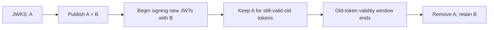

# Testing Old Tokens After Revocation, Permission Changes, or Key Rotation

In **Spring Security OAuth 2.0/OIDC Resource Server**, access tokens can continue being sent to APIs after a user logs out, permissions are reduced, tenant membership is revoked, or the Authorization Server (AS) rotates to a new signing key. Therefore, token lifecycle testing must answer three questions: **under what conditions is an old token still accepted, what change causes it to be rejected, and how long does it take every Resource Server instance to observe the change?**

Three events are often lumped together as "revoking a token," yet they have different scopes:

1. **Revoking a specific token:** invalidating an access token or token family before expiration.
2. **Permission/identity changes:** a user loses scopes, roles, or tenant membership, or their account is disabled; claims in already-issued tokens may remain intact.
3. **Signing key changes:** the AS stops signing with an old key or removes the old public key from JWKS; this change can affect many tokens signed by that key.

With **self-contained JWTs**, Resource Servers usually verify signatures and claims offline. Old JWTs **do not automatically vanish** from every API just because a user logs out or an admin changes permissions. With **opaque tokens**, Resource Servers typically query the introspection endpoint, and the AS can return `active=false` once a token is revoked. Caches at the AS, API gateway, Resource Server, or policy store can still introduce lag before everywhere observes the new state.

This lesson covers designing and testing these lifecycles in Spring Security, including JWT/opaque tokens, scopes, memberships, `jti` denylists, token versions, JWKS caches, normal and emergency key rotation, multiple Resource Server instances, testing with fake AS/JWKS servers, and distinguishing mock authorization tests from decoder/introspection integration tests.

> **Principle:** Token expiry, token revocation, permission freshness, and signing-key rotation are distinct conditions. Tests must specify which condition changed, which Resource Server must observe the change, how much lag is allowed, and what HTTP outcome is expected.

## 1. Distinguishing Types of Changes in the Token Lifecycle

| Event | What changes? | Are old JWTs invalidated automatically? | Can opaque tokens be invalidated via introspection? |
|---|---|---|---|
| User logs out of SPA | Client-side/session state | No, unless an extra mechanism exists | Possibly, if AS revokes token and introspection reflects it |
| Refresh token revoked | Ability to obtain new access tokens | Old access tokens stay valid | Inactive only if AS also revokes access tokens |
| Specific access token revoked | State of that specific token | Not automatically with offline validation | AS can normally return `active=false` |
| User disabled | Account status | Signed JWTs can still be unexpired | AS may return inactive, or API needs a policy check |
| Scope/role reduced | Current permissions | Old claims inside JWT do not change | Can be reflected via introspection per contract |
| Tenant membership revoked | User–tenant relationship | Old claim remains in JWT | Can be reflected via introspection or membership lookup |
| Normal signing key rotation | New signing key introduced | Old tokens remain valid while old public key is trusted | Does not directly affect typical opaque tokens |
| Old public key removed from JWKS | Set of keys trusted by Resource Server | Tokens signed with old key rejected after cache refreshes | Does not directly affect opaque introspection |
| Private signing key compromised | Trust in a key broken | Tokens signed by that key may need rejection | Only affects opaque if AS uses that key in a related mechanism |

### 1.1. Expiration Is Not Revocation

A JWT:

```json
{
  "iss": "https://login.example.test/realms/shop",
  "sub": "user-123",
  "aud": ["orders-api"],
  "scope": "orders.read",
  "exp": 1900000000,
  "jti": "token-123"
}
```

may have a valid signature and an `exp` still in the future. If the Resource Server only verifies signature, issuer, audience, and timestamps, the token remains accepted. A user logging out in the browser or the AS marking a refresh token revoked does not alter the bytes of this access token.

Revocation requires a mechanism observable by the Resource Server: introspection, a denylist, a token-version/status lookup, a policy service, key removal (at key scope), or waiting for expiration.

### 1.2. Rotating Keys Differs from Revoking One Token

If the AS rotates from key A to key B while keeping public key A published in JWKS, old tokens signed with A still verify. This is normal behavior to avoid breaking unexpired access tokens.

If the AS removes public key A, all JWTs requiring key A can be rejected once Resource Servers refresh JWKS. This is a **key-level** change that can impact many users, clients, and tokens simultaneously.

### 1.3. Changing Permissions Does Not Mutate Issued Claims

A JWT containing:

```json
{"scope": "orders.read orders.write"}
```

does not automatically turn into:

```json
{"scope": "orders.read"}
```

when an admin removes write permission in the database. Signed claims are immutable. You must wait for expiration, revoke via a supported mechanism, check current permissions server-side, or use reference/introspected access tokens per contract.

## 2. Define Testing Goals Before Choosing a Token Format

| Criterion | Self-contained JWT | Opaque / reference token |
|---|---|---|
| Per-request check | Usually verifies signature/claims locally | Usually calls introspection or uses cache |
| Revoking a specific token | Needs an extra mechanism or waiting for `exp` | AS can mark inactive |
| Current scope changes | Claims in old tokens stay unchanged | AS can return updated state/claims per contract |
| AS network dependency | Discovery/JWKS and rotation; validation usually offline | Usually depends on introspection |
| Caching | JWKS/public keys; optionally denylist/policy caches | Introspection-result cache |
| Revocation latency | Driven by TTL, denylist/status lookups, or policy freshness | Driven by AS propagation, introspection cache, and RS cache |

Choosing JWT for throughput or opaque for revocation is an architectural decision. No token format automatically solves account disablement, membership, and object-level authorization.

### 2.1. Write Explicit Revocation SLOs

Instead of writing "logout must revoke immediately," define measurable targets:

```text
Token type: JWT access token
Maximum access-token lifetime: 5 minutes
Permission removal propagation: <= 30 seconds
Emergency signing-key compromise response: <= 2 minutes
Opaque token revocation visibility: <= 5 seconds
```

These numbers are illustrative examples only, not Spring Security defaults or universal recommendations. Organizations must set targets based on data sensitivity, traffic load, AS capacity, and online check costs.

A test can only draw valid conclusions when it knows the **allowed lag**, the starting timestamp, and how to verify every Resource Server instance has received the updated state.

## 3. JWTs After User Logout

A bearer access token is a credential usable by anyone holding it until expiration or rejection by an additional policy.

Example:

```text
10:00:00  User receives JWT access token, exp=10:05:00
10:01:00  User logs out of SPA
10:01:05  Attacker still holds a copy of the access token
10:02:00  Attacker sends token to Orders API
```

If the API only verifies signature, issuer, audience, expiration, and scope, the 10:02 request can still succeed. Deleting the token from browser storage only stops that browser from reusing it; it does not delete copies elsewhere.

### 3.1. Client Logout Is Not Server-Side Token Revocation

Logout can encompass one or more actions:

- Deleting the access token from client memory/storage.
- Revoking the refresh token or token family at the AS.
- Ending the SSO session/cookie at the OP.
- Calling the OAuth token revocation endpoint if supported by token type and AS.
- Revoking the specific access token.
- Adding the token's `jti` to a denylist at Resource Servers.
- Invalidating the session, account, or membership per policy.

Specify explicitly which steps your logout flow performs. Redirecting to the OIDC end-session endpoint does not automatically guarantee every JWT issued across all APIs immediately stops working.

### 3.2. Testing Post-Logout Behavior with JWTs

If the design uses offline JWTs without a denylist or status check, the expected outcome per design may be:

| Time | JWT signature/time | Expected |
|---|---|---|
| Before logout | Valid | Permitted if scope/object permissions pass |
| Right after logout | Still valid, unexpired | May still be accepted |
| After token expires | Timestamp invalid | Rejected |
| New token after logout | AS cannot issue new tokens if session/refresh revoked | No new valid token |

This test is not automatically a bug if the contract accepts unexpired access tokens after logout. If logout must invalidate access tokens immediately, the architecture needs a mechanism visible to Resource Servers.

## 4. JWT Revocation via a `jti` Denylist

One implementation assigns each JWT a unique `jti` (JWT ID) and has Resource Servers check a denylist before authorizing.

Claim example:

```json
{
  "iss": "https://login.example.test/realms/shop",
  "sub": "user-123",
  "aud": ["orders-api"],
  "jti": "jti-8f1c",
  "exp": 1900000000
}
```

When the token is revoked, the server persists an appropriate identifier:

```text
issuer + jti
revoked_until = token.exp
reason = logout / incident / admin_action
```

Namespace by issuer to avoid `jti` collisions across issuers. Never use the raw bearer token as a key if a safer digest or identifier can be used.

### 4.1. `jti` Does Not Automatically Enable Revocation

The `jti` claim is only an identifier. The JWT specification does not create a registry of revoked tokens, and Spring Security's JWT decoder does not know which tokens are denylisted on its own.

The application must:

1. Require the issuer to emit `jti` if policy uses a denylist.
2. Verify the token before trusting `jti`.
3. Look up revocation status from a trusted server-side source.
4. Reject the token if `(iss, jti)` is revoked.
5. Retain entries at least until token expiration plus any necessary safety margin.
6. Handle cache propagation and database outages under a fail-closed policy.

### 4.2. Do Not Arbitrarily Put Blocking Database Lookups in a JWT Validator

`OAuth2TokenValidator<Jwt>` in Spring Security is typically a synchronous validation contract. Do not stuff blocking JDBC/HTTP calls into a validator on the request path, especially in WebFlux.

Architectural options:

- Use opaque introspection if online status per token is needed.
- Use a stack-appropriate custom authentication manager/provider combining the decoder with async status lookups.
- Use a reactive authorization layer/policy check if revocation is part of current permissions.
- Use a denylist cache/store with defined latency and failure policies.
- Keep token lifetimes short if risk and UX permit.

In the Servlet stack, online lookups also incur latency and availability costs; configure timeouts, caching, connection pooling, and fail-closed behavior. In WebFlux, use reactive stores/clients and never call `block()`.

### 4.3. Token-Status Check Pseudocode

```text
verifiedJwt = decodeAndValidateSignatureIssuerAudienceTime(token)

status = tokenStatusStore.find(verifiedJwt.iss, verifiedJwt.jti)

if status == REVOKED:
    reject authentication

if status == UNKNOWN and policy requires online confirmation:
    fail closed or use explicitly documented bounded fallback

otherwise:
    continue to scope and object authorization
```

An `UNKNOWN` result must never default to `ACTIVE` if policy requires confirming revocation status. Distinguish "no revocation record found" from "unable to reach status store."

## 5. Token Versions or Security Stamps

Another approach stores a current version or security stamp per user or client.

JWT:

```json
{
  "sub": "user-123",
  "token_version": 7,
  "exp": 1900000000
}
```

Server-side account state:

```text
user-123.token_version = 8
```

When a token carries version 7 while current state is 8, the API rejects it per policy.

### 5.1. What Events Do Token Versions Solve?

You can bump the version when a user logs out of all sessions, an account is compromised, password/security credentials change, an admin revokes all access tokens, a user is disabled, or membership/permissions change if versions are scoped to tenant/permission domains.

Version checks only work if the Resource Server actually checks them. An offline JWT decoder does not query the account database automatically.

### 5.2. User-Wide or Per-Tenant Versions?

If a user belongs to both `shop-a` and `shop-b`, bumping a global user version revokes tokens in both tenants. Sometimes that is intentional; other times finer granularity is needed:

```text
user security version:
  (issuer, subject) -> 8

tenant membership version:
  (issuer, subject, tenant) -> 14
```

Tokens/actors can carry versions per contract, or a server-side policy store can provide the current version. Avoid stuffing too many mutable permissions into JWTs expecting them to self-update.

### 5.3. Version Lookups Also Have a Cache Window

If the Resource Server caches token versions for 30 seconds, revoked access can persist during that cache window. Tests must verify cache TTL, invalidation event behavior, whether lost events are detected, whether newly launched instances load the current version, whether a cache backend outage allows or denies, and whether versions update atomically with account/membership changes.

## 6. Opaque Tokens and Post-Revocation Introspection

With opaque tokens, the Resource Server queries the AS:

```http
POST /oauth2/introspect HTTP/1.1
Host: login.example.test
Authorization: Basic <RESOURCE_SERVER_CREDENTIALS>
Content-Type: application/x-www-form-urlencoded

token=<OPAQUE_ACCESS_TOKEN>
```

While active:

```json
{
  "active": true,
  "sub": "user-123",
  "scope": "orders.read",
  "aud": ["orders-api"],
  "exp": 1900000000
}
```

After AS revokes the token:

```json
{"active": false}
```

Spring Security opaque-token support uses an introspector to convert active responses into principals/`Authentication`. Inactive tokens typically result in Bearer authentication failure (401).

### 6.1. Tests Must Send Real Bearer Tokens Through the Filter Chain

An HTTP integration test must:

1. Configure Spring's real `ReactiveOpaqueTokenIntrospector` or `OpaqueTokenIntrospector`.
2. Point the introspection URI to a fake AS test server.
3. Send `Authorization: Bearer test-opaque-token`.
4. Have the fake AS return `active=true`.
5. Confirm the API processes the request.
6. Switch the fake AS state to `active=false`.
7. Resend the same token.
8. Confirm introspection is called again per cache policy and the API rejects.

Never use `mockOpaqueToken()` in this test, because it injects a simulated `Authentication` into the test chain and **bypasses HTTP introspection**.

### 6.2. Introspection Does Not Guarantee Immediate Revocation If Cached

Suppose:

```text
12:00:00  AS returns active=true
12:00:01  Resource Server caches result for 60 seconds
12:00:05  Admin revokes token at AS
12:00:06  Resource Server receives same token again, cache hit active=true
12:01:01  Cache expires, Resource Server queries AS
12:01:02  AS returns active=false
```

Revocation occurred at the AS at 12:00:05, yet the API can keep accepting the token until the cache entry expires or is invalidated. If 5-second propagation is required, a 60-second cache TTL fails.

### 6.3. Do Not Confuse AS Responses with Resource Server Caches

Multiple cache layers can exist: AS/internal token-state caches, API gateway caches, Resource Server introspection-result caches, distributed application caches, and custom principal/authentication caches.

A test that merely stubs the AS to return `active=false` is insufficient if requests never reach the AS. Observe introspection call counts or control caches to verify which layer answered.

## 7. Permission Changes While Old Tokens Are Still Unexpired

Suppose a user initially holds:

```text
SCOPE_orders.read
SCOPE_orders.write
```

Later an admin removes write permission:

```text
Current permission:
  orders.read = true
  orders.write = false
```

The old JWT still has claim:

```json
{"scope": "orders.read orders.write"}
```

If the Resource Server relies solely on JWT claims, the old token retains write authority until expiration. This is a **permission freshness** problem, not a signature or JWKS problem.

### 7.1. Permission Update Strategies

| Strategy | When does the API see the change? | Trade-off |
|---|---|---|
| Short access token TTL | Once the old token expires and a new one is issued | Stale permission window equal to remaining TTL |
| Revoke token + denylist | Once all RSs receive the denylist update | Requires online/distributed status lookup |
| Opaque introspection | Once AS returns updated scopes/state or inactive | Network dependency and cache window |
| Server-side permission lookup | Per freshness/cache policy of the permission store | Adds I/O to authorization |
| Tenant membership version | When current version differs from claim/cache | Requires version management and propagation |
| Token exchange / new token | When client obtains a new token with new scopes | Does not automatically invalidate old tokens |
| Signing key rotation | When old key is removed, affecting all tokens signed by it | Too broad for a single user permission change |

Never use **key rotation** to revoke a routine user's permissions. Key rotation impacts every token signed by that key regardless of user or scope.

### 7.2. Testing Permission Changes

A test should involve two tokens:

```text
Old token:
  sub=user-123
  scope=orders.read orders.write
  exp=10:05

New token:
  sub=user-123
  scope=orders.read
  exp=10:10
```

Verify whether the old token can still write per the chosen strategy, whether the new token can read, whether the new token is denied on POST write, whether the permission store blocks the old token after write removal, and whether all Resource Server instances observe the same version/policy.

Never write tests assuming the old JWT automatically loses `orders.write` simply because the AS issued a new token. Two tokens are two independent credentials.

### 7.3. Permission Removal and New Token Issuance Are Separate Assertions

When an admin removes write permission, asserting that the AS mints a new token with read-only is one assertion. Asserting that **the old token** can no longer perform writes is a separate assertion. A test that only obtains a new token and sees POST return 403 does not prove the old token was invalidated.

## 8. Membership/Tenant Changes and Object-Level Permissions

Permission changes include removing a user from a tenant, suspending a tenant, downgrading a user from admin to read-only, removing a user from a project/branch, changing record ownership, revoking shares/ACLs, or restricting a service account's tenants.

A JWT may carry `tenant_id=shop-a` and `scope=orders.read`, yet permission to read a specific order still depends on current membership/ACLs.

### 8.1. Token Claims Do Not Replace Database Authorization

A query may bind:

```sql
SELECT *
FROM orders
WHERE id = :orderId
  AND tenant_id = :authorizedTenant
  AND owner_subject = :verifiedSubject;
```

If the user loses membership, the tenant resolver/policy must reject before querying, or the query must join current membership/ACLs. Never take a tenant from the URL and pass it directly as a query parameter without verification.

### 8.2. Testing Old Permissions After Membership Revocation

Fixtures:

```text
Before:
  user-123 is ACTIVE member of shop-a
  token has orders.read
  order-1 belongs to shop-a

Change:
  membership.status = REVOKED

After:
  same JWT is still unexpired
  request GET /api/tenants/shop-a/orders/order-1
```

Expected behavior depends on contract:

- If membership is checked online on every request or cached for 5 seconds, requests after the propagation window must be denied.
- If membership is only snapshotted into the JWT, old tokens may retain access until expiry; document this explicitly in the threat model.
- If AS introspection updates claims, test the updated response and RS caches.
- If a tenant version changes, old-version tokens must fail per policy.

### 8.3. 403 or 404?

A valid token whose user lost membership is typically an authorization failure (403). If the API avoids disclosing whether an order exists in another tenant, it may return 404 for invisible objects. Keep semantics consistent across detail, search, count, and export endpoints.

## 9. Normal Signing-Key Rotation

The AS uses a private signing key to sign JWTs. Resource Servers fetch public keys from a trusted JWKS URI. Normal rotation requires an overlap between the old key and the new key.

```text
T0:
  JWKS = [key-A]
  AS signs with key-A

T1:
  JWKS = [key-A, key-B]
  AS still signs with key-A

T2:
  JWKS = [key-A, key-B]
  AS starts signing new tokens with key-B

T3:
  Old key-A tokens are still within maximum lifetime
  JWKS keeps key-A and key-B

T4:
  All key-A tokens have expired + clock/cache safety window
  JWKS removes key-A
```



### 9.1. Why Must the New Key Be Published Before Signing with It?

Resource Servers may cache JWKS. If the AS starts signing with key B before public key B is published and fetchable, APIs cannot find the matching key and return authentication failures.

Safe sequence:

1. Publish public key B.
2. Give Resource Servers time to refresh JWKS.
3. Start signing with B.
4. Keep A in JWKS long enough to verify unexpired old tokens.
5. Remove A only after the old-token window ends.

The overlap window must account for maximum access-token lifetime, clock skew, propagation, and caching behavior.

### 9.2. Old-Key Tokens Stay Valid While the Old Key Remains in JWKS

Once the AS begins signing with B, old tokens carrying `kid=key-A` can still verify as long as key A remains published in trusted JWKS, the Resource Server can access/cache public key A, signature and other claims are valid, and the token has not expired or been revoked separately.

This is **expected behavior during normal rotation**, not a decoder bug when old tokens continue passing.

### 9.3. Removing an Old Key Does Not Always Take Effect Immediately

Resource Servers may cache JWKS containing A. When the AS removes A, an instance may keep using cached key A until the cache refreshes/expires or another refresh trigger fires.

Thus "JWKS no longer contains A" and "every API instance immediately rejects tokens signed with A" are two separate things. Verify cache TTLs, refresh triggers, gateway/CDN caches, and instance rollouts.

## 10. Emergency Key Compromise Differs from Normal Rotation

If private signing key A is leaked, the AS/security team may need to revoke trust in A even while tokens signed with A have not yet expired.

This is a broad-impact **incident response**:

- All JWTs signed with A may be rejected, including unaffected users.
- The AS must stop signing with A and secure/rotate private keys.
- Public key A must be removed from trusted JWKS.
- Resource Server JWKS caches must be refreshed/invalidated via supported mechanisms.
- CDN/proxy caches must be accounted for.
- Clients may need to acquire new tokens signed with B.
- Monitoring must track 401 rates and key lookup failures.

### 10.1. Do Not Use Normal Overlap During a Compromise Incident

In normal rotation, keeping the old key keeps old tokens working. During key compromise, keeping public key A in JWKS can let attackers keep forging or using tokens signed with the leaked private key.

Incident policy may call for **emergency removal of A**, accepting invalidation of all tokens under A. That is a decision governed by threat model and incident severity, not the default for routine key rotation.

### 10.2. JWKS Caching Can Create a Revocation Window

If Resource Servers keep public key A cached after the AS removes it, tokens signed with A can remain accepted. For rapid emergency response, verify cache TTL/max-age, whether immediate refresh/invalidation is supported, CDN/proxy cache durations, and how long it takes all instances to adopt the new key set.

Never claim a specific Spring Security API always refreshes instantaneously whenever JWKS changes. Behavior depends on Nimbus/Spring Security versions, cache configuration, and HTTP caching.

### 10.3. Key Compromise Tests Must Also Test Forged Tokens

An important test:

1. Create key A and public JWK A.
2. Sign a test token with private key A.
3. Resource Server accepts the token before the incident.
4. Remove public JWK A from JWKS and publish B.
5. Force or wait for cache refresh per the configured strategy.
6. Resend the old token signed with A.
7. Assert the token is rejected.
8. Mint a token signed with B and assert the new token works.
9. Assert there is no fallback to raw payload parsing or accepting arbitrary keys.

If a test merely deletes the key from fake JWKS while the decoder still caches A, initial requests can keep succeeding. That exact window is what the test should observe and quantify.

## 11. Spring Security JWT Decoder and Validators

A typical Servlet decoder:

```java
@Bean
JwtDecoder jwtDecoder() {
    String issuer =
        "https://login.example.test/realms/shop";
    String jwks =
        "https://login.example.test/realms/shop/protocol/openid-connect/certs";

    NimbusJwtDecoder decoder =
        NimbusJwtDecoder.withJwkSetUri(jwks)
            .jwsAlgorithm(SignatureAlgorithm.RS256)
            .build();

    OAuth2TokenValidator<Jwt> defaults =
        JwtValidators.createDefaultWithIssuer(issuer);

    OAuth2TokenValidator<Jwt> audience = jwt ->
        jwt.getAudience().contains("orders-api")
            ? OAuth2TokenValidatorResult.success()
            : OAuth2TokenValidatorResult.failure(
                new OAuth2Error(
                    "invalid_token",
                    "Wrong audience",
                    null
                )
            );

    decoder.setJwtValidator(
        new DelegatingOAuth2TokenValidator<>(
            defaults, audience
        )
    );

    return decoder;
}
```

Imports:

```java
import org.springframework.context.annotation.Bean;
import org.springframework.security.oauth2.core.DelegatingOAuth2TokenValidator;
import org.springframework.security.oauth2.core.OAuth2Error;
import org.springframework.security.oauth2.core.OAuth2TokenValidator;
import org.springframework.security.oauth2.core.OAuth2TokenValidatorResult;
import org.springframework.security.oauth2.jose.jws.SignatureAlgorithm;
import org.springframework.security.oauth2.jwt.Jwt;
import org.springframework.security.oauth2.jwt.JwtDecoder;
import org.springframework.security.oauth2.jwt.JwtValidators;
import org.springframework.security.oauth2.jwt.NimbusJwtDecoder;
```

This is a Servlet example. WebFlux uses `ReactiveJwtDecoder`/`NimbusReactiveJwtDecoder` with matching APIs.

Issuer/audience/time validators do not replace key rotation. The decoder fetches public keys from JWKS and verifies signatures; claim validators inspect token claims. Once a key is removed from JWKS and caches update, signature verification for tokens using that key must fail.

### 11.1. Never Hardcode a Single Public Key If the AS Rotates

If an application builds a decoder from a static public key with no update process, AS rotation can cause all new tokens to return 401. Conversely, accepting arbitrary keys to avoid 401 breaks the trust boundary.

### 11.2. Key Algorithms Must Follow the Contract

If the contract allows only RS256, configure an explicit allowlist. Never automatically allow all algorithms just because a new key uses a different one. Algorithm changes require coordination between AS and Resource Server, compatibility testing, and a safe overlapping rollout.

## 12. Spring Security Opaque Introspection and Testing Revocation

A Servlet configuration:

```yaml
spring:
  security:
    oauth2:
      resourceserver:
        opaquetoken:
          introspection-uri: https://login.example.test/oauth2/introspect
          client-id: orders-api
          client-secret: §{INTROSPECTION_CLIENT_SECRET}
```

Filter chain:

```java
.oauth2ResourceServer(oauth2 ->
    oauth2.opaqueToken(Customizer.withDefaults())
)
```

The Resource Server calls introspection per implementation/configuration. If the AS marks the token inactive, authentication fails.

### 12.1. Fake Introspection Endpoint

In integration tests, a fake server can return initially:

```json
{
  "active": true,
  "sub": "user-123",
  "scope": "orders.read",
  "aud": ["orders-api"]
}
```

Then for the same token:

```json
{"active": false}
```

Tests must verify the second request **actually re-queries the AS** if uncached, or only observes inactive after cache expiry/invalidation if cached.

### 12.2. Distinguishing Inactive from AS Outages

- `active=false`: AS responded and confirmed the token is inactive.
- Timeout/DNS/TLS/5xx: Resource Server could not verify status.
- 401 from introspection endpoint: Resource Server credentials may be wrong or the AS rejected the client.
- Malformed JSON: contract/protocol error.

All unverifiable cases must **fail closed**, while metrics/runbooks distinguish them so operations does not mistake every failure for a revoked token.

### 12.3. Reactive Opaque Tokens

In WebFlux, use `ReactiveOpaqueTokenIntrospector` and an appropriate reactive implementation. Test with `WebTestClient`, real bearer headers, and a fake AS. Never run a blocking introspection client on the event loop.

## 13. Testing Permission Changes with Old Tokens

A time-ordered test:

```text
T0:
  user has orders.read + orders.write
  issue old JWT

T1:
  admin removes orders.write

T2:
  issue new JWT with orders.read only

T3:
  send old JWT to POST /api/orders

T4:
  send new JWT to POST /api/orders
```

Expected behavior depends on strategy:

| Strategy | Old JWT POST | New JWT POST |
|---|---|---|
| JWT snapshot + short TTL | May still succeed until expiry | 403 |
| JWT + current permission lookup | 403 after permission store updates | 403 |
| JWT + token version increment | Authentication denied per contract | 403 if new token still lacks write |
| Fresh opaque introspection | 403 if active with read-only authorities; or 401 if AS revoked token | 403 |
| Cached opaque introspection | May still write until cache expires | Per new token's response/cache |

### 13.1. Testing Current Permission Stores

If authorization depends on a database, use a test transaction or fake policy service to grant write, authenticate the user/token, succeed on POST, revoke the permission in the store, re-call with the same token, assert rejection within the propagation window, and verify store outages do not accidentally allow writes.

Do not merely mock an `Authentication` with `SCOPE_orders.write` and expect Spring Security to automatically know the database changed.

### 13.2. Membership / Tenant Changes

A user may lose access to `shop-a` while retaining access to `shop-b`. If policy uses a global user token version, the change may revoke too broadly. Tests should verify the exact granularity:

| Change | Token / actor | Expected |
|---|---|---|
| Disable account | `user-123` across all tenants | Denies protected operations |
| Revoke `shop-a` membership | `user-123`/`shop-a` | Denies `shop-a` |
| Revoke `shop-a` membership | `user-123`/`shop-b` | May remain allowed if `shop-b` membership is still active |
| Remove `orders.write` in `shop-a` | `user-123`/`shop-a` write | Denies write; read may remain |
| Revoke one token `jti` | `token-1` | Denies `token-1`; `token-2` of same user may remain |

## 14. Testing Real JWTs: Do Not Confuse with `mockJwt`

Spring Security Test supports:

```java
mockMvc.perform(get("/api/orders")
    .with(jwt().authorities(
        new SimpleGrantedAuthority("SCOPE_orders.read")
    )))
    .andExpect(status().isOk());
```

Or in WebFlux:

```java
webTestClient
    .mutateWith(mockJwt().authorities(
        new SimpleGrantedAuthority("SCOPE_orders.read")
    ))
    .get()
    .uri("/api/orders")
    .exchange()
    .expectStatus().isOk();
```

These helpers are great for testing **authorization** with a simulated `Authentication`. They generally bypass decoder signature/JWKS validation.

**You cannot use `mockJwt` to prove** that an old token was revoked, an invalid JWT signature fails, JWKS key A was removed and caches refreshed, a new `kid` was fetched, audience/issuer validators run properly, or a token signed with a compromised private key is rejected.

To test those, send a **real signed compact JWT** through the active decoder and filter chain.

### 14.1. Testing the Decoder Directly

A decoder test should generate its own RSA/EC test key pair, serve the public JWK via a fake JWKS endpoint, sign JWTs with the test private key, control issuer/audience/exp claims, and issue tokens using key A and key B. Then call `decoder.decode(token)` or send a bearer header to the API. Real token signatures and claims are processed by the real decoder.

### 14.2. Pseudocode Test After Old Key Removal

```java
@Test
void rejectsOldTokenAfterOldKeyIsRemovedAndCacheRefreshed() {
    String oldToken = signedJwt(
        oldPrivateKey,
        "key-A",
        Map.of(
            "iss", ISSUER,
            "aud", List.of("orders-api"),
            "sub", "user-123",
            "exp", futureExpiration()
        )
    );

    jwksStub.publish(oldPublicJwk);
    assertThat(decoder.decode(oldToken)).isNotNull();

    jwksStub.replaceKeys(newPublicJwk);
    expireOrRefreshJwksCacheForTest();

    assertThatThrownBy(() -> decoder.decode(oldToken))
        .isInstanceOf(JwtException.class);
}
```

This is pseudocode illustrating a test strategy; `jwksStub`, `expireOrRefreshJwksCacheForTest`, and `signedJwt` are test helpers to implement according to your HTTP stub and decoder version. Spring Security has no universal `expireOrRefreshJwksCacheForTest` API; tests must drive real caches via configuration/test servers or instantiate a new decoder if only testing post-refresh behavior.

### 14.3. Testing Expired vs. Revoked Tokens Are Two Separate Tests

Expired JWTs are rejected by the timestamp validator. Unexpired revoked JWTs are only rejected if a denylist, status/policy check, or key-level revocation exists. Never use an expired token to claim a revocation mechanism works.

## 15. Testing JWKS Rotation with a Fake Server

A fake JWKS server can switch responses by test phase.

**Phase 1 — Only key A**

```json
{"keys": [{"kid": "key-A", "kty": "RSA", "...": "..."}]}
```

- Token A is accepted.
- Token B is rejected before key B is published.

**Phase 2 — Publish A and B**

```json
{"keys": [
  {"kid": "key-A", "kty": "RSA", "...": "..."},
  {"kid": "key-B", "kty": "RSA", "...": "..."}
]}
```

- Unexpired Token A stays accepted.
- Token B is accepted once the decoder fetches key B.
- AS starts signing new tokens with B.

**Phase 3 — Remove A after overlap**

```json
{"keys": [{"kid": "key-B", "kty": "RSA", "...": "..."}]}
```

- Token B continues to be accepted.
- Token A is rejected once the decoder refreshes its cache.
- The test measures the elapsed time from when fake JWKS changed until decoder instances observed the change.

### 15.1. Controlling Caches in Tests

Use a fake JWKS server with deterministic response headers/cache behavior, configure HTTP/JWK caching per your dependency version's API, create a fresh decoder per phase if only testing key-set semantics, use test hooks to await/trigger refresh if supported by the library, and assert JWKS GET call counts.

Avoid arbitrary `Thread.sleep`; use deadline-bounded polling or a test clock when appropriate.

Creating a new decoder for Phase 3 proves "a fresh decoder rejects removed keys," yet **does not prove a running decoder's cache refreshed**. Test cache propagation separately.

### 15.2. Testing Multiple Resource Server Instances

A system may run:

```text
orders-api-1 -> JWKS cache A
orders-api-2 -> JWKS cache B
orders-api-3 -> JWKS cache C
gateway/CDN -> metadata/JWKS cache D
```

After key removal, one instance may still trust A while another has refreshed. Testing and observability should check multiple instances or multiple decoder instances with independent cache lifecycles.

### 15.3. Do Not Force Production Cache TTLs Too Low Just for Tests

Tests can use short cache TTLs in a dedicated test profile. Never tune production cache settings solely to speed up unit tests; production TTLs must reflect rotation/revocation SLOs and capacity.

## 16. Testing Opaque Token Revocation with a Fake Introspection Server

A fake AS can hold state:

```text
token-1 -> active=true
token-2 -> active=false
```

When testing revocation:

1. Send `token-1` through `WebTestClient`/`MockMvc` with a real bearer header.
2. Fake AS returns `active=true`.
3. Verify endpoint succeeds if scope/tenant/object permissions pass.
4. Switch `token-1` to `active=false` at the fake AS.
5. Resend the same `token-1`.
6. Verify the API rejects once the cache policy allows the change to become visible.
7. Verify the fake server received the expected number of introspection calls.

Active response:

```json
{
  "active": true,
  "sub": "user-123",
  "scope": "orders.read",
  "aud": ["orders-api"]
}
```

Revoked response:

```json
{"active": false}
```

### 16.1. Do Not Use `mockOpaqueToken` for Integration Introspection Tests

Example:

```java
webTestClient
    .mutateWith(mockOpaqueToken())
    .get()
    .uri("/api/orders")
    .exchange();
```

is for authorization tests; it does not make the application send an HTTP introspection request to the AS. To test real revocation, send an `Authorization: Bearer` header and let Spring Resource Server invoke the real introspector.

### 16.2. Verify Introspection Client Authentication

The fake AS should verify that the Resource Server calls the endpoint with the agreed authentication method, such as `client_secret_basic`, private key JWT, or mTLS. Never log secrets or tokens; tests only assert the correct method and identity.

### 16.3. Distinguish Inactive Tokens from Invalid Introspection Clients

If the Resource Server sends wrong client credentials, the AS may return 401/403 on the introspection call. That is an integration/configuration failure, not an indication that the end-user token was revoked.

## 17. Testing Caching and Propagation

A realistic revocation test must measure:

```text
t_revoke:
  time when state is revoked at the authoritative source

t_seen:
  time when the last Resource Server rejects the old token

propagation_delay = t_seen - t_revoke
```

With multiple instances, `t_seen` should be when **the slowest instance** among the protected set observes the change.

Procedure:

1. All instances successfully validate the old token.
2. Revoke the token or remove the key at the source.
3. Record the timestamp of the change.
4. Send the same token to each instance.
5. Record the timestamps of the first and last instances to reject.
6. Compare against the SLO.
7. Verify lost cache invalidation events still fall back to TTL bounds.
8. Verify newly started instances do not load stale state.

A single cache unit test does not simulate Redis pub/sub, CDNs, gateways, or multiple pods. It is useful for checking TTLs, yet proving distributed propagation requires integration/load tests in a production-like environment.

## 18. Outages and Fail-Closed Policy

| Failure | What the Resource Server knows | Safe handling |
|---|---|---|
| AS returns `active=false` | Token is inactive | Reject |
| Introspection timeout | Unable to verify | Do not grant `Authentication` |
| JWKS timeout while key is cached | Can verify with trusted cached key | Follow cache/trust policy; claims must still be valid |
| JWKS timeout with no cached key | Unable to verify signature | Reject |
| Denylist store timeout | Unknown whether token is revoked | Fail closed if lookup is mandatory; or approved bounded fallback |
| Permission service timeout | Unknown current permissions | Reject or follow defined policy degradation |
| Cache invalidation event lost | Instance may retain stale state | TTL bound, reconciliation/refresh |
| Metadata unexpectedly changes issuer | Trust configuration mismatch | Never implicitly trust new issuer |

**Fail closed** means never treating unverified credentials as valid. It does not force every infrastructure error to return the exact same HTTP status; status codes and observability must distinguish token errors from dependency errors.

### 18.1. Degraded Modes Must Be Bounded

Some systems continue serving cached positive introspection during brief AS outages. That is an availability/security trade-off. If enabled, define the maximum offline duration for cache entries, whether token `exp` is respected, how long a revoked token may stay accepted, which APIs prohibit degraded mode, and what happens once TTL expires.

Never add a fallback inside an exception handler turning every AS error into authenticated success.

## 19. Token Revocation Endpoints and OIDC Logout

The OAuth token revocation endpoint under RFC 7009 lets clients ask the AS to revoke tokens via supported mechanisms. Distinguish:

- Client sends token to the revocation endpoint per authentication/authorization contract.
- AS may revoke the token and related tokens per policy.
- Refresh token revocation prevents obtaining new access tokens via refresh flows.
- Old access tokens may stay accepted by Resource Servers if using offline JWTs without status lookups.
- The AS may support cascade revocation across refresh/access token families, yet behavior must be confirmed against the provider contract.

Testing that the revocation endpoint returns 200 OK only proves the AS accepted the request per protocol. You must further test that **Resource Servers actually reject the old token** under your chosen architecture. With offline JWTs, 200 from the revocation endpoint does not prove APIs know the token was revoked.

RP-Initiated Logout and Back-Channel Logout concern ending OIDC sessions at the client/RP. They do not automatically make every OAuth access token revoked across all Resource Servers. If your architecture wants logout events to terminate API access, you need an event contract, mapping between sessions/users/token families, a shared status/version service or denylist, delivery/retry/idempotency, and propagation tests.

## 20. Key Rotation and Access-Token Lifetime Must Be Coordinated

An overlap planning formula:

```text
old-key retention window
  >= maximum lifetime of tokens signed by old key
   + allowed clock skew
   + propagation/cache safety margin
```

Illustrative example:

```text
Maximum access-token lifetime: 10 minutes
Allowed clock skew:             1 minute
JWKS/cache propagation margin:  2 minutes

Old key retention after last old-key token issuance:
  at least 13 minutes, plus operational safety as required
```

This is a rough calculation, not a substitute for real tests. If the AS can still mint tokens with key A after you begin counting retention, count from **the last token signed with A**, not from when rotation started.

### 20.1. Do Not Remove a Key Based on the First Token Signed by the New Key

Multiple AS nodes may not switch signers simultaneously. Confirm no node still signs with the old key and know when the very last token using key A was issued.

### 20.2. Emergency Removal Is the Exception

On key compromise, do not wait out normal retention. Make an explicit incident decision: remove the key immediately, invalidate caches, accept widespread 401s, issue new tokens with a safe key, and handle downstream clients.

## 21. Caching and HTTP Infrastructure

JWKS/metadata can traverse:

```text
Authorization Server
  -> reverse proxy
  -> CDN
  -> Resource Server HTTP client
  -> Nimbus/JWK cache
```

An HTTP `Cache-Control` `max-age` can affect when Resource Servers observe new key sets. Custom proxies/caches can prolong stale data if misconfigured.

Fake JWKS servers should test `Cache-Control`, `ETag`/conditional requests if used by the client, 304 responses, stale proxy responses, network timeouts during refresh, and a new key initially absent then appearing. Never assume decoders honor all HTTP cache headers identically to browsers; check the behavior of your Nimbus/Spring Security version and HTTP client.

Never cache `Authentication` or introspection principals longer than token expiry or the revocation SLA. Where caching exists, keys, TTLs, and invalidation must reflect token, issuer, client, tenant, and required permission freshness.

## 22. Auditing and Observability for the Token Lifecycle

A safe log entry might record:

```text
request_id=req-123
issuer_alias=shop
subject_ref=user-123
token_id_hash=sha256:...
token_status=REVOKED
authn_decision=DENY
reason=TOKEN_STATUS_REVOKED
resource=orders-api
instance=orders-api-2
```

Never log raw bearer tokens, refresh tokens, client secrets, or private JWKs.

Metrics should distinguish JWT signature validation failures, unknown `kid`/JWKS refresh errors, issuer/audience/timestamp failures, opaque `active=false`, introspection HTTP timeouts/5xx/invalid client, denylist hits, token-version mismatches, permission/membership denials, 401 vs. 403, cache hit/miss/stale decisions, revocation propagation delay, and old/new key acceptance counts during key rotation.

Never use raw token strings or raw `jti` as metric labels if doing so creates high cardinality or leaks data.

## 23. Comprehensive Test Matrix

| Test | Prior token/state | Change | Expected |
|---|---|---|---|
| JWT logout without revocation | Valid, unexpired JWT | Delete token from browser | Token may still be accepted by API |
| JWT logout with `jti` denylist | Valid JWT, `jti` unrevoked | Add `(iss,jti)` to denylist | Old token rejected after propagation |
| Opaque revocation | `active=true` | AS switches to `active=false` | Same token rejected after introspection/cache window |
| Refresh token revoked | Unexpired access JWT | Revoke refresh token | No new tokens issued; old access token may stay valid |
| Permission removed, JWT snapshot | Old token has read+write | Remove write in DB | Old token retains write until expiry without online check |
| Permission removed, current policy | Old token has read+write | Permission store removes write | Old token POST gets 403 after propagation |
| Tenant membership revoked | JWT has old tenant claim | Membership inactive | Tenant request denied per current policy |
| Normal key rotation | Token A signed by key A | Publish B, sign new with B, keep A | Both A and B valid during overlap |
| Remove old key | Unexpired Token A | Remove A and refresh JWKS | A rejected after cache refresh; B stays valid |
| Emergency key compromise | Tokens signed by A | Emergency revoke A | A rejected after invalidation; B accepted |
| Unknown `kid` | JWT `kid` absent from trusted JWKS | JWKS does not provide key | Fail closed |
| JWKS outage | Token needs uncached key | Endpoint times out | Reject when unable to verify |
| Introspection outage | Opaque token | AS times out | Do not grant `Authentication` |
| Stale cache | Cached positive | Source revokes | Measure stale window and enforce SLO |
| Two instances | Both accept old token | Revoke/rotate | Both reject within propagation SLA |
| Cross-tenant | `shop-a` actor | Requests `shop-b` | Neither queries nor returns `shop-b` data |

## 24. Fixture Strategy: Keeping Old and New Tokens Under Control

A helpful test fixture should produce tokens across time and keys:

```text
Token A:
  kid = key-A
  jti = jti-A
  sub = user-123
  aud = orders-api
  scope = orders.read orders.write
  exp = T0 + 5 minutes

Token B:
  kid = key-B
  jti = jti-B
  sub = user-123
  aud = orders-api
  scope = orders.read
  exp = T1 + 5 minutes
```

Keep the exact same Token A across test phases rather than minting a new Token A each time. Minting a fresh token after every change fails to test **old token behavior**.

Test tokens must be signed with dedicated non-production test private keys. Never commit real access/refresh tokens, client secrets, or AS private signing keys.

Use a clock abstraction/test clock when components support it, or generate JWTs with expirations relative to test runtime. Avoid hardcoding `exp` values that end up in the past when tests run later. Separate cases for valid tokens, expired tokens, future `nbf`, clock skew boundaries, and just-past expiry. Avoid `Thread.sleep` waiting for token expiration whenever clocks/fixtures can be controlled.

## 25. Testing with MockMvc Using Real Signed JWTs

For a Servlet Resource Server, integration tests can boot the application with a real `JwtDecoder` pointing at a fake JWKS server and send:

```java
mockMvc.perform(get("/api/orders")
        .header(
            HttpHeaders.AUTHORIZATION,
            "Bearer " + signedOldToken
        ))
    .andExpect(status().isOk());
```

After revoking `jti` or changing policy, resend **the exact same `signedOldToken`** and assert the outcome.

If using MockMvc with the `jwt()` request post-processor:

```java
mockMvc.perform(get("/api/orders")
        .with(jwt()))
```

Spring Security Test constructs a simulated `Authentication`; the decoder does not verify a compact token. Use `jwt()` for authorization unit/HTTP tests, and real bearer headers for decoder integration tests.

### 25.1. Token-Status Check Example

An application may isolate status checks into a service:

```java
public interface RevokedTokenStore {
    boolean isRevoked(String issuer, String jti);
}
```

In the authorization/use-case layer:

```java
public OrderDto readOrder(
        Jwt jwt,
        UUID orderId) {

    String issuer = jwt.getIssuer().toString();
    String jti = jwt.getId();

    if (jti == null || revokedTokenStore.isRevoked(issuer, jti)) {
        throw new AccessDeniedException("Token revoked");
    }

    return orderService.readVisibleOrder(orderId, jwt);
}
```

This is a Servlet/blocking service example illustrating policy; `RevokedTokenStore` may perform DB I/O and needs timeouts/caching. Never copy synchronous lookups onto the WebFlux event loop. In real implementations, authentication failures should be handled at the proper security boundary with status mappings per contract rather than throwing arbitrarily from controllers.

## 26. Testing WebFlux with JWT / Opaque Tokens

WebFlux uses `ReactiveJwtDecoder` for JWTs, `ReactiveOpaqueTokenIntrospector` for opaque tokens, `SecurityWebFilterChain`/`ServerHttpSecurity`, `WebTestClient` for HTTP tests, and `mockJwt`/`mockOpaqueToken` for simulated `Authentication` in authorization tests.

### 26.1. Testing Real JWTs via WebTestClient

```java
webTestClient.get()
    .uri("/api/orders")
    .headers(headers ->
        headers.setBearerAuth(signedOldToken))
    .exchange()
    .expectStatus().isOk();
```

Test configuration must use a real decoder and a fake JWKS endpoint. Do not call `mutateWith(mockJwt())` in this test.

### 26.2. Testing Real Opaque Tokens via WebTestClient

```java
webTestClient.get()
    .uri("/api/orders")
    .headers(headers ->
        headers.setBearerAuth("opaque-token-1"))
    .exchange()
    .expectStatus().isOk();
```

Configure a real introspector pointing at a fake AS. Once the fake AS switches to `active=false`, resend the exact same token and assert rejection per cache policy.

### 26.3. Using Test Helpers for Their Intended Purpose

`mockJwt` and `mockOpaqueToken` excel at testing route scopes, principal injection, tenant/object authorization, reactive security contexts, and service calls.

However, they do not test AS revocation, JWK refresh, signature verification, or caching behavior.

## 27. 401, 403, and Infrastructure Errors

| Scenario | Typical HTTP status | Meaning |
|---|---|---|
| No bearer token at protected endpoint | 401 | Unauthenticated |
| Invalid JWT signature/issuer/audience/timestamps | 401 | Token rejected |
| Denylisted JWT | 401 `invalid_token` per Bearer semantics | Revoked credential |
| Opaque introspection `active=false` | 401 `invalid_token` | AS confirmed token inactive |
| Valid token missing scope | 403 `insufficient_scope` or appropriate 403 response | Authenticated but insufficient permissions |
| Valid token with revoked tenant membership | 403 or 404 per policy | No permission in tenant |
| Order not visible | 404 or 403 per anti-enumeration policy | Do not disclose object |
| JWKS/introspection network failure | Fail closed; status depends on exception handling | Unable to verify credential |
| Wrong introspection client credentials | Integration infrastructure error | AS call unauthenticated |

Some exception handlers or custom entry points map infrastructure failures differently. What must be preserved is **never letting a request proceed as authenticated** when the token cannot be verified.

Do not refresh infinitely on 401: the cause may be a revoked token, wrong issuer/audience/signature, key rotation, or an introspection outage. 403 usually indicates a valid token missing permissions; do not wipe the user's session or refresh token merely because one endpoint returned 403.

## 28. Step-by-Step Implementation and Testing Process

**Step 1 — Document the token contract.** Define JWT vs. opaque, issuer, audience, scopes, `exp`, `jti`, tenant claims, introspection, and key profiles.

**Step 2 — Identify events requiring revocation.** Single-token logout, refresh-token family, account, tenant membership, scope, or signing key? Never lump them into one action.

**Step 3 — Set propagation SLOs.** Define the maximum time from revocation/change until all Resource Server instances reject or update permissions.

**Step 4 — Choose mechanisms.** JWT TTL, `jti` denylist, token version, opaque introspection, current permission lookup, or emergency key removal.

**Step 5 — Configure Spring Security.** Preserve signature, issuer, audience, algorithm, and timestamp validation; custom checks must fail closed.

**Step 6 — Create test keys/tokens.** Use dedicated test private keys; maintain old/new token fixtures controlling `kid`, `jti`, scopes, and expiry.

**Step 7 — Stand up fake JWKS/introspection servers.** Control active state, key sets, cache headers, delays, and error responses.

**Step 8 — Test old tokens after changes.** Send the exact same token before and after revocation, permission, or key changes.

**Step 9 — Test negative cases.** Unknown `kid`, wrong audience, expired, inactive, missing status store, AS timeouts, and stale caches.

**Step 10 — Test multiple instances/concurrency.** Verify cache propagation and ensure no request is served by a stale instance beyond the SLA.

**Step 11 — Test authorization separately.** Use `mockJwt`/`mockOpaqueToken` for scope/role/object policies; never use mocks to claim revocation/crypto works.

**Step 12 — Prepare incident runbooks.** Key compromise, AS outage, failed revocation propagation, client refresh storms, and rollback.

## 29. Common Design Mistakes

1. **Assuming logout invalidated old JWTs.** UI logout only clears client credentials; unexpired JWTs stay usable if APIs perform no revocation/status check.
2. **Revoking refresh tokens while forgetting access tokens.** Revoking refresh tokens stops new access tokens, yet old access JWTs can remain live.
3. **Assuming removing a scope in admin updates old JWTs.** Signed claims are immutable; you need TTLs, introspection, permission lookups, or version/revocation mechanisms.
4. **Using key rotation to revoke a single user.** Removing a key can reject swathes of tokens across all users/clients sharing that key.
5. **Keeping an old key too long after compromise.** Normal overlap does not apply to compromise incidents.
6. **Removing an old key immediately during normal rotation.** Causes valid old tokens to fail with 401.
7. **Assuming JWKS updates take effect immediately.** Decoders, caches, CDNs, and instances may retain the old key.
8. **Using `mockJwt` to test signatures.** Mock helpers do not prove JWS verification.
9. **Using `mockOpaqueToken` to test revocation.** Mock `Authentication` bypasses introspection.
10. **Failing to distinguish AS outages from inactive tokens.** Timeouts are not proof a token was revoked.
11. **Caching positive introspection too long.** Can violate revocation SLOs.
12. **Failing open when the denylist/status store is down.** If policy requires lookups, never assume tokens are active.
13. **Not actually testing old tokens.** Minting a new token after a permission change does not verify old-token behavior.
14. **Testing only one Resource Server instance.** One pod may have refreshed keys/status while another has not.
15. **Confusing 403 with revoked tokens.** Valid tokens lacking scope are typically 403; revoked credentials are typically 401.
16. **Using one global token version for narrow tenant changes.** Can revoke overly broadly.
17. **Logging raw tokens during incident investigation.** Use protected hashes/identifiers, issuer aliases, and reason codes.

## 30. Pre-Release Checklist

- [ ] Distinguished offline JWTs from opaque introspection.
- [ ] Defined whether logout revokes access tokens or only refreshes/sessions.
- [ ] Set maximum access-token lifetime and clock-skew policies.
- [ ] Defined permission freshness and membership revocation behavior.
- [ ] Decided whether a `jti` denylist or token-version lookup is needed.
- [ ] Aligned cache TTLs and invalidation with the propagation SLO.
- [ ] Ensured normal key rotation includes old/new key overlap.
- [ ] Prepared an emergency removal and cache invalidation runbook for key compromise.
- [ ] Preserved issuer, audience, algorithm, and timestamp validation on Resource Servers.
- [ ] Tested JWTs using real signed token fixtures and real decoders.
- [ ] Tested opaque tokens using real bearer headers and a fake HTTP introspection server.
- [ ] Restricted `mockJwt`/`mockOpaqueToken` strictly to authorization tests.
- [ ] Added tests for old tokens after logout, revocation, and permission changes.
- [ ] Added tests for key A/B rotation, unknown `kid`, and stale JWKS caches.
- [ ] Added tests for AS/JWKS/status-store outages and fail-closed behavior.
- [ ] Added multi-instance propagation tests or equivalent operational verification.
- [ ] Handled 401/403/404 with accurate semantics.
- [ ] Ensured access tokens, refresh tokens, client secrets, and private keys are never logged.
- [ ] Added metrics distinguishing inactive tokens, invalid signatures, wrong audiences, timeouts, and permission denials.

## 31. References

- [Spring Security Reference — JWT Resource Server](https://docs.spring.io/spring-security/reference/servlet/oauth2/resource-server/jwt.html): JWT decoder, issuer/JWKS, validation, and authority mapping.
- [Spring Security Reference — Opaque Token Resource Server](https://docs.spring.io/spring-security/reference/servlet/oauth2/resource-server/opaque-token.html): introspection, active tokens, and custom introspectors.
- [Spring Security Reference — Reactive JWT Resource Server](https://docs.spring.io/spring-security/reference/reactive/oauth2/resource-server/jwt.html): JWTs in WebFlux.
- [Spring Security Reference — Reactive Opaque Token Resource Server](https://docs.spring.io/spring-security/reference/reactive/oauth2/resource-server/opaque-token.html): reactive introspection.
- [Spring Security Reference — Testing OAuth 2.0](https://docs.spring.io/spring-security/reference/servlet/test/index.html): `jwt()`/`opaqueToken()` and test helper limitations.
- [RFC 7009 — OAuth 2.0 Token Revocation](https://www.rfc-editor.org/rfc/rfc7009): revocation endpoint and token revocation semantics.
- [RFC 7662 — OAuth 2.0 Token Introspection](https://www.rfc-editor.org/rfc/rfc7662): `active` and introspection responses.
- [RFC 7519 — JSON Web Token](https://www.rfc-editor.org/rfc/rfc7519): `exp`, `jti`, issuer, and JWT claims.
- [RFC 7517 — JSON Web Key](https://www.rfc-editor.org/rfc/rfc7517): JWK/JWKS and public key representation.
- [RFC 7515 — JSON Web Signature](https://www.rfc-editor.org/rfc/rfc7515): JWS signatures and headers.
- [RFC 8725 — JWT Best Current Practices](https://www.rfc-editor.org/rfc/rfc8725): algorithm/key validation and JWT security.
- [OpenID Connect RP-Initiated Logout](https://openid.net/specs/openid-connect-rpinitiated-1_0.html): logout initiated from relying parties.
- [OpenID Connect Back-Channel Logout](https://openid.net/specs/openid-connect-backchannel-1_0.html): logout events between OP and RP.
- [OWASP JSON Web Token Cheat Sheet](https://cheatsheetseries.owasp.org/cheatsheets/JSON_Web_Token_for_Java_Cheat_Sheet.html): JWT lifecycle and revocation considerations.

**Conclusion:** Token lifecycle testing must keep **the exact same old token** across state changes and observe precisely how long Resource Servers continue accepting it. Offline JWTs are not automatically revoked on logout or scope/membership changes; opaque introspection can reflect `active=false`, yet caching and propagation govern lag. Normal rotation must keep the old key long enough for valid old tokens, whereas key compromise requires emergency removal and cache invalidation. Test using real signed JWTs with fake JWKS, real bearer tokens with fake introspection endpoints, current permission stores, and multiple Resource Server instances; `mockJwt`/`mockOpaqueToken` only prove authorization with simulated `Authentication`. **Every processing path must fail closed when credentials cannot be verified, and preserve the boundary between 401 authentication failure and 403 authorization denial.**
