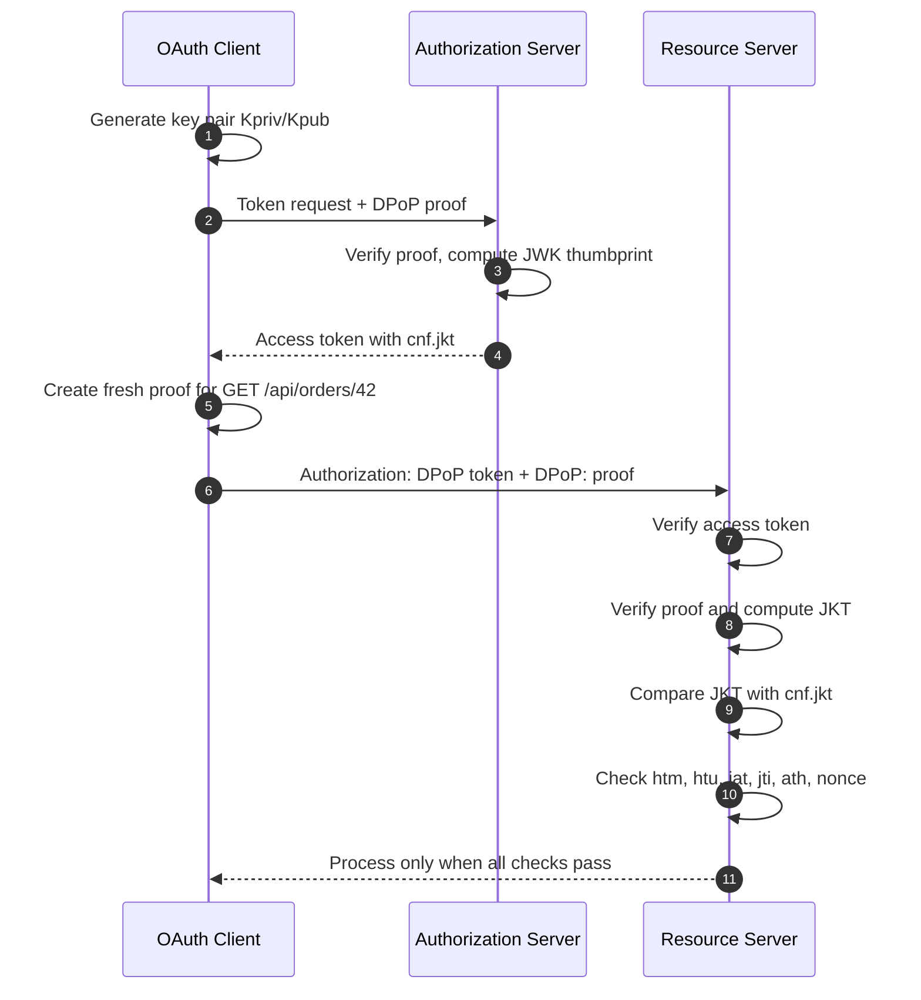

# `cnf`, `jkt`, and Checking That the Key in the Proof Matches the Access Token Binding

In OAuth 2.0, a **Bearer access token** can be used by any party that obtains the token string. If the token leaks through logs, browser storage, a proxy, or a compromised machine, whoever obtains it can replay it from another device while the token remains valid.

**DPoP (Demonstrating Proof of Possession)** reduces replay risk by binding the access token to a client's public key. The Authorization Server places the binding information in the **`cnf`** claim of the access token. With DPoP, the **`cnf.jkt`** subfield contains the JWK thumbprint of the public key. Every request to the Resource Server carries a **DPoP proof JWT** signed with the corresponding private key. The Resource Server verifies the proof, computes the thumbprint of the public JWK inside the proof, and compares it against `cnf.jkt` in the validated access token.

The deciding point is:

```text
JWK thumbprint in the DPoP proof
             |
             | must equal
             v
cnf.jkt in the verified access token
```

If the two values do not match, the client has failed to prove possession of the key bound to the token. The Resource Server must reject the request, even if the access token's signature is valid and its scopes appear sufficient.

This lesson is part of the **Proof-of-Possession Tokens** chapter, focusing on the `cnf` claim, `jkt`, proof structure, JWK thumbprint calculation, signature and request binding checks, replay protection, and how to integrate these principles with Spring Security Resource Server.

> **Illustrative context:** The Orders API runs Spring Security and accepts DPoP-bound access tokens intended for the `orders-api` audience. The client generates its own asymmetric key pair. The Authorization Server binds the access token to that public key using `cnf.jkt`. The client sends the token via `Authorization: DPoP ...` and the proof via the `DPoP` header. Tokens, issuers, and key values in this article are examples; exact DPoP APIs may vary by Spring Security version.

## 1. Why Bind an Access Token to a Key?

### 1.1. Bearer Tokens Allow Any Holder to Use Them

A standard Bearer request:

```http
GET /api/orders/42 HTTP/1.1
Host: api.example.com
Authorization: Bearer ACCESS_TOKEN
```

The Resource Server checks the token. If the token is valid and authorized, the request is processed. The issue with the Bearer model is that **the sender does not have to prove they are the original client**. Anyone who obtains the token can send the same string.

Leak sources can include HTTP/tracing logs, browser storage, misconfigured proxies/gateways, crash dumps, debug output, support systems, or malware on the client device. Short-lived access tokens with strict audience and scopes limit the blast radius, yet a stolen Bearer token can still be replayed.

### 1.2. DPoP Adds Proof of Key Possession

With DPoP, the client generates a key pair:

- **Private key:** kept on the client, used to sign proofs.
- **Public key:** placed in the DPoP proof header as a JWK.

During token issuance, the client proves possession of the private key and the Authorization Server binds the token to the public key. When calling the Resource Server, the client creates a fresh proof for that request.



An attacker who has only the access token without the private key cannot create a valid fresh proof for their requests.

### 1.3. DPoP Does Not Change Permissions Inside the Access Token

DPoP adds **proof of possession**; it does not change the meaning of scopes and audience:

- The access token still defines the resource, issuer, expiration, and permissions.
- `cnf.jkt` binds the token to a public key.
- The DPoP proof proves the client holds the private key and that the proof targets a specific request.
- The Resource Server must still check scopes, tenant, ownership, and business policies.

A token with `SCOPE_orders.read` but without a valid proof must still be rejected. Conversely, a valid proof with a token missing the required scope must not be allowed to read orders.

## 2. What Is the `cnf` Claim?

`cnf` stands for the **confirmation** claim. This claim represents information about the key material or confirmation method the client must prove when using the token. Its general semantics are described in RFC 7800 and related profile/token-binding specifications.

With DPoP, an access token typically contains:

```json
{
  "iss": "https://login.example.com",
  "sub": "customer-42",
  "aud": ["orders-api"],
  "scope": "orders.read",
  "exp": 2000000000,
  "cnf": {
    "jkt": "BASE64URL_SHA256_JWK_THUMBPRINT"
  }
}
```

Where:

- `cnf` is the confirmation object.
- `jkt` is the JWK SHA-256 thumbprint of the public key used to create DPoP proofs.
- The `jkt` value is an unpadded base64url string.
- The Resource Server reads `cnf.jkt` from the **verified access token**, never from an unverified request header or payload.

### 2.1. `cnf.jkt` Is Not `kid`

| Value | Role |
|---|---|
| `kid` | Key identifier used by an issuer/JWK Set to select a key |
| `cnf.jkt` | Thumbprint identifying the public JWK to which the token is bound |
| DPoP proof `jti` | Unique identifier of the proof for replay prevention |
| `ath` | Hash of the access token to which the proof is bound |
| `sub` | Subject of the access token |
| `aud` | Resource/audience permitted to use the token |

`kid` can be arbitrarily named by an issuer and is not necessarily globally unique. `jkt` is computed from the public key components using a standardized algorithm, so it does not depend on issuer-chosen names.

**Never compare `cnf.jkt` with `kid`.** The two values have neither the same semantics nor the same format.

### 2.2. `cnf.jkt` Is Not the Hash of the Entire Proof

A DPoP proof changes on every request: `jti`, `htm`, `htu`, `iat`, and `ath` can all differ. If `cnf.jkt` were computed over the whole proof JWT, it would change on every request and could not bind a token to a stable key.

`jkt` is computed from the **public JWK** located in the proof's protected header. Different proofs signed with the same key produce the exact same JWK thumbprint.

### 2.3. `cnf` Can Take Multiple Forms

For example, with a certificate-bound access token using mTLS:

```json
{
  "cnf": {
    "x5t#S256": "BASE64URL_CERTIFICATE_THUMBPRINT"
  }
}
```

This is a different mechanism from DPoP:

- `cnf.jkt`: binds to a DPoP public JWK.
- `cnf.x5t#S256`: binds to a client certificate thumbprint in mTLS.

Never compare a certificate thumbprint against a JWK thumbprint. Do not assume any token containing an arbitrary `cnf` field is a DPoP token; check the exact confirmation method required by the token profile and policy.

## 3. What Does a DPoP Proof JWT Contain?

A DPoP proof is a JWT with a dedicated structure. Example protected header:

```json
{
  "typ": "dpop+jwt",
  "alg": "ES256",
  "jwk": {
    "kty": "EC",
    "crv": "P-256",
    "x": "PUBLIC_X_COORDINATE",
    "y": "PUBLIC_Y_COORDINATE"
  }
}
```

Payload when sending a request to a Resource Server:

```json
{
  "jti": "proof-id-8d7c2",
  "htm": "GET",
  "htu": "https://api.example.com/api/orders/42",
  "iat": 1999999990,
  "ath": "BASE64URL_SHA256_OF_ACCESS_TOKEN"
}
```

The proof may also contain a `nonce` claim if the server requires a nonce.

| Component | Meaning | Check |
|---|---|---|
| Header `typ` | Proof JWT type | Must be `dpop+jwt` per profile |
| Header `alg` | Signature algorithm | Must be an asymmetric algorithm allowed by policy |
| Header `jwk` | Public key used to verify proof | Valid JWK containing no private key |
| Payload `jti` | Unique identifier of the proof | Must not be replayed within the acceptance window |
| Payload `htm` | HTTP method | Must match the request's method |
| Payload `htu` | HTTP target URI excluding query/fragment | Must match the URI per DPoP rules |
| Payload `iat` | Proof creation timestamp | Must lie within the allowed time window |
| Payload `ath` | Access token hash | Required in proofs used at a Resource Server |
| Payload `nonce` | Server-provided nonce when applicable | Must match the nonce required by the server |

### 3.1. The JWK Header Must Contain Only the Public Key

The DPoP proof carries the public JWK so the Resource Server can verify the proof's signature. For example, an EC public JWK contains only `kty`, `crv`, `x`, and `y`.

Reject private parameters such as `d` for EC/RSA private keys, `p`/`q`/`dp`/`dq`/`qi` for RSA private keys, or symmetric secret `k` where disallowed. Private keys must never be sent in proofs.

### 3.2. The Proof Must Be Signed

A well-formed JSON payload without a valid signature is not proof of key possession. The Resource Server needs to:

1. Parse the protected header within size limits.
2. Check `typ` and `alg`.
3. Read the public JWK.
4. Verify the DPoP proof signature using that public JWK.
5. Compute the JWK thumbprint.
6. Compare the thumbprint against `cnf.jkt` in the verified access token.
7. Verify the claims binding the proof to the request.

Carrying its own public key does not make a proof trustworthy on its own. **The binding to an access token signed by a trusted issuer** is what confirms this key is the one required by the token.

## 4. How Are the JWK Thumbprint and `cnf.jkt` Calculated?

DPoP uses the **JWK Thumbprint** defined in RFC 7638. Do not hash an arbitrary JWK JSON object, because field ordering, whitespace, or metadata such as `kid`/`use` can vary even for the same public key.

General algorithm:

1. Identify the key type and the required members needed to represent the public key.
2. Build a canonical JSON object containing only those required members per RFC 7638.
3. Sort the member names lexicographically per standard rules.
4. Encode the canonical string as UTF-8.
5. Compute SHA-256.
6. Base64URL-encode the result **without padding**.

### 4.1. EC P-256 Example

Public JWK:

```json
{
  "kty": "EC",
  "crv": "P-256",
  "x": "f83OJ3D2xF4...",
  "y": "x_FEzRu9M..."
}
```

Canonical string per RFC 7638 containing only required members:

```json
{"crv":"P-256","kty":"EC","x":"f83OJ3D2xF4...","y":"x_FEzRu9M..."}
```

The coordinate values are truncated for illustration and are not a real key. The SHA-256 digest of the canonical JSON's UTF-8 bytes is then Base64URL-encoded without padding.

### 4.2. RSA Example

Public RSA JWK:

```json
{
  "kty": "RSA",
  "n": "PUBLIC_MODULUS",
  "e": "AQAB",
  "kid": "signing-key-1",
  "use": "sig",
  "alg": "RS256"
}
```

The required members in the canonical JSON for RSA are `e`, `kty`, and `n`:

```json
{"e":"AQAB","kty":"RSA","n":"PUBLIC_MODULUS"}
```

`kid`, `use`, and `alg` do not participate in the JWK thumbprint under RFC 7638's required-member set for RSA.

### 4.3. Why Not Hash the Raw `jwk` Header Directly?

Two JSON documents can represent the exact same public key despite differing field order and metadata. Hashing the raw JSON would yield different digests. JWK thumbprint canonicalization relies strictly on **the essential public members**, yielding a stable key identifier.

### 4.4. Thumbprint Calculation Pseudocode

```text
jwkThumbprint(jwk):
    if jwk.kty == "EC":
        canonical = JSON with only:
            crv, kty, x, y
        in canonical member order
    else if jwk.kty == "RSA":
        canonical = JSON with only:
            e, kty, n
    else:
        reject unless this key type is explicitly supported

    digest = SHA-256(UTF8(canonical))
    return BASE64URL_ENCODE_WITHOUT_PADDING(digest)
```

Do not blindly support every key type by hashing the entire object. If the system requires OKP/EdDSA, implement the exact required-member set per RFC 7638 and constrain algorithms appropriately. Never accept unfamiliar JWKs merely because a library can parse them.

## 5. Checking That the Proof Key Matches `cnf.jkt` in the Access Token

Suppose the verified access token contains:

```json
{
  "iss": "https://login.example.com",
  "aud": ["orders-api"],
  "scope": "orders.read",
  "cnf": {
    "jkt": "THUMBPRINT_A"
  }
}
```

The accompanying DPoP proof carries a public JWK whose computed thumbprint is `THUMBPRINT_A`. In that case, the proof key matches the binding.

If an attacker uses a different key, the thumbprint is `THUMBPRINT_B`:

```text
Access token:
    cnf.jkt = THUMBPRINT_A

DPoP proof:
    thumbprint(header.jwk) = THUMBPRINT_B

THUMBPRINT_A != THUMBPRINT_B
    => reject request
```

### 5.1. Verification Order

A clear pipeline:

1. Validate the access token using the configured Resource Server mechanism.
2. Read `cnf.jkt` from the verified token's claims/metadata.
3. Verify the DPoP proof signature using the public JWK inside the proof.
4. Compute the JWK thumbprint from the exact public JWK used to verify the proof.
5. Compare the thumbprint with `cnf.jkt`.
6. Verify `htm`, `htu`, `iat`, `jti`, `ath`, and `nonce`.
7. Record the proof ID atomically in the replay cache.
8. Only then pass the request to authorization and controllers.

You may parse/check certain proof fields earlier to fail fast on malformed input, but **never treat a request as authenticated** until all access-token and proof checks succeed.

### 5.2. Never Read `cnf` from an Unverified Token

A JWT payload can be decoded without verification. An attacker could alter the `cnf` claim to point to their own key. If the Resource Server reads `cnf.jkt` from an unverified payload, the attacker can forge both access token claims and the proof key at will.

- JWT: read `cnf` only after signature, issuer, audience, expiration, and other validators succeed.
- Opaque token: read `cnf` only from a trusted introspection response where `active=true`.
- Never use caller-supplied headers/query parameters in place of the confirmation claim.
- Never trust `cnf` metadata from endpoints outside the AS trust configuration.

### 5.3. Constant-Time Comparison

While a thumbprint is not a secret like a password, binding comparisons should still use an appropriate constant-time comparison utility. You can decode Base64URL to bytes and use a constant-time equality utility.

Do not compare strings after trimming, lowercasing, or non-standard normalization. Base64URL thumbprints must be handled strictly according to their defined encoding.

## 6. Checking `htm` and `htu` So the Proof Applies to the Right Request

Proving possession of the private key is not enough. The proof must be bound to the **specific HTTP request**.

### 6.1. `htm`: HTTP Method

If the actual request is:

```http
GET /api/orders/42 HTTP/1.1
```

the proof must contain:

```json
{
  "htm": "GET"
}
```

If an attacker takes a proof from a GET request and reuses it for a POST request, the method mismatches and the proof is rejected.

### 6.2. `htu`: HTTP Target URI

The proof must contain the target URI per DPoP, stripping query and fragment. For example, for the request:

```text
https://api.example.com/api/orders/42?expand=items#section
```

the corresponding `htu` value omitting query and fragment is:

```text
https://api.example.com/api/orders/42
```

Do not arbitrarily drop the scheme, host, or path. The Resource Server must construct the target URI accurately from the request it received according to DPoP rules.

### 6.3. Reverse Proxies Can Distort `htu`

A deployment setup:

```text
Client
  -> https://api.example.com/api/orders/42
  -> ingress terminates TLS
  -> http://orders-service:8080/internal/orders/42
```

The backend observes an internal URI that differs from the URI the client called. If the backend directly uses its local scheme/host/path to compare against `htu`, valid proofs will be rejected. Worse, if the backend trusts client-supplied `X-Forwarded-Host` or `Forwarded` headers, an attacker can control the URI used for verification.

You need to:

- Identify the exact public/external URI that the DPoP client called.
- Trust forwarded headers only from authenticated proxies configured as trusted.
- Have the ingress strip client-sent forwarded headers and regenerate them itself.
- Keep path rewriting and URI reconstruction synchronized between gateway and backend.
- Never take an arbitrary hostname from a header to construct the verification URI.
- Test DPoP through the actual production proxy/ingress topology.

### 6.4. Do Not Normalize URIs Arbitrarily

HTTP vs. HTTPS scheme, hostname/port, path encoding, context path, reverse-proxy prefixes, and redirects can all affect matching. Match URIs according to DPoP rules and how your framework builds external request URIs. Never write an ad-hoc "strip slashes, lowercase everything" helper just to make proofs match.

## 7. `ath`: The Proof Must Bind to the Exact Access Token

When a DPoP proof is used at a **Resource Server**, the payload must contain `ath`, which is the hash of the access token sent in the request.

Example request:

```http
GET /api/orders/42 HTTP/1.1
Authorization: DPoP ACCESS_TOKEN
DPoP: DPOP_PROOF_JWT
```

The client computes:

```text
ath = BASE64URL_NO_PADDING(
        SHA-256(
            ASCII(access_token)
      ))
```

The Resource Server recomputes it from **the exact access token in the Authorization header** and compares it against `ath` in the proof.

### 7.1. Why Is `ath` Needed?

If a proof is bound only to the key, method, and URI without binding to the token, it is not tied to the request's exact access token. `ath` prevents using that proof together with a different access token.

### 7.2. Calculating It in Java

```java
import java.nio.charset.StandardCharsets;
import java.security.MessageDigest;
import java.security.NoSuchAlgorithmException;
import java.util.Base64;

public final class DpopAccessTokenHash {

    private DpopAccessTokenHash() {
    }

    public static String calculate(String accessToken) {
        try {
            MessageDigest sha256 =
                MessageDigest.getInstance("SHA-256");

            byte[] digest = sha256.digest(
                accessToken.getBytes(StandardCharsets.US_ASCII)
            );

            return Base64.getUrlEncoder()
                .withoutPadding()
                .encodeToString(digest);
        } catch (NoSuchAlgorithmException ex) {
            throw new IllegalStateException(
                "SHA-256 is unavailable",
                ex
            );
        }
    }
}
```

This code illustrates how to calculate `ath`; it does not by itself verify the proof or access token. Do not hash a trimmed string, a decoded JWT payload, or only the payload segment.

### 7.3. Do Not Confuse `ath` with `jkt`

| Claim | Hash of What? | Purpose |
|---|---|---|
| `ath` | Exact access token string | Binds the proof to the token in the request |
| `jkt` | Public JWK per RFC 7638 | Binds the token to the key pair |
| `jti` | Proof identifier | Prevents replay |

Both `ath` and `jkt` look like base64url strings, but their inputs and semantics are completely different.

### 7.4. Token Endpoint and Resource Server Differ

At the token endpoint, the client may send a DPoP proof to prove key possession when requesting a token. At that time, no newly issued access token exists to put into `ath` as when calling a Resource Server. When using a DPoP-bound access token at a Resource Server, the proof must bind to the access token via `ath` per RFC 9449.

Do not use a single proof template for every endpoint while ignoring claim requirements at each protocol stage.

## 8. `iat`, `jti`, and Replay Protection

### 8.1. `iat`: Proof Creation Time

The Resource Server must limit proof age. If old proofs were accepted indefinitely, an attacker could store a captured proof and replay it later.

```text
now = current server time
iat = proof issuance time

accept only if:
    now - allowed_past_skew <= iat
    iat <= now + allowed_future_skew
```

The exact interval depends on the system, clock synchronization, and policy; never choose an overly wide window just to reduce client errors.

### 8.2. `jti`: Unique Identifier of the Proof

Each proof requires a unique `jti`. The Resource Server records used proof IDs in a replay cache with a TTL matching the acceptance window.

Cache keys should be namespaced by key thumbprint:

```text
replay-cache-key = (jkt, jti)
```

Using `jti` alone risks collisions across independent clients. If `jti` is not stored/checked, an attacker can replay the same proof while it remains valid.

### 8.3. Atomic Insert Is Mandatory

Unsafe logic:

```text
if cache does not contain jti:
    process request
    cache.put(jti)
```

Two concurrent requests can both check the cache before either writes to it, and both get accepted.

An atomic **put-if-absent** operation is required:

```text
if atomicPutIfAbsent((jkt, jti), expiresAt):
    accept proof
else:
    reject replay
```

In a multi-pod cluster, the replay cache must be shared/synchronized or backed by an appropriate distributed anti-replay mechanism. A per-pod in-memory cache does not stop an attacker from sending the same proof to another pod.

### 8.4. Recording `jti` at the Right Time

A pipeline might:

1. Validate proof structure and size limits.
2. Verify the proof signature.
3. Check `htm`/`htu`/`iat`/`ath`/`nonce`.
4. Verify the thumbprint matches `cnf.jkt`.
5. Atomically claim `jti` in the replay store.
6. Proceed to authorization.

Recording too early allows invalid proofs to occupy IDs or cause denial-of-service. Recording too late after the controller runs allows concurrent reuse of the same proof. Place the replay claim in the authentication step before authorization/controllers.

### 8.5. The Replay Cache Needs Resource Limits

The TTL must not exceed the window during which a proof can be accepted; bound cache size and eviction; prevent attackers from creating unbounded cache keys via abnormally long `jti` strings; bound proof/JWK sizes; and monitor replay rates with low-cardinality metrics. If the replay store is unavailable and anti-replay cannot be guaranteed, policy should fail closed for DPoP-bound endpoints.

## 9. Nonces: Preventing Pre-Generated Proofs

DPoP can use server-provided nonces. The Resource Server or Authorization Server returns a nonce in a response header, and the client must include that nonce in its next proof.

Example response:

```http
HTTP/1.1 401 Unauthorized
WWW-Authenticate: DPoP error="use_dpop_nonce"
DPoP-Nonce: SERVER_NONCE_VALUE
```

The client builds a new proof:

```json
{
  "jti": "new-proof-id",
  "htm": "GET",
  "htu": "https://api.example.com/api/orders/42",
  "iat": 2000000000,
  "ath": "ACCESS_TOKEN_HASH",
  "nonce": "SERVER_NONCE_VALUE"
}
```

### 9.1. Nonces Do Not Replace Signatures or `jkt`

A nonce is a challenge enabling the server to control freshness/request creation. It does not prove on its own that the client holds the key. The Resource Server must still verify the proof signature, compute and match `jkt`, and check `ath`, `htm`/`htu`, `iat`, and `jti`.

### 9.2. Nonces Must Be Tied to Server Context

When a server issues nonces, define whether a nonce is single-use or reusable within a TTL, which resource/server it applies to, whether it is bound to a key thumbprint or session context, its lifetime, and how it is synchronized across multiple instances.

Never accept a nonce from another host or trust a caller-supplied nonce as a challenge. Never use an unbounded global nonce.

### 9.3. Clients Must Generate a New Proof on Retry

Upon receiving `use_dpop_nonce`, the client must not resend the exact old proof. It must create a fresh proof with a new `jti`, current `iat`, and the server-supplied nonce; request and token claims must match the new attempt.

## 10. Token Response and How Clients Use DPoP

When the Authorization Server accepts a DPoP proof at the token endpoint and issues a key-bound token, the response may contain:

```http
HTTP/1.1 200 OK
Content-Type: application/json
Cache-Control: no-store
Pragma: no-cache

{
  "access_token": "ACCESS_TOKEN_BOUND_TO_KEY",
  "token_type": "DPoP",
  "expires_in": 600,
  "scope": "orders.read"
}
```

The client must handle `token_type` `DPoP` per contract. When calling the Resource Server:

```http
GET /api/orders/42 HTTP/1.1
Host: api.example.com
Authorization: DPoP ACCESS_TOKEN_BOUND_TO_KEY
DPoP: SIGNED_DPOP_PROOF
```

Do not send a DPoP-bound access token using the Bearer scheme and expect the server to infer a proof. The authorization scheme and proof header are part of the protocol.

### 10.1. Clients Generate a Dedicated Proof for Each Request

Each HTTP request needs a proof matching its method, target URI, access token, timestamp, proof ID, and nonce if required. Never cache a single DPoP proof for reuse across multiple requests. An old proof may have the wrong method/URI/token or be rejected by replay detection.

### 10.2. Clients Must Keep the Private Key Secure

Native apps can use the OS keystore/keychain; BFF/server-side clients can use an HSM/KMS or secure key store; browser apps need a threat model covering XSS and signing APIs. Never serialize private JWKs into logs or unprotected local files. Maintain key rotation and token re-issuance procedures.

## 11. JWT Access Tokens: Reading `cnf.jkt` from Verified Claims

For JWT access tokens, the Resource Server typically has a decoder that checks signature, issuer, audience, and timestamps. Only afterward does it read:

```json
{
  "cnf": {
    "jkt": "EXPECTED_THUMBPRINT"
  }
}
```

Flow:

```text
Incoming DPoP access token
    |
    v
JWT decoder
    |
    +-- signature invalid -> reject
    +-- issuer invalid -> reject
    +-- audience invalid -> reject
    +-- exp/nbf invalid -> reject
    |
    v
Verified Jwt
    |
    v
Read cnf.jkt
    |
    v
Verify DPoP proof and compare proof JWK thumbprint
    |
    v
Authentication accepted
```

### 11.1. Never Let the Proof Replace Access-Token Verification

A proof signature may be valid while the access token was issued by an untrusted issuer, is expired, has the wrong audience, lacks the needed scope, or has been revoked by policy. DPoP does not verify those properties in place of the decoder.

### 11.2. Tokens Without `cnf.jkt`

If an endpoint is configured to **accept only DPoP-bound tokens**, a token missing `cnf.jkt` must be rejected. Never automatically treat it as a Bearer token.

| Access token | Authorization scheme | Proof | Behavior |
|---|---|---|---|
| Bearer token without `cnf` | Bearer | None | May authenticate under Bearer policy |
| DPoP-bound token with `cnf.jkt` | DPoP | Matching | Authenticates if all checks pass |
| DPoP-bound token with `cnf.jkt` | DPoP | Missing | Reject |
| DPoP-bound token with `cnf.jkt` | DPoP | Different JKT | Reject |
| DPoP-bound token | Bearer | Any | Reject per DPoP binding |
| Unbound token | DPoP | Any proof | Do not promote to DPoP-bound |
| Token with invalid signature | DPoP | Valid proof | Reject |
| Valid token, missing scope | DPoP | Valid proof | Authentication may pass; authorization rejects |

## 12. Opaque Access Tokens: `cnf` Can Come from Introspection

For opaque tokens, the Resource Server queries the Authorization Server via introspection. Depending on the provider contract, the response may contain:

```json
{
  "active": true,
  "scope": "orders.read",
  "client_id": "orders-client",
  "sub": "customer-42",
  "aud": ["orders-api"],
  "cnf": {
    "jkt": "EXPECTED_THUMBPRINT"
  }
}
```

Here, `cnf.jkt` must come from a **trusted introspection response**. The Resource Server uses it only after the response is processed and `active` is confirmed.

### 12.1. Opaque + DPoP Flow

```text
Authorization: DPoP opaque-access-token
DPoP: proof JWT
        |
        v
Extract token and proof
        |
        v
Opaque token introspection
        |
        +-- active=false/error -> reject
        |
        v
Trusted principal + cnf.jkt
        |
        v
Verify DPoP proof, calculate jkt
        |
        v
Compare jkt + request claims + replay
        |
        v
Authorization
```

Never extract `cnf` from the opaque token string or a custom request header. If the AS does not return confirmation metadata and the contract provides no other trusted way to obtain the binding, the Resource Server cannot properly verify DPoP binding.

### 12.2. Introspection Caching Affects Revocation and Binding

If the Resource Server caches introspection results, it may retain a stale `cnf.jkt` for the duration of the TTL. Cache active results only for a TTL aligned with revocation policy; never mix metadata across different issuers/clients/audiences; keep the DPoP replay cache separate from the introspection cache; and ensure invalidation/TTL reflects revocation SLAs.

## 13. DPoP and mTLS: Two Different Forms of Proof of Possession

| Characteristic | DPoP | mTLS certificate-bound token |
|---|---|---|
| Key material | Client-side asymmetric JWK | Client TLS certificate/private key |
| Binding claim | `cnf.jkt` | Typically `cnf.x5t#S256` |
| Proof | Per-request DPoP JWT | TLS client certificate in handshake |
| Request header | `DPoP` + DPoP Authorization scheme | No DPoP proof header needed |
| Binding validation | Proof JWK thumbprint matches `jkt` | Certificate thumbprint matches `cnf` |
| Processing layer | Application/protocol layer | TLS/mTLS layer and token validation |

Never use `cnf.jkt` to validate a certificate. Never treat a TLS connection carrying a client certificate as proof that a DPoP proof is valid.

### 13.1. DPoP Still Requires TLS

DPoP does not replace HTTPS. TLS still protects the confidentiality/integrity of tokens and proofs in transit while authenticating the server. DPoP adds an application-layer sender constraint; it does not permit sending access tokens in plaintext.

### 13.2. DPoP Does Not Replace Authorization

Even when the key proof matches, scopes may be missing, the audience may be wrong, the tenant may mismatch, the user may not own the resource, or business state may forbid the operation. Proof of possession proves **the ability to use the corresponding private key**, not that the key holder has business permissions.

## 14. Handling Tokens and Proofs Across Multiple Tenants

A multi-tenant Resource Server may receive tokens bound to different keys per issuer/client:

```text
Tenant Acme:
  issuer = https://id.acme.example
  token.cnf.jkt = JKT_A

Tenant Beta:
  issuer = https://id.beta.example
  token.cnf.jkt = JKT_B
```

The Resource Server must select the issuer manager from a trusted registry, validate the access token for the right issuer/audience, read `cnf.jkt` from the verified token, verify the proof's public key and compute its thumbprint, compare the binding, and then check the tenant claim/membership and object policy.

Never select an issuer, JWKS URL, or tenant trust solely from `jkt`. JKT is a key thumbprint, not a tenant identity or issuer URL.

### 14.1. Sharing the Same Key Across Multiple Tenants Can Blur Boundaries

If the same public key is used across multiple tenants, `jkt` may be identical across tokens. That does not grant cross-tenant permissions by itself, but it makes key possession non-distinguishing across tenants.

If policy requires isolating devices/tenants, the AS/client can create separate key pairs per tenant or authorization context. Even if keys are shared, the Resource Server must still check issuer, audience, and tenant binding.

## 15. Spring Security Resource Server: Where to Integrate DPoP

Spring Security provides foundations for access token authentication, yet **built-in DPoP support and API names depend on the exact version**. Do not assume every Spring Security 6.x release validates DPoP proofs simply by enabling `oauth2ResourceServer().jwt()`.

When using a version with official DPoP Resource Server support, prefer that version's native configuration and APIs. When the current version does not provide full built-in support, integrate a dedicated DPoP component inside the security chain, ensuring it executes before authorization/controllers and coordinates properly with access-token authentication.

### 15.1. Do Not Just Add a Controller Interceptor

A controller-level interceptor can miss functional WebFlux routes, certain error/async dispatches, handlers that bypass standard controllers, or requests processed before the interceptor runs.

DPoP is a request authentication requirement, so it must be enforced at the **security filter/authentication layer** or via native Resource Server support, not scattered manually across controllers.

### 15.2. Conceptual Integration Model

```text
HTTP request
  |
  +-- Extract DPoP Authorization token + DPoP proof
  |
  v
Standard access-token authentication
  |
  +-- JwtDecoder / OpaqueTokenIntrospector
  |
  v
Verified principal with cnf.jkt
  |
  v
DPoP proof validator
  |
  +-- typ / alg / public jwk
  +-- proof signature
  +-- JWK thumbprint == cnf.jkt
  +-- htm / htu / iat / jti / ath / nonce
  +-- replay cache atomic claim
  |
  v
Authentication accepted
  |
  v
Authorization (scope, tenant, resource)
  |
  v
Controller / Handler
```

This is a logical architecture, not fixed API names. When using built-in support, confirm the implementation checks **both token binding and proof request claims/replay**, not just parsing the `DPoP` header.

### 15.3. Authentication Requests Should Carry Full Context

A conceptual request model:

```java
public record DpopRequestCredentials(
    String accessToken,
    String dpopProof,
    String httpMethod,
    String externalRequestUri
) {}
```

This is an illustrative DTO, not a built-in Spring Security class. Enforce size limits on tokens/proofs and derive the external URI only from a trusted request/proxy context.

### 15.4. Validator Receives the Verified Access Token

```java
public interface DpopProofValidator {

    Mono<DpopProofResult> validate(
        VerifiedAccessToken accessToken,
        String proofJwt,
        HttpRequestBinding request
    );
}
```

`VerifiedAccessToken`, `DpopProofResult`, and `HttpRequestBinding` are illustrative application models. The validator **receives the already-verified token** and request context, and returns the proof result; never rely on unverified claims.

## 16. DPoP Proof Verification Pseudocode

```text
validateDpop(accessToken, proofJwt, request):

    verifiedToken = authenticateAccessToken(accessToken)

    expectedJkt = verifiedToken.claim("cnf").claim("jkt")
    if expectedJkt is absent:
        reject if endpoint requires DPoP-bound tokens

    proof = parseJwtWithSizeLimit(proofJwt)

    require proof.header.typ == "dpop+jwt"
    require proof.header.alg is asymmetric and allowed
    require proof.header.jwk is valid public JWK
    reject private key parameters

    verify proof signature using proof.header.jwk

    actualJkt = RFC7638Thumbprint(proof.header.jwk)
    require constantTimeEqual(actualJkt, expectedJkt)

    require proof.htm == request.method
    require proof.htu == externalTargetUriWithoutQueryOrFragment
    require proof.iat within allowed time window
    require proof.jti is present and bounded
    require proof.ath == BASE64URL(SHA256(ASCII(accessToken)))

    if server requires nonce:
        require proof.nonce is valid for this server/context

    require atomicReplayStore.putIfAbsent(actualJkt, proof.jti)

    return authenticated request
```

**Order may be optimized**, but mandatory validation steps must never be skipped. Both token authentication and proof validation must succeed before a request is treated as authenticated.

### 16.1. Do Not Use the Public JWK Before Checking Key Type

A parser may accept a JWK that is valid JSON yet violates DPoP policy. Check that `kty` is permitted, `alg` is asymmetric and on the allowlist, the JWK has all required public parameters, no private parameters are present, key size/curve matches policy, and the signature verifies.

Never let the token header select an arbitrary algorithm outside the allowlist.

### 16.2. Do Not Only Match `jkt`

A proof with the right public key where `htm` is POST on a GET request, `htu` points to another endpoint, `ath` hashes a different token, `iat` is too old, `jti` was already used, or `nonce` is wrong must still be rejected. A JKT match is necessary, not the entirety of DPoP validation.

## 17. Example Java Code Structure for Proof Validation

The following snippets form a **design skeleton**, not a production-ready implementation to copy verbatim. They illustrate how to separate thumbprint logic, request binding, replay storage, and token binding. JWT parsing/verification should use a proven JOSE library and version-appropriate APIs.

### 17.1. Parsed and Signature-Verified Proof Model

```java
import java.time.Instant;
import java.util.Map;

public record VerifiedDpopProof(
    String thumbprint,
    String jti,
    String httpMethod,
    String httpUri,
    Instant issuedAt,
    String accessTokenHash,
    String nonce,
    Map<String, Object> publicJwk
) {}
```

The name `VerifiedDpopProof` indicates an object whose proof signature has already been verified by a parser/JOSE verifier. Never construct this object merely by decoding a JWT payload.

### 17.2. Request Binding

```java
public record HttpRequestBinding(
    String method,
    String externalUriWithoutQueryAndFragment
) {}
```

`externalUriWithoutQueryAndFragment` must be constructed from the actual request URI called by the client, following DPoP rules and trusted proxy configuration. Never read it directly from an arbitrary header.

### 17.3. Replay Store Contract

```java
import java.time.Instant;

public interface DpopReplayStore {

    /**
     * Atomically records (jkt, jti) if it has not been seen.
     *
     * @return true only for the first successful claim
     */
    boolean claimOnce(
        String jkt,
        String jti,
        Instant expiresAt
    );
}
```

A production implementation can use Redis or a datastore supporting atomic set-if-absent with TTL. The interface must guarantee **atomicity across the entire Resource Server cluster**, not just within a single JVM.

### 17.4. Conceptual Validator Logic

```java
import java.time.Clock;
import java.time.Duration;
import java.time.Instant;
import java.util.Objects;

public final class DpopBindingPolicy {

    private final Clock clock;
    private final Duration maxProofAge;
    private final Duration allowedFutureSkew;
    private final DpopReplayStore replayStore;

    public DpopBindingPolicy(
            Clock clock,
            Duration maxProofAge,
            Duration allowedFutureSkew,
            DpopReplayStore replayStore) {
        this.clock = clock;
        this.maxProofAge = maxProofAge;
        this.allowedFutureSkew = allowedFutureSkew;
        this.replayStore = replayStore;
    }

    public void validate(
            String expectedJkt,
            String expectedAth,
            HttpRequestBinding request,
            VerifiedDpopProof proof) {

        if (expectedJkt == null || expectedJkt.isBlank()) {
            throw new DpopValidationException(
                "Access token is not DPoP-bound"
            );
        }

        if (!constantTimeTextEquals(
                expectedJkt,
                proof.thumbprint())) {
            throw new DpopValidationException(
                "DPoP key does not match token binding"
            );
        }

        if (!Objects.equals(
                request.method(),
                proof.httpMethod())) {
            throw new DpopValidationException(
                "DPoP htm does not match request method"
            );
        }

        if (!Objects.equals(
                request.externalUriWithoutQueryAndFragment(),
                proof.httpUri())) {
            throw new DpopValidationException(
                "DPoP htu does not match request URI"
            );
        }

        if (!Objects.equals(
                expectedAth,
                proof.accessTokenHash())) {
            throw new DpopValidationException(
                "DPoP ath does not match access token"
            );
        }

        Instant now = clock.instant();
        Instant earliest = now.minus(maxProofAge);
        Instant latest = now.plus(allowedFutureSkew);

        if (proof.issuedAt().isBefore(earliest)
                || proof.issuedAt().isAfter(latest)) {
            throw new DpopValidationException(
                "DPoP proof is outside the accepted time window"
            );
        }

        Instant expiresAt =
            proof.issuedAt().plus(maxProofAge);

        if (!replayStore.claimOnce(
                proof.thumbprint(),
                proof.jti(),
                expiresAt)) {
            throw new DpopValidationException(
                "DPoP proof replay detected"
            );
        }
    }

    private static boolean constantTimeTextEquals(
            String left,
            String right) {
        if (left == null || right == null) {
            return false;
        }

        byte[] a = left.getBytes(java.nio.charset.StandardCharsets.US_ASCII);
        byte[] b = right.getBytes(java.nio.charset.StandardCharsets.US_ASCII);

        return java.security.MessageDigest.isEqual(a, b);
    }
}
```

`DpopValidationException` is an application exception that must be defined and mapped properly to a DPoP authentication error. The example assumes `VerifiedDpopProof` has already passed JOSE signature, header, JWK, and nonce validation. It **does not replace** those steps.

### 17.5. Remaining Checks Belong in the Parser/JOSE Layer

Before calling `DpopBindingPolicy`, the implementation must parse the protected header within size bounds, require `typ=dpop+jwt`, enforce asymmetric algorithms, confirm a public-only JWK, verify the proof signature, compute the RFC 7638 thumbprint, check `jti` and `iat`, validate nonces if enabled, reject duplicate DPoP headers, and map parser errors with accurate semantics.

## 18. Spring Security Servlet: Preserving Token Authentication and Adding DPoP Proofs

In the Servlet stack, Resource Server typically uses `BearerTokenResolver`, `BearerTokenAuthenticationFilter`, an `AuthenticationManager`/provider, and `JwtDecoder` or `OpaqueTokenIntrospector`.

DPoP-bound access tokens require a processing path that accepts **both the access token and the proof**. Simply using a resolver to extract the token while discarding the `DPoP` header is insufficient.

### 18.1. Authentication Requests Must Carry Both Related Credentials

A dedicated request converter/filter can read:

```http
Authorization: DPoP ACCESS_TOKEN
DPoP: PROOF_JWT
```

It must preserve the raw access token and proof in an unauthenticated authentication request. Do not populate principal/authorities on that request.

### 18.2. Authentication Provider Coordinates Both Validators

```text
DpopAuthenticationProvider
    |
    +-- delegate access token authentication
    |      +-- JwtDecoder / Opaque introspector
    |      +-- issuer, audience, exp, active, scope metadata
    |
    +-- DPoP proof validation
           +-- verify proof signature
           +-- compute JKT
           +-- compare token cnf.jkt
           +-- htm / htu / iat / jti / ath / nonce
           +-- replay store
    |
    v
Authenticated principal
```

The provider returns an `Authentication` only when **both the access token and the proof are valid**. If the delegated access-token provider fails, do not proceed as an unbound Bearer token.

### 18.3. Do Not Add a Second Independent Bearer Filter

Placing a custom DPoP filter alongside the default Resource Server filter can cause the token to be verified twice, one filter accepting Bearer while the other requires DPoP, the SecurityContext being overwritten, or authorization running before the proof is checked.

The design needs a unified authentication path for DPoP-bound tokens or the native DPoP support of your Spring Security version.

### 18.4. Built-In APIs Vary by Version

Before writing a custom provider, verify whether your exact Spring Security version includes built-in DPoP Resource Server support. If so, prefer native configuration. If not, any custom integration must be reviewed and tested against RFC 9449. **Never assume** a default JWT Resource Server configuration performs `cnf.jkt`/DPoP proof matching on its own.

## 19. Spring Security WebFlux: Handling Proofs in a Reactive Chain

In WebFlux, the main building blocks are `SecurityWebFilterChain`, `ServerAuthenticationConverter`, `AuthenticationWebFilter`, `ReactiveAuthenticationManager`, `ReactiveJwtDecoder` or `ReactiveOpaqueTokenIntrospector`, and `ReactiveSecurityContextHolder`.

DPoP validation must execute inside the reactive pipeline before authorization.

### 19.1. Conceptual Reactive Flow

```text
ServerWebExchange
    |
    v
DPoP authentication converter
    +-- Authorization: DPoP token
    +-- DPoP: proof
    +-- method + trusted external URI
    |
    v
ReactiveAuthenticationManager
    +-- authenticate access token
    +-- verify DPoP proof
    +-- compare proof JKT with cnf.jkt
    +-- replay store (nonblocking)
    |
    v
Mono<Authentication>
    |
    v
Reactor SecurityContext
    |
    v
authorizeExchange / reactive method security
```

### 19.2. A Reactive Replay Store Must Be Non-Blocking

Never execute blocking Redis/JDBC calls directly on the Netty event loop. Use a reactive datastore or an integration with explicit scheduling/concurrency design. If the replay store is unavailable and anti-replay cannot be guaranteed, policy should fail closed for DPoP-bound endpoints.

Never write `Mono.just(replayStore.claimOnce(...))` if `claimOnce` performs a blocking network call before creating the Mono; the operation already runs synchronously when the method is called.

### 19.3. Never Use `ThreadLocal` to Hold Proof State

Proofs, access tokens, and request bindings must travel inside per-request objects/pipeline context. Never place them in static fields, mutable singletons, or shared `ThreadLocal`s; doing so can mix requests and leak credentials.

## 20. Error Responses and DPoP Challenges

DPoP has distinct error semantics. Conditions can trigger token/proof errors, replay rejections, nonce refresh challenges, or rejections when a token is not presented with the DPoP scheme.

Example nonce challenge:

```http
HTTP/1.1 401 Unauthorized
WWW-Authenticate: DPoP error="use_dpop_nonce"
DPoP-Nonce: NEXT_NONCE
Cache-Control: no-store
```

An invalid proof can trigger a challenge:

```http
HTTP/1.1 401 Unauthorized
WWW-Authenticate: DPoP error="invalid_dpop_proof"
```

The exact structure depends on the error condition and RFC 9449. Never turn every DPoP error into `403 insufficient_scope`, because proof errors belong to authentication.

| Scenario | Layer | Typical Result |
|---|---|---|
| Access token invalid signature/expired | Access token authentication | 401 invalid_token |
| Missing DPoP proof for bound token | DPoP authentication | 401/proof error |
| Invalid proof signature | DPoP authentication | 401 invalid_dpop_proof |
| JKT differs from `cnf.jkt` | DPoP binding | Reject authentication |
| `htm`/`htu` mismatch | Request binding | Reject proof |
| Wrong `ath` hash | Token-proof binding | Reject proof |
| `jti` replay | Anti-replay | Reject proof |
| Nonce needs refresh | Nonce policy | `use_dpop_nonce` challenge |
| Valid token/proof, missing scope | Authorization | 403 insufficient_scope |
| Valid token/proof, wrong tenant/owner | Domain authorization | 403/404 per policy |

DPoP is an API authentication mechanism. The Resource Server should not convert proof errors into `302 /login`. The client must understand DPoP challenges and create a fresh proof or manage access-token state per OAuth client policy.

## 21. Key Lifecycle: Creation, Storage, Rotation, and Loss

### 21.1. Keys Must Be Created on the Client Side

The client generates the key pair using an algorithm accepted by the AS. The public key is sent via the DPoP proof; the private key stays on the client.

Never let the Resource Server generate keys on the client's behalf or inject `cnf.jkt` into a token after issuance. The binding must be issued by the AS in the token response per protocol.

### 21.2. Lost Private Key

If a client loses its private key, it can no longer generate proofs matching the current access token's `cnf.jkt`. That token must not be reused as a Bearer token to "rescue" the session.

The client must run a new token-issuance flow with a new key per AS policy. If the refresh token is also bound to the old key, refreshing with a new key may be rejected; reauthorization or an AS-supported key recovery flow is required.

### 21.3. Key Rotation

When switching from key A to key B:

```text
Token T1:
  cnf.jkt = JKT_A

Proof signed by key B:
  proof.jkt = JKT_B

JKT_A != JKT_B
  => T1 can no longer be used with key B
```

The client must obtain a new token bound to key B. Never alter the `cnf` claim client-side or swap the public key in the proof arbitrarily to force a match.

### 21.4. Token Renewal / Refresh

If the AS supports refresh tokens bound to a DPoP key, the client must prove possession of the key per policy when refreshing. Key retention and refresh tokens must remain consistent. Rotating the DPoP key may require a fresh grant or an AS-supported re-binding mechanism; never assume a refresh token can silently switch to a new key.

### 21.5. One Key per User, Device, or Session?

Per-device keys isolate device loss; per-installation keys allow revoking a single installation; per-session keys narrow token-binding scope at higher management cost. Never embed a single shared private key in a mobile/SPA bundle across all users. If all installations share one key, an attacker extracting the key from one installation can forge proofs for many tokens sharing that binding.

## 22. DPoP Across Client Types

### 22.1. Native Mobile

Generate a dedicated key pair per app installation/device, use the OS keystore/keychain where appropriate, avoid exporting the private key unnecessarily, send a fresh proof on every request, and plan for app backups restored onto another device. Refresh token rotation and DPoP key binding must be handled consistently.

### 22.2. Browser SPA

DPoP can reduce replay of tokens extracted from browser storage, but does not completely stop XSS. If a malicious script executes within the origin, it can invoke signing APIs or use the application to sign proofs even when the private key is non-exportable.

Combine CSP, output encoding, dependency hygiene, BFF architecture where appropriate, secure storage, and session protections. Never claim DPoP eliminates XSS.

### 22.3. BFF / Server-Side Client

A BFF can keep private keys in a server-side key store and sign proofs for outbound requests. Bind keys/authorized clients strictly to the proper user/session/client context. Never reuse one shared DPoP key across multiple users' identities if policy requires isolation.

### 22.4. Service-to-Service

Workloads can hold private keys in an HSM/KMS or workload identity environment. DPoP can mitigate token replay in some architectures; mTLS-bound tokens are another option. Choose one mechanism supported by both the AS and Resource Server, and do not mix the two `cnf` types.

## 23. What Does DPoP Not Protect Against?

DPoP proves key possession and binds proofs to requests/tokens, but it does not address every threat. It does not by itself protect against XSS or malware that can call signing capabilities, stolen private keys, compromised client processes, broken authorization/BOLA, tokens issued with overly broad audiences/scopes, a Resource Server trusting the wrong issuer/JWKS, tampered request bodies, replay without a `jti` cache, broken external URI reconstruction, or denial of service via oversized proofs/tokens.

### 23.1. DPoP Proofs Do Not Hash the Request Body by Default

The core claims `htm`/`htu`/`ath` bind the method, URI, and access token. They do not hash the HTTP body automatically. If an API requires payload integrity, a dedicated protocol-level mechanism is required; do not invent custom claims and assume all parties verify them.

### 23.2. DPoP Does Not Prove a Real Human Is Operating the Client

A private key may belong to a device, app, or service. It proves possession of the key, not which specific human is sitting at the device. User authentication, consent, and business authorization remain separate layers.

## 24. Testing DPoP: Cover Both Key Binding and Request Binding

A test that merely creates a JWT access token with `cnf.jkt` and returns 200 is insufficient. Test access token signature, proof signature, JKT, method/URI, `ath`, timestamps, replay, and nonces.

### 24.1. Core Test Matrix

| Case | Input | Expected |
|---|---|---|
| Token and proof use the same key | `cnf.jkt = thumbprint(K1)`, proof K1 | Binding succeeds if other claims are valid |
| Different proof key | Token JKT K1, proof JKT K2 | Reject |
| Token lacks `cnf.jkt` on DPoP-only route | Missing binding | Reject |
| Access token invalid signature | Untrusted token | Reject before authorization |
| Invalid proof signature | JWK cannot verify proof | Reject |
| Proof lacks `typ=dpop+jwt` | Header violates profile | Reject |
| `alg=none` | Disallowed algorithm | Reject |
| Symmetric algorithm | HS* when policy allows only asymmetric | Reject |
| Proof contains private JWK params | Has `d`/private fields | Reject |
| Wrong `htm` | GET proof, POST request | Reject |
| Wrong `htu` host/path | Proof for another URI | Reject |
| `htu` includes query/fragment | Proof violates profile | Reject |
| Wrong `ath` | Hash of another token | Reject |
| `iat` too old | Proof past window | Reject |
| `iat` too far in the future | Clock skew exceeds policy | Reject |
| Reused `jti` | Replay | Reject |
| Two concurrent requests with same proof | Race | Only one request claims successfully |
| Missing nonce when server requires one | Proof lacks nonce | Nonce challenge |
| Wrong nonce | Does not match server nonce | Reject |
| Valid nonce | Fresh proof, matching nonce | Proceed |
| Broken proxy URI reconstruction | `htu` differs from external URI | Reject |
| Spoofed forwarded header from client | Not from trusted proxy | Must not be used to determine `htu` |
| Valid token/proof, missing scope | Authentication passes | 403 |
| Valid token/proof, wrong tenant | Domain policy fails | 403/404 |
| mTLS `cnf` token sent with DPoP proof | Wrong confirmation method | Reject |
| DPoP token sent with Bearer scheme | Wrong presentation | Reject |

### 24.2. Independent JWK Thumbprint Tests

Use RFC 7638 test vectors:

- EC P-256 public JWK → deterministic thumbprint.
- RSA public JWK → deterministic thumbprint.
- Reordering JSON members → thumbprint unchanged.
- Adding `kid`/`use` metadata → thumbprint unchanged.
- Changing `x`/`y` or `n`/`e` → thumbprint changes.
- JWK missing a required member → error.
- Private key parameter → reject per DPoP policy.
- Unsupported key type → reject.

Do not write a test that computes both expected and actual values with the exact same helper function; use independent vectors from the RFC or a trusted library to avoid reproducing the same bug in the test.

### 24.3. Replay Tests Must Run Concurrently

A replay test should generate a valid proof with a unique `jti`, send the same proof concurrently to two instances/workers, verify that only one claim succeeds, resend the proof and verify rejection, and test behavior after TTL expiration and during cache outages.

A single local cache does not prove cluster-wide replay protection.

## 25. Integration Testing with Spring Security

### 25.1. Test Access-Token Validation and Proof Validation Separately

Split tests across:

- JWT decoder: issuer/audience/exp/signature.
- Introspection: active and `cnf` metadata.
- DPoP proof: signature, JKT, `htm`/`htu`/`iat`/`jti`/`ath`/nonce.
- Filter chain: Authentication is created only after DPoP auth passes.
- Authorization: scopes/tenants/ownership.
- Proxy integration: external URI reconstruction and trusted forwarded headers.

### 25.2. Do Not Treat `mockJwt()` as a DPoP Integration Test

Spring Security test helpers can inject a mock JWT Authentication to test authorization. They do not necessarily exercise DPoP proof parsing, signatures, JKT matching, or the replay cache.

To test DPoP end-to-end:

1. Generate a test key pair.
2. Sign an access token with a test issuer or use a controlled test decoder.
3. Set `cnf.jkt` to the thumbprint of the test public key.
4. Create a DPoP proof signed with the matching private key.
5. Send real `Authorization: DPoP` and `DPoP` headers through the security filter chain.
6. Verify the response and the replay store.
7. Test proofs signed with another key and mutated claims.
8. Never use production private keys in tests.

### 25.3. Negative Tests Should Check More Than Status Codes

Beyond HTTP 401, verify that controllers are not invoked, domain services do not execute, the replay store records only valid proofs per policy, no unexpected outbound calls happen, access tokens/proofs/private keys are not logged, and failed requests leave no `Authentication` in the `SecurityContext`.

## 26. Common Implementation Mistakes

1. **Comparing `cnf.jkt` with `kid`:** wrong because `kid` is an identifier, whereas `jkt` is an RFC 7638 thumbprint.
2. **Hashing the raw JWK JSON:** wrong because metadata and member ordering can change the hash.
3. **Reading `cnf` from an unverified JWT payload:** attackers can tamper with the payload.
4. **Verifying the proof without comparing JKT to the token:** proofs could be signed with any arbitrary key.
5. **Comparing JKT without verifying the proof signature:** knowing the public key does not prove the sender owns the private key.
6. **Skipping the `ath` check:** the proof is not bound to the exact access token.
7. **Omitting `htm`/`htu`:** proofs could be replayed across different methods or endpoints.
8. **Having no replay cache:** valid proofs can be replayed.
9. **Local-only replay cache in a single pod:** attackers can send the same proof to another pod.
10. **Trusting client-sent `X-Forwarded-Host`:** attackers can manipulate the URI used for `htu` validation.
11. **Reusing one proof across multiple requests:** violates request binding and replay policy.
12. **Treating DPoP as a replacement for TLS:** DPoP neither encrypts traffic nor authenticates the server.
13. **Treating DPoP as a replacement for scope/tenant authorization:** proofs only confirm key possession.
14. **Falling back from DPoP-bound tokens to Bearer:** nullifies the sender constraint.
15. **Using an mTLS certificate thumbprint as `jkt`:** `x5t#S256` and `jkt` are distinct confirmation methods.

## 27. Observability and Operations

Suggested metrics:

| Metric | Meaning |
|---|---|
| `dpop.proof.validation.success` | Valid proof |
| `dpop.proof.validation.failure` | Invalid proof |
| `dpop.jkt.mismatch` | Proof key does not match access token |
| `dpop.ath.mismatch` | Proof bound to another token |
| `dpop.htm.htu.mismatch` | Request binding mismatch |
| `dpop.replay.detected` | Proof already used |
| `dpop.nonce.challenge` | Server requested a nonce |
| `dpop.replay.store.failure` | Replay storage unavailable |
| `dpop.proof.age` | Proof age / latency |
| `dpop.jwt.parse.failure` | Malformed proof |
| `security.access_token.invalid` | Invalid access token |

These are suggested metric names; not all are emitted automatically by Spring Security. Never use raw tokens, proof JWTs, `jti`, or `sub` as high-cardinality metric labels.

### 27.1. Safe Logging

Safe to log:

```text
event=dpop_validation_failed
reason=jkt_mismatch
requestId=...
routeGroup=orders
issuerRegistryId=login-primary
```

Never log raw `Authorization`, `DPoP` proofs, private JWK parameters, or full token claims containing PII. Although proofs contain the public JWK, raw proofs and tokens remain security-sensitive data enabling replay/correlation.

### 27.2. Replay Cache Outages

If the replay store stops working, the system needs an explicit decision. For endpoints requiring anti-replay, when **you cannot prove a proof has not been used**, do not continue accepting requests normally.

You can return a dependency/temporarily-unavailable error per API contract, rather than silently skipping the replay check. Monitor cache latency, errors, evictions, and replication consistency.

## 28. Checklist Before Enabling DPoP-Bound Access Tokens

| Question | Requirement |
|---|---|
| Does the AS support DPoP and issue `DPoP` token types? | Yes |
| Does the access token include `cnf.jkt`? | Yes, from a trusted source |
| Does the Resource Server verify the access token before reading `cnf`? | Yes |
| Does the proof header have `typ=dpop+jwt`? | Verify |
| Is `alg` asymmetric and on the allowlist? | Verify |
| Does the JWK contain only the public key? | Verify |
| Is the proof signature verified? | Yes |
| Does thumbprint calculation use RFC 7638? | Yes |
| Does the proof JKT equal the token's `cnf.jkt`? | Required |
| Does `htm` match the HTTP method? | Required |
| Does `htu` match the external URI? | Required |
| Does `ath` match the exact access token? | Required at the Resource Server |
| Is `iat` within the time window? | Required |
| Is `jti` replay-protected? | Required |
| Is the replay store atomic and cluster-aware? | Yes |
| Is a nonce policy defined? | When applicable |
| Are duplicate Authorization/DPoP headers handled? | Yes |
| Are reverse-proxy headers trusted only from proxies? | Yes |
| Do DPoP-bound tokens avoid falling back to Bearer? | Yes |
| Are scopes/audience/tenant/ownership still checked? | Yes |
| Is TLS still mandatory? | Yes |
| Is the client key lifecycle/rotation defined? | Yes |
| Are negative tests in place for JKT/ath/htu/replay/nonce? | Yes |
| Are logs/metrics free of raw tokens/proofs? | Yes |
| Has the exact Spring Security version's DPoP support level been verified? | Yes |

## 29. References

- [RFC 9449 — OAuth 2.0 Demonstrating Proof of Possession (DPoP)](https://www.rfc-editor.org/rfc/rfc9449): DPoP proof JWT, token binding, `jkt`, `ath`, `htm`, `htu`, nonces, and error semantics.
- [RFC 7800 — Proof-of-Possession Key Semantics for JWTs](https://www.rfc-editor.org/rfc/rfc7800): confirmation claim `cnf` and key binding in JWTs.
- [RFC 7638 — JSON Web Key (JWK) Thumbprint](https://www.rfc-editor.org/rfc/rfc7638): canonical JWK thumbprint.
- [RFC 7515 — JSON Web Signature (JWS)](https://www.rfc-editor.org/rfc/rfc7515): JWT/JWS signature structure and protected headers.
- [RFC 7517 — JSON Web Key (JWK)](https://www.rfc-editor.org/rfc/rfc7517): public JWKs, key types, and parameters.
- [RFC 7519 — JSON Web Token (JWT)](https://www.rfc-editor.org/rfc/rfc7519): JWT claims and NumericDate.
- [RFC 9068 — JWT Profile for OAuth 2.0 Access Tokens](https://www.rfc-editor.org/rfc/rfc9068): access token profile and Resource Server validation.
- [RFC 8705 — OAuth 2.0 Mutual-TLS Client Authentication and Certificate-Bound Access Tokens](https://www.rfc-editor.org/rfc/rfc8705): distinguishing certificate-bound tokens from DPoP.
- [Spring Security — OAuth2 Resource Server](https://docs.spring.io/spring-security/reference/servlet/oauth2/resource-server/index.html): access token authentication and decoders.
- [Spring Security — Reactive OAuth2 Resource Server](https://docs.spring.io/spring-security/reference/reactive/oauth2/resource-server/index.html): reactive access token authentication.
- [Project Reactor — Context](https://projectreactor.io/docs/core/release/reference/advancedFeatures/context.html): context propagation if implementing DPoP on WebFlux.

**Conclusion:** `cnf.jkt` in a verified access token is the thumbprint of the public key that the Authorization Server bound to the token. The DPoP proof carries the public JWK and is signed with the corresponding private key. The Resource Server must **verify the proof signature, compute the RFC 7638 JWK thumbprint, and match it against `cnf.jkt`**, then enforce `htm`, `htu`, `iat`, `jti`, `ath`, nonces, and replay policies. Only when the access token, proof, and authorization all pass may the request proceed. This boundary makes stolen tokens much harder to replay from clients lacking the private key, while preserving all OAuth Resource Server checks for issuer, audience, scopes, and resource permissions.
