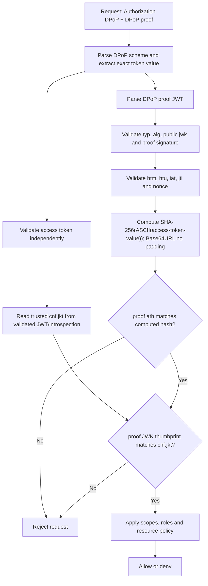

# `ath` and Matching the Proof Against the Exact Access Token Presented

## 1. The Problem to Solve

In OAuth 2.0, a **Bearer access token** can be used by any party holding the token. If the token leaks, whoever obtains it can try calling the API until the token expires or is revoked.

**DPoP (Demonstrating Proof of Possession)** per RFC 9449 adds a cryptographic proof to bind the access token to a client's public key. When calling a Resource Server, the client sends:

- The access token bound to the DPoP key.
- A DPoP proof JWT signed with the corresponding private key.

Inside the DPoP proof, the **`ath`** claim contains the hash of **the exact access token being sent in the request**. The Resource Server recomputes the hash from the received token and compares it with the `ath` claim inside the signed proof.

This solves an important scenario: a client may hold multiple access tokens bound to the same DPoP key. If a proof only proved that the client held the private key without binding the token value, a captured proof could be paired with a different access token. `ath` prevents that token substitution.

> **Core rule:** For a protected-resource request using a DPoP-bound access token, `ath` must be the unpadded Base64URL encoding of the SHA-256 hash over the **ASCII bytes of the exact access-token value presented in the Authorization header**. Do not hash the JWT payload, do not hash the DPoP proof, and do not hash the entire header.

## 2. The DPoP Proof and the Access Token Are Two Different JWTs/Credentials

A common point of confusion is that both the access token and the DPoP proof can have JWT structure. They serve different roles:

| Component | Role | Key Data |
| --- | --- | --- |
| **Access token** | Credential verified by the Resource Server to decide access permissions. | `iss`, `sub`, `aud`, `exp`, scopes; DPoP binding may reside in `cnf.jkt`. |
| **DPoP proof JWT** | Evidence that the client holds the private key and the proof was generated for the current request. | JOSE `typ=dpop+jwt`, `alg`, public `jwk`; `jti`, `htm`, `htu`, `iat`, `ath` when sending an access token. |
| **`ath`** | Binds the proof to the access token value being sent. | Hash of the access-token value per the RFC 9449 formula. |
| **`cnf.jkt`** | Binds the access token to the DPoP public key. | JWK SHA-256 thumbprint of the public key. |

`ath` belongs to the **payload of the DPoP proof**, not as a replacement for `cnf.jkt` in the access token. The Resource Server must check both bindings:

1. `ath` matches the exact access token received.
2. The public key in the DPoP proof matches the public key bound to the access token.

In addition, the Resource Server verifies the proof signature, HTTP method/URI, timestamp, replay identifier, and nonce if required.

## 3. Where `ath` Appears in a DPoP Request

Example of a client calling an API:

```http
GET /resource HTTP/1.1
Host: resource.example.org
Authorization: DPoP <access-token-value>
DPoP: <signed-dpop-proof-jwt>
```

Where:

- The `Authorization` scheme is **`DPoP`**, not `Bearer`.
- `Authorization` contains the **access token**.
- The `DPoP` header contains the **proof JWT**.
- The proof payload contains `ath` computed from the access-token value in the `Authorization` header.

A DPoP proof can have the conceptual form:

```json
{
  "typ": "dpop+jwt",
  "alg": "ES256",
  "jwk": {
    "kty": "EC",
    "crv": "P-256",
    "x": "<public-x>",
    "y": "<public-y>"
  }
}

{
  "jti": "unique-proof-id",
  "htm": "GET",
  "htu": "https://resource.example.org/resource",
  "iat": 1893452400,
  "ath": "<base64url-sha256-of-presented-access-token>"
}
```

This is an illustrative payload, not a validly signed proof. The `jwk` header must contain only the **public key**, never the private key.

## 4. The Exact `ath` Formula

RFC 9449 defines `ath` as:

```text
ath = BASE64URL-ENCODE(SHA-256(ASCII(access_token_value)))
```

Steps:

1. Extract the **access token value** after parsing the scheme and credential from `Authorization: DPoP ...`.
2. Encode the token string into **ASCII bytes**.
3. Compute the digest with **SHA-256**.
4. Encode the digest using **Base64URL**.
5. Strip trailing `=` padding characters.
6. Write the result into the `ath` claim of the DPoP proof JWT.

Do not use SHA-512, do not use standard Base64, do not keep padding, and do not hash the `DPoP` prefix before the access token.

### 4.1. Java Example

A standalone function to compute `ath`:

```java
import java.nio.charset.StandardCharsets;
import java.security.MessageDigest;
import java.security.NoSuchAlgorithmException;
import java.util.Base64;

public final class DPoPProofHashes {

    private DPoPProofHashes() {
    }

    public static String accessTokenHash(String accessToken) {
        if (accessToken == null || accessToken.isEmpty()) {
            throw new IllegalArgumentException(
                    "Access token must not be empty");
        }

        // RFC 9449 hashes the ASCII encoding of the token value.
        for (int i = 0; i < accessToken.length(); i++) {
            if (accessToken.charAt(i) > 0x7f) {
                throw new IllegalArgumentException(
                        "Access token value must be ASCII");
            }
        }

        try {
            byte[] tokenBytes =
                    accessToken.getBytes(StandardCharsets.US_ASCII);

            byte[] digest = MessageDigest
                    .getInstance("SHA-256")
                    .digest(tokenBytes);

            return Base64.getUrlEncoder()
                    .withoutPadding()
                    .encodeToString(digest);
        }
        catch (NoSuchAlgorithmException ex) {
            // SHA-256 is required by the Java platform.
            throw new IllegalStateException(
                    "SHA-256 is unavailable", ex);
        }
    }
}
```

This function only computes the hash; it **does not verify the DPoP proof signature**, does not validate the access token, and does not grant permissions.

### 4.2. Constant-Time String Comparison

Once the proof has been parsed and its signature verified, the Resource Server compares `ath`:

```java
import java.nio.charset.StandardCharsets;
import java.security.MessageDigest;

public final class DPoPAthVerifier {

    private DPoPAthVerifier() {
    }

    public static boolean matches(
            String presentedAccessToken,
            String proofAth) {

        if (presentedAccessToken == null
                || presentedAccessToken.isEmpty()
                || proofAth == null
                || proofAth.isEmpty()) {
            return false;
        }

        final String expected;
        try {
            expected = DPoPProofHashes.accessTokenHash(
                    presentedAccessToken);
        }
        catch (IllegalArgumentException ex) {
            return false;
        }

        byte[] expectedBytes =
                expected.getBytes(StandardCharsets.US_ASCII);
        byte[] actualBytes =
                proofAth.getBytes(StandardCharsets.US_ASCII);

        return MessageDigest.isEqual(
                expectedBytes, actualBytes);
    }
}
```

`MessageDigest.isEqual` is used to avoid short-circuit string comparisons that stop at the first mismatching character. Before calling this method, the application must still verify that the `ath` claim is a string and that the proof is a JWT whose signature has passed verification.

**Never check only `ath` and skip the rest of DPoP validation.** A matching hash only proves the proof is bound to that token value; it does not prove the token was issued by a trusted issuer or that the proof was created for the current request.

## 5. Why Hash the Exact Presented Token Value?

Suppose a client uses the same DPoP key to obtain two access tokens:

```text
AT1 = access token for resource owner / permission A
AT2 = access token for resource owner / permission B

Proof P1 signed with private key K:
  ath = H(AT1)
```

If the client sends:

```http
Authorization: DPoP AT1
DPoP: P1
```

then `ath` matches.

However, if someone swaps the access token:

```http
Authorization: DPoP AT2
DPoP: P1
```

then the Resource Server computes `H(AT2)`, while the signed proof contains `H(AT1)`. The two values mismatch and the request is rejected.

This is **token substitution protection**. Without `ath`, a proof signed by the same key could be paired with a different access token bound to that same key, altering the permissions or resource owner of the request.

### 5.1. `ath` Binds the Token Value; `cnf.jkt` Binds the Key

The two checks complement each other:

| Check | Question | If It Fails |
| --- | --- | --- |
| `ath` | Was this proof created for **the exact access-token value** being presented? | Proof does not match token; reject. |
| `cnf.jkt` | Was the DPoP proof signed by the key bound to the access token? | Sender failed to prove key binding; reject. |

Example:

```json
{
  "iss": "https://login.example.test",
  "sub": "user-123",
  "aud": ["orders-api"],
  "exp": 1893456000,
  "cnf": {
    "jkt": "base64url-jwk-sha256-thumbprint"
  }
}
```

For a JWT access token, `cnf.jkt` holds the JWK SHA-256 thumbprint of the DPoP public key. The Resource Server computes the RFC 7638 thumbprint from the public JWK in the proof and compares them. For opaque tokens, the AS can return `cnf.jkt` in the introspection response; the Resource Server verifies key binding itself.

**Never substitute `ath` for `cnf.jkt` or vice versa.** Token hash and public-key thumbprint are two different values.

## 6. Which String Must Be Hashed?

This is the part most likely to cause interoperability bugs. The Resource Server must hash **the exact presented credential value**, after the HTTP authentication parser has stripped the scheme.

| Value | Use as `ath` input? | Reason |
| --- | --- | --- |
| `Kz~8mX...` (token value) | **Yes** | This is the access-token value. |
| `DPoP Kz~8mX...` | No | Includes the authentication scheme. |
| `Authorization: DPoP Kz~8mX...` | No | Includes the header name and scheme. |
| `Bearer Kz~8mX...` | No | This is not how a DPoP-bound token is sent. |
| Base64URL-decoded JWT payload | No | The hash must be over the original token string, not the JSON payload. |
| JWT header + payload | No | Not the complete access-token value. |
| DPoP proof JWT | No | `ath` does not hash the proof. |
| Refresh token | No | `ath` binds the access token in a protected-resource request. |
| `cnf.jkt` | No | That is the public key's thumbprint. |

### 6.1. Do Not Parse and Re-Serialize the JWT

Example JWT token:

```text
eyJhbGciOiJSUzI1NiJ9.eyJzdWIiOiJ1c2VyLTEyMyJ9.signature
```

The hash must be computed over **the entire compact token string exactly as received**, including header segment, payload segment, and signature segment separated by dots.

Do not:

- Decode the payload to JSON and re-serialize it.
- Reorder JSON properties.
- Base64URL-decode individual segments and recombine them.
- Drop the signature segment.
- Hash the `sub` or `jti` claim.
- Normalize letter casing.

Two JWTs with identical payloads yet different headers, signatures, keys, or byte representations are still **two distinct token values** and must produce different `ath` values.

### 6.2. Do Not Trim or URL-Decode the Token

The HTTP parser must extract the credential properly according to the authentication scheme syntax. Once the token value is obtained:

- Do not call `trim()` to fix a malformed token.
- Do not URL-decode `%xx`.
- Do not change encoding.
- Do not lowercase.
- Do not strip leading/trailing characters to try to make hashes match.

If a request has multiple `Authorization` headers or ambiguous credentials, reject it according to request parsing policy. Never pick an arbitrary token and ignore the rest.

### 6.3. Opaque Tokens Must Also Be Hashed Verbatim

`ath` does not require the access token to be a JWT. With an opaque DPoP-bound token:

```text
Authorization: DPoP 8NsP2s0Y43randomopaque
DPoP: <proof with ath=H("8NsP2s0Y43randomopaque")>
```

The Resource Server still hashes **the ASCII bytes of the opaque token string**. Do not call introspection to "decode" the opaque token before computing `ath`.

## 7. When Is `ath` Required?

Per RFC 9449, a DPoP proof must include `ath` when used alongside an **access token during protected-resource access**.

| Request | Is an access token presented with the proof? | `ath` |
| --- | --- | --- |
| Client calls Resource Server with a DPoP-bound access token | Yes | **Required**. |
| Client calls Token Endpoint to exchange an authorization code | No access token in request yet | Do not hash the authorization code; `ath` is not required because no access token is presented. |
| Client calls Token Endpoint with `grant_type=refresh_token` | Refresh token present, not an access token | Do not hash the refresh token into `ath`. |
| Client calls Token Endpoint with client credentials grant | No access token presented yet | No `ath` for an unissued access token. |
| Client calls Resource Server but omits `ath` in proof | Access token present | Invalid proof; reject. |

A DPoP proof at the Token Endpoint must still include required claims like `jti`, `htm`, `htu`, `iat`, signature, and `nonce` if required by the AS. Only `ath` is omitted rather than hashing an authorization code or refresh token.

When a refresh token is also sender-constrained with DPoP for a public client, the client must prove the same key per AS policy. That is a refresh-grant key-binding check; it does not turn the refresh token into an access token for the `ath` claim.

## 8. DPoP Checks That Must Run Alongside `ath`

A Resource Server cannot accept a request solely because `ath` matches. Per RFC 9449, proof validation has multiple parts.

| Component | Check |
| --- | --- |
| `DPoP` header | Exactly one proof header, whose value is a valid JWT. |
| JOSE `typ` | Must be `dpop+jwt`. |
| JOSE `alg` | Must be a supported/accepted asymmetric signing algorithm; never `none` or symmetric MAC. |
| JOSE `jwk` | Public key used to verify the signature; contains no private key. |
| JWS signature | Proof signature verifies with the public key in `jwk`. |
| `htm` | Matches the HTTP method of the current request. |
| `htu` | Matches the target URI of the request per RFC normalization rules; omit query and fragment. |
| `iat` | Proof was created within an acceptable time window. |
| `jti` | Unique identifier; server can detect replay and must enforce a suitable replay policy. |
| `nonce` | If the server supplied a nonce, the proof must carry the matching nonce. |
| `ath` | Matches the hash of the exact presented access token. |
| `cnf.jkt` | Public key in the proof matches the key bound to the access token. |
| Access token | The token itself must still be valid: issuer, audience, expiry, status, scopes, and other policies. |

### 8.1. `ath` Does Not Replace `htm` and `htu`

Suppose a proof contains:

```json
{
  "htm": "GET",
  "htu": "https://api.example.test/orders",
  "ath": "hash-of-access-token"
}
```

Even if the token matches, if the client sends that proof for:

```http
DELETE /admin/users/123
```

then `ath` may still match the token, yet `htm`/`htu` do not match the request. The request must be rejected.

### 8.2. `ath` Does Not Prevent Replay on Its Own

`ath` binds the proof to the access-token value, but **does not prevent the same proof from being replayed** with the same token. The Resource Server must still verify:

- Unique `jti` within the validity window with an appropriate replay cache/policy.
- `iat` within the allowed time bounds.
- `htm`/`htu` matching the current request.
- `nonce` if required by the server.

Every HTTP request needs a fresh DPoP proof. When retrying a request, the client generates a new proof with a new `jti` and a new `iat`; `ath` is recomputed from the access token being used.

## 9. Resource Server Verification Flow

A conceptual flow:



Steps can be executed in different optimized orders, but **never create a verified `Authentication` or grant access before every mandatory check is complete**.

### 9.1. JWT Access Tokens

For JWT access tokens:

1. Verify the signature with a trusted key/issuer.
2. Check `iss`, `aud`, `exp`, `nbf`, and token profile.
3. Read `cnf.jkt` from the **verified** claims.
4. Verify the DPoP proof and `ath`.
5. Compute the JWK thumbprint of the public key in the proof and compare it with `cnf.jkt`.
6. Apply authorization.

Never read `cnf.jkt` from an unverified JWT payload and treat it as trusted data.

### 9.2. Opaque Access Tokens

For opaque DPoP-bound tokens:

1. The Resource Server introspects the token via the configured endpoint.
2. The AS returns `active` and token metadata, including `cnf.jkt` per the DPoP contract.
3. The Resource Server confirms the token is active along with required metadata.
4. The Resource Server verifies the DPoP proof, `ath`, and key thumbprint itself.

Per RFC 9449, the Resource Server **does not send the DPoP proof in the introspection request**. The AS returns key-binding metadata; the Resource Server performs proof/key-binding verification locally during the protected-resource request.

## 10. Creating a DPoP Proof with `ath` in Java and Nimbus

The following example illustrates client-side proof signing with an RSA key. In production, keys must be stored securely and remain non-exportable if the platform supports non-exportable keys.

```java
import java.time.Instant;
import java.util.UUID;

import com.nimbusds.jose.jwk.JWKSet;
import com.nimbusds.jose.jwk.RSAKey;
import com.nimbusds.jose.jwk.source.JWKSource;
import com.nimbusds.jose.proc.SecurityContext;

import org.springframework.security.oauth2.jose.jws.SignatureAlgorithm;
import org.springframework.security.oauth2.jwt.Jwt;
import org.springframework.security.oauth2.jwt.JwtClaimsSet;
import org.springframework.security.oauth2.jwt.JwtEncoderParameters;
import org.springframework.security.oauth2.jwt.JwsHeader;
import org.springframework.security.oauth2.jwt.NimbusJwtEncoder;

public final class DPoPProofFactory {

    private final NimbusJwtEncoder encoder;

    public DPoPProofFactory(RSAKey dpopKey) {
        JWKSource<SecurityContext> jwkSource =
                (selector, context) ->
                        selector.select(new JWKSet(dpopKey));

        this.encoder = new NimbusJwtEncoder(jwkSource);
    }

    public String createForResourceRequest(
            String accessToken,
            String method,
            String targetUri,
            String nonce) {

        Instant now = Instant.now();

        JwsHeader header = JwsHeader
                .with(SignatureAlgorithm.RS256)
                .type("dpop+jwt")
                .jwk(dpopKey.toPublicJWK().toJSONObject())
                .build();

        JwtClaimsSet.Builder claims = JwtClaimsSet.builder()
                .issuedAt(now)
                .id(UUID.randomUUID().toString())
                .claim("htm", method)
                .claim("htu", targetUri)
                .claim("ath",
                        DPoPProofHashes.accessTokenHash(accessToken));

        if (nonce != null && !nonce.isBlank()) {
            claims.claim("nonce", nonce);
        }

        Jwt proof = this.encoder.encode(
                JwtEncoderParameters.from(header, claims.build()));

        return proof.getTokenValue();
    }
}
```

`.jwk(...)` must receive the public JWK matching the signing private key, e.g. `dpopKey.toPublicJWK().toJSONObject()`. In real code, construct the header with:

```java
.jwk(dpopKey.toPublicJWK().toJSONObject())
```

**Important notes:**

- `accessToken` must be the exact token value placed after the `DPoP` scheme in the request.
- `method` and `targetUri` must reflect the actual request.
- `nonce` is added only when required/active under the server's nonce policy; if the server sent a nonce, the client must include that exact nonce in the next proof.
- `jti` must be fresh for every proof request.
- The `jwk` header contains only the public JWK.
- `RSAKey` in the example holds the private key for client-side signing; never send the private key to the Resource Server.

This code illustrates proof creation; production needs URI normalization, key lifecycle management, clock handling, nonce caching, and error handling.

## 11. Complete Request Example

The client sends access token `AT1` and proof `P1`:

```http
GET /api/orders HTTP/1.1
Host: api.example.test
Authorization: DPoP AT1
DPoP: P1
```

In proof `P1`:

```json
{
  "htm": "GET",
  "htu": "https://api.example.test/api/orders",
  "iat": 1893452400,
  "jti": "proof-unique-001",
  "ath": "BASE64URL_SHA256_OF_AT1"
}
```

The Resource Server:

1. Parses `AT1` accurately from the `Authorization` header.
2. Computes `H(AT1)`.
3. Compares it with `P1.ath`.
4. Verifies proof signature and key binding.
5. Verifies the access token via the JWT decoder or introspector.
6. Checks method, URI, timestamp, replay, and nonce.
7. Applies scope/authorization only when all checks pass.

If the client swaps the token to `AT2` while still sending `P1`:

```http
GET /api/orders HTTP/1.1
Host: api.example.test
Authorization: DPoP AT2
DPoP: P1
```

then:

```text
Expected ath = H(AT2)
Received proof ath = H(AT1)
Expected ath != Received proof ath
Result = reject
```

Even if `AT1` and `AT2` are bound to the same public key, the proof still cannot be transferred to another token.

## 12. DPoP Token Requests and Refresh Requests Do Not Hash the Refresh Token into `ath`

DPoP is also used at the Token Endpoint. For example, a client exchanging an authorization code:

```http
POST /oauth2/token HTTP/1.1
Host: login.example.test
Content-Type: application/x-www-form-urlencoded
DPoP: <proof-for-token-endpoint>

grant_type=authorization_code&code=<authorization-code>&code_verifier=<pkce-verifier>
```

The proof for the Token Endpoint must have `htm`/`htu` matching the token request, `jti`/`iat`, and `nonce` if required by the AS. Because the request does not yet present an access token, do not compute `ath` from the authorization code.

For a refresh request:

```http
POST /oauth2/token HTTP/1.1
Host: login.example.test
Content-Type: application/x-www-form-urlencoded
DPoP: <fresh-proof-for-token-endpoint>

grant_type=refresh_token&refresh_token=<refresh-token>
```

`ath` is not the hash of the refresh token. Refresh-token DPoP key binding (if the AS issues key-bound refresh tokens) is verified under separate refresh-token grant policies.

When the AS issues a new access token, the token value changes. Requests to the Resource Server must create a new proof and compute a **new `ath` from the new access token**.

## 13. Access Token Rotation Changes `ath`

Suppose:

```text
Old access token: AT1
New access token: AT2
DPoP key: K (unchanged)
```

Despite the same key K, the hashes:

```text
ath1 = H(AT1)
ath2 = H(AT2)
```

differ (with negligible SHA-256 collision probability). The client must not reuse an old proof with the new token.

| Scenario | Proof | Result |
| --- | --- | --- |
| AT1 + proof with `ath=H(AT1)` | Matches token | Passes `ath` check if other checks pass. |
| AT2 + old proof with `ath=H(AT1)` | Wrong token | Rejected. |
| AT2 + new proof with `ath=H(AT2)` | Matches token | Passes `ath` check if other checks pass. |
| AT2 + new proof using a different key than `cnf.jkt` | Right token, wrong key | Rejected on key binding. |

This also prevents clients from accidentally reusing a proof right after an authorized-client manager refreshes an access token.

## 14. Handling `ath` and DPoP Proof Errors

The Resource Server should classify errors so the client knows whether to build a new proof or replace the token.

| Error | Cause | Server Action |
| --- | --- | --- |
| Missing `DPoP` header | Client sent no proof. | Reject DPoP authentication; return DPoP challenge. |
| Missing `ath` when presenting an access token | Proof violates protected-resource access contract. | Reject proof, typically `invalid_dpop_proof`. |
| `ath` does not match token | Proof created for another token or client miscomputed hash. | Reject; do not invoke business handler. |
| Invalid proof signature | Proof fails to prove private-key possession. | Reject proof. |
| `cnf.jkt` mismatch | Proof key is not the key bound to the token. | Reject token/key binding. |
| `htm` or `htu` mismatch | Proof is not intended for the current request. | Reject proof. |
| `iat` too old / too far in the future | Proof is outside the time window. | Reject proof. |
| `jti` already used | Proof is replayed per replay policy. | Reject proof. |
| Missing/invalid nonce | Server requires a fresh nonce. | Return `use_dpop_nonce` with `DPoP-Nonce` when appropriate. |
| Access token expired/revoked | Credential is no longer valid. | Reject token with appropriate token error. |

Example invalid proof response:

```http
HTTP/1.1 401 Unauthorized
WWW-Authenticate: DPoP error="invalid_dpop_proof"
```

Example invalid access token or key binding response:

```http
HTTP/1.1 401 Unauthorized
WWW-Authenticate: DPoP error="invalid_token"
```

Example server nonce requirement response:

```http
HTTP/1.1 401 Unauthorized
WWW-Authenticate: DPoP error="use_dpop_nonce"
DPoP-Nonce: <server-generated-nonce>
```

The client must create a **new proof** containing the nonce, a new `jti`, and the `ath` of the active access token. Never edit the payload of an already-signed JWT proof; any change invalidates the signature.

## 15. DPoP and Bearer Must Not Downgrade into Each Other

A DPoP-bound access token is sent with:

```http
Authorization: DPoP <access-token>
DPoP: <proof>
```

Never send that token as:

```http
Authorization: Bearer <access-token>
```

A Resource Server supporting both Bearer and DPoP must **reject a DPoP-bound access token if presented under the Bearer scheme**. Otherwise, an attacker can strip the proof and revert to bearer semantics: anyone holding the token can use it.

A system may support both schemes for **two different token types**, provided it distinguishes which tokens are sender-constrained. Never inspect only the header scheme and let every token pass.

### 15.1. Duplicate or Ambiguous Credentials

Reject ambiguous requests such as:

```http
Authorization: Bearer AT1
Authorization: DPoP AT2
DPoP: proof-for-AT2
```

RFC 9449 recommends that Resource Servers detect multiple credential schemes and reject with `invalid_request`. Parsers/proxies must never silently pick a different header than the one the application evaluates.

## 16. `ath` Differs from `at_hash` in OpenID Connect

The two claim names are similar, yet they belong to two different contexts:

| Claim | Where Does It Live? | Purpose |
| --- | --- | --- |
| `ath` | DPoP proof JWT payload. | Binds the DPoP proof to the access token presented at the Resource Server. |
| `at_hash` | OIDC ID token in certain flows. | Binds the ID token to the access token per OpenID Connect rules. |

Never use `at_hash` in place of `ath`, and never use `ath` for OIDC ID token validation. Even though both involve access tokens and hashes, their locations, calculation rules, and protocol purposes differ.

## 17. DPoP with Opaque Token Introspection

DPoP is not limited to JWT access tokens. For opaque tokens, the Resource Server can obtain key-binding info via introspection.

Example response:

```json
{
  "active": true,
  "sub": "user-123",
  "scope": "orders:read",
  "cnf": {
    "jkt": "base64url-jwk-sha256-thumbprint"
  }
}
```

The Resource Server:

1. Sends the opaque access token to the configured introspection endpoint.
2. Checks `active=true` and required metadata.
3. Reads `cnf.jkt` from the authenticated response over a trusted channel.
4. Verifies the DPoP proof signature and claims.
5. Computes `ath` from the exact opaque token string received in the Authorization header.
6. Compares the proof public-key thumbprint with `cnf.jkt`.

The introspection request does not need the protected-resource request's DPoP proof. The Resource Server performs DPoP binding verification locally using metadata from the AS.

## 18. Spring Security: Configuration and Limits by Version/Stack

### 18.1. Servlet Resource Server in Spring Security 7.1+

Spring Security provides DPoP support for **Servlet-based Resource Servers**. In versions that include the DPoP configurer, you can configure:

```java
@Bean
SecurityFilterChain api(HttpSecurity http) throws Exception {
    return http
            .authorizeHttpRequests(authorize -> authorize
                    .anyRequest().authenticated())
            .oauth2ResourceServer(oauth2 -> oauth2
                    .jwt(Customizer.withDefaults())
                    .dPoP(Customizer.withDefaults()))
            .build();
}
```

`OAuth2ResourceServerConfigurer.dPoP(...)` is marked since **Spring Security 7.1**. `DPoPAuthenticationProvider` appeared in 6.5, so distinguish the provider API from the full configuration DSL. Check the exact Javadoc for your project's version before copying configuration.

In the standard configuration, built-in DPoP support coordinates proof and key-binding validation with the token authentication manager. There is no need to write a custom access-token claim validator to "check `ath`": `ath` belongs to the proof JWT and must be verified inside the DPoP authentication flow.

### 18.2. Do Not Confuse the DPoP Proof Decoder with the Access-Token Decoder

The Resource Server has two distinct objects to verify:

- **Access-token decoder/introspector**: verifies the access token's issuer, signature/active state, audience, and claims.
- **DPoP proof verifier**: verifies the proof JWT's `typ`, `alg`, `jwk`, `htm`, `htu`, `iat`, `jti`, `nonce`, and `ath`.

Configuring only:

```java
.oauth2ResourceServer(oauth2 ->
        oauth2.jwt(Customizer.withDefaults()))
```

does not imply that proof JWTs are being verified. A standard JWT decoder is configured for **access tokens**, and does not automatically understand a separate `DPoP` header JWT.

### 18.3. WebFlux Requires Checking Separate Support

In current Spring Security documentation, the DPoP Resource Server configurer is documented in the **Servlet stack** (`HttpSecurity`/`SecurityFilterChain`). OAuth2 WebFlux documentation covers `ReactiveJwtDecoder` and `ReactiveOpaqueTokenIntrospector`, but you must not assume that:

```java
.oauth2ResourceServer(oauth2 ->
        oauth2.jwt(Customizer.withDefaults()))
```

automatically verifies the `DPoP` header or `ath`.

If a WebFlux application needs DPoP, confirm whether your version provides a reactive DPoP API. If not, design a custom reactive authentication/filter pipeline or enforce it at a trusted gateway, ensuring full RFC 9449 compliance without calling `block()` on the event loop. Never place Servlet `DPoPAuthenticationProvider` or Servlet filters into a `SecurityWebFilterChain` and treat it as reactive integration.

### 18.4. Do Not Use `OAuth2TokenValidator` to Replace a DPoP Proof Verifier

`OAuth2TokenValidator<Jwt>` is typically attached to the access-token decoder to validate access-token claims. `ath` lives in the **proof JWT**; it needs the request's access-token value for comparison. An access-token validator lacks the HTTP context required to verify proof signatures, `htm`, `htu`, and replay state.

Separate responsibilities:

| Component | Responsibility |
| --- | --- |
| Access-token decoder/introspector | Verifies the token and retrieves trusted `cnf.jkt`. |
| DPoP proof verifier | Verifies proof JWT, `ath`, request binding, key binding, nonce, and replay. |
| Authorization layer | Enforces scopes, roles, tenants, and resource permissions. |

## 19. Testing `ath`

A good test suite needs positive and negative cases, not just happy-path proofs.

| Case | Access token sent | `ath` in proof | Result |
| --- | --- | --- | --- |
| ATH-01 | `AT1` | `H(AT1)` | Passes `ath` check if other checks pass. |
| ATH-02 | `AT1` | `H(AT2)` | Rejected. |
| ATH-03 | `AT2` | Old proof `H(AT1)` | Rejected. |
| ATH-04 | Opaque token `O1` | `H(O1)` | Passes `ath` check; introspection/key binding must still pass. |
| ATH-05 | `AT1` | Missing `ath` | Rejected. |
| ATH-06 | `AT1` | Empty string or malformed format | Rejected. |
| ATH-07 | `AT1` | Standard Base64 with padding | Rejected because it does not equal unpadded Base64URL expected value. |
| ATH-08 | `AT1` | SHA-512 hash | Rejected. |
| ATH-09 | `AT1` | Hash of JWT payload instead of compact token | Rejected. |
| ATH-10 | `AT1` | Hash of `"DPoP AT1"` string | Rejected. |
| ATH-11 | `AT1` | Matching hash, invalid proof signature | Rejected. |
| ATH-12 | `AT1` | Matching hash, `cnf.jkt` differs from proof key | Rejected. |
| ATH-13 | `AT1` | Matching hash, wrong `htm` | Rejected. |
| ATH-14 | `AT1` | Matching hash, wrong `htu` | Rejected. |
| ATH-15 | `AT1` | Matching hash, replayed `jti` | Rejected per replay policy. |
| ATH-16 | `AT1` | Matching hash, missing/wrong nonce when required | Rejected with appropriate nonce challenge. |
| ATH-17 | `AT1` sent with Bearer scheme | Proof absent/unprocessed | DPoP-bound token must not downgrade to Bearer. |
| ATH-18 | `AT1` | Proof created for Token Endpoint | Rejected due to `htu`/request binding mismatch; `ath` is not required at token endpoint. |

### 19.1. Unit Testing Hash Calculation with a Fixed Vector

RFC 9449 provides an example access token and `ath`. You can use published vectors to verify your implementation:

```java
import static org.junit.jupiter.api.Assertions.assertEquals;
import static org.junit.jupiter.api.Assertions.assertNotEquals;

import org.junit.jupiter.api.Test;

class DPoPProofHashesTest {

    @Test
    void computesRfc9449AccessTokenHash() {
        String accessToken =
                "Kz~8mXK1EalYznwH-LC-1fBAo."
              + "4Ljp~zsPE_NeO.gxU";

        assertEquals(
                "fUHyO2r2Z3DZ53EsNrWBb0xWXoaNy59IiKCAqksmQEo",
                DPoPProofHashes.accessTokenHash(accessToken));
    }

    @Test
    void changingOneTokenCharacterChangesAth() {
        String first =
                "Kz~8mXK1EalYznwH-LC-1fBAo."
              + "4Ljp~zsPE_NeO.gxU";
        String second =
                "Kz~8mXK1EalYznwH-LC-1fBAo."
              + "4Ljp~zsPE_NeO.gxV";

        assertNotEquals(
                DPoPProofHashes.accessTokenHash(first),
                DPoPProofHashes.accessTokenHash(second));
    }
}
```

The second test requires importing `assertNotEquals`. Fixed vectors catch bugs like using SHA-512, the wrong Base64 alphabet, or keeping padding.

### 19.2. Testing Token-to-Proof Comparison

```java
@Test
void proofMustMatchThePresentedAccessToken() {
    String token1 = "access-token-one";
    String token2 = "access-token-two";

    String proofAth = DPoPProofHashes.accessTokenHash(token1);

    assertTrue(DPoPAthVerifier.matches(token1, proofAth));
    assertFalse(DPoPAthVerifier.matches(token2, proofAth));
}
```

This is a unit test of the comparison function, not a DPoP integration test. It does not verify the proof JWT signature or key binding.

### 19.3. Integration Testing Through the Resource Server

Using dedicated test key pairs, construct genuinely signed access tokens and DPoP proofs:

1. The JWT access token includes `cnf.jkt` matching the public key thumbprint.
2. The DPoP proof has `typ=dpop+jwt`, asymmetric `alg`, public `jwk`, and valid `htm`, `htu`, `iat`, `jti`, and `ath`.
3. Send `Authorization: DPoP <token>` and `DPoP: <proof>` via an HTTP test client.
4. Assert that a valid request passes authentication and reaches the endpoint.
5. Swap the access token while keeping the old proof; assert rejection and that the controller is not invoked.
6. Keep the token, mutate `ath`, and re-sign the proof with the test key; assert rejection.
7. Keep `ath` valid, but change `cnf.jkt` or the proof key; assert rejection.
8. Keep `ath` valid, but change `htm`/`htu`; assert rejection.
9. Resend the same `jti` within the replay window; assert rejection if replay detection is enabled.
10. Test the nonce challenge and a fresh proof containing the nonce.

This is what proves the **entire DPoP authentication path**. Mocking a `Jwt` or calling a controller directly does not prove DPoP proofs are verified.

### 19.4. Testing Opaque Tokens

Mock the introspection server to return:

```json
{
  "active": true,
  "cnf": {
    "jkt": "<test-key-thumbprint>"
  }
}
```

Then send the opaque token and proof:

- Matching `ath` for the opaque token and right key → can authenticate.
- `ath` of another opaque token → rejected.
- `cnf.jkt` differs from proof key → rejected.
- `active=false` → token rejected even if `ath` matches.

This proves `ath` does not depend on whether the token is JWT or opaque; it depends strictly on the **token value** presented.

## 20. Common Implementation Mistakes

### Mistake 1 — Hashing the Decoded JWT Payload

`ath` hashes the compact access-token value. Hashing the JSON payload violates the protocol and could let two tokens with the same payload yet different headers/signatures share the same hash.

### Mistake 2 — Hashing the Entire Authorization Header String

`Authorization: DPoP` is HTTP syntax, not the token value. Strip the scheme and hash only the credential.

### Mistake 3 — Hashing the DPoP Proof Instead of the Access Token

`ath` links the proof to the access token. Do not hash the proof JWT or public JWK.

### Mistake 4 — Using Standard Base64 or Keeping Padding

The RFC requires unpadded Base64URL encoding. A string with a different encoding will not match even for the same digest.

### Mistake 5 — Using SHA-512 or an Algorithm Taken from the Header

RFC 9449 mandates SHA-256 for `ath`. Never let the client pick the hash algorithm from the proof header.

### Mistake 6 — Comparing `ath` Without Verifying the Proof Signature

An attacker can construct a payload with a matching `ath`. Only a proof validly signed with the corresponding private key proves possession.

### Mistake 7 — Comparing `ath` Without Checking `cnf.jkt`

A matching token hash does not prove the key signing the proof is the key bound to the token by the AS.

### Mistake 8 — Thinking `ath` Prevents Replay

A proof with a valid `ath` can still be replayed with the same token. You need `jti`, `iat`, nonces, and a replay cache/policy.

### Mistake 9 — Reusing an Old Proof After Token Refresh

The new access token has a different value, so the old `ath` no longer matches. Create a new proof for the new token.

### Mistake 10 — Requiring `ath` at the Token Endpoint

When a request to the Token Endpoint does not yet present an access token, do not hash the authorization code or refresh token into `ath`.

### Mistake 11 — Confusing `ath` with `at_hash`

The two claims belong to different protocols/contexts. They are not interchangeable.

### Mistake 12 — Allowing DPoP-Bound Tokens with the Bearer Scheme

This removes the sender constraint. A Resource Server supporting DPoP must reject a DPoP-bound token if a client presents it as Bearer.

### Mistake 13 — Treating the DPoP Proof as an Access Token

A proof only demonstrates key possession/request binding; it does not grant permissions. The access token must still be verified independently.

### Mistake 14 — Assuming `.jwt()` in WebFlux Automatically Verifies DPoP

The reactive JWT decoder processes the access token JWT; the DPoP proof is a separate JWT with its own request context. Confirm reactive DPoP support in your version or build a complete integration.

## 21. Key, Token, and Log Security

DPoP reduces the impact of standalone access-token theft, but does not replace client security and TLS.

### 21.1. Protecting the Private Key

- Use a secure keystore/platform key store whenever possible.
- Never place the private key inside `jwk` in the proof.
- Never log private JWKs, key material, or proof signing secrets.
- Define lifecycle and rotation for DPoP keys.
- When rotating keys, tokens bound to the old key do not automatically transfer to the new key; new tokens must be issued via the authorization flow.

### 21.2. Never Log Raw Tokens or Proofs

Never write:

```java
log.debug("Authorization={}, DPoP={}", authorization, dpopProof);
```

Exposed tokens and proofs can be reused within their validity windows. Logs should contain only correlation IDs, routes, error categories, and low-cardinality internal metrics.

### 21.3. DPoP Does Not Replace HTTPS

DPoP is an application-level sender-constraint mechanism. It does not replace TLS, does not guarantee integrity for the entire request body/headers, and does not eliminate XSS. Resource Servers and clients must still use HTTPS, control proxy/URI reconstruction, and protect the client execution context.

## 22. Combining DPoP with Nonces and Replay Detection

The Resource Server can require a nonce to limit proofs generated too far in advance:

```http
HTTP/1.1 401 Unauthorized
WWW-Authenticate: DPoP error="use_dpop_nonce"
DPoP-Nonce: <nonce-issued-by-resource-server>
```

The client must:

1. Store the nonce scoped to the exact Resource Server that issued it.
2. Create a new proof with a new `jti`.
3. Add the `nonce` claim with the exact value.
4. Keep `htm`/`htu` matching the current request.
5. Recompute `ath` from the presented access token.
6. Sign the new proof with the same DPoP key bound to the token.

A nonce from the Authorization Server must not be used in place of a Resource Server nonce, and vice versa. Each nonce may only be used with the server that issued it.

### 22.1. Replay Cache

A replay cache can store the pair:

```text
(proof-key-thumbprint, jti) -> expiry-time
```

or an equivalent proof identifier key per policy. When a new proof arrives:

- If `jti` already exists within the valid window, reject.
- If absent, record it atomically before allowing the request to proceed.
- TTL must cover the proof acceptance window.
- In a cluster, replay detection requires shared state or a strategy ensuring no two nodes accept the same proof.

Do not cache only `ath`: the same access token can legitimately be used across many requests with fresh proofs. Caching by access token would accidentally block normal client usage.

## 23. Comprehensive Test Matrix

| Group | Input | Expected Result |
| --- | --- | --- |
| Access token | Valid JWT, matching issuer/audience/exp | Token layer passes. |
| Access token | Expired JWT or invalid signature | Reject token. |
| Access token | Opaque token `active=false` | Reject token. |
| DPoP header | Missing proof | Reject DPoP request. |
| DPoP header | Multiple proof headers or malformed JWT | Reject. |
| Proof header | `typ` other than `dpop+jwt` | Reject proof. |
| Proof header | `alg=none` or symmetric algorithm | Reject proof. |
| Proof key | JWK contains private parameters | Reject proof. |
| Proof signature | Invalid signature | Reject proof. |
| Request binding | Wrong `htm`/`htu` | Reject proof. |
| Proof time | `iat` too old/future outside policy | Reject proof. |
| Replay | Reused `jti` | Reject proof. |
| Nonce | Required by server, missing/wrong in proof | Challenge `use_dpop_nonce`. |
| `ath` | Missing `ath` | Reject proof. |
| `ath` | `ath` = hash of another token | Reject proof. |
| `ath` | `ath` = hash of exact access token value | Passes `ath` check. |
| Key binding | `cnf.jkt` differs from proof JWK thumbprint | Reject token binding. |
| Authentication scheme | DPoP-bound token sent as Bearer | Reject downgrade. |
| Authorization | Valid token/proof, missing scope | 403 per policy. |
| Domain | Valid token/proof/scope, wrong tenant/owner | 403/404 per policy. |

### 23.1. Token-Swapping Matrix

| Request | Access token | Proof `ath` | Result |
| --- | --- | --- | --- |
| R1 | AT1 | H(AT1) | Passes `ath`. |
| R2 | AT1 | H(AT2) | Fails `ath`. |
| R3 | AT2 | H(AT1) | Fails `ath`. |
| R4 | AT2 | H(AT2) | Passes `ath`. |
| R5 | AT2 | H(AT2), wrong key | Fails `cnf.jkt`. |
| R6 | AT2 | H(AT2), replayed proof | Fails replay policy. |

This matrix shows that **`ath` is only one binding layer**, not a replacement for the other verification steps.

## 24. Self-Check Questions

**1. What is `ath`?** A claim in a DPoP proof JWT containing the hash of the access token presented alongside the proof.

**2. What is the `ath` formula?** Unpadded Base64URL of the SHA-256 hash over the ASCII bytes of the access-token value.

**3. Is `ath` in the access token or the DPoP proof?** Inside the payload of the DPoP proof.

**4. Which string does the Resource Server hash?** The token value parsed from `Authorization: DPoP <token>`, excluding the scheme/header.

**5. Can you hash the JWT payload instead of the compact token?** No.

**6. Do opaque access tokens use `ath`?** Yes. Hash the opaque token value string using the same formula.

**7. How does `ath` differ from `cnf.jkt`?** `ath` binds the proof to the token value; `cnf.jkt` binds the token to the proof's public key.

**8. Does `ath` replace DPoP proof signature verification?** No.

**9. Does `ath` prevent replay on its own?** No. You still need `jti`, `iat`, nonces, and a replay policy.

**10. When refreshing produces a new access token, can the old proof be reused?** No. A new `ath` must be computed and a new proof created.

**11. Is `ath` needed at the token endpoint when exchanging an authorization code?** No, because the request does not yet present an access token.

**12. Should a refresh token be hashed into `ath`?** No.

**13. Can a DPoP-bound token be sent with the Bearer scheme?** A DPoP-supporting Resource Server must reject that downgrade.

**14. What if `ath` is right but `htu` is wrong?** Reject the proof because it is not intended for the current request.

**15. What if `ath` is right but `cnf.jkt` is wrong?** Reject because the client has not proven possession of the key bound to the token.

**16. Does `at_hash` in OIDC replace `ath`?** No; they belong to different protocols/contexts.

**17. Does `.oauth2ResourceServer().jwt()` automatically verify DPoP proofs?** Never assume so. You need explicit DPoP support for your framework/stack.

**18. Why must a new proof be generated on retry?** Every HTTP request needs its own proof; `jti`/`iat`/`htm`/`htu` and `nonce` must match the new request.

## 25. Official References

- **RFC 9449 — OAuth 2.0 Demonstrating Proof of Possession (DPoP):** defines `ath`, proof structure, protected-resource validation, key binding, nonces, and replay considerations. https://www.rfc-editor.org/rfc/rfc9449
- **RFC 7515 — JSON Web Signature (JWS):** proof JWT signatures and Base64URL encoding. https://www.rfc-editor.org/rfc/rfc7515
- **RFC 7517 — JSON Web Key (JWK):** representing public keys in DPoP proofs. https://www.rfc-editor.org/rfc/rfc7517
- **RFC 7638 — JSON Web Key (JWK) Thumbprint:** computing `cnf.jkt` from a public JWK. https://www.rfc-editor.org/rfc/rfc7638
- **RFC 7662 — OAuth 2.0 Token Introspection:** token metadata and active state for opaque access tokens. https://www.rfc-editor.org/rfc/rfc7662
- **RFC 6750 — OAuth 2.0 Bearer Token Usage:** contrasting Bearer and DPoP authentication schemes. https://www.rfc-editor.org/rfc/rfc6750
- **Spring Security Reference — OAuth 2.0 DPoP-bound Access Tokens (Servlet):** https://docs.spring.io/spring-security/reference/servlet/oauth2/resource-server/dpop-tokens.html
- **Spring Security API — DPoPAuthenticationProvider:** https://docs.spring.io/spring-security/reference/api/java/org/springframework/security/oauth2/server/resource/authentication/DPoPAuthenticationProvider.html
- **Spring Security API — OAuth2ResourceServerConfigurer.DPoPConfigurer:** https://docs.spring.io/spring-security/reference/api/java/org/springframework/security/config/annotation/web/configurers/oauth2/server/resource/OAuth2ResourceServerConfigurer.DPoPConfigurer.html
- **Spring Security Reference — Reactive OAuth2 Resource Server:** https://docs.spring.io/spring-security/reference/reactive/oauth2/

## 26. Conclusion

`ath` is the claim that binds a DPoP proof to **the exact access-token value being presented**. The Resource Server computes:

```java
String expectedAth = Base64.getUrlEncoder()
        .withoutPadding()
        .encodeToString(
                MessageDigest.getInstance("SHA-256")
                        .digest(accessToken.getBytes(StandardCharsets.US_ASCII)));
```

and compares it with `ath` inside the signature-verified proof. This prevents pairing a proof with a different access token, even when both tokens share the same DPoP key.

However, `ath` addresses only **proof-to-token binding**. The Resource Server must still check `cnf.jkt` to confirm the proof key matches, `htm`/`htu` to confirm the request, `iat`/`jti`/nonces to mitigate replay, and verify the access token against issuer/resource policies. Only when all conditions pass should the API proceed to check scopes, tenants, and data permissions.

In Spring Security, use the DPoP integration appropriate for your exact **version and application stack**; the Servlet DPoP configurer does not automatically apply to WebFlux. One of the most important tests in this lesson is sending **AT2 with a proof carrying `ath=H(AT1)`** and proving the Resource Server rejects it before running business logic. This directly verifies that proofs are always matched against the exact presented access token.
