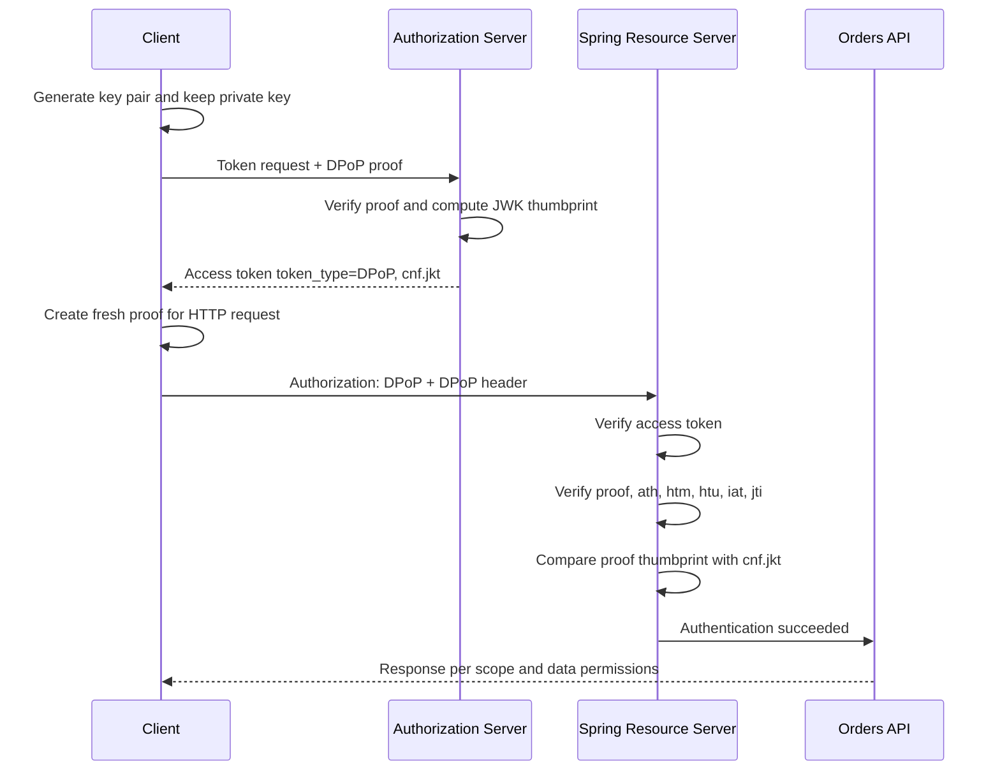

# Configuring DPoP Handling in Servlet and Verifying Limits in Other Stacks

## 1. What Problem Does DPoP Solve?

With a Bearer access token, anyone who obtains the token string can try calling the API while the token remains valid:

```http
GET /api/orders/42 HTTP/1.1
Host: api.example.com
Authorization: Bearer <access-token>
```

DPoP (Demonstrating Proof of Possession) adds proof of key possession to OAuth 2.0 access tokens. The Client generates an asymmetric key pair, retains the private key, and signs a DPoP Proof JWT for each request. The Authorization Server (AS) binds the access token to the public key; the Resource Server (RS) requires the Client to prove it holds the corresponding private key whenever using the token.

```http
GET /api/orders/42 HTTP/1.1
Host: api.example.com
Authorization: DPoP <dpop-bound-access-token>
DPoP: <signed-dpop-proof-jwt>
```

If an attacker obtains only the access token without the private key, they cannot create a valid fresh proof for their requests. This is an application-layer sender-constraining mechanism, standardized in RFC 9449.

DPoP does not replace TLS, audience, scopes, or business authorization. It does not sign the entire request body/headers and does not defend against every case where the private key or Client execution context is compromised.

### Learning Objectives

After this lesson, you can:

1. Distinguish between Bearer tokens and DPoP-bound access tokens.
2. Explain how the Client generates a proof, the AS attaches the **cnf.jkt** claim, and the RS verifies the proof.
3. Read the **typ**, **alg**, **jwk**, **htm**, **htu**, **iat**, **jti**, **ath**, **nonce**, and **cnf.jkt** fields.
4. Configure DPoP for Spring Security Servlet Resource Server from Spring Security 7.1 onward.
5. Understand the roles of `DPoPAuthenticationConverter`, `DPoPAuthenticationProvider`, `DPoPProofJwtDecoderFactory`, and `DPoPAuthenticationEntryPoint`.
6. Prevent downgrades when an API accepts both Bearer and DPoP.
7. Properly design replay protection, nonces, proxy URIs, and CORS.
8. Distinguish Servlet support from WebFlux/reactive limitations in current Spring Security versions.
9. Test DPoP with genuinely signed access tokens and proof JWTs.

## 2. Token Issuance and API Calling Flow

### 2.1. Client Generates a Key Pair

The Client creates a public/private key pair. The private key is kept in storage appropriate to the platform: Android Keystore, iOS Keychain/Secure Enclave, Web Crypto API with non-exportable keys where suitable, or an HSM/key store for server-to-server applications.

The Client places the public JWK in the JOSE header of the DPoP Proof. The private key is used to sign the proof, but is never sent in the request.

| Component | Purpose |
|---|---|
| Access token | API access permissions issued by the AS |
| DPoP Proof JWT | Proves the Client holds the private key and binds the proof to the HTTP request |
| Public JWK | Public key used to verify the proof |
| **cnf.jkt** | Public key fingerprint bound to the access token |

### 2.2. Token Endpoint Receives the Proof and Binds the Access Token

The Client sends the proof in the `DPoP` header when calling the token endpoint:

```http
POST /oauth2/token HTTP/1.1
Host: id.example.com
Content-Type: application/x-www-form-urlencoded
DPoP: <proof-for-token-endpoint>

grant_type=authorization_code&
client_id=shop-mobile&
code=<authorization-code>&
redirect_uri=https%3A%2F%2Fclient.example.com%2Fcallback&
code_verifier=<pkce-verifier>
```

The AS verifies the proof. If valid, the AS binds the access token to the proven public key. For JWT access tokens, binding is typically represented by the `cnf.jkt` claim:

```json
{
  "iss": "https://id.example.com",
  "sub": "user-417",
  "aud": ["orders-api"],
  "scope": "orders.read",
  "exp": 1893456000,
  "cnf": {
    "jkt": "<JWK-SHA256-THUMBPRINT>"
  }
}
```

`cnf.jkt` is the base64url-encoded SHA-256 JWK Thumbprint of the public key per RFC 7638. The token response indicates `token_type` is `DPoP`:

```http
HTTP/1.1 200 OK
Content-Type: application/json
Cache-Control: no-store

{
  "access_token": "<dpop-bound-access-token>",
  "token_type": "DPoP",
  "expires_in": 600
}
```

### 2.3. Every Resource Request Has a Fresh Proof

The Client sends the access token using the `DPoP` authentication scheme and sends the proof JWT in the `DPoP` header:

```http
GET /api/orders/42 HTTP/1.1
Host: api.example.com
Authorization: DPoP <dpop-bound-access-token>
DPoP: <new-proof-for-this-request>
```

The proof must bind to the current request. The Client must generate a fresh proof when retrying a request—even when the method and URL are unchanged—because `jti` must be unique within the server's proof acceptance window.



DPoP can be used with JWT access tokens or opaque access tokens. With JWTs, the RS reads `cnf.jkt` from the verified token. With opaque tokens, the AS can return `cnf.jkt` in the introspection response. The RS must still verify the binding between the access token and proof itself.

## 3. Structure of a DPoP Proof JWT

### 3.1. JOSE Header

An illustrative proof JWT header:

```json
{
  "typ": "dpop+jwt",
  "alg": "ES256",
  "jwk": {
    "kty": "EC",
    "crv": "P-256",
    "x": "<PUBLIC-X>",
    "y": "<PUBLIC-Y>"
  }
}
```

- `typ` must equal `dpop+jwt`.
- `alg` must be a supported and policy-permitted asymmetric signing algorithm. Never accept `none`.
- `jwk` contains the public key used to verify the proof.
- The JWK in the header must contain no private key material.

The server must restrict allowed algorithms. Do not use arbitrary algorithms or key URLs sent by the Client to expand trust.

### 3.2. Proof Claims

For a protected resource request:

```json
{
  "jti": "proof-unique-id-001",
  "htm": "GET",
  "htu": "https://api.example.com/api/orders/42",
  "iat": 1893455700,
  "ath": "<BASE64URL-SHA256-OF-ACCESS-TOKEN>"
}
```

| Claim | Meaning | Check at Resource Server |
|---|---|---|
| jti | Unique ID of the proof | Must be present and protected against reuse |
| htm | HTTP method | Matches request method, e.g., GET |
| htu | HTTP target URI | Matches request URI, omitting query and fragment |
| iat | Proof creation timestamp | Lies within the accepted time window |
| ath | Access token hash | Matches hash of the token being sent |
| nonce | Nonce issued by AS/RS if required | Matches a recent nonce issued by that exact server |

`ath` is the base64url encoding of SHA-256 over the ASCII bytes of the access token. It binds the proof to the exact token being presented; a proof created for token A cannot be reused with token B.

### 3.3. Token Endpoint Proofs Differ from Resource Endpoint Proofs

When requesting an access token, the Client does not yet have a new access token to hash, so the token-endpoint proof does not need an `ath` claim. When calling a protected resource, the proof must include `ath`.

Proof for the token endpoint:

```json
{
  "jti": "token-request-proof-001",
  "htm": "POST",
  "htu": "https://id.example.com/oauth2/token",
  "iat": 1893455700
}
```

Proof for a resource request:

```json
{
  "jti": "resource-proof-001",
  "htm": "GET",
  "htu": "https://api.example.com/api/orders/42",
  "iat": 1893455710,
  "ath": "<BASE64URL-SHA256-OF-ACCESS-TOKEN>"
}
```

Do not copy the token endpoint's proof to call the API. `htu`, `htm`, `ath`, and `jti` must fit the corresponding request.

### 3.4. `htu` Omits Query and Fragment

Per RFC 9449, `htu` represents the HTTP target URI with query and fragment omitted:

```text
Actual request:
https://api.example.com/api/orders/42?include=items#details

htu:
https://api.example.com/api/orders/42
```

The server must normalize URIs per RFC rules before comparing to avoid false mismatches. Do not normalize arbitrarily to the point where two distinct URLs collapse into the same resource.

`htu` is sensitive when an application sits behind a reverse proxy or API gateway. The Resource Server must compare against the public URI seen by the Client, rather than accidentally using an internal URL while the Client signed the public URL.

### 3.5. Proofs Do Not Sign the Entire Request

A standard DPoP proof binds the HTTP method, HTTP target URI, presented access token, timestamp/ID, and possessed key. The proof does not automatically sign the request body or every HTTP header. TLS is still necessary to protect data in transit. If an API requires integrity over the body or specific headers, a separate mechanism matching the threat model is required.

## 4. Steps the Resource Server Must Verify

### 4.1. Verify the Access Token First

For JWT access tokens, the Resource Server must still verify:

- Signature using a key from a trusted issuer.
- Exact `iss`.
- `aud` intended for the current API.
- `exp`, `nbf`, and time claims.
- Appropriate token type/profile.
- Scope/authority per endpoint.
- Presence of the `cnf.jkt` claim when the token is DPoP-bound.

DPoP does not replace standard OAuth Resource Server checks.

### 4.2. Verify the Proof JWT

The Resource Server must check:

1. The request has exactly one `DPoP` proof header containing a valid JWT value.
2. JOSE `typ` equals `dpop+jwt`.
3. `alg` is an allowed asymmetric signature algorithm.
4. `jwk` contains a public key and no private key.
5. The proof signature is valid with the public JWK in the header.
6. `htm` matches the HTTP method.
7. `htu` matches the request URI after valid normalization, omitting query/fragment.
8. `iat` is within the accepted time window.
9. `jti` has not been used within the replay protection window.
10. If the server requires a nonce, the `nonce` claim matches a server-issued nonce.
11. `ath` equals the hash of the sent access token.

### 4.3. Verify Binding Between Token and Proof

After verifying the proof, the Resource Server computes the JWK SHA-256 Thumbprint of the public key in the proof and compares it with `cnf.jkt` in the access token.

```text
access token:
  cnf.jkt = thumbprint(public-key-A)

DPoP proof:
  jwk = public-key-A

=> binding match

If proof uses public-key-B:
  thumbprint(public-key-B) != cnf.jkt

=> reject
```

Even a proof with a valid signature is insufficient if it was signed with a different key than the one bound to the access token.

### 4.4. Check API Permissions After DPoP

DPoP only proves the Client holds the key bound to the token. It does not grant business permissions on its own.

- The token must carry `SCOPE_orders.read` to read orders.
- The user must belong to the order's tenant.
- The Client must have permissions on the API resource.
- Repositories must restrict data by tenant/owner.

A request with a flawless DPoP proof but lacking the required scope must still be rejected with 403 Forbidden.

## 5. Configuring Spring Security Servlet from 7.1 Onward

### 5.1. Support by Version

DPoP was added incrementally in Spring Security; not every API appeared at the same time.

| API | Introduced In | Role |
|---|---:|---|
| DPoPAuthenticationToken | 6.5 | Authentication request carrying access token and DPoP proof |
| DPoPProofContext | 6.5 | Context for decoding/validating proofs |
| DPoPProofJwtDecoderFactory | 6.5 | Creates decoders for proof JWTs |
| DPoPAuthenticationProvider | 6.5 | Authenticates DPoP-bound access tokens |
| DPoPProofReplayValidator | 6.5.12 | Validates `iat` and `jti` reuse |
| DPoPProofReplayValidator.InMemoryCache | 6.5.12 | Single-node replay cache |
| DPoPAuthenticationConverter | 7.1 | Converts Servlet requests into `DPoPAuthenticationToken` |
| DPoPAuthenticationEntryPoint | 7.1 | Creates DPoP authentication challenges |
| OAuth2ResourceServerConfigurer.dPoP(...) | 7.1 | Enables DPoP via the `HttpSecurity` DSL |

**Recommendation:** For new Servlet applications, use Spring Security 7.1+ for the built-in DSL. Spring Security 6.5 already provides several provider/context/decoder primitives, yet lacks `oauth2ResourceServer(...).dPoP(...)` and the default Servlet converter introduced in 7.1.

Do not copy `.dPoP(...)` into a 6.5 or earlier project and just tweak imports. Check the actual resolved versions of `spring-security-config` and `spring-security-oauth2-resource-server`.

### 5.2. Dependencies

Gradle example for a Servlet Resource Server:

```groovy
dependencies {
    implementation 'org.springframework.boot:spring-boot-starter-web'
    implementation 'org.springframework.boot:spring-boot-starter-security'
    implementation 'org.springframework.boot:spring-boot-starter-oauth2-resource-server'

    testImplementation 'org.springframework.boot:spring-boot-starter-test'
    testImplementation 'org.springframework.security:spring-security-test'
}
```

This example assumes the application uses a Spring Boot/Spring Security version compatible with Spring Security 7.1. Never pull in an isolated Security module of a different version just to get DPoP APIs; keep BOM/dependency management aligned.

### 5.3. Configuring the Issuer

Example `application.yml`:

```yaml
spring:
  security:
    oauth2:
      resourceserver:
        jwt:
          issuer-uri: https://id.example.com/realms/shop
```

`issuer-uri` is the trusted issuer of the Authorization Server. The Resource Server must verify the issuer and token signature. This setting does not automatically create DPoP-bound access tokens; the Authorization Server must issue tokens with `token_type=DPoP` and `cnf.jkt` binding.

### 5.4. Configuring `SecurityFilterChain`

Minimal example:

```java
package com.example.orders.security;

import org.springframework.context.annotation.Bean;
import org.springframework.context.annotation.Configuration;
import org.springframework.http.HttpMethod;
import org.springframework.security.config.Customizer;
import org.springframework.security.config.annotation.web.configuration.EnableWebSecurity;
import org.springframework.security.config.annotation.web.builders.HttpSecurity;
import org.springframework.security.web.SecurityFilterChain;

@Configuration
@EnableWebSecurity
public class SecurityConfig {

    @Bean
    SecurityFilterChain apiSecurity(HttpSecurity http)
            throws Exception {

        return http
            .authorizeHttpRequests(auth -> auth
                .requestMatchers("/api/public/**").permitAll()
                .requestMatchers(
                    HttpMethod.GET, "/api/orders/**")
                    .hasAuthority("SCOPE_orders.read")
                .requestMatchers(
                    HttpMethod.POST, "/api/orders/**")
                    .hasAuthority("SCOPE_orders.write")
                .anyRequest().denyAll()
            )
            .oauth2ResourceServer(oauth2 -> oauth2
                .jwt(Customizer.withDefaults())
                .dPoP(Customizer.withDefaults())
            )
            .build();
    }
}
```

Key points:

- `HttpSecurity` and `SecurityFilterChain` belong to the Servlet stack.
- `jwt(...)` configures the `AuthenticationManager` used to verify JWT access tokens.
- `dPoP(...)` enables handling requests with the `DPoP` authentication scheme.
- The DPoP configurer adds proof-handling components to the security chain.
- Scopes are still checked by `authorizeHttpRequests`.
- `anyRequest().denyAll()` keeps the default policy strict; add real rules per API.

By default, the DPoP configurer matches requests whose `Authorization` header starts with the `DPoP` scheme. It uses `DPoPAuthenticationConverter` to extract the access token and proof, and `DPoPAuthenticationProvider` to verify token binding.

### 5.5. Configuring a `JwtDecoder` with an Audience Validator

If the API requires an explicit audience, provide a custom `JwtDecoder` bean:

```java
package com.example.orders.security;

import org.springframework.context.annotation.Bean;
import org.springframework.context.annotation.Configuration;
import org.springframework.security.oauth2.core.DelegatingOAuth2TokenValidator;
import org.springframework.security.oauth2.core.OAuth2Error;
import org.springframework.security.oauth2.core.OAuth2TokenValidator;
import org.springframework.security.oauth2.core.OAuth2TokenValidatorResult;
import org.springframework.security.oauth2.jwt.Jwt;
import org.springframework.security.oauth2.jwt.JwtDecoder;
import org.springframework.security.oauth2.jwt.JwtValidators;
import org.springframework.security.oauth2.jwt.NimbusJwtDecoder;

@Configuration
public class JwtDecoderConfig {

    @Bean
    JwtDecoder jwtDecoder() {
        String issuer =
            "https://id.example.com/realms/shop";
        String jwksUri =
            "https://id.example.com/realms/shop/protocol/openid-connect/certs";

        NimbusJwtDecoder decoder =
            NimbusJwtDecoder.withJwkSetUri(jwksUri).build();

        OAuth2TokenValidator<Jwt> audience = jwt ->
            jwt.getAudience().contains("orders-api")
                ? OAuth2TokenValidatorResult.success()
                : OAuth2TokenValidatorResult.failure(
                    new OAuth2Error(
                        "invalid_token",
                        "Token audience is not orders-api",
                        null));

        decoder.setJwtValidator(
            new DelegatingOAuth2TokenValidator<>(
                JwtValidators.createDefaultWithIssuer(issuer),
                audience));

        return decoder;
    }
}
```

The bean above verifies issuer, timestamps, and audience. It does not check DPoP proofs itself; `dPoP(...)` and the provider handle the binding part. Ensure the AS issues `cnf.jkt` and the Resource Server has the proper token format/validator for access tokens.

### 5.6. Do Not Confuse DPoP with Enabling JWT

Configuring `oauth2ResourceServer(...).jwt(...)` only enables JWT Resource Server support. It does not automatically verify the `DPoP` header, `ath`, `htm`, `htu`, or `cnf.jkt`.

The DPoP configurer enables proof processing; the token manager must still validate the access token properly. In the JWT example, configure `jwt(...)` together with `dPoP(...)`.

## 6. Prevent DPoP-Bound Tokens from Downgrading to Bearer

### 6.1. Risk

An API might accidentally support both flows:

```text
Authorization: Bearer <token>
Authorization: DPoP <token> + DPoP header
```

If the Resource Server handles the `DPoP` scheme via the DPoP provider yet still accepts a DPoP-bound token through the Bearer filter, an attacker can strip the proof and use the token as Bearer.

RFC 9449 specifies that a Resource Server supporting both Bearer and DPoP must reject a DPoP-bound access token if presented with the Bearer scheme.

### 6.2. If the API Accepts Only DPoP

You can configure a DPoP-dedicated filter chain and reject the Bearer scheme with a custom `BearerTokenResolver`:

```java
package com.example.orders.security;

import org.springframework.http.HttpHeaders;
import org.springframework.security.oauth2.core.OAuth2AuthenticationException;
import org.springframework.security.oauth2.core.OAuth2Error;
import org.springframework.security.oauth2.server.resource.web.BearerTokenResolver;
import org.springframework.stereotype.Component;

@Component
public class DPoPOnlyBearerTokenResolver
        implements BearerTokenResolver {

    @Override
    public String resolve(
            jakarta.servlet.http.HttpServletRequest request) {

        String authorization =
            request.getHeader(HttpHeaders.AUTHORIZATION);

        if (authorization != null
                && authorization.regionMatches(
                    true, 0, "Bearer ", 0, 7)) {

            throw new OAuth2AuthenticationException(
                new OAuth2Error(
                    "invalid_token",
                    "This endpoint requires DPoP authentication",
                    null));
        }

        // The DPoP scheme is handled separately by DPoPAuthenticationConverter.
        return null;
    }
}
```

Wire it into a DPoP-only chain:

```java
@Bean
SecurityFilterChain dpopOnlyApi(
        HttpSecurity http,
        DPoPOnlyBearerTokenResolver bearerTokenResolver)
        throws Exception {

    return http
        .securityMatcher("/api/dpop/**")
        .authorizeHttpRequests(auth -> auth
            .anyRequest().authenticated())
        .oauth2ResourceServer(oauth2 -> oauth2
            .bearerTokenResolver(bearerTokenResolver)
            .jwt(Customizer.withDefaults())
            .dPoP(Customizer.withDefaults()))
        .build();
}
```

The resolver returns `null` for the `DPoP` scheme so the DPoP filter handles the header separately. If it sees `Bearer`, the resolver rejects it to prevent the Bearer authentication path from bypassing proof validation.

This example illustrates a DPoP-only chain. Set appropriate `@Order` and `securityMatcher` if the application has other Bearer or web login chains. When serving multiple schemes on the same API surface, explicitly design how DPoP-bound tokens are identified and rejected whenever a Client tries sending Bearer.

### 6.3. If the API Must Support Both Bearer and DPoP

An API may support legacy Clients using Bearer and newer Clients using DPoP. In that case, check `cnf.jkt` on the access token in the Bearer path:

- Tokens without a DPoP binding may proceed under the Bearer policy.
- Tokens with `cnf.jkt` must not be accepted as Bearer.
- DPoP-bound tokens are accepted only when the proof is valid and the thumbprint matches.
- Never treat any request carrying an arbitrary `DPoP` header as having proven key possession.

You can split routes/API versions into two filter chains or implement explicit Bearer token-binding validation. Never enable both filters and assume they automatically enforce downgrade protection as intended.

## 7. Which Parts Does Spring Security Handle?

| Component | Role |
|---|---|
| DPoPAuthenticationConverter | Reads `Authorization: DPoP` and the proof from `HttpServletRequest` |
| DPoPAuthenticationToken | Carries the access token, proof JWT, HTTP method, and resource URI |
| DPoPAuthenticationProvider | Coordinates access token and DPoP proof verification |
| DPoPProofContext | Provides request context to the proof decoder |
| DPoPProofJwtDecoderFactory | Creates `JwtDecoder` instances to verify DPoP proofs |
| DPoPProofReplayValidator | Checks timestamps and `jti` reuse |
| DPoPAuthenticationEntryPoint | Builds DPoP challenges when authentication fails |
| OAuth2ResourceServerConfigurer.DPoPConfigurer | Servlet DSL enabling and customizing the DPoP filter |

### 7.1. `DPoPAuthenticationProvider`

`DPoPAuthenticationProvider` takes an `AuthenticationManager` used to authenticate the access token. This provider combines token authentication with proof and public-key binding verification.

It is a synchronous `AuthenticationProvider` for the Servlet stack. Never invoke it directly on the WebFlux event loop or treat it as a `ReactiveAuthenticationManager`.

### 7.2. `DPoPProofJwtDecoderFactory`

The factory creates a decoder for the proof based on `DPoPProofContext`, which contains the proof JWT, HTTP method, target URI, and the access token when handling a protected resource request.

Spring Security's default validator factory checks key claims such as `htm`, `htu`, `iat`, `jkt`, `ath`, and `jti` depending on the API version. Proof validation must accompany signature verification using the public JWK and an appropriate algorithm policy.

Never replace default proof validation with a custom validator that checks only `jti` or `iat`; retain all RFC requirements.

### 7.3. `DPoPAuthenticationEntryPoint`

An entry point dedicated to DPoP requests, producing authentication challenges with the `DPoP` scheme. When a request fails authentication, the Resource Server typically responds with `401 Unauthorized` and `WWW-Authenticate: DPoP`.

When the Client uses browser `fetch`, configure CORS so the Client can read protocol-required response headers such as `WWW-Authenticate` or `DPoP-Nonce`.

### 7.4. The 7.1 DPoP Configurer

In Spring Security 7.1, `DPoPConfigurer` provides these extension points:

- `requestMatcher(...)`
- `authenticationConverter(...)`
- `authenticationSuccessHandler(...)`
- `authenticationFailureHandler(...)`

It uses `AuthenticationFilter` and by default selects requests with the `DPoP` Authorization scheme. This is a Servlet API taking `HttpServletRequest`.

Additional hooks to customize the proof verifier were introduced in a later version line. Do not use 7.2-only methods in a 7.1.x project; check the Javadoc of the exact resolved artifact.

## 8. Replay Protection: `jti` Must Be Single-Use

### 8.1. A Valid Signature Does Not Prevent Replay

Suppose an attacker captures a request:

```http
GET /api/orders/42 HTTP/1.1
Authorization: DPoP <access-token>
DPoP: <captured-proof>
```

The proof still has a valid signature. If the server verifies only signature, `htm`, `htu`, and `iat` without recording used proofs, the attacker can replay the proof within the accepted time window.

A DPoP proof requires an `iat` within a short window and a unique `jti`. The server records used `jti` values and rejects subsequent appearances while the proof remains valid.

### 8.2. `DPoPProofReplayValidator`

Spring Security provides `DPoPProofReplayValidator` starting in **6.5.12**. This validator checks that the proof has an `iat` within the accepted window and a `jti` that has not been used before.

Example initializing the validator:

```java
Cache replayCache = ...; // Cache with appropriate put-if-absent semantics

DPoPProofReplayValidator replayValidator =
    new DPoPProofReplayValidator(replayCache);

replayValidator.setClockSkew(Duration.ofSeconds(30));
```

This shows how to create the validator; to wire it into the processing pipeline, configure the proof decoder factory/provider according to your Spring Security version. Do not simply declare a validator bean and assume Spring automatically uses it.

### 8.3. In-Memory Cache Fits Only a Single Node

`DPoPProofReplayValidator.InMemoryCache` uses a `ConcurrentHashMap` with bounded capacity. Spring Security documentation states it works only in single-node setups; clustered environments should use a distributed cache such as Redis or Hazelcast.

With three Resource Server nodes:

```text
Request proof P1 → Node A → cache A records jti-1
Replay P1        → Node B → cache B does not have jti-1
```

If the cache is not shared or properly synchronized, Node B will not know the proof was already used on Node A. This weakens replay protection across the cluster.

A distributed cache needs an atomic put-if-absent / compare-and-set operation so two nodes cannot accept the same `jti` concurrently. The TTL must cover the entire window during which a proof can still be accepted.

### 8.4. Hook Limitations by Version

- `DPoPProofReplayValidator` and `InMemoryCache` exist from 6.5.12.
- `DPoPAuthenticationProvider` has the setter `setDPoPProofVerifierFactory(...)`.
- The `DPoPConfigurer` DSL in 7.1 does not expose a fluent `dPoPProofVerifierFactory(...)` hook.
- That fluent hook was marked for 7.2 in preview API docs at the time of reference.

Therefore, on 7.1.x if a custom distributed replay cache is needed, check how to post-process/customize the provider or manually wire the appropriate components. Do not copy 7.2 methods into 7.1 code. Always test with two nodes and the same proof to verify the replay cache is genuinely shared.

## 9. Nonces: Limiting Pre-Generated Proofs

### 9.1. Why Are Nonces Needed?

A Client could create a proof JWT with a future `iat` and store it for later use. If the server relies solely on client timestamps and allows a wide window, proofs can be pre-generated and stolen.

The server can require an unpredictable nonce, which the Client must embed in the `nonce` claim of its next proof. Nonces help the server control when proofs are created and reduce the risk of proof pre-generation.

### 9.2. Authorization Server Nonces and Resource Server Nonces Differ

- The Authorization Server issues nonces for DPoP proofs used at the token endpoint.
- The Resource Server issues nonces for DPoP proofs used at protected resources.

A nonce is valid only at the server that issued it. Never take a nonce received from the AS and send it to the RS, or vice versa.

### 9.3. Resource Server Challenge

When the RS requires a nonce, the response may be:

```http
HTTP/1.1 401 Unauthorized
WWW-Authenticate: DPoP error="use_dpop_nonce"
DPoP-Nonce: <opaque-random-nonce>
Cache-Control: no-store
```

The Client receives the nonce and constructs a fresh proof with the claim:

```json
{
  "jti": "new-proof-id",
  "htm": "GET",
  "htu": "https://api.example.com/api/orders/42",
  "iat": 1893455710,
  "ath": "<BASE64URL-SHA256-OF-ACCESS-TOKEN>",
  "nonce": "<opaque-random-nonce>"
}
```

The server must verify that the nonce matches a recent value issued by that server itself. Never accept a proofless nonce after requiring a nonce; doing so creates a nonce downgrade.

### 9.4. CORS with Nonces

Browser JavaScript cannot read all response headers by default. If the Client needs to read `DPoP-Nonce`, configure:

```http
Access-Control-Expose-Headers: DPoP-Nonce, WWW-Authenticate
```

Requests must also be allowed to send the `Authorization` and `DPoP` headers in CORS preflight.

### 9.5. Configuration Limits in Spring Security 7.1

The 7.1 DPoP configurer provides a default failure handler and proof verifier, but does not include a complete nonce-specific DSL among its public methods. If your system requires Resource Server nonces, build nonce issuance, state storage, claim validation, and challenge response handling via appropriate extensions.

Do not conclude that enabling `dPoP(Customizer.withDefaults())` automatically implements every nonce policy your organization expects.

## 10. Reverse Proxies, URIs, and Forwarded Headers

### 10.1. `htu` Must Be the URI the Client Actually Called

The Client may sign:

```text
https://api.example.com/api/orders/42
```

Yet the internal Servlet container sees only:

```text
http://orders-service:8080/api/orders/42
```

If the Resource Server compares the internal URI directly against the public `htu`, valid proofs will be rejected.

### 10.2. Forwarded Headers Must Have a Trust Boundary

Applications often use `Forwarded` or `X-Forwarded-*` to restore the public scheme/host. Trust these headers only when written/sanitized by a trusted reverse proxy.

If forwarded headers from Internet Clients are accepted directly, an attacker can spoof host/scheme to manipulate target URI construction.

Verify which proxies are permitted to write forwarded headers, that the proxy strips client-supplied headers before writing its own, at which layer the Servlet container/Spring Framework handles forwarded headers, and that the URI observed by the DPoP context matches the public URL.

### 10.3. Path Rewriting

If the gateway rewrites:

```text
Client URL:  /api/orders/42
Internal:    /orders/42
```

then the DPoP verifier must compare against the URI matching the RFC semantics signed by the Client. Do not heuristically stitch internal and public paths together. Proxy/path transformations must be consistent and tested.

## 11. Integrating with Opaque Access Tokens

### 11.1. DPoP Does Not Require Access Tokens to Be JWTs

RFC 9449 allows the Resource Server to obtain public-key binding from JWT `cnf.jkt` or from a token introspection response.

Example introspection response:

```json
{
  "active": true,
  "sub": "user-417",
  "scope": "orders.read",
  "token_type": "DPoP",
  "cnf": {
    "jkt": "<JWK-SHA256-THUMBPRINT>"
  }
}
```

The Resource Server does not send the DPoP proof with the introspection request. The AS returns binding info, and the RS verifies the proof locally.

### 11.2. Spring Security

Spring Security Servlet includes `OpaqueTokenConfigurer` and `OpaqueTokenIntrospector` to validate opaque tokens. `DPoPAuthenticationProvider` takes an `AuthenticationManager` for access tokens, so that manager must expose `cnf.jkt` binding metadata.

Do not assume every custom introspector automatically provides DPoP binding. Confirm that the principal/attributes contain `cnf.jkt`, the token type is checked properly, and the DPoP provider in your version enforces your policy.

Examples in this lesson use JWTs to illustrate `cnf.jkt`. When deploying opaque tokens, write integration tests against a real AS or a stub returning the exact introspection claims.

## 12. How Does DPoP Differ from mTLS and PKCE?

| Mechanism | Binding | Protects Against | Limitations |
|---|---|---|---|
| Bearer token | Any holder of the token can use it | Does not sender-constrain on its own | Copied tokens can be replayed |
| DPoP | Access token bound to public key; per-request proofs | Reduces risk of stolen tokens being used on another machine | If private key/client context is compromised, attacker can create proofs |
| OAuth mTLS | Token bound to client certificate at TLS layer | Copied token is insufficient without certificate's private key | Client TLS certificate management is complex |
| PKCE | Authorization code bound to verifier | Code interception/injection | Does not bind access tokens to a key per API request |
| OIDC nonce | ID token bound to login request | Replay/substitution in OIDC authentication | Does not replace DPoP proofs for APIs |

DPoP and PKCE can be used together. RFC 9449 also defines the optional `dpop_jkt` parameter to bind an authorization code to a DPoP key. PKCE remains recommended for the Authorization Code Flow.

DPoP does not replace TLS. Nor does it defend against XSS or malicious code executing inside the Client's execution context; that code can invoke the private key to sign new proofs even when the key is non-exportable.

## 13. Limitations in WebFlux and Other Stacks

### 13.1. Servlet and WebFlux Have Different Contracts

| Component | Servlet | WebFlux |
|---|---|---|
| HTTP security DSL | `HttpSecurity` | `ServerHttpSecurity` |
| Filter chain | `SecurityFilterChain` | `SecurityWebFilterChain` |
| Request abstraction | `HttpServletRequest` | `ServerWebExchange` |
| Authentication manager | `AuthenticationManager` | `ReactiveAuthenticationManager` |
| JWT decoder | `JwtDecoder` | `ReactiveJwtDecoder` |
| Opaque introspector | `OpaqueTokenIntrospector` | `ReactiveOpaqueTokenIntrospector` |
| Built-in DPoP configurer | Available from Spring Security 7.1 | No equivalent reactive DSL in 7.1.2 reference |

### 13.2. Why Not Use the Servlet DPoP Provider Directly in WebFlux?

Servlet's built-in DPoP components are designed around `HttpServletRequest`, `HttpServletResponse`, `AuthenticationFilter`, `AuthenticationProvider`, `AuthenticationManager`, and Servlet-specific `AuthenticationConverter`.

WebFlux uses `ServerWebExchange`, Reactor Publishers, and `ReactiveAuthenticationManager`. Calling a Servlet provider on the event loop does not make it reactive; it may fail to compile or break the execution architecture.

### 13.3. Support Status in Spring Security 7.1.2

The OAuth2 WebFlux 7.1.2 documentation describes reactive JWT (`ReactiveJwtDecoder`) and opaque tokens (`ReactiveOpaqueTokenIntrospector`), but does not publish an equivalent API:

```java
http.oauth2ResourceServer(oauth2 ->
    oauth2.dPoP(Customizer.withDefaults()))
```

for `ServerHttpSecurity`.

Therefore:

- Do not copy `.dPoP(...)` from `HttpSecurity` into `ServerHttpSecurity`.
- Do not treat `JwtReactiveAuthenticationManager` as a DPoP verifier.
- Do not validate only the JWT access token and conclude it is sender-constrained.
- If using WebFlux, implement/customize a true reactive pipeline or place a DPoP-supporting gateway/Servlet Resource Server in front under a controlled architecture.

This is a limitation of the documented Spring Security API at the referenced version, not a claim that no framework can implement DPoP on a reactive stack.

### 13.4. What a Reactive Implementation Must Do

A custom WebFlux DPoP authentication flow must:

1. Extract `Authorization: DPoP` and the `DPoP` proof from `ServerWebExchange`.
2. Verify the access token via `ReactiveJwtDecoder` or `ReactiveOpaqueTokenIntrospector`.
3. Read `cnf.jkt` from the verified token/introspection result.
4. Verify the proof signature using the public JWK and an algorithm allowlist.
5. Check `typ`, `htm`, `htu`, `iat`, `jti`, `ath`, and `nonce`.
6. Compare the proof key thumbprint against `cnf.jkt`.
7. Check replay using a reactive/distributed store with atomic operations.
8. Return `Mono<Authentication>` only after all checks complete.
9. Reject Bearer downgrades for DPoP-bound tokens.
10. Preserve the Reactor Context and never execute blocking I/O on the event loop.

Do not write a filter that merely compares `cnf.jkt` with a Client-sent claim. The proof JWT must be fully verified per the RFC.

### 13.5. Spring Cloud Gateway and Reactive Gateways

If the gateway runs on WebFlux, you cannot assume DPoP is enforced just because a downstream API uses Spring Security Servlet. Two common architectural options exist:

- The gateway enforces full DPoP before forwarding requests; downstream services trust the gateway under a dedicated trust contract and prevent Clients from bypassing the gateway.
- The gateway forwards the access token and proof intact to a DPoP-capable Servlet Resource Server, while securing the internal network hop and ensuring `htu`/proxy semantics stay accurate.

Never let the gateway strip the `DPoP` header, rewrite the `Authorization` scheme to Bearer, or rewrite URIs without accounting for proof validation.

### 13.6. The Authorization Server Is a Separate Role

Resource Server `.dPoP(...)` only handles incoming API calls. The Authorization Server must also accept DPoP proofs at the token endpoint, verify proofs/nonces, bind access tokens to public keys, return `token_type=DPoP`, supply `cnf.jkt` in JWTs or introspection responses, and handle refresh-token requests with matching proof/key bindings.

Resource Server documentation does not prove your Authorization Server supports DPoP issuance. Verify the AS/IdP capabilities or token endpoint extensions separately.

## 14. CORS, Headers, and HTTP Error Semantics

### 14.1. Request Headers That Must Be Permitted

Browser Clients typically trigger preflight for `Authorization`, `DPoP`, and other application headers.

Conceptual policy example:

```text
Access-Control-Allow-Headers:
  Authorization, DPoP, Content-Type

Access-Control-Expose-Headers:
  WWW-Authenticate, DPoP-Nonce
```

Allow only the origins, methods, and headers required by the application. Never use a wildcard origin with credentialed browser requests unless explicitly permitted by CORS rules.

### 14.2. Common Errors

| Case | Typical Response |
|---|---|
| Missing token | 401 Unauthorized, DPoP challenge |
| Invalid/expired token | 401, `invalid_token` |
| Missing proof / invalid signature | 401, `invalid_dpop_proof` |
| `htm` or `htu` mismatch | 401, proof invalid |
| `ath` does not match token | 401, proof invalid |
| `cnf.jkt` does not match proof key | 401, token/proof binding invalid |
| Replayed proof | 401, proof invalid/replay |
| Missing nonce when required by RS | 401, `use_dpop_nonce` + `DPoP-Nonce` |
| Valid authentication, missing scope | 403 Forbidden |
| Has scope, lacks record permission | 403 or 404 per policy |

Do not turn every error into 403. Token/proof authentication errors are typically 401; authorization failures after authentication succeeds are typically 403.

## 15. Testing DPoP with Spring Security Servlet

### 15.1. Do Not Use Mock Authentication to Prove DPoP

`@WithMockUser`, `jwt()`, or helpers that inject an `Authentication` bypass token/proof decoding. They are useful for testing authorization rules, yet do not prove that proof signatures, `ath`, `cnf.jkt`, `jti` replay, or `htu` work properly.

To test DPoP end-to-end, generate genuinely signed access tokens and proof JWTs using test keys.

### 15.2. Test Fixture

Prepare:

- A test or stub Authorization Server.
- A signing key for JWT access tokens.
- A DPoP key pair for the Client.
- An access token with `cnf.jkt` equal to the DPoP public key thumbprint.
- A proof JWT with `typ=dpop+jwt`, public `jwk`, `htm`, `htu`, `iat`, `jti`, and `ath`.
- A test replay cache whose state can be inspected.
- A fixed or injectable `Clock` if testing time boundaries.

Never use production private keys in tests.

### 15.3. Sample Request in MockMvc

Once the fixture has produced a valid token/proof:

```java
mockMvc.perform(get("/api/orders/42")
        .header(
            HttpHeaders.AUTHORIZATION,
            "DPoP " + dpopBoundAccessToken)
        .header("DPoP", dpopProofJwt))
    .andExpect(status().isOk());
```

`dpopBoundAccessToken` and `dpopProofJwt` must be generated and signed from real test fixtures, not placeholder strings. `htu` in the proof must match the URL exposed by the MockMvc/Servlet request in the test setup.

### 15.4. Test Matrix

| Test | Expected Result |
|---|---|
| Valid token + proof, valid key binding | Request authenticated |
| Missing DPoP proof | 401 |
| `typ` header not `dpop+jwt` | 401 |
| `none` or disallowed symmetric algorithm | 401 |
| JWK contains private key | 401 |
| Invalid proof signature | 401 |
| `htm` differs from HTTP method | 401 |
| `htu` differs from request URI | 401 |
| `iat` too old or too far in the future | 401 |
| Missing `jti` | 401 |
| Resending same proof `jti` | 401 |
| `ath` does not match access token | 401 |
| `cnf.jkt` differs from proof key thumbprint | 401 |
| Expired token or wrong audience | 401 |
| Token missing scope | 403 |
| Bearer scheme with DPoP-bound token | Rejected per RFC 9449 |
| Missing/wrong nonce when required by server | 401 + `DPoP-Nonce` |
| Replay across two nodes | Second node also rejects |
| Public URI behind proxy | `htu` matched accurately |
| Browser Client reading nonce | CORS exposes `DPoP-Nonce` |
| Opaque introspection returns mismatched `cnf.jkt` | 401 |

### 15.5. Testing Replay Across a Cluster

A test running inside a single JVM does not prove multi-node replay protection. Send proof P1 to node A, verify node A accepts it, resend the exact P1 to node B, and verify node B rejects it. Repeat under distributed cache timeouts and confirm failure behavior matches policy.

### 15.6. Testing Downgrades

Send the same DPoP-bound access token using the scheme:

```http
Authorization: Bearer <dpop-bound-access-token>
```

A Resource Server supporting both Bearer and DPoP must reject this token per RFC 9449 `7.2. Do not test only the valid `DPoP` scheme path.

## 16. Common Implementation Mistakes

| Mistake | Consequence | Fix |
|---|---|---|
| Enabling `jwt()` and assuming DPoP is on | Tokens remain Bearer-only | Enable `dPoP(...)` and verify proofs |
| Checking only proof signature | Proof can be used on wrong method/URI/token | Check `htm`, `htu`, `ath`, `iat`, `jti`, binding |
| Skipping `cnf.jkt` check | Any proof key could be used | Compare proof key thumbprint with token binding |
| Sending DPoP token as Bearer | Downgrades sender constraint | Reject DPoP-bound tokens presented as Bearer |
| Reusing same proof on retry | Replay protection rejects request | Generate fresh proof, fresh `jti` |
| Local-only replay cache in cluster | Another node accepts replay | Atomic distributed cache |
| Caching `jti` without TTL | Unbounded memory growth | TTL covering proof acceptance window |
| Using internal URL for `htu` | Valid proofs rejected or mismatched | Reconstruct public URI from trusted proxy |
| Trusting `X-Forwarded-Host` from Internet | Host spoofing affects `htu` | Trust only controlled proxies |
| Ignoring nonces | Fails RS/AS nonce policies | Implement nonce challenge and validation |
| Using AS nonce for RS | Nonce from wrong trust context | Namespace nonces per issuing server |
| Thinking DPoP signs request body | Body can still be altered outside proof | Use TLS and appropriate integrity controls |
| Putting private JWK in proof header | Leaks private key | Include only public JWK |
| Accepting `alg=none` | Proof signature unverified | Allowlist asymmetric algorithms |
| Testing with `jwt()` and concluding DPoP works | Bypasses proof provider | Signed proof + signed token integration tests |
| Copying `dPoP(...)` into WebFlux | Incompatible stack API | Use custom reactive implementation or Servlet |
| Running Servlet `AuthenticationProvider` on event loop | Wrong execution model | Reactive authentication pipeline |
| Thinking Resource Server config makes AS issue DPoP tokens | AS may still issue Bearer tokens | Configure/verify issuance separately |
| Treating DPoP as full XSS defense | Malicious code can invoke private key | Protect execution context, CSP, key storage |
| CORS not exposing `DPoP-Nonce` | Browser cannot read nonce | `Access-Control-Expose-Headers` |

## 17. Implementation Roadmap

### Step 1: Verify Authorization Server and Client Support

Confirm the AS accepts DPoP proofs at the token endpoint, issues `token_type=DPoP`, attaches `cnf.jkt` in JWTs or introspection responses, supports nonces per policy, and handles refresh-token requests with matching DPoP keys per contract.

Confirm the Client can store private keys securely, generate fresh proofs per request, and handle nonces/retries.

### Step 2: Choose the Spring Security Version and Stack

- Servlet: prefer Spring Security 7.1+ with `dPoP(...)`.
- Spring Security 6.5: evaluate DPoP provider/decoder primitives and required custom wiring.
- WebFlux: plan a custom reactive implementation if DPoP is needed directly on a reactive Resource Server.
- Gateway: decide clearly whether DPoP is verified at the gateway or a downstream Servlet service.

### Step 3: Configure Access-Token Validation

Keep issuer, signature, audience, expiry, token type, and scope validators. Ensure tokens are issued with `cnf.jkt` and the right resource audience.

### Step 4: Enable the DPoP Filter and Block Downgrades

Configure `dPoP(...)`, decide whether the API is DPoP-only or also supports Bearer. If supporting both, strictly reject DPoP-bound tokens received under the Bearer scheme.

### Step 5: Define Replay and Nonce Policies

- Short `iat` window.
- Single-use `jti`.
- Shared replay cache when running multiple nodes.
- Nonces from AS/RS if required by the threat model.
- Clear timeout and failure semantics.

### Step 6: Verify Proxies and CORS

Verify `htu` against the public URI, trust forwarded headers only from proper proxies, and expose response headers for browser Clients.

### Step 7: Test for Real

Use signed access tokens/proofs, testing cross-node replay, wrong thumbprints, wrong URI/method, Bearer downgrades, nonces, AS outages, and token audience/scopes.

### Step 8: Operational Observability

Monitor proof validation failures, unknown/unsupported algorithms, replay `jti` hits, nonce challenge frequency, replay cache latency/errors/size, JWT/introspection latency, Bearer downgrade attempts, post-proxy URI mismatches, and 401/403 counts by error category.

Never log raw access tokens, private keys, full DPoP proofs, or unnecessary sensitive data.

## 18. Self-Check Questions

**Question 1.** How does DPoP differ from a Bearer token?

**Answer:** A DPoP-bound access token is bound to a public key, and the Client must send a proof signed with the matching private key for protected resource requests. A Bearer token can be used by anyone holding the token string.

**Question 2.** Why must a proof include `ath` on resource requests?

**Answer:** `ath` is the base64url-encoded SHA-256 hash of the presented access token. It binds the proof to that exact access token and prevents the proof from being paired with another token.

**Question 3.** What is `cnf.jkt`?

**Answer:** The JWK SHA-256 Thumbprint of the DPoP public key bound to the access token. The Resource Server compares it with the public key in the proof.

**Question 4.** Why does `htu` exclude query and fragment?

**Answer:** RFC 9449 defines the HTTP target URI in proofs without query and fragment. The server must compare strictly per RFC URI rules.

**Question 5.** Can the same proof be reused when retrying a GET?

**Answer:** No. Each request/retry needs a fresh proof with a new `jti` to avoid replay rejection and reduce replay risk.

**Question 6.** Does a DPoP proof sign the request body?

**Answer:** No. A standard proof binds method, URI, access token, and timestamp/ID. TLS is still required to protect the request body and headers.

**Question 7.** Can a DPoP-bound token be sent with the Bearer scheme?

**Answer:** No. A Resource Server supporting both Bearer and DPoP must reject a DPoP-bound token received under the Bearer scheme per RFC 9449 `7.2.

**Question 8.** Is `DPoPProofReplayValidator.InMemoryCache` suitable for clusters?

**Answer:** No. Spring documentation states this cache is only suitable for single-node setups; a cluster needs a distributed cache with atomic operations to share used `jti` values.

**Question 9.** Can Authorization Server and Resource Server nonces be used interchangeably?

**Answer:** No. A nonce may only be used with the server that issued it.

**Question 10.** Does Spring Security 7.1 have a DPoP DSL for WebFlux?

**Answer:** The 7.1.2 documentation provides the `dPoP(...)` DSL for Servlet `HttpSecurity`; there is no equivalent reactive DSL in the WebFlux reference. A custom reactive implementation is needed to handle DPoP in WebFlux.

**Question 11.** Is enabling `oauth2ResourceServer().jwt()` enough?

**Answer:** No. That validates the JWT access token. DPoP also requires proof validation and key binding, so DPoP support must be enabled and the AS configured to issue bound tokens.

**Question 12.** Why must you pay attention to reverse proxies?

**Answer:** `htu` is signed by the Client using the public URI. If the server compares against an internal URI or trusts spoofed forwarded headers, valid proofs can be rejected or URI binding can be bypassed.

**Question 13.** Does DPoP replace PKCE?

**Answer:** No. PKCE protects the authorization code exchange; DPoP binds the access token to a key and per-request API proofs. Both can be used together.

**Question 14.** Does DPoP completely stop XSS?

**Answer:** No. Malicious code running in the Client context can ask the key to sign proofs right on the device. Non-exportable keys reduce exfiltration but do not prevent all abuse.

**Question 15.** Once the DPoP provider authenticates a request, can the user read every order?

**Answer:** No. Scopes, tenant membership, ownership, and object-level authorization are still required for each resource.

## 19. Official References

- [RFC 9449 — OAuth 2.0 Demonstrating Proof of Possession (DPoP)](https://www.rfc-editor.org/rfc/rfc9449.html): proof structure, token binding, resource access, nonces, replay, and security considerations.
- [Spring Security 7.1 — OAuth 2.0 DPoP-bound Access Tokens](https://docs.spring.io/spring-security/reference/7.1/servlet/oauth2/resource-server/dpop-tokens.html): DPoP token request and protected resource request flows.
- [Spring Security 7.1 — OAuth2ResourceServerConfigurer](https://docs.spring.io/spring-security/reference/7.1/api/java/org/springframework/security/config/annotation/web/configurers/oauth2/server/resource/OAuth2ResourceServerConfigurer.html): `dPoP(...)` DSL.
- [Spring Security 7.1 — DPoPConfigurer](https://docs.spring.io/spring-security/reference/7.1/api/java/org/springframework/security/config/annotation/web/configurers/oauth2/server/resource/OAuth2ResourceServerConfigurer.DPoPConfigurer.html): request matcher, converter, and handlers.
- [Spring Security — DPoPAuthenticationProvider](https://docs.spring.io/spring-security/reference/api/java/org/springframework/security/oauth2/server/resource/authentication/DPoPAuthenticationProvider.html): provider that authenticates DPoP-bound access tokens.
- [Spring Security — DPoPProofJwtDecoderFactory](https://docs.spring.io/spring-security/reference/api/java/org/springframework/security/oauth2/jwt/DPoPProofJwtDecoderFactory.html): proof JWT decoder and validator factory.
- [Spring Security — DPoPProofReplayValidator](https://docs.spring.io/spring-security/reference/api/java/org/springframework/security/oauth2/jwt/DPoPProofReplayValidator.html): `iat`, `jti`, and anti-replay cache checks.
- [Spring Security — WebFlux OAuth2](https://docs.spring.io/spring-security/reference/7.1/reactive/oauth2/index.html): reactive JWT decoder and opaque-token introspector; verify reactive DPoP API limits.

API documentation may change between minor/patch versions. Always check the Javadoc of the Spring Security version resolved in your project, especially regarding replay caches, nonces, and custom proof verifier factories.

## 20. Key Takeaways

**DPoP binds an access token to a public key and requires the Client to prove possession of the private key on each request.** A Resource Server must verify both the access token and the DPoP proof, including `htm`, `htu`, `iat`, `jti`, `ath`, `nonce` if required, and the `cnf.jkt` binding.

With Spring Security:

- **Servlet:** `oauth2ResourceServer(...).dPoP(...)` is available from Spring Security 7.1; pair it with the appropriate JWT/opaque token manager.
- **Replay:** use single-use `jti` and a shared cache in multi-node setups; an in-memory cache suits only a single node.
- **Bearer compatibility:** reject DPoP-bound tokens when sent under the Bearer scheme.
- **Nonces/proxy/CORS:** design around the RFC and real infrastructure; never assume enabling the default DSL covers every policy.
- **WebFlux:** the 7.1.2 reference does not yet have an equivalent reactive DPoP DSL; you need a custom reactive authentication pipeline or DPoP verification in a controlled Servlet/gateway component.

DPoP reduces the risk of stolen access tokens being replayed from another machine, but does not replace TLS, PKCE, audience/scope validation, protecting the Client execution context, or data-level authorization.
