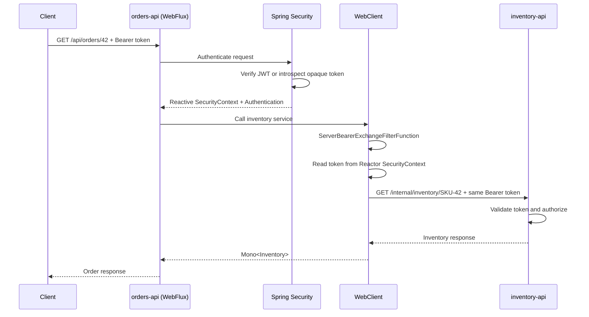
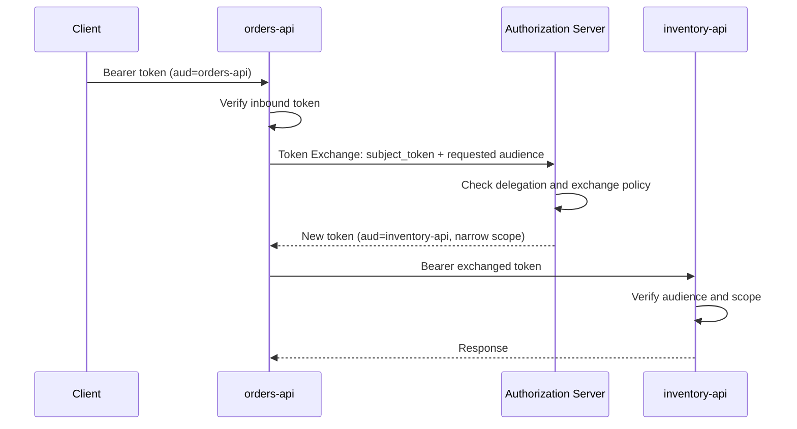

# ServerBearerExchangeFilterFunction and Token Relay in WebFlux

## 1. The Problem: An Authenticated Request Calls Another Service

In a Spring Security OAuth 2.0 Resource Server system using WebFlux, a request can pass through multiple services:

- A client calls **orders-api** with an access token.
- **orders-api** verifies the Bearer token and creates an `Authentication`.
- **orders-api** then calls **inventory-api** to check stock.
- **inventory-api** needs to know the original caller's identity or delegated permissions to enforce policies.

Incoming request:

```http
GET /api/orders/42 HTTP/1.1
Host: orders.example.test
Authorization: Bearer <alice-access-token>
```

After the token is verified, the service can use `WebClient` to call downstream. One option is **forwarding the current access token**:

```http
GET /internal/inventory/SKU-42 HTTP/1.1
Host: inventory.internal
Authorization: Bearer <alice-access-token>
```

Spring Security provides **`ServerBearerExchangeFilterFunction`** to perform token relay in reactive applications. The filter reads the `Authentication` from the **Reactor Security Context**, extracts the access token from the corresponding authentication, and attaches the Bearer `Authorization` header to outbound requests.

This lesson belongs to the **Token Relay** chapter of the **Spring Security OAuth 2.0 OIDC Resource Server** module. The goal is to understand this filter, how to connect it to `WebClient`, how to preserve the reactive context throughout processing, and the security boundaries when sending access tokens to other services.

| Component | Role |
|---|---|
| **orders-api** | WebFlux Resource Server receiving tokens from clients. |
| **inventory-api** | Downstream API needing to verify the caller or delegated permissions. |
| **WebClient** | Reactive HTTP client used to call downstream. |
| **ServerBearerExchangeFilterFunction** | `ExchangeFilterFunction` that forwards the current token. |
| **ReactiveSecurityContextHolder** | Retrieves `SecurityContext` from the Reactor Context. |

> **Key principle:** `ServerBearerExchangeFilterFunction` performs **token relay** — resending the access token currently used in the active request. It does not perform OAuth 2.0 Token Exchange, obtain a new token, change the audience, or refresh the token.

---

## 2. What Is Token Relay in WebFlux?

**Token relay** is when a service forwards the current request's Bearer access token to a downstream service. Downstream receives that token and verifies/authorizes it according to its own policies.



Token relay is suitable when downstream is designed to **receive the same user/delegated access token** and that token has the audience/scope for downstream.

### 2.1. What the Filter Does

In a reactive request with a suitable authentication:

1. Reads the reactive `SecurityContext`.
2. Retrieves the current `Authentication`.
3. If the authentication represents an OAuth2 access token, extracts the token value.
4. Builds an outbound `ClientRequest` with an `Authorization` Bearer header.
5. Passes the request to the next `ExchangeFunction`.

The forwarded token is the current token, intact by token value. The filter does not re-decode the JWT to grant permissions; it relies on the authentication already created by Spring Security during the inbound request.

### 2.2. What the Filter Does Not Do

`ServerBearerExchangeFilterFunction` does not:

- Re-verify the token a second time before sending.
- Change the token's audience/resource.
- Obtain a new token from the Authorization Server.
- Convert a user token into a service token.
- Perform RFC 8693 Token Exchange.
- Refresh an access token when it is about to expire.
- Revoke a token when downstream returns 401.
- Decide on its own whether downstream is allowed to receive the token.
- Replace downstream authorization checks.

Therefore, configuring the filter is only part of the architecture. The API still needs to define **which service may receive which token**, and downstream must still verify the credential against its own trust policy.

---

## 3. Tokens Flow Through Reactor Context, Not ThreadLocal

WebFlux uses Reactor to process asynchronous/non-blocking requests. A single request may switch across multiple threads during execution. Therefore, Servlet-style `ThreadLocal` `SecurityContextHolder` should not be treated as the identity source in a reactive pipeline.

Spring Security reactive stores the context in **Reactor Context**. `ReactiveSecurityContextHolder` provides an API to read the current context from a publisher.

```java
Mono<Authentication> authentication =
    ReactiveSecurityContextHolder.getContext()
        .map(SecurityContext::getAuthentication);
```

`ServerBearerExchangeFilterFunction` relies on this reactive mechanism. It can locate the current request's token when `WebClient` is invoked within the same reactive chain.

### 3.1. Per-Subscriber Context

Example:

```java
return orderService.loadOrder(orderId)
    .flatMap(order -> inventoryClient.getInventory(order.sku()))
    .map(inventory -> toOrderResponse(orderId, inventory));
```

If the publisher executes within a reactive request chain that has a `SecurityContext`, the filter can retrieve the authentication from that context.

Reactor Context is bound to the subscription, not pinned to a thread. Switching schedulers via `publishOn`/`subscribeOn` normally does not lose the Reactor Context. However, creating an independent subscription, offloading work to another async system, or breaking out of the reactive chain can lose security context if context is not propagated properly.

### 3.2. Do Not Call subscribe() Inside a Service

Anti-pattern:

```java
public Mono<OrderResponse> getOrder(String orderId) {
    inventoryClient.getInventory("SKU-42")
        .subscribe(); // Independent subscription, detached from the request chain

    return orderRepository.findById(orderId)
        .map(this::toResponse);
}
```

Consequences:

- The caller does not wait for the inventory result.
- Errors may be detached from the request's error handling.
- The `SecurityContext` may be missing in the independent subscription.
- Cancellation/deadlines are not propagated properly.
- The request may finish while the outbound call is still running.

Use composition:

```java
public Mono<OrderResponse> getOrder(String orderId) {
    return orderRepository.findById(orderId)
        .flatMap(order ->
            inventoryClient.getInventory(order.sku())
                .map(inventory -> toResponse(order, inventory))
        );
}
```

Keeping `Mono`/`Flux` within the same pipeline lets context, cancellation, and errors be managed by the request's subscription.

### 3.3. Do Not Call block() in a Reactive Request

Anti-pattern:

```java
Inventory inventory = inventoryClient.getInventory("SKU-42").block();
```

`block()` can stall the event loop, break the non-blocking flow, and increase latency. Use `flatMap`, `map`, `zip`, or appropriate operators to compose publishers.

### 3.4. Background Jobs

A background job enqueued to run after an HTTP request finishes should not assume it still has the old request's `SecurityContext`. Explicitly decide whether the job runs with:

- Its own workload/service identity.
- A securely issued delegated token with an appropriate lifetime/audience.
- Stored actor metadata for auditing, paired with authorization checks when the job executes.
- A supported delegation/token-exchange mechanism.

Never store raw access tokens in a message queue/log just to "restore Security Context" later. If a job needs to represent a user, design a dedicated credential lifecycle with expiry/revocation and restricted permissions.

---

## 4. Configuring WebFlux Resource Server

Before relaying, the inbound request must be authenticated. The example below uses JWT access tokens.

### 4.1. Dependencies

With the Spring Boot BOM managing versions:

```xml
<dependencies>
    <dependency>
        <groupId>org.springframework.boot</groupId>
        <artifactId>spring-boot-starter-webflux</artifactId>
    </dependency>

    <dependency>
        <groupId>org.springframework.boot</groupId>
        <artifactId>spring-boot-starter-security</artifactId>
    </dependency>

    <dependency>
        <groupId>org.springframework.boot</groupId>
        <artifactId>spring-boot-starter-oauth2-resource-server</artifactId>
    </dependency>

    <dependency>
        <groupId>org.springframework.boot</groupId>
        <artifactId>spring-boot-starter-test</artifactId>
        <scope>test</scope>
    </dependency>

    <dependency>
        <groupId>org.springframework.security</groupId>
        <artifactId>spring-security-test</artifactId>
        <scope>test</scope>
    </dependency>
</dependencies>
```

Do not add `spring-boot-starter-web` alongside it if the application is meant to run pure WebFlux without an explicit reason; Spring Boot may select the Servlet application type when both web stacks are present. Always inspect your application's actual dependency graph.

### 4.2. JWT Issuer and Audience

Example `application.yml`:

```yaml
spring:
  security:
    oauth2:
      resourceserver:
        jwt:
          issuer-uri: https://auth.example.test/realms/orders
          jwk-set-uri: https://auth.example.test/realms/orders/protocol/openid-connect/certs
          audiences:
            - orders-api
```

This is an example issuer/JWKS/audience configuration for Spring Boot versions supporting these properties. If you declare a `ReactiveJwtDecoder` bean manually, attach explicit issuer/time/audience/token-profile validators; do not assume auto-configuration continues applying validators once you replace the decoder.

### 4.3. SecurityWebFilterChain

```java
package com.example.orders.security;

import org.springframework.context.annotation.Bean;
import org.springframework.context.annotation.Configuration;
import org.springframework.http.HttpMethod;
import org.springframework.security.config.Customizer;
import org.springframework.security.config.annotation.web.reactive.EnableWebFluxSecurity;
import org.springframework.security.config.web.server.ServerHttpSecurity;
import org.springframework.security.web.server.SecurityWebFilterChain;

@Configuration
@EnableWebFluxSecurity
public class OrdersResourceServerSecurity {

    @Bean
    SecurityWebFilterChain apiSecurity(ServerHttpSecurity http) {
        return http
            .csrf(ServerHttpSecurity.CsrfSpec::disable)
            .authorizeExchange(exchange -> exchange
                .pathMatchers(HttpMethod.GET, "/api/orders/**")
                    .hasAuthority("SCOPE_orders:read")
                .pathMatchers(HttpMethod.POST, "/api/orders/**")
                    .hasAuthority("SCOPE_orders:write")
                .anyExchange().denyAll())
            .oauth2ResourceServer(oauth ->
                oauth.jwt(Customizer.withDefaults()))
            .build();
    }
}
```

This is a stateless API using the `Bearer` header. Disabling CSRF is only appropriate if the API does not use cookie/session authentication; browser applications combining sessions must design CSRF and security chains appropriately. `SecurityWebFilterChain` verifies inbound tokens and places `Authentication` into the reactive security context.

### 4.4. Opaque Tokens Can Also Be Relayed

If the inbound API uses opaque tokens, configure the Resource Server with introspection:

```yaml
spring:
  security:
    oauth2:
      resourceserver:
        opaquetoken:
          introspection-uri: https://auth.example.test/oauth2/introspect
          client-id: ${INTROSPECTION_CLIENT_ID}
          client-secret: ${INTROSPECTION_CLIENT_SECRET}
```

And:

```java
.oauth2ResourceServer(oauth ->
    oauth.opaqueToken(Customizer.withDefaults()))
```

After the opaque token is introspected and Spring Security creates the corresponding authentication, token relay can forward the current access token. Not every opaque-looking string is accepted automatically; inbound introspection must succeed first.

---

## 5. Creating WebClient with ServerBearerExchangeFilterFunction

This is the core configuration of the lesson.

```java
package com.example.orders.config;

import org.springframework.context.annotation.Bean;
import org.springframework.context.annotation.Configuration;
import org.springframework.security.oauth2.server.resource.web.reactive.function.client.ServerBearerExchangeFilterFunction;
import org.springframework.web.reactive.function.client.WebClient;

@Configuration
public class DownstreamWebClientConfig {

    @Bean
    WebClient inventoryWebClient(WebClient.Builder builder) {
        return builder
            .baseUrl("https://inventory.internal")
            .filter(new ServerBearerExchangeFilterFunction())
            .build();
    }
}
```

Spring Boot can provide a `WebClient.Builder` customized for the application context. In applications not using Boot auto-configuration, you can create a builder with `WebClient.builder()`.

### 5.1. Meaning of Each Component

- `baseUrl`: the configured root endpoint of the downstream service.
- `filter`: registers `ServerBearerExchangeFilterFunction` in the outbound pipeline.
- `build`: builds a `WebClient` that applies the filter to requests created by this client.

When an inbound request has OAuth2 Bearer Authentication, the filter retrieves the token from the reactive `SecurityContext` and sets the corresponding header on the outbound request.

### 5.2. Calling Downstream with WebClient

```java
package com.example.orders.client;

import com.example.orders.api.InventoryResponse;

import org.springframework.stereotype.Component;
import org.springframework.web.reactive.function.client.WebClient;

import reactor.core.publisher.Mono;

@Component
public class InventoryClient {

    private final WebClient inventoryWebClient;

    public InventoryClient(WebClient inventoryWebClient) {
        this.inventoryWebClient = inventoryWebClient;
    }

    public Mono<InventoryResponse> getInventory(String sku) {
        return inventoryWebClient.get()
            .uri("/internal/inventory/{sku}", sku)
            .retrieve()
            .bodyToMono(InventoryResponse.class);
    }
}
```

### 5.3. Calling Downstream from a Reactive Service

```java
package com.example.orders.service;

import com.example.orders.api.OrderResponse;
import com.example.orders.client.InventoryClient;
import com.example.orders.repository.OrderRepository;

import org.springframework.stereotype.Service;

import reactor.core.publisher.Mono;

@Service
public class OrderQueryService {

    private final OrderRepository orderRepository;
    private final InventoryClient inventoryClient;

    public OrderQueryService(
            OrderRepository orderRepository,
            InventoryClient inventoryClient) {
        this.orderRepository = orderRepository;
        this.inventoryClient = inventoryClient;
    }

    public Mono<OrderResponse> getOrder(String orderId) {
        return orderRepository.findById(orderId)
            .switchIfEmpty(Mono.error(
                new OrderNotFoundException(orderId)))
            .flatMap(order ->
                inventoryClient.getInventory(order.sku())
                    .map(inventory ->
                        OrderResponse.from(order, inventory))
            );
    }
}
```

`OrderRepository` here is a reactive repository returning `Mono<Order>`. In the pipeline above, the request stays on the same subscription; the filter can read the `SecurityContext` when `WebClient` performs the exchange.

### 5.4. What If There Is No Security Context?

`ServerBearerExchangeFilterFunction` does not synthesize new credentials. If no matching authentication/token is found in the reactive context, the outbound request proceeds without a relayed token. Downstream may return 401 if the endpoint requires a Bearer token.

If an outbound call **must** carry a user token, do not rely on downstream coincidentally returning 401 to detect a lost context. Check authentication at the service boundary or write an explicit policy for that use case.

---

## 6. Which Authentication Types Does Token Relay Support?

In Resource Server, two common authentication types are:

| Inbound Token | Typical Authentication | Token Relay |
|---|---|---|
| JWT access token | `JwtAuthenticationToken` | Extracts the access token from JWT authentication. |
| Opaque access token | `BearerTokenAuthentication` | Extracts the introspected access token. |
| Form login username/password | `UsernamePasswordAuthenticationToken` | Not an OAuth2 access-token authentication for relaying via this filter. |
| Anonymous request | Anonymous authentication/no token | No Bearer token to relay. |
| Service-specific custom authentication | Depends on implementation | Only works if represented as an OAuth2 token authentication type supported by the filter or via an explicit custom filter. |

The filter must not be treated as a generic API to turn any string in a principal into a Bearer credential. The token must come from an authentication verified by Spring Security.

### 6.1. Do Not Read the Token from the sub Claim

`sub` is the subject identifier, not the access token:

```java
// WRONG: subject is not a bearer credential.
String token = jwt.getSubject();
headers.setBearerAuth(token);
```

The token value is the original credential in OAuth2 token authentication. Never use `sub`, `email`, `preferred_username`, or custom claims as a Bearer token.

### 6.2. Do Not Relay an ID Token as an Access Token

An OIDC ID Token may be a signed JWT, but its purpose is to authenticate the user to the OIDC client. Downstream APIs require an access token with the right audience/resource and scope. Never take an ID Token from a login session and place it in `Authorization: Bearer` for a Resource Server.

---

## 7. Token Relay Differs from OAuth 2.0 Token Exchange

This is the most important distinction when designing microservices.

### 7.1. Relay: Resending the Exact Current Token

```text
Inbound token:
  aud = orders-api
  scope = orders:read

orders-api -> inventory-api:
  Authorization: Bearer <same-token>
```

No new token is issued. The token retains its original claims, audience, scope, lifetime, and issuer.

### 7.2. Token Exchange: Requesting a New Token for Downstream

Suppose the inbound token is only for `orders-api`, whereas `inventory-api` requires the `inventory-api` audience.

A token exchange flow can look like:



RFC 8693 defines OAuth 2.0 Token Exchange. It requires Authorization Server support and policies permitting exchange/delegation. `ServerBearerExchangeFilterFunction` **does not perform this flow**.

### 7.3. Comparison

| Criterion | Token Relay | Token Exchange |
|---|---|---|
| Outbound token | Same as inbound token | New token issued by the AS |
| Audience | Unchanged | Can be issued for downstream |
| Scope | Cannot narrow or expand itself | AS can issue an appropriate set of permissions |
| Network call to AS | Not needed merely to relay | Yes, per the token exchange protocol |
| Lifetime | Retains original token's expiry | Per the new token |
| Revocation | Depends on original token's mechanism | Per the new token/AS semantics |
| Delegation | Forwards existing identity/authority | AS evaluates subject/actor/delegation |
| Spring API | `ServerBearerExchangeFilterFunction` | OAuth2 client/token-exchange support or appropriate custom authorized flow |

### 7.4. When to Use Relay?

Relay is suitable if:

- The token has an audience accepted by downstream.
- Downstream trusts the same issuer and validates tokens under the same profile.
- The scopes in the token are sufficient and appropriately bounded.
- User delegation should be preserved.
- Policy permits downstream to receive this token.
- The token lifetime has enough remaining validity for the outbound operation.

### 7.5. When Are Token Exchange or Service Credentials Needed?

Use token exchange or an OAuth2 client credential flow when:

- The inbound token is intended only for the current API.
- Downstream requires a different audience.
- Scopes need to be narrowed before calling downstream.
- User subject and service actor must be distinguished.
- Downstream only accepts workload identity.
- You do not want to send the original user token to every microservice.
- A clear delegation chain/audit trail is required.

Never change the audience inside a JWT payload yourself. Only the AS can issue a newly signed token with the appropriate claims.

---

## 8. Audience and Scope Determine Whether Downstream Accepts the Token

Suppose the inbound access token is:

```json
{
  "iss": "https://auth.example.test/realms/orders",
  "sub": "alice-123",
  "aud": ["orders-api"],
  "scope": "orders:read",
  "exp": 1890003600
}
```

`orders-api` relays the exact token to `inventory-api`. Downstream checks `aud` and requires `inventory-api`, so it rejects the request.

This is the right behavior. Just because a token was verified at `orders-api` does not mean it is permitted at every service.

### 8.1. Audience Must Describe the Target Resource Server

A token can be issued as:

```json
{
  "aud": ["inventory-api"],
  "scope": "inventory:read"
}
```

or in a system with a multi-audience contract:

```json
{
  "aud": ["orders-api", "inventory-api"],
  "scope": "orders:read inventory:read"
}
```

Multi-audience tokens broaden the surface where a credential can be used. Only accept them if the AS and resource owners explicitly designed for them with an appropriate threat model. Do not add all microservices to `aud` "just to make relay convenient."

### 8.2. Inbound Scope May Be Insufficient for Downstream

`orders:read` does not necessarily include `inventory:read`. Downstream must check its own scopes/authorities:

```java
.authorizeExchange(exchange -> exchange
    .pathMatchers(HttpMethod.GET, "/internal/inventory/**")
        .hasAuthority("SCOPE_inventory:read")
    .anyExchange().denyAll())
```

Do not let downstream only check `authenticated` when the business domain requires specific permissions. Token relay neither elevates scopes nor guarantees scope suitability.

### 8.3. Audience and Scope Do Not Replace Object Authorization

Even when a token has `inventory:read`, downstream must still check tenant/owner/resource permissions. Scopes represent API/action-level permissions; they do not automatically authorize reading every record.

---

## 9. Limiting Token Leakage: Do Not Use One Relay WebClient for Every Host

`ServerBearerExchangeFilterFunction` attaches a Bearer token to outbound requests whenever a suitable authentication is present. Therefore, **every destination of a `WebClient` with this filter must be treated as capable of receiving the current user's credential**.

This poses a major risk if a single `WebClient` is shared across:

- `inventory.internal` — an authorized internal downstream service.
- `analytics.vendor.example` — an external service.
- A URL taken from a request parameter.
- A user-configured webhook URL.
- An arbitrary URL that can cause SSRF.

If a token is sent to the wrong host, the bearer credential can be leaked and replayed elsewhere.

### 9.1. Separate WebClients by Trust Boundary

A secure design:

```java
@Configuration
public class WebClientConfig {

    @Bean
    WebClient inventoryWebClient(WebClient.Builder builder) {
        return builder
            .baseUrl("https://inventory.internal")
            .filter(new ServerBearerExchangeFilterFunction())
            .build();
    }

    @Bean
    WebClient publicCatalogWebClient(WebClient.Builder builder) {
        // Do not relay user tokens to external/public services.
        return builder
            .baseUrl("https://catalog.vendor.example")
            .build();
    }
}
```

Each client has its own purpose and configured destination. Do not attach token relay to a global builder used for all outbound HTTP calls unless you can prove every destination is authorized to receive the credential.

### 9.2. Do Not Let Clients Choose Arbitrary Destination URLs

Risk:

```java
// DO NOT USE: caller-controlled URL on a WebClient with token relay.
public Mono<String> fetch(String userSuppliedUrl) {
    return relayWebClient.get()
        .uri(userSuppliedUrl)
        .retrieve()
        .bodyToMono(String.class);
}
```

If an attacker supplies their own host, the request can send the token to that host. This is credential exfiltration and may be combined with SSRF.

Instead:

- Use fixed base URLs in configuration.
- Map downstream service IDs to an allowlist of destinations.
- Validate scheme/host/port against policy.
- Do not follow redirects to untrusted origins when credentials may be forwarded.
- Restrict destinations via egress firewall/network policies.
- Never place tokens in query strings or URLs.
- Never write tokens to logs/traces.

### 9.3. Redirects and Retries Must Be Considered

An outbound request may encounter redirects or retries. Understand the behavior of the HTTP connector/client in use:

- Redirecting to another origin can create credential forwarding risks depending on the connector/configuration.
- Retrying a request can resend the same bearer token multiple times.
- A retry does not extend a token's expiration or refresh it.
- Do not retry indefinitely when downstream returns 401/403.
- Do not automatically send tokens to an unverified `Location` URL.
- For non-idempotent operations, retries can also duplicate side effects.

Define clear timeouts, retry budgets, and redirect policies. For calls with token relay, destination safety is just as critical as TLS.

---

## 10. Do Not Log or Expose Tokens

An access token is a bearer credential: anyone holding the token can use it within its granted permissions and lifetime.

Never record:

```text
Authorization: Bearer eyJ...
request.headers.Authorization
token.getTokenValue()
```

Avoid putting tokens into:

- Application logs.
- Exception messages.
- `WebClient` wiretap logs.
- HTTP tracing/baggage.
- Metrics labels.
- Distributed trace attributes.
- Error responses sent to clients.
- Queue messages or persistent job records without a dedicated credential-storage design.

If you need to trace outbound calls, log the correlation ID, downstream service ID, route, status, and latency. Never log the token, full `Authorization` header, or sensitive payloads.

### 10.1. Redact the Authorization Header

If wiretap/debug logging is enabled, verify that loggers and HTTP connectors do not print request headers containing Bearer tokens. Do not rely solely on production log levels usually being low; incident debugging might turn on verbose logging.

### 10.2. Do Not Return the Token to the Frontend

Controllers should not include relayed access tokens in response bodies. Tokens should only travel in outbound `Authorization` headers to permitted downstream services.

---

## 11. Downstream Must Verify Tokens as an Independent Resource Server

`inventory-api` should not treat a request arriving from `orders-api` as sufficient proof. It must verify the Bearer token against its own trust policy.

Example downstream WebFlux security:

```java
@Configuration
@EnableWebFluxSecurity
public class InventorySecurity {

    @Bean
    SecurityWebFilterChain inventoryChain(ServerHttpSecurity http) {
        return http
            .csrf(ServerHttpSecurity.CsrfSpec::disable)
            .authorizeExchange(exchange -> exchange
                .pathMatchers(HttpMethod.GET, "/internal/inventory/**")
                    .hasAuthority("SCOPE_inventory:read")
                .anyExchange().denyAll())
            .oauth2ResourceServer(oauth ->
                oauth.jwt(Customizer.withDefaults()))
            .build();
    }
}
```

In practice, `inventory-api` must configure the issuer, `inventory-api` audience, validators, and scopes per its contract. If the token only has audience `orders-api`, downstream will reject it. That signals the need for token exchange or service credentials.

### 11.1. Do Not Trust Self-Asserted Upstream Headers

Do not use headers like:

```http
X-Authenticated-User: alice-123
X-User-Roles: ADMIN
```

as standalone proof if clients can call downstream directly or spoof headers. If using gateway/service identity and trusted identity headers, you need:

- A network path restricted solely to the trusted proxy/gateway.
- The proxy stripping client-supplied headers and overwriting them.
- Downstream authenticating the proxy/service identity.
- Explicit integrity and policy controls.
- No direct ingress bypass.

Bearer token relay preserves a credential that downstream can verify itself; it does not make arbitrary custom headers trustworthy.

---

## 12. Using ServerBearerExchangeFilterFunction with JWT and Opaque Tokens

### 12.1. Inbound JWT

Flow:

1. Bearer token is extracted from the inbound request.
2. `ReactiveJwtDecoder` verifies signature and claims.
3. Spring Security creates a `JwtAuthenticationToken`.
4. `ServerBearerExchangeFilterFunction` reads the token from the authentication.
5. `WebClient` sends the same token to downstream.

The JWT token is neither re-signed nor transformed. `iss`, `aud`, `scope`, `exp`, and `jti` remain unchanged.

### 12.2. Inbound Opaque Token

Flow:

1. Bearer token is extracted from the inbound request.
2. `ReactiveOpaqueTokenIntrospector` calls the introspection endpoint.
3. The AS confirms the token and returns principal/attributes.
4. Spring Security creates a Bearer token authentication.
5. The filter can relay the original token value.
6. Downstream introspects/validates according to its own policy.

Opaque tokens are not decoded into JWTs just to be relayed. The filter only needs the token value inside the appropriate authentication.

### 12.3. When Inbound Authentication Is Not OAuth2 Bearer

For example, the application uses form login and `UsernamePasswordAuthenticationToken`. `ServerBearerExchangeFilterFunction` has no OAuth2 access token to extract. Never convert a username/password/session ID into a Bearer token yourself.

If downstream needs service identity in this use case, use an explicitly configured OAuth2 client credentials flow.

---

## 13. Service Identity Instead of User Token Relay

Not every outbound request should represent a user. A service may need to call downstream using **client credentials**:

```text
orders-api (service identity)
  -> inventory-api
  Authorization: Bearer <orders-api service token>
```

This is workload-to-workload authorization. Downstream sees the client/service principal instead of Alice. This fits scheduled jobs, internal maintenance, or tasks not requiring user delegation.

Spring Security OAuth2 Client can manage authorized clients and obtain access tokens per client registration. An illustrative client credentials configuration:

```yaml
spring:
  security:
    oauth2:
      client:
        registration:
          inventory-service:
            provider: internal-idp
            client-id: ${INVENTORY_CLIENT_ID}
            client-secret: ${INVENTORY_CLIENT_SECRET}
            authorization-grant-type: client_credentials
            scope:
              - inventory:read
        provider:
          internal-idp:
            token-uri: https://auth.example.test/oauth2/token
```

This is OAuth2 Client configuration, distinct from Resource Server inbound configuration. Using `client_credentials` requires a client registration/authorized-client manager and an appropriate `WebClient` filter to acquire tokens. `ServerBearerExchangeFilterFunction` does not replace the OAuth2 Client filter.

### 13.1. Comparing User Delegation and Service Identity

| Question | User Token Relay | Client Credentials |
|---|---|---|
| Whom does downstream see? | User/delegated principal | Service/client |
| Where does the token come from? | Inbound `SecurityContext` | Authorization Server via OAuth2 Client |
| Needs user scopes? | Yes, token must carry appropriate scopes | No; uses client scopes/grants |
| Used for background jobs? | Only with an explicit delegation lifecycle | Generally more appropriate |
| Auditing | Can record user subject and client | Records workload/client |
| Revocation | Depends on user token lifecycle | Depends on client credential/token lifecycle |

### 13.2. Do Not Conflate User and Service Authority

If `orders-api` uses client credentials, downstream must not assume the service token represents Alice. If both user and actor are needed, use delegation/token exchange or issuer-supported protocol claims. Never inject `X-User-Id` into requests to simulate user authority.

---

## 14. Token Exchange and Delegated Actors

In some systems, downstream needs to know both:

- **Subject:** user Alice being represented.
- **Actor:** `orders-api` calling downstream on behalf of Alice.

RFC 8693 Token Exchange provides a subject token/actor token model and a new token issued by the AS per policy. The new token can represent the appropriate delegation chain.

Conceptual example:

```json
{
  "iss": "https://auth.example.test/realms/orders",
  "sub": "alice-123",
  "aud": ["inventory-api"],
  "scope": "inventory:read",
  "act": {
    "sub": "orders-api"
  }
}
```

This is only an illustrative claim example; actual profile/actor claims must follow the AS contract. Never edit a JWT yourself to add `act` or change `aud`.

`ServerBearerExchangeFilterFunction` does not create such delegated tokens. It relays the existing token. If downstream needs an audience-specific token or actor chain, implement a token exchange/authorized client flow supported by the AS.

---

## 15. Error Handling When Downstream Rejects a Token

When downstream returns:

- **401 Unauthorized:** token rejected, wrong audience/issuer, expired, signature/introspection failed, or missing credential.
- **403 Forbidden:** token accepted, but the principal lacks scope/permission.
- **5xx:** downstream or dependency error.
- **Timeout:** processing outcome unknown if the request was already sent.

Do not automatically treat a downstream 401 as proof that the inbound token is invalid for `orders-api`. A token can be valid for `orders-api` yet invalid for `inventory-api` due to a different audience.

### 15.1. Do Not Retry Infinitely by Relaying Tokens

A relay filter only attaches the token; it does not refresh. If the token has expired, retrying with the same token will continue to fail. Handle according to policy:

- Return an appropriate error to the client.
- Use token exchange/authorized client if the architecture requires a different token.
- If an OAuth2 Client refresh flow exists, use the client's refresh management mechanism; never attempt to refresh a user token yourself by reading a refresh token from claims.
- Do not blindly retry non-idempotent operations.

### 15.2. Do Not Expose Overly Detailed Downstream Errors

Never return to the client:

- Raw downstream `Authorization` headers.
- Token payloads or introspection responses.
- Internal hostnames and stack traces.
- Secrets/client credentials.
- Internal policy/risk reasons.

You can map downstream 401/403 responses to appropriate business/API errors and log internal reason codes.

---

## 16. Testing Token Relay with WebClient

A test should prove that the filter actually reads the reactive `SecurityContext` and attaches the header, rather than merely mocking the controller to return a response.

### 16.1. Unit Test Using ExchangeFunction

You can inspect the outbound `ClientRequest` using a custom `ExchangeFunction`:

```java
import static org.assertj.core.api.Assertions.assertThat;

import java.time.Instant;
import java.util.List;
import java.util.concurrent.atomic.AtomicReference;

import org.junit.jupiter.api.Test;
import org.springframework.http.HttpHeaders;
import org.springframework.http.HttpStatus;
import org.springframework.security.oauth2.jwt.Jwt;
import org.springframework.security.oauth2.server.resource.authentication.JwtAuthenticationToken;
import org.springframework.security.oauth2.server.resource.web.reactive.function.client.ServerBearerExchangeFilterFunction;
import org.springframework.security.core.context.ReactiveSecurityContextHolder;
import org.springframework.web.reactive.function.client.ClientRequest;
import org.springframework.web.reactive.function.client.ClientResponse;
import org.springframework.web.reactive.function.client.ExchangeFunction;
import org.springframework.web.reactive.function.client.WebClient;

import reactor.core.publisher.Mono;
import reactor.test.StepVerifier;

class ServerBearerRelayTest {

    @Test
    void forwardsCurrentJwtAsBearerHeader() {
        String tokenValue = "test-access-token";
        AtomicReference<ClientRequest> captured =
            new AtomicReference<>();

        ExchangeFunction exchange = request -> {
            captured.set(request);
            return Mono.just(
                ClientResponse.create(HttpStatus.OK).build());
        };

        WebClient client = WebClient.builder()
            .exchangeFunction(exchange)
            .filter(new ServerBearerExchangeFilterFunction())
            .build();

        Jwt jwt = Jwt.withTokenValue(tokenValue)
            .header("alg", "RS256")
            .subject("alice-123")
            .issuer("https://auth.example.test/realms/orders")
            .audience(List.of("orders-api"))
            .issuedAt(Instant.now())
            .expiresAt(Instant.now().plusSeconds(300))
            .build();

        JwtAuthenticationToken authentication =
            new JwtAuthenticationToken(jwt);

        Mono<Void> call = client.get()
            .uri("https://inventory.internal/internal/inventory/SKU-42")
            .retrieve()
            .bodyToMono(Void.class)
            .contextWrite(
                ReactiveSecurityContextHolder.withAuthentication(
                    authentication));

        StepVerifier.create(call).verifyComplete();

        assertThat(captured.get()).isNotNull();
        assertThat(captured.get().headers().getFirst(
            HttpHeaders.AUTHORIZATION))
            .isEqualTo("Bearer " + tokenValue);
    }
}
```

This test verifies **token relay and Reactor Context**. It does not test JWT signature, JWKS, or issuer/audience validators of the inbound Resource Server because `Jwt`/`JwtAuthenticationToken` are constructed directly.

### 16.2. Test Without Authentication

Another test should call `WebClient` without writing `ReactiveSecurityContextHolder.withAuthentication(...)` and confirm that the filter does not synthesize a Bearer credential. If the downstream endpoint requires authentication, it will reject the request.

### 16.3. Test Opaque Tokens

Create a `BearerTokenAuthentication` from an introspection fixture in the test, place the authentication into Reactor Context, and verify the `Authorization` header contains the right token value. This test proves relaying opaque authentication works per the type supported in your Spring Security version.

### 16.4. Test Context Propagation Across the Service Chain

Test requests traversing:

```text
controller
  -> reactive service
  -> flatMap
  -> WebClient
  -> ServerBearerExchangeFilterFunction
```

Assert that the outbound header still carries the token. Add tests across `publishOn`/`subscribeOn` if the application has significant scheduler boundaries. Avoid testing only the standalone filter if real bugs stem from code detaching subscriptions or losing context.

### 16.5. Test That Tokens Are Not Sent to External Clients

Create two `WebClient` instances:

- `inventoryWebClient` with the relay filter.
- `publicCatalogWebClient` without the relay filter.

Send the same reactive authentication context through both, and assert only the request to inventory includes the `Authorization` Bearer header. This is a useful regression test for protecting trust boundaries.

---

## 17. Integration Testing with WebTestClient

`WebTestClient` can test inbound WebFlux security. Example:

```java
webTestClient
    .mutateWith(mockJwt()
        .jwt(jwt -> jwt
            .subject("alice-123")
            .claim("aud", List.of("orders-api")))
        .authorities(
            new SimpleGrantedAuthority("SCOPE_orders:read")))
    .get()
    .uri("/api/orders/42")
    .exchange()
    .expectStatus().isOk();
```

This tests authorization with mocked JWT authentication. To test token relay, downstream HTTP exchanges must also be captured/mocked as shown earlier. To test real JWT verification, use a signed JWT test key and a trusted test JWKS.

An integration test suite can include:

1. Valid inbound JWT, right scope → outbound `WebClient` sends the same Bearer token.
2. Inbound JWT missing scope → request blocked before calling downstream.
3. Inbound token with invalid signature → controller/downstream not called.
4. Inbound JWT with audience only for `orders-api` → relay still sends the same token; downstream `inventory-api` rejects audience mismatch.
5. Inbound token with downstream-compatible audience/scope → downstream accepts per policy.
6. No `SecurityContext` → filter does not synthesize a token.
7. Public `WebClient` without relay filter → no `Authorization` header.
8. Downstream returns 401 → error mapped properly, no infinite retries.
9. User-supplied URL cannot cause the token to be sent to an external host.
10. Async/background work does not accidentally reuse an old request's token.

---

## 18. Common Mistakes During Implementation

| Mistake | Consequence | Fix |
|---|---|---|
| Attaching the filter to a `WebClient` used for all hosts | Bearer tokens can leak to external services. | Create separate `WebClient` instances per trust boundary. |
| Assuming the filter exchanges tokens automatically | Downstream with a different audience still returns 401. | Use token exchange or service credentials. |
| Using `ThreadLocal` `SecurityContextHolder` in WebFlux | Cannot reliably find identity in reactive flows. | Use Reactor Security Context/`ReactiveSecurityContextHolder`. |
| Calling `subscribe()` inside a service | Detached subscription, separated errors/context. | Compose with `flatMap`/`map`. |
| Calling `block()` on the event loop | Blocks threads and reduces throughput. | Use reactive composition. |
| Relaying an ID Token | Downstream receives a token for the wrong purpose. | Use an OAuth access token with the right audience. |
| Using `sub` as the token | Downstream receives a subject string, not a credential. | Relay the token value from OAuth2 authentication. |
| Trusting downstream calls because they come from an internal service | Skips token verification/authorization. | Have downstream verify tokens or workload identity itself. |
| Token only has the first API's audience | Downstream API rightly rejects it. | Use token exchange or a token with an appropriate resource audience per policy. |
| Token missing downstream scope | 403. | Request the right scope via the AS; do not add authorities yourself. |
| Logging the `Authorization` header | Bearer credentials exposed in logs/traces. | Redact headers and log non-sensitive metadata. |
| Caller-controlled outbound URL | Credential exfiltration/SSRF. | Destination allowlists and fixed `WebClient` instances. |
| Using the filter for background jobs | Context does not exist or uses the wrong user. | Use explicit service identity/delegation. |
| Mistaking downstream 401 for an invalid inbound token | Mishandled error boundaries. | Distinguish downstream audience/resource policies. |
| Not checking redirect behavior | Tokens may travel to the wrong origin depending on client config. | Restrict redirects and egress. |

---

## 19. Performance and Operational Considerations

### 19.1. Relay Does Not Call the AS for a New Token

Compared to token exchange, `ServerBearerExchangeFilterFunction` does not require a round trip to the token endpoint just to attach the current token. It is an outbound request processing step in the `WebClient` pipeline.

This does not mean outbound calls are free: there is still DNS/TLS/network/downstream latency, and the token still needs to be verified by downstream.

### 19.2. Connection Pooling and Timeouts

HTTP connector/`WebClient` configuration requires appropriate timeouts and connection pools. For downstream calls carrying Bearer tokens:

- Timeouts must fit within the request deadline.
- Retries must have a budget and consider idempotency.
- Do not queue requests/tokens indefinitely.
- Do not retry 401/403 as transient errors.
- Monitor latency/status per downstream service ID.
- Never log raw request headers.

### 19.3. Expiring Tokens

The filter relays the current token even when it is close to `exp`. It does not check whether the token has enough remaining lifetime for the downstream call and does not auto-refresh. Downstream may receive an expired token by the time the request arrives.

If a workflow requires a fresh access token, use the OAuth2 Client/authorized-client lifecycle or an appropriate token exchange. Do not write custom logic to read a refresh token from a JWT (refresh tokens are not standard access token claims) or mint new JWTs yourself.

### 19.4. Clock Skew and Downstream Validation

Every Resource Server needs an appropriate time validation policy. A token valid at the first API may be rejected downstream if clocks/clock skew or audience/profile policies differ. Time synchronization and issuer contracts are system-wide responsibilities.

---

## 20. Token Relay Design Checklist

Before enabling `ServerBearerExchangeFilterFunction` in production:

| Question | What to Confirm |
|---|---|
| **Inbound authentication** | Tokens are verified/introspected by Spring Security before relaying. |
| **Reactive context** | `WebClient` calls execute within the right Reactor subscription holding `SecurityContext`. |
| **Token type** | `Authentication` is an appropriate OAuth2 access-token authentication. |
| **Downstream destination** | Base URL/host/port belong to an approved allowlist. |
| **Audience** | The token carries the audience required by downstream. |
| **Scope** | The token holds the permissions needed downstream; downstream still authorizes independently. |
| **Token exchange** | If a new audience/restricted scope is needed, use AS exchange/client flows. |
| **WebClient separation** | The relay filter is not attached to clients calling external/public URLs. |
| **Redirects** | Redirects to other origins are controlled. |
| **TLS** | Outbound HTTPS and certificate validation are properly configured. |
| **Header handling** | Manual `Authorization` headers are not ambiguously mixed with relay. |
| **Logging** | `Authorization` headers are redacted in logs/traces/wiretap. |
| **Background work** | Does not depend on a request's `SecurityContext` after the request ends. |
| **Failure handling** | 401/403/5xx/timeouts are classified properly; no infinite retries. |
| **Testing** | Tests cover header relay, missing context, external clients, and audience/scope mismatches. |
| **Lifecycle** | Token expiry/revocation aligns with downstream call durations. |

---

## 21. Runbook: Downstream Does Not Receive the Bearer Token

When `inventory-api` returns 401 or no `Authorization` header is seen, investigate in order:

1. **Inbound request:** did the client send `Authorization: Bearer`?
2. **Inbound authentication:** did Resource Server create a `JwtAuthenticationToken`/Bearer authentication?
3. **Reactive context:** is `WebClient` invoked inside the same publisher chain?
4. **Filter registration:** does the right `WebClient` bean have `ServerBearerExchangeFilterFunction` attached?
5. **Subscription:** does the code call `subscribe()` independently or run in the background?
6. **Outbound capture:** does the actual request contain an `Authorization` header? Check only in safe tests/debugging without printing token values.
7. **Authentication type:** does the authentication hold an OAuth2 access token?
8. **Audience:** does the token have the audience required by downstream?
9. **Scope:** does the token have the scope/authority required by downstream?
10. **Expiry:** did the token expire before downstream processed it?
11. **Issuer/JWKS:** does downstream trust the corresponding issuer/key?
12. **Redirects/proxies:** did the outbound request change origins or have headers stripped?
13. **Security policy:** does downstream have the right route matchers/authority mappings?
14. **Token exchange:** if audiences differ, does the AS support exchange?
15. **Logging:** ensure raw `Authorization` headers are not enabled during debugging.

If the header is not attached, inspect context/filter wiring. If the header is attached but downstream rejects it, inspect the token contract (audience, scope, issuer, expiry) and downstream authorization.

---

## 22. Technical References

- [Spring Security — Reactive OAuth 2.0 Resource Server JWT](https://docs.spring.io/spring-security/reference/reactive/oauth2/resource-server/jwt.html): inbound JWT validation in WebFlux.
- [Spring Security — Reactive OAuth 2.0 Resource Server Opaque Token](https://docs.spring.io/spring-security/reference/reactive/oauth2/resource-server/opaque-token.html): introspection in a reactive Resource Server.
- [Spring Security API — ServerBearerExchangeFilterFunction](https://docs.spring.io/spring-security/site/docs/current/api/org/springframework/security/oauth2/server/resource/web/reactive/function/client/ServerBearerExchangeFilterFunction.html): filter for relaying access tokens from reactive security context.
- [Spring Security — Reactive Security Context](https://docs.spring.io/spring-security/reference/reactive/authorization/method.html): reactive method authorization and context integration.
- [Spring Framework — WebClient](https://docs.spring.io/spring-framework/reference/web/webflux-webclient.html): reactive HTTP client, filters, and exchanges.
- [Project Reactor — Context](https://projectreactor.io/docs/core/release/reference/advancedFeatures/context.html): subscriber context and propagation in reactive pipelines.
- [RFC 6750 — OAuth 2.0 Bearer Token Usage](https://www.rfc-editor.org/rfc/rfc6750.html): Bearer tokens in the `Authorization` header and security considerations.
- [RFC 8693 — OAuth 2.0 Token Exchange](https://www.rfc-editor.org/rfc/rfc8693.html): exchanging subject/actor tokens for other resources/audiences.
- [RFC 9068 — JWT Profile for OAuth 2.0 Access Tokens](https://www.rfc-editor.org/rfc/rfc9068.html): access-token JWT profile and audience/type validation.
- [OWASP — OAuth 2.0 Cheat Sheet](https://cheatsheetseries.owasp.org/cheatsheets/OAuth2_Cheat_Sheet.html): audience restriction, token handling, and security recommendations.
- [OWASP — Server Side Request Forgery Prevention Cheat Sheet](https://cheatsheetseries.owasp.org/cheatsheets/Server_Side_Request_Forgery_Prevention_Cheat_Sheet.html): destination allowlists and outbound URL controls.

**Conclusion:** `ServerBearerExchangeFilterFunction` enables WebFlux `WebClient` to **forward the current access token** from the reactive Security Context to downstream services via the `Bearer` `Authorization` header. It is useful when downstream is permitted to receive that exact token and the audience/scope match. It does not issue new tokens, refresh tokens, change audiences, or perform Token Exchange. Keep relay `WebClient` instances separate from clients calling external services, keep requests inside the same reactive pipeline, never log tokens, and let downstream independently verify tokens and check permissions. If downstream needs a different audience or delegation, use OAuth2 Token Exchange or workload credentials per the Authorization Server contract.
