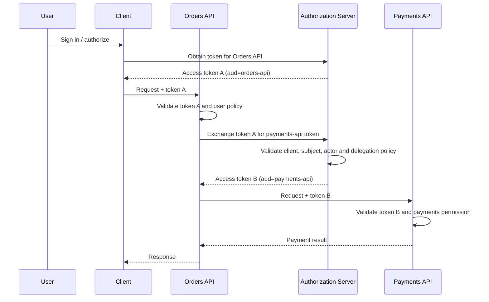

# When a Dedicated Target Service Token or Token Exchange Is Needed

In a **Spring Security OAuth 2.0/OIDC Resource Server**, a request often passes through multiple APIs. For example, the Orders API receives a request from a web client and then calls the Payments API, Inventory API, or Shipping API. The token received by the Orders API **cannot automatically be used at every backend service behind it**. An access token is issued for a specific resource server, with an audience, scopes, lifetime, and usage rights governed by the contract between the Authorization Server (AS), the client, and the target service.

When the Orders API calls the Payments API, there are three common choices:

1. **Forward the current token:** only forward the inbound access token when the token was genuinely issued for the Payments API (or an audience set accepted by the Payments API) and the permissions in the token are sufficient for the action.
2. **Obtain a token via Client Credentials:** the Orders API calls the Payments API under its own service account identity. This fits when the downstream action belongs to the service's own permissions and does not need to represent a user.
3. **Token exchange / On-Behalf-Of (OBO):** the Orders API uses the token representing the current user as a subject token, authenticates itself to the AS, and requests a new access token intended for the Payments API. The new token can carry delegation rights permitted by the AS.

The deciding factor is not the number of HTTP hops, but **who is acting, on whose behalf they are acting, which resource the token is intended for, and how far the AS allows delegation**.

This lesson covers how to choose between forwarding, service credentials, and RFC 8693 token exchange; analyzes audience/resource, scopes, and subject/actor/delegation claims; integrates Spring Security OAuth2 Client with WebClient; protects downstream trust boundaries; and tests the entire flow from the entry API to the target service.

> **Principle:** Each Resource Server must verify tokens intended for itself. Token exchange creates a new credential according to AS policy; it is not swapping token strings, copying headers, or adding an audience to a JWT yourself.

## 1. The Problem: One Request, Multiple Resource Servers

Suppose the architecture is:

```text
Browser / Mobile Client
        |
        | access token for orders-api
        v
   Orders API
        |
        | call to Payments API
        v
   Payments API
        |
        | call to Fraud API
        v
    Fraud API
```

The inbound token may contain:

```json
{
  "iss": "https://login.example.test/realms/shop",
  "sub": "user-123",
  "aud": ["orders-api"],
  "scope": "orders.read orders.pay",
  "exp": 1900000000
}
```

The Orders API verifies the token against its own issuer/audience. When it needs to call the Payments API, the fact that the token has a valid signature **does not prove** it is a valid credential for the Payments API.

The Payments API may require:

```text
audience = payments-api
scope = payments.create
issuer = trusted shop issuer
subject = user-123 (if delegated operation)
actor = orders-service (if delegated)
tenant = shop-a (per contract)
```

If the Orders API sends a token whose audience is only `orders-api` to the Payments API, downstream should reject that token. This is the right behavior: a token issued for one resource should not be usable at another resource.

### 1.1. Practical Request Example

The client sends:

```http
POST /api/orders/order-42/pay
Host: orders.example.test
Authorization: Bearer <TOKEN_FOR_ORDERS_API>
Content-Type: application/json

{"paymentMethodId": "card-7"}
```

The Orders API may need to:

1. Verify the inbound token intended for the Orders API.
2. Check that the user is permitted to pay for `order-42` in the active tenant.
3. Call the Payments API with a credential intended for the Payments API.
4. Process the response and return the result to the client.

Step 3 requires choosing a credential strategy. Never forward the inbound request's `Authorization` header by default.

## 2. Distinguishing Issuer, Client, Subject, Actor, and Audience

| Component | Meaning | Example |
|---|---|---|
| **Issuer** | AS that issued the token | https://login.example.test/realms/shop |
| **Client** | OAuth client requesting/sending the token | shop-web, orders-service |
| **Subject** | User or principal the token refers to | user-123 |
| **Actor** | Party performing the action on behalf of the subject, if delegated | orders-service |
| **Audience/resource** | API permitted to receive the access token | orders-api, payments-api |
| **Scope** | Permissions granted within the token's scope | orders.read, payments.create |
| **Tenant** | Data/organization boundary per contract | shop-a |

A request can have subject `user-123`, actor `orders-service`, and audience `payments-api`. That means the Orders service is calling Payments on behalf of `user-123`, provided the AS issued the corresponding delegation rights.

Never infer actor solely from `client_id`, never infer audience from the `Host` header, and never infer user authority from a service account's scope.

### 2.1. Service-Representing Tokens Differ from User-Representing Tokens

Client Credentials token:

```json
{
  "iss": "https://login.example.test/realms/shop",
  "sub": "orders-service",
  "aud": ["payments-api"],
  "scope": "payments.create"
}
```

Delegated token:

```json
{
  "iss": "https://login.example.test/realms/shop",
  "sub": "user-123",
  "aud": ["payments-api"],
  "scope": "payments.create",
  "act": {
    "sub": "orders-service"
  }
}
```

These are illustrative claim examples. Exact structures depend on the token profile and AS contract. The first token states the service is the principal; the second represents the user as the subject and the service as the actor under an appropriate delegation model.

## 3. Three Credential Propagation Strategies

| Strategy | Credential Sent Downstream | Whom Does It Represent? | When Appropriate |
|---|---|---|---|
| **Forward inbound token** | Token the client sent to the current API | Subject/client per the original token | Token was already issued for downstream or within an allowed audience set |
| **Client Credentials** | New token issued by the AS for the service client | The service itself | Backend task belonging to service rights, no user delegation needed |
| **Token exchange / OBO** | New token exchanged from the inbound token | Subject/user and actor/service per policy | Service calls downstream on behalf of user with new audience/scope |

### 3.1. Forwarding a Token Is Not Token Exchange

Forwarding keeps the access token unchanged. No new token issuance occurs, and neither audience nor scope changes. If the token is not intended for the Payments API, forwarding cannot fix that.

### 3.2. Client Credentials Is Not OBO

Client Credentials issues a token for the service client. It does not automatically carry the permissions of the end user calling the Orders API. If the Orders API uses a service token to perform every action for every user, service privileges may exceed individual user privileges and lose attribution/delegation semantics.

### 3.3. Token Exchange Creates a New Token

Token exchange is a grant at the AS. The service sends a subject token (and optionally an actor token), authenticates its own client, and specifies token type/resource/audience/scope per contract. The AS checks policies and issues a new token. The downstream Resource Server verifies the new token independently.

## 4. When Is Forwarding the Existing Access Token Allowed?

Forwarding can be valid when the inbound token was issued for use across multiple resource servers by contract. For example, a token containing:

```json
{
  "aud": ["orders-api", "payments-api"],
  "scope": "orders.read payments.create"
}
```

If the Payments API accepts that audience set and policy permits it, the Orders API can forward the raw bearer token.

However, multi-audience tokens widen credential exposure. If the token is leaked at one service, it can be used across multiple services. Least privilege generally favors narrow-audience tokens and dedicated tokens per downstream resource.

### 4.1. Checklist Before Forwarding

Only forward if all applicable conditions are met:

- The token was issued by an issuer trusted by downstream.
- The audience contains the exact downstream resource identifier per contract.
- The token type/profile is an access token accepted by downstream.
- Scopes/permissions are sufficient for the action.
- The token is unexpired and not sender-constrained in a way the new request cannot satisfy.
- Tenant/delegation context aligns with downstream policy.
- Forwarding tokens through an intermediary service is permitted by the architecture.
- There is no requirement for token exchange to narrow the audience or record an actor.

Do not decode the inbound token payload yourself and guess that it works downstream. Decisions must rely on verified tokens and agreed contracts; downstream still validates independently.

### 4.2. Do Not Forward ID Tokens

An OIDC ID token is for the OIDC client to confirm an authentication event. It is not an access token for the Payments API. Never send an ID token in `Authorization: Bearer` downstream simply because it contains a subject or email.

### 4.3. Do Not Forward Refresh Tokens

A refresh token is used at the AS to request new tokens under the corresponding grant. It is not a bearer credential for calling business APIs. Never send refresh tokens to the Payments API, put them into messages/events, or log them.

### 4.4. Sender-Constrained Tokens

If the inbound token is bound to a DPoP key or mTLS certificate, copying the access token string to another service may not suffice. Proof/certificate binding must be fulfilled per contract. Never convert a sender-constrained token into a plain Bearer token by skipping checks.

## 5. Audience Is the Primary Boundary for Downstream Tokens

Suppose:

```text
Orders API:
  resource identifier = orders-api

Payments API:
  resource identifier = payments-api
```

Inbound token:

```json
{"aud": ["orders-api"]}
```

This token must not be accepted at the Payments API if the expected audience is `payments-api`.

### 5.1. Scope Does Not Replace Audience

A token with:

```json
{
  "aud": ["orders-api"],
  "scope": "payments.create"
}
```

can still be invalid at the Payments API. A scope named `payments.create` does not by itself prove the token was issued for the Payments resource.

### 5.2. Audience Does Not Replace Scope

Conversely:

```json
{
  "aud": ["payments-api"],
  "scope": "orders.read"
}
```

was issued for the Payments API, but lacks permission to create a payment. Downstream must verify both audience and action permissions.

### 5.3. Do Not Edit the Audience Yourself

Wrong:

```java
Map<String, Object> claims = decodeWithoutVerification(inboundToken);
claims.put("aud", List.of("payments-api"));
return serialize(claims);
```

Altering the payload breaks the signature; re-signing with a key not owned by the AS means the Payments API cannot trust the token. Only the AS or an issuer trusted by downstream may issue credentials with a new audience.

### 5.4. String and Array Audiences

A JWT audience can be a string or an array per the JWT specification. Spring Security provides `Jwt.getAudience()` to inspect the list. Each API requires its specific expected resource identifier; do not check merely that an audience exists.

## 6. Client Credentials: Service Calls Downstream Under Its Own Identity

Client Credentials fits when the Orders service has its own backend rights, such as submitting scheduled settlement batches, syncing system catalogs, checking Payments API health/status, executing internal workflows permitted by service policy, or handling tasks that do not represent a specific end user.

The AS issues a token to the authenticated client:

```text
client_id = orders-service
aud       = payments-api
scope     = payments.create
sub       = orders-service (per token profile)
```

The Payments API knows the caller is the Orders service. If auditing the end user who initiated the workflow is needed, the Orders service can record attribution in business audits or use a delegated token per contract; never pretend a service token is a user's token.

### 6.1. Configuring Client Registration

Spring Boot example:

```yaml
spring:
  security:
    oauth2:
      client:
        registration:
          payments-service:
            provider: shop-issuer
            client-id: orders-service
            client-secret: ${ORDERS_SERVICE_CLIENT_SECRET}
            authorization-grant-type: client_credentials
            scope:
              - payments.create
        provider:
          shop-issuer:
            token-uri: https://login.example.test/realms/shop/protocol/openid-connect/token
```

This is outbound OAuth2 Client configuration. It does not replace inbound Resource Server configuration. Secrets should come from a secret manager or proper environment injection, never committed to source control or logged.

Some AS implementations require `client_secret_basic`, `private_key_jwt`, mTLS, or other client authentication methods. Configuration must match the AS contract; do not assume a client secret is always the only method.

### 6.2. Creating OAuth2AuthorizedClientManager for Service Credentials

In a Servlet application, service-layer code can use `AuthorizedClientServiceOAuth2AuthorizedClientManager`:

```java
@Configuration
public class PaymentsOAuthClientConfiguration {

    @Bean
    OAuth2AuthorizedClientManager paymentsAuthorizedClientManager(
            ClientRegistrationRepository registrations,
            OAuth2AuthorizedClientService authorizedClients) {

        OAuth2AuthorizedClientProvider provider =
            OAuth2AuthorizedClientProviderBuilder.builder()
                .clientCredentials()
                .build();

        AuthorizedClientServiceOAuth2AuthorizedClientManager manager =
            new AuthorizedClientServiceOAuth2AuthorizedClientManager(
                registrations,
                authorizedClients
            );

        manager.setAuthorizedClientProvider(provider);
        return manager;
    }
}
```

Imports:

```java
import org.springframework.context.annotation.Bean;
import org.springframework.context.annotation.Configuration;
import org.springframework.security.oauth2.client.AuthorizedClientServiceOAuth2AuthorizedClientManager;
import org.springframework.security.oauth2.client.OAuth2AuthorizedClientManager;
import org.springframework.security.oauth2.client.OAuth2AuthorizedClientProvider;
import org.springframework.security.oauth2.client.OAuth2AuthorizedClientProviderBuilder;
import org.springframework.security.oauth2.client.OAuth2AuthorizedClientService;
import org.springframework.security.oauth2.client.registration.ClientRegistrationRepository;
```

`AuthorizedClientServiceOAuth2AuthorizedClientManager` suits service-tier authorization not tied to a specific `HttpServletRequest`. For flows directly tied to servlet requests/sessions, `DefaultOAuth2AuthorizedClientManager` and `OAuth2AuthorizedClientRepository` may be more appropriate.

### 6.3. Obtaining an Access Token by Registration

```java
@Service
public class PaymentsServiceTokenProvider {

    private final OAuth2AuthorizedClientManager manager;

    public PaymentsServiceTokenProvider(
            OAuth2AuthorizedClientManager manager) {
        this.manager = manager;
    }

    public String accessToken() {
        OAuth2AuthorizeRequest request =
            OAuth2AuthorizeRequest
                .withClientRegistrationId("payments-service")
                .principal("orders-service")
                .build();

        OAuth2AuthorizedClient client = manager.authorize(request);

        if (client == null) {
            throw new IllegalStateException(
                "Could not authorize payments-service client"
            );
        }

        return client.getAccessToken().getTokenValue();
    }
}
```

Imports:

```java
import org.springframework.security.oauth2.client.OAuth2AuthorizeRequest;
import org.springframework.security.oauth2.client.OAuth2AuthorizedClient;
import org.springframework.stereotype.Service;
```

The manager/provider is responsible for acquiring tokens and managing the authorized-client lifecycle per configuration. Never hold a token indefinitely in a static field; tokens expire and the manager can acquire fresh ones when needed.

### 6.4. Calling the Payments API with a Service Token

```java
@Service
public class PaymentsGateway {

    private final WebClient paymentsWebClient;
    private final PaymentsServiceTokenProvider tokenProvider;

    public PaymentsGateway(
            WebClient paymentsWebClient,
            PaymentsServiceTokenProvider tokenProvider) {
        this.paymentsWebClient = paymentsWebClient;
        this.tokenProvider = tokenProvider;
    }

    public Mono<PaymentResponse> createPayment(
            PaymentCommand command) {

        String token = tokenProvider.accessToken();

        return paymentsWebClient.post()
            .uri("/api/payments")
            .headers(headers -> headers.setBearerAuth(token))
            .bodyValue(command)
            .retrieve()
            .bodyToMono(PaymentResponse.class)
            .block();
    }
}
```

This is a Servlet/blocking service example. In WebFlux, do not call `block()`; the reactive section below demonstrates using `Mono` and the reactive authorized client manager.

**Important:** The token in this example represents `orders-service`. The Payments API must check the service client's permissions, scope, audience, tenant/object policies, and business state. If the payment must be authorized for the acting user, Client Credentials alone may not suffice.

## 7. Spring Security OAuth2 Client with WebClient

Spring Security provides a filter function to attach an OAuth2 authorized client to an outbound `WebClient`. This avoids manually managing `Bearer` headers in many places.

Servlet example:

```java
@Bean
WebClient paymentsWebClient(
        OAuth2AuthorizedClientManager authorizedClientManager) {

    ServletOAuth2AuthorizedClientExchangeFilterFunction oauth2 =
        new ServletOAuth2AuthorizedClientExchangeFilterFunction(
            authorizedClientManager
        );

    oauth2.setDefaultClientRegistrationId("payments-service");

    return WebClient.builder()
        .baseUrl("https://payments.example.test")
        .apply(oauth2.oauth2Configuration())
        .build();
}
```

Imports:

```java
import org.springframework.context.annotation.Bean;
import org.springframework.security.oauth2.client.OAuth2AuthorizedClientManager;
import org.springframework.security.oauth2.client.web.reactive.function.client.ServletOAuth2AuthorizedClientExchangeFilterFunction;
import org.springframework.web.reactive.function.client.WebClient;
```

Exact package/imports must match your Spring Security version; the Servlet stack filter function resides in its corresponding integration package. When using a default registration, every request passing through the `WebClient` filter looks up/authorizes an authorized client via the manager.

Call example:

```java
public Mono<PaymentResponse> createPayment(PaymentCommand command) {
    return paymentsWebClient.post()
        .uri("/api/payments")
        .bodyValue(command)
        .retrieve()
        .bodyToMono(PaymentResponse.class);
}
```

The registration and manager configurations must exist; if the API needs a specific OAuth client per downstream service, use explicit registrations rather than one global default that makes no distinction between resources.

### 7.1. Do Not Use the Same Registration for Every Downstream Service

The Orders API and Payments API have different audiences/scopes. Create separate registrations or configure appropriate client providers:

```text
payments-service:
  audience/resource = payments-api
  scope = payments.create

inventory-service:
  audience/resource = inventory-api
  scope = inventory.reserve

shipping-service:
  audience/resource = shipping-api
  scope = shipping.create
```

If the AS uses a `resource` parameter or audience-specific token endpoint policy, configure the client request to send the resource information per contract. Setting `scope` alone does not guarantee the AS issues the right audience.

## 8. WebFlux: Reactive OAuth2 Client and WebClient

In WebFlux, use the reactive authorized-client manager:

- `ReactiveClientRegistrationRepository`
- `ReactiveOAuth2AuthorizedClientService`
- `ReactiveOAuth2AuthorizedClientManager`
- `AuthorizedClientServiceReactiveOAuth2AuthorizedClientManager`
- `ServerOAuth2AuthorizedClientExchangeFilterFunction`

Example manager for Client Credentials:

```java
@Bean
ReactiveOAuth2AuthorizedClientManager paymentsReactiveAuthorizedClientManager(
        ReactiveClientRegistrationRepository registrations,
        ReactiveOAuth2AuthorizedClientService authorizedClients) {

    ReactiveOAuth2AuthorizedClientProvider provider =
        ReactiveOAuth2AuthorizedClientProviderBuilder.builder()
            .clientCredentials()
            .build();

    AuthorizedClientServiceReactiveOAuth2AuthorizedClientManager manager =
        new AuthorizedClientServiceReactiveOAuth2AuthorizedClientManager(
            registrations,
            authorizedClients
        );

    manager.setAuthorizedClientProvider(provider);
    return manager;
}
```

Imports:

```java
import org.springframework.context.annotation.Bean;
import org.springframework.security.oauth2.client.AuthorizedClientServiceReactiveOAuth2AuthorizedClientManager;
import org.springframework.security.oauth2.client.ReactiveOAuth2AuthorizedClientManager;
import org.springframework.security.oauth2.client.ReactiveOAuth2AuthorizedClientProvider;
import org.springframework.security.oauth2.client.ReactiveOAuth2AuthorizedClientProviderBuilder;
import org.springframework.security.oauth2.client.ReactiveOAuth2AuthorizedClientService;
import org.springframework.security.oauth2.client.registration.ReactiveClientRegistrationRepository;
```

WebClient:

```java
@Bean
WebClient paymentsWebClient(
        ReactiveOAuth2AuthorizedClientManager manager) {

    ServerOAuth2AuthorizedClientExchangeFilterFunction oauth2 =
        new ServerOAuth2AuthorizedClientExchangeFilterFunction(
            manager
        );

    oauth2.setDefaultClientRegistrationId("payments-service");

    return WebClient.builder()
        .baseUrl("https://payments.example.test")
        .filter(oauth2)
        .build();
}
```

Imports:

```java
import org.springframework.security.oauth2.client.web.reactive.function.client.ServerOAuth2AuthorizedClientExchangeFilterFunction;
import org.springframework.web.reactive.function.client.WebClient;
```

Calling downstream:

```java
public Mono<PaymentResponse> createPayment(
        PaymentCommand command) {

    return paymentsWebClient.post()
        .uri("/api/payments")
        .bodyValue(command)
        .retrieve()
        .bodyToMono(PaymentResponse.class);
}
```

Never call `block()` on the reactive request path. Token acquisition and outbound HTTP requests must preserve the reactive chain, timeouts, and error propagation.

### 8.1. Reactive Context Is Not an Arbitrary Token Store

Spring Security can use Reactor Context to associate authentication/authorized-client contexts. Never copy raw tokens into global mutable state or `ThreadLocal`. When using delegated tokens per user request, bind them accurately to the request/principal context so tokens are never mixed up between concurrent users.

## 9. Token Exchange per RFC 8693

OAuth 2.0 Token Exchange (RFC 8693) defines a grant enabling a client to exchange one security token for another according to AS policy.

Use case:

```text
Client -> Orders API:
  access token for orders-api
  subject = user-123

Orders API -> Authorization Server:
  authenticated client = orders-service
  subject_token = inbound user token
  audience = payments-api
  scope = payments.create

Authorization Server:
  validates subject token
  validates orders-service client
  checks delegation policy
  issues a new token for payments-api

Orders API -> Payments API:
  new access token for payments-api
```

Token exchange is not the API signing a new JWT itself. The AS is the party deciding and issuing the new token.

### 9.1. Core Parameters

RFC 8693 defines the grant type:

```text
urn:ietf:params:oauth:grant-type:token-exchange
```

A request may include:

| Parameter | Meaning |
|---|---|
| `grant_type` | Token exchange grant identifier |
| `subject_token` | Token representing the subject the client wants to exchange |
| `subject_token_type` | Token type of the subject token |
| `actor_token` | Token representing the actor performing the exchange, if needed |
| `actor_token_type` | Type of the actor token |
| `requested_token_type` | Desired token type from the AS, typically access token |
| `audience` | Target resource server/audience |
| `scope` | Desired scope for the new token |
| `resource` | Resource indicator per RFC 8707 if supported by the AS |
| client authentication | Client authenticates at the token endpoint using its registered method |

An access-token subject token typically has type:

```text
urn:ietf:params:oauth:token-type:access_token
```

Requested access token type is also commonly:

```text
urn:ietf:params:oauth:token-type:access_token
```

Specific values and extensions must follow the RFC/AS contract. Not every provider supports every parameter.

### 9.2. Illustrative Token Exchange Request

```http
POST /realms/shop/protocol/openid-connect/token HTTP/1.1
Host: login.example.test
Authorization: Basic <ORDERS_SERVICE_CLIENT_CREDENTIALS>
Content-Type: application/x-www-form-urlencoded

grant_type=urn%3Aietf%3Aparams%3Aoauth%3Agrant-type%3Atoken-exchange&
subject_token=<INBOUND_ACCESS_TOKEN>&
subject_token_type=urn%3Aietf%3Aparams%3Aoauth%3Atoken-type%3Aaccess_token&
requested_token_type=urn%3Aietf%3Aparams%3Aoauth%3Atoken-type%3Aaccess_token&
audience=payments-api&
scope=payments.create
```

This is a form request example. Client authentication can be `client_secret_basic`, `private_key_jwt`, mTLS, or another method supported by the AS. Never place literal client secrets in code or logs.

### 9.3. Illustrative Token Exchange Response

```json
{
  "access_token": "<NEW_ACCESS_TOKEN>",
  "issued_token_type": "urn:ietf:params:oauth:token-type:access_token",
  "token_type": "Bearer",
  "expires_in": 300,
  "scope": "payments.create"
}
```

The new token must be treated as an independent credential. The Payments API verifies issuer, signature/introspection, audience, expiration, scope, and delegation policy like any other access token.

### 9.4. The AS Can Reject the Exchange

The AS must check:

- Is the subject token valid, unexpired, and eligible as an input?
- Is the Orders service permitted to exchange that token?
- Is the target audience/resource permitted?
- Are the requested scopes within delegable permissions?
- Has the tenant/user been suspended or revoked?
- Is there an appropriate actor/delegation policy?
- Is the token type/profile supported?

If the client requests `payments.admin` while the subject only has `payments.create`, the AS must reject or downscope per contract. The Resource Server must never assume the requested scope was granted; it must read the actual scope from the token response/claims.

## 10. Subject Token and Actor Token

Token exchange distinguishes subject from actor.

- **Subject:** the principal toward whom/on whose behalf the action is directed.
- **Actor:** the client/service performing the exchange or delegated action.

Example:

```text
subject = user-123
actor   = orders-service
target  = payments-api
action  = payments.create
```

### 10.1. The act Claim

A delegated access token can represent the actor via the `act` claim per RFC 8693, for example:

```json
{
  "iss": "https://login.example.test/realms/shop",
  "sub": "user-123",
  "aud": ["payments-api"],
  "scope": "payments.create",
  "act": {
    "sub": "orders-service"
  },
  "exp": 1900000000
}
```

This illustrates the actor claim model. An AS may have its own profile, different claims, or lack actor representation support. Downstream should only rely on verified claims documented in the contract.

### 10.2. The may_act Claim

A subject token may carry a `may_act` claim indicating which actors are allowed to act on the subject's behalf per policy. This claim does not grant permissions by itself unless the AS verifies and enforces the corresponding semantics.

Never add `act` or `may_act` to a JWT yourself. They must come from the AS or an issuer trusted by downstream.

### 10.3. Do Not Confuse act.sub with sub

In a delegated token:

- `sub` can be the user.
- `act.sub` can be the service.
- `aud` is the downstream API.

If audits only record `sub`, the actor service may be missing. If audits only record the client ID, user attribution may be lost. Record both subject and actor per the token contract, alongside the request/correlation ID.

## 11. On-Behalf-Of (OBO) as a Delegation Pattern

OBO typically describes a service receiving a user's token and then requesting another token to call downstream on the user's behalf. Many identity providers have their own implementations of this pattern; some build on RFC 8693, while others have proprietary protocols/parameters.



### 11.1. OBO Differs from User Login at Downstream

The Orders API does not pass browser sessions or ID tokens to the Payments API. It acquires a new credential intended for the Payments API. The Payments API does not need to accept the Orders API's token when the contract requires a token with Payments' own audience.

### 11.2. OBO Is Not Arbitrary Impersonation

The AS must verify that the Orders service is permitted to delegate the user's rights to Payments. A service cannot arbitrarily pick a subject like `admin-1` and request a token with admin rights.

### 11.3. OBO Still Requires Business Authorization Downstream

Even when token exchange succeeds, the Payments API still checks the payment target, tenant, payment state, limits, fraud policies, and object ownership. The AS granting a token scope does not replace business rules.

## 12. Client Credentials or Token Exchange?

Ask: **Whom does the downstream action belong to?**

| Question | If the Answer Is the Service | If the Answer Is the User |
|---|---|---|
| Principal to audit | `orders-service` | `user-123`, actor may be `orders-service` |
| Suitable credential | Client Credentials | Token exchange/OBO per policy |
| Scope | Service permissions | Permissions delegated from user/service |
| Downstream object policy | Service-level authorization | User + actor + object/tenant policy |
| User permission change | Does not automatically affect service tokens | Can affect new tokens/online policies |
| Attribution | Service principal | Subject + actor + correlation ID |

### 12.1. Example of Using Client Credentials Correctly

The Orders service runs nightly settlement with no active user request. It needs `payments.settlement.run`. Client Credentials for `orders-service` is appropriate if the AS and Payments API allow it.

### 12.2. Example Requiring Token Exchange

`user-123` clicks "Pay for order." The Orders API needs to call the Payments API on behalf of that user, and the Payments API must enforce user-specific payment permissions. Token exchange/OBO is more suitable if the AS supports delegation.

### 12.3. Do Not Use a Broad Service Token in Place of Every User

A service token with `payments.admin` could make every request from the Orders API act as an admin at the Payments API. If the Orders API only checks that the user has `orders.read` and then uses an admin service token to perform all operations, it creates privilege escalation/confused deputy risks.

Services must enforce corresponding policies before downstream calls, and the Payments API needs to know how far the service principal is permitted to go. For user-specific actions, token exchange generally preserves delegated identity more clearly.

## 13. Spring Security Inbound Resource Server and Outbound OAuth2 Client Are Two Sides

A single application can simultaneously act as:

- **Inbound Resource Server:** verifies tokens clients send to the Orders API.
- **Outbound OAuth2 Client:** acquires tokens to call the Payments API.

Inbound configuration:

```yaml
spring:
  security:
    oauth2:
      resourceserver:
        jwt:
          issuer-uri: https://login.example.test/realms/shop
```

Outbound client configuration:

```yaml
spring:
  security:
    oauth2:
      client:
        registration:
          payments-service:
            provider: shop-issuer
            client-id: orders-service
            client-secret: ${ORDERS_SERVICE_CLIENT_SECRET}
            authorization-grant-type: client_credentials
            scope:
              - payments.create
        provider:
          shop-issuer:
            token-uri: https://login.example.test/realms/shop/protocol/openid-connect/token
```

These are two configurations with distinct purposes. The Resource Server's `issuer-uri` establishes trust for inbound tokens; the OAuth2 Client's `token-uri` is used to obtain outbound tokens. Never use an outbound access token as the inbound user's `Authentication`.

### 13.1. Security Filter Chain

```java
@Bean
SecurityFilterChain ordersSecurity(HttpSecurity http) throws Exception {
    return http
        .authorizeHttpRequests(auth -> auth
            .requestMatchers(HttpMethod.POST, "/api/orders/**")
                .hasAuthority("SCOPE_orders.pay")
            .anyRequest().authenticated()
        )
        .oauth2ResourceServer(oauth2 ->
            oauth2.jwt(Customizer.withDefaults())
        )
        .build();
}
```

Imports:

```java
import org.springframework.context.annotation.Bean;
import org.springframework.http.HttpMethod;
import org.springframework.security.config.Customizer;
import org.springframework.security.config.annotation.web.builders.HttpSecurity;
import org.springframework.security.web.SecurityFilterChain;
```

The inbound filter chain authenticates the client's token. The outbound OAuth2 Client manager handles token acquisition separately when the service calls Payments.

### 13.2. Do Not Put the Outbound Token into the Inbound User's SecurityContext

`SecurityContext` describes the `Authentication` of the current request. `OAuth2AuthorizedClient` is an outbound credential tied to a client registration/principal. Never replace the user `Authentication` with a service `Authentication` just so `WebClient` gets a token; that corrupts attribution and can break method authorization.

## 14. Token Exchange in Spring Security: Distinguishing Framework from AS Capability

Spring Security provides OAuth2 Client abstractions to manage authorized clients, token acquisition, refreshing, and outbound requests. However, **support for the token exchange grant depends on your Spring Security version, provider, and configuration**.

Before implementing, determine:

1. Does the AS support RFC 8693 or a specific OBO profile?
2. Does your Spring Security version have the appropriate provider/grant support?
3. If so, which APIs pass `subject_token`, `actor_token`, `audience`/`resource`, and scopes?
4. If no suitable built-in provider exists, does the application have a tested token-exchange adapter/custom provider?
5. How are new tokens stored/cached by user, subject token, target resource, scopes, and expiry?

Do not assume enabling `oauth2ResourceServer().jwt()` automatically enables token exchange. The inbound Resource Server only verifies received tokens.

### 14.1. Adapter Integration Pattern

You can define a domain abstraction:

```java
public interface DownstreamTokenProvider {

    Mono<AccessTokenValue> tokenForPayments(
        Authentication inboundAuthentication,
        String tenantId,
        Set<String> requestedScopes
    );
}
```

`AccessTokenValue` is an application value object, for instance holding only the token value and expiry; never log raw tokens. The implementation can use built-in `OAuth2AuthorizedClientManager`/providers if supported by the version/AS, or a custom token exchange client.

Benefits:

- Business services do not need to know RFC 8693 form parameters.
- You can swap the AS/provider without changing business code.
- Easy to test requested audience/scopes.
- Easy to apply timeouts, metrics, caching, and error mapping.
- Can reject token exchange if subject/tenant context is incomplete.

### 14.2. Pseudocode for an Exchange Adapter

```java
public Mono<AccessTokenValue> exchangeForPayments(
        String subjectToken,
        String tenantId,
        Set<String> requestedScopes) {

    return tokenExchangeClient.exchange(
        new TokenExchangeRequest(
            subjectToken,
            ACCESS_TOKEN_TYPE,
            "payments-api",
            requestedScopes,
            tenantId
        )
    );
}
```

This is an illustrative abstraction, not a built-in Spring Security API. `TokenExchangeClient` is a custom implementation. `tenantId` is only sent if the AS contract uses it as delegation context; it must come from a tenant verified at the Orders API. The AS must verify claims/relationships/policies itself rather than trusting arbitrary values.

### 14.3. What Must a Custom Token-Exchange Provider Handle?

If implementing a provider/client yourself, you must:

- Authenticate the OAuth client at the token endpoint using an AS-supported method.
- Send subject token/type per contract.
- Send actor token/type if policy requires it.
- Send desired audience/resource and scopes.
- Validate HTTP/TLS, timeouts, and response schemas.
- Check `access_token`, `token_type`, `expires_in`, `issued_token_type`, and actual `scope`.
- Never log raw tokens or credentials.
- Cache the new token with proper scoping.
- Never fall back to a service admin token when exchange fails.
- Handle revocation/expiry of both subject tokens and new tokens.
- Use HTTPS and control redirects/network egress.

## 15. Requesting Tokens for the Right Resource Using Resource Indicators

RFC 8707 defines Resource Indicators for OAuth 2.0. Clients can specify `resource` when requesting tokens if supported by the AS.

Example token request:

```http
POST /oauth2/token HTTP/1.1
Host: login.example.test
Content-Type: application/x-www-form-urlencoded
Authorization: Basic <CLIENT_CREDENTIALS>

grant_type=client_credentials&
resource=https%3A%2F%2Fpayments.example.test&
scope=payments.create
```

The AS may map the resource URI to an audience identifier:

```text
resource = https://payments.example.test
aud      = payments-api
```

Do not assume the `resource` parameter always appears verbatim as `aud` in the JWT. Inspect actual tokens and the AS contract.

### 15.1. Name-Based or URI-Based Audience?

Some systems use `payments-api`, `https://payments.example.test`, `api://payments`, or an AS-managed resource identifier. Downstream's expected audience must match the exact value issued by the AS. Never normalize or compare hostnames yourself when the contract requires an exact identifier.

### 15.2. Each Downstream Service Should Have Its Own Resource Identifier

If Orders, Payments, and Inventory share a single common audience such as `all-internal-apis`, a token leaked at one API can be used across multiple APIs. If the architecture requires shared audiences, evaluate the blast radius and enforce separate scopes/authorization at each service.

## 16. Scopes in Token Exchange

The Orders API has an inbound token:

```json
{
  "aud": ["orders-api"],
  "scope": "orders.pay"
}
```

It requests a downstream token:

```text
audience = payments-api
scope = payments.create
```

The AS should not grant the requested scope simply because the service sent it. Policy may require:

```text
subject user-123 is allowed to pay
AND orders-service may act for user-123
AND payments.create is delegable to payments-api
AND tenant shop-a is active
```

The new token should only contain the required permissions. Never request `payments.admin` if the use case only creates payments.

### 16.1. Requested Scope vs. Granted Scope

The token exchange response may grant a lower scope or reject the request per policy. The service must read the actually granted scope from the response/token contract rather than assuming the requested scope was granted.

If the downstream API requires `payments.create` while the token only has `payments.read`, the request will get a 403. You can detect this early via response scopes or let downstream authorization deny it; never self-escalate scopes.

### 16.2. Tenant-Specific Permissions

If permissions depend on the tenant, the AS can include a tenant claim or permission claim in the new token per contract. Downstream still needs to validate the tenant and object access. Never pass an arbitrary tenant header and treat it as authorization.

## 17. Token Exchange, Subject Tokens, and Delegation Chains

A request can traverse multiple services:

```text
user-123
  -> Orders API
      -> Payments API
          -> Fraud API
```

There may be an actor chain:

```json
{
  "sub": "user-123",
  "act": {
    "sub": "payments-service",
    "act": {
      "sub": "orders-service"
    }
  },
  "aud": ["fraud-api"]
}
```

This example illustrates a nested delegation chain; not every AS or downstream service implements or needs deep chains. More delegation layers make auditing and policies more complex.

### 17.1. Keep Only the Necessary Chain

Downstream typically needs to know the subject and the immediate actor; not every token needs to carry the entire service call history. Separate audit data recorded in dedicated logs/events from claims needed for authorization.

### 17.2. Never Forge an Actor Chain

The Orders API must never add `act.sub=payments-service` itself or claim another actor. The AS must authenticate the current client and construct delegation claims per policy. The Payments API trusts actor claims only after verifying the token from a trusted issuer.

### 17.3. When Is an Actor Token Needed?

RFC 8693 permits `actor_token` when a separate actor credential must be represented. An AS may require an actor token to prove service identity/delegation, or determine the actor from client authentication. Not every flow requires an actor token; follow the AS contract.

## 18. Trust Boundary of the Downstream API

The Payments API must validate the received token:

```text
iss = trusted issuer
aud includes payments-api
signature/introspection valid
exp/nbf valid
scope includes payments.create
actor/delegation policy valid (if required)
tenant/resource belongs to authorized scope
business rule permits operation
```

Do not trust the Orders API merely because it sits on a private network. Internal networks, service meshes, or API gateways do not replace authentication/authorization at the target service.

### 18.1. Do Not Use Headers as Proof of Delegation

Headers such as:

```http
X-User-Id: user-123
X-Tenant-Id: shop-a
X-Actor-Service: orders-service
```

can be useful for tracing/metadata inside a controlled trust boundary, yet they **do not prove** that the user/actor has permissions. External clients could send similar headers themselves if the gateway fails to strip/overwrite them.

Downstream should extract subject/actor/tenant from the verified token or verify delegation context via a policy service.

### 18.2. mTLS and Service Identity

mTLS/service mesh can prove the network caller is `orders-service`. However, mTLS identity does not by itself prove end user `user-123` is permitted to create a payment. When combining mTLS and OAuth tokens, define what each layer proves and how service identity binds to the token's `client_id`/actor.

### 18.3. Confused Deputy

A service with broad privileges can be tricked by a caller into performing actions exceeding the caller's privileges. For example, a user only has `orders.read`, yet the Orders API uses a `payments.admin` service token to create a payment based on caller-supplied data. This is a confused-deputy/privilege escalation risk.

Countermeasures:

- Verify user permissions at the entry API.
- Use token exchange with narrow delegated scopes when user authority is needed.
- Restrict service credentials by role/task.
- Have downstream enforce object/tenant/business policies.
- Never let clients control target resources/scopes outside an allowlist.
- Audit both subject and actor.

## 19. Token Exchange and Multi-Tenant Context

Suppose a user belongs to multiple tenants:

```text
user-123:
  shop-a: orders.pay
  shop-b: orders.read
```

Request to the Orders API:

```http
POST /api/tenants/shop-a/orders/order-42/pay
Authorization: Bearer <TOKEN_FOR_ORDERS_API>
```

The Orders API must determine the active tenant `shop-a` from verified context/membership. When requesting a Payments token, the AS must know the delegation applies to `shop-a` if tenant-scoped permissions are part of the contract.

Do not forward `shop-a` from the path without authorizing it first. Never use token exchange to bypass membership checks at the Orders API. Nor should the AS trust a tenant request parameter without verifying subject/actor policy.

### 19.1. Downstream Token with a Tenant Claim

Example:

```json
{
  "sub": "user-123",
  "act": {"sub": "orders-service"},
  "aud": ["payments-api"],
  "scope": "payments.create",
  "tenant_id": "shop-a"
}
```

The Payments API can require `tenant_id=shop-a` and check that the payment record belongs to `shop-a`. If the AS does not support tenant claims, downstream can use a server-side membership/policy service.

### 19.2. Tenant ID Is Context, Not Permission

A token carrying a tenant claim only indicates the contract issuing that claim carries tenant semantics. It does not automatically prove every object in that tenant is accessible. The Payments API must still enforce object-level authorization.

## 20. Caching Exchanged Tokens Properly

Token exchange can incur a network round trip to the AS. You can cache authorized clients/new tokens, provided the cache key isolates the exact authority context.

Do not cache solely under a generic key `payments-api` because `user-123`'s token may differ from `user-456`'s token, tenant `shop-a` may differ from `shop-b`, and scope `create` may differ from `refund`.

Cache keys may need elements such as:

```text
issuer
subject identity
actor/client identity
target audience/resource
normalized requested scopes
tenant/delegation context
token binding context, if sender-constrained
```

Never place raw access tokens into cache keys or logs. You can use stable identity IDs or secure digests per design.

### 20.1. Token Cache TTL

Cache exchanged tokens with a safety margin before expiration. Never use a token after `exp`, even if the AS or cache store still holds the entry.

If the subject token is revoked, a cached token exchange result may still remain usable unless revocation propagation exists. Cache policies must reflect your threat model and token lifetimes.

### 20.2. Do Not Cache User Tokens in Global Singleton Fields

A singleton service with a `currentAccessToken` field shared across all requests could send user A's token on user B's request. Authorized client stores must be partitioned by principal/client registration and managed properly by Spring Security; custom caches must have safe keys, TTLs, and invalidation.

### 20.3. Token Exchange and Token Reuse

If the AS permits a new token to be used for a window of time, the service can reuse the token across requests sharing the same subject/actor/audience/scope. Never broaden token reuse across another subject/tenant just to reduce token endpoint traffic.

## 21. Error Handling When Token Exchange Fails

| Failure | Cause | Handling |
|---|---|---|
| `invalid_grant` | Subject token invalid/expired/revoked or ineligible | Never call downstream with the old wrong-audience token |
| `unauthorized_client` | Orders service not permitted to use the grant | Configuration/AS policy must be fixed |
| `invalid_target` | Audience/resource identifier not accepted by the AS | Check resource identifier/allowlist |
| `invalid_scope` | Requested scope not allowed | Reduce scope or adjust delegation policy |
| Client authentication failure | Wrong secret/`private_key_jwt`/mTLS | Handle as an integration incident |
| AS timeout/5xx | Could not acquire a new token | Fail closed for the delegated operation |
| Malformed token response | Contract/provider error | Never use unparseable/unvalidatable tokens |
| Downstream 401 | New token has wrong issuer/audience/expiry/signature | Inspect exchange response and downstream trust |
| Downstream 403 | Valid token but missing permissions | Inspect granted scopes/delegation/object policies |

### 21.1. Do Not Fall Back to the Inbound Token When Exchange Fails

If the inbound token only has the Orders API audience, never send it to the Payments API as a fallback when token exchange fails. Doing so violates the audience boundary.

### 21.2. Do Not Fall Back to a Service Admin Token

If delegated exchange fails, never switch to a Client Credentials token with admin privileges to complete the action on the user's behalf. Such fallbacks create privilege escalation and break audit semantics.

### 21.3. Do Not Retry Token Exchange Indefinitely

Retries can help for transient network errors, but must have timeouts, backoff, retry budgets, and idempotency for downstream business operations. Never retry `invalid_grant`/`invalid_scope` as transient errors.

### 21.4. Refreshing the Inbound Token Is Not Always the Solution

If the subject token has expired, the client may need to obtain a new token via the original OAuth flow. The Orders API should not hold the browser's refresh token to refresh it itself unless the architecture and AS contract explicitly design for it. Token exchange does not turn an expired subject token into a valid one.

## 22. Token Exchange with WebClient: Illustrative Flow

A service can call the provider adapter first, then send the new token:

```java
public Mono<PaymentResponse> payOrder(
        PaymentCommand command,
        Authentication inboundAuthentication,
        AuthenticatedActor actor) {

    return downstreamTokenProvider.tokenForPayments(
            inboundAuthentication,
            actor.tenantId(),
            Set.of("payments.create")
        )
        .flatMap(token ->
            paymentsWebClient.post()
                .uri("/api/payments")
                .headers(headers ->
                    headers.setBearerAuth(token.value())
                )
                .bodyValue(command)
                .retrieve()
                .bodyToMono(PaymentResponse.class)
        );
}
```

This is an illustrative WebFlux example. `DownstreamTokenProvider` must validate the inbound principal created by Spring Security, extract the subject token from the credential context per contract, call AS token exchange, and return a new token intended for the Payments API. Never grab raw `Authorization` headers from arbitrary request objects in the service layer without an explicit trust boundary.

### 22.1. Do Not Put Bearer Tokens Inside Business DTOs

`PaymentCommand` should only hold business fields such as amount, currency, and order reference. Tokens are transport/security credentials, not business data. Place them into `WebClient` headers after the authorized-client/token provider completes.

### 22.2. Create Separate Correlation IDs

Use trace/correlation IDs to link logs across Orders, AS, and Payments. Never use access tokens as correlation IDs. Tokens can leak into traces if instrumentation records headers; configure `Authorization` redaction.

## 23. Token Exchange and Downstream Idempotency

A payment call can fail after Payments processed the request but the response was lost. Retrying could create a duplicate payment. Token exchange does not solve business idempotency.

Use an appropriate idempotency key or command ID:

```http
POST /api/payments
Authorization: Bearer <PAYMENTS_ACCESS_TOKEN>
Idempotency-Key: payment-command-42
Content-Type: application/json
```

An idempotency key is not a token and does not prove authorization; it helps downstream handle retries safely. The Payments API still authenticates the token and verifies command ownership/state.

## 24. Delegation, Auditing, and Cross-Service Accountability

An audit event can record:

```json
{
  "requestId": "req-42",
  "resource": "payments-api",
  "action": "payments.create",
  "subject": {
    "issuer": "https://login.example.test/realms/shop",
    "id": "user-123"
  },
  "actor": {
    "clientId": "orders-service"
  },
  "tenant": "shop-a",
  "decision": "ALLOW"
}
```

Never record raw subject tokens, exchanged access tokens, or client secrets.

### 24.1. Subject and Actor Must Both Be Recorded Accurately

If you only log `orders-service`, it is hard to tell which user requested the payment. If you only log `user-123`, it is hard to tell which service performed the delegation. Audits should retain both when the token contract supports it and business policy requires it.

### 24.2. Delegation Does Not Remove Service Responsibilities

The Orders API must still verify the user is allowed to execute the use case and request only necessary scopes. The Payments API must still protect its resources and validate payment state. The AS is responsible for issuing tokens according to configured delegation policies.

## 25. Testing Forwarding and Token Exchange

A test suite must isolate the flows.

### 25.1. Testing Audience-Matched Forwarding

Fixtures:

```text
Inbound token:
  aud = [orders-api, payments-api]
  scope = payments.create
```

Assertions:

- The Orders API verifies the inbound token.
- The Payments API accepts the token if its trust/contract permits it.
- Token bytes are forwarded intact.
- No claims are added or audiences modified.
- If downstream audience mismatches, the API rejects.

Another test with `aud=[orders-api]` must confirm Orders does not forward that token to call Payments.

### 25.2. Testing Client Credentials

- Fake AS token endpoint verifies Orders service client authentication.
- Token request has the exact `grant_type=client_credentials`.
- Requested scope/resource matches configuration.
- Response token audience is the Payments API per contract.
- The Orders API calls Payments with the service token.
- Downstream receives the expected subject/service principal.
- User-specific permissions are not assumed from a service token.

### 25.3. Testing RFC 8693 Token Exchange

- Valid, unexpired subject token intended for the Orders API.
- Orders service client permitted by the AS to exchange.
- Request includes the right `subject_token_type`.
- Requested audience/resource is the Payments API.
- Requested scope falls within delegation policy.
- AS returns a new token with audience/subject/actor/scope matching the contract.
- Orders API does not send the subject token instead of the new token.
- Payments API verifies the new token and authorizes the action.
- Exchange is rejected when the subject token is revoked, the client is unauthorized, or scope is too broad.

### 25.4. Testing act/subject Claims

If the token contract uses `act`:

- `sub` must be the expected user/subject.
- `act.sub` must be `orders-service` or an AS-permitted actor.
- Tokens lacking an actor claim must be rejected if downstream policy mandates delegation identity.
- Forged actors in requests/headers must never override the actor inside the token.
- Multi-hop chains are parsed per profile if used.

### 25.5. Testing Tenant Isolation

- User belonging to `shop-a` exchanges a token for `shop-a`.
- The same user cannot exchange a token for `shop-b` if membership disallows it.
- The Orders API does not pull raw tenant from the URL and send it to the AS as proof.
- The Payments API checks tenant/object ownership in data.
- Token exchange cache does not return a `shop-a` token for a `shop-b` request.

## 26. Testing with Spring Security Test and a Fake Authorization Server

`jwt()`/`mockJwt()` are helpful for testing inbound authorization with a mocked `Authentication`:

```java
mockMvc.perform(post("/api/orders/order-42/pay")
        .with(jwt().jwt(jwt ->
            jwt.subject("user-123")
               .claim("scope", "orders.pay")
        ).authorities(
            new SimpleGrantedAuthority("SCOPE_orders.pay")
        )))
    .andExpect(status().isOk());
```

However, this test does not prove real JWT signature verification or token exchange works.

### 26.1. Testing the Outbound Token Endpoint

Use WireMock/MockWebServer/a fake AS to confirm:

- Token endpoint URL is correct.
- Client authentication method is correct.
- Grant type is correct.
- `subject_token`, token type, audience/resource, and scopes are correct.
- AS responses are parsed properly.
- Error responses do not cause the app to fall back to the wrong credential.

Never send production secrets/tokens to test logs.

### 26.2. Testing That Downstream Actually Validates the New Token

Fake Payments API or integration tests with dedicated Resource Server configuration:

- Token with audience `payments-api` is accepted.
- Token with audience `orders-api` is rejected.
- Token missing `payments.create` gets 403.
- Expired/invalid-signature token gets 401.
- Wrong actor/tenant claim is rejected per policy.

If a test merely mocks the `WebClient` response to 200, it does not prove the Payments API verifies the new token.

### 26.3. mockOpaqueToken Is Not Token Exchange

`mockOpaqueToken()` creates a mocked `Authentication` for the endpoint under test. It neither calls the AS token endpoint to exchange the subject token nor calls downstream introspection. Each network boundary must be tested separately, or end-to-end integration tests must run with a fake AS and downstream server.

## 27. Testing Concurrency and Token Caches

Two users calling concurrently:

```text
Request A:
  subject=user-123
  tenant=shop-a
  target=payments-api
  scope=payments.create

Request B:
  subject=user-456
  tenant=shop-b
  target=payments-api
  scope=payments.create
```

Assertions:

- Token A is never sent on Request B.
- Cache keys properly include subject/actor/tenant/resource/scopes.
- No mutable singleton field stores the current token.
- Concurrent token refreshes never return an authorized client for the wrong principal.
- Token expiry is respected.
- If Exchange A fails, never fall back to Token B or service admin.
- Tracing/logging never records raw tokens.

A Client Credentials token can be shared across requests for the same service principal per the authorized-client lifecycle. Delegated tokens scoped by user/tenant must never be shared indiscriminately across principals.

## 28. Security Controls When Implementing Token Exchange

### 28.1. Least Privilege

Request the exact target audience and scopes. Never request a token with more privileges than the downstream action requires.

### 28.2. The AS Must Validate Both Client and Subject Token

The AS needs to know which service is exchanging and which token represents the subject. Holding a subject token alone is insufficient proof that the service is authorized to delegate.

### 28.3. Restrict Target Resources

The Orders service should only exchange for allowlisted resources, such as the Payments API. Never let callers supply arbitrary URLs causing the service to request tokens for random internal hosts.

### 28.4. Protect Token Endpoint Credentials

Client secrets/private keys/mTLS credentials must be managed in a secret manager, rotated, and never logged.

### 28.5. Control Replay and Token Theft

Bearer access tokens can be replayed if leaked. Use TLS, limit token lifetimes, use sender-constrained tokens if supported by the system, and redact logs/traces. Never pass tokens in query strings.

### 28.6. Avoid Unnecessary Tokens in Message Payloads

If an async workflow is needed, consider storing actor/subject/delegation references and having the worker acquire a fresh token per service policy, rather than pushing raw bearer tokens through queues. If credentials must be passed, explicitly design expiry, audience, encryption, access controls, and replay handling.

### 28.7. Do Not Use ID Tokens for Token Exchange as Access Tokens Unless Permitted by Contract

`subject_token_type` must describe the actual token type and the AS must support that type. Never substitute an ID token for an access token merely because they share the same subject.

## 29. Decision Table

| Scenario | Typically Suitable Approach | Reason |
|---|---|---|
| Inbound token already has downstream's audience and sufficient scope | Controlled forwarding | No need to swap credentials |
| Inbound token is only for the current API | Token exchange/OBO or Client Credentials depending on semantics | Downstream needs its own token |
| Backend job running independently of a user | Client Credentials | Service is the principal |
| User-initiated operation needing downstream to enforce user rights | Token exchange/OBO | Preserves subject and delegation context |
| Downstream only needs to know an authorized service is calling | Client Credentials | No user delegation needed |
| Need to narrow scopes or change audience | Token exchange | AS issues a new token per target |
| AS lacks exchange support, but service has independent rights | Client Credentials if business policy allows | Do not fake user delegation |
| AS lacks exchange support and user-specific delegation is mandatory | Change AS/integration design | Cannot safely mint delegated tokens yourself |
| Sender-constrained inbound token | Exchange or protocol-specific forwarding | Must preserve exact proof/key binding |

## 30. Troubleshooting

| Symptom | Possible Cause | What to Check |
|---|---|---|
| Payments API returns 401 when forwarding token | Audience only contains `orders-api` | Check `aud`, issuer, signature, token type |
| Payments API returns 403 | Token missing `payments.create` | Check granted scopes/authorities |
| Token exchange `invalid_grant` | Subject token expired/revoked/wrong type | Check inbound token and AS contract |
| `unauthorized_client` | Orders service not allowed to use exchange grant | Client registration/AS policy |
| `invalid_target` | Audience/resource identifier wrong or not allowlisted | Check target resource |
| Exchange response lacks requested scope | AS downscoped or policy disallows | Read actual granted scope |
| Service token works but user is unauthorized | Used Client Credentials for a delegated use case | Redesign authorization/actor model |
| Token exchange succeeds but downstream rejects actor | Wrong delegation claim/profile | Check `sub`, `act`, actor policy |
| Two users receive each other's token | Faulty cache key/principal isolation | Check authorized-client storage |
| WebFlux hangs/times out | Blocking token exchange or `block()` | Use reactive manager/client |
| AS outage makes service call downstream with inbound token | Wrong-audience fallback | Remove fallback; fail closed |
| New token uses wrong tenant | Tenant context pulled from unauthorized request or cache collision | Check actor/tenant resolution |
| Logs contain bearer tokens | Unredacted HTTP tracing/header logging | Redact `Authorization`/token fields |

## 31. Implementation Checklist

- [ ] Identify inbound token audience and downstream resource identifier.
- [ ] Decide between forwarding, Client Credentials, or token exchange based on the acting principal.
- [ ] Never forward ID tokens or refresh tokens to business APIs.
- [ ] Never edit JWT payloads/audiences.
- [ ] Use Client Credentials only when the service principal holds appropriate business rights.
- [ ] Use token exchange/OBO for user-specific delegation when AS supports it and policy permits.
- [ ] AS validates client, subject token, actor/delegation, and target resource.
- [ ] New token carries a narrow audience and scope for downstream.
- [ ] Downstream independently validates token, actor, and object/tenant authorization.
- [ ] Spring Security inbound Resource Server and outbound OAuth2 Client are configured separately.
- [ ] `OAuth2AuthorizedClient` lifecycle/expiry/cache are properly managed.
- [ ] Token exchange support is verified for your Spring Security version and AS provider.
- [ ] No fallback to wrong-audience tokens or service admin tokens.
- [ ] WebFlux uses non-blocking token acquisition.
- [ ] Cache keys isolate subject, actor, tenant, audience, and scope where needed.
- [ ] Fake AS tests verify grant parameters and client authentication.
- [ ] Downstream integration tests verify audience/scope/actor.
- [ ] Concurrency tests ensure tokens are never mixed across users/tenants.
- [ ] Logs/traces redact bearer tokens and client secrets.
- [ ] Timeouts, retries, idempotency, and fail-closed behavior are defined.

## 32. References

- [RFC 8693 — OAuth 2.0 Token Exchange](https://www.rfc-editor.org/rfc/rfc8693): subject tokens, actor tokens, requested token types, audience, scope, and delegation.
- [RFC 8707 — Resource Indicators for OAuth 2.0](https://www.rfc-editor.org/rfc/rfc8707): identifying target resources when requesting access tokens.
- [RFC 6749 — OAuth 2.0 Authorization Framework](https://www.rfc-editor.org/rfc/rfc6749): Client Credentials, access tokens, and OAuth client roles.
- [RFC 6750 — OAuth 2.0 Bearer Token Usage](https://www.rfc-editor.org/rfc/rfc6750): using bearer tokens via the `Authorization` header.
- [RFC 9068 — JWT Profile for OAuth 2.0 Access Tokens](https://www.rfc-editor.org/rfc/rfc9068): JWT access token profile and claims.
- [RFC 7662 — OAuth 2.0 Token Introspection](https://www.rfc-editor.org/rfc/rfc7662): verifying opaque/reference tokens.
- [RFC 8725 — JSON Web Token Best Current Practices](https://www.rfc-editor.org/rfc/rfc8725): token validation, audience, and cross-JWT confusion.
- [Spring Security — OAuth2 Client Core](https://docs.spring.io/spring-security/reference/servlet/oauth2/client/core.html): client registrations and authorized-client management.
- [Spring Security — OAuth2 Client Authorized Clients](https://docs.spring.io/spring-security/reference/servlet/oauth2/client/authorized-clients.html): `OAuth2AuthorizedClientManager` and provider lifecycle.
- [Spring Security — Reactive OAuth2 Client](https://docs.spring.io/spring-security/reference/reactive/oauth2/client/index.html): reactive authorized-client management.
- [Spring Security — Resource Server JWT](https://docs.spring.io/spring-security/reference/servlet/oauth2/resource-server/jwt.html): inbound JWT validation.
- [OWASP OAuth 2.0 Cheat Sheet](https://cheatsheetseries.owasp.org/cheatsheets/OAuth2_Cheat_Sheet.html): OAuth security controls, audience restriction, and token handling.

**Conclusion:** When the Orders API calls the Payments API, the inbound token may only be forwarded if it was already issued for the Payments resource and carries sufficient permissions. If downstream needs the Orders service's own authority, Client Credentials creates a service token. If the operation must run on behalf of a user with its own audience/scope, token exchange/OBO lets the AS check subject, actor, and delegation and issue a new token. Spring Security Resource Server verifies inbound tokens; OAuth2 Client manages outbound credentials. The Payments API must still verify tokens intended for itself and enforce payment/tenant permissions. **Never change audience by editing a JWT, never use a service admin token in place of user delegation, and never fall back to a wrong-audience token when exchange fails.**
