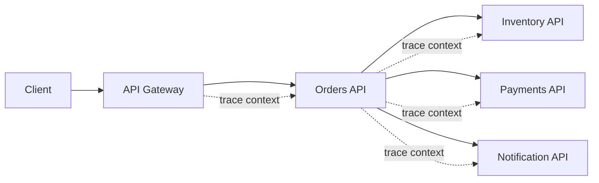
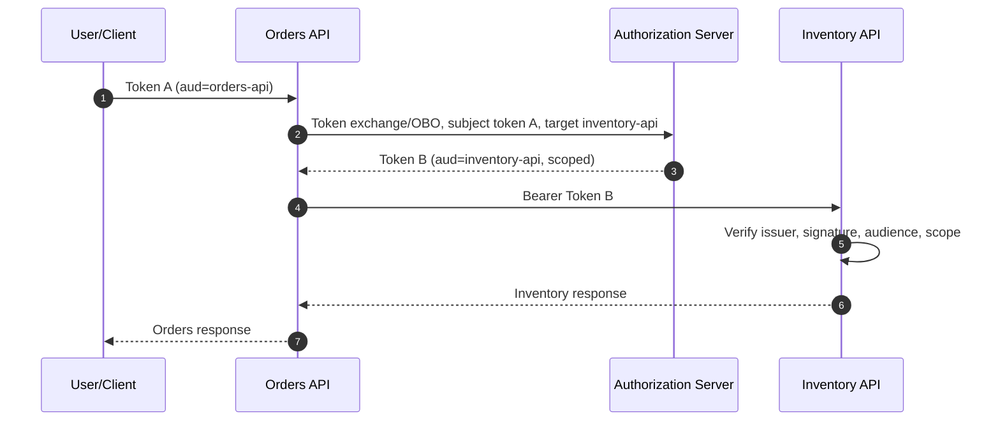
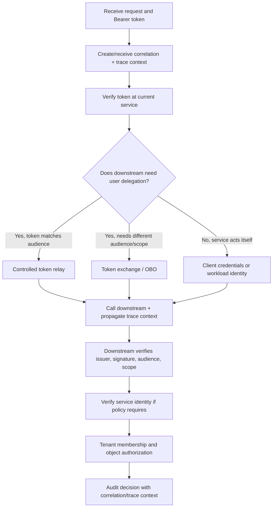

# Correlation Information, Permission Scopes, and Verifying Downstream Calls

In a multi-service architecture, a request can traverse an API Gateway, Resource Server, business services, and one or more downstream APIs. When relaying tokens, each service must answer three distinct questions: **which trace/correlation does this request belong to**, **what is the caller permitted to do at the current and next resources**, and **does the downstream service properly verify the caller's identity and permissions**.

These three questions are often conflated. An **`X-Correlation-ID`** helps link logs, yet **does not prove the caller is authenticated**. A **`traceparent`** enables distributed tracing, yet **does not grant permissions**. An access token with scope **`orders.read`** intended for API A does not automatically grant permission to call API B. Nor does an **`X-User-Id`** header passed down from an upstream service replace an access token or service authentication mechanism.

This lesson belongs to the **Token Relay** chapter of Spring Security OAuth 2.0 / OIDC Resource Server. It spans correlation metadata, trace context, token relay, token exchange/on-behalf-of (OBO), client credentials, audience and scope, through to how downstream verifies the caller. Examples use **Spring Boot 3 / Spring Security 6, Servlet and WebFlux**. Hostnames, client registrations, and scopes are illustrative assumptions; production must use approved issuers, resource identifiers, and policies.

## 1. Three Layers of Information in an Inter-Service Call

| Layer | Question | Example | Used For |
| --- | --- | --- | --- |
| **Correlation / trace context** | Which activity does this request relate to? | `X-Correlation-ID`, `traceparent` | Linking logs, spans, events, and troubleshooting. |
| **Authorization context** | What is the caller allowed to do on which resource? | Access token, `aud`, `scope`, roles/permissions | Validating tokens and deciding permissions. |
| **Service identity / transport identity** | Which service is connecting downstream? | OAuth client credentials, mTLS client certificate | Authenticating the workload/service caller. |

A single request can carry all three:

```http
GET /api/inventory/items/42 HTTP/1.1
Authorization: Bearer <access-token-for-inventory-api>
X-Correlation-ID: 5e5d3f9a-4a14-4ad5-9d37-0e39d48e21f0
traceparent: 00-4bf92f3577b34da6a3ce929d0e0e4736-00f067aa0ba902b7-01
```

- `Authorization` carries the credential for downstream to verify.
- `X-Correlation-ID` is an application identifier used to correlate logs.
- `traceparent` describes the distributed trace context per W3C Trace Context.

**Never use correlation IDs, trace IDs, or baggage as proof of authentication/authorization.** They can originate from clients, proxies, or instrumentation and are not credentials.

## 2. A Request Traversing Multiple Services



Each service creates its own span, yet the spans can belong to the same trace. A business correlation ID can travel across the entire request so operations teams can locate the full activity. Meanwhile, the token sent to each API must be **selected according to the target API's audience and permissions**.

For example, the Orders API receives an access token intended for `orders-api`. When calling the Inventory API, it needs a token that the Inventory API trusts and accepts for the `inventory-api` resource. Copying the raw Bearer token from the incoming request to every downstream service does not guarantee this.

## 3. Distinguishing Request ID, Correlation ID, Trace ID, and Span ID

| Identifier | Scope | Lifecycle | Role |
| --- | --- | --- | --- |
| **Request ID** | One specific HTTP request | Typically generated at ingress for that request | Looking up requests and responses. |
| **Correlation ID** | A business activity or series of related requests | Can span across multiple HTTP requests | Grouping logs/events of a workflow. |
| **Trace ID** | One distributed trace | Spans multiple spans and services | Tracking timing relationships across steps. |
| **Span ID** | One operation/span within a trace | Single span | Identifying a specific step. |
| **Idempotency key** | A write command requiring duplicate-execution prevention | Lifetime of idempotency record retention | Preventing duplicate business outcomes. |

Do not assume these IDs are identical. A single trace can cover multiple HTTP requests; a correlation ID can link multiple traces; a request can be retried and produce multiple attempts.

**A Correlation ID is not an Idempotency Key.** If a client sends `POST /orders` twice with the same correlation ID, the server must not infer the two requests are the same command. Idempotency requires its own contract, storage, and semantics.

## 4. W3C Trace Context: traceparent and tracestate

W3C Trace Context standardizes two main headers:

- **`traceparent`:** contains version, trace ID, parent span ID, and trace flags.
- **`tracestate`:** contains vendor-specific trace state in a standardized format.

Example:

```http
traceparent: 00-4bf92f3577b34da6a3ce929d0e0e4736-00f067aa0ba902b7-01
tracestate: vendor=value
```

A distributed tracing library reads the request context, creates a child span for the outbound call, and injects the new context into the downstream request. Downstream continues the trace from the corresponding parent span.

Do not assemble `traceparent` strings manually by swapping span IDs by hand. Use OpenTelemetry or Micrometer Tracing propagators/instrumentation to validate, create spans, and inject standard-compliant headers.

`traceparent` can be supplied by external clients. It helps with correlation, not proving a request is trustworthy. At a trust boundary, the system can decide whether to continue a valid trace context or start a new trace/link the old one per policy.

## 5. Baggage Is Not a Place for Permissions or Secrets

Baggage lets small metadata travel across a trace, such as a workflow code or tenant alias for observability. However, baggage can propagate across many services and vendors.

Never put into baggage:
- Access tokens, refresh tokens, client secrets, or session cookies.
- PII such as emails, phone numbers, addresses, or sensitive data.
- Raw roles/scopes for downstream to grant permissions with.
- Claims used as a basis for authorization.
- Large payloads or arbitrary client-supplied values that inflate cardinality/log volume.

If a tenant alias is needed in traces, restrict values via an allowlist, evaluate data sensitivity, and use it solely for **observability**. Downstream must still obtain authoritative tenant context from verified tokens or domain policies.

## 6. Generating Correlation IDs at the Trust Boundary

An API edge can generate a new ID for a request and return it to the client:

```java
import java.io.IOException;
import java.util.UUID;

import jakarta.servlet.FilterChain;
import jakarta.servlet.ServletException;
import jakarta.servlet.http.HttpServletRequest;
import jakarta.servlet.http.HttpServletResponse;

import org.slf4j.MDC;
import org.springframework.web.filter.OncePerRequestFilter;

public final class CorrelationIdFilter extends OncePerRequestFilter {

    public static final String ATTRIBUTE =
        CorrelationIdFilter.class.getName() + ".correlationId";

    @Override
    protected void doFilterInternal(
            HttpServletRequest request,
            HttpServletResponse response,
            FilterChain chain)
            throws ServletException, IOException {

        String correlationId = UUID.randomUUID().toString();
        request.setAttribute(ATTRIBUTE, correlationId);
        response.setHeader("X-Correlation-ID", correlationId);

        String previous = MDC.get("correlationId");
        MDC.put("correlationId", correlationId);
        try {
            chain.doFilter(request, response);
        } finally {
            if (previous == null) {
                MDC.remove("correlationId");
            } else {
                MDC.put("correlationId", previous);
            }
        }
    }
}
```

This example **always generates a new ID at the edge**. If your system has a trusted gateway passing a correlation ID across multiple boundaries, only accept the header from an authenticated gateway over the appropriate network path, validate its format/length, and never treat that value as security evidence. Headers sent directly by internet clients must never be blindly trusted as audit identities.

MDC is thread-local logging context in the traditional Servlet model. You must remove or restore the value in `finally` to prevent subsequent requests on the same thread from picking up the wrong ID. With async dispatches or WebFlux, corresponding context propagation is required; never assume MDC travels across all threads automatically.

## 7. Returning Correlation IDs and Structured Logging

The filter can store the correlation ID in a request attribute; controllers/services read it via an accessor or pass it into a request context:

```java
String correlationId =
    (String) request.getAttribute(CorrelationIdFilter.ATTRIBUTE);
```

Structured logs can record:

```json
{
  "event": "inventory_lookup_completed",
  "correlationId": "5e5d3f9a-4a14-4ad5-9d37-0e39d48e21f0",
  "traceId": "4bf92f3577b34da6a3ce929d0e0e4736",
  "service": "orders-api",
  "downstream": "inventory-api",
  "status": 200,
  "durationMs": 28
}
```

Log only data needed for troubleshooting and auditing. **Never log `Authorization` headers, raw tokens, refresh tokens, cookies, or full claims**. If recording a subject is necessary, use an issuer-namespaced identity and apply log protection/pseudonymization policies.

Client-controlled correlation IDs can be abused for log injection, high-cardinality metrics, or investigation confusion. Validate charset/length, encode log fields, and use server-generated request IDs when no trusted upstream exists.

## 8. Passing Correlation Metadata Downstream

An application correlation ID can be passed as a dedicated header:

```java
public Mono<InventoryItem> getItem(
        WebClient inventoryClient,
        String itemId,
        String correlationId) {

    return inventoryClient.get()
        .uri("/items/{id}", itemId)
        .header("X-Correlation-ID", correlationId)
        .retrieve()
        .bodyToMono(InventoryItem.class);
}
```

The method accepts the ID explicitly so it does not depend on `MDC`/`ThreadLocal` when `WebClient` switches execution threads. In larger applications, this metadata can be encapsulated inside a controlled request context.

When using Micrometer Tracing/OpenTelemetry with an instrumented `WebClient`, `traceparent`/`tracestate` are typically propagated automatically. **Do not manually copy `traceparent` as a raw header string** when tracing instrumentation is managing the span lifecycle.

A downstream service should:
- Receive and log validated correlation IDs.
- Create its own spans/service logs.
- Return the correlation ID or request ID per API contract if needed.
- Never use that ID to make authorization decisions.
- Never log tokens merely for the convenience of linking requests.

## 9. What Is Token Relay?

**Token relay** forwards the current request's access token into a downstream call:

```text
Client -- Bearer token T --> Orders API
Orders API -- Bearer token T --> Inventory API
```

Spring Security provides a filter for `WebClient` in Servlet Resource Servers:

```java
import org.springframework.context.annotation.Bean;
import org.springframework.security.oauth2.server.resource.web.reactive.function.client.ServletBearerExchangeFilterFunction;
import org.springframework.web.reactive.function.client.WebClient;

@Bean
WebClient inventoryWebClient(WebClient.Builder builder) {
    return builder
        .baseUrl("https://inventory.internal")
        .filter(new ServletBearerExchangeFilterFunction())
        .build();
}
```

`ServletBearerExchangeFilterFunction` retrieves the access token from the current `Authentication` when an appropriate token `Authentication` is present and adds a Bearer header to outbound requests. This example is for a client dedicated to calling **one fixed downstream service**.

The relay filter does not:
- Change the audience.
- Request new scopes.
- Change the issuer.
- Perform token exchange.
- Create a separate service identity.
- Guarantee downstream accepts the token.

Because the filter can attach the current token to requests using that `WebClient`, restrict the client to trusted destinations. Never attach the relay filter to a `WebClient` used to call arbitrary user-entered URLs.

## 10. Conditions for Token Relay to Work

Suppose the incoming token is:

```json
{
  "iss": "https://idp.example/realms/shop",
  "sub": "user-42",
  "aud": ["orders-api"],
  "scope": "orders.read"
}
```

The Orders API forwards the exact token to the Inventory API. If the Inventory API requires:

```json
{
  "aud": ["inventory-api"],
  "scope": "inventory.read"
}
```

then the original token **does not satisfy the target resource's audience and scope**. The Inventory API must reject it, even though the token is validly signed and was accepted by the Orders API.

Relay is only appropriate when the access token was already issued for downstream or has an audience/resource contract covering downstream per an approved design. Avoid issuing overly broad multi-audience tokens merely for relay convenience; each resource should verify its own audience and permissions.

## 11. Why Should You Not Blindly Relay Every Token?

Risks:

1. **Audience mismatch:** a token intended for API A is sent to API B.
2. **Over-privilege:** the token holds broader permissions than downstream needs.
3. **Credential leakage:** the token is sent to the wrong host, proxy, redirect, or log.
4. **Issuer mismatch:** downstream does not trust the issuer that minted the token.
5. **Token lifetime:** downstream receives an almost-expired or already-expired token.
6. **Confused deputy:** service A exercises the caller's privileges in ways the caller did not intend to access B's resources.
7. **Missing service identity:** downstream cannot distinguish the user caller from the connecting workload if the token contract does not represent the actor.

Relaying must be an intentional decision based on **destination, audience, issuer, scope, and caller semantics**.

## 12. Token Exchange and On-Behalf-Of Differ from Token Relay

If the incoming token is intended for the Orders API while the Inventory API needs its own token, the service can use **OAuth 2.0 Token Exchange** (RFC 8693) or an **On-Behalf-Of (OBO)** flow supported by the Authorization Server.



Token B can represent user delegation and the actor/service depending on the Authorization Server contract. Downstream must still verify Token B independently. Do not assume all IdPs support RFC 8693 or OBO identically; Entra OBO and other implementations have specific configurations, grants, and claims.

Token exchange is usually preferable when you need:
- An audience-specific token for the target API.
- Downscoping to the minimum required permissions.
- Preserving user context so downstream enforces per-user authorization.
- Representing the service acting on behalf of the user per a supported contract.

Never mint a new JWT yourself by copying claims and signing with the service's private key to impersonate the token issuer. Tokens must be issued by the Authorization Server or a trusted authority following the agreed protocol.

## 13. Client Credentials When Downstream Only Needs the Service Caller

Not every downstream call needs user delegation. If the Orders API calls the Inventory API to sync stock under the privileges of the **Orders API workload**, Client Credentials can be used:

```text
Orders API -- client credentials token --> Inventory API
```

The token typically represents the OAuth client/service, not the user who sent the initial request. The Inventory API verifies the client/service principal and grants only the required M2M permissions.

Illustrative client registration configuration:

```yaml
spring:
  security:
    oauth2:
      client:
        registration:
          inventory-service:
            provider: internal-idp
            client-id: orders-api
            client-secret: ORDERS_API_CLIENT_SECRET_FROM_SECRET_MANAGER
            authorization-grant-type: client_credentials
            scope:
              - inventory.read
        provider:
          internal-idp:
            token-uri: https://identity.internal.example/oauth2/token
```

Never commit client secrets. Production requires a secret manager, rotation, TLS, issuer/resource configuration, and restricted registration permissions.

## 14. Obtaining a Client Credentials Token with OAuth2AuthorizedClientManager

Servlet/service-tier example using `AuthorizedClientServiceOAuth2AuthorizedClientManager`:

```java
import org.springframework.context.annotation.Bean;
import org.springframework.security.oauth2.client.AuthorizedClientServiceOAuth2AuthorizedClientManager;
import org.springframework.security.oauth2.client.OAuth2AuthorizedClientManager;
import org.springframework.security.oauth2.client.OAuth2AuthorizedClientProviderBuilder;
import org.springframework.security.oauth2.client.OAuth2AuthorizeRequest;
import org.springframework.security.oauth2.client.OAuth2AuthorizedClient;
import org.springframework.security.oauth2.client.registration.ClientRegistrationRepository;
import org.springframework.security.oauth2.client.OAuth2AuthorizedClientService;

@Bean
OAuth2AuthorizedClientManager authorizedClientManager(
        ClientRegistrationRepository registrations,
        OAuth2AuthorizedClientService authorizedClients) {

    var manager =
        new AuthorizedClientServiceOAuth2AuthorizedClientManager(
            registrations, authorizedClients);

    manager.setAuthorizedClientProvider(
        OAuth2AuthorizedClientProviderBuilder.builder()
            .clientCredentials()
            .build());

    return manager;
}
```

Using it in a service:

```java
OAuth2AuthorizeRequest request =
    OAuth2AuthorizeRequest
        .withClientRegistrationId("inventory-service")
        .principal("orders-api")
        .build();

OAuth2AuthorizedClient client = authorizedClientManager.authorize(request);

if (client == null) {
    throw new IllegalStateException(
        "Could not obtain inventory service access token");
}

String accessToken =
    client.getAccessToken().getTokenValue();
```

Then attach the token to a request sent solely to the Inventory API:

```java
return inventoryWebClient.get()
    .uri("/internal/items/{id}", itemId)
    .headers(headers -> headers.setBearerAuth(accessToken))
    .retrieve()
    .bodyToMono(InventoryItem.class);
```

This example shows a token requested under the `inventory-service` registration. Ensure this `WebClient` has a fixed base URL, does not log tokens, and downstream grants `inventory.read` only to the appropriate service principal. `OAuth2AuthorizedClientManager` manages the authorized client/token lifecycle per provider; it does not decide item-level business permissions on its own.

## 15. Both User Delegation and Service Identity Can Matter

In a single call, downstream sometimes needs to know both:

- **Who is the original user?** To check ownership, tenant membership, or consent.
- **Which service is calling?** To enforce workload controls, network trust, and auditing.

A relayed user access token can represent the user subject and client/authorized party per the token contract. A client credentials token represents the service principal without carrying full user permissions. A token exchange can represent the user subject and service actor per contract.

Never combine the two pieces of information via unprotected headers:

```http
X-User-Id: user-42
X-User-Role: admin
X-Calling-Service: orders-api
```

Those headers can be forged if clients connect directly or proxies fail to strip/overwrite them properly. If downstream needs user delegation, use signed access tokens/OBO/token exchange with verified claims. If workload identity is needed, use client credentials, mTLS, or a trusted workload identity mechanism. If both are needed, explicitly design actor/subject semantics.

## 16. Actor and Subject in Delegated Tokens

RFC 8693 describes token exchange and actor-related claims such as `act` in a delegation model. An illustrative token can represent both subject and actor:

```json
{
  "iss": "https://identity.example",
  "sub": "user-42",
  "aud": ["inventory-api"],
  "scope": "inventory.read",
  "act": {
    "sub": "orders-api"
  }
}
```

This is a conceptual example; not every Authorization Server emits `act` or the same structure. Downstream should only trust actor claims when the token is signed by a trusted issuer and the profile/semantics are agreed upon.

Distinguish:
- `sub`: subject represented by the token in the profile.
- `act`: actor acting on behalf of the subject per the token-exchange model.
- `client_id`/`azp`: OAuth client or authorized party per the provider/token profile.
- mTLS identity: workload certificate at the connection layer.

Never infer actor solely from a request-supplied `X-Calling-Service` header. Never assume `sub` is a human if the token is app-only.

## 17. Downstream Must Verify Tokens Independently

The Inventory API must not assume that because the Orders API verified the token, it can drop Resource Server security. Each protected resource must verify tokens sent to it:

1. Issuer is in the trust registry.
2. Signature is valid per JWK/algorithm policy.
3. `exp`, `nbf`, and time validators pass.
4. Audience matches the Inventory API.
5. Token is an access token matching the profile.
6. Scopes/permissions suffice for the operation.
7. Tenant, ownership, and domain ACLs match.
8. If required, service/workload identity is also authenticated.

Internal calls still traverse the network and can be misrouted, retried, misconfigured, or invoked by another workload. **An internal network is not by itself proof of authorization.**

## 18. Configuring the Downstream Resource Server

A downstream API can configure a JWT Resource Server with a governed issuer and JWK Set. Example audience validator for the Inventory API:

```java
import org.springframework.context.annotation.Bean;
import org.springframework.context.annotation.Configuration;
import org.springframework.http.HttpMethod;
import org.springframework.security.config.Customizer;
import org.springframework.security.config.annotation.web.builders.HttpSecurity;
import org.springframework.security.oauth2.core.DelegatingOAuth2TokenValidator;
import org.springframework.security.oauth2.core.OAuth2Error;
import org.springframework.security.oauth2.core.OAuth2TokenValidator;
import org.springframework.security.oauth2.core.OAuth2TokenValidatorResult;
import org.springframework.security.oauth2.jwt.Jwt;
import org.springframework.security.oauth2.jwt.JwtValidators;
import org.springframework.security.oauth2.jwt.NimbusJwtDecoder;
import org.springframework.security.web.SecurityFilterChain;

@Configuration
class InventoryResourceServerConfig {

    private static final String ISSUER =
        "https://identity.internal.example/realms/platform";
    private static final String JWK_SET_URI =
        "https://identity.internal.example/realms/platform/protocol/openid-connect/certs";

    @Bean
    NimbusJwtDecoder inventoryJwtDecoder() {
        NimbusJwtDecoder decoder =
            NimbusJwtDecoder.withJwkSetUri(JWK_SET_URI).build();

        OAuth2TokenValidator<Jwt> audienceValidator = jwt ->
            jwt.getAudience().contains("inventory-api")
                ? OAuth2TokenValidatorResult.success()
                : OAuth2TokenValidatorResult.failure(
                    new OAuth2Error(
                        "invalid_token", "Wrong audience", null));

        decoder.setJwtValidator(
            new DelegatingOAuth2TokenValidator<>(
                JwtValidators.createDefaultWithIssuer(ISSUER),
                audienceValidator));

        return decoder;
    }

    @Bean
    SecurityFilterChain inventorySecurity(HttpSecurity http)
            throws Exception {
        return http
            .authorizeHttpRequests(auth -> auth
                .requestMatchers(
                    HttpMethod.GET, "/internal/items/**")
                    .hasAuthority("SCOPE_inventory.read")
                .anyRequest().denyAll())
            .oauth2ResourceServer(oauth2 -> oauth2
                .jwt(Customizer.withDefaults()))
            .build();
    }
}
```

This example uses a `NimbusJwtDecoder` bean with issuer/time validators and an audience validator. The JWK Set URI must be a trusted endpoint from configuration, never from a token header. Spring Security uses this decoder bean in the Resource Server chain. In production, also configure algorithm allowlists, token type/profile checks, and HTTP client timeouts/caching per policy.

HTTP rules check scopes; the decoder checks signature, issuer, time, and audience. Afterward, the service still needs tenant/object policies. If downstream uses multiple issuers, each manager/decoder must have the corresponding validators and audiences.

## 19. Scopes Must Be Intended for the Target API

Suppose the Orders API receives:

```json
{
  "aud": ["orders-api"],
  "scope": "orders.read orders.write"
}
```

It calls the Inventory API. Downstream requires:

```json
{
  "aud": ["inventory-api"],
  "scope": "inventory.read"
}
```

The fact that `orders.write` sounds powerful does not make it equivalent to `inventory.read`. Scopes are permissions scoped to a resource server and authorization contract. Each API needs clear names and meanings.

Do not:
- Grant every scope in the entire system to one access token.
- Map `orders.admin` to `inventory.admin` just because both contain the word admin.
- Use the Orders API's scope as proof the caller may read Inventory.
- Disable the audience validator just to make token relay work.

If downstream needs inventory read permission, the Authorization Server must grant `inventory.read` to the user delegation or service client per policy.

## 20. Scopes, Roles, and Permissions Downstream

Spring Security typically maps OAuth scopes to `SCOPE_` authorities. Example:

```text
scope = "inventory.read inventory.reserve"

Authorities:
  SCOPE_inventory.read
  SCOPE_inventory.reserve
```

Rule:

```java
.authorizeHttpRequests(auth -> auth
    .requestMatchers(HttpMethod.GET, "/internal/items/**")
        .hasAuthority("SCOPE_inventory.read")
    .requestMatchers(HttpMethod.POST, "/internal/reservations/**")
        .hasAuthority("SCOPE_inventory.reserve")
    .anyRequest().denyAll())
```

If an IdP emits permissions/roles under a different schema, downstream needs converters per issuer/token profile and allowlist mappings. Never blindly map an `admin` role from any issuer into Inventory admin privileges. After scopes, the domain service still checks tenant and object permissions.

## 21. Verifying Workloads with mTLS or Service Tokens

These two mechanisms can complement each other:

| Mechanism | What It Verifies | Limitations |
| --- | --- | --- |
| OAuth client credentials | Service holds a token from the Authorization Server with audience/scope. | Token lifecycle must be managed; does not carry user delegation by itself. |
| mTLS | Peer presents a trusted certificate chain/identity in the TLS handshake. | Requires managing cert issuance/rotation and workload mapping. |
| mTLS-bound access token | Token is bound to a certificate per a supported profile. | Both Resource Server and Authorization Server must support the standard. |
| Network policy | Workload is permitted to connect to the endpoint. | Does not replace application-layer authentication/authorization. |

With mTLS, downstream must verify the certificate chain, validity, EKU/SAN or workload identity mapping, and rotation. Checking only an `X-Client-Cert` header forwarded by a proxy is insufficient unless the proxy strips forged input and establishes a strict trust boundary.

You can require both mTLS service identity and a user-delegated bearer token: mTLS authenticates the connecting workload; the token authenticates user/delegation and scope for the resource. Policy must explicitly state **how the two identities combine**.

## 22. WebFlux: Relaying Tokens via WebClient

In a WebFlux Resource Server, Spring Security provides the corresponding filter:

```java
import org.springframework.context.annotation.Bean;
import org.springframework.security.oauth2.server.resource.web.reactive.function.client.ServerBearerExchangeFilterFunction;
import org.springframework.web.reactive.function.client.WebClient;

@Bean
WebClient inventoryWebClient(WebClient.Builder builder) {
    return builder
        .baseUrl("https://inventory.internal")
        .filter(new ServerBearerExchangeFilterFunction())
        .build();
}
```

`ServerBearerExchangeFilterFunction` relays the bearer token from the reactive `SecurityContext` onto `WebClient` requests. It still **does not change audience/scope** and does not convert a token intended for the current API into a token intended for the Inventory API. Use a dedicated client for trusted hosts; never attach the filter to a `WebClient` that can call arbitrary URLs.

WebFlux stores security context in Reactor Context. Never fetch `Authentication` via imperative `SecurityContextHolder` or rely on `ThreadLocal` MDC to infer tokens in a reactive pipeline. Use reactive security/context APIs and tracing instrumentation.

## 23. Correlation Propagation in WebFlux and Async Code

A `WebClient` request can switch threads multiple times. `ThreadLocal` MDC does not automatically guarantee correlation IDs are preserved accurately. Three approaches:

- Use Micrometer Observation/Tracing with configured context propagation.
- Pass correlation metadata explicitly as parameters/request context.
- Use Reactor Context and library-supported logging context bridges.

Example of passing metadata explicitly:

```java
public Mono<Item> loadItem(
        String itemId,
        String correlationId) {

    return inventoryWebClient.get()
        .uri("/items/{id}", itemId)
        .header("X-Correlation-ID", correlationId)
        .retrieve()
        .bodyToMono(Item.class);
}
```

Never use a static mutable variable to store request IDs; concurrent requests will overwrite one another. Never pull a correlation ID from MDC and assume it remains accurate after `publishOn`, `subscribeOn`, or an async boundary without configured propagation.

## 24. Passing Both Correlation IDs and Trace Context Properly

A service may carry:

```text
X-Correlation-ID -> business/request correlation
traceparent      -> distributed trace parent
tracestate       -> vendor trace metadata
baggage          -> small approved contextual metadata
Authorization    -> downstream credential
```

With Spring Boot, use the Boot-provided `WebClient.Builder` along with configured Micrometer Observation/Tracing and a tracing bridge for instrumentation. A manually created `WebClient` bypassing the builder/instrumentation may not create or propagate spans as expected.

Do not copy trace headers from an arbitrary request to another request if the two operations are not part of the same trace. Tracing instrumentation must create child spans for outbound calls and inject the appropriate context.

## 25. Do Not Trust Forwarded Identity Headers as Credentials

Misleading headers:

```http
X-User-Id: user-42
X-Authenticated-User: alice
X-User-Roles: admin
X-Tenant-Id: acme
X-Calling-Service: orders-api
```

If downstream relies on them to grant permissions, callers can spoof them. If a gateway architecture uses identity headers:

1. The gateway must authenticate the caller with trusted credentials.
2. Ingress must strip same-named headers sent by clients.
3. The gateway must overwrite values based on verified identity.
4. Gateway-to-downstream connections must be protected and accept only the gateway identity.
5. Downstream must authenticate the gateway/service under an explicit contract.
6. Never let these headers cross another trust boundary without re-verification.

Even when all those conditions hold, signed bearer tokens or token exchange usually express end-to-end identity/authorization more cleanly. **Correlation headers are always just metadata**, even when generated by a gateway.

## 26. Forwarding Tenant Context

A route:

```http
GET /api/tenants/acme/inventory/items/42
```

may indicate which tenant the user wants to operate on, yet the path does not prove membership. Downstream must verify:

- Token/audience/scope are intended for the Inventory API.
- Issuer and subject are verified.
- Tenant `acme` is permitted for the caller/service.
- The user or service holds membership/grants in that tenant.
- Item 42 belongs to tenant `acme` and the caller is permitted to read it.

If sharing an issuer across multiple tenants, do not assume `iss` determines the tenant. If the token has a `tenant_id` claim, trust it only after signature/issuer/audience validation and check semantics against the IdP contract. Domain policies may require fresh database membership checks.

## 27. Delegation Chains and Unintended Privilege Escalation

Example:

```text
User -> Orders API -> Inventory API -> Warehouse API
```

If the Orders API holds `inventory.write` and forwards a broad user token, the Inventory API may be able to do more than originally intended. If the Inventory API in turn uses a service token with warehouse admin rights, effective privileges can escalate further.

Each hop should enforce:

1. **Least privilege:** request only the scopes needed for the specific operation.
2. **Audience restriction:** tokens are bound strictly to the target resource.
3. **Actor accountability:** downstream identifies the acting service when needed.
4. **User delegation:** preserve user subject via token exchange/OBO when required by business rules.
5. **Domain checks:** tenant/object ownership at the service owning the data.
6. **Audit chain:** record caller, actor, target resource, and correlation/trace IDs.

Never use service privileges to bypass a user permission denial when the business operation is defined as user-delegated. If the operation is genuinely a background/system task, clearly distinguish caller kind and apply a separate policy.

## 28. Timeouts, Retries, and Idempotency When Calling Downstream

A Correlation ID helps group attempts within the same workflow, yet does not guarantee a command runs only once.

Example:

```text
Orders API sends POST reserve stock
Inventory processes successfully
Response is lost on the network
Orders retries POST
```

Without an idempotency contract, stock could be reserved twice. Use `Idempotency-Key` for commands with side effects, persisting results keyed by principal/tenant/operation for a reasonable retention window. The Correlation ID can stay the same to link logs; each attempt can have its own request/span ID.

When retrying:
- Do not retry infinitely on 401/403.
- Refresh/re-authorize tokens via the OAuth client manager when appropriate, rather than endlessly repeating an old token.
- Respect `Retry-After`, deadlines, and backoff for 429/5xx.
- Do not retry non-idempotent writes without idempotency semantics.
- Never log Bearer tokens in retry diagnostics.

## 29. Redirects and Destinations Must Be Controlled with Bearer Tokens

A `WebClient` with bearer relay can accidentally send credentials to an unintended destination if URLs are built from user input or redirect policies are loose.

- Use fixed base URLs or host/scheme allowlists.
- Never assemble URLs from caller input without validation.
- Inspect redirect behavior and ensure `Authorization` headers are never forwarded to another host.
- Never relay tokens over unencrypted HTTP.
- Never put tokens in query strings or paths.
- Restrict outbound network destinations via network policy.

A service can become a **confused deputy** if it holds tokens/permissions to access resources while letting callers control which host receives the credential.

## 30. Auditing: Who Called Whom, on Behalf of Whom, and in Which Request?

Audit events for downstream calls should distinguish:

| Field | Meaning |
| --- | --- |
| `correlationId` | Links workflow/request logs. |
| `traceId` | Links distributed spans. |
| `callingService` | Workload that sent the call, from verified identity. |
| `subjectIssuer` | Issuer of the subject token if delegated. |
| `subjectId` | Verified subject, protected/pseudonymized per policy. |
| `targetResource` | API/resource receiving the request. |
| `audience` | Resource the token was issued for. |
| `grantedScopes` | Relevant scopes/permissions per policy. |
| `operation` | Business action performed. |
| `decision` | Allow/deny and reason code. |

Never record raw access tokens, refresh tokens, client secrets, cookies, or full JWT claims. For user PII, apply retention/access controls. Correlation IDs help locate audit events; **they do not prove which user an audit event belongs to unless tied to a verified identity**.

## 31. Testing Correlation and Tracing

Recommended test cases:

| Scenario | Expectation |
| --- | --- |
| Request without correlation ID | Edge creates a new ID and returns header per contract. |
| Client sends malformed/oversized ID | Rejected or replaced with a server-generated ID per policy. |
| Trusted gateway sends correlation ID | Accepted only if source/trust boundary is verified. |
| Two concurrent requests | MDC/context does not mix IDs. |
| `WebClient` switches threads | Correlation/trace context remains intact per instrumentation or explicit propagation. |
| Outbound call | Downstream receives correlation metadata and a valid parent span. |
| Spoofed correlation ID | Does not affect `Authentication` or authorization. |
| Baggage contains sensitive data | Not propagated or filtered per policy. |

Tests should not merely check that a header exists; verify that **another request does not inherit the previous request's ID**, especially with thread pools/async execution.

## 32. Testing Token Relay and Downstream Authorization

| Scenario | Expectation |
| --- | --- |
| Token has right Inventory API audience and scope | Inventory authenticates and permits if domain policy passes. |
| Token only has Orders API audience | Inventory rejects. |
| Token has right audience but lacks `inventory.read` | Authorization denied. |
| Token issuer not trusted by Inventory | Authentication failure. |
| Expired token | Rejected. |
| Orders relays token to Payments API | Only works if token was issued for Payments per contract; otherwise must reject. |
| Caller sends `X-User-Roles: admin` | Does not alter verified authorities. |
| Correlation ID is an arbitrary string | Grants no permissions. |
| Token exchange returns Inventory-audience token | Inventory verifies the new token and right scope. |
| Client credentials token | Inventory authenticates service principal per M2M policy. |
| User does not belong to requested tenant | Domain authorization denies even if scope matches. |
| Valid token but item belongs to another tenant | Does not return cross-tenant data. |

Include positive tests proving valid calls succeed and negative tests for audience/scope/issuer mismatches. A downstream `permitAll` is not proof that token relay works safely.

## 33. Common Design Mistakes

| Mistake | Consequence | Fix |
| --- | --- | --- |
| Using trace ID as an authorization key | Callers can forge IDs to impersonate | Separate trace context from security principals. |
| Relaying every Bearer token to every downstream | Token leakage/audience mismatch | Dedicated clients per destination, token exchange when needed. |
| Trusting `X-User-Id` or `X-Roles` | Header spoofing, privilege escalation | Verified tokens/identities and explicit trust boundaries. |
| Using client credentials while expecting user identity | Loses user delegation/owner semantics | Token exchange/OBO or design service-only operations. |
| Using user tokens for all background jobs | Unsuitable credential lifetime/context | Workload identity/service credentials. |
| Downstream trusting that the gateway already verified | Bypasses when routes/networks change | Each resource server verifies its own credentials. |
| Skipping audience validation | Token substitution between APIs | Dedicated audience validator downstream. |
| Using MDC in WebFlux like `ThreadLocal` | Correlation lost or mixed up | Reactor Context/Micrometer propagation. |
| Using correlation ID instead of idempotency key | Duplicate side effects on retry | Idempotency contract and persistence. |
| Logging `Authorization` to debug | Exposes bearer credentials | Log request ID, issuer alias, decision, and reason. |

## 34. Roadmap for Designing a Downstream Call



Execution order:

1. Identify which resource downstream is and its exact audience.
2. Identify which scopes/permissions the operation needs.
3. Decide between user delegation, service identity, or both.
4. Choose relay, token exchange/OBO, or client credentials.
5. Configure a dedicated `WebClient` for the trusted destination.
6. Propagate trace context/correlation metadata via instrumentation or explicit context.
7. Require downstream to verify tokens and workload identity itself.
8. Check tenant, owner, and domain ACLs at the service owning the data.
9. Design timeouts, retries, idempotency, and auditing.
10. Test audience mismatches, scope mismatches, spoofed headers, and context propagation.

## 35. References

- [Spring Security 6.5 — Bearer Token Propagation](https://docs.spring.io/spring-security/reference/6.5/servlet/oauth2/resource-server/bearer-tokens.html): relaying Bearer tokens with `ServletBearerExchangeFilterFunction`.
- [Spring Security 6.5 — Reactive Bearer Token Propagation](https://docs.spring.io/spring-security/reference/6.5/reactive/oauth2/resource-server/bearer-tokens.html): `ServerBearerExchangeFilterFunction` in WebFlux.
- [Spring Security 6.5 — OAuth2 Client](https://docs.spring.io/spring-security/reference/6.5/servlet/oauth2/client/index.html): `OAuth2AuthorizedClientManager` and client credentials.
- [RFC 8693 — OAuth 2.0 Token Exchange](https://www.rfc-editor.org/rfc/rfc8693.html): subject token, actor token, delegation, and token exchange.
- [RFC 6750 — OAuth 2.0 Bearer Token Usage](https://www.rfc-editor.org/rfc/rfc6750.html): using Bearer tokens in HTTP.
- [RFC 8705 — OAuth 2.0 Mutual-TLS Client Authentication and Certificate-Bound Access Tokens](https://www.rfc-editor.org/rfc/rfc8705.html): mTLS client identity and certificate-bound tokens.
- [W3C Trace Context](https://www.w3.org/TR/trace-context/): `traceparent`, `tracestate`, and distributed trace propagation.
- [OpenTelemetry Context Propagation](https://opentelemetry.io/docs/concepts/context-propagation/): propagating trace context across services.
- [Spring Boot — Observability](https://docs.spring.io/spring-boot/reference/actuator/observability.html): Micrometer Observation and tracing integration.

## 36. Conclusion

In inter-service calls, **correlation**, **authorization**, and **service identity** complement one another without replacing one another. Correlation IDs/trace context help trace which services a request traversed. Access tokens and scopes identify the target resource and granted permissions. Service identity identifies the connecting workload and can be further protected via client credentials or mTLS.

Token relay only forwards the current token; it does not change audience or expand scopes. When downstream needs a token dedicated to that resource, use token exchange/OBO if supported by the Authorization Server. When downstream only needs the workload's privileges, client credentials or workload identity is more suitable. Regardless of the choice, downstream must still verify its own issuer, signature, audience, timestamps, scopes, and tenant/object policies.

**Key takeaway:** *Use correlation metadata to trace calls, use access tokens with the right audience and scope to prove permissions, and let downstream verify the caller before executing business logic.*
