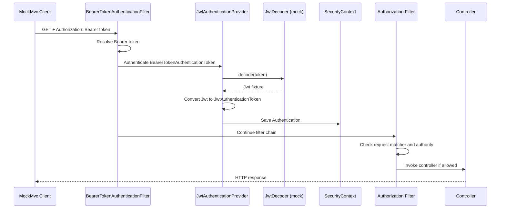
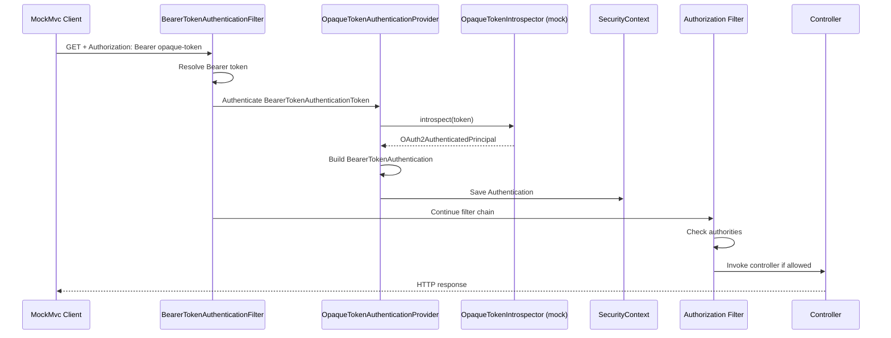

# Mocking JwtDecoder or OpaqueTokenIntrospector to Test Filter Flow

## 1. Purpose of the test

A Spring Security OAuth 2.0 Resource Server on the Servlet stack typically receives access tokens in the header:

```http
GET /api/orders/42 HTTP/1.1
Host: orders.example.test
Authorization: Bearer test-access-token
```

The request passes through the Spring Security filter chain. The filter extracts the Bearer token, authenticates the token via the configured mechanism, creates an Authentication, stores it in the SecurityContext, and only then allows the request to reach the controller.

For JWTs, token verification uses `JwtDecoder`. For opaque tokens, the Resource Server uses `OpaqueTokenIntrospector`. In filter-chain testing, we can **mock the token verification dependency** to focus on how the request moves through the filters and is authorized.

This lesson belongs to the **Servlet Testing** chapter of the **Spring Security OAuth 2.0 OIDC Resource Server** module. It focuses on replacing the decoder/introspector with a Mockito test double, sending a real Bearer header via MockMvc, observing Authentication/authorities, checking 401/403 errors, and identifying what has actually been tested.

| Component | Role |
|---|---|
| `BearerTokenAuthenticationFilter` | Extracts the Bearer token from the HTTP request and initiates authentication. |
| `JwtDecoder` | Converts a JWT compact string into a verified `Jwt` per the real decoder. |
| `OpaqueTokenIntrospector` | Sends the opaque token to the introspection service and returns a principal. |
| `JwtAuthenticationProvider` | Uses `JwtDecoder` to authenticate JWTs. |
| `OpaqueTokenAuthenticationProvider` | Uses `OpaqueTokenIntrospector` to authenticate opaque tokens. |
| `SecurityFilterChain` | Connects authentication and authorization rules for HTTP requests. |
| `MockMvc` | Sends requests through the Servlet filter chain in tests without opening a real HTTP port. |

> **Core point:** Mocking `JwtDecoder` or `OpaqueTokenIntrospector` lets you test the **Bearer authentication filter flow** without calling an Authorization Server or verifying real signatures. It does not replace integration tests for signatures, JWKS, HTTP introspection, issuer/audience validators, or token profiles.

---

## 2. Servlet Resource Server flow to test

When a request has a Bearer header, the JWT flow is typically:



For opaque tokens, the provider part changes:



The key to the test is that the request must contain an `Authorization: Bearer ...` header and must pass through the real filter chain. Mock the dependency at the end of the authentication provider, not the entire filter chain.

### 2.1. Role of each component

- `BearerTokenAuthenticationFilter` reads the Bearer credential from the request.
- `JwtAuthenticationProvider` calls `JwtDecoder.decode(token)`.
- `OpaqueTokenAuthenticationProvider` calls `OpaqueTokenIntrospector.introspect(token)`.
- The provider creates an Authentication once the dependency returns a valid result.
- The authorization filter checks authorities, roles, and request matchers.
- `ExceptionTranslationFilter` coordinates handling authentication/authorization exceptions along the filter chain.
- `BearerTokenAuthenticationEntryPoint` typically generates a 401 response for Bearer authentication errors.
- `BearerTokenAccessDeniedHandler` handles access denied, typically returning 403.

### 2.2. Why mocking the decoder/introspector is the right substitution point

If the goal is to test filter flow, every test does not need to:

- Start an Authorization Server.
- Generate an RSA keypair and sign JWTs.
- Publish JWKS.
- Send HTTP requests to an introspection endpoint.
- Manage client secrets for introspection.

We only need to specify which `Jwt` or principal the test double returns for a given token. Spring Security still runs all remaining steps in the filter chain.

---

## 3. Distinguishing filter-flow tests from authorization-only tests

Two groups of tests are easily confused.

### 3.1. Authorization-only tests

Spring Security Test provides request post-processors such as `jwt()` and `opaqueToken()`. They place a mock Authentication into the request/security context to check authorization rules.

Example:

```java
mvc.perform(get("/api/orders/42")
        .with(jwt().authorities(
            new SimpleGrantedAuthority("SCOPE_orders:read"))))
    .andExpect(status().isOk());
```

This test is very useful for checking:

- Whether the route requires the right authority.
- Whether `@PreAuthorize` rejects missing scopes.
- Whether controllers/services handle Authentication properly.

However, `jwt()` **does not invoke `BearerTokenAuthenticationFilter` to extract a token from the Authorization header**, nor does it invoke `JwtDecoder`. Likewise, `opaqueToken()` does not invoke `OpaqueTokenIntrospector` like the real introspection flow.

### 3.2. Filter-flow tests

To test the filter, send a Bearer header:

```java
mvc.perform(get("/api/orders/42")
        .header(HttpHeaders.AUTHORIZATION, "Bearer " + TOKEN))
    .andExpect(status().isOk());
```

In this test:

1. `BearerTokenAuthenticationFilter` reads the header.
2. The provider calls the mock decoder or introspector.
3. The provider creates the Authentication.
4. The authorization filter checks permissions.
5. The controller is invoked only if the request is allowed.

This is the main focus of this lesson.

### 3.3. Tool selection table

| Goal | Appropriate test approach |
|---|---|
| Only check whether a route requires `SCOPE_orders:read` | `jwt()` or `opaqueToken()` |
| Test that `BearerTokenAuthenticationFilter` reads the header | Mock `JwtDecoder`/`OpaqueTokenIntrospector` + Bearer header |
| Test that the decoder is called with the right token | Mockito `verify(...)` |
| Test real RSA/JWKS signatures | Real `NimbusJwtDecoder` + signed JWT + test JWKS |
| Test real HTTP introspection requests | Real introspector + mock HTTP server |
| Test issuer/audience/time validators | Real decoder/validator tests |
| Test 401 when token is invalid | Mock decoder/introspector throws authentication exception |
| Test 403 when token is valid but lacks authority | Mock returns valid principal/JWT with a different scope |
| Test multiple `SecurityFilterChain`s | MockMvc requests hitting each real matcher/chain |

---

## 4. Configuring a Servlet Resource Server using JWT

Security configuration example:

```java
package com.example.orders.security;

import org.springframework.context.annotation.Bean;
import org.springframework.context.annotation.Configuration;
import org.springframework.http.HttpMethod;
import org.springframework.security.config.Customizer;
import org.springframework.security.config.annotation.web.builders.HttpSecurity;
import org.springframework.security.web.SecurityFilterChain;

@Configuration
public class OrdersSecurityConfig {

    @Bean
    SecurityFilterChain ordersSecurityFilterChain(HttpSecurity http)
            throws Exception {
        return http
            .authorizeHttpRequests(auth -> auth
                .requestMatchers(HttpMethod.GET, "/api/orders/**")
                    .hasAuthority("SCOPE_orders:read")
                .requestMatchers(HttpMethod.POST, "/api/orders/**")
                    .hasAuthority("SCOPE_orders:write")
                .anyRequest().denyAll())
            .oauth2ResourceServer(oauth ->
                oauth.jwt(Customizer.withDefaults()))
            .build();
    }
}
```

The configuration above keeps default CSRF. If the API only accepts Bearer tokens in the Authorization header and does not use cookie/session authentication, CSRF can be configured according to the application's threat model. In POST tests when CSRF is enabled, send a CSRF token with `csrf()`.

### 4.1. Illustrative controller

```java
package com.example.orders.api;

import org.springframework.security.core.annotation.AuthenticationPrincipal;
import org.springframework.security.oauth2.jwt.Jwt;
import org.springframework.web.bind.annotation.GetMapping;
import org.springframework.web.bind.annotation.PathVariable;
import org.springframework.web.bind.annotation.RequestMapping;
import org.springframework.web.bind.annotation.RestController;

@RestController
@RequestMapping("/api/orders")
public class OrderController {

    @GetMapping("/{orderId}")
    public String getOrder(
            @PathVariable String orderId,
            @AuthenticationPrincipal Jwt jwt) {
        return "order=" + orderId + ", subject=" + jwt.getSubject();
    }
}
```

The controller simply illustrates receiving the JWT principal after authentication. In real applications, the business service still needs to check tenant, owner, and permissions for each order.

### 4.2. Test dependencies

Use the Spring Boot BOM to manage versions:

```xml
<dependencies>
    <dependency>
        <groupId>org.springframework.boot</groupId>
        <artifactId>spring-boot-starter-web</artifactId>
    </dependency>

    <dependency>
        <groupId>org.springframework.boot</groupId>
        <artifactId>spring-boot-starter-security</artifactId>
    </dependency>

    <dependency>
        <groupId>org.springframework.boot</groupId>
        <artifactId>spring-boot-starter-oauth2-resource-server</artifactId>
    </dependency>

    <dependency>
        <groupId>org.springframework.boot</groupId>
        <artifactId>spring-boot-starter-test</artifactId>
        <scope>test</scope>
    </dependency>

    <dependency>
        <groupId>org.springframework.security</groupId>
        <artifactId>spring-security-test</artifactId>
        <scope>test</scope>
    </dependency>
</dependencies>
```

No extra JWT test library is needed just to build a `Jwt` object. `Jwt.withTokenValue(...)` is part of the Spring Security API.

---

## 5. Mocking JwtDecoder with Mockito

`JwtDecoder` is an interface with method `decode(String token)`. In tests, mock this interface and have it return a pre-built `Jwt` fixture.

### 5.1. Building a Jwt fixture

```java
package com.example.orders.security;

import java.time.Instant;
import java.util.List;

import org.springframework.security.oauth2.jwt.Jwt;

final class JwtFixtures {

    static final String TOKEN = "test-access-token";
    static final String ISSUER =
        "https://auth.example.test/realms/orders";

    private JwtFixtures() {
    }

    static Jwt ordersReadToken() {
        Instant now = Instant.now();

        return Jwt.withTokenValue(TOKEN)
            .header("alg", "RS256")
            .issuer(ISSUER)
            .subject("alice-123")
            .audience(List.of("orders-api"))
            .issuedAt(now)
            .expiresAt(now.plusSeconds(300))
            .claim("scope", "orders:read")
            .claim("client_id", "web-portal")
            .build();
    }

    static Jwt ordersWriteToken() {
        Instant now = Instant.now();

        return Jwt.withTokenValue(TOKEN)
            .header("alg", "RS256")
            .issuer(ISSUER)
            .subject("alice-123")
            .audience(List.of("orders-api"))
            .issuedAt(now)
            .expiresAt(now.plusSeconds(300))
            .claim("scope", "orders:write")
            .claim("client_id", "web-portal")
            .build();
    }
}
```

The `Jwt` fixture is the object returned by the decoder. `Jwt.withTokenValue(...)` does not create a JWS signature and does not verify signatures. The `alg` header in the fixture is only metadata on the test object; it does not prove the token string was signed with RS256.

### 5.2. Mocking the bean in a Spring Boot test

In Spring Boot 3.x, you can use `@MockBean` to replace the `JwtDecoder` bean in the application context:

```java
package com.example.orders.security;

import static org.mockito.Mockito.verify;
import static org.mockito.Mockito.when;
import static org.springframework.test.web.servlet.request.MockMvcRequestBuilders.get;
import static org.springframework.test.web.servlet.result.MockMvcResultMatchers.content;
import static org.springframework.test.web.servlet.result.MockMvcResultMatchers.status;

import org.junit.jupiter.api.Test;
import org.springframework.beans.factory.annotation.Autowired;
import org.springframework.boot.test.autoconfigure.web.servlet.AutoConfigureMockMvc;
import org.springframework.boot.test.context.SpringBootTest;
import org.springframework.boot.test.mock.mockito.MockBean;
import org.springframework.http.HttpHeaders;
import org.springframework.security.oauth2.jwt.JwtDecoder;
import org.springframework.test.web.servlet.MockMvc;

@SpringBootTest
@AutoConfigureMockMvc
class JwtResourceServerFilterTest {

    @Autowired
    MockMvc mvc;

    @MockBean
    JwtDecoder jwtDecoder;

    @Test
    void bearerHeaderIsDecodedAndRequestReachesController()
            throws Exception {
        when(jwtDecoder.decode(JwtFixtures.TOKEN))
            .thenReturn(JwtFixtures.ordersReadToken());

        mvc.perform(get("/api/orders/42")
                .header(
                    HttpHeaders.AUTHORIZATION,
                    "Bearer " + JwtFixtures.TOKEN))
            .andExpect(status().isOk())
            .andExpect(content().string(
                "order=42, subject=alice-123"));

        verify(jwtDecoder).decode(JwtFixtures.TOKEN);
    }
}
```

This test keeps the **real `SecurityFilterChain`** in the Spring context and replaces only `JwtDecoder`. When MockMvc sends the Authorization header, the filter must resolve the token before the provider invokes the decoder.

In newer Spring Framework versions with `@MockitoBean`, you can use that annotation to register a Mockito mock in the context. Choose the annotation matching your project's Spring Boot/Spring Framework version; do not declare two mocks simultaneously for the same bean.

### 5.3. Why verify?

An HTTP 200 assertion indicates the request succeeded, while `verify(jwtDecoder).decode(TOKEN)` confirms the mock decoder was actually called with the sent token.

If a test accidentally uses the `jwt()` post-processor or bypasses the filter chain, the response might still be 200 without invoking the decoder. Verification ensures the test proves it crossed the exact boundary under test.

### 5.4. Checking the extracted token

You can send a distinct token value in each test:

```java
@Test
void passesExtractedBearerValueToDecoder() throws Exception {
    String token = "another-test-token";

    Jwt jwt = Jwt.withTokenValue(token)
        .header("alg", "RS256")
        .subject("bob-456")
        .claim("scope", "orders:read")
        .build();

    when(jwtDecoder.decode(token)).thenReturn(jwt);

    mvc.perform(get("/api/orders/42")
            .header(HttpHeaders.AUTHORIZATION, "Bearer " + token))
        .andExpect(status().isOk());

    verify(jwtDecoder).decode(token);
}
```

In real tests, the fixture must include any claims required by configured controllers, converters, and validators. If custom validators run outside or inside the decoder, note that mocking the `JwtDecoder` bean replaces the decoder that holds those validators; see the limitations section below.

---

## 6. Testing a valid JWT missing a scope: 403

A token may be decoded successfully yet lack the required authority. For example, GET order requires `SCOPE_orders:read`, while the JWT fixture only has `orders:write`.

```java
@Test
void validJwtWithoutReadScopeIsForbidden() throws Exception {
    when(jwtDecoder.decode(JwtFixtures.TOKEN))
        .thenReturn(JwtFixtures.ordersWriteToken());

    mvc.perform(get("/api/orders/42")
            .header(
                HttpHeaders.AUTHORIZATION,
                "Bearer " + JwtFixtures.TOKEN))
        .andExpect(status().isForbidden());

    verify(jwtDecoder).decode(JwtFixtures.TOKEN);
}
```

What this test proves:

1. The Bearer header is read.
2. The decoder returns the JWT.
3. Spring Security builds the authentication.
4. The scope converter maps `orders:write` to authority `SCOPE_orders:write`.
5. The GET matcher requires `SCOPE_orders:read`.
6. Authorization denies the request with 403.

By default `JwtGrantedAuthoritiesConverter` reads the `scope` or `scp` claim per Spring Security convention and produces authorities prefixed with `SCOPE_`. If the application uses a custom claim such as `permissions` or `roles`, tests must reflect the actual custom converter.

### 6.1. Testing POST with write scope

If CSRF is enabled:

```java
import static org.springframework.security.test.web.servlet.request
    .SecurityMockMvcRequestPostProcessors.csrf;

@Test
void writeScopeCanAccessWriteEndpoint() throws Exception {
    when(jwtDecoder.decode(JwtFixtures.TOKEN))
        .thenReturn(JwtFixtures.ordersWriteToken());

    mvc.perform(post("/api/orders/42")
            .with(csrf())
            .header(
                HttpHeaders.AUTHORIZATION,
                "Bearer " + JwtFixtures.TOKEN))
        .andExpect(status().isOk());
}
```

This example assumes the application has a matching POST mapping. If the endpoint does not exist, the result may be 404 after passing security; tests should target actual project endpoints.

The CSRF token in the test only satisfies CSRF protection on the POST request. It does not replace the Bearer token and does not authenticate the user.

---

## 7. Testing missing and invalid tokens

A filter-flow test also needs failure branches.

### 7.1. No Authorization header sent

```java
import static org.mockito.Mockito.verifyNoInteractions;

@Test
void requestWithoutBearerTokenIsUnauthorized() throws Exception {
    mvc.perform(get("/api/orders/42"))
        .andExpect(status().isUnauthorized());

    verifyNoInteractions(jwtDecoder);
}
```

The endpoint requires an authority, so anonymous requests are denied. The decoder is not called because there is no Bearer token to decode.

### 7.2. Decoder reports an invalid token

```java
import org.springframework.security.oauth2.jwt.BadJwtException;

@Test
void invalidJwtIsRejectedByAuthenticationFilter() throws Exception {
    when(jwtDecoder.decode(JwtFixtures.TOKEN))
        .thenThrow(new BadJwtException("Invalid test token"));

    mvc.perform(get("/api/orders/42")
            .header(
                HttpHeaders.AUTHORIZATION,
                "Bearer " + JwtFixtures.TOKEN))
        .andExpect(status().isUnauthorized());

    verify(jwtDecoder).decode(JwtFixtures.TOKEN);
}
```

`JwtAuthenticationProvider` treats `JwtException` from the decoder as an authentication failure. The Bearer authentication entry point normally returns 401 and a `WWW-Authenticate` challenge.

You can check the challenge:

```java
.andExpect(header().string(
    HttpHeaders.WWW_AUTHENTICATE,
    org.hamcrest.Matchers.containsString("Bearer")));
```

Do not assert the full error message string if the message may change across versions or error handlers. Usually the status and appropriate challenge type are sufficient.

### 7.3. Malformed token vs invalid token

Cases such as malformed headers, missing token values, or multiple credential transmission methods can be rejected by `BearerTokenResolver` before the decoder is called. Error status/details may differ between `invalid_request` and `invalid_token` per the Bearer protocol.

Split tests by objective:

- Header without Bearer credentials.
- Header with a Bearer token rejected by the decoder.
- Syntactically invalid header or multiple credential methods.
- Valid token missing an authority.

Do not lump all of these into a single "bad token" test because they take different branches.

---

## 8. Mocking OpaqueTokenIntrospector

With opaque tokens, the Resource Server does not use `JwtDecoder`. `OpaqueTokenIntrospector` receives the token string and returns an `OAuth2AuthenticatedPrincipal`.

### 8.1. Security chain configuration for opaque tokens

This is an **alternative** to the JWT chain; you do not need to declare both on the same chain if the application only supports one token type:

```java
package com.example.orders.security;

import org.springframework.context.annotation.Bean;
import org.springframework.context.annotation.Configuration;
import org.springframework.http.HttpMethod;
import org.springframework.security.config.Customizer;
import org.springframework.security.config.annotation.web.builders.HttpSecurity;
import org.springframework.security.web.SecurityFilterChain;

@Configuration
public class OpaqueOrdersSecurityConfig {

    @Bean
    SecurityFilterChain opaqueOrdersSecurityFilterChain(
            HttpSecurity http) throws Exception {
        return http
            .authorizeHttpRequests(auth -> auth
                .requestMatchers(HttpMethod.GET, "/api/orders/**")
                    .hasAuthority("SCOPE_orders:read")
                .anyRequest().denyAll())
            .oauth2ResourceServer(oauth ->
                oauth.opaqueToken(Customizer.withDefaults()))
            .build();
    }
}
```

With Spring Boot auto-configuration, introspection URI and client credentials can be configured via properties. In filter-flow tests, we replace the `OpaqueTokenIntrospector` bean with a mock so no real AS endpoint needs to be called.

### 8.2. Creating a principal fixture

```java
package com.example.orders.security;

import java.util.Map;

import org.springframework.security.core.authority.AuthorityUtils;
import org.springframework.security.oauth2.core.DefaultOAuth2AuthenticatedPrincipal;
import org.springframework.security.oauth2.core.OAuth2AuthenticatedPrincipal;

final class OpaquePrincipalFixtures {

    private OpaquePrincipalFixtures() {
    }

    static OAuth2AuthenticatedPrincipal ordersReadPrincipal() {
        return new DefaultOAuth2AuthenticatedPrincipal(
            "alice-123",
            Map.of(
                "sub", "alice-123",
                "scope", "orders:read",
                "client_id", "web-portal"
            ),
            AuthorityUtils.createAuthorityList("SCOPE_orders:read")
        );
    }

    static OAuth2AuthenticatedPrincipal ordersWritePrincipal() {
        return new DefaultOAuth2AuthenticatedPrincipal(
            "alice-123",
            Map.of(
                "sub", "alice-123",
                "scope", "orders:write",
                "client_id", "web-portal"
            ),
            AuthorityUtils.createAuthorityList("SCOPE_orders:write")
        );
    }
}
```

Unlike the JWT flow, `OpaqueTokenIntrospector` returns a principal that already carries authorities. A mock introspector must return authorities matching the test's contract. If it returns a principal without `SCOPE_orders:read`, the GET request will get 403 even though the introspector returned successfully.

### 8.3. Mocking the introspector in a Spring Boot test

```java
package com.example.orders.security;

import static org.mockito.Mockito.verify;
import static org.mockito.Mockito.when;
import static org.springframework.test.web.servlet.request.MockMvcRequestBuilders.get;
import static org.springframework.test.web.servlet.result.MockMvcResultMatchers.content;
import static org.springframework.test.web.servlet.result.MockMvcResultMatchers.status;

import org.junit.jupiter.api.Test;
import org.springframework.beans.factory.annotation.Autowired;
import org.springframework.boot.test.autoconfigure.web.servlet.AutoConfigureMockMvc;
import org.springframework.boot.test.context.SpringBootTest;
import org.springframework.boot.test.mock.mockito.MockBean;
import org.springframework.http.HttpHeaders;
import org.springframework.security.oauth2.server.resource.introspection.OpaqueTokenIntrospector;
import org.springframework.test.web.servlet.MockMvc;

@SpringBootTest
@AutoConfigureMockMvc
class OpaqueResourceServerFilterTest {

    @Autowired
    MockMvc mvc;

    @MockBean
    OpaqueTokenIntrospector introspector;

    @Test
    void bearerHeaderIsPassedToIntrospectorAndAuthenticated()
            throws Exception {
        String token = "opaque-test-token";

        when(introspector.introspect(token))
            .thenReturn(
                OpaquePrincipalFixtures.ordersReadPrincipal());

        mvc.perform(get("/api/orders/42")
                .header(
                    HttpHeaders.AUTHORIZATION,
                    "Bearer " + token))
            .andExpect(status().isOk())
            .andExpect(content().string(
                "order=42, subject=alice-123"));

        verify(introspector).introspect(token);
    }
}
```

Like the JWT test, the request goes through the real filter chain. The filter resolves the Bearer token; `OpaqueTokenAuthenticationProvider` calls the mock introspector; the principal is wrapped into `BearerTokenAuthentication`; authorization checks authorities before entering the controller.

### 8.4. Opaque token missing scope

```java
@Test
void activeOpaqueTokenWithoutReadAuthorityIsForbidden()
        throws Exception {
    String token = "opaque-write-token";

    when(introspector.introspect(token))
        .thenReturn(
            OpaquePrincipalFixtures.ordersWritePrincipal());

    mvc.perform(get("/api/orders/42")
            .header(
                HttpHeaders.AUTHORIZATION,
                "Bearer " + token))
        .andExpect(status().isForbidden());

    verify(introspector).introspect(token);
}
```

This test simulates a token accepted by introspection that lacks read permission. This is an **authorization failure**, typically returning 403.

### 8.5. Inactive/invalid opaque token

The mock introspector can throw `BadOpaqueTokenException`:

```java
import org.springframework.security.oauth2.server.resource.introspection.BadOpaqueTokenException;

@Test
void inactiveOpaqueTokenIsUnauthorized() throws Exception {
    String token = "inactive-opaque-token";

    when(introspector.introspect(token))
        .thenThrow(new BadOpaqueTokenException("Inactive test token"));

    mvc.perform(get("/api/orders/42")
            .header(
                HttpHeaders.AUTHORIZATION,
                "Bearer " + token))
        .andExpect(status().isUnauthorized());

    verify(introspector).introspect(token);
}
```

The provider treats this as an authentication error and the request does not reach the controller.

---

## 9. Comparing mock JwtDecoder and mock OpaqueTokenIntrospector

| Aspect | Mock `JwtDecoder` | Mock `OpaqueTokenIntrospector` |
|---|---|---|
| Input | Compact JWT token string | Opaque/reference token string |
| Method | `decode(token)` | `introspect(token)` |
| Result | `Jwt` | `OAuth2AuthenticatedPrincipal` |
| Provider | `JwtAuthenticationProvider` | `OpaqueTokenAuthenticationProvider` |
| Typical Authentication created | `JwtAuthenticationToken` | `BearerTokenAuthentication` |
| Default authorities | Converter reads `scope`/`scp` | Principal returns authorities |
| Verifies real signature? | No | No |
| Calls real AS? | No | No |
| Best suited for testing | Bearer filter + JWT provider + converter + authorization | Bearer filter + opaque provider + principal authorities + authorization |

Both enable testing HTTP requests and security filters without depending on an external identity provider.

---

## 10. Ensuring the filter chain is actually enabled in MockMvc

A common mistake is creating MockMvc without applying Spring Security filters.

### 10.1. Spring Boot auto-configured MockMvc

Common pattern:

```java
@SpringBootTest
@AutoConfigureMockMvc
class ResourceServerFilterTest {
    // @Autowired MockMvc
}
```

`@AutoConfigureMockMvc` registers filter beans in MockMvc by default. Do not set `addFilters = false` in tests intended to verify Resource Server filter flow.

### 10.2. Using MockMvcBuilders manually

If building MockMvc manually from `WebApplicationContext`, you must apply Spring Security:

```java
@BeforeEach
void setUp() {
    mvc = MockMvcBuilders
        .webAppContextSetup(context)
        .apply(springSecurity())
        .build();
}
```

Without `springSecurity()`, requests may not run through `FilterChainProxy` like the real application. Then tests may check controllers without checking authentication filters.

### 10.3. Testing multiple SecurityFilterChains

An application may have multiple chains with `securityMatcher` and `@Order`. Tests must send requests matching the specific chain under test.

Example:

```java
@Bean
@Order(1)
SecurityFilterChain apiChain(HttpSecurity http) throws Exception {
    return http
        .securityMatcher("/api/**")
        .authorizeHttpRequests(auth -> auth
            .anyRequest().authenticated())
        .oauth2ResourceServer(oauth ->
            oauth.jwt(Customizer.withDefaults()))
        .build();
}
```

Another chain might serve `/admin/**` or browser login. If a request accidentally matches another chain, mocking the right decoder bean still does not prove the API chain is running.

Tests should have representative requests for each URL area and assert appropriate statuses and decoder invocations. Do not use a single endpoint and assume all chains are correct.

### 10.4. Do not assert only the status code

A filter-flow test should combine:

- HTTP status/body.
- `verify(decoder).decode(token)` or `verify(introspector).introspect(token)`.
- Controller/service invocation if needed.
- `verifyNoInteractions(...)` when no Bearer token is present.
- Authority-specific allow/deny cases.

Status alone can be influenced by routing, CSRF, exception handlers, or controller mappings. Verification confirms the right dependency was called.

---

## 11. Testing a custom JwtAuthenticationConverter

Many projects do not use the default `scope` claim. For example, the issuer emits:

```json
{
  "sub": "alice-123",
  "permissions": [
    "orders:read",
    "orders:export"
  ]
}
```

The application may use a custom converter:

```java
@Bean
Converter<Jwt, ? extends AbstractAuthenticationToken>
jwtAuthenticationConverter() {
    JwtGrantedAuthoritiesConverter authoritiesConverter =
        new JwtGrantedAuthoritiesConverter();

    authoritiesConverter.setAuthoritiesClaimName("permissions");
    authoritiesConverter.setAuthorityPrefix("SCOPE_");

    JwtAuthenticationConverter converter =
        new JwtAuthenticationConverter();
    converter.setJwtGrantedAuthoritiesConverter(authoritiesConverter);

    return converter;
}
```

And configuration:

```java
.oauth2ResourceServer(oauth -> oauth
    .jwt(jwt -> jwt
        .jwtAuthenticationConverter(jwtAuthenticationConverter())))
```

The test with a mock decoder must return a `Jwt` with the right `permissions` claim:

```java
Jwt jwt = Jwt.withTokenValue(TOKEN)
    .header("alg", "RS256")
    .subject("alice-123")
    .claim("permissions", List.of("orders:read"))
    .build();

when(jwtDecoder.decode(TOKEN)).thenReturn(jwt);
```

Then the GET request should be permitted with `SCOPE_orders:read`. If converter mapping is wrong, the test will receive 403. This tests the integrated path **decoder output → authentication converter → authorization**.

For opaque tokens, principal authorities come from the introspector. If there is a custom introspector wrapper/converter, test that exact mapping in tests.

---

## 12. Testing 401, 403, and WWW-Authenticate

These two statuses represent two different failure types:

| Result | Meaning | Test case |
|---|---|---|
| **401 Unauthorized** | Missing or unaccepted credential. | No Bearer header, JWT decode error, inactive opaque token. |
| **403 Forbidden** | Authentication succeeded, but insufficient authority. | Valid JWT missing read scope, opaque principal missing read authority. |
| **404 Not Found** | May be used to hide resource existence per policy. | Application-specific object-level authorization handler. |

### 12.1. 401 with an invalid token

You can check that `WWW-Authenticate` contains a Bearer challenge:

```java
mvc.perform(get("/api/orders/42")
        .header(HttpHeaders.AUTHORIZATION, "Bearer " + TOKEN))
    .andExpect(status().isUnauthorized())
    .andExpect(header().string(
        HttpHeaders.WWW_AUTHENTICATE,
        containsString("Bearer")));
```

### 12.2. 403 with insufficient scope

With the default Bearer access denied handler configured, the response usually includes a Bearer challenge with `insufficient_scope` when appropriate. Header content may depend on how the handler detects the required scope and the version. In basic authorization tests, asserting 403 is enough; only assert specific error parameters when the application defines an explicit contract.

### 12.3. Do not turn infrastructure failures into invalid tokens

With real opaque introspection, an AS timeout or HTTP 503 differs from `active=false`. Mock `OpaqueTokenIntrospector` throwing `BadOpaqueTokenException` to simulate an inactive token. To test an upstream outage, use an exception/status representing dependency failure and test error mapping separately; do not treat every exception as proof of an invalid token.

---

## 13. Structuring tests to avoid mixing JWT and opaque

A single filter chain should have only the authentication mechanism intended by design. If the application supports both JWT and opaque tokens, it may have separate chains or a mechanism selected per contract. Do not configure both to match every request and expect Spring Security to guess the token type automatically.

### 13.1. Separating test classes and application contexts

Example:

- `JwtResourceServerFilterTest`: configures JWT chain, mocks `JwtDecoder`.
- `OpaqueResourceServerFilterTest`: configures opaque chain, mocks `OpaqueTokenIntrospector`.
- `ResourceServerAuthorizationTest`: tests authorities/route rules.
- `JwtDecoderIntegrationTest`: real decoder, signed JWT, and JWKS tests.
- `OpaqueIntrospectionIntegrationTest`: real introspector with mock HTTP server.

Separating contexts prevents a JWT mock bean from unintentionally replacing a bean in opaque tests or vice versa.

### 13.2. If the same application supports multiple chains

Use explicit matchers:

```java
@Bean
@Order(1)
SecurityFilterChain jwtApiChain(HttpSecurity http) throws Exception {
    return http
        .securityMatcher("/api/jwt/**")
        .authorizeHttpRequests(auth -> auth
            .anyRequest().authenticated())
        .oauth2ResourceServer(oauth ->
            oauth.jwt(Customizer.withDefaults()))
        .build();
}

@Bean
@Order(2)
SecurityFilterChain opaqueApiChain(HttpSecurity http) throws Exception {
    return http
        .securityMatcher("/api/opaque/**")
        .authorizeHttpRequests(auth -> auth
            .anyRequest().authenticated())
        .oauth2ResourceServer(oauth ->
            oauth.opaqueToken(Customizer.withDefaults()))
        .build();
}
```

This illustrates routing by URL. In real configurations, ensure no catch-all chain comes earlier and prevents subsequent matchers from ever matching. Tests for `/api/jwt/...` must verify the decoder; `/api/opaque/...` must verify the introspector.

---

## 14. Testing scope mapping and principal data

### 14.1. String-formatted JWT scope

The default converter normally understands:

```json
{
  "scope": "orders:read orders:write"
}
```

and maps it to:

```text
SCOPE_orders:read
SCOPE_orders:write
```

The mock decoder must return claims in the exact format the converter expects. If a test only supplies authorities via the `jwt().authorities(...)` post-processor, it does not test the converter.

### 14.2. Collection-formatted JWT scp

Some issuers use:

```json
{
  "scp": ["orders:read", "orders:write"]
}
```

Spring Security's default converter supports these scope/authorities conventions. If the issuer uses nested structures or a different claim name, configure the converter and test the real schema.

### 14.3. Opaque principal authorities

With opaque tokens, the principal from the introspector carries both attributes and authorities. The mock introspector should simulate both:

```java
new DefaultOAuth2AuthenticatedPrincipal(
    "alice-123",
    Map.of(
        "sub", "alice-123",
        "scope", "orders:read"
    ),
    AuthorityUtils.createAuthorityList("SCOPE_orders:read")
);
```

Do not return only a `scope` attribute and assume the mock principal turns it into an authority on its own. The real `NimbusOpaqueTokenIntrospector` has its own mapping logic; mocking the interface bypasses that logic. To test mapping an introspection response into authorities, test the real implementation or the custom converter/wrapper in use.

---

## 15. Limitations to know when mocking JwtDecoder

This is important to avoid false conclusions about security coverage.

When mocking:

```java
when(jwtDecoder.decode(TOKEN))
    .thenReturn(JwtFixtures.ordersReadToken());
```

the test **does not verify**:

- Whether JWT compact serialization is valid.
- Whether the JWS signature is valid.
- Whether the public key is in the trusted JWKS.
- Whether the algorithm is in the allowlist.
- Whether `kid` is selected properly.
- Whether `iss` matches the expected issuer.
- Whether `aud` contains the resource API.
- Whether `exp`/`nbf` are valid.
- Whether the token type is an access token rather than an ID Token.
- Whether custom validators run.
- Whether JWKS cache/refresh/rotation works.

Reason: the mock replaces the entire `JwtDecoder` bean. The provider receives a pre-built `Jwt` object without knowing whether it came from a real signature or a test fixture.

### 15.1. Testing validators separately

You can unit test a custom `OAuth2TokenValidator<Jwt>` by calling `validate(jwt)` with different issuer/audience/time fixtures. This tests validator logic, though not HTTP filter flow.

### 15.2. Testing the real decoder

Use a real `NimbusJwtDecoder`, a test RSA keypair, and a local/mocked HTTP JWKS server. Sign the JWT with the test private key and let the decoder verify with the test public key. Then you can test:

- Valid/invalid signatures.
- Algorithm allowlists.
- Issuer validator.
- Audience validator.
- Expiry/not-before.
- Key ID and JWKS selection.

You can still use MockMvc for HTTP filter flow, while not mocking the decoder in that integration test.

### 15.3. Both test layers complement each other

| Filter-flow test with mock decoder | Integration test with real decoder |
|---|---|
| Fast, few dependencies. | Slower and requires key/JWKS fixtures. |
| Tests Bearer extraction/provider/authorization. | Tests real cryptographic/token validation. |
| Easy to construct arbitrary token claims. | Accepts only signed tokens satisfying validators. |
| Does not prove trust configuration. | Proves decoder/trust configuration. |
| Suited for many route/authority cases. | Suited for trust boundary/security regression cases. |

Do not pick one type and drop the other if the system needs both filter behavior and cryptographic assurance.

---

## 16. Limitations to know when mocking OpaqueTokenIntrospector

When mocking:

```java
when(introspector.introspect(TOKEN))
    .thenReturn(OpaquePrincipalFixtures.ordersReadPrincipal());
```

the test does not verify:

- The HTTP request to the introspection endpoint.
- HTTP method/content type/body encoding.
- Introspection client authentication.
- TLS/certificate validation.
- Whether the AS response JSON matches the expected schema.
- Whether the `active` boolean is parsed and checked.
- HTTP client timeouts, retries, rate limits, and error mapping.
- Introspection caching and invalidation.
- Provider-specific scope mapping inside the real introspector.

The mock only tests that `OpaqueTokenAuthenticationProvider` calls the interface and processes the principal it returns.

### 16.1. Testing real HTTP introspection

Another integration test can use a mock HTTP server returning an RFC 7662 response:

```json
{
  "active": true,
  "sub": "alice-123",
  "scope": "orders:read",
  "aud": ["orders-api"]
}
```

Use the real `NimbusOpaqueTokenIntrospector` or the application's introspector implementation to send requests to the test server. Verify client authentication and response mapping per your library version.

You can still use MockMvc to send the Bearer header to the Resource Server. This is a deeper test because the filter, provider, HTTP introspector, and authorization all participate.

### 16.2. Active false and upstream failure are two different cases

- `active=false`: AS confirms the token is inactive; authentication is denied.
- HTTP 401 from AS: introspection client may have invalid credentials/permissions.
- HTTP 429/5xx/timeout: dependency error or throttling.
- Malformed response: introspector cannot build a valid principal.

Do not mock all of these cases as `BadOpaqueTokenException` and conclude the system handles outages properly. Write separate tests for invalid tokens and dependency failures if the application has corresponding error mappings.

---

## 17. Testing sessions, CSRF, and request methods

Resource Servers commonly use Bearer headers and a stateless session policy, but do not assume every Servlet application has no sessions/cookies.

### 17.1. If the API only uses Bearer headers

You can configure:

```java
.sessionManagement(session -> session
    .sessionCreationPolicy(SessionCreationPolicy.STATELESS))
```

`STATELESS` prevents Spring Security from using an HTTP session to store the SecurityContext in the usual stateful manner. This does not automatically check JWTs, scopes, or revocation.

### 17.2. CSRF

If requests are authenticated via cookies/sessions, browsers can automatically send cookies and CSRF protection is critical. If the API only receives Bearer tokens via an `Authorization` header explicitly attached by clients, the threat model differs and the application may disable CSRF for that chain.

In tests:

- GET typically does not need a CSRF token.
- POST/PUT/PATCH/DELETE may get 403 from CSRF before reaching authorization if CSRF is enabled.
- Use `.with(csrf())` when testing authorization of unsafe methods.
- If testing CSRF behavior, leave out the CSRF token and assert rejection separately.

Do not confuse a 403 from CSRF with a 403 from missing scope. Inspect the response/test setup to identify which filter rejected the request.

### 17.3. Request matchers and methods

A passing GET test does not prove POST has the same policy. Test real HTTP methods and paths:

```java
.requestMatchers(HttpMethod.GET, "/api/orders/**")
    .hasAuthority("SCOPE_orders:read")
.requestMatchers(HttpMethod.POST, "/api/orders/**")
    .hasAuthority("SCOPE_orders:write")
.anyRequest().denyAll()
```

Matchers are ordered. A broad matcher placed earlier can prevent a specific matcher later from being applied. Tests should cover each important method/path.

---

## 18. Testing a custom BearerTokenResolver if the application changes token extraction

By default, Resource Server reads Bearer tokens from the Authorization header. If the application customizes `BearerTokenResolver`, tests must also verify the new token extraction rules.

For example, a custom resolver might restrict header sources or block query parameters. Test:

- Valid Authorization header.
- Malformed header.
- Multiple credential sources.
- Query parameter token rejected if policy forbids it.
- Form parameter not accepted if policy forbids it.
- Token not logged when the resolver reports an error.

Do not enable query parameter Bearer tokens just for test convenience. Tokens in URLs can leak into browser history, proxy/access logs, and referrers.

If the application uses `DefaultBearerTokenResolver` with custom settings, keep that behavior and test according to application policy; do not assume a mock decoder tests the resolver.

---

## 19. Testing multiple Authentication/authority cases

A filter-flow test suite can be organized as a table:

| Test case | Decoder/introspector | Request | Result |
|---|---|---|---|
| No token | Not called | GET without Authorization | 401 |
| Valid JWT, read scope | Decoder returns JWT with `orders:read` | GET + Bearer | 200 |
| Valid JWT, write scope | Decoder returns JWT with `orders:write` | GET + Bearer | 403 |
| Invalid JWT | Decoder throws `BadJwtException` | GET + Bearer | 401 |
| Active opaque, read authority | Introspector returns principal with read | GET + Bearer | 200 |
| Active opaque, write authority | Principal only has write | GET + Bearer | 403 |
| Inactive opaque | Introspector throws `BadOpaqueTokenException` | GET + Bearer | 401 |
| Malformed Bearer header | Decoder/introspector not called | GET + malformed header | Per Bearer resolver/error contract |
| POST missing CSRF | CSRF filter blocks | POST + Bearer, no CSRF | 403 CSRF |
| POST with CSRF and write scope | Decoder returns write JWT | POST + Bearer + CSRF | Succeeds if controller mapping valid |
| Token wrong audience with real validator | Real decoder | GET + signed JWT | 401 |
| Token missing authority | Mock/real decoder | GET + Bearer | 403 |
| Unknown path | Decoder may not be called depending on matcher | Disallowed request path | 403/404 per configuration |

Some tests should be separated because filter order determines which dependency runs first. For instance, the CSRF filter and Bearer authentication filter sit at different positions in the chain; do not use a single test to infer the ordering of every failure.

---

## 20. Testing method security with a filter-authenticated JWT

If the controller calls a service annotated with `@PreAuthorize`, filter-flow tests can verify method security at the same time.

Service example:

```java
@Service
public class OrderService {

    @PreAuthorize("hasAuthority('SCOPE_orders:read')")
    public String read(String orderId) {
        return "order=" + orderId;
    }
}
```

Controller:

```java
@RestController
@RequestMapping("/api/orders")
public class OrderController {

    private final OrderService service;

    public OrderController(OrderService service) {
        this.service = service;
    }

    @GetMapping("/{id}")
    public String read(@PathVariable String id) {
        return service.read(id);
    }
}
```

Enable method security:

```java
@Configuration
@EnableMethodSecurity
class MethodSecurityConfig {
}
```

When a test sends a Bearer header and the mock decoder returns a JWT with the scope, the request passes HTTP authorization first and then method security checks again at the service boundary.

Remember:

- `@PreAuthorize` only works when method security is enabled.
- Methods must be called through a Spring-managed proxy.
- Self-invocation within the same bean can bypass the proxy.
- HTTP authorization and method authorization are two distinct layers.
- A test with `jwt()` can test method security, but does not test the Bearer filter.
- If the endpoint is already rejected earlier by an HTTP matcher, the service method will not be called.

Use Mockito `verify(orderService, never()).read(...)` or an appropriate mock collaborator to prove the method is not invoked when authentication/authorization fails.

---

## 21. Verifying whether the controller is invoked

To prove 401/403 happens before the controller, you can spy/mock the controller or business service.

Example when the decoder rejects:

```java
mvc.perform(get("/api/orders/42")
        .header(HttpHeaders.AUTHORIZATION, "Bearer " + TOKEN))
    .andExpect(status().isUnauthorized());

verifyNoInteractions(orderService);
```

When the token is valid but lacks scope:

```java
mvc.perform(get("/api/orders/42")
        .header(HttpHeaders.AUTHORIZATION, "Bearer " + TOKEN))
    .andExpect(status().isForbidden());

verifyNoInteractions(orderService);
```

Ensure the test mocks the exact service bean called by the controller; if the controller runs logic directly, assert body/status and use an appropriate test collaborator. There is no need to spy every bean if status and decoder verification already sufficiently prove the behavior.

---

## 22. Managing mock state across tests

Spring TestContext may reuse the application context across multiple test methods. Mockito mocks can therefore retain stubbings/invocations if not reset according to the test framework lifecycle.

Principles:

- Each test should stub the specific token it needs.
- Do not rely on stubbing from an earlier test.
- Use the default reset behavior of `@MockBean`/`@MockitoBean` from the Spring test framework, or reset explicitly if configuration changes.
- Use distinct token values for scenarios when needed.
- Verify invocations inside the test method itself.
- Avoid parallel tests sharing the same mock and token if stubbings could contend.
- Do not store a mutable global `Jwt` fixture and mutate claims between tests.

An immutable fixture helper keeps tests readable and avoids state leakage.

---

## 23. Testing the real JWT decoder when cryptographic security must be verified

Mocking the decoder is a good choice for filter tests, but integration tests are still needed for the trust boundary.

A real decoder test can:

1. Generate a test RSA keypair.
2. Create a JWKS containing the public key.
3. Sign a JWT with the private key.
4. Run a real `NimbusJwtDecoder` with a test JWKS URL.
5. Attach expected issuer/audience/time validators.
6. Send the JWT via the MockMvc Authorization header.
7. Assert the valid token is accepted.
8. Tamper with the payload or sign with another key and assert 401.
9. Test wrong issuer/audience.
10. Test invalid expiry/not-before.

Never use production private keys in tests. Do not fetch keys from a real issuer in unit tests; local fixtures keep tests deterministic.

### 23.1. Why can MockMvc still be used?

MockMvc tests the Servlet filter chain without needing a server socket. A real decoder only changes the authentication dependency. Therefore integration tests can combine:

- MockMvc.
- Real `SecurityFilterChain`.
- Real `JwtDecoder`.
- Local JWKS endpoint/mock HTTP server.
- Signed JWT test fixtures.

This is a deeper level of verification than mocking the decoder, while still not requiring deploying the application to an external environment.

---

## 24. Testing real HTTP introspection when the protocol must be verified

Mocking `OpaqueTokenIntrospector` does not prove introspection requests are sent properly. A deeper integration test uses a real introspector and a mock HTTP server:

```text
Resource Server
   |
   | POST /introspect
   | Authorization: Basic <test-client-credentials>
   | Content-Type: application/x-www-form-urlencoded
   v
Mock Authorization Server
   |
   | 200 {"active":true, "sub":"alice-123", "scope":"orders:read"}
   v
OpaqueTokenIntrospector -> BearerTokenAuthentication
   |
   v
Servlet authorization filter
```

Check:

- HTTP method POST.
- Correct introspection URI.
- `token` is form-encoded.
- Correct client authentication.
- TLS/connection behavior per test configuration.
- `active=false` is rejected.
- Malformed responses are rejected.
- 401/403 from the introspection server are classified.
- Timeouts/5xx do not create a valid principal.
- Scopes are converted into the right authorities.

Mock servers are only for tests; production must use HTTPS and proper credential management.

---

## 25. Common mistakes when writing filter-flow tests

| Mistake | Why the test does not prove what needs checking | How to fix |
|---|---|---|
| Using `jwt()` and claiming the decoder ran | The post-processor creates Authentication, bypassing the decoder/filter authentication path. | Send an Authorization Bearer header. |
| Using `opaqueToken()` and claiming the introspector ran | The post-processor creates opaque authentication for tests. | Mock the introspector and send a Bearer header. |
| Using `@AutoConfigureMockMvc(addFilters = false)` | Disables servlet filters. | Keep filter registration enabled. |
| Building standalone MockMvc without `springSecurity()` | The filter chain may not be applied. | Use Boot MockMvc or apply Spring Security. |
| Mocking the controller instead of the decoder | Does not test the authentication provider/filter. | Mock `JwtDecoder` or `OpaqueTokenIntrospector`. |
| Asserting only status 200 | Might take another code path or have wrong test setup. | Verify the decoder/introspector receives the right token. |
| Using a Jwt fixture and claiming signatures were tested | A `Jwt` object is not a signed compact token. | Create a signed-token integration test. |
| Mocking the introspector and claiming HTTP introspection was tested | No network request is sent. | Use a real introspector + mock HTTP server. |
| Using an opaque principal without authorities | Authentication succeeds, but authorization returns 403. | Attach the right authorities to the principal fixture. |
| Confusing CSRF 403 with missing-scope 403 | Request was blocked at a different filter. | Send `csrf()` or test CSRF separately. |
| Configuring both JWT and opaque ambiguously on the same chain | The authentication mechanism is not selected as intended by the test. | Separate chains/contexts or configure explicit selection. |
| Not checking the chain matcher | Request may match a different chain. | Test URLs/methods belonging to the expected chain. |
| Reusing one token value across many stubs | Stubbings can overlap and make tests hard to read. | Use dedicated token fixtures per scenario. |
| Using `@WithMockUser` for Resource Server filter tests | Creates user/password Authentication, does not simulate Bearer tokens. | Use a Bearer header with a mock decoder/introspector. |
| Having the mock decoder return a JWT for every token | Fails to test token extraction/decision boundaries clearly. | Stub for specific token values and verify. |
| Swallowing exceptions in controllers | Can turn authentication/authorization failures into wrong 200/500 responses. | Let Spring Security exception handling run or configure explicit handlers. |

---

## 26. Checklist for a Servlet Resource Server test suite

| Item | What to verify |
|---|---|
| **Real filter chain** | MockMvc applies `FilterChainProxy`; filters are not disabled. |
| **Bearer extraction** | Requests use `Authorization: Bearer ...`. |
| **JWT provider** | Mock `JwtDecoder` receives the exact compact token string. |
| **Opaque provider** | Mock `OpaqueTokenIntrospector` receives the exact opaque token. |
| **Authentication creation** | Controller receives the right principal after the provider. |
| **Authority mapping** | Scopes/permissions convert into the right authorities. |
| **Allow case** | Tokens/principals with matching authorities are permitted. |
| **Deny case** | Valid tokens missing authorities receive 403. |
| **Missing token** | 401 and decoder/introspector is not called. |
| **Invalid token** | Decoder/introspector rejects and request receives 401. |
| **Controller boundary** | Controller/service does not execute when authentication/authorization fails. |
| **CSRF** | POST tests handle CSRF according to real config. |
| **Multiple chains** | Requests match the right chain. |
| **Custom resolver** | Header/query/form rules are tested if a custom resolver exists. |
| **Custom converter** | JWT claims/opaque authorities map properly. |
| **Crypto assurance** | Dedicated tests exist with real JwtDecoder and signed tokens. |
| **Introspection assurance** | Dedicated tests exist with real introspector and mock AS if needed. |
| **Error semantics** | 401, 403, and upstream failures are distinguished. |
| **Mock lifecycle** | Stubbings/invocations do not leak between test methods. |
| **Secret hygiene** | Raw access tokens are not written to logs/assertion output. |

---

## 27. Runbook: test returns 200 but the decoder is never called

If a Resource Server test succeeds yet `verify(jwtDecoder).decode(token)` fails, investigate:

1. Is the test using `.with(jwt())` or `@WithMockUser`? Those can bypass the Bearer filter flow.
2. Does the request actually send `Authorization: Bearer <token>`?
3. Is `@AutoConfigureMockMvc` disabling filters?
4. Did a manually built MockMvc apply `springSecurity()`?
5. Does the request match the right `SecurityFilterChain` using JWT?
6. Is the chain using JWT or opaque tokens?
7. Is the mocked `JwtDecoder` the actual bean used by the provider?
8. Is another custom `AuthenticationManager`/provider replacing the decoder?
9. Was the token rejected by `BearerTokenResolver` before the provider ran?
10. Is the test verifying the exact token value after the `Bearer ` prefix is stripped?

If the decoder was called but the response is 403, check `scope`/authorities and request matchers. If the response is 401, check exceptions from the decoder and the authentication entry point.

For opaque tokens, substitute `OpaqueTokenIntrospector` in the decoder questions above and verify the chain configures `.opaqueToken(...)`.

---

## 28. Technical references

- [Spring Security — OAuth 2.0 Resource Server JWT (Servlet)](https://docs.spring.io/spring-security/reference/servlet/oauth2/resource-server/jwt.html): `JwtDecoder`, `JwtAuthenticationProvider`, and JWT validation.
- [Spring Security — OAuth 2.0 Resource Server Opaque Token (Servlet)](https://docs.spring.io/spring-security/reference/servlet/oauth2/resource-server/opaque-token.html): `OpaqueTokenIntrospector`, principal, and authorities.
- [Spring Security — Testing](https://docs.spring.io/spring-security/reference/servlet/test/index.html): Spring Security Test and MockMvc integration.
- [Spring Security — MockMvc Support](https://docs.spring.io/spring-security/reference/servlet/test/mockmvc/index.html): request post-processors, security filters, and MockMvc.
- [Spring Security API — JwtDecoder](https://docs.spring.io/spring-security/site/docs/current/api/org/springframework/security/oauth2/jwt/JwtDecoder.html): decoder contract.
- [Spring Security API — OpaqueTokenIntrospector](https://docs.spring.io/spring-security/site/docs/current/api/org/springframework/security/oauth2/server/resource/introspection/OpaqueTokenIntrospector.html): introspection contract.
- [Spring Security API — BearerTokenAuthenticationFilter](https://docs.spring.io/spring-security/site/docs/current/api/org/springframework/security/oauth2/server/resource/web/authentication/BearerTokenAuthenticationFilter.html): Servlet Bearer authentication filter.
- [Spring Framework — MockMvc](https://docs.spring.io/spring-framework/reference/testing/mockmvc.html): MVC request execution in tests.
- [RFC 6750 — OAuth 2.0 Bearer Token Usage](https://www.rfc-editor.org/rfc/rfc6750.html): Bearer header and authentication error semantics.
- [RFC 7662 — OAuth 2.0 Token Introspection](https://www.rfc-editor.org/rfc/rfc7662.html): introspection request/response and `active`.
- [RFC 7519 — JSON Web Token](https://www.rfc-editor.org/rfc/rfc7519.html): JWT claims and token structure.

**Conclusion:** To test the Servlet filter flow of a Resource Server, keep the real `SecurityFilterChain` and MockMvc filters active, send Bearer tokens via HTTP headers, and mock the dependency at the authentication provider: `JwtDecoder` for JWT or `OpaqueTokenIntrospector` for opaque tokens. Verify that the dependency receives the right token, test allow/deny by authority, and distinguish 401 from 403. This tests the path from the Bearer header to Authentication and authorization. Because mocks replace actual verification, supplement them with separate tests using a real decoder/JWKS or real HTTP introspector when you need to prove signatures, validators, and the introspection protocol.
