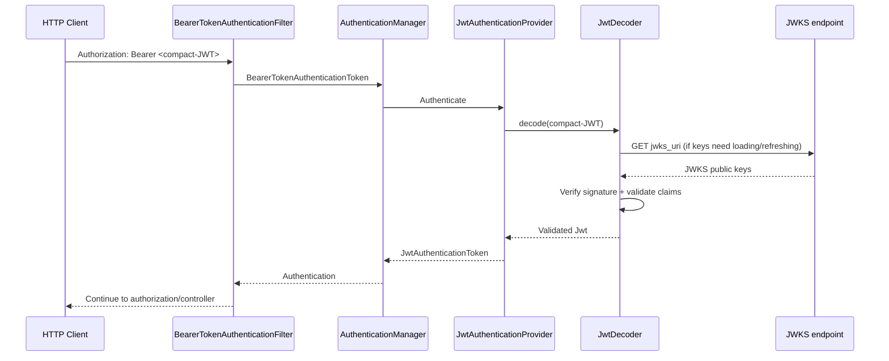

# jwt() Does Not Prove Signature Verification, Discovery, or JWKS Fetching Was Tested

## 1. Lesson objective

In Spring Security Servlet testing, the **spring-security-test** library provides the **jwt()** request post-processor:

```java
mockMvc.perform(get("/api/orders")
        .with(jwt()))
        .andExpect(status().isOk());
```

This test is useful for checking **authorization**: whether a request that already has a `JwtAuthenticationToken` with the specified authorities is allowed to access the endpoint. However, it **does not prove** that Spring Security has:

- Received and parsed a real Bearer token from the HTTP header.
- Verified the JWS signature using the issuer's public key.
- Read discovery metadata from the OpenID Provider/Authorization Server.
- Downloaded the JSON Web Key Set (JWKS) from `jwks_uri`.
- Selected the right JWK by `kid` and verified the signature.
- Executed issuer, audience, timestamp, or token-profile validators.
- Handled key rotation or network errors when calling the JWKS endpoint.

The reason is that `jwt()` builds a pre-made JWT/principal for the test and places the authentication into the request's security context. It does not sign a compact JWT to send via `Authorization: Bearer`, nor does it invoke `JwtDecoder` like the real Bearer authentication flow.

This article distinguishes two testing goals:

1. **Authorization tests:** use `jwt()` to test scopes, roles, request matchers, method security, and controller behavior once the principal is already authenticated.
2. **Authentication/trust-path tests:** sign a JWT with a test private key, send it as a Bearer credential through the full filter chain, and let the decoder actually fetch public keys from JWKS and verify the token.

We will also separately test issuer discovery, JWKS downloads, `issuer-uri`/`jwk-set-uri` configuration, signature errors, and caching/rotation. These are separate tests; a green test using `jwt()` cannot replace them.

## 2. Real JWT authentication flow in Servlet

With a Spring Security Resource Server, a request carrying a Bearer token flows through the main components:



Here:

- `BearerTokenAuthenticationFilter` extracts the token from the header.
- `JwtAuthenticationProvider` uses `JwtDecoder` to verify the token.
- `NimbusJwtDecoder` typically verifies the JWS using a key retrieved from JWKS.
- `OAuth2TokenValidator` checks issuer, expiration, audience, and additional policies.
- Only after authentication succeeds does authorization evaluate authorities/scopes.

In configuration:

```java
http.oauth2ResourceServer(oauth2 ->
        oauth2.jwt(Customizer.withDefaults()));
```

Spring Security wires these components into the filter chain. If a test simply creates a ready-made authentication using `jwt()`, it starts near the end of the flow, after the very steps we want to verify.

## 3. What does jwt() actually do?

`SecurityMockMvcRequestPostProcessors.jwt()` is a test helper that creates a `JwtAuthenticationToken` to place into the `MockHttpServletRequest`/security context. Claims and authorities can be customized:

```java
mockMvc.perform(get("/api/orders")
        .with(jwt()
                .jwt(jwt -> jwt
                        .subject("user-123")
                        .claim("scope", "orders:read"))
                .authorities(
                        new SimpleGrantedAuthority(
                                "SCOPE_orders:read"))))
        .andExpect(status().isOk());
```

The test above verifies that a principal with authority `SCOPE_orders:read` is allowed to call the endpoint. It does not generate an RSA/ECDSA signature, contains no private key, calls no metadata endpoint, and fetches no JWKS.

### 3.1. Why is the name jwt() easily misunderstood?

The created object is an in-memory `Jwt`. In this test flow, `Jwt` is a pre-constructed principal, not a compact token sent over HTTP and decoded. Claims may look like a production JWT, but that does not mean those claims were signed by an issuer.

| Test approach | How is Authentication created? | Calls JwtDecoder? | Checks signature/JWKS? |
| --- | --- | --- | --- |
| with(jwt()) | Test helper creates `JwtAuthenticationToken`. | **No** in this helper flow. | **No**. |
| with(user(...)) / @WithMockUser | Creates mock user authentication. | No. | No. |
| with(authentication(...)) | Installs Authentication created by the test. | No, unless the test invokes a decoder separately. | Not automatically. |
| Authorization: Bearer <JWT> through filter chain | Bearer filter invokes AuthenticationManager/Provider/Decoder. | **Yes**, if using a real decoder. | Yes, if the decoder uses test trusted keys/JWKS. |
| Calling JwtDecoder.decode(token) directly | Test invokes the decoder. | Yes. | Possible, though it does not test the HTTP filter chain. |

### 3.2. jwt() is still very useful

Do not remove `jwt()` from the test suite. It is well suited for:

- `hasAuthority("SCOPE_orders:read")` rules.
- Role or permission mapping rules.
- Method security such as `@PreAuthorize`.
- Access rules based on claims already converted into the principal.
- Controller/service behavior when a valid actor is already present.
- Combinations of authorities and domain policies without repeating cryptographic setup.

Simply name and scope the test accurately: this is an **authorization test with a mock principal**, not a JWT authentication test.

## 4. Distinguishing authentication and authorization

A Resource Server makes at least two decisions:

| Stage | Question | Example checks |
| --- | --- | --- |
| Authentication | Is the credential actually valid per trust configuration? | JWS signature, issuer, `exp`, `nbf`, audience, JWKS key. |
| Authorization | Is the authenticated principal permitted to do this? | `SCOPE_orders:read`, role, tenant, owner, method security. |

Examples:

- A JWT properly signed by a trusted issuer, with the right audience and unexpired, but missing `orders:write` → authentication succeeds, authorization may return **403**.
- A JWT with claim `scope=orders:write` but an invalid signature → authentication fails, typically **401**.
- A `jwt().authorities(SCOPE_orders:write)` test only checks the first branch after authentication is mocked as successful.

If a `jwt()` test returns 200, you cannot conclude forged JWTs will be rejected. If a `jwt()` test returns 403, you cannot conclude signatures or issuers were checked either.

## 5. Two key-retrieval configurations: issuer discovery and jwk-set-uri

A Spring Security Resource Server can be configured to locate public keys in two common ways.

### 5.1. issuer-uri: discovery from the issuer

Example:

```yaml
spring:
  security:
    oauth2:
      resourceserver:
        jwt:
          issuer-uri: https://login.example.test/realms/shop
```

With `issuer-uri`, the Resource Server uses the issuer to discover metadata from the Authorization Server/OpenID Provider. Metadata provides `jwks_uri`, from which the decoder retrieves public keys.

```text
issuer-uri
    │
    ▼
Authorization Server metadata / OIDC discovery
    │
    └── jwks_uri
             │
             ▼
          JWKS JSON
             │
             ▼
      NimbusJwtDecoder
```

During configuration and verification, the issuer must match the verified `iss` value in the token. Discovery does not mean the Resource Server trusts any issuer claimed by an arbitrary token.

### 5.2. jwk-set-uri: direct JWKS configuration

Example:

```yaml
spring:
  security:
    oauth2:
      resourceserver:
        jwt:
          jwk-set-uri: https://login.example.test/realms/shop/protocol/openid-connect/certs
```

With `jwk-set-uri`, the application knows the JWKS endpoint upfront and does not need to look up `jwks_uri` via metadata discovery. The decoder still must download/read JWKS to verify signatures when needed.

**No discovery does not mean no JWKS requests.** If tests only use `jwt()`, they skip both.

### 5.3. Configuring both issuer-uri and jwk-set-uri

Spring Boot/Spring Security allows declaring both:

```yaml
spring:
  security:
    oauth2:
      resourceserver:
        jwt:
          issuer-uri: https://login.example.test/realms/shop
          jwk-set-uri: https://login.example.test/realms/shop/protocol/openid-connect/certs
```

This lets you configure the JWKS location directly while preserving issuer validation. It is useful when you want to avoid a metadata discovery lookup to find the key endpoint. **Never drop the issuer validator just because `jwk-set-uri` is configured.**

If constructing the decoder manually:

```java
NimbusJwtDecoder decoder = NimbusJwtDecoder
        .withJwkSetUri(jwkSetUri)
        .build();

OAuth2TokenValidator<Jwt> issuerAndTimestamp =
        JwtValidators.createDefaultWithIssuer(issuerUri);

decoder.setJwtValidator(issuerAndTimestamp);
```

`withJwkSetUri` configures the key source; `JwtValidators.createDefaultWithIssuer` retains default timestamp and issuer checks. An API audience validator can be composed using `DelegatingOAuth2TokenValidator`.

## 6. Discovery and JWKS are two separate requests

Suppose the issuer is:

```text
https://login.example.test
```

Metadata discovery might send:

```http
GET /.well-known/openid-configuration HTTP/1.1
Host: login.example.test
```

Response:

```json
{
  "issuer": "https://login.example.test",
  "jwks_uri": "https://login.example.test/oauth2/jwks",
  "authorization_endpoint": "https://login.example.test/oauth2/authorize",
  "token_endpoint": "https://login.example.test/oauth2/token"
}
```

Then the decoder uses `jwks_uri`:

```http
GET /oauth2/jwks HTTP/1.1
Host: login.example.test
```

JWKS response:

```json
{
  "keys": [
    {
      "kty": "RSA",
      "kid": "shop-key-2026-01",
      "use": "sig",
      "alg": "RS256",
      "n": "<base64url-modulus>",
      "e": "AQAB"
    }
  ]
}
```

The two endpoints have distinct purposes:

| Endpoint | Returns | Used for |
| --- | --- | --- |
| Discovery metadata | Metadata about the issuer and related endpoints, including `jwks_uri`. | Locating and identifying the Authorization Server. |
| JWKS endpoint | Set of public JWKs. | Verifying JWT signatures and selecting keys per the JOSE header. |

A test that only asserts a request to JWKS does not prove discovery ran. A test that only asserts metadata was downloaded does not prove the decoder fetched public keys or verified signatures.

## 7. Why does jwt() not prove discovery ran?

When using:

```java
mockMvc.perform(get("/api/orders")
        .with(jwt()))
        .andExpect(status().isOk());
```

the request is already given an authentication. The Resource Server does not need to fetch issuer metadata to construct that authentication. Therefore:

- The metadata URL can be wrong and the test still passes.
- The discovery endpoint can be unreachable and the test still passes.
- The `issuer` in metadata can mismatch and the test still passes.
- Metadata can lack `jwks_uri` and the test still passes.
- `jwks_uri` can point to the wrong host and the test still passes.

To prove discovery, you must initialize the decoder via issuer discovery and assert HTTP requests to the metadata endpoint using a mock server or a real test Authorization Server.

## 8. Why does jwt() not prove JWKS was fetched?

`jwt()` does not send a compact token through `JwtDecoder`, so it never triggers fetching JWKs from a remote set. The following failures can go undetected:

- JWKS URL returns 404 or 500.
- Malformed JWKS JSON.
- Empty `keys` or no matching key.
- `kid` in JWT does not exist in JWKS.
- Key in JWKS does not match the signature.
- Untrusted TLS certificate on the JWKS host.
- JWKS cache keeps stale keys or refresh does not work.
- Network timeout when the decoder needs a key.

To test those cases, tests must send a **real Bearer compact JWT** to the decoder. A mock `JwtDecoder` that always returns a `Jwt` does not prove JWKS was fetched either.

## 9. Layered testing strategy

| Test layer | Approach | What it proves |
| --- | --- | --- |
| Authorization unit/integration | `with(jwt())` and explicit authorities/claims. | Permission rules after authentication. |
| Decoder test | `JwtDecoder.decode(signedCompactJwt)` with a test public key. | Signature and validators inside the decoder. |
| JWKS protocol test | `NimbusJwtDecoder.withJwkSetUri(mockJwksUrl)` and an HTTP mock server. | Decoder actually downloads JWKS and selects keys. |
| Discovery protocol test | `JwtDecoders.fromIssuerLocation(mockIssuer)` and a metadata/JWKS mock server. | Metadata discovery, issuer, and `jwks_uri`. |
| Servlet filter-chain test | MockMvc sending `Authorization: Bearer <signed-JWT>` through an app context with a real decoder. | Integrated HTTP parsing, Bearer filter, decoder, validators, and authorization. |
| Operational test | JWKS outage, key rotation, cache, TLS, and timeouts. | Dependency/rotation behavior as configured. |

No need to cram everything into one test. Layer separation makes it clear exactly what has been proved and where failures originate.

## 10. Creating a real signed JWS test token

To test signatures, a test needs:

- A test-only private key to sign tokens.
- The corresponding public key published in the test JWKS.
- A real compact JWT with three parts: `header.payload.signature`.
- A `kid` matching the public JWK in the JWKS.
- Valid claims matching the API's validators.

Example creating a test RSA JWK with Nimbus JOSE:

```java
import com.nimbusds.jose.JOSEException;
import com.nimbusds.jose.JWSAlgorithm;
import com.nimbusds.jose.JWSHeader;
import com.nimbusds.jose.JOSEObjectType;
import com.nimbusds.jose.crypto.RSASSASigner;
import com.nimbusds.jose.jwk.RSAKey;
import com.nimbusds.jose.jwk.gen.RSAKeyGenerator;
import com.nimbusds.jwt.JWTClaimsSet;
import com.nimbusds.jwt.SignedJWT;

import java.time.Instant;
import java.util.Date;

final class TestJwtFactory {

    static RSAKey newSigningKey(String keyId) throws JOSEException {
        return new RSAKeyGenerator(2048)
                .keyID(keyId)
                .generate();
    }

    static String sign(
            RSAKey signingKey,
            String issuer,
            String audience) throws JOSEException {

        Instant now = Instant.now();

        JWTClaimsSet claims = new JWTClaimsSet.Builder()
                .issuer(issuer)
                .subject("user-123")
                .audience(audience)
                .issueTime(Date.from(now))
                .expirationTime(Date.from(now.plusSeconds(300)))
                .claim("scope", "orders:read")
                .build();

        JWSHeader header = new JWSHeader.Builder(JWSAlgorithm.RS256)
                .type(JOSEObjectType.JWT)
                .keyID(signingKey.getKeyID())
                .build();

        SignedJWT jwt = new SignedJWT(header, claims);
        jwt.sign(new RSASSASigner(signingKey.toPrivateKey()));

        return jwt.serialize();
    }
}
```

`TestJwtFactory` signs tokens with a test private key. The Resource Server receives only the public key. Never use production private keys or real tokens in tests/CI.

### 10.1. Creating a JWKS from the public key

```java
import com.nimbusds.jose.jwk.JWKSet;
import com.nimbusds.jose.jwk.RSAKey;

static String jwksJson(RSAKey signingKey) {
    return new JWKSet(signingKey.toPublicJWK()).toString();
}
```

`toPublicJWK()` strips private parameters. A JWKS served to the Resource Server must never contain private keys.

### 10.2. Why use test keys instead of mocking the decoder?

A test key pair allows verifying real behavior:

1. Token is signed with private key A.
2. JWKS publishes public key A.
3. Decoder retrieves key A.
4. Signature is verified successfully.
5. Token signed with key B is rejected if JWKS only publishes key A.

If a mock decoder always returns a `Jwt`, steps 2–4 never execute.

## 11. Testing the decoder with a mock JWKS endpoint

You can use MockWebServer or WireMock. Example with OkHttp MockWebServer:

```java
import okhttp3.mockwebserver.MockResponse;
import okhttp3.mockwebserver.MockWebServer;
import okhttp3.mockwebserver.RecordedRequest;

import org.junit.jupiter.api.AfterAll;
import org.junit.jupiter.api.BeforeAll;
import org.junit.jupiter.api.Test;
import org.springframework.security.oauth2.jwt.Jwt;
import org.springframework.security.oauth2.jwt.JwtValidators;
import org.springframework.security.oauth2.jwt.NimbusJwtDecoder;

import static org.junit.jupiter.api.Assertions.assertEquals;

class JwksDecoderTest {

    static MockWebServer jwksServer;
    static RSAKey issuerSigningKey;
    static final String ISSUER = "https://issuer.example.test";

    @BeforeAll
    static void startServer() throws Exception {
        jwksServer = new MockWebServer();
        jwksServer.start();
        issuerSigningKey = TestJwtFactory.newSigningKey("issuer-key-1");
    }

    @AfterAll
    static void stopServer() throws Exception {
        jwksServer.shutdown();
    }

    @Test
    void downloadsJwksAndValidatesSignedJwt() throws Exception {
        jwksServer.enqueue(new MockResponse()
                .setResponseCode(200)
                .addHeader("Content-Type", "application/json")
                .setBody(TestJwtFactory.jwksJson(issuerSigningKey)));

        String jwksUri = jwksServer.url("/jwks").toString();

        NimbusJwtDecoder decoder = NimbusJwtDecoder
                .withJwkSetUri(jwksUri)
                .build();
        decoder.setJwtValidator(
                JwtValidators.createDefaultWithIssuer(ISSUER));

        String token = TestJwtFactory.sign(
                issuerSigningKey, ISSUER, "orders-api");

        Jwt decoded = decoder.decode(token);

        assertEquals("user-123", decoded.getSubject());

        RecordedRequest request = jwksServer.takeRequest();
        assertEquals("GET", request.getMethod());
        assertEquals("/jwks", request.getPath());
    }
}
```

This is a component test example for the decoder. Helper imports and the MockWebServer dependency must be present in the test source set. If the project manages versions via the Spring Boot BOM, let the BOM manage compatible library versions.

### 11.1. What has been proved?

The test above proves:

- A real compact JWS was created using a private key.
- The decoder was configured to point to the JWKS URI.
- The decoder issued an HTTP GET to the mock JWKS server.
- The public key in JWKS is sufficient to verify the token.
- The issuer validator accepted the expected issuer.

It does **not yet** prove `BearerTokenAuthenticationFilter` or the full HTTP security chain. To test those components, add a MockMvc integration test sending the token in the `Authorization` header.

## 12. Testing invalid signatures when header and claims look valid

An important test is signing a token with private key B while JWKS only publishes public key A. To ensure the decoder finds the `kid` yet the signature still fails, generate two key pairs with the same `kid` in the fixture:

```java
RSAKey trustedKey = TestJwtFactory.newSigningKey("shared-kid");
RSAKey attackerKey = TestJwtFactory.newSigningKey("shared-kid");

String tokenSignedByTrustedKey =
        TestJwtFactory.sign(trustedKey, ISSUER, "orders-api");

String tokenSignedByAttackerKey =
        TestJwtFactory.sign(attackerKey, ISSUER, "orders-api");
```

The mock JWKS publishes only `trustedKey.toPublicJWK()`. The first token must decode successfully; the second must fail signature verification. Both can have identical `iss`, `aud`, `sub`, `exp`, and `kid`; the difference lies in the private key that signed the token.

This test proves the decoder checks the **cryptographic signature**, not merely the `kid` or claims.

### 12.1. Testing tokens tampered with after signing

Another variant:

1. Create a valid compact JWT using the test key.
2. Alter one character in the payload segment or signature segment.
3. Keep headers/claims looking valid.
4. Send the token through the decoder.
5. Assert `JwtException` or HTTP 401 through the filter chain.

Do not decode and re-sign the token after modification; the goal is to prove a tampered token no longer has a valid signature.

### 12.2. Do not use an unknown kid as a substitute for signature tests

`kid` is not proof of signature. When `kid` does not exist in JWKS, the decoder may fail to find a key and reject before checking the signature. This is a useful test for key selection, but **different** from testing a matching `kid` with a bad signature.

Include both:

- Non-existent `kid` → no trusted key found.
- Existing `kid` but token signed with a different private key → signature verification fails.

## 13. Testing real issuer discovery

To test discovery, use a mock server returning metadata with `issuer` and `jwks_uri`. Skeleton example:

```java
String issuer = "http://localhost:" + server.getPort();
String jwksUri = issuer + "/jwks";

server.enqueue(new MockResponse()
        .setResponseCode(200)
        .addHeader("Content-Type", "application/json")
        .setBody("""
            {
              "issuer": "http://localhost:PORT",
              "jwks_uri": "http://localhost:PORT/jwks"
            }
            """.replace("PORT", Integer.toString(server.getPort()))));

server.enqueue(new MockResponse()
        .setResponseCode(200)
        .addHeader("Content-Type", "application/json")
        .setBody(TestJwtFactory.jwksJson(signingKey)));

JwtDecoder decoder = JwtDecoders.fromIssuerLocation(issuer);
Jwt jwt = decoder.decode(
        TestJwtFactory.sign(signingKey, issuer, "orders-api"));

RecordedRequest metadataRequest = server.takeRequest();
RecordedRequest jwksRequest = server.takeRequest();

assertEquals("/.well-known/openid-configuration",
        metadataRequest.getPath());
assertEquals("/jwks", jwksRequest.getPath());
```

This is a skeleton; `server`, `signingKey`, and lifecycle setup are initialized by the test. Using a root issuer makes the discovery path in this simple example `/.well-known/openid-configuration`. If the issuer has a path, Spring Security may try multiple well-known metadata URLs per discovery rules; assert the actual endpoint for your fixture's issuer rather than hardcoding one path for all issuers.

### 13.1. Testing metadata issuer mismatch

Metadata returning an issuer different from the configured URI must be rejected. Do not only check that a GET metadata request occurred; verify the decoder enforces the right issuer identity.

### 13.2. Testing metadata missing jwks_uri

If metadata lacks a valid `jwks_uri`, the decoder cannot fetch public keys via discovery. Tests must verify initialization/decoding fails per contract and protected requests produce no authentication.

### 13.3. Testing discovery network errors

Mock the metadata endpoint returning 404, 500, or timing out. Verify the decoder does not silently use an arbitrary key or skip signatures. The application's final HTTP status depends on exception handling; the security invariant is **no authenticated principal and no business handler invocation**.

## 14. Testing jwk-set-uri directly and proving no discovery occurs

When the decoder is built with:

```java
NimbusJwtDecoder decoder =
        NimbusJwtDecoder.withJwkSetUri(jwksUri).build();
```

there is no metadata discovery step. A test can use a mock server to:

1. Enqueue a response only for `/jwks`.
2. Build the decoder with the `/jwks` URI.
3. Decode a token with a valid signature.
4. Assert a request to `/jwks`.
5. Assert no request to `/.well-known/openid-configuration`.

With Spring Boot, configure both `issuer-uri` and `jwk-set-uri` if you want to skip metadata discovery while keeping issuer checks:

```yaml
spring:
  security:
    oauth2:
      resourceserver:
        jwt:
          issuer-uri: http://localhost:9000
          jwk-set-uri: http://localhost:9000/jwks
```

Do not set only `jwk-set-uri` and assume issuer validation appears automatically. If constructing the decoder manually, attach an issuer validator as in section 5.3.

## 15. Full MockMvc tests must send real Bearer tokens

To test the complete Servlet Resource Server path, use `@SpringBootTest` and `@AutoConfigureMockMvc`, then send an `Authorization` header:

```java
@SpringBootTest
@AutoConfigureMockMvc
class OrdersJwtFilterChainTest {

    @Autowired
    MockMvc mockMvc;

    @Test
    void acceptsSignedJwtThroughBearerFilter() throws Exception {
        String token = TestJwtFactory.sign(
                trustedTestKey,
                TEST_ISSUER,
                "orders-api");

        mockMvc.perform(get("/api/orders")
                        .header(HttpHeaders.AUTHORIZATION,
                                "Bearer " + token))
                .andExpect(status().isOk());
    }

    @Test
    void rejectsTokenSignedByUntrustedKey() throws Exception {
        String token = TestJwtFactory.sign(
                attackerTestKey,
                TEST_ISSUER,
                "orders-api");

        mockMvc.perform(get("/api/orders")
                        .header(HttpHeaders.AUTHORIZATION,
                                "Bearer " + token))
                .andExpect(status().isUnauthorized());
    }
}
```

This example assumes the test application context uses a real `JwtDecoder` configured with a test JWKS endpoint publishing only `trustedTestKey`. `attackerTestKey` must not be published in JWKS. To test an invalid signature independently of `kid` lookup, both keys can share the same `kid` as in section 12.

### 15.1. Do not disable servlet filters in tests

`@AutoConfigureMockMvc` integrates the filter chain by default. If a test configures:

```java
@AutoConfigureMockMvc(addFilters = false)
```

the test does not run the Security filter chain; sending a Bearer header will not prove the Resource Server was invoked. Only disable filters when the explicit goal is testing MVC/controllers without security.

### 15.2. Do not replace the decoder with a mock in trust-path tests

If the context has:

```java
@MockBean
JwtDecoder jwtDecoder;
```

and the mock returns an arbitrary `Jwt`, requests can succeed without real signatures/JWKS. A mock decoder is useful for testing authentication/authorization behavior around the decoder, but it cannot prove the real decoder works.

## 16. Test matrix: which test proves what?

| Case | Test setup | Expectation |
| --- | --- | --- |
| AUTHZ-01 | `with(jwt())`, authority `SCOPE_orders:read` | 2xx if rules allow. |
| AUTHZ-02 | `with(jwt())`, missing scope | 403. |
| AUTHZ-03 | `with(jwt())`, different role/tenant | Domain/method authorization denies. |
| JWT-01 | Bearer compact JWS signed by trusted test key | Decoder verifies successfully. |
| JWT-02 | Bearer JWS signed by untrusted key | 401. |
| JWT-03 | Payload/signature modified after signing | 401. |
| JWT-04 | Valid signature but wrong `iss` | 401. |
| JWT-05 | Valid signature/issuer but wrong `aud` | 401. |
| JWT-06 | Valid signature but `exp` in the past | 401. |
| JWKS-01 | `jwk-set-uri` mock returns matching key | JWKS GET occurs and decode succeeds. |
| JWKS-02 | Malformed JWKS JSON / HTTP 500 | No authentication; controller not reached. |
| JWKS-03 | Non-existent `kid` | No trusted key found; rejected. |
| JWKS-04 | Same `kid`, token signed by different key | Signature fails. |
| DISC-01 | `issuer-uri`, valid metadata | Metadata GET and JWKS GET via `jwks_uri`. |
| DISC-02 | Metadata issuer mismatch | Discovery/decoder rejects. |
| DISC-03 | Metadata missing `jwks_uri` | Cannot complete key discovery. |
| DISC-04 | Metadata endpoint timeout/5xx | Fail closed. |
| CFG-01 | `jwk-set-uri` only | No discovery; JWKS fetch still occurs when decoding. |
| CFG-02 | `issuer-uri` + `jwk-set-uri` | No metadata lookup needed; issuer validation still active per Boot config. |
| ROT-01 | JWKS publishes new key and token uses new `kid` | Decoder can update key per cache/refresh policy. |
| ROT-02 | Old key removed after overlap window | Token signed with old key is rejected once key is no longer trusted/cache expires. |

## 17. Testing the audience validator beyond the signature

A valid signature only proves the token was signed by the corresponding key. The Resource Server must still check issuer and audience.

Validator example:

```java
OAuth2TokenValidator<Jwt> audienceValidator = jwt -> {
    if (jwt.getAudience().contains("orders-api")) {
        return OAuth2TokenValidatorResult.success();
    }

    OAuth2Error error = new OAuth2Error(
            "invalid_token",
            "Token is not intended for this API",
            null);

    return OAuth2TokenValidatorResult.failure(error);
};

decoder.setJwtValidator(
        new DelegatingOAuth2TokenValidator<>(
                JwtValidators.createDefaultWithIssuer(TEST_ISSUER),
                audienceValidator));
```

Tests need a token properly signed by a trusted key with `aud=inventory-api`; that token must be rejected at the audience validator. If only a token signed with the wrong key is used, the test does not prove the audience validator works because the decoder already rejected it at the signature step.

### 17.1. Separating negative tests by cause

To pinpoint which layer is broken:

- Wrong signature + correct claims → tests signature verification.
- Correct signature + wrong issuer → tests issuer validation.
- Correct signature/issuer + wrong audience → tests audience validation.
- Correct signature/issuer/audience + expired `exp` → tests timestamp validation.

Each case varies only one key factor. This avoids overly broad "invalid token" tests where it is unclear which validator the decoder executed.

## 18. JWKS caching and key rotation

JWKS responses are normally cached to reduce network calls. Therefore, the number of JWKS GET requests does not necessarily equal the number of API requests.

### 18.1. A jwt() test cannot test caching

Because `jwt()` does not invoke the decoder, it never touches the JWK source or cache. Tests can pass even if the JWKS endpoint is unreachable, new keys are not fetched, the cache holds stale keys, or an unknown `kid` fails to trigger a refresh per policy.

### 18.2. Testing key rotation

```text
Initially:
  JWKS = { key-1 }
  Token T1 signed by private key-1

During overlap:
  JWKS = { key-1, key-2 }
  Token T2 signed by private key-2

After old key removal:
  JWKS = { key-2 }
```

Test:

1. Decoder verifies T1 using key-1.
2. Mock JWKS updates to publish key-2.
3. Send T2 with `kid=key-2` when the decoder needs to refresh the JWK set.
4. Verify T2 is accepted per the library's cache/refresh behavior.
5. After the overlap window and appropriate cache policy, verify tokens signed only with the old key are rejected.

Do not hardcode assumptions that every decoder refreshes JWKS immediately upon server changes. Cache/refresh timing depends on Nimbus and configuration. Use a fresh decoder or control the cache in component tests if a deterministic test is needed; dedicated operational tests verify the real behavior of the version in use.

### 18.3. JWKS outage must fail closed

When the decoder cannot retrieve the required key, it lacks sufficient evidence to verify the signature. The request must be rejected / create no Authentication; it must never:

- Skip the signature check.
- Accept the token simply because `iss`/`aud` look right.
- Use a public key fetched from a `jku`/`x5u` declared by the token itself if that source is untrusted.
- Return a fallback mock principal.

The final HTTP status depends on exception mapping; the test invariant is zero business access.

## 19. Discovery/JWKS tests at the Spring Boot level

When using auto-configuration:

```yaml
spring:
  security:
    oauth2:
      resourceserver:
        jwt:
          issuer-uri: http://localhost:9000
```

Tests can start a mock metadata/JWKS server and pass the URI into properties. `DynamicPropertySource` is one way to pass runtime URLs:

```java
@SpringBootTest
@AutoConfigureMockMvc
class IssuerDiscoveryIntegrationTest {

    static final MockWebServer issuerServer = new MockWebServer();

    @DynamicPropertySource
    static void properties(DynamicPropertyRegistry registry) {
        registry.add("spring.security.oauth2.resourceserver.jwt.issuer-uri",
                () -> issuerServer.url("/").toString());
    }

    // @BeforeAll: start server and enqueue metadata/JWKS responses.
    // Test: send signed Bearer JWT via MockMvc.
}
```

This is a skeleton, not a standalone runnable class. Start the server before the Spring context needs the property; metadata must return the exact issuer string verified by the decoder and `jwks_uri` pointing to the mock server. Use static server lifecycle and clean up after tests.

### 19.1. Discovery may happen lazily

Do not write tests assuming metadata/JWKS is always fetched immediately when `ApplicationContext` starts. Depending on the Spring Security/Spring Boot version and how the decoder is initialized, some operations may be deferred until the first request requiring JWT authentication.

Trigger a real Bearer request first and then assert the HTTP calls. If testing specific startup behavior, write a dedicated test for your exact version and real configuration.

### 19.2. Do not confuse application startup with proof of discovery

A successful application context startup does not prove the metadata endpoint was called. If decoder initialization is lazy, the app can start even when the issuer host is down. Conversely, startup failure can be caused by many other beans/configurations.

To prove discovery, assert actual metadata requests and that the metadata response was used.

## 20. Sample test suite: separating authorization and trust path

### 20.1. Authorization tests with jwt()

```java
@Test
void readerCanReadOrders() throws Exception {
    mockMvc.perform(get("/api/orders")
            .with(jwt().authorities(
                    new SimpleGrantedAuthority(
                            "SCOPE_orders:read"))))
            .andExpect(status().isOk());
}

@Test
void readerCannotCreateOrders() throws Exception {
    mockMvc.perform(post("/api/orders")
            .with(jwt().authorities(
                    new SimpleGrantedAuthority(
                            "SCOPE_orders:read"))))
            .andExpect(status().isForbidden());
}
```

These two tests verify authorization behavior. No JWKS mock is needed because the tests do not target authentication.

### 20.2. Trust-path tests with real Bearer tokens

```java
@Test
void signedTokenIsDecodedThroughResourceServer() throws Exception {
    String token = TestJwtFactory.sign(
            trustedTestKey, TEST_ISSUER, "orders-api");

    mockMvc.perform(get("/api/orders")
            .header(HttpHeaders.AUTHORIZATION, "Bearer " + token))
            .andExpect(status().isOk());
}

@Test
void wrongSignatureIsRejectedBeforeController() throws Exception {
    String token = TestJwtFactory.sign(
            attackerTestKey, TEST_ISSUER, "orders-api");

    mockMvc.perform(get("/api/orders")
            .header(HttpHeaders.AUTHORIZATION, "Bearer " + token))
            .andExpect(status().isUnauthorized());
}
```

These two tests only prove the trust path if the test application context:

- Uses a real decoder, not a mock.
- Has the Bearer Resource Server filter chain.
- Has the decoder fetch the public key from a test JWKS endpoint.
- Does not publish the attacker public key in JWKS.
- Configures issuer/audience validators matching the production contract.

### 20.3. Testing protocol calls separately

When proving discovery:

- Enqueue the metadata response.
- Trigger a real Bearer request.
- Assert the metadata URL was called.
- Assert the metadata issuer matches.
- Assert `jwks_uri` was called.

When using direct JWKS:

- Do not enqueue metadata.
- Trigger decoding with a real signed token.
- Assert the JWKS endpoint was called.
- Assert no discovery request occurred.

## 21. Common mistakes

1. **Using `jwt()` and concluding signatures are valid:** `jwt()` creates a mock principal with no JWS signature verification.
2. **Using `jwt()` and concluding JWKS works:** there is no `JwtDecoder` invocation, so no JWK retrieval occurs.
3. **Using `jwt()` and concluding discovery succeeded:** there is no metadata lookup.
4. **Using `@WithMockUser` to test Bearer authentication:** that is mock user authentication.
5. **Mocking `JwtDecoder` in signature tests:** a mock returning a `Jwt` does not prove cryptography, issuer, audience, or JWKS.
6. **Testing only an unknown `kid`:** does not prove signature checking when a valid `kid` is paired with the wrong private key.
7. **Testing only an invalid signature:** can miss broken issuer/audience/expiry validators.
8. **Asserting only app context startup:** discovery/JWKS may be lazy; trigger a Bearer request and assert outbound calls.
9. **Configuring `jwk-set-uri` while dropping issuer validation:** a direct key source does not automatically verify `iss`.
10. **Asserting JWKS is requested exactly once:** caching can change the request count.
11. **Using production keys or tokens in tests:** generate dedicated test key pairs and short-lived tokens.
12. **Disabling filters and sending a Bearer header:** with `addFilters=false`, the Resource Server filter does not run.
13. **Using a decoder test and claiming the full HTTP path works:** calling `decode` directly does not test header parsing/Bearer filter/request matchers.

## 22. Checklist for choosing the right test

| Question to answer | Appropriate test |
| --- | --- |
| Can a user with `SCOPE_orders:read` call GET? | `with(jwt().authorities(...))`. |
| Does a user missing scope get 403? | `with(jwt())` with missing authority. |
| Is a JWS signed by a trusted key decoded? | Signed token + real `JwtDecoder`. |
| Is an invalid signature rejected? | Token signed by another key + real decoder. |
| Is issuer metadata downloaded? | `JwtDecoders.fromIssuerLocation` + mock metadata server + assert request. |
| Is JWKS downloaded? | Real decoder + mock JWKS endpoint + signed token + assert GET. |
| Is `kid` selected properly? | JWKS with multiple keys and token with specific `kid`. |
| Does the audience validator run? | Signed token with valid signature/issuer but wrong `aud`. |
| Does the Bearer filter work? | MockMvc sending `Authorization: Bearer ...` through the full filter chain. |
| Does key rotation work? | Update JWKS, use token with new key, and test cache/refresh policy. |
| Does a JWKS outage fail closed? | Mock endpoint failure and assert no Authentication/business invocation. |

## 23. References

- **Spring Security Reference — Testing OAuth 2.0:** `jwt()` request post-processor and Resource Server testing. https://docs.spring.io/spring-security/reference/servlet/test/mockmvc/oauth2.html
- **Spring Security Reference — OAuth 2.0 Resource Server JWT:** issuer discovery, JWK Set URI, JWT validation, and key rotation. https://docs.spring.io/spring-security/reference/servlet/oauth2/resource-server/jwt.html
- **Spring Security Reference — Servlet Security Architecture:** filter chain and authentication flow. https://docs.spring.io/spring-security/reference/servlet/architecture.html
- **Spring Security API — SecurityMockMvcRequestPostProcessors.jwt():** https://docs.spring.io/spring-security/reference/api/java/org/springframework/security/test/web/servlet/request/SecurityMockMvcRequestPostProcessors.html
- **Spring Security API — JwtDecoder / NimbusJwtDecoder:** https://docs.spring.io/spring-security/reference/api/java/org/springframework/security/oauth2/jwt/JwtDecoder.html
- **RFC 7515 — JSON Web Signature (JWS):** compact JWS and signatures. https://www.rfc-editor.org/rfc/rfc7515
- **RFC 7517 — JSON Web Key (JWK):** public key representation and JWKS. https://www.rfc-editor.org/rfc/rfc7517
- **RFC 8414 — Authorization Server Metadata:** metadata discovery. https://www.rfc-editor.org/rfc/rfc8414
- **OpenID Connect Discovery 1.0:** provider configuration and `jwks_uri`. https://openid.net/specs/openid-connect-discovery-1_0.html

## 24. Conclusion

`jwt()` in MockMvc is a great tool for testing **authorization with a pre-built `JwtAuthenticationToken`**. It does not send a compact JWT through the Bearer filter and does not invoke `JwtDecoder`, so it does not prove signatures, issuer discovery, JWKS downloads, key selection, or validators ran.

To test the trust path, sign JWTs with a test private key, publish the public key in a mock JWKS, send the token via `Authorization: Bearer ...` through MockMvc with the real filter chain, and verify tokens with invalid signatures/issuers/audiences/expiry are rejected. When testing discovery, mock the metadata endpoint and assert requests to both metadata and `jwks_uri`; when configuring `jwk-set-uri` directly, assert JWKS fetching and remember to keep the issuer validator.

Use `jwt()` for permission questions, signed Bearer tokens for authentication questions, and mock metadata/JWKS servers for discovery/key-retrieval questions. When each test has a clear objective, a green result proves the exact security layer it was written to verify.
