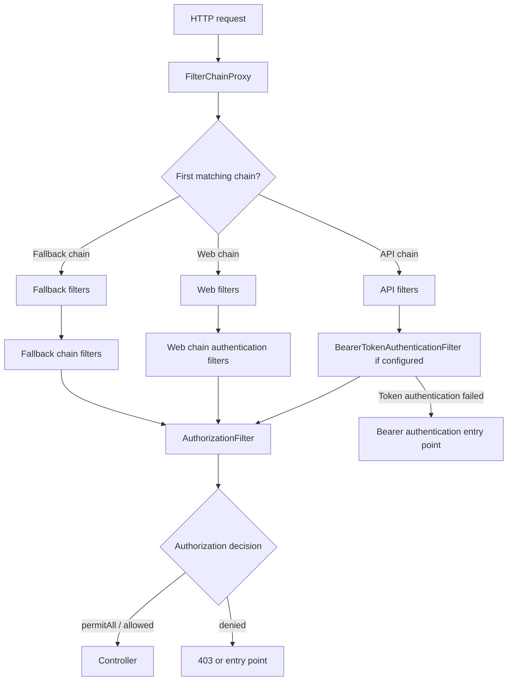

# Testing Multiple Filter Chains and permitAll Endpoints Receiving Invalid Tokens

In Spring Security Servlet, an endpoint configured with `permitAll()` can still return **401 when a request carries an invalid Bearer token**. The reason is that `permitAll` is an authorization rule, whereas extracting and authenticating a Bearer token occurs earlier in the authentication filter.

This easily causes confusion when an application has multiple `SecurityFilterChain`s. `FilterChainProxy` selects the first chain matching the request; each chain has its own set of filters and rules. An endpoint might live in a chain with OAuth2 Resource Server enabled, in a chain without a Bearer filter, or accidentally get caught by a catch-all chain ordered earlier.

This article explains how to distinguish the two kinds of matchers, how chain selection affects Bearer authentication, how `permitAll` endpoints behave when given an invalid token, and how to test using MockMvc with the real filter chain. The goal is to determine which chain a request goes through, which filter processes the `Authorization` header, and why the outcome is 200, 401, 403, or another OAuth error.

> **Rule to remember:** `permitAll` lets a request pass the authorization step without requiring Authentication. It does not tell Spring to skip authentication filters that already ran earlier. If `BearerTokenAuthenticationFilter` is in the selected chain and the client sends an invalid token, authentication can fail before `AuthorizationFilter` evaluates `permitAll`.

## 1. Two distinct phases: selecting the filter chain and authorizing the request

Spring Security Servlet uses `FilterChainProxy` to dispatch across `SecurityFilterChain`s. When a request arrives at the application, the general flow is:

1. `FilterChainProxy` evaluates the chains in order.
2. The first chain whose `RequestMatcher` matches is selected.
3. That chain's filters execute in order.
4. Authentication filters may read credentials and build Authentication.
5. The authorization filter applies rules such as `permitAll`, `authenticated`, or `hasAuthority`.
6. The request is passed to the servlet/controller if no filter blocks it.



A request goes through **only one selected chain** during that dispatch. Chains do not add filters to each other. Therefore, having Resource Server configured on one chain does not mean every request in the application passes through `BearerTokenAuthenticationFilter`.

### 1.1. securityMatcher selects the chain

`securityMatcher(...)` determines which requests belong to a `SecurityFilterChain`.

```java
http
    .securityMatcher("/api/**")
    .authorizeHttpRequests(auth -> auth
        .anyRequest().authenticated()
    )
    .oauth2ResourceServer(oauth2 ->
        oauth2.jwt(Customizer.withDefaults())
    );
```

The chain above applies only to URLs matching `/api/**`. If the request is `/web/home`, this chain is not selected.

### 1.2. requestMatchers selects authorization rules inside the chain

`requestMatchers(...)` inside `authorizeHttpRequests` determines which rule applies after the chain has been selected.

```java
http
    .securityMatcher("/api/**")
    .authorizeHttpRequests(auth -> auth
        .requestMatchers("/api/public/**").permitAll()
        .requestMatchers("/api/admin/**").hasAuthority("SCOPE_admin")
        .anyRequest().authenticated()
    )
    .oauth2ResourceServer(oauth2 ->
        oauth2.jwt(Customizer.withDefaults())
    );
```

Here `/api/public/ping` still belongs to the API chain. It is allowed at the authorization step, yet that chain still contains `BearerTokenAuthenticationFilter`.

### 1.3. Quick comparison

| Configuration | Role | When it takes effect |
|---|---|---|
| `securityMatcher("/api/**")` | Selects the chain | Before the chain's filters run |
| `requestMatchers("/api/public/**").permitAll()` | Permits requests per authorization rule | At the authorization step inside the selected chain |
| `anyRequest().authenticated()` | Requires Authentication for remaining requests | At the authorization step |
| `oauth2ResourceServer().jwt()` | Adds JWT Bearer authentication configuration to the chain | When the filter chain is built |

Do not use `requestMatchers` as if it creates a new filter chain. To route public routes through a different set of filters, you need a separate chain with an appropriate `securityMatcher` and order.

## 2. Does permitAll skip BearerTokenAuthenticationFilter?

No. These two mechanisms answer two different questions:

- `BearerTokenAuthenticationFilter` asks: does the request carry a Bearer credential, and can that credential be authenticated?
- `AuthorizationFilter` asks: is the current Authentication allowed to access this endpoint?

If a request sends no Bearer token, `BearerTokenAuthenticationFilter` typically does nothing. The request continues to `AuthorizationFilter`, where `permitAll` allows access.

If a request sends a Bearer token that is invalid, the filter attempts to authenticate it. When the decoder or authentication provider throws an error, the filter handles the authentication failure and invokes the authentication entry point. The request typically ends with 401 before `permitAll` is ever evaluated.

### 2.1. Basic behavior table

Suppose endpoint `/api/public/ping` is in a chain with:

```java
.authorizeHttpRequests(auth -> auth
    .requestMatchers("/api/public/**").permitAll()
    .anyRequest().authenticated()
)
.oauth2ResourceServer(oauth2 ->
    oauth2.jwt(Customizer.withDefaults())
)
```

Typical results:

| Request | Expected result | Reason |
|---|---:|---|
| No Authorization header | 200 | No Bearer credential to authenticate; `permitAll` allows |
| Valid Bearer token | 200 | Authentication succeeds; endpoint requires no specific permissions |
| Expired Bearer token | 401 | Authentication fails before authorization |
| Bearer token with wrong signature | 401 | Decoder cannot verify token |
| Bearer token with wrong issuer/audience | 401 | Token invalid per Resource Server contract |
| Syntactically malformed Bearer header | May be 400 or 401 depending on resolver/protocol error | May be `invalid_request`, distinct from syntactically valid but invalid token |
| Valid token missing scope | 200 on `permitAll` endpoint | Endpoint does not require that scope |

One final point to understand clearly: if the token is valid, the filter can create an Authentication and place it into the SecurityContext. `permitAll` does not force the request to become anonymous. Controllers can inspect the principal if needed, even though login is not required for the endpoint.

### 2.2. permitAll does not mean ignoring every credential error

Example public endpoint:

```java
.requestMatchers("/health/public").permitAll()
```

This means requests do not need a privileged principal to pass authorization. It does not mean clients can send invalid credentials and expect the system to ignore them.

The default behavior is usually helpful: if a client actively sends `Authorization: Bearer ...`, the system verifies the credential and reports an error if it is invalid. This helps catch stale tokens, corrupted tokens, misconfigured clients, or tokens sent to the wrong audience.

## 3. Filter order relative to the outcome

In a chain with OAuth2 Resource Server, key filters may include:

- `SecurityContextHolderFilter`: configures how SecurityContext is loaded/saved during the request.
- `BearerTokenAuthenticationFilter`: extracts and authenticates a Bearer token if present.
- `AnonymousAuthenticationFilter`: supplies an anonymous Authentication when appropriate.
- `ExceptionTranslationFilter`: translates authentication/authorization exceptions to the entry point or access-denied handler.
- `AuthorizationFilter`: enforces authorization rules.

The actual order may include other filters depending on configuration, but the crucial point is that Bearer authentication runs before `AuthorizationFilter`'s authorization decision.

If Bearer authentication fails, the request does not proceed to `permitAll` like a normal request.

### 3.1. When there is no token

Request:

```http
GET /api/public/ping HTTP/1.1
Host: api.example.test
```

`BearerTokenAuthenticationFilter` finds no Bearer token and continues the chain. `AuthorizationFilter` evaluates the `permitAll` rule and lets the request proceed.

### 3.2. When there is an invalid token

Request:

```http
GET /api/public/ping HTTP/1.1
Host: api.example.test
Authorization: Bearer not-a-valid-jwt
```

The filter detects the Bearer credential and passes it to `AuthenticationManager`/Provider. The JWT decoder fails to decode or validate the token, and the error is handled as an authentication failure. With the default Bearer entry point, the response is usually 401 with `WWW-Authenticate: Bearer` and the corresponding error.

`permitAll` is not used to rescue a failed Authentication.

### 3.3. When there is a valid token

Request:

```http
GET /api/public/ping HTTP/1.1
Host: api.example.test
Authorization: Bearer <VALID_TOKEN_FOR_API>
```

The filter authenticates the token and places a `JwtAuthenticationToken` into the SecurityContext. `AuthorizationFilter` applies `permitAll` and allows the request through. If the controller reads Authentication, the principal can be the user/service from the token.

## 4. Multiple SecurityFilterChains: first matching chain wins

An application may declare multiple `SecurityFilterChain`s, for example:

- Stateless API using JWT.
- Browser pages using form login/session.
- Actuator endpoints with their own policy.
- Public/static resources.
- Fallback chain for remaining paths.

`FilterChainProxy` evaluates chains in order. **The first chain matching the request is used.** Subsequent chains do not add filters to that request.

### 4.1. Example three-chain configuration

```java
@Configuration
@EnableWebSecurity
public class SecurityConfiguration {

    @Bean
    @Order(1)
    SecurityFilterChain apiChain(HttpSecurity http) throws Exception {
        return http
            .securityMatcher("/api/**")
            .sessionManagement(session ->
                session.sessionCreationPolicy(
                    SessionCreationPolicy.STATELESS
                )
            )
            .authorizeHttpRequests(auth -> auth
                .requestMatchers("/api/public/**").permitAll()
                .requestMatchers(HttpMethod.GET, "/api/orders/**")
                    .hasAuthority("SCOPE_orders.read")
                .requestMatchers(HttpMethod.POST, "/api/orders/**")
                    .hasAuthority("SCOPE_orders.write")
                .anyRequest().authenticated()
            )
            .oauth2ResourceServer(oauth2 ->
                oauth2.jwt(Customizer.withDefaults())
            )
            .build();
    }

    @Bean
    @Order(2)
    SecurityFilterChain browserChain(HttpSecurity http) throws Exception {
        return http
            .securityMatcher("/web/**")
            .authorizeHttpRequests(auth -> auth
                .requestMatchers("/web/public/**").permitAll()
                .anyRequest().authenticated()
            )
            .formLogin(Customizer.withDefaults())
            .build();
    }

    @Bean
    @Order(3)
    SecurityFilterChain fallbackChain(HttpSecurity http) throws Exception {
        return http
            .securityMatcher("/**")
            .authorizeHttpRequests(auth -> auth
                .anyRequest().denyAll()
            )
            .build();
    }
}
```

Key imports:

```java
import org.springframework.context.annotation.Bean;
import org.springframework.context.annotation.Configuration;
import org.springframework.core.annotation.Order;
import org.springframework.http.HttpMethod;
import org.springframework.security.config.Customizer;
import org.springframework.security.config.annotation.web.builders.HttpSecurity;
import org.springframework.security.config.annotation.web.configuration.EnableWebSecurity;
import org.springframework.security.config.http.SessionCreationPolicy;
import org.springframework.security.web.SecurityFilterChain;
```

This is an illustrative example; real applications may need CSRF, CORS, exception handling, session policies, or custom filters. The fallback chain `/**` ensures requests that do not match specialized chains are still handled by an explicit security policy.

### 4.2. Why is @Order needed?

If two chains both match `/api/public/ping`, the chain with higher precedence (lower numeric order) is evaluated first. If that chain is a catch-all without Resource Server, API requests may never enter the API JWT chain.

Dangerous configuration example:

```java
@Bean
@Order(1)
SecurityFilterChain catchAll(HttpSecurity http) throws Exception {
    return http
        .securityMatcher("/**")
        .authorizeHttpRequests(auth -> auth.anyRequest().permitAll())
        .build();
}

@Bean
@Order(2)
SecurityFilterChain api(HttpSecurity http) throws Exception {
    return http
        .securityMatcher("/api/**")
        .oauth2ResourceServer(oauth2 ->
            oauth2.jwt(Customizer.withDefaults())
        )
        .build();
}
```

The catch-all chain matches every URL first, so the API chain is never chosen. This is not a bug in the Bearer filter; the bug is in chain selection.

### 4.3. Having no matching chain is also a risk

If the application declares chains matching only `/api/**` and `/web/**`, a request to `/internal/report` might match no chain at all. Then Spring Security's security filters do not protect that request.

Always include a fallback chain matching remaining requests, usually `/**`, with an explicit policy. Do not rely on assuming Spring will pick the closest chain or merge chains together.

## 5. Public endpoints in a chain with Resource Server

Common configuration:

```java
@Bean
SecurityFilterChain apiSecurity(HttpSecurity http) throws Exception {
    return http
        .securityMatcher("/api/**")
        .authorizeHttpRequests(auth -> auth
            .requestMatchers("/api/public/**").permitAll()
            .anyRequest().authenticated()
        )
        .oauth2ResourceServer(oauth2 ->
            oauth2.jwt(Customizer.withDefaults())
        )
        .build();
}
```

Requests to `/api/public/**` share the same filter set as other API requests, including `BearerTokenAuthenticationFilter`.

Outcomes:

- No token: public endpoint still works.
- Valid token: public endpoint still works and Authentication may be present.
- Invalid token: authentication failure, typically 401.
- Expired token: authentication failure, typically 401.

This is the right choice when the application wants a public endpoint not to require login while still rejecting invalid credentials if a client sends them.

### 5.1. Public endpoints can receive both anonymous and authenticated requests

Endpoint example:

```java
@GetMapping("/api/public/ping")
Map<String, Object> ping(Authentication authentication) {
    return Map.of(
        "status", "ok",
        "authenticated", authentication != null
            && authentication.isAuthenticated()
    );
}
```

Note that `AnonymousAuthenticationToken` can also return `isAuthenticated() == true`; if you need to distinguish an authenticated user, check the exact principal type or use `AuthenticationTrustResolver`/an appropriate policy. Do not rely solely on this boolean to determine whether a user sent a Bearer token.

If no token is sent, the request is still permitted. If a valid token is sent, the controller can read the real principal. If an invalid token is sent, the controller is not invoked.

### 5.2. permitAll does not skip the scope converter

When a Bearer token is valid, Spring still decodes the token and builds authorities using the JWT authentication converter. A `permitAll` endpoint does not require scopes to pass authorization, yet the converter can still run.

If the token is valid but the `scope` claim lacks `orders.read`, the public endpoint can still return 200. That same token calling a protected GET endpoint requiring `SCOPE_orders.read` will receive 403.

## 6. Public endpoints in a chain without Resource Server

Suppose:

```java
@Bean
@Order(1)
SecurityFilterChain publicChain(HttpSecurity http) throws Exception {
    return http
        .securityMatcher("/public/**")
        .authorizeHttpRequests(auth ->
            auth.anyRequest().permitAll()
        )
        .build();
}

@Bean
@Order(2)
SecurityFilterChain apiChain(HttpSecurity http) throws Exception {
    return http
        .securityMatcher("/api/**")
        .authorizeHttpRequests(auth ->
            auth.anyRequest().authenticated()
        )
        .oauth2ResourceServer(oauth2 ->
            oauth2.jwt(Customizer.withDefaults())
        )
        .build();
}

@Bean
@Order(3)
SecurityFilterChain fallback(HttpSecurity http) throws Exception {
    return http
        .securityMatcher("/**")
        .authorizeHttpRequests(auth ->
            auth.anyRequest().denyAll()
        )
        .build();
}
```

At `/public/status`, the chain does not configure OAuth2 Resource Server so it has no `BearerTokenAuthenticationFilter` added by that configuration. An `Authorization: Bearer ...` header may not be processed by a JWT decoder; the `permitAll` endpoint can still return 200 even with an invalid token.

At `/api/orders`, the API chain is selected and Bearer tokens are authenticated.

This is a chain-level difference, not `permitAll` itself changing authentication behavior.

### 6.1. Should public endpoints be split into a separate chain?

Only split them if the application truly wants a different security boundary. For example, static/public service endpoints that never read user identity, never accept optional tokens, and have their own policy.

If a public endpoint needs to personalize responses when a valid token is present, or wants to fail when a client sends an invalid token, keeping it inside the Resource Server chain with `permitAll` is usually clearer.

If an endpoint sits in a chain without a Bearer filter, invalid tokens may be ignored. Decide whether that matches your API contract and write tests demonstrating that behavior.

### 6.2. web.ignoring() vs permitAll()

`web.ignoring()` excludes requests from the Spring Security filter chain. When a request is ignored:

- No `BearerTokenAuthenticationFilter`.
- No `AuthorizationFilter`.
- No other security headers/filters from the chain.
- Bearer headers are not verified by the Resource Server.

Use `ignoring` mainly for static assets that genuinely must bypass the security chain. For application endpoints, `permitAll` is usually better because requests still pass through the security filters.

## 7. Different kinds of Bearer errors

Not every invalid `Authorization` header produces the same response.

| Scenario | Typical error | Typical default response |
|---|---|---:|
| Unparseable compact Bearer token | `invalid_token` | 401 |
| JWT invalid signature | `invalid_token` | 401 |
| JWT expired or before `nbf` | `invalid_token` | 401 |
| JWT wrong issuer/audience | `invalid_token` | 401 |
| Valid token missing authority on protected endpoint | `insufficient_scope`/access denied | 403 |
| Bearer request sending token via multiple disallowed methods | `invalid_request` | 400 |
| No token on protected endpoint | Authentication required | 401 |
| No token on `permitAll` endpoint | No error | Endpoint processed |

Response details depend on `AuthenticationEntryPoint`, `AccessDeniedHandler`, `BearerTokenResolver`, and exception handling configuration. If the application customizes these components, tests must verify the actual contract.

### 7.1. Invalid token vs insufficient permission

A token with an invalid signature/issuer/audience is an authentication failure. The server cannot trust the principal or claims.

A valid token missing `SCOPE_orders.write` is an authorization failure. The server authenticated the principal, but policy forbids the action.

Do not return 403 for every bad token just because an endpoint is public/protected; preserve semantics so clients can distinguish invalid credentials from insufficient permissions.

### 7.2. Malformed headers can produce 400

A structurally invalid Bearer request can be rejected by the resolver with `invalid_request`, such as a request attempting to send an access token via multiple mechanisms simultaneously. This differs from a syntactically valid token with an invalid signature.

Tests should separate:
- `Authorization: Bearer <malformed-compact-token>` — usually reaches the decoder and may return 401.
- Protocol-malformed Bearer header / duplicate token sources — may return 400.
- No Bearer header — no authentication attempt.

## 8. Configuring JWT Resource Server and permitAll

Complete example for an API chain:

```java
@Configuration
@EnableWebSecurity
public class ApiSecurityConfiguration {

    @Bean
    @Order(1)
    SecurityFilterChain apiSecurity(HttpSecurity http) throws Exception {
        return http
            .securityMatcher("/api/**")
            .sessionManagement(session ->
                session.sessionCreationPolicy(
                    SessionCreationPolicy.STATELESS
                )
            )
            .authorizeHttpRequests(auth -> auth
                .requestMatchers(
                    HttpMethod.GET,
                    "/api/public/**"
                ).permitAll()
                .requestMatchers(
                    HttpMethod.GET,
                    "/api/orders/**"
                ).hasAuthority("SCOPE_orders.read")
                .requestMatchers(
                    HttpMethod.POST,
                    "/api/orders/**"
                ).hasAuthority("SCOPE_orders.write")
                .anyRequest().authenticated()
            )
            .oauth2ResourceServer(oauth2 ->
                oauth2.jwt(Customizer.withDefaults())
            )
            .build();
    }
}
```

In this example:
- `/api/public/**` does not require Authentication.
- If a client sends a Bearer token, the token is still authenticated.
- `/api/orders/**` requires Authentication and scope per HTTP method.
- A valid JWT missing the scope passes authentication and is then denied by authorization.
- An invalid JWT is rejected at authentication before authorization rules are evaluated.

### 8.1. Configuring issuer-uri

```yaml
spring:
  security:
    oauth2:
      resourceserver:
        jwt:
          issuer-uri: https://login.example.test/realms/shop
```

Spring Boot/Spring Security can use the issuer to configure the decoder and verify the issuer via discovery/JWK metadata. If an audience validator or restricted algorithm list is needed, configure the decoder/validators per the token contract.

For filter behavior tests, a fake `JwtDecoder` can be used to control success/failure. For real signature/issuer/audience tests, use a real decoder with test keys and a controlled JWKS endpoint.

## 9. Verifying which chain is selected

When there are multiple chains, do not merely read `authorizeHttpRequests` and guess. Verify which chain a request actually passes through.

### 9.1. Inspecting FilterChainProxy in tests

You can inject `FilterChainProxy` and inspect the filter list for a URL:

```java
@Autowired
FilterChainProxy springSecurityFilterChain;

@Test
void apiPublicEndpointUsesBearerResourceServerChain() {
    List<Filter> filters =
        springSecurityFilterChain.getFilters("/api/public/ping");

    assertThat(filters)
        .anyMatch(BearerTokenAuthenticationFilter.class::isInstance);
}
```

Imports:

```java
import jakarta.servlet.Filter;
import java.util.List;
import org.springframework.security.oauth2.server.resource.web.authentication.BearerTokenAuthenticationFilter;
import org.springframework.security.web.FilterChainProxy;
```

The `getFilters(String)` method is useful for checking the selected chain in tests. If the application uses custom request matchers, special servlet/context paths, or complex matchers, real HTTP request tests remain the ultimate confirmation.

### 9.2. Checking a chain without a Bearer filter

```java
@Test
void webPublicEndpointDoesNotUseApiBearerFilter() {
    List<Filter> filters =
        springSecurityFilterChain.getFilters("/web/public/status");

    assertThat(filters)
        .noneMatch(BearerTokenAuthenticationFilter.class::isInstance);
}
```

This test verifies filter chain structure. It does not replace behavior tests: you still need to send a request with an invalid header to confirm the response the client receives.

### 9.3. Enabling debug logs in a controlled manner

In local/test environments, Spring Security debug logs can show which filter chain matched and which filters ran. Example log configuration:

```yaml
logging:
  level:
    org.springframework.security: DEBUG
```

Do not enable broad debug logging in production if logs could contain sensitive data or generate excessive volume. Never log raw `Authorization` headers/tokens during investigations.

## 10. MockMvc testing: requests with no token and invalid tokens

An important test must run through the real filter chain. Suppose the application has an endpoint:

```java
@RestController
@RequestMapping("/api")
class PublicApiController {

    @GetMapping("/public/ping")
    Map<String, String> ping() {
        return Map.of("status", "ok");
    }
}
```

Test sending no token:

```java
@SpringBootTest
@AutoConfigureMockMvc
class PublicEndpointSecurityTests {

    @Autowired
    MockMvc mockMvc;

    @Test
    void publicEndpointAllowsRequestWithoutBearerToken()
            throws Exception {

        mockMvc.perform(get("/api/public/ping"))
            .andExpect(status().isOk())
            .andExpect(jsonPath("$.status").value("ok"));
    }
}
```

This test proves `permitAll` permits requests without credentials.

### 10.1. Sending an invalid token to the same endpoint

If the API chain has Resource Server enabled, send an invalid token:

```java
@Test
void publicEndpointRejectsInvalidBearerToken()
        throws Exception {

    mockMvc.perform(get("/api/public/ping")
            .header(
                HttpHeaders.AUTHORIZATION,
                "Bearer not-a-valid-jwt"
            ))
        .andExpect(status().isUnauthorized());
}
```

This is the expected behavior in the default configuration of a chain with a JWT Resource Server. The controller is not called because authentication failed before authorization.

### 10.2. Verifying the decoder is actually called

In filter integration tests, you can mock `JwtDecoder`:

```java
@MockBean
JwtDecoder jwtDecoder;

@Test
void invalidBearerIsSentToDecoderEvenOnPermitAllEndpoint()
        throws Exception {

    given(jwtDecoder.decode("broken-token"))
        .willThrow(new BadJwtException("Invalid JWT"));

    mockMvc.perform(get("/api/public/ping")
            .header(
                HttpHeaders.AUTHORIZATION,
                "Bearer broken-token"
            ))
        .andExpect(status().isUnauthorized());

    then(jwtDecoder).should().decode("broken-token");
}
```

Imports:

```java
import static org.mockito.BDDMockito.given;
import static org.mockito.BDDMockito.then;
import org.springframework.security.oauth2.jwt.BadJwtException;
import org.springframework.security.oauth2.jwt.JwtDecoder;
```

`@MockBean` fits many Spring Boot versions; newer versions may recommend a replacement annotation from Spring Framework. What matters is that the mock is injected into the `JwtAuthenticationProvider` used by the chain.

This test proves the filter extracted the Bearer token and called the decoder. It does not prove real JWT signatures are verified; use an integration test with a real decoder for cryptographic validation.

## 11. Testing valid tokens and scopes

To prove `permitAll` does not require scopes while still permitting authentication when a token is valid, test valid tokens through the Bearer filter.

With a mock decoder:

```java
@Test
void publicEndpointAllowsValidTokenWithoutRequiredBusinessScope()
        throws Exception {

    Jwt jwt = Jwt.withTokenValue("valid-token")
        .header("alg", "RS256")
        .subject("user-123")
        .claim("scope", "profile.read")
        .build();

    given(jwtDecoder.decode("valid-token")).willReturn(jwt);

    mockMvc.perform(get("/api/public/ping")
            .header(
                HttpHeaders.AUTHORIZATION,
                "Bearer valid-token"
            ))
        .andExpect(status().isOk());

    then(jwtDecoder).should().decode("valid-token");
}
```

Because the endpoint is `permitAll`, the `orders.read` scope is not needed. Authentication is still established.

To test a protected endpoint:

```java
@Test
void protectedEndpointRejectsValidTokenWithoutRequiredScope()
        throws Exception {

    Jwt jwt = Jwt.withTokenValue("valid-token")
        .header("alg", "RS256")
        .subject("user-123")
        .claim("scope", "profile.read")
        .build();

    given(jwtDecoder.decode("valid-token")).willReturn(jwt);

    mockMvc.perform(get("/api/orders")
            .header(
                HttpHeaders.AUTHORIZATION,
                "Bearer valid-token"
            ))
        .andExpect(status().isForbidden());
}
```

Specific tests must ensure the application's JWT converter maps scopes in the exact claim format used. If using the `scp` claim, a custom converter, or custom role mapping, fixtures must match.

### 11.1. Why not use jwt() in this test?

Spring Security Test provides `jwt()`/`mockJwt()` to create mock Authentication. It is useful for authorization rules, but typically bypasses `BearerTokenAuthenticationFilter` and `JwtDecoder`.

If the goal is to prove request headers pass through the decoder, send a real `Authorization: Bearer ...`. You can use `jwt()` in other tests to verify scope rules faster.

## 12. Testing multiple filter chains with MockMvc

Suppose you have:
- `/api/**`: JWT Resource Server.
- `/web/**`: form login, no JWT Resource Server.
- `/**`: fallback deny-all.

Test by URL:

```java
@Test
void apiPublicRouteRejectsInvalidBearer() throws Exception {
    mockMvc.perform(get("/api/public/ping")
            .header(
                HttpHeaders.AUTHORIZATION,
                "Bearer broken-token"
            ))
        .andExpect(status().isUnauthorized());
}

@Test
void webPublicRouteUsesItsOwnChain() throws Exception {
    mockMvc.perform(get("/web/public/status")
            .header(
                HttpHeaders.AUTHORIZATION,
                "Bearer broken-token"
            ))
        .andExpect(status().isOk());
}
```

The second test is only accurate if:
- `/web/public/status` matches the browser chain before fallback.
- The browser chain contains no `BearerTokenAuthenticationFilter`.
- No other filter/custom authentication processes that header.
- The endpoint is actually `permitAll`.
- No external proxy/gateway rejected the request beforehand.

A 200 result on a chain without Resource Server means the Bearer header was ignored in this chain. Confirm this is the desired policy, especially if public APIs may receive optional tokens.

### 12.1. Testing the fallback chain

A request belonging to neither `/api/**` nor `/web/**` must enter the fallback chain:

```java
@Test
void unmatchedRouteIsHandledByFallbackChain() throws Exception {
    mockMvc.perform(get("/unmatched/path"))
        .andExpect(status().isForbidden());
}
```

The example fallback uses `denyAll`, so it can return 403. If the fallback requires `authenticated`, no token usually returns 401. What matters is that requests do not fall outside all chains.

### 12.2. Testing chain order with overlapping URLs

If chain A matches `/api/**` and chain B matches `/**`, testing a request to `/api/orders` must prove the API chain wins. You can:
- Assert `FilterChainProxy.getFilters(...)` contains `BearerTokenAuthenticationFilter`.
- Assert the decoder is called when sending a Bearer token.
- Assert protected endpoints return the right status.
- Assert browser-specific filters do not appear in the API chain if required.

Do not merely assert that `@Order` annotations exist; assert the behavior of real requests.

## 13. Complete test matrix

A small yet effective matrix:

| Chain | Endpoint | Authorization header | Expected |
|---|---|---|---:|
| API + Resource Server | `/api/public/ping` `permitAll` | None | 200 |
| API + Resource Server | `/api/public/ping` `permitAll` | Valid token | 200 |
| API + Resource Server | `/api/public/ping` `permitAll` | Invalid token | 401 |
| API + Resource Server | `/api/public/ping` `permitAll` | Expired token | 401 |
| API + Resource Server | `/api/orders` `authenticated` | None | 401 |
| API + Resource Server | `/api/orders` `authenticated` | Invalid token | 401 |
| API + Resource Server | `/api/orders` scope read | Valid token with scope | 200 |
| API + Resource Server | `/api/orders` scope read | Valid token missing scope | 403 |
| Web chain without Resource Server | `/web/public/status` `permitAll` | Invalid token | Usually 200, header ignored |
| Fallback deny-all | `/other/path` | None | 403 |
| Fallback authenticated | `/other/path` | None | 401 |

Expected values must be adjusted if the app uses a custom entry point, custom access-denied handler, or proxy filter.

### 13.1. Testing public endpoints with valid and invalid tokens separately

Do not combine into a single "permitAll works" test. Include at least three tests:

1. No token sent → public endpoint works.
2. Valid token sent → public endpoint works; if needed, Authentication can be read.
3. Invalid token sent → authentication failure per policy.

Only this clearly proves optional tokens do not mean invalid credentials are ignored.

## 14. Testing real JWTs with test keys/JWKS

Mocking `JwtDecoder` is useful for testing wiring/filter behavior. To test cryptographic validation, use a test key pair and a real decoder.

An integration test can:
1. Generate a test RSA key pair.
2. Start a fake JWKS endpoint returning the public JWK.
3. Configure `NimbusJwtDecoder` to point to the fake JWKS URI.
4. Sign a JWT with the test private key.
5. Send the compact JWT via the `Authorization` header.
6. Modify one byte of the signature or claims and resend.
7. Verify the valid token is accepted and the invalid token receives 401.

Decoder example:

```java
@Bean
JwtDecoder testJwtDecoder() {
    NimbusJwtDecoder decoder =
        NimbusJwtDecoder.withJwkSetUri(
            "http://localhost:9001/jwks"
        )
        .jwsAlgorithm(SignatureAlgorithm.RS256)
        .build();

    decoder.setJwtValidator(
        JwtValidators.createDefaultWithIssuer(
            "https://issuer.test"
        )
    );

    return decoder;
}
```

In the test, the fake JWKS must return a key whose `kid` matches the JWT header and whose public key corresponds to the private key used to sign. Control `iss`, `aud`, `exp`, and `nbf` according to real validators.

### 14.1. Public endpoints still reject JWTs with invalid signatures

Even if the endpoint is `permitAll`, a token with an invalid signature is still rejected by the decoder if the request passes through a chain with Resource Server.

This is an important test because fake tokens can be sent to public endpoints to probe parsers, pollute logs, or detect misconfigurations. The default behavior remains authenticating credentials that were sent.

### 14.2. Separating signature tests from authorization tests

- Signature/issuer/audience tests: send real bearer tokens with a real decoder.
- Scope authorization tests: can use `jwt()` or signed JWTs with different scopes.
- Chain selection tests: use `FilterChainProxy` inspection and HTTP requests.
- `permitAll` tests: send requests with no token, valid tokens, and invalid tokens.

Do not use a single mock Authentication test to conclude all four.

## 15. Testing custom AuthenticationEntryPoint and AccessDeniedHandler

An application may customize:

```java
.oauth2ResourceServer(oauth2 -> oauth2
    .authenticationEntryPoint(customBearerEntryPoint)
    .accessDeniedHandler(customBearerDeniedHandler)
    .jwt(Customizer.withDefaults())
)
```

In that case, status/body may differ from defaults. However, do not turn an invalid bearer token on a public endpoint into success simply because you want a public response.

Tests must distinguish:
- Decoder throws `BadJwtException` → authentication entry point.
- Valid token missing scope on protected endpoint → access-denied handler.
- Public endpoint `permitAll` with no token → entry point not called.
- Public endpoint `permitAll` with valid token → access-denied handler not called.

### 15.1. Bearer error response

With the default `BearerTokenAuthenticationEntryPoint`, invalid tokens usually produce a `WWW-Authenticate` challenge. You can assert:

```java
mockMvc.perform(get("/api/public/ping")
        .header(
            HttpHeaders.AUTHORIZATION,
            "Bearer invalid-token"
        ))
    .andExpect(status().isUnauthorized())
    .andExpect(header().string(
        HttpHeaders.WWW_AUTHENTICATE,
        containsString("Bearer")
    ));
```

Do not assert a rigid error body format if the application has a custom entry point or different versions. Prefer asserting status, challenge, and decoder invocation per contract.

## 16. Optional authentication: when a public endpoint still wants to read the user

Sometimes an endpoint is public yet its response can be personalized:

- No token: returns public catalog.
- Valid token: adds membership/user pricing.
- Invalid token: returns 401 if the client sent a credential.
- Valid token missing an optional scope: still returns the public view, omitting data needing higher privileges.

In this case, keeping the endpoint in the Resource Server chain and using `permitAll` is a clean model. The controller/service reads Authentication if present and performs additional authorization for privileged data.

### 16.1. Do not inspect principals via arbitrary strings

Use Spring Security principal types or `JwtAuthenticationToken` when claims are needed. Do not read the JWT from the header a second time inside the controller and parse it yourself. The filter already authenticated the token and placed Authentication into the SecurityContext.

### 16.2. Optional authentication is not optional validation

Optional means requests do not require credentials to access public data. When a client sends a credential, the system still validates it per the chain. This is predictable behavior for API clients.

## 17. If you genuinely want to ignore invalid tokens on a public route

Some systems have a specific policy: a public route must be completely independent of the `Authorization` header and always behave as anonymous. There are two architectural approaches, each with trade-offs.

### 17.1. Move the route to a chain without Resource Server

This expresses a clear boundary: the route belongs to a chain with no Bearer authentication filter. Then Bearer headers are not processed by Resource Server in that chain.

Choose this only when the route needs neither optional tokens nor a user principal. Write tests confirming token headers are ignored and the right chain is selected.

### 17.2. Custom BearerTokenResolver

You can customize the resolver not to extract Bearer tokens for certain requests. When the resolver returns `null`, the Bearer filter treats the request as having no token.

However, a resolver ignoring tokens on a public route means:
- Valid tokens are also ignored.
- Invalid tokens are also ignored.
- Controllers receive no authenticated principal from Bearer tokens.
- Policy can become confusing if a route changes from public to protected.

If used, match HTTP method/path precisely, account for context paths and dispatcher behavior, test valid/invalid/no-token cases, and never let clients control the bypass condition. Avoid overly broad custom resolvers based on generic prefixes.

### 17.3. Do not use permitAll as a way to bypass the decoder

Adding `permitAll` does not create a bypass. If the requirement is to ignore all bearer credentials, express that via an explicit chain/resolver policy and test it clearly. Do not rely on a false assumption about filter ordering.

## 18. web.ignoring() and static resources

`WebSecurityCustomizer` can configure requests not to go through Spring Security:

```java
@Bean
WebSecurityCustomizer webSecurityCustomizer() {
    return web -> web.ignoring()
        .requestMatchers("/assets/**", "/favicon.ico");
}
```

This configuration differs from `permitAll`:
- `permitAll`: still runs the chain's security filters.
- `web.ignoring`: skips the Spring Security filter chain for matching requests.

For `/assets/app.js`, ignoring can make sense if it is truly static content. For `/api/public/ping`, `permitAll` is usually better to preserve security headers, CORS integration, logging/security context, and other filters.

If a static resource request carries an invalid header, it may still return content because the security chain does not run. That is not Resource Server `permitAll` behavior.

## 19. CORS preflight and special requests

Some tests can mislead if they only send `OPTIONS`:

- Browser preflight usually sends `Access-Control-Request-Headers: authorization`, not a real access token in the `Authorization` header.
- The CORS filter may handle preflight before Bearer authentication executes.
- The actual request following preflight carries the Bearer token.

Therefore, an `OPTIONS /api/public/ping` test does not prove invalid bearer tokens are handled like GET/POST. When testing invalid tokens, send the real request method and a real `Authorization` header.

In addition, when `ERROR`, `FORWARD`, `ASYNC` dispatchers or special servlet/context paths are involved, matchers and filter dispatcher behavior can have an impact. Test with URLs/dispatchers matching production.

## 20. Checking path matchers and chain overlap

Common mistakes:

- API chain matches `/api/**`, while the real public endpoint is at `/public/api/**`.
- Context path makes matcher paths differ from the URL seen by browsers.
- Catch-all chain is ordered ahead of the API chain.
- Two chains match the same path, but the first chain lacks Resource Server.
- One chain uses an MVC matcher while another uses an Ant/path matcher with different semantics.
- `securityMatcher` is too narrow, leaving some endpoints outside any chain.
- Method matcher opens only GET, while the endpoint has different POST/HEAD/OPTIONS behavior.

### 20.1. Testing with the exact request

If the endpoint is:

```text
POST /api/public/payment-preview
```

test that exact POST path, not just `GET /api/public/**`. Authorization rules can distinguish HTTP methods.

### 20.2. Checking fallback and error dispatch

An initial request might pass through the API chain and then undergo a servlet `ERROR` dispatch to `/error`. If `/error` belongs to another chain, the error response may behave differently. Do not draw conclusions solely from the final status while ignoring dispatch and exception handler logs/traces.

### 20.3. Avoid unnecessary duplicate matchers

If the API chain already has `securityMatcher("/api/**")`, rules inside usually only need relative or specific paths. Full paths can be used as in the examples; what matters is not confusing the matcher that selects the chain with matchers that select authorization rules.

## 21. Layered test strategy

| Test layer | Tool | Proves | Does not prove |
|---|---|---|---|
| Authorization unit | `jwt()`/`mockJwt()` | `permitAll`, scope/role rules with mock Authentication | Bearer filter/decoder |
| Filter integration | MockMvc + real `SecurityFilterChain` + mocked `JwtDecoder` | Header extracted, decoder called, entry point handles errors | Real JWS signature |
| Chain selection | `FilterChainProxy` inspection + MockMvc | First matching chain and corresponding filter set | Production gateway routing |
| JWT integration | MockMvc + real `JwtDecoder` + test JWKS/key | Signature, issuer, audience, time validation | Production identity provider |
| Full API integration | Test app + fake AS + downstream test server | End-to-end request behavior across filter/authorization/downstream | All production topologies |
| Browser/CORS test | Browser/integration environment | Preflight and actual request behavior | JWT validation if real bearer tokens are not sent |

A good test suite does not need to repeat all logic at every layer. Each test should prove one specific boundary.

## 22. Complete example test structure

A test class can be structured as:

```java
@SpringBootTest
@AutoConfigureMockMvc
class ApiSecurityIntegrationTests {

    @Autowired
    MockMvc mockMvc;

    @Test
    void publicEndpointAllowsAnonymousRequest() throws Exception {
        mockMvc.perform(get("/api/public/ping"))
            .andExpect(status().isOk());
    }

    @Test
    void publicEndpointRejectsInvalidBearerToken() throws Exception {
        mockMvc.perform(get("/api/public/ping")
                .header(
                    HttpHeaders.AUTHORIZATION,
                    "Bearer invalid-token"
                ))
            .andExpect(status().isUnauthorized());
    }

    @Test
    void protectedEndpointRequiresAuthentication() throws Exception {
        mockMvc.perform(get("/api/orders"))
            .andExpect(status().isUnauthorized());
    }

    @Test
    void protectedEndpointRejectsInvalidBearerToken() throws Exception {
        mockMvc.perform(get("/api/orders")
                .header(
                    HttpHeaders.AUTHORIZATION,
                    "Bearer invalid-token"
                ))
            .andExpect(status().isUnauthorized());
    }
}
```

In a real test class, the decoder/JWKS fixture must be configured so `invalid-token` is reliably rejected. If the app uses form login or a custom entry point, the protected route's status might be a redirect/login instead of 401; tests must follow the API chain's contract.

### 22.1. Do not use @WithMockUser to test Bearer headers

`@WithMockUser` puts a mock Authentication into the SecurityContext. It does not prove `BearerTokenAuthenticationFilter` read the header or `JwtDecoder` ran.

Use `@WithMockUser`/`jwt()` for authorization tests; use an `Authorization` header with a token fixture to test Resource Server filters.

### 22.2. Do not mock the entire FilterChainProxy

If you mock `FilterChainProxy` or only invoke controllers directly, tests no longer verify chain selection/filter ordering. Use MockMvc integrated with the real Spring Security filter chain.

## 23. Symptom-based troubleshooting

| Symptom | Possible cause | How to verify |
|---|---|---|
| Public endpoint returns 401 when no token is sent | Another chain was selected, endpoint does not match `permitAll`, custom auth filter | Check chain matchers, request path/method, and logs |
| Public endpoint returns 401 when invalid token is sent | Expected behavior of a Resource Server chain | Confirm `BearerTokenAuthenticationFilter` is in the chain |
| Public endpoint returns 200 despite invalid token | Route is in a chain without a Bearer filter or resolver ignores tokens | Inspect `FilterChainProxy` and decoder invocations |
| Protected API does not call `JwtDecoder` | Chain did not match or an earlier chain matched | Check `@Order`, `securityMatcher`, fallback |
| API returns 403 for invalid token | Custom entry point/exception mapping or error is actually authorization | Check exception/error code and decoder result |
| API returns 401 for valid token missing scope | Token validation failed, wrong audience/issuer, converter failed to build Authentication | Check decoder, claims, and authorities |
| Public API returns 403 for valid token | Different authorization rule, wrong matcher, custom authorization manager | Check matched rule and chain |
| Request is unprotected | No chain matched | Add fallback chain and test unmatched path |
| `/error` returns a different status | Error dispatch goes through another chain/matcher | Check dispatcher type and error handling |
| `OPTIONS` behaves differently from `GET` | CORS preflight short-circuit or method-specific matcher | Test actual request with `Authorization` header |
| Web route unexpectedly gets JWT 401 | Web route was caught earlier by an API/catch-all chain with Resource Server | Check ordering and URL overlap |

## 24. Common design mistakes

1. **Thinking `permitAll` skips authentication.** The Bearer filter runs before authorization; invalid tokens can still return 401.
2. **Confusing `securityMatcher` with `requestMatchers`.** One selects the chain; the other selects authorization rules inside the chain.
3. **Putting a catch-all chain first.** It can capture all requests and prevent the API Resource Server chain from running.
4. **Having no fallback chain.** Requests matching no chain may pass through without Spring Security protection.
5. **Assuming chains are combined.** `FilterChainProxy` selects the first matching chain; it does not merge filters from later chains.
6. **Using `web.ignoring` for public APIs.** Requests skip all Spring Security filters.
7. **Testing only with tokenless requests.** Misses invalid-bearer behavior on `permitAll` endpoints.
8. **Using `jwt()` to test the decoder.** The test helper creates mock Authentication and bypasses Bearer token decoding.
9. **Using a syntactically malformed token to represent every error.** Malformed requests may return 400; invalid tokens typically return 401.
10. **Not testing the scope converter.** A valid token may fail to map authorities required by rules.
11. **Not testing HTTP methods.** A public GET does not mean POST on the same path is also public.
12. **Not testing chain selection with real requests.** The `@Order` annotation alone does not prove which chain is actually chosen.
13. **Allowing invalid tokens to be ignored unintentionally.** A chain without Resource Server may treat the request as anonymous.
14. **Logging raw `Authorization` headers while debugging.** Tokens are credentials; redact logs before enabling tracing.

## 25. Pre-release testing checklist

- [ ] Every `SecurityFilterChain` has an explicit `securityMatcher`/scope.
- [ ] `@Order` accurately reflects ordering from specific chains to fallback.
- [ ] A fallback chain protects remaining requests.
- [ ] No catch-all chain precedes specialized API chains.
- [ ] `securityMatcher` and `requestMatchers` are clearly distinguished.
- [ ] Verified whether the public endpoint's chain includes `BearerTokenAuthenticationFilter`.
- [ ] Public endpoint with no token returns the contract result.
- [ ] Public endpoint with valid token returns the contract result.
- [ ] Public endpoint with invalid token has a documented expected status.
- [ ] Protected endpoint with no token is rejected.
- [ ] Protected endpoint with invalid token is rejected.
- [ ] Protected endpoint with valid token missing scope returns 403.
- [ ] Tests send real `Authorization` headers through MockMvc.
- [ ] Mock decoder tests are separated from real signature/JWKS tests.
- [ ] `jwt()`/`@WithMockUser` are used only for appropriate authorization tests.
- [ ] Tests exist for chain overlap and fallback paths.
- [ ] Tests cover relevant HTTP methods and context/servlet paths.
- [ ] CORS preflight is not confused with real Bearer requests.
- [ ] Error/forward dispatches are tested if used by the application.
- [ ] Custom entry point/access-denied handler preserves proper semantics.
- [ ] Access tokens or `Authorization` headers are never logged.

## 26. References

- [Spring Security Reference — Servlet Architecture](https://docs.spring.io/spring-security/reference/servlet/architecture.html): `FilterChainProxy`, `SecurityFilterChain`, and filter ordering.
- [Spring Security Reference — Java Configuration](https://docs.spring.io/spring-security/reference/servlet/configuration/java.html): multiple `SecurityFilterChain`s, `securityMatcher`, and `@Order`.
- [Spring Security Reference — Authorize HTTP Requests](https://docs.spring.io/spring-security/reference/servlet/authorization/authorize-http-requests.html): `permitAll`, `authenticated`, and authorization matchers.
- [Spring Security Reference — OAuth 2.0 Resource Server JWT](https://docs.spring.io/spring-security/reference/servlet/oauth2/resource-server/jwt.html): Bearer token authentication and JWT decoder.
- [Spring Security Reference — Testing](https://docs.spring.io/spring-security/reference/servlet/test/index.html): MockMvc and test support for Spring Security.
- [Spring Security Reference — MockMvc OAuth2](https://docs.spring.io/spring-security/reference/servlet/test/mockmvc/oauth2.html): `jwt()` and OAuth2 test request post-processors.
- [RFC 6750 — OAuth 2.0 Bearer Token Usage](https://www.rfc-editor.org/rfc/rfc6750): Bearer error semantics `invalid_request`, `invalid_token`, `insufficient_scope`.
- [Spring Security API — BearerTokenAuthenticationFilter](https://docs.spring.io/spring-security/site/docs/current/api/org/springframework/security/oauth2/server/resource/web/authentication/BearerTokenAuthenticationFilter.html): Bearer authentication filter API.
- [Spring Security API — FilterChainProxy](https://docs.spring.io/spring-security/site/docs/current/api/org/springframework/security/web/FilterChainProxy.html): request dispatch to security filter chains.

**Conclusion:** When a public endpoint sits inside a chain with OAuth2 Resource Server, `permitAll` lets requests without tokens and with valid tokens pass through, yet an invalid Bearer token can still be rejected by `BearerTokenAuthenticationFilter` before authorization. When multiple chains exist, `FilterChainProxy` picks only the first matching chain; `securityMatcher` decides the chain, while `requestMatchers` decides authorization rules within that chain. Test using MockMvc with real Bearer headers, inspect the URL's filter set, and separately test no-token, valid-token, invalid-token, missing-scope, non-Resource-Server chain, and fallback cases. **Do not infer behavior from an endpoint name or `permitAll` in isolation; the actual filter chain determines which filters process credentials.**
