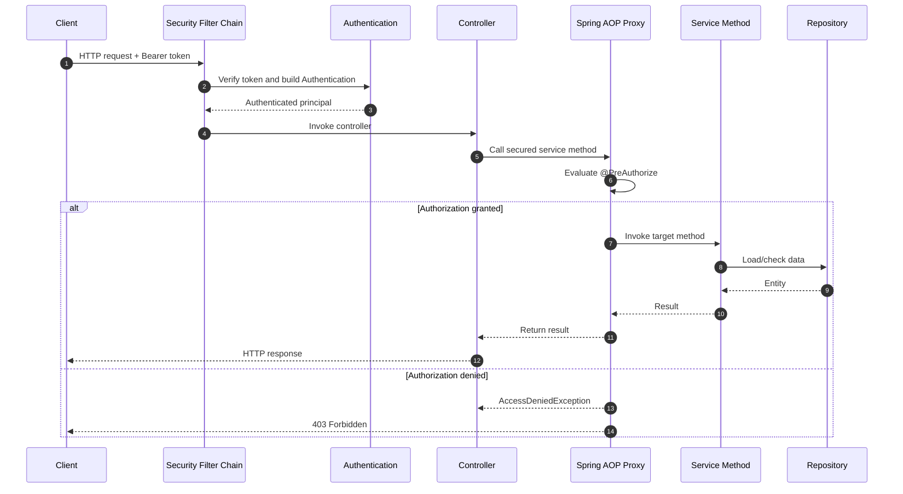
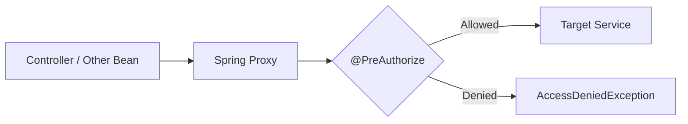
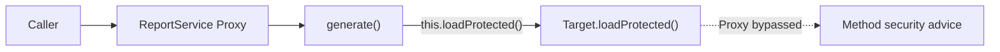

# Testing Method Security, Proxy Invocation, and Data Ownership

In a Spring Security Servlet application, checking that an endpoint returns 403 Forbidden is not enough to prove method security works properly. Rules may live on service methods, execute through Spring AOP proxies, depend on the current Authentication, and require verifying data ownership in the database. If a test directly calls an object instantiated with `new`, invokes an internal method within the same class, or only mocks the repository, the test may bypass the very path used in production.

This lesson focuses on three tightly coupled layers: **method authorization**, **proxy invocation**, and **data ownership**. Examples use Spring Boot 3, Spring Security 6, JUnit 5, and Spring Test. The goal is to prove that only callers with the right authority can invoke the method, that invocations actually pass through the security proxy, and that users can only read or modify data within their authorized scope.

## 1. Where does method security sit in the request lifecycle?

A Servlet Resource Server typically verifies the Bearer token in the filter chain, creates an Authentication, and stores it in the SecurityContext. When the controller invokes a service method annotated with `@PreAuthorize`, the method-security interceptor checks permissions before the method body executes.



Two control layers must be tested separately:

- **Request authorization:** which endpoints can be called, and whether HTTP authentication/authorization returns 401 or 403.
- **Method authorization:** whether a Spring bean method is allowed to run under the current Authentication.

If you test only the controller, you may not know whether the service annotation was applied. If you test only the method with a mock Authentication, you have not yet proved that the JWT decoder, issuer, and audience are configured properly.

## 2. Enabling method security in the application

Spring Security 6 uses `@EnableMethodSecurity`:

```java
import org.springframework.context.annotation.Configuration;
import org.springframework.security.config.annotation.method.configuration.EnableMethodSecurity;

@Configuration
@EnableMethodSecurity
class MethodSecurityConfiguration {
}
```

By default, this enables annotations such as `@PreAuthorize`, `@PostAuthorize`, `@PreFilter`, and `@PostFilter`. If the application needs `@Secured` or JSR-250 annotations like `@RolesAllowed`, enable them explicitly:

```java
@Configuration
@EnableMethodSecurity(
    securedEnabled = true,
    jsr250Enabled = true
)
class MethodSecurityConfiguration {
}
```

Do not enable extra options if the application does not use them. Method security only takes effect on Spring-managed beans invoked through the appropriate proxy/interceptor mechanism.

## 3. Distinguishing hasAuthority and hasRole

Spring Security uses two common checks:

```java
@PreAuthorize("hasAuthority('document:read')")
public DocumentView read(UUID id) {
    // ...
}

@PreAuthorize("hasRole('ADMIN')")
public void archiveAll() {
    // ...
}
```

`hasAuthority` compares the authority verbatim. `hasRole('ADMIN')` adds the default `ROLE_` prefix, making it equivalent to checking authority `ROLE_ADMIN`.

| Annotation expression | Authority checked |
| --- | --- |
| `hasAuthority('document:read')` | `document:read` |
| `hasRole('ADMIN')` | `ROLE_ADMIN` |
| `hasAnyAuthority('document:read','document:write')` | Any of the listed authorities |
| `hasAnyRole('ADMIN','AUDITOR')` | `ROLE_ADMIN` or `ROLE_AUDITOR` |

Do not write tests using only `roles = ADMIN` and expect it to grant `document:write`. Roles and permissions are two distinct vocabularies; mapping from roles to authorities must be configured intentionally.

## 4. Placing rules on service methods

Example of a service with read and write document permissions:

```java
import java.util.UUID;
import org.springframework.security.access.prepost.PreAuthorize;
import org.springframework.stereotype.Service;

@Service
public class DocumentService {

    @PreAuthorize("hasAuthority('document:read')")
    public DocumentView read(UUID documentId) {
        return loadView(documentId);
    }

    @PreAuthorize("hasAuthority('document:write')")
    public void update(UUID documentId, UpdateDocument command) {
        updateDocument(documentId, command);
    }
}
```

Method security protects the method regardless of whether the caller is a controller, a scheduled task, or another service, as long as the call goes through the secured Spring bean. Controller-level rules remain useful to block requests early, while service methods are the right boundary when the same business logic is called from multiple entry points.

Do not place security annotations on a private helper and expect Spring AOP to intercept internal calls. Understand the proxy model before writing tests.

## 5. Why proxies determine whether method security runs

Spring method security is enforced by a method interceptor attached to the Spring bean's proxy. The caller invokes the proxy; the proxy runs security advice and only then delegates to the target object.



If a test instantiates the target manually:

```java
DocumentService service = new DocumentService();
service.read(documentId);
```

the object is not wrapped by a Spring proxy. The annotation is just metadata; no method-security interceptor runs. That test can execute the method body regardless of permissions.

In integration tests, inject the bean from `ApplicationContext`:

```java
@Autowired
DocumentService documentService;
```

The injected bean is a reference through Spring infrastructure, giving method security the chance to run. Never replace that bean with `new` when the test objective is proxy enforcement.

## 6. Self-invocation bypasses the proxy

A common mistake:

```java
@Service
public class ReportService {

    public Report generate(UUID id) {
        return loadProtected(id);
    }

    @PreAuthorize("hasAuthority('report:read')")
    public Report loadProtected(UUID id) {
        return repository.findById(id).orElseThrow();
    }
}
```

When `generate()` calls `this.loadProtected()`, the call goes directly to the target object. It does not route back out through the proxy, so advice on `loadProtected()` can be skipped.



The clearest fix is extracting the protected method into a separate bean:

```java
@Service
public class ProtectedReportReader {

    @PreAuthorize("hasAuthority('report:read')")
    public Report load(UUID id) {
        return repository.findById(id).orElseThrow();
    }
}

@Service
public class ReportService {

    private final ProtectedReportReader reader;

    public ReportService(ProtectedReportReader reader) {
        this.reader = reader;
    }

    public Report generate(UUID id) {
        return buildReport(reader.load(id));
    }
}
```

`ReportService` calls through the Spring-managed `ProtectedReportReader` reference, so the call passes through the proxy. Self-injection or `AopContext.currentProxy()` may exist, but they usually make code harder to read and tightly couple it to proxy infrastructure. Prefer splitting responsibilities into beans with clear boundaries.

## 7. Methods unsuitable for proxy-based interception

With proxy-based AOP:

- Private methods cannot be invoked through a proxy like normal public service APIs.
- Final methods cannot be overridden to create a subclass proxy.
- Final classes cannot be CGLIB subclassed.
- Self-invocation does not pass through the proxy.
- Objects created with `new` have no Spring advice.
- Methods on non-Spring-managed beans are not protected automatically.

JDK dynamic proxies work via interfaces; CGLIB subclass proxies work via classes and have limitations on final classes/methods. Verify the actual proxy type and how beans are registered in the context. Never put annotations on a private helper and treat it as an authorization boundary.

## 8. Verifying a bean is actually a proxy

In diagnostic tests you can use:

```java
import org.springframework.aop.support.AopUtils;

assertThat(AopUtils.isAopProxy(documentService)).isTrue();
Class<?> targetClass = AopUtils.getTargetClass(documentService);
assertThat(targetClass).isEqualTo(DocumentService.class);
```

This is a diagnostic helper check. The more important assertion remains behavior: a user lacking permissions must receive `AccessDeniedException` and the method body must not execute. A proxy may exist for transactions/caching/other advice; hence `isAopProxy` alone does not prove the method-security advisor is applied.

## 9. Testing method security with Spring Test and @WithMockUser

`spring-security-test` provides `@WithMockUser` to set up the SecurityContext in tests:

```java
import org.junit.jupiter.api.Test;
import org.springframework.beans.factory.annotation.Autowired;
import org.springframework.boot.test.context.SpringBootTest;
import org.springframework.security.access.AccessDeniedException;
import org.springframework.security.test.context.support.WithMockUser;

import static org.assertj.core.api.Assertions.assertThat;
import static org.assertj.core.api.Assertions.assertThatThrownBy;

@SpringBootTest
class DocumentServiceMethodSecurityTest {

    @Autowired
    DocumentService documentService;

    @Test
    @WithMockUser(
        username = "alice",
        authorities = "document:read"
    )
    void readerCanReadDocument() {
        DocumentView view = documentService.read(existingDocumentId());
        assertThat(view).isNotNull();
    }

    @Test
    @WithMockUser(
        username = "alice",
        authorities = "document:read"
    )
    void readerCannotUpdateDocument() {
        assertThatThrownBy(() ->
            documentService.update(
                existingDocumentId(), updateCommand()))
            .isInstanceOf(AccessDeniedException.class);
    }

    @Test
    @WithMockUser(
        username = "alice",
        authorities = "document:write"
    )
    void writerCanUpdateDocument() {
        documentService.update(
            existingDocumentId(), updateCommand());
    }
}
```

The helpers `existingDocumentId()` and `updateCommand()` represent test-prepared fixtures. The test must invoke the Spring-injected bean, not a manually constructed object.

`@WithMockUser` creates a mock username and authorities. It does not run a JWT decoder, nor does it verify signatures, issuer, audience, or claim mapping. It is a good test for method authorization with an already-established Authentication.

## 10. roles and authorities in @WithMockUser

These two approaches differ:

```java
@Test
@WithMockUser(username = "alice", roles = "ADMIN")
void roleAdminHasRoleAuthority() {
    // Authentication contains ROLE_ADMIN.
}

@Test
@WithMockUser(username = "alice", authorities = "document:read")
void permissionIsPresent() {
    // Authentication contains document:read.
}
```

Use `roles` when the method expression uses `hasRole('ADMIN')`. Use `authorities` when the expression uses `hasAuthority('document:read')`.

Do not pass `roles = ROLE_ADMIN` because `roles` automatically adds the `ROLE_` prefix; that creates the wrong role or causes configuration validation errors. When multiple authorities are needed, pass an array:

```java
@Test
@WithMockUser(
    username = "alice",
    authorities = {
        "document:read",
        "document:write",
        "tenant:member"
    }
)
void userHasSeveralPermissions() {
    // ...
}
```

## 11. Testing anonymous and authenticated-but-unauthorized callers

Distinguish two states:

- **Anonymous:** no valid Authentication yet.
- **Authenticated but missing authority:** authenticated, yet not allowed to perform the operation.

With method security, both are normally blocked by `@PreAuthorize`, though at the HTTP boundary the responses may differ: unauthenticated requests usually get 401 from the entry point; rejected authenticated requests usually get 403 from access-denied handling.

```java
import org.springframework.security.test.context.support.WithAnonymousUser;

@Test
@WithMockUser(authorities = "profile:read")
void wrongAuthorityCannotReadDocument() {
    assertThatThrownBy(() ->
        documentService.read(existingDocumentId()))
        .isInstanceOf(AccessDeniedException.class);
}

@Test
@WithAnonymousUser
void anonymousCannotReadDocument() {
    assertThatThrownBy(() ->
        documentService.read(existingDocumentId()))
        .isInstanceOf(AccessDeniedException.class);
}
```

To verify HTTP status codes, test requests through MockMvc rather than only asserting exceptions from direct method calls.

## 12. Test dependencies in the project

In a Gradle Spring Boot project, test dependencies are usually managed by starters:

```groovy
dependencies {
    implementation("org.springframework.boot:spring-boot-starter-security")
    implementation("org.springframework.boot:spring-boot-starter-oauth2-resource-server")

    testImplementation("org.springframework.boot:spring-boot-starter-test")
    testImplementation("org.springframework.security:spring-security-test")
}
```

`spring-boot-starter-test` brings in JUnit Jupiter, AssertJ, and Spring Test. `spring-security-test` provides annotations and request post-processors like `@WithMockUser`, `jwt()`, and `opaqueToken()`.

Use versions managed by the Spring Boot BOM to avoid version mismatches between Spring Security modules. This is an example dependency structure, not a confirmation that a specific project already declares them.

## 13. Testing ownership: permission is more than scopes

A user holding `document:read` cannot automatically read every document. Permissions may also depend on:

- Whether the document belongs to the current user.
- Whether the user belongs to the tenant owning the document.
- Whether the document has been shared with the user.
- Whether the document is in a readable state.
- Whether the user has tenant administration permissions.

The rule can be modeled as:

```text
Allow read if:
  caller has document:read
  AND (
    document.ownerId == caller.subjectId
    OR caller has document:read:any
    OR caller is an authorized member of document.tenantId
  )
```

Scope/authority is one part of the policy. Ownership and tenant membership usually require authoritative stored and updated domain data.

## 14. Extracting the subject from the verified Authentication

In Spring Security, method expressions can accept `authentication`:

```java
@PreAuthorize("@documentAuthorization.canRead(authentication, #documentId)")
public DocumentView read(UUID documentId) {
    // ...
}
```

The `documentAuthorization` bean determines the current subject and checks the data. Never accept `ownerId` from the request and trust it:

```java
// Unsafe if the caller can choose ownerId.
@PreAuthorize("@documentAuthorization.canReadOwner(#ownerId)")
public DocumentView read(UUID documentId, String ownerId) {
    // ...
}
```

A caller could change `ownerId` to someone else. Authorization should compare the verified identity in `Authentication` against the owner/tenant read from the database. The request can supply the document ID; the service must load the document itself and apply the policy.

## 15. Using @P to stabilize parameter names in SpEL

SpEL normally references method parameters by name:

```java
@PreAuthorize("@documentAuthorization.canRead(authentication, #documentId)")
public DocumentView read(UUID documentId) {
    // ...
}
```

Parameter name discovery depends on compilation and available metadata. To avoid expressions depending on debug symbols or compiler flags, you can use `@P`:

```java
import org.springframework.security.core.parameters.P;

@PreAuthorize("@documentAuthorization.canRead(authentication, #id)")
public DocumentView read(@P("id") UUID documentId) {
    // ...
}
```

If relying on natural parameter names, enable compiler `-parameters` and verify the build preserves metadata. For methods with multiple parameters, explicit name annotations keep expressions resilient to Java variable renames.

Do not rely on `#p0`/`#a0` as the sole mechanism if the codebase may change signatures; they are hard to read and error-prone as methods evolve.

## 16. Authorization bean checking ownership from repositories

Example policy bean:

```java
import java.util.UUID;
import org.springframework.security.core.Authentication;
import org.springframework.stereotype.Component;

@Component("documentAuthorization")
public class DocumentAuthorization {

    private final DocumentRepository documents;
    private final MembershipRepository memberships;

    public DocumentAuthorization(
            DocumentRepository documents,
            MembershipRepository memberships) {
        this.documents = documents;
        this.memberships = memberships;
    }

    public boolean canRead(
            Authentication authentication,
            UUID documentId) {

        if (authentication == null
                || !authentication.isAuthenticated()
                || authentication instanceof org.springframework.security.authentication.AnonymousAuthenticationToken) {
            return false;
        }

        Document document = documents.findById(documentId)
            .orElse(null);

        if (document == null) {
            return false;
        }

        String subjectKey = trustedSubjectKey(authentication);
        if (subjectKey == null) {
            return false;
        }

        if (document.getOwnerKey().equals(subjectKey)) {
            return true;
        }

        boolean canReadAny = authentication.getAuthorities().stream()
            .anyMatch(a -> a.getAuthority().equals("document:read:any"));

        if (canReadAny) {
            return true;
        }

        return memberships.isActiveMember(
            subjectKey, document.getTenantId());
    }

    private String trustedSubjectKey(Authentication authentication) {
        Object principal = authentication.getPrincipal();
        if (principal instanceof org.springframework.security.oauth2.jwt.Jwt jwt) {
            return jwt.getIssuer() + "|" + jwt.getSubject();
        }
        return authentication.getName();
    }
}
```

This is a skeleton example. In production, the identity key should match the model storing owners—usually an `(issuer, subject)` pair or an internal user ID mapped from that pair. `authentication.getName()` is not always the JWT `sub`; it depends on the converter/principal implementation. Never omit the issuer if multiple IdPs can emit the same subject string.

`isActiveMember` must query authoritative membership data or a domain cache with an explicit freshness policy. If membership data changes rapidly, tests must verify behavior after membership is revoked.

## 17. Using @PostAuthorize to protect the returned object

When you must load an object first before deciding ownership, you can use:

```java
@PostAuthorize(
    "@documentAuthorization.canReadResult(authentication, returnObject)"
)
public DocumentView find(UUID id) {
    return repository.findViewById(id).orElseThrow();
}
```

`@PostAuthorize` runs after the method body. It can protect the returned data, yet the object has already been loaded and the method code has already executed. Do not use it as the sole guard for operations with side effects, because emails, events, payments, or database writes may have already happened before access is denied.

For large lists, `@PostFilter` can also load large amounts of data and filter in memory; that hurts performance and can produce inaccurate pagination/count semantics. Prefer database queries filtered by tenant/owner.

## 18. Protecting write operations before side effects occur

For updates/deletes, authorization must happen before side effects. Example:

```java
@PreAuthorize("@documentAuthorization.canEdit(authentication, #id)")
@Transactional
public void rename(
        @P("id") UUID documentId,
        @P("title") String title) {

    Document document = repository.findById(documentId)
        .orElseThrow(DocumentNotFoundException::new);

    document.rename(title);
}
```

The policy bean must check ownership/tenant and edit grant. However, if the policy query and the update are separate, data may change between the two steps (TOCTOU). Under strict requirements, enforce the ownership predicate directly inside the update query or re-verify within an appropriate transaction/lock.

Scoped query example:

```sql
UPDATE documents
SET title = :title
WHERE id = :documentId
  AND owner_issuer = :issuer
  AND owner_subject = :subject
  AND tenant_id = :tenantId
```

Check the affected row count. If it is 0, handle according to the API contract (404/403) without disclosing whether the document exists in another tenant. Security decisions and data mutations should share the same trust model.

## 19. Preventing IDOR with server-side ownership checks

IDOR (Insecure Direct Object Reference) occurs when a caller swaps an identifier in the URL/body to access an object they do not own:

```http
GET /documents/11111111-1111-1111-1111-111111111111
GET /documents/22222222-2222-2222-2222-222222222222
```

Hard-to-guess UUIDs are not authorization. Opaque IDs, UUIDs, or sequential IDs all require ownership/tenant checks. An endpoint should never rely on users "not knowing the ID" to protect objects.

Tests should include at least:
- Owner can read their own object.
- Another user cannot read that object.
- User in another tenant cannot cross the tenant boundary.
- Admin/reader-any is permitted only with explicit authority.
- Non-existent objects produce a response matching the API contract.

## 20. @PreFilter and @PostFilter must be tested carefully

`@PreFilter` filters an input collection before the method runs; `@PostFilter` filters the returned collection after the method runs:

```java
@PreFilter(
    filterTarget = "documentIds",
    value = "@documentAuthorization.canRead(authentication, filterObject)"
)
public List<UUID> retainReadableIds(List<UUID> documentIds) {
    return documentIds;
}

@PostFilter(
    "@documentAuthorization.canReadResult(authentication, filterObject)"
)
public List<DocumentView> findVisibleDocuments() {
    return repository.findAllViews();
}
```

Collection filtering does not replace authorization queries in the repository and does not automatically preserve safe pagination/counts. For bulk updates, avoid silent filtering that misleads callers into thinking all IDs were processed. Return explicit results and check each resource against policy.

## 21. Testing owners and non-owners

An ownership test should use two distinct subjects and explicit fixtures:

```java
@SpringBootTest
class DocumentOwnershipTest {

    @Autowired
    DocumentService documentService;

    @Test
    @WithMockUser(username = "issuer-A|alice",
                  authorities = "document:read")
    void ownerCanReadOwnDocument() {
        DocumentView view = documentService.read(aliceDocumentId());
        assertThat(view.id()).isEqualTo(aliceDocumentId());
    }

    @Test
    @WithMockUser(username = "issuer-A|bob",
                  authorities = "document:read")
    void otherUserCannotReadAliceDocument() {
        assertThatThrownBy(() ->
            documentService.read(aliceDocumentId()))
            .isInstanceOf(AccessDeniedException.class);
    }
}
```

This test illustrates the identity key in `authentication.name`. If the production principal is `JwtAuthenticationToken`, use a custom `@WithSecurityContext` or construct a `JwtAuthenticationToken` with the right claims/issuer to exercise the same `trustedSubjectKey()` code path.

Do not simply mock `DocumentAuthorization.canRead()` to return `true` in owner tests. Doing so tests service wiring, not ownership logic. Write dedicated tests for the policy bean with repository fixtures to verify owner/tenant decisions.

## 22. Separating policy bean tests from method interceptor tests

The two test layers serve different purposes:

| Test | What it proves |
| --- | --- |
| `DocumentAuthorizationTest` | Owner, tenant, admin, missing document, and membership policies return the right allow/deny results. |
| `DocumentServiceMethodSecurityTest` | Annotations are enforced through the Spring proxy. |
| `DocumentControllerMvcTest` | HTTP status, authentication entry point, endpoint authorization, and JSON contract. |
| `JwtResourceServerIntegrationTest` | Real token decoder, issuer, signature, audience, and authority mapping. |

Policy bean tests can be pure unit tests with mocked repositories. Method-security tests need a Spring context and proxied beans. JWT integration tests need decoder/key/issuer fixtures or a suitable test IdP.

Do not try to cram everything into one huge test; each test should prove one specific boundary.

## 23. Creating a small test context for method security

You can use `@SpringJUnitConfig` with a minimal test configuration:

```java
@Configuration
@EnableMethodSecurity
static class TestConfig {

    @Bean
    DocumentAuthorization documentAuthorization(
            DocumentRepository documents,
            MembershipRepository memberships) {
        return new DocumentAuthorization(documents, memberships);
    }

    @Bean
    DocumentService documentService(
            DocumentRepository documents,
            DocumentAuthorization authorization) {
        return new DocumentService(documents, authorization);
    }
}
```

A small test context verifies the proxy/interceptor without booting an entire web server. Beans must have the exact dependencies and annotations of production. With mocked repositories, method-security tests do not prove ownership queries; dedicated policy-bean tests verify those.

In real projects, the test configuration should import the production security configuration or an intentional equivalent. Never accidentally create a test config missing `@EnableMethodSecurity`.

## 24. Verifying the method body does not run when denied

An exception assertion proves the caller was blocked, and you can also verify side effects did not occur:

```java
@Test
@WithMockUser(authorities = "document:read")
void readerCannotCallWriteMethod() {
    assertThatThrownBy(() ->
        documentService.update(documentId, command))
        .isInstanceOf(AccessDeniedException.class);

    verify(documentRepository, never()).save(any());
}
```

Depending on design, the repository might be called to evaluate policy or load an entity before the method body. Verify the exact side effect you want to prevent—such as `save`, publishing an event, or calling an external client—rather than asserting `never()` on every repository method.

With `@PreAuthorize`, the interceptor checks before the method body is invoked. With `@PostAuthorize`, the body has already run before the result is denied. Tests must reflect this difference.

## 25. Testing self-invocation with behavioral tests

If a public service method `generate()` calls a secured method in the same class, write a test proving policy can be bypassed under a broken design. Then extract the bean and re-test through the proxy.

Do not assert only `AopUtils.isAopProxy`; create a user lacking authority and verify the protected operation is rejected. If `generate()` is the entry point, tests should call `generate()` rather than calling `loadProtected()` directly, because that is the real production path.

A good design makes public service operations clear security boundaries, with private helpers handling internal logic only after the boundary has been verified.

## 26. MockMvc tests: method denial becomes HTTP 403

A controller calling a secured service:

```java
@RestController
@RequestMapping("/documents")
class DocumentController {

    private final DocumentService documents;

    DocumentController(DocumentService documents) {
        this.documents = documents;
    }

    @GetMapping("/{id}")
    DocumentView get(@PathVariable UUID id) {
        return documents.read(id);
    }
}
```

MockMvc test:

```java
@WebMvcTest(DocumentController.class)
@Import({
    MethodSecurityConfiguration.class,
    DocumentService.class
})
class DocumentControllerTest {

    @Autowired
    MockMvc mvc;

    @Test
    @WithMockUser(authorities = "profile:read")
    void insufficientAuthorityReturnsForbidden() throws Exception {
        mvc.perform(get("/documents/{id}", documentId))
            .andExpect(status().isForbidden());
    }
}
```

This is an illustrative structure; you must provide repository/policy beans or mock dependencies and import the right service. A `@WebMvcTest` may not automatically configure the full Resource Server filter chain if the slice is restricted. Check the actual test context and do not use `addFilters = false` when testing HTTP security.

If the controller's service is mocked, method security on the implementation may not trigger. To test service method annotations, inject the real proxy-wrapped bean. To test controller HTTP mapping in isolation, mocking the service is reasonable, but you cannot conclude method security worked.

## 27. Distinguishing 401 and 403 in HTTP tests

| Scenario | Typically expected result |
| --- | --- |
| No Bearer token sent to an endpoint requiring authentication | 401 Unauthorized |
| Invalid/expired Bearer token | 401 Unauthorized |
| Valid token missing scope at request authorization | 403 Forbidden |
| Valid token, endpoint allows, but service `@PreAuthorize` denies | 403 Forbidden |
| Anonymous calling a secured method directly | `AccessDeniedException` or handled per method-security entry-point configuration |

HTTP exception handling depends on the security filter chain and entry point/access denied handler. Do not assert all authorization errors are 401; do not assume every method exception automatically turns into HTTP 403 if the test bypasses `ExceptionTranslationFilter` or appropriate MVC exception mapping.

## 28. Testing real JWT claims and authority mapping

`@WithMockUser` does not create a JWT. With MockMvc, Spring Security Test provides the `jwt()` post-processor to construct a `JwtAuthenticationToken` for the request:

```java
import static org.springframework.security.test.web.servlet.request.SecurityMockMvcRequestPostProcessors.jwt;

mvc.perform(get("/documents/{id}", documentId)
        .with(jwt().jwt(jwt -> jwt
            .issuer("https://idp.example/realms/shop")
            .subject("alice")
            .claim("aud", List.of("documents-api"))
            .claim("scope", "document:read"))))
    .andExpect(status().isOk());
```

This post-processor creates a test Authentication; it **does not verify JWT signatures**, JWK endpoints, or decoder validators. Use it to test authorization mapping/endpoint behavior when claims are simulated.

To test the real decoder, use JWTs signed with a test key and a JWK Set fixture. Test tokens with wrong issuer, wrong audience, expired timestamps, disallowed algorithms, and invalid signatures. If using `jwt()` in a test, never label that result as a signature verification test.

## 29. Testing audience and issuer downstream

If the API has an audience validator, include tests for:

- Right issuer, right audience, right scope: allowed.
- Right issuer, different audience: 401/invalid token.
- Untrusted issuer: 401.
- Invalid signature or mismatched key: 401.
- Expired token or before `nbf`: 401.
- Right audience but missing scope: 403.

A `jwt()` test can verify request authorization when Authentication carries the expected claims/authorities. However, only an integration test with a real decoder proves the validator is attached to the decoder used by the filter chain.

## 30. Using custom @WithSecurityContext for a JWT principal

When method policies depend on issuer, subject, tenant, or custom claims, create a dedicated test annotation:

```java
@Retention(RetentionPolicy.RUNTIME)
@WithSecurityContext(factory = WithTestJwtSecurityContextFactory.class)
public @interface WithTestJwt {
    String issuer() default "https://idp.example/realms/shop";
    String subject() default "alice";
    String[] authorities() default {"document:read"};
}
```

Factory building `Jwt` and `Authentication`:

```java
public class WithTestJwtSecurityContextFactory
        implements WithSecurityContextFactory<WithTestJwt> {

    @Override
    public SecurityContext createSecurityContext(WithTestJwt annotation) {
        Instant now = Instant.now();
        Jwt jwt = Jwt.withTokenValue("test-token")
            .header("alg", "RS256")
            .issuer(annotation.issuer())
            .subject(annotation.subject())
            .claim("tenant_id", "tenant-a")
            .issuedAt(now)
            .expiresAt(now.plusSeconds(300))
            .build();

        var authorities = AuthorityUtils.createAuthorityList(
            annotation.authorities());

        Authentication authentication =
            new JwtAuthenticationToken(jwt, authorities);

        SecurityContext context = SecurityContextHolder.createEmptyContext();
        context.setAuthentication(authentication);
        return context;
    }
}
```

This is a mock principal for method-security tests, not a valid token for calling the Resource Server filter chain. Do not use the `alg` header of the test object to infer signatures were verified. This fixture merely constructs an internal `Jwt` object to test SpEL/policies with claim fields.

If you need to test the claim converter, test the converter separately with a `Jwt` fixture and integration test the decoder/filter chain with real signatures.

## 31. Testing ownership by issuer and subject

In a multi-IdP system, `sub=123` from issuer A is not necessarily the same user as `sub=123` from issuer B. Owner keys should use an explicit identity namespace:

```text
owner_key = issuer + "|" + subject
```

Or map the `(issuer, subject)` pair to a stable internal user ID after verification. Do not use email as the primary authorization key if emails can change, be reused, or collide across issuers.

Tests should create two principals:

| Principal | Issuer | Subject | Result |
| --- | --- | --- | --- |
| Alice | `issuer-A` | `123` | Reads document owned by `issuer-A` and subject `123` |
| Bob | `issuer-A` | `456` | Denied Alice's document |
| Mallory | `issuer-B` | `123` | Denied unless mapped to the same internal identity |

This catches bugs that compare only `sub` while ignoring `iss`.

## 32. Ownership changes and revoked tenant membership

A good test checks more than initial state. Also test after membership is revoked:

1. Alice is an active member of tenant A.
2. Alice can read tenant A documents per policy.
3. An admin revokes Alice's membership.
4. The next request/method call is denied per freshness policy.
5. Alice still cannot read tenant B documents.

If a membership cache is used, tests must control TTL/invalidation or cache fixtures. If the policy queries the database directly, tests must commit/refresh transactions properly to avoid accidentally reading a stale persistence context.

Never assume that because a token is still valid, membership is still valid. Authentication and authorization domains have different lifecycles.

## 33. Testing tenant isolation and cross-tenant IDOR

Seed two tenants and documents:

```text
tenant-a:
  alice -> document A-1
  bob   -> document A-2

tenant-b:
  carol -> document B-1
```

Test matrix:

| Caller | Resource | Expected |
| --- | --- | --- |
| Alice | A-1 | Allow |
| Alice | A-2 | Deny if owner-only policy |
| Alice | B-1 | Deny |
| Bob | A-2 | Allow |
| Carol | B-1 | Allow |
| Tenant admin A | A-1/A-2 | Allow if explicit tenant-admin permission exists |
| Tenant admin A | B-1 | Deny |

Do not test only an owner reading their own object. Cross-tenant negative tests are essential proof against queries missing `tenant_id`.

## 34. Distinguishing 404 and 403 to prevent enumeration

When a caller requests a non-existent document or a document owned by another user, the API may choose to:

- Return 404 for both to avoid revealing existence.
- Return 403 when the caller already knows the resource and the contract allows explicitly signaling permission denial.

This is an API/security policy decision. Tests must pin down the chosen semantics. Never let the repository return 404 for missing objects and the policy return 403 for foreign objects unintentionally if that leaks object enumeration.

Even when the HTTP responses are identical, internal audit events can still distinguish `not_found` from `ownership_denied` without recording sensitive data in public logs.

## 35. Testing @PostAuthorize and side effects

With `@PostAuthorize`, tests should verify whether the method body executed before access was denied. For instance, if a method returns another user's object, the interceptor may deny after the repository read the data.

If the method has side effects, that is a reason to move authorization before the side effect or design transactions so nothing commits. Do not write a test that only asserts `AccessDeniedException` and concludes no side effects occurred. Verify DB state, event publishers, and external calls.

For read-only object retrieval, `@PostAuthorize` may fit certain cases; query-level ownership is usually more efficient and easier to control for lists/search/pagination.

## 36. Testing method authorization with transactions

If a method has both `@PreAuthorize` and `@Transactional`, multiple advisors wrap the bean. Do not rely on accidental advisor ordering to protect side effects. Security checks must run before business logic can write data.

Integration tests should:
- Call the method through the proxy.
- Use a user lacking permissions.
- Assert `AccessDeniedException`.
- Reload the entity in a new transaction to verify data did not change.
- Verify no domain events were published or external clients called.

Do not blindly place `@Transactional` on the test and inspect only the same persistence context; dirty state can prevent test results from reflecting actual database commits. Use clear transaction boundaries and re-query appropriately.

## 37. Testing permission mapping and policy evolution

If authorities are mapped from JWT claims, write dedicated tests for the converter:

- `scope` string to `SCOPE_...` or canonical permissions per policy.
- `roles` from the right claim path/issuer to role authorities.
- Wrongly typed claims, missing claims, or issuers outside the mapping profile grant no permissions.
- Duplicate/unknown roles are handled per allowlist.
- New policy versions change mappings without retaining old authorities.

Then method-security tests use canonical authorities to prove method rules. Avoid stuffing provider-claim parsing logic into SpEL; the converter normalizes tokens, while policy beans check domain resources.

## 38. Testing method security for background jobs and system actors

Scheduled tasks or message consumers may have no HTTP user Authentication. If a method requires `document:write`, background jobs need a dedicated, explicitly designed identity/policy.

Never put `@WithMockUser(roles = "ADMIN")` in a test to hide the fact that the production scheduler lacks a `SecurityContext`. Test jobs with a real system actor, or design separate internal methods callable only by trusted workflows. Never create a global admin `SecurityContext` just to make jobs run.

If a background operation acts on behalf of a user, messages/events must have protected provenance and delegation contracts; a correlation ID in a message does not prove user identity.

## 39. Ensuring method security is not accidentally disabled in test slices

A test might pass because `@EnableMethodSecurity` was not loaded, annotations were not proxied, or the bean was mocked. When testing method security:

- Confirm configuration enables `@EnableMethodSecurity`.
- Inject the real bean from the context.
- Do not mock the secured service when testing the real interceptor.
- Do not instantiate the service manually with `new`.
- Invoke methods through the injected reference.
- Include denied tests proving the interceptor actually blocks.
- Include allowed tests proving the rule does not reject every caller.

If using `@WebMvcTest`, explicitly import the method-security config and secured service bean, or use `@SpringBootTest` for a small integration test. Test slices must reflect the real production wiring under test.

## 40. Minimum test matrix for method security and ownership

| Category | Positive case | Negative case |
| --- | --- | --- |
| Authority | Having `document:read` can read | Missing authority is blocked |
| Role | `ROLE_ADMIN` satisfies `hasRole('ADMIN')` | Unprefixed `ADMIN` authority does not satisfy |
| Proxy | Spring bean invocation applies interceptor | Object from `new` does not represent production path |
| Self-invocation | Calling through another bean remains enforced | `this.securedMethod()` must not be treated as a boundary |
| Owner | Owner accesses document | Other user is denied |
| Tenant | Member of matching tenant accesses | User from another tenant is denied |
| Admin override | Explicit `read:any` per policy | Do not infer admin from unrelated roles |
| JWT identity | Accurate issuer/subject mapping | Same subject, different issuer are distinguished |
| HTTP | Valid authenticated request returns 2xx | Missing/invalid token 401, insufficient permission 403 |
| Side effect | Authorized writer updates | Reader cannot update/publish events |
| Membership revocation | Active member is allowed | After revocation, denied per freshness contract |
| Pagination | Query returns matching tenant/owner rows | Do not filter in memory causing wrong totals/pages |

The matrix should be tailored to actual policy. Negative tests must verify both responses/exceptions and critical side effects.

## 41. Example testing a policy bean with Mockito

The policy bean can be tested independently without Spring AOP:

```java
@ExtendWith(MockitoExtension.class)
class DocumentAuthorizationTest {

    @Mock
    DocumentRepository documents;

    @Mock
    MembershipRepository memberships;

    @InjectMocks
    DocumentAuthorization authorization;

    @Test
    void ownerCanReadDocument() {
        UUID id = UUID.randomUUID();
        Document document = document(
            id, "issuer-A|alice", "tenant-A");

        when(documents.findById(id)).thenReturn(Optional.of(document));

        Authentication authentication =
            new UsernamePasswordAuthenticationToken(
                "issuer-A|alice",
                "n/a",
                AuthorityUtils.createAuthorityList("document:read"));

        assertThat(authorization.canRead(authentication, id)).isTrue();
        verify(memberships, never()).isActiveMember(anyString(), anyString());
    }

    @Test
    void anotherSubjectCannotReadPrivateDocument() {
        UUID id = UUID.randomUUID();
        Document document = document(
            id, "issuer-A|alice", "tenant-A");

        when(documents.findById(id)).thenReturn(Optional.of(document));
        when(memberships.isActiveMember("issuer-A|bob", "tenant-A"))
            .thenReturn(false);

        Authentication authentication =
            new UsernamePasswordAuthenticationToken(
                "issuer-A|bob",
                "n/a",
                AuthorityUtils.createAuthorityList("document:read"));

        assertThat(authorization.canRead(authentication, id)).isFalse();
    }
}
```

The `document(...)` factories are fixture helpers. This test verifies the pure policy bean: owner and non-owner. It does not test `@PreAuthorize`; method-security integration tests still require a Spring context/proxy.

## 42. Common testing mistakes

| Mistake | Why the test is wrong | Right approach |
| --- | --- | --- |
| `new Service()` | No Spring proxy | Inject bean from context |
| Mocking secured service | Bypasses real method interceptor | Use real bean in method-security tests |
| Testing only controller with mocked service | Does not prove service annotations run | Add proxied service tests |
| Calling secured method from same class | Self-invocation bypasses proxy | Extract bean or call through proxy |
| Testing only owner success | Misses IDOR | Test non-owner and cross-tenant |
| Comparing `sub` alone | Subject collision across issuers | Use issuer-subject tuple or internal ID |
| Using `@PostAuthorize` for writes | Side effects may already execute | Pre-authorize and enforce in query/transaction |
| Testing only with `jwt()` | Does not check signatures/decoder | Add integration tests with signed JWTs |
| `@WithMockUser(roles=...)` wrong prefix | Tests different authority than policy | Use `roles` or `authorities` with proper semantics |
| Disabling filters in MockMvc | HTTP security does not run | Keep filter chain in tests verifying security |
| Asserting only exceptions | Side effects may still occur | Verify database/events/client calls |
| Using only mocked repositories | Does not prove tenant-scoped queries | Include persistence/query integration tests |

## 43. References

- [Spring Security 6.5 — Method Security](https://docs.spring.io/spring-security/reference/6.5/servlet/authorization/method-security.html): `@EnableMethodSecurity`, pre/post authorization, and method interceptors.
- [Spring Security 6.5 — Testing Method Security](https://docs.spring.io/spring-security/reference/6.5/servlet/test/method.html): `@WithMockUser`, `@WithAnonymousUser`, custom `@WithSecurityContext`.
- [Spring Security 6.5 — MockMvc Security](https://docs.spring.io/spring-security/reference/6.5/servlet/test/mockmvc/index.html): request post-processors and MockMvc integration.
- [Spring Security 6.5 — OAuth 2.0 Resource Server JWT](https://docs.spring.io/spring-security/reference/6.5/servlet/oauth2/resource-server/jwt.html): JWT decoder, issuer/audience validation, and authorities.
- [Spring Framework — AOP Proxies](https://docs.spring.io/spring-framework/reference/core/aop/proxying.html): JDK/CGLIB proxies, self-invocation, and proxy limitations.
- [OWASP — Insecure Direct Object Reference Prevention](https://cheatsheetseries.owasp.org/cheatsheets/Insecure_Direct_Object_Reference_Prevention_Cheat_Sheet.html): server-side object access control.
- [OWASP — Authorization Cheat Sheet](https://cheatsheetseries.owasp.org/cheatsheets/Authorization_Cheat_Sheet.html): deny-by-default, least privilege, and checking permissions on every request.

## 44. Conclusion

Method security only takes effect when secured methods are invoked through a Spring-managed proxy and the security interceptor is enabled. Therefore, tests must inject beans from `ApplicationContext`, invoke the actual production entry points, and cover both allow and deny cases. `@WithMockUser` is useful for checking authority rules; custom `@WithSecurityContext` helps construct JWT principal/issuer/subject fixtures when policies depend on claims; MockMvc tests HTTP mapping; signed JWT integration tests verify the decoder and token validators.

Data ownership must be verified using verified identities and authoritative domain data. Use an `(issuer, subject)` tuple or internal identity mapping to avoid `sub` collisions, enforce tenant/object checks in queries or policy beans, and include non-owner, cross-tenant, missing-object, and membership-revocation tests. For write operations, check permissions before side effects and account for race conditions between authorization and updates.

**Core takeaway:** *A trustworthy method-security test must prove that the call passes through the proxy, the right Authentication is applied, and a caller cannot access an object merely by swapping an ID in the request.*
