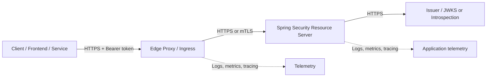

# HTTPS, Proxies, and Protecting Bearer Tokens in Transit

In a **Spring Security OAuth 2.0/OIDC Resource Server** system, an API typically receives an access token via an HTTP header:

```http
GET /api/orders/42 HTTP/1.1
Host: api.example.com
Authorization: Bearer <access-token>
```

Under the **Bearer** mechanism, any party holding a valid token can generally use that token to call the API within the permissions granted to the token. The Resource Server does not inherently know whether the current sender is the party originally issued the token. Consequently, a token leaked over the network, via a reverse proxy, in logs, or across an internal HTTP hop can lead to unauthorized access even while Spring Security verifies the JWT signature accurately.

This topic focuses on how to protect Bearer tokens **in transit and when traversing proxies**, how Spring Security operates behind TLS termination, and the limits of HTTPS that must be understood properly.

## 1. Why do Bearer tokens require special protection?

An access token can contain or reference permissions such as `orders.read` and `orders.write`. If the token is stolen and has not expired, an attacker can attempt to replay it:

```http
GET /api/orders/42 HTTP/1.1
Host: api.example.com
Authorization: Bearer <stolen-access-token>
```

If the token is valid, matches the audience, and has permission for the endpoint, the Resource Server may be unable to distinguish the attacker's request from the original client's request. This is the **replay** risk of Bearer tokens.

Distinguish three security goals:

| Goal | Primary mechanism | Key point |
|---|---|---|
| **Confidentiality in transit** | HTTPS/TLS on every hop carrying the token | Prevents network eavesdroppers from reading the `Authorization` header |
| **Token integrity and origin assurance** | Verifying JWT signature or introspection; checking `iss`, `aud`, `exp`, etc. | A properly signed token can still be stolen and replayed |
| **Limiting token usability** | Least-privilege scopes/permissions, short lifetime, resource permission checks; sender-constrained tokens where appropriate | Reduces damage if a token leaks; does not replace transport encryption |

**A signed JWT does not mean an encrypted JWT.** The header and payload of a JWS-style JWT are typically only Base64URL-encoded for transport and can be read by anyone who obtains the token string. The signature protects integrity and authenticity, not confidentiality of the token contents or protection against Bearer token reuse.

OAuth 2.0 Bearer Token Usage (RFC 6750) requires protecting tokens in transit with TLS and prefers sending tokens in the `Authorization` header.

## 2. Deployment topologies with proxies: identifying every leak point

In practice, a Spring Boot Resource Server usually runs behind a CDN, API Gateway, Load Balancer, Ingress, or Nginx. HTTPS on the public address **does not mean** the entire path to the application is encrypted.



When **TLS termination** occurs at the proxy, the proxy decrypts the request for routing and inspection; the Bearer token exists in plaintext in the proxy's memory. The proxy then opens a new connection to the backend. If that connection is `http://`, the token continues **unencrypted** across the internal network.

Compare two paths:

```text
INSUFFICIENTLY PROTECTED:
Client  ==HTTPS==>  Nginx  ---HTTP--->  Spring Boot
                    (TLS terminated)     (Authorization in plaintext)

RECOMMENDED:
Client  ==HTTPS==>  Nginx  ==HTTPS/mTLS==>  Spring Boot
                    (TLS terminated)        (TLS re-established)
```

An internal HTTP hop cannot be assumed safe merely because it uses private IPs, container networks, or Kubernetes Services. Internal networks remain exposed to eavesdropping via misconfiguration, compromised workloads, misrouting, or overly broad privileges. If an architecture must leave a segment unencrypted, that is a risk decision requiring explicit trust boundaries, network isolation, and access controls; it cannot be described as end-to-end encryption.

### Places to inspect along the token's journey

| Location | Typical risk | Mitigation |
|---|---|---|
| Client → public proxy | Eavesdropping or tampering over HTTP; spoofed certificates | Use HTTPS only; verify certificate and hostname |
| Proxy → backend | TLS dropped after load balancer; token exposed on internal network | Use HTTPS/mTLS to backend; verify upstream certificate |
| Proxy/API Gateway | `Authorization` header appears in logs, traces, debug output, WAF events | Strip or redact tokens across all telemetry |
| Proxy → other services | Accidentally forwarding tokens to untrusted upstreams | Strict routing/allowlists; never broadcast headers indiscriminately |
| Resource Server → JWKS/introspection | Exchanging metadata, public keys, or token checks over weak links | Call Authorization Server endpoints over trusted HTTPS; protect introspection credentials |
| Browser/app client | Token appears in URLs, history, referrer headers, console, or extensions | Keep tokens out of URLs and logs; restrict where tokens are stored/read |

## 3. HTTPS/TLS must be enforced on the right hops

### 3.1. Start with HTTPS; do not rely on HTTP redirects

Clients must send API requests carrying Bearer tokens directly to `https://` URLs:

```text
CORRECT: https://api.example.com/api/orders/42
WRONG:   http://api.example.com/api/orders/42
```

An HTTP `301`, `302`, `307`, or `308` redirect to HTTPS helps browsers visiting public pages, but **cannot protect a Bearer token already sent in the initial HTTP request**. Before the server ever returns the redirect, the token has already crossed an unencrypted connection.

For APIs accepting credentials, configure clients to build only HTTPS requests, reject HTTP URLs before attaching tokens, and restrict or disable HTTP entrypoints for sensitive endpoints. Avoid letting HTTP redirects automatically forward the `Authorization` header across different hostnames/origins.

### 3.2. Certificates and server identity verification

Foundational requirements:

- Use supported and securely configured TLS versions (typically TLS 1.2/1.3; prefer TLS 1.3 where possible).
- Certificates must be unexpired, have a valid trust chain, and include a SAN matching the hostname the client connects to.
- Clients, reverse proxies, and backends **must verify both the certificate chain and hostname**; never disable verification merely for internal/self-signed certificates.
- Manage certificate lifecycles, automate renewal/key rotation, and protect private keys; never embed private keys in source code.
- Avoid “trust all certificates”, `insecureSkipVerify`, `curl -k`, or `verify=false` in production. They defeat protection against spoofed servers/MITM attacks.

For internal services, use a properly distributed internal CA or mTLS. Applying **mutual TLS** between the proxy and Resource Server allows both sides to verify each other's identity; this adds a protection layer alongside Bearer token validation.

### 3.3. What does HSTS help with, and what does it not?

HTTP Strict Transport Security (HSTS) is a header returned over a valid HTTPS connection, for example:

```http
Strict-Transport-Security: max-age=31536000
```

Browsers supporting HSTS remember to use HTTPS for the domain during the specified duration, reducing future HTTP downgrade risk. However:

- HSTS **does not encrypt** the proxy → backend hop.
- HSTS does not replace calling `https://` directly from the start; the very first visit may not be protected unless an HSTS policy is already cached or preloaded.
- HSTS is primarily a browser mechanism; you cannot assume every service-to-service HTTP client enforces it.
- Enable `includeSubDomains`/preload only after confirming all relevant subdomains support HTTPS long-term.

## 4. Transmitting tokens properly in HTTP

### 4.1. Prefer the `Authorization: Bearer` header

```http
GET /api/orders/42 HTTP/1.1
Host: api.example.com
Authorization: Bearer eyJ...<truncated>
Accept: application/json
```

RFC 6750 defines sending Bearer tokens via the `Authorization` header, alongside certain conditional alternatives. For modern APIs, the header is the preferred choice because it has standard semantics and keeps tokens out of URLs.

**Never place access tokens in query strings or paths**, for example:

```text
WRONG: GET /api/orders/42?access_token=eyJ...
WRONG: GET /api/token/eyJ.../orders/42
```

Tokens in URLs easily end up in access logs, browser history, analytics tools, monitoring, reverse proxies, referrer headers, bug reports, and link-sharing tools. “Already using HTTPS” does not prevent tokens from appearing in those stores after TLS termination.

Do not stuff Bearer tokens into arbitrary form fields or request bodies to evade header logging; such workarounds create new exposure surfaces, break middleware assumptions, and do nothing to improve transport security.

### 4.2. Scope where tokens are sent and handle redirects

Clients should only attach the Bearer header when calling an API/origin configured as an intended recipient of that token. On cross-domain redirects, never automatically carry the `Authorization` header across redirects. In multi-API frontends, avoid interceptors that attach the same access token to **every** HTTPS request; a token for Orders API should not go to an Analytics API or CDN domain.

Access tokens should also have an `aud` matching the target Resource Server. `aud` is a server-side control reducing cross-API token misuse; it does not replace client-side transport protection.

### 4.3. Responses and caching

For responses containing private data, apply:

```http
Cache-Control: no-store
```

Configure caches/proxies appropriately for authenticated endpoints to avoid serving one user's response to another user. Never cache data from Bearer-authenticated requests using a key consisting solely of the URL without user isolation and proper cache policies. Avoid placing raw tokens into cache keys visible in logs, metrics, or traces.

## 5. Reverse proxies, the `Authorization` header, and trust boundaries

### 5.1. Proxies must forward tokens to the right backend without logging them

Proxies must ensure the `Authorization` header reaches the intended Resource Server without accidentally being stripped or recorded in telemetry. Some API Gateways validate tokens at the edge, yet if the backend still needs to verify JWTs or read claims for authorization, it must receive the access token **over a protected connection** or an internal identity context authenticated by dedicated design.

Risk categories to watch for:

- Logging all request headers, such as `$http_authorization`, in access or error logs.
- Sending raw headers and bodies to APM/tracing systems or error-reporting tools.
- Recording tokens in HTTP client/REST template debug logs, gateway filters, or overly verbose Spring Security logging.
- Forwarding requests/headers to other upstreams without controlling target domains.
- Putting tokens into URLs, query strings, error messages, stack traces, or analytics events.

When observability for authentication failures is needed, log **status code, request ID, endpoint, appropriate issuer/audience level, generalized failure reason, and data-minimized user identifier**. Never log raw access tokens, refresh tokens, ID Tokens, session cookies, client secrets, or introspection endpoint credentials.

### 5.2. `X-Forwarded-*` and `Forwarded` are not proof of TLS

When TLS terminates at the proxy, the backend observes the proxy-to-app connection rather than the client's HTTPS connection directly. The proxy may send metadata:

```http
X-Forwarded-Proto: https
X-Forwarded-Host: api.example.com
X-Forwarded-For: 203.0.113.10
```

Or use the standard `Forwarded` header. These headers convey original scheme, host, and client IP for generating URLs, redirects, logs, or checks that need to know whether the external connection used HTTPS.

**Forwarded headers sent by arbitrary clients must not be trusted automatically.** If the Resource Server is directly reachable and configured to trust any `X-Forwarded-Proto: https`, an attacker can send that header over plain HTTP to spoof secure-request detection logic.

Proper design relies on complementary rules:

1. The edge proxy **strips/overwrites** forwarded headers supplied by external Internet clients, then regenerates them from the actual edge connection.
2. The backend accepts requests only from permitted proxies; enforce via firewalls, security groups, or Kubernetes NetworkPolicies where applicable.
3. With multiple proxies, specify exactly which proxies are trusted and how client IP/scheme/host chains are built; never blindly trust the entire incoming `X-Forwarded-For` chain.
4. Applications should process forwarded headers only when infrastructure establishes clear trust boundaries.

`X-Forwarded-Proto: https` describes the external connection; **it does not encrypt the proxy → backend link**. Internal TLS must still be configured independently.

## 6. Example: Nginx terminating TLS and re-encrypting to Spring Boot

Suppose:

- Clients call `https://api.example.com`.
- Nginx acts as the edge reverse proxy terminating public TLS.
- The Spring Boot Resource Server exposes TLS at `https://orders-api.internal:8443` with a valid certificate from an internal CA.
- The backend is not directly exposed to the Internet; Nginx validates upstream TLS.

Illustrative configuration (certificate paths, hostnames, and ports must be replaced with real values):

```nginx
# Minimal logging: DO NOT log the Authorization header, query string, or Referer.
# For paths carrying secrets, fix the URL design itself.
log_format api_min '$remote_addr "$request_method $uri" '
                   '$status $body_bytes_sent';

server {
    listen 443 ssl;
    server_name api.example.com;

    ssl_certificate     /etc/nginx/tls/fullchain.pem;
    ssl_certificate_key /etc/nginx/tls/private-key.pem;
    ssl_protocols TLSv1.2 TLSv1.3;

    add_header Strict-Transport-Security "max-age=31536000" always;
    access_log /var/log/nginx/api_access.log api_min;

    location / {
        # New HTTPS connection from proxy to backend.
        proxy_pass https://orders-api.internal:8443;

        # Verify backend certificate against a trusted CA.
        proxy_ssl_server_name on;
        proxy_ssl_verify on;
        proxy_ssl_trusted_certificate /etc/nginx/tls/internal-ca.pem;

        # Edge regenerates trusted forwarded headers.
        proxy_set_header Host $host;
        proxy_set_header X-Forwarded-Proto https;
        proxy_set_header X-Forwarded-Host $host;
        proxy_set_header X-Forwarded-For $remote_addr;
        proxy_set_header Forwarded "";

        # Allow Resource Server to receive the access token over the protected link.
        proxy_set_header Authorization $http_authorization;
    }
}
```

Explanation of key directives:

| Directive | Effect | Additional conditions |
|---|---|---|
| `listen 443 ssl` | Accepts public HTTPS connections | Manage real certificates and TLS policies |
| `proxy_pass https://...` | Opens a new TLS connection from Nginx to backend | Backend address must be a real HTTPS endpoint |
| `proxy_ssl_verify on` | Enforces upstream certificate verification | Trusted CA, certificate hostname must match upstream; never disable on error |
| `proxy_ssl_server_name on` | Sends SNI during backend TLS handshake | Useful when upstream selects certificates by hostname |
| `Authorization $http_authorization` | Forwards token to the target API | Never log the token; never forward to unauthorized upstreams |
| `X-Forwarded-Proto https` | Declares client → edge scheme | Edge must actually receive HTTPS and strip/overwrite external values |
| `X-Forwarded-For $remote_addr` | Uses the IP connecting to the edge instead of appending caller-supplied chains | If behind another trusted CDN/proxy, design the IP chain handling explicitly |
| `log_format api_min` | Reduces risk of query-string tokens entering access logs | Other system logs, error logs, and APMs still require redaction policies |

This is only the illustrative HTTPS server block. Production setups must also configure HTTP listener/redirect or blocking, DNS, timeouts, rate/access limits, TLS policies, and environment-appropriate private key protection. If another proxy/CDN sits **in front of** Nginx, update the trust and TLS model across the entire chain; for example, `$remote_addr` might then be the CDN's IP rather than the end client's IP.

### A very common misconfiguration

```nginx
# Protects client -> proxy, but proxy -> app hop remains plain HTTP.
location / {
    proxy_pass http://orders-api.internal:8080;
}
```

In this setup, tokens travel **unencrypted** on the Nginx → Spring Boot hop. Even if the architecture functions, it cannot be considered equivalent to HTTPS on both hops.

## 7. Spring Boot Resource Server behind a proxy

### 7.1. Resource Server must validate tokens, not delegate all security to the proxy

Spring Security Resource Server receives the Bearer token and validates it according to the configured token type:

- JWT: checks signature against trusted keys, issuer, validity timestamps, audience, and relevant claim policies.
- Opaque token: calls a trusted introspection endpoint to determine token status and permissions.
- Both: still enforce endpoint and resource authorization, not merely checking whether a token “is valid.”

Illustrative `application.yml` for a Spring Boot JWT Resource Server, with sample values:

```yaml
spring:
  security:
    oauth2:
      resourceserver:
        jwt:
          issuer-uri: https://login.example.com/realms/shop
          audiences:
            - orders-api

# Enable forwarded-header handling only after proxies strip/overwrite
# Internet-supplied headers and the backend cannot be called directly.
server:
  forward-headers-strategy: framework
```

An `issuer-uri` over HTTPS secures connections to the trusted issuer when fetching metadata/JWKS. For OAuth introspection, also use HTTPS, verify certificates, and protect the client credentials used to call the endpoint.

`server.forward-headers-strategy: framework` enables Spring Boot's framework-level forwarded-header handling. **This property does not make a proxy trustworthy**, does not verify headers actually came from an authorized proxy, and does not establish TLS between proxy and backend. It is appropriate only when infrastructure enforces the trust boundary described in section 5.2. If forwarded-header handling is unnecessary, do not enable it out of habit.

### 7.2. Spring Security's HTTPS enforcement is an additional layer

In a Spring Security Servlet application, you can require a secure channel:

```java
import org.springframework.context.annotation.Bean;
import org.springframework.context.annotation.Configuration;
import org.springframework.security.config.Customizer;
import org.springframework.security.config.annotation.web.builders.HttpSecurity;
import org.springframework.security.web.SecurityFilterChain;

@Configuration
class SecurityConfig {

    @Bean
    SecurityFilterChain apiSecurity(HttpSecurity http) throws Exception {
        http
            .requiresChannel(channels -> channels
                .anyRequest().requiresSecure()
            )
            .authorizeHttpRequests(auth -> auth
                .requestMatchers("/actuator/health").permitAll()
                .anyRequest().authenticated()
            )
            .oauth2ResourceServer(oauth2 -> oauth2
                .jwt(Customizer.withDefaults())
            );

        return http.build();
    }
}
```

`requiresSecure()` tells Spring Security to require a secure request; if a request is insecure, the default mechanism may redirect to HTTPS. This is an **application-layer control** and cannot rescue a Bearer token that already traversed plain HTTP earlier. When an app sits behind a reverse proxy, whether a request appears secure depends on the backend connection or forwarded headers the app trusts. Misconfiguration can cause redirect loops, wrong URL schemes, or checks fooled by spoofed headers.

To genuinely protect tokens on the network, prioritize:

1. Expose APIs only over HTTPS at the edge.
2. Enable TLS (or mTLS where appropriate) between the edge and Spring Boot.
3. Block direct backend access from unauthorized sources.
4. Trust forwarded headers only when set by trusted proxies.
5. Still validate Bearer tokens and enforce authorization inside the Resource Server.

### 7.3. The `Authorization` header may be replaced or dropped at the gateway

If a client sends a Bearer token yet Spring Security returns 401, the cause is not always a bad JWT. A Proxy/Gateway might have stripped `Authorization`, replaced it with another auth scheme, or routed the request to the wrong backend. Conversely, a misconfigured gateway might forward raw tokens to services that should never receive them.

To diagnose, check **header presence and routing paths** (e.g., “Authorization present/absent” without logging the value) and inspect proxy configuration. If the gateway authenticates at the edge and passes identity in an internal header, that header must be generated by the proxy and protected via internal hop authentication; the backend must never trust client-supplied identity headers.

## 8. Status codes, redirects, and error responses

When an API uses Bearer authentication:

| Scenario | Handling approach |
|---|---|
| Missing Bearer token | Typically return `401 Unauthorized` with appropriate `WWW-Authenticate: Bearer` |
| Expired token, bad signature, invalid issuer/audience | Typically `401`; never echo the raw token in error bodies |
| Valid token with insufficient permissions | Typically `403 Forbidden` |
| Calling an HTTP URL with `Authorization` | Block on the client before sending; do not treat redirects as token protection |
| Proxy redirects to external domain | Never automatically forward Bearer tokens to external domains |
| API hits 500 during authentication | Return a generic error; log error code/request ID rather than tokens or sensitive headers |

Basic 401 response example:

```http
HTTP/1.1 401 Unauthorized
WWW-Authenticate: Bearer
Cache-Control: no-store
```

Avoid embedding tokens in login URLs, `returnUrl` parameters, or exception messages. For Bearer-token APIs, 401 is usually more appropriate than redirecting automatically to an OIDC client's HTML login page, unless your architecture deliberately implements a separate browser login flow.

## 9. Auditing the token path in a production system

When auditing a deployment, trace each hop in order:

**Step 1 — Identify public entrypoints.** Which hostname do clients call? Do all requests carrying Bearer tokens start with `https://`? Do any public HTTP endpoints receive the `Authorization` header?

**Step 2 — Identify where TLS terminates.** Which Load Balancer, Ingress, or API Gateway terminates TLS? If multiple proxy layers exist, does each hop connect to the next over HTTP or HTTPS?

**Step 3 — Verify upstream TLS.** Does the proxy actually enable certificate and hostname checks for Spring Boot/backends, or is verification disabled? If using mTLS, where is client/server certificate verification enforced?

**Step 4 — Trace header flow.** Does `Authorization` reach the target API? Are `X-Forwarded-Proto`/`Forwarded` regenerated by trusted proxies? Can the backend be reached directly?

**Step 5 — Audit data sinks.** Do Nginx/Ingress logs, Spring Boot access logs, APMs, distributed traces, gateway events, or exception reporters capture `Authorization` headers, cookies, query strings, or body tokens?

**Step 6 — Verify responses and authorization.** Invalid tokens must be rejected; valid tokens with wrong `aud` must be rejected; valid tokens lacking permissions or resource ownership must be blocked. Never equate token validation with access to every record.

Example commands for checking HTTPS configuration in an authorized environment:

```bash
# Inspect certificate/handshake of the public endpoint.
openssl s_client -connect api.example.com:443 -servername api.example.com

# Check response headers for the HTTPS URL, without real tokens.
curl --head --url https://api.example.com/

# Check how the HTTP endpoint responds, also without attaching real tokens.
curl --head --url http://api.example.com/
```

These commands do not prove that proxy → backend is encrypted. To confirm the internal hop, inspect actual upstream transport settings, certificates, and inter-service connection policies. Never use `-k`/`--insecure` to bypass failing certificates. When using `curl -v`, packet captures, or debugging proxies, never put real Bearer tokens into shared output or unprotected logs.

## 10. Advanced scenarios and the limits of HTTPS

### 10.1. TLS protects transit, not tokens after endpoint decryption

HTTPS stops network eavesdroppers in between from reading HTTP traffic. However, the client, TLS-terminating proxy, and backend all see the Bearer token in plaintext to process it. If any of those components is compromised or logs the token, TLS cannot stop the leak.

Therefore, combine secret handling, log redaction, least-privilege operational access, and bounded token lifetime/scope. If an API needs less data, limit claims in the access token rather than stuffing unnecessary personal data into the JWT payload.

### 10.2. HTTPS does not eliminate XSS or insecure token storage risks

In browsers, access tokens kept in JavaScript memory or local storage can still be stolen if the app has an XSS flaw or a malicious extension with read access. HTTP-only secure cookies in a Backend-for-Frontend (BFF) model can reduce the risk of JavaScript directly reading sessions/tokens, while introducing requirements for session management, `Secure`/`HttpOnly`/`SameSite` cookies, and proper CSRF protection.

TLS and token-storage design are **two distinct protection layers**. You cannot rely on HTTPS to claim every frontend token storage and transport approach is safe.

### 10.3. What if a Bearer token is stolen after TLS termination?

An attacker who extracts a token from logs can present it over **a completely legitimate HTTPS connection** that the attacker opens. TLS works properly, yet it cannot tell whether the holder of the token is its legitimate owner.

Depending on risk level, consider:

- Short-lived access tokens; minimal scopes and audience.
- Token revocation or active-status checks where supported by the architecture.
- Per-resource/tenant permission checks; anomaly limits, rate limiting, and monitoring.
- Sender-constrained access tokens such as OAuth mTLS-bound tokens or DPoP if the Authorization Server, client, and Resource Server ecosystem supports them; these add proof of possessing the corresponding key and reduce replayability when only the token string leaks.

Enabling **mTLS between proxy and backend** does not automatically turn a client-sent Bearer token into an mTLS-bound token. To bind tokens to a client's key/certificate, the Authorization Server must issue bound tokens and the Resource Server must verify the corresponding proof-of-possession per the protocol.

### 10.4. Do CORS and CSRF replace HTTPS?

No. CORS is a browser mechanism restricting which origins' web apps may read cross-origin responses; it does not encrypt requests and cannot stop standalone HTTP clients from sending Bearer tokens. CSRF is a separate problem, especially with automatically attached cookies. Both must be configured appropriately for the frontend model, yet neither replaces TLS or proxy Bearer token protection policies.

## 11. Summary of common misconfigurations that leak tokens

| Mistake | Consequence | Fix |
|---|---|---|
| Client calls `http://` waiting for redirect | Token leaks in the very first request | Send tokens only over HTTPS URLs |
| Public HTTPS, but `proxy_pass http://backend` | Token travels in plaintext internally | Use HTTPS/mTLS to backend and verify cert |
| Proxy sets `proxy_ssl_verify off` or client skips cert checks | Vulnerable to spoofed servers/MITM | Enable chain and hostname verification |
| Logging `$http_authorization`, raw HTTP headers, or URL tokens | Log readers can reuse tokens | Do not log tokens; redact at gateway/APM/app |
| Backend trusts `X-Forwarded-Proto` from Internet | Secure-request logic can be spoofed | Proxy overwrites headers and restrict backend access |
| Gateway forwards same token to multiple upstreams | Token leaks to unauthorized services | Restrict forwarding targets and validate `aud` at APIs |
| Assuming JWT signature hides the payload | Claims are readable if token leaks | Keep unnecessary secrets out of JWTs; protect transit and storage |
| Using HTTPS without per-resource permission checks | Valid tokens access unauthorized records | Enforce authorization by role, owner, tenant, and state |

## Conclusion

A Bearer token is a credential that can be replayed if stolen. In a Spring Security OAuth 2.0/OIDC Resource Server, **HTTPS must cover both the client → proxy path and every proxy → backend hop carrying the token**; reverse proxies must verify upstream TLS, keep tokens out of URLs and logs, and handle forwarded headers according to trust boundaries. Spring Security remains responsible for validating access tokens and enforcing real authorization. JWT signatures, HSTS, CORS, or an HTTP redirect cannot replace these token protection controls.

### References

- [RFC 6750 — OAuth 2.0 Bearer Token Usage](https://www.rfc-editor.org/rfc/rfc6750)
- [RFC 9700 — Best Current Practice for OAuth 2.0 Security](https://www.rfc-editor.org/rfc/rfc9700)
- [RFC 9449 — OAuth 2.0 Demonstrating Proof of Possession (DPoP)](https://www.rfc-editor.org/rfc/rfc9449)
- [Spring Security — OAuth 2.0 Resource Server](https://docs.spring.io/spring-security/reference/servlet/oauth2/resource-server/index.html)
- [Spring Boot — Running Behind a Front-end Proxy Server](https://docs.spring.io/spring-boot/how-to/webserver.html#howto.webserver.use-behind-a-proxy-server)
- [NGINX — Module ngx_http_proxy_module](https://nginx.org/en/docs/http/ngx_http_proxy_module.html)
