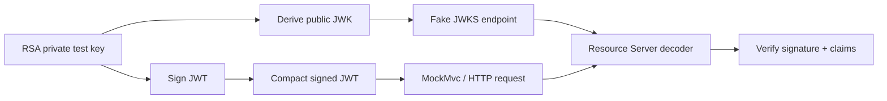

# Creating Test Key Pairs and Signed Tokens with Controlled Claims

When integration-testing a Spring Security OAuth 2.0 Resource Server, a hand-crafted JWT string or a mocked Authentication is not enough to prove the application verifies signatures correctly. To test the full Bearer token path, tests need a **test key pair, a corresponding public JWKS, and a genuinely signed compact JWT**. At the same time, claims must be controlled so tests can deliberately create valid tokens, wrong issuer/audience tokens, expired tokens, not-yet-valid tokens, or tokens missing scopes.

A good fixture set lets tests reproduce the same scenario without depending on a production Authorization Server. The test creates a private signing key itself, publishes only the public key via a fake JWKS endpoint, signs JWTs with per-case claims, and sends that exact token string in the Authorization header to MockMvc or an HTTP test server.

This guide uses Nimbus JOSE + JWT, the library underlying Spring Security JWT support. The main examples use RSA with RS256; the later sections cover EC/ES256, JWKS rotation, time control, claim profiles, and how to distinguish signed JWTs from Spring Security test helpers.

> **Rule:** The private test key is only used for signing in tests. The Resource Server fetches the public key from JWKS and verifies the signature. Never put private JWKs, production signing keys, real access tokens, or client secrets into fixtures, test logs, or the repository.

## 1. Why Are Genuinely Signed Tokens Needed?

Two categories of tests are often conflated:

- **Authorization tests:** verify which scope/role an endpoint requires and which principal is allowed access. These can use jwt(), mockJwt(), or a simulated Authentication.
- **JWT integration tests:** verify the Bearer header, token parsing, signature, issuer, audience, validity timestamps, and claim mapping. These must send a genuinely signed compact JWT through the filter chain with a real decoder.

Spring Security Test example:

```java
mockMvc.perform(get("/api/orders")
        .with(jwt().authorities(
            new SimpleGrantedAuthority("SCOPE_orders.read")
        )))
    .andExpect(status().isOk());
```

This test is useful for authorization, but the Authentication was created directly inside the test. It does not prove that BearerTokenAuthenticationFilter read a compact JWT, that JwtDecoder fetched the JWKS, or that the RS256 signature was verified.

With a real JWT, the request must carry:

```http
GET /api/orders HTTP/1.1
Host: api.example.test
Authorization: Bearer <SIGNED_JWT>
```

Only then does the Resource Server execute the pipeline:

1. Extract the Bearer token.
2. Parse the JWT header and claims.
3. Look up the matching public key by kid in the trusted JWKS.
4. Verify the signature using an allowed algorithm.
5. Validate issuer, audience, and timestamps according to validators.
6. Convert claims into a JwtAuthenticationToken/authorities.
7. Apply authorization rules.

## 2. Choosing an Algorithm and Key Type for Tests

For a Resource Server using asymmetric signing, RSA/RS256 is a common fixture choice:

- The Authorization Server holds the private key for signing.
- The Resource Server only needs the public key for verification.
- The JWKS publishes the public JWK.
- The private key is never sent to the Resource Server.



Do not use a shared HMAC secret as the default fixture for a production system that uses RSA. With HMAC, the verifier also holds the secret capable of signing tokens; that changes the trust model.

### 2.1. Generating an RSA JWK with Nimbus

Nimbus JOSE + JWT can generate an RSA key directly:

```java
RSAKey signingKey = new RSAKeyGenerator(2048)
    .keyID("test-rsa-1")
    .keyUse(KeyUse.SIGNATURE)
    .algorithm(JWSAlgorithm.RS256)
    .generate();

RSAKey publicJwk = signingKey.toPublicJWK();
```

Imports:

```java
import com.nimbusds.jose.JWSAlgorithm;
import com.nimbusds.jose.jwk.KeyUse;
import com.nimbusds.jose.jwk.RSAKey;
import com.nimbusds.jose.jwk.gen.RSAKeyGenerator;
```

RSA 2048-bit is the typical fixture size for RS256 tests. If the real system uses a different key profile, tests should follow that profile. Do not weaken production key sizes just to make tests run faster.

### 2.2. Each Key Needs Its Own kid

The JWT header includes kid so the decoder can select the matching public key from the JWKS:

```json
{
  "alg": "RS256",
  "kid": "test-rsa-1",
  "typ": "JWT"
}
```

The kid is an identifier within a key set, not proof of authenticity. The signature proves the token was created by the corresponding private key. Each published public key should have a unique kid that remains stable while the key is in use.

Do not reuse the same kid for a different key pair in the same JWKS. Changing the key material while keeping the same kid can cause unpredictable caching and key selection behavior.

### 2.3. Publish Only the Public JWK

The test JWKS must be constructed from the public projection:

```java
JWKSet publicJwkSet = new JWKSet(signingKey.toPublicJWK());
```

A public RSA JWK contains fields such as kty, kid, use, alg, n, and e. A private RSA JWK also contains sensitive parameters such as d, p, q, dp, dq, qi, and possibly oth.

You can assert on the fixture:

```java
assertThat(publicJwk.isPrivate()).isFalse();
assertThat(publicJwk.toJSONObject())
    .doesNotContainKeys("d", "p", "q", "dp", "dq", "qi", "oth");
```

The public JWK is served by the fake JWKS endpoint. The private key stays inside the test process to sign tokens. Never serialize the full signingKey into the JWKS response.

## 3. Creating Compact JWTs with Controlled Claims

A test access token should accurately model the contract the Resource Server expects. Common claims:

| Claim | Purpose | Example |
|---|---|---|
| iss | Issuer that issued the token | https://issuer.test |
| sub | Subject/principal | user-123 |
| aud | Resource Server permitted to accept the token | orders-api |
| iat | Time when the token was issued | current time |
| nbf | Time when the token becomes valid | current time |
| exp | Time when the token expires | current + 5 minutes |
| jti | Token identifier | UUID |
| scope | OAuth scopes | orders.read orders.write |
| tenant_id | Tenant per application contract | shop-a |
| client_id | OAuth client per token profile | shop-web |

Not every claim is required in every JWT profile. Tests must mirror the issuer's real token contract while including negative cases for claims the application requires.

### 3.1. Helper for Signing JWTs with RSA

Example of a small factory:

```java
public final class TestJwtFactory {

    private final RSAKey signingKey;
    private final Clock clock;

    public TestJwtFactory(RSAKey signingKey, Clock clock) {
        this.signingKey = signingKey;
        this.clock = clock;
    }

    public String issue(
            String issuer,
            String subject,
            List<String> audiences,
            Set<String> scopes,
            Duration lifetime,
            Map<String, Object> extraClaims) throws JOSEException {

        Instant now = clock.instant();

        JWTClaimsSet.Builder claims =
            new JWTClaimsSet.Builder()
                .issuer(issuer)
                .subject(subject)
                .audience(audiences)
                .issueTime(Date.from(now))
                .notBeforeTime(Date.from(now))
                .expirationTime(
                    Date.from(now.plus(lifetime))
                )
                .jwtID(UUID.randomUUID().toString())
                .claim("scope", String.join(
                    " ",
                    new TreeSet<>(scopes)
                ));

        extraClaims.forEach(claims::claim);

        JWSHeader header = new JWSHeader.Builder(
                JWSAlgorithm.RS256
            )
            .keyID(signingKey.getKeyID())
            .type(JOSEObjectType.JWT)
            .build();

        SignedJWT jwt = new SignedJWT(header, claims.build());

        jwt.sign(new RSASSASigner(signingKey.toPrivateKey()));

        return jwt.serialize();
    }
}
```

Key imports:

```java
import com.nimbusds.jose.JOSEException;
import com.nimbusds.jose.JOSEObjectType;
import com.nimbusds.jose.JWSAlgorithm;
import com.nimbusds.jose.JWSHeader;
import com.nimbusds.jose.crypto.RSASSASigner;
import com.nimbusds.jwt.JWTClaimsSet;
import com.nimbusds.jwt.SignedJWT;

import java.time.Clock;
import java.time.Duration;
import java.time.Instant;
import java.util.Date;
import java.util.List;
import java.util.Map;
import java.util.Set;
import java.util.TreeSet;
import java.util.UUID;
```

Notable details:

- Issuer, subject, and audience are passed in per test.
- Scopes are sorted before joining into a string for more deterministic output.
- iat, nbf, and exp are computed from Clock.
- jti is generated uniquely per token.
- Extra claims are used only for application-defined claims.
- Header alg and kid always match the signing key.
- The token is signed with the private key and serialized into a compact JWS.

This is a helper for test access tokens following an illustrative profile. If your issuer uses an scp claim instead of scope, a differently named tenant claim, or an at+jwt header typ, adapt the factory to match your real token profile.

### 3.2. Example Issuing a Token for Orders API

```java
String token = jwtFactory.issue(
    "https://issuer.test",
    "user-123",
    List.of("orders-api"),
    Set.of("orders.read", "orders.write"),
    Duration.ofMinutes(5),
    Map.of("tenant_id", "shop-a")
);
```

The token has subject user-123, audience orders-api, two scopes, and tenant shop-a. It is signed with the private key matching the kid in the JWKS.

### 3.3. Do Not Modify a JWT After Signing

A compact JWT has three parts:

```text
base64url(header).base64url(payload).base64url(signature)
```

Changing the payload or header after signing invalidates the signature. If you need a token with the wrong audience, sign a new token with the wrong audience. If you need a token with an invalid signature, sign with a different key or alter part of the compact token after generation. Do not edit the payload and expect the old signature to remain valid.

## 4. Generating JWKS JSON for a Fake Authorization Server

A JWKS is a JSON Web Key Set, typically shaped like:

```json
{
  "keys": [
    {
      "kty": "RSA",
      "kid": "test-rsa-1",
      "use": "sig",
      "alg": "RS256",
      "n": "<PUBLIC_MODULUS>",
      "e": "AQAB"
    }
  ]
}
```

Generate the JSON from the public JWK:

```java
ObjectMapper mapper = new ObjectMapper();

String jwksJson = mapper.writeValueAsString(
    new JWKSet(signingKey.toPublicJWK()).toJSONObject()
);
```

Imports:

```java
import com.nimbusds.jose.jwk.JWKSet;
import com.fasterxml.jackson.databind.ObjectMapper;
```

Do not build n/e manually by copying from the private key or expose the private JWK on the endpoint. Let Nimbus produce the public projection.

### 4.1. Fake JWKS Endpoint with WireMock

Example:

```java
stubFor(get(urlEqualTo("/jwks"))
    .willReturn(aResponse()
        .withHeader("Content-Type", "application/json")
        .withBody(jwksJson)));
```

The fake server can run on a dynamic port in tests. Configure the decoder to point to the URL provided by the test server. Whether you use WireMock, MockWebServer, or another embedded HTTP server, the principle is the same: the response returns the valid public JWKS with a JSON content type and requires no connection to a real identity provider.

### 4.2. Configuring the Decoder to Point to the Fake JWKS

Servlet Resource Server example:

```java
@Bean
JwtDecoder jwtDecoder(
        @Value("${test.jwks-uri}") String jwksUri) {

    NimbusJwtDecoder decoder =
        NimbusJwtDecoder.withJwkSetUri(jwksUri)
            .jwsAlgorithm(SignatureAlgorithm.RS256)
            .build();

    decoder.setJwtValidator(
        JwtValidators.createDefaultWithIssuer(
            "https://issuer.test"
        )
    );

    return decoder;
}
```

In the test context, the test.jwks-uri property must point to the fake server. Never let tests accidentally call a production JWKS or the public internet.

### 4.3. Adding an Audience Validator

Issuer validation does not automatically replace audience validation. If the API requires orders-api, configure an explicit validator:

```java
OAuth2TokenValidator<Jwt> audienceValidator = jwt ->
    jwt.getAudience().contains("orders-api")
        ? OAuth2TokenValidatorResult.success()
        : OAuth2TokenValidatorResult.failure(
            new OAuth2Error(
                "invalid_token",
                "Required audience is missing",
                null
            )
        );

decoder.setJwtValidator(
    new DelegatingOAuth2TokenValidator<>(
        JwtValidators.createDefaultWithIssuer(
            "https://issuer.test"
        ),
        audienceValidator
    )
);
```

Imports:

```java
import org.springframework.security.oauth2.core.DelegatingOAuth2TokenValidator;
import org.springframework.security.oauth2.core.OAuth2Error;
import org.springframework.security.oauth2.core.OAuth2TokenValidator;
import org.springframework.security.oauth2.core.OAuth2TokenValidatorResult;
import org.springframework.security.oauth2.jwt.Jwt;
import org.springframework.security.oauth2.jwt.JwtDecoder;
import org.springframework.security.oauth2.jwt.JwtValidators;
import org.springframework.security.oauth2.jwt.NimbusJwtDecoder;
import org.springframework.security.oauth2.jose.jws.SignatureAlgorithm;
```

With multiple APIs, the expected audience must be configured per Resource Server. Do not use a validator that accepts every audience just to make fixtures easier to run.

## 5. Controlling Time in Tests

Time claims are a common source of flaky tests:

- exp: the token is no longer valid after this timestamp.
- nbf: the token must not be accepted before this timestamp.
- iat: issuance timestamp, useful for auditing/profile validation.

Use Clock rather than scattering Instant.now() calls across helpers. When a test needs fixed time, use Clock.fixed:

```java
Instant testNow = Instant.parse("2026-11-15T09:00:00Z");
Clock fixedClock = Clock.fixed(testNow, ZoneOffset.UTC);
```

Imports:

```java
import java.time.Clock;
import java.time.Instant;
import java.time.ZoneOffset;
```

The token factory and timestamp validator should share the same clock in deterministic tests. Spring Security's JwtTimestampValidator supports clock and clock skew:

```java
JwtTimestampValidator timestampValidator =
    new JwtTimestampValidator(Duration.ofSeconds(30));

timestampValidator.setClock(fixedClock);
```

Then combine the timestamp validator with issuer/audience validators in the decoder. If the application under test uses JwtValidators.createDefaultWithIssuer(), check how the application configures its clock; do not issue tokens against a fixed clock while the decoder evaluates against a distant system clock.

### 5.1. Testing a Valid Token

```text
testNow = 10:00:00
iat     = 10:00:00
nbf     = 10:00:00
exp     = 10:05:00
request = 10:00:01
```

The token is within its validity window, so timestamp validation can succeed.

### 5.2. Testing an Expired Token

```text
testNow = 10:06:00
iat     = 10:00:00
nbf     = 10:00:00
exp     = 10:05:00
```

The token has expired. With synchronized timestamp validator and clock, the decoder rejects the token.

### 5.3. Testing a Token Before nbf

```text
testNow = 10:00:00
nbf     = 10:02:00
exp     = 10:05:00
```

The token is not yet valid. Tests must account for configured clock skew; if nbf is only a few seconds ahead of current time and clock skew is 30 seconds, the token may still be accepted per policy.

### 5.4. iat Does Not Automatically Replace exp/nbf Validation

Do not assume every default validator rejects a future iat. If the application requires iat not to exceed a threshold, write a dedicated validator and test it explicitly. The default timestamp validator focuses on exp/nbf per the Spring Security version's contract.

## 6. Creating Fixtures for Different Claims

A factory should allow varying claims without rewriting signing logic. You can create intention-revealing helpers:

```java
String validOrdersToken();
String tokenForWrongAudience();
String tokenFromUntrustedIssuer();
String expiredToken();
String tokenNotYetValid();
String tokenWithoutRequiredScope();
String tokenForAnotherTenant();
String tokenSignedByUnknownKey();
String tokenWithInvalidSignature();
```

These helpers can delegate to the shared TestJwtFactory with different inputs.

### 6.1. Issuer

A token's iss must match the issuer trusted by the Resource Server. A token signed by the same private key but carrying the wrong issuer must still be rejected if an issuer validator is configured.

Do not check only the signature and skip issuer validation. A key may be used across multiple issuer contexts; trust must bind both the issuer and the key source.

### 6.2. Audience

Token for Orders API:

```json
{"aud": ["orders-api"]}
```

Token for Payments API:

```json
{"aud": ["payments-api"]}
```

If the Orders API decoder requires orders-api, a token meant only for payments-api must be rejected even with a valid signature.

### 6.3. Scope

Spring Security by default can convert a space-delimited scope string claim into authorities prefixed with SCOPE_:

```json
{"scope": "orders.read orders.write"}
```

Example authorities:
- SCOPE_orders.read
- SCOPE_orders.write

If the application uses an scp claim, roles, or a custom JwtAuthenticationConverter, tests must construct the matching schema and verify the corresponding mapping. Do not assume all issuers place permissions in the same claim.

### 6.4. Tenant and Custom Claims

```json
{
  "tenant_id": "shop-a",
  "roles": ["ORDER_MANAGER"],
  "department": "fulfillment"
}
```

Custom claims only matter if the application defines and validates them. Tenant isolation tests should create tokens for shop-a and shop-b, then call endpoints targeting resources belonging to each tenant.

### 6.5. Subject and Client Identity

A user token may have sub=user-123. A service token may carry subject/client identity per the AS profile. A client_id or azp claim does not replace subject and does not automatically prove a service actor unless the contract defines it that way.

## 7. Controlling the JWT Header

The JWT header also needs to be controlled:

| Header | Meaning | What Tests Should Verify |
|---|---|---|
| alg | Signing algorithm | Only configured algorithms are accepted |
| kid | JWK selection | Must resolve to a trusted key |
| typ | Token type/profile | Matches the profile accepted by the API if validated |
| cty | Content type/nested JWT context | Used only when required by the profile |

RS256 header example:

```java
JWSHeader header = new JWSHeader.Builder(JWSAlgorithm.RS256)
    .keyID(signingKey.getKeyID())
    .type(JOSEObjectType.JWT)
    .build();
```

Some JWT access-token profiles use typ=at+jwt per RFC 9068. If the AS issues access tokens under that profile, fixtures should model the corresponding typ and the decoder/application may need a dedicated validator. Do not swap typ arbitrarily and assume the token still represents the same credential type.

### 7.1. Rejecting alg=none

Negative test cases with an unsigned JWT or alg=none must verify the Resource Server rejects them. Never disable signature validation to simplify fixtures.

### 7.2. Algorithm Allowlist

If an API trusts only RS256, configure the decoder to accept only RS256. A token validly signed with HS256/ES256 must still be rejected if the algorithm is not in the allowlist. A valid signature does not mean any algorithm is trusted.

### 7.3. Unknown kid

Create a token signed with key B while the JWKS publishes only public key A. The decoder cannot find a trusted key for the token's kid and must reject it. There must be no fallback to an arbitrary key or skipping signature verification.

## 8. Deliberately Creating Invalid-Signature Tokens

There are two ways to create an invalid signature:

**Option 1: sign with a different key.** Create key pair B, while the fake JWKS publishes only public key A. The JWT has B's kid; the decoder cannot verify it with the published key.

**Option 2: tamper with the signature after signing.** Create a valid JWT and alter a character in the signature segment without re-signing. The header/payload remain parseable, but the signature no longer matches.

In tests, using key B against JWKS A is often cleaner because it keeps the compact token structurally valid. If you are testing the parser specifically, you can construct other malformed strings.

Do not use a single malformed token to represent every failure mode. Parser error, unknown kid, bad signature, wrong issuer, wrong audience, and expired token are distinct branches.

## 9. Test Key Sets for Multiple Issuers or Multiple Resource Servers

If an application trusts multiple issuers, each issuer should have its own JWKS/test key set according to its contract:

```text
issuer-A:
  jwks = /issuer-a/jwks
  key = issuer-a-test-key
  expected audience = orders-api

issuer-B:
  jwks = /issuer-b/jwks
  key = issuer-b-test-key
  expected audience = inventory-api
```

Tests should verify:
- An issuer-A token is not authenticated using issuer-B's trust configuration.
- A token with a valid signature but wrong issuer is rejected.
- API A's audience is not automatically accepted by API B.
- There is no issuer fallback merely because kid values collide.

Do not rely solely on kid to distinguish issuers. kid is not a global identifier; the trust context also includes the issuer and JWKS URI.

## 10. Testing Key Rotation with Two Key Pairs

Create key A and key B:

```java
RSAKey keyA = new RSAKeyGenerator(2048)
    .keyID("test-key-A")
    .keyUse(KeyUse.SIGNATURE)
    .algorithm(JWSAlgorithm.RS256)
    .generate();

RSAKey keyB = new RSAKeyGenerator(2048)
    .keyID("test-key-B")
    .keyUse(KeyUse.SIGNATURE)
    .algorithm(JWSAlgorithm.RS256)
    .generate();
```

Create JWT A signed by private key A, and JWT B signed by private key B. The fake JWKS can transition through phases:

```text
Phase 1: JWKS = [public A]
  token A -> accepted
  token B -> rejected (unknown kid)

Phase 2: JWKS = [public A, public B]
  token A -> accepted
  token B -> accepted after decoder obtains B

Phase 3: JWKS = [public B]
  token B -> accepted
  token A -> rejected after decoder refreshes its JWK cache
```

### 10.1. JWKS Rotation Does Not Mean Instant Cache Refresh

The decoder may cache the JWK set. When the fake JWKS removes key A, a running decoder may still hold public key A until its cache refreshes/expires or a refresh trigger fires.

Therefore:
- Creating a new decoder with a JWKS containing only B proves a fresh decoder rejects token A.
- Testing the same decoder after a cache refresh proves cache lifecycle behavior.
- Testing across multiple decoder instances proves propagation between instances.

Do not spin up a new decoder and claim you have tested the old decoder's cache refresh.

### 10.2. Verify Public JWKS Does Not Leak Private Material in Each Phase

When building the A+B JWKS, include only the public projections of both keys:

```java
JWKSet jwks = new JWKSet(List.of(
    keyA.toPublicJWK(),
    keyB.toPublicJWK()
));
```

Do not put the full keyA/keyB into JWKSet. Private signing keys must remain inside the test factory.

## 11. Generating EC Keys and Signing with ES256

If the production Resource Server uses EC/ES256, tests should generate an EC key pair rather than testing only RSA.

```java
ECKey ecSigningKey = new ECKeyGenerator(Curve.P_256)
    .keyID("test-ec-1")
    .keyUse(KeyUse.SIGNATURE)
    .algorithm(JWSAlgorithm.ES256)
    .generate();

ECKey ecPublicJwk = ecSigningKey.toPublicJWK();
```

Imports:

```java
import com.nimbusds.jose.jwk.Curve;
import com.nimbusds.jose.jwk.ECKey;
import com.nimbusds.jose.jwk.gen.ECKeyGenerator;
```

Signing:

```java
SignedJWT jwt = new SignedJWT(
    new JWSHeader.Builder(JWSAlgorithm.ES256)
        .keyID(ecSigningKey.getKeyID())
        .type(JOSEObjectType.JWT)
        .build(),
    claims
);

jwt.sign(new ECDSASigner(ecSigningKey.toECPrivateKey()));

String compact = jwt.serialize();
```

Imports:

```java
import com.nimbusds.jose.crypto.ECDSASigner;
```

The Resource Server must be configured to trust ES256 if the test expects this token to be accepted. If only RS256 is allowlisted, an ES256 token must be rejected even when its signature is valid.

Do not mix test key types and algorithms arbitrarily. RSA keys use RS256; EC P-256 keys use ES256 per their corresponding profile.

## 12. Dependencies and Library Versions

Nimbus JOSE + JWT usually appears transitively via Spring Security OAuth2 JOSE in a Resource Server application. If test sources directly import Nimbus APIs, declare the test dependency explicitly so the build does not rely accidentally on a transitive compile classpath.

Gradle example:

```gradle
dependencies {
    implementation("org.springframework.boot:spring-boot-starter-oauth2-resource-server")

    testImplementation("com.nimbusds:nimbus-jose-jwt")
    testImplementation("org.springframework.boot:spring-boot-starter-test")
    testImplementation("org.springframework.security:spring-security-test")
}
```

Manage versions through Spring Boot dependency management/BOM or the project's version catalog. Do not copy arbitrary versions into build files when the project already manages them centrally.

Nimbus APIs can differ slightly across versions. Use the dependency version pinned by the project and compile test fixtures against that version.

## 13. Testing Real JWTs with MockMvc

An integration test needs:
- A real Spring Security filter chain.
- A real Resource Server configuration.
- A real JwtDecoder pointing to the fake JWKS.
- An RSA test key pair.
- A genuinely signed compact JWT.
- MockMvc sending the Authorization header.

Example:

```java
@SpringBootTest
@AutoConfigureMockMvc
class SignedJwtResourceServerTests {

    @Autowired
    MockMvc mockMvc;

    @Autowired
    TestJwtFactory jwtFactory;

    @Test
    void acceptsSignedTokenForOrdersAudience() throws Exception {
        String token = jwtFactory.issue(
            "https://issuer.test",
            "user-123",
            List.of("orders-api"),
            Set.of("orders.read"),
            Duration.ofMinutes(5),
            Map.of()
        );

        mockMvc.perform(get("/api/orders")
                .header(
                    HttpHeaders.AUTHORIZATION,
                    "Bearer " + token
                ))
            .andExpect(status().isOk());
    }
}
```

This is an illustrative structure. The test factory, fake JWKS server, and test properties must be registered in the test context. If the endpoint needs database fixtures, seed the corresponding data so the test does not fail in the business layer before the security assertion completes.

### 13.1. Wrong Audience

```java
@Test
void rejectsTokenForAnotherAudience() throws Exception {
    String token = jwtFactory.issue(
        "https://issuer.test",
        "user-123",
        List.of("payments-api"),
        Set.of("orders.read"),
        Duration.ofMinutes(5),
        Map.of()
    );

    mockMvc.perform(get("/api/orders")
            .header(
                HttpHeaders.AUTHORIZATION,
                "Bearer " + token
            ))
        .andExpect(status().isUnauthorized());
}
```

If the Orders API audience validator requires orders-api, the token above is rejected during authentication. The status is typically 401.

### 13.2. Wrong Issuer

Sign with a test key trusted by the JWKS, but use a different issuer:

```java
String token = jwtFactory.issue(
    "https://untrusted-issuer.test",
    "user-123",
    List.of("orders-api"),
    Set.of("orders.read"),
    Duration.ofMinutes(5),
    Map.of()
);
```

The issuer validator must reject the token. This proves trust does not depend solely on the signature matching the right public key.

### 13.3. Expired Token

```java
String token = jwtFactory.issue(
    ISSUER,
    "user-123",
    List.of("orders-api"),
    Set.of("orders.read"),
    Duration.ofSeconds(-60),
    Map.of()
);
```

If the factory allows a negative lifetime, the token will have exp in the past. You can create a clearer expiredToken() helper to avoid passing negative durations in tests. The decoder must reject it via the timestamp validator.

### 13.4. Valid Token Missing a Scope

The token still has valid issuer, audience, signature, and timestamps, but only carries orders.profile:

```java
String token = jwtFactory.issue(
    ISSUER,
    "user-123",
    List.of("orders-api"),
    Set.of("orders.profile"),
    Duration.ofMinutes(5),
    Map.of()
);
```

If the endpoint requires SCOPE_orders.read, authentication succeeds but authorization is denied. Under standard configurations, the response is 403. This test distinguishes an invalid token from insufficient authority.

## 14. Testing Bearer Headers with WebTestClient

With WebFlux, the principle stays the same: send a real compact JWT in the Authorization header and configure ReactiveJwtDecoder to point to the fake JWKS.

```java
webTestClient.get()
    .uri("/api/orders")
    .headers(headers ->
        headers.setBearerAuth(signedToken)
    )
    .exchange()
    .expectStatus().isOk();
```

Do not call mutateWith(mockJwt()) in signature/JWKS tests. That helper creates a simulated Authentication and bypasses the reactive decoder.

If you need to test a reactive JWT validator with a fixed clock, use the corresponding ReactiveJwtDecoder/validator and ensure the clock is configured with the same test time.

## 15. What Do Test Helpers vs. Integration Tests Prove?

| Test Approach | What It Proves | What It Does Not Prove |
|---|---|---|
| jwt()/mockJwt() | Authorization rules with a simulated Authentication | Compact token signature/JWKS |
| @WithMockUser | Role/authority access rules | Bearer parsing/JWT validation |
| Mock JwtDecoder | Filter extracts token, calls decoder, and handles decoder result | Cryptographic signature |
| Signed JWT + real decoder | Signature, key lookup, issuer/audience/time validators | Production AS availability |
| Fake JWKS HTTP endpoint | JWK retrieval, kid selection, decoder integration | Production provider behavior |
| Full test AS + Resource Server | Token issuance/validation per test contract | All production network/cache topologies |

A test suite should combine the right layers rather than using a single mocked test to claim the entire OAuth flow works.

## 16. Test Matrix for Key Pairs and Tokens

| Case | Key/JWKS | Claims/Header | Expected |
|---|---|---|---|
| Valid token | Public key A present in JWKS | Valid issuer/audience/time/scope | 200 if endpoint allows |
| Wrong signature | JWKS A, token signed by B | Other claims all valid | 401 |
| Unknown kid | JWKS A, token kid B | Token signed by B | 401 |
| Wrong issuer | Public key A trusted | Wrong iss | 401 |
| Wrong audience | Public key A trusted | aud lacks current API | 401 |
| Expired | Public key A trusted | exp in the past | 401 |
| Future nbf | Public key A trusted | nbf beyond clock skew | 401 |
| Missing scope | Public key A trusted | Valid token, missing authority | 403 on protected endpoint |
| Wrong tenant | Public key A trusted | tenant claim differs from resource tenant | 403/404 per policy |
| Unsupported algorithm | JWKS key/decoder allowlist mismatch | Disallowed alg | 401 |
| Unsigned JWT | No trusted signature | alg=none | 401 |
| Rotated key | JWKS A+B | Tokens A and B | Both valid during overlap |
| Old key removed | JWKS has only B after refresh | Token A | 401 after cache refresh |
| Wrong typ/profile | Valid signature | Wrong typ for profile if validator requires it | Rejected per profile |
| Missing required claim | Valid signature | Missing required claim | Rejected if validator/policy requires it |

Status codes 401/403/404 may vary depending on exception mapping and anti-enumeration policies. What matters is that the test verifies rejection at the right layer.

## 17. Access Tokens, ID Tokens, and Profile Claims

Not every JWT issued by an OIDC provider is an access token intended for an API.

- **ID token:** issued to the OIDC client, describing an authentication event and client audience.
- **Access token:** credential used to call a resource server, carrying audience/scope per the API contract.
- **Refresh token:** credential used with the AS to obtain new access tokens, never sent to business APIs.

An ID token with valid sub, email, aud, and signature still does not automatically become an access token for the Orders API.

If a test needs an OIDC ID token, build a dedicated fixture with claims such as iss, sub, client aud, exp, iat, nonce, and claims per the OIDC profile. Do not reuse the access-token factory by merely swapping the audience claim.

### 17.1. JWT Access Token Profile

Some systems follow RFC 9068 and use typ=at+jwt with its claims profile. Other systems define their own access-token profile. Fixtures should reflect the real AS contract and the active validator.

Do not add typ=at+jwt to every token just because it is an access token if the real issuer uses a different profile and downstream validators do not support it.

## 18. Managing Test Private Keys Safely

Test keys can be generated fresh when the test suite starts:

- Use a separate key pair per test class or test suite.
- Never use production private keys.
- Do not store private JWKs in golden fixtures unless necessary.
- Never print private keys, signed tokens, or Authorization headers to logs.
- Public JWKS may appear in fake server responses.
- Shut down/release test server resources after tests.
- Never reuse a private test key as a staging/production credential.

Generating keys per test run keeps fixtures free of shared key files, though you do not necessarily need a new key for every test method. You can generate one key per test class and mint multiple JWTs with different claims.

### 18.1. Do Not Confuse Test Keys with Non-Sensitive Values

A test private key is still a private key. Even though it holds no production privileges, it should not be placed in a public JWKS or logs. If you need to store a static test key for compatibility testing, place it in test resources, restrict its scope, and clearly mark it for test-only use.

### 18.2. Do Not Put Tokens in Assertion Messages

Avoid assertion failures that print the entire JWT. Logging tokens can leak credentials in CI artifacts. Assert on status, claims, kid, or a safe hash/digest instead of the raw token.

## 19. Common Mistakes When Creating Test JWTs

1. **Using jwt() to test signatures.** Simulated Authentication bypasses the decoder.
2. **JWKS containing a private key.** The fake server accidentally publishes the full JWK instead of the public projection.
3. **Mismatched kid.** The token header uses a different kid than the key in JWKS.
4. **alg mismatch with key/decoder.** Token signed with RS256 while decoder allows only ES256, or vice versa.
5. **Wrong API audience.** Token signature is valid, so the Resource Server rightly rejects it per contract.
6. **Issuer mismatch.** Mixing production and test issuers between token and decoder.
7. **Tokens expiring due to slow tests.** Using too short a lifetime or an unsynchronized fixed time.
8. **Ignoring clock skew.** Tokens at the nbf/exp boundary behave differently than expected.
9. **Wrong scope claim format.** App expects a space-delimited string, but fixture sends an array/roles claim.
10. **Editing the payload after signing.** The signature becomes invalid.
11. **Reusing the same kid across keys.** Key selection/caching becomes unpredictable.
12. **Not testing unknown kid.** The decoder may hit key lookup failures during rotation.
13. **Testing only the decoder directly.** Fails to verify the Bearer filter/HTTP chain.
14. **Testing only the filter with a mocked decoder.** Fails to verify cryptographic validation.
15. **Using an ID token for an API.** Wrong token purpose/audience.
16. **Leaking private keys into logs/CI artifacts.** Test credentials still require protection.
17. **Assuming instant JWKS refresh.** The decoder cache may retain old keys.

## 20. Workflow for Building Fixtures in a Test Suite

**Step 1 — Read the token contract.** Identify issuer, audience, algorithm, kid, token type, required claims, and scope format.

**Step 2 — Generate the key pair.** Use RSA 2048/RS256 or EC P-256/ES256 matching the Resource Server configuration.

**Step 3 — Build the public JWKS.** Export only the public JWK and verify no private parameters are present.

**Step 4 — Start the fake JWKS endpoint.** Point the decoder to the test server, never to a production AS.

**Step 5 — Build the JWT factory.** Control iss, sub, aud, iat, nbf, exp, jti, scope, and custom claims.

**Step 6 — Synchronize Clock.** Share the same test clock between the token factory and timestamp validator when testing fixed time.

**Step 7 — Create positive/negative fixtures.** Valid, wrong issuer, wrong audience, expired, future nbf, missing scope, unknown kid, and invalid signature.

**Step 8 — Send real tokens over HTTP.** Use MockMvc or WebTestClient with an Authorization Bearer header.

**Step 9 — Test key rotation.** Publish A, publish A+B, remove A, and observe cache refresh behavior.

**Step 10 — Keep mocked authorization tests separate.** Use jwt()/mockJwt() for fast access-rule checks; never use them as proof of signature validation.

## 21. References

- [Spring Security Reference — JWT Resource Server](https://docs.spring.io/spring-security/reference/servlet/oauth2/resource-server/jwt.html): decoder, JWKS, issuer, and JWT validation.
- [Spring Security Reference — Testing OAuth 2.0](https://docs.spring.io/spring-security/reference/servlet/test/index.html): test support for MockMvc and Resource Server.
- [Spring Security Reference — MockMvc OAuth2](https://docs.spring.io/spring-security/reference/servlet/test/mockmvc/oauth2.html): jwt() and request post-processors.
- [Nimbus JOSE + JWT](https://connect2id.com/products/nimbus-jose-jwt): JWK, JWKSet, SignedJWT, signer, and verifier APIs.
- [RFC 7515 — JSON Web Signature](https://www.rfc-editor.org/rfc/rfc7515): JWS compact serialization and signatures.
- [RFC 7517 — JSON Web Key](https://www.rfc-editor.org/rfc/rfc7517): JWK/JWKS and public key representation.
- [RFC 7519 — JSON Web Token](https://www.rfc-editor.org/rfc/rfc7519): registered claims such as iss, sub, aud, exp, nbf, iat, and jti.
- [RFC 8725 — JSON Web Token Best Current Practices](https://www.rfc-editor.org/rfc/rfc8725): algorithm verification, issuer/audience, and cross-JWT confusion.
- [RFC 9068 — JWT Profile for OAuth 2.0 Access Tokens](https://www.rfc-editor.org/rfc/rfc9068): access token JWT profile and typ=at+jwt.
- [RFC 7518 — JSON Web Algorithms](https://www.rfc-editor.org/rfc/rfc7518): RS256, ES256, and JWS algorithms.

**Conclusion:** A reliable JWT integration test requires a private test key for signing, a public-only JWKS for the Resource Server to verify against, and controlled claims matching the token contract. Keep signature/issuer/audience/time tests separate from authorization tests using mocked Authentication. Generate positive and negative tokens with the same factory, control time through Clock, verify kid/algorithm handling, and send real compact JWTs via MockMvc or WebTestClient. **Never publish private keys, never modify payloads after signing, and never use an ID token as an API access token.**
