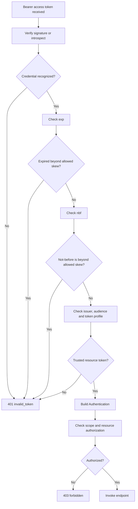

# Expired Tokens, Not-Yet-Valid Tokens, and Clock Skew Boundaries

## 1. Goal: Controlling Access Token Timestamps

JWT access tokens commonly carry time claims such as `iat`, `nbf`, and `exp`. A Resource Server (RS) compares these timestamps against the current clock to decide whether the token has been issued, has reached its valid start time, and is still within its lifetime.

Example:

```json
{
  "iss": "https://auth.example.test/realms/orders",
  "sub": "alice-123",
  "aud": ["orders-api"],
  "scope": "orders:read",
  "iat": 1890000000,
  "nbf": 1890000000,
  "exp": 1890003600
}
```

If the Authorization Server (AS) and RS clocks drift apart, a freshly issued token may be rejected because `nbf` sits in the future according to the RS clock. Conversely, a token already expired according to the AS may still be accepted if the RS clock runs slow.

Spring Security supports **clock skew**—a time tolerance window—when validating JWT timestamps. Tolerance absorbs small clock offsets. If configured too generously, tokens can be accepted past their intended expiry or earlier than their intended valid start time.

This lesson belongs to the **Integration Verification** chapter of the **Spring Security OAuth 2.0 OIDC Resource Server** module. It covers the semantics of `exp`, `nbf`, and `iat`; how `JwtTimestampValidator` works; configuring clock skew; deterministic boundary testing; and distinguishing timestamp failures from issuer, audience, or signature errors.

> **Key principle:** Clock skew is only a tolerance for clock drift. It does not replace time synchronization and should never be used to mask clock configuration bugs.

---

## 2. Three Time Claims to Distinguish

| Claim | Name | Meaning |
|---|---|---|
| `iat` | Issued At | Time when the token was issued. |
| `nbf` | Not Before | Token must not be accepted before this time. |
| `exp` | Expiration Time | Token must not be accepted at or after this expiration time, subject to a small clock-skew leeway. |

NumericDate values represent seconds since the Unix epoch `1970-01-01T00:00:00Z`, not milliseconds.

### 2.1. Issued At — iat

`iat` indicates when the token was issued. It is useful for auditing, token age policies, and rules detecting anomalous tokens.

`iat` **does not automatically mean the token can only be used strictly after that timestamp**. It records issuance time; `nbf` is the dedicated claim representing when validity begins.

If the application must reject tokens whose `iat` lies too far in the future relative to the RS clock, define a dedicated validator. Do not assume checking `exp` and `nbf` also validates `iat`.

### 2.2. Not Before — nbf

```json
{
  "iat": 1890000000,
  "nbf": 1890000060,
  "exp": 1890003600
}
```

The token is issued at `iat`, but is only permitted for use starting at `nbf`. Between those two instants, the token exists and has a valid signature, yet is not yet allowed by policy.

A token can be rejected as not-yet-valid if the RS checks it before `nbf` and clock skew does not cover the gap.

### 2.3. Expiration Time — exp

```json
{
  "iat": 1890000000,
  "nbf": 1890000000,
  "exp": 1890003600
}
```

After the expiration timestamp, the token is no longer accepted. `exp` is an absolute timestamp, not a TTL counted from when the RS receives a request. A client cannot extend a token's life by replaying it.

### 2.4. iat Does Not Replace nbf

```json
{
  "iat": 1890000300,
  "nbf": 1890000000,
  "exp": 1890003600
}
```

`iat` lies in the future while `nbf` is already active. Under the semantics of the two claims, `nbf` does not forbid using the token now. However, a future `iat` may indicate:

- The AS clock is running fast.
- The token was constructed incorrectly.
- The issuer is violating the system's profile.
- The token's timestamps were tampered with or come from an untrusted source.

If policy requires `iat` not to exceed the current time plus a small tolerance, add a validator for `iat`. Do not attribute that behavior to the default `JwtTimestampValidator`.

---

## 3. JWT Time Rules

RFC 7519 defines the baseline semantics:

- If `exp` is present, the current date/time must be before `exp`; afterward the token must not be accepted.
- If `nbf` is present, the current date/time must be at or after `nbf` for the token to be accepted.
- `iat` identifies the issuance time.
- Implementations may allow a small leeway to account for clock skew.

Validity window before considering other claims/profiles:

```text
             Token not yet valid               Token accepted           Token expired
Time  ------------------------------------------------|====================|-------->
                                                     nbf                  exp
```

With clock skew `S`, the acceptance window can expand at both ends:

```text
         nbf - S                 nbf                  exp             exp + S
------------|--------------------|====================|----------------|-------->
         early tolerance          nominal validity      late tolerance
```

This is a conceptual illustration. When making decisions right on the boundary, rely on the exact behavior of the validator and Spring Security version in use. Do not write your own comparison and assume it matches the framework.

### 3.1. Leeway Does Not Mutate JWT Timestamps

If a token has `exp=1890003600`, the validator does not rewrite the claim to a later value. It only applies tolerance when comparing the timestamp against the current clock.

A JWT forwarded downstream still carries the same `exp`. Another service with smaller clock skew may reject a token the first service just accepted. Resource Servers therefore need compatible time policies.

### 3.2. Clock Skew Is Not Token Lifetime Extension at the AS

The AS should still mint access tokens with appropriate lifetimes. Clock skew is validator tolerance, not a way for the AS to issue 5-minute tokens while implicitly allowing 10 extra minutes everywhere.

### 3.3. Token Profiles Can Require Claims

General JWT allows many registered claims to be optional. A specific access-token profile may require `exp`, `iat`, `iss`, `aud`, or other claims.

RFC 9068 defines the JWT Profile for OAuth 2.0 Access Tokens with its own required claims. Distinguish:

- JWT syntax permits a claim to be absent.
- An access-token profile may mandate that claim.
- Spring's timestamp validator checks timestamps only when the corresponding claim is present; it does not replace full profile validation.

If the system requires every access token to carry `exp`, enforce the claim's presence via a dedicated profile validator or ensure the AS adheres to the contract.

---

## 4. What Is Clock Skew?

Clock skew is the offset between the clocks used to issue and verify tokens.

| Component | Clock | Offset |
|---|---|---:|
| Authorization Server | 10:00:00 | Accurate |
| Resource Server A | 09:59:40 | 20 seconds slow |
| Resource Server B | 10:00:25 | 25 seconds fast |

The AS issues a token with:

```text
nbf = 10:00:00
exp = 10:10:00
```

RS A receives the token at actual time 10:00:05, when its clock reads 09:59:45. Without tolerance, the token can be treated as before `nbf`.

RS B receives the token at actual time 10:09:50, when its clock reads 10:10:15. Without tolerance, the token can be treated as expired even though 10 seconds remain on the AS clock.

### 4.1. Sources of Clock Skew

Clock drift can come from:

- VMs or container hosts without time synchronization.
- Stopped or misconfigured NTP/chrony services.
- Newly booted nodes that have not synced clocks yet.
- Suspended/resumed virtual machines.
- Regions with different time sources or network paths.
- Tests using a virtual clock while another component reads the system clock.
- Developer workstation clocks differing from CI clocks.
- AS and RS running on platforms with different time-sync setups.

Containers generally share the host kernel's clock. Do not assume each container maintains an independently synchronized clock.

### 4.2. Time Synchronization Remains the Primary Defense

Production systems should:

- Synchronize host clocks with NTP/chrony or an organization-supported time sync service.
- Monitor clock offset and synchronization health.
- Alert when offset exceeds thresholds.
- Standardize systems and logs on UTC.
- Avoid manual clock jumps while services are processing tokens.
- Verify time sync across all regions and nodes.
- Use clock injection in tests instead of waiting on wall-clock time.

Validator clock skew is a secondary safety margin, not a substitute for clock synchronization.

---

## 5. JwtTimestampValidator in Spring Security

Spring Security uses `JwtTimestampValidator` to validate JWT timestamps. It checks `exp` and `nbf` when present.

In Spring Security 6.x, `JwtTimestampValidator` defaults to a 60-second clock skew. You can configure the tolerance via constructor or setter depending on your version's API:

```java
JwtTimestampValidator timestampValidator =
    new JwtTimestampValidator(Duration.ofSeconds(30));
```

Here the validator permits a 30-second tolerance for timestamp checks. Choose this value based on measured clock offsets and the system's security requirements.

### 5.1. Conceptual Behavior

With clock skew `S`:

- A token is considered expired when the validator's clock passes `exp` after accounting for tolerance.
- A token is considered not-yet-valid when `nbf` remains in the future beyond tolerance.
- Tokens within the tolerance window can be accepted.
- `iat` is not enforced as a mandatory timestamp check by this validator.

In the current implementation, boundary checks use strict comparisons; as a result, exact equality may behave differently from instants just past the boundary. When writing security regression tests, fix the clock and verify against your actual running version rather than relying on mental math.

### 5.2. Default Validator with Issuer

A common decoder setup uses `JwtValidators.createDefaultWithIssuer(issuer)`. This default validator includes timestamp validation and issuer validation per the Spring Security version's behavior.

```java
NimbusJwtDecoder decoder =
    NimbusJwtDecoder.withJwkSetUri(jwkSetUri).build();

decoder.setJwtValidator(
    JwtValidators.createDefaultWithIssuer(issuer)
);
```

This uses the default validator, applying the timestamp validator's default clock skew.

### 5.3. When Custom Clock Skew Is Needed

When you need a skew other than the default, construct validators explicitly and compose everything the application requires:

```java
@Bean
JwtDecoder jwtDecoder() {
    NimbusJwtDecoder decoder =
        NimbusJwtDecoder.withJwkSetUri(
            "https://auth.example.test/realms/orders/protocol/openid-connect/certs"
        ).build();

    JwtTimestampValidator timestampValidator =
        new JwtTimestampValidator(Duration.ofSeconds(30));

    OAuth2TokenValidator<Jwt> issuerValidator =
        new JwtIssuerValidator(
            "https://auth.example.test/realms/orders"
        );

    OAuth2TokenValidator<Jwt> audienceValidator = jwt -> {
        if (jwt.getAudience().contains("orders-api")) {
            return OAuth2TokenValidatorResult.success();
        }

        OAuth2Error error = new OAuth2Error(
            "invalid_token",
            "Required audience orders-api is missing",
            null
        );

        return OAuth2TokenValidatorResult.failure(error);
    };

    decoder.setJwtValidator(
        new DelegatingOAuth2TokenValidator<>(
            timestampValidator,
            issuerValidator,
            audienceValidator
        )
    );

    return decoder;
}
```

Key imports:

```java
import java.time.Duration;

import org.springframework.context.annotation.Bean;
import org.springframework.security.oauth2.core.OAuth2Error;
import org.springframework.security.oauth2.core.OAuth2TokenValidator;
import org.springframework.security.oauth2.core.OAuth2TokenValidatorResult;
import org.springframework.security.oauth2.jwt.DelegatingOAuth2TokenValidator;
import org.springframework.security.oauth2.jwt.Jwt;
import org.springframework.security.oauth2.jwt.JwtDecoder;
import org.springframework.security.oauth2.jwt.JwtIssuerValidator;
import org.springframework.security.oauth2.jwt.JwtTimestampValidator;
import org.springframework.security.oauth2.jwt.NimbusJwtDecoder;
```

If a project uses `JwtValidators.createDefaultWithIssuer(...)` and wants to customize skew alone, construct `JwtTimestampValidator` explicitly and combine it with the issuer validator and all other required validators.

**Note:** Calling `decoder.setJwtValidator(...)` replaces the validator set used by the decoder. Never accidentally drop issuer, audience, or custom access-token profile validators just to change clock skew.

### 5.4. Adding an iat Validator If Policy Requires It

`JwtTimestampValidator` focuses on `exp` and `nbf`. If the system requires rejecting `iat` too far in the future, write a dedicated validator:

```java
public final class IssuedAtValidator
        implements OAuth2TokenValidator<Jwt> {

    private final Clock clock;
    private final Duration allowedFutureSkew;

    public IssuedAtValidator(
            Clock clock,
            Duration allowedFutureSkew) {
        this.clock = clock;
        this.allowedFutureSkew = allowedFutureSkew;
    }

    @Override
    public OAuth2TokenValidatorResult validate(Jwt jwt) {
        Instant issuedAt = jwt.getIssuedAt();

        if (issuedAt == null) {
            return failure("Required iat claim is missing");
        }

        Instant latestAllowed =
            clock.instant().plus(allowedFutureSkew);

        if (issuedAt.isAfter(latestAllowed)) {
            return failure("iat is too far in the future");
        }

        return OAuth2TokenValidatorResult.success();
    }

    private OAuth2TokenValidatorResult failure(String description) {
        return OAuth2TokenValidatorResult.failure(
            new OAuth2Error("invalid_token", description, null)
        );
    }
}
```

This is an illustrative validator. If `iat` is mandatory under the token profile, missing it must also be rejected as shown. If the profile does not mandate `iat`, think carefully before introducing a new requirement.

This validator must share the same clock source/policy as the timestamp validator so validators never observe inconsistent instants within the same request.

---

## 6. Injecting a Controllable Clock in Tests

Tests relying on `Instant.now()` and `Thread.sleep()` are prone to flakiness:

- Tests run faster or slower on CI.
- OS schedulers/GC can shift execution timing.
- Boundary tests depend on milliseconds.
- Parallel tests can skew timing.
- Long sleeps slow down the suite without guaranteeing exact boundaries.

Use `Clock.fixed(...)` to test at a deterministic instant.

```java
private static final Instant NOW =
    Instant.parse("2026-11-15T10:00:00Z");

private static final Clock FIXED_CLOCK =
    Clock.fixed(NOW, ZoneOffset.UTC);
```

Then inject the clock into the validator:

```java
JwtTimestampValidator validator =
    new JwtTimestampValidator(Duration.ZERO);

validator.setClock(FIXED_CLOCK);
```

Every test runs against the same `NOW`, making results independent of machine wall-clock time.

### 6.1. Helper for Building JWT Fixtures

```java
private Jwt jwtWithTimes(
        Instant issuedAt,
        Instant notBefore,
        Instant expiresAt) {

    return Jwt.withTokenValue("test-token")
        .header("alg", "RS256")
        .issuer("https://auth.example.test/realms/orders")
        .subject("alice-123")
        .audience(List.of("orders-api"))
        .issuedAt(issuedAt)
        .notBefore(notBefore)
        .expiresAt(expiresAt)
        .claim("scope", "orders:read")
        .build();
}
```

This is a fixture object for invoking the validator directly, not a signed compact JWT. When testing `JwtTimestampValidator` directly, that is fine because the goal is purely timestamp comparison.

### 6.2. Assertion Helpers

```java
private void assertValid(Jwt jwt) {
    OAuth2TokenValidatorResult result = validator.validate(jwt);
    assertThat(result.hasErrors()).isFalse();
}

private void assertInvalid(Jwt jwt) {
    OAuth2TokenValidatorResult result = validator.validate(jwt);
    assertThat(result.hasErrors()).isTrue();
}
```

You can also assert on error descriptions if the application guarantees a stable error contract, but avoid coupling every test to exact framework messages that may evolve across versions.

---

## 7. Unit Tests for Expiry: Valid vs. Expired Tokens

Assume:

```text
Fixed clock = 2026-11-15T10:00:00Z
Clock skew = 0
```

### 7.1. Token Expired in the Past

```java
@Test
void expiredTokenIsRejected() {
    Jwt jwt = jwtWithTimes(
        NOW.minusSeconds(600),
        NOW.minusSeconds(600),
        NOW.minusSeconds(1)
    );

    assertInvalid(jwt);
}
```

`exp` is before the current instant. With zero skew, the token must be rejected.

### 7.2. Valid Unexpired Token

```java
@Test
void tokenWithFutureExpirationIsAccepted() {
    Jwt jwt = jwtWithTimes(
        NOW.minusSeconds(60),
        NOW.minusSeconds(60),
        NOW.plusSeconds(300)
    );

    assertValid(jwt);
}
```

`exp` is in the future and `nbf` has passed, so timestamp validation succeeds.

### 7.3. Testing the Exact Expiry Boundary

Create a fixture with `exp` equal to the fixed clock, then verify the outcome on your actual Spring Security version. This is an important boundary test because implementations may differ on strict inequality vs. equality.

Never use `Thread.sleep()` to push the clock across the boundary. Fix the clock and set fixture timestamps explicitly.

### 7.4. Token Expired Just Before the Clock

```java
@Test
void tokenExpiredBeforeCurrentInstantIsRejected() {
    Jwt jwt = jwtWithTimes(
        NOW.minusSeconds(300),
        NOW.minusSeconds(300),
        NOW.minusSeconds(1)
    );

    assertInvalid(jwt);
}
```

`Instant` has higher precision than integer-second NumericDate in Java models. When minting real compact JWTs, NumericDate may serialize to whole seconds; ensure signed-token tests use a timestamp representation consistent with the library.

---

## 8. Unit Tests for Not-Before: Tokens Not Yet Valid

### 8.1. nbf in the Future

```java
@Test
void notBeforeInFutureIsRejected() {
    Jwt jwt = jwtWithTimes(
        NOW.minusSeconds(10),
        NOW.plusSeconds(60),
        NOW.plusSeconds(300)
    );

    assertInvalid(jwt);
}
```

A token with a valid signature is still rejected because `nbf` has not arrived.

### 8.2. nbf Equal to Current Time

```java
@Test
void notBeforeAtCurrentInstantIsAcceptedWithZeroSkew() {
    Jwt jwt = jwtWithTimes(
        NOW.minusSeconds(60),
        NOW,
        NOW.plusSeconds(300)
    );

    assertValid(jwt);
}
```

Per `nbf` semantics, a token is accepted when the current time is at or after not-before. Boundary tests should still be pinned to your validator version.

### 8.3. nbf in the Past

```java
@Test
void notBeforeInPastIsAccepted() {
    Jwt jwt = jwtWithTimes(
        NOW.minusSeconds(60),
        NOW.minusSeconds(1),
        NOW.plusSeconds(300)
    );

    assertValid(jwt);
}
```

### 8.4. nbf After exp

A token with `nbf` later than `exp` has no valid time window. An AS should never issue such a token; an RS can add a validator to reject it explicitly.

```java
@Test
void impossibleValidityWindowIsRejectedAtCurrentTime() {
    Jwt jwt = jwtWithTimes(
        NOW.minusSeconds(60),
        NOW.plusSeconds(300),
        NOW.plusSeconds(120)
    );

    assertInvalid(jwt);
}
```

---

## 9. Testing Clock Skew with exp

Assume the clock is fixed at `NOW` and skew is 30 seconds.

```java
private JwtTimestampValidator validatorWithSkew(Duration skew) {
    JwtTimestampValidator validator =
        new JwtTimestampValidator(skew);
    validator.setClock(FIXED_CLOCK);
    return validator;
}
```

### 9.1. Token Expired 10 Seconds Ago Within Tolerance

```java
@Test
void recentlyExpiredTokenCanBeAcceptedWithinConfiguredSkew() {
    JwtTimestampValidator validator =
        validatorWithSkew(Duration.ofSeconds(30));

    Jwt jwt = jwtWithTimes(
        NOW.minusSeconds(300),
        NOW.minusSeconds(300),
        NOW.minusSeconds(10)
    );

    assertThat(validator.validate(jwt).hasErrors()).isFalse();
}
```

This is the direct consequence of tolerance: the token is past nominal expiry yet still inside the permitted clock-skew window.

### 9.2. Token Expired Beyond Tolerance

```java
@Test
void tokenExpiredBeyondConfiguredSkewIsRejected() {
    JwtTimestampValidator validator =
        validatorWithSkew(Duration.ofSeconds(30));

    Jwt jwt = jwtWithTimes(
        NOW.minusSeconds(600),
        NOW.minusSeconds(600),
        NOW.minusSeconds(31)
    );

    assertThat(validator.validate(jwt).hasErrors()).isTrue();
}
```

### 9.3. Comparison Matrix

| Token `exp` vs. Fixed Clock | 0s Skew | 30s Skew |
|---|---|---|
| `NOW + 60s` | Accept | Accept |
| `NOW + 1s` | Accept | Accept |
| `NOW` | Check boundary per validator/version | Within tolerance |
| `NOW - 10s` | Reject | Accept within tolerance |
| `NOW - 30s` | Reject | On boundary, check version |
| `NOW - 31s` | Reject | Reject |

Rows right on the boundary should be verified with fixed-clock tests against the actual framework version. Do not treat this table as a substitute for reading the running version's validator/API.

---

## 10. Testing Clock Skew with nbf

Clock skew also affects tokens whose not-before time has not yet arrived.

Assume:

```text
Fixed clock = 10:00:00
nbf         = 10:00:20
clock skew  = 30 seconds
```

Because `nbf` is only 20 seconds ahead of the clock, the token can be accepted within tolerance. This helps when the AS clock runs slightly ahead of the RS, but also means tokens can be used slightly earlier than their nominal `nbf`.

### 10.1. nbf Within Tolerance

```java
@Test
void notBeforeWithinConfiguredSkewCanBeAccepted() {
    JwtTimestampValidator validator =
        validatorWithSkew(Duration.ofSeconds(30));

    Jwt jwt = jwtWithTimes(
        NOW,
        NOW.plusSeconds(20),
        NOW.plusSeconds(300)
    );

    assertThat(validator.validate(jwt).hasErrors()).isFalse();
}
```

### 10.2. nbf Beyond Tolerance

```java
@Test
void notBeforeBeyondConfiguredSkewIsRejected() {
    JwtTimestampValidator validator =
        validatorWithSkew(Duration.ofSeconds(30));

    Jwt jwt = jwtWithTimes(
        NOW,
        NOW.plusSeconds(31),
        NOW.plusSeconds(300)
    );

    assertThat(validator.validate(jwt).hasErrors()).isTrue();
}
```

### 10.3. Comparison Matrix

| `nbf` vs. Fixed Clock | 0s Skew | 30s Skew |
|---|---|---|
| `NOW - 60s` | Accept | Accept |
| `NOW` | Accept | Accept |
| `NOW + 10s` | Reject | Accept within tolerance |
| `NOW + 30s` | Reject | On boundary, check version |
| `NOW + 31s` | Reject | Reject |

### 10.4. Skew Applies at Both Ends

A common configuration mistake is thinking of skew as "extra time after expiry" only. In practice, timestamp tolerance can affect both `exp` and `nbf`:

- Allows a recently expired token to remain valid briefly.
- Allows a token with a near-future `nbf` to be accepted early.

Increasing skew therefore **widens the acceptance window at both ends**. Evaluate the risk of both early acceptance and late expiration.

---

## 11. Future iat and Custom Validators

`iat` is not `nbf`. If the application wants to reject `iat` values too far in the future, write a dedicated validator and test it independently.

### 11.1. Validator with Clock Injection

```java
public final class FutureIssuedAtValidator
        implements OAuth2TokenValidator<Jwt> {

    private final Clock clock;
    private final Duration tolerance;

    public FutureIssuedAtValidator(
            Clock clock,
            Duration tolerance) {
        this.clock = clock;
        this.tolerance = tolerance;
    }

    @Override
    public OAuth2TokenValidatorResult validate(Jwt jwt) {
        Instant issuedAt = jwt.getIssuedAt();

        if (issuedAt == null) {
            return OAuth2TokenValidatorResult.failure(
                new OAuth2Error(
                    "invalid_token",
                    "Missing iat claim",
                    null
                )
            );
        }

        Instant latestAllowed =
            clock.instant().plus(tolerance);

        if (issuedAt.isAfter(latestAllowed)) {
            return OAuth2TokenValidatorResult.failure(
                new OAuth2Error(
                    "invalid_token",
                    "iat is in the future",
                    null
                )
            );
        }

        return OAuth2TokenValidatorResult.success();
    }
}
```

### 11.2. Testing Future iat Within Tolerance

```java
@Test
void futureIssuedAtWithinToleranceIsAccepted() {
    FutureIssuedAtValidator validator =
        new FutureIssuedAtValidator(
            FIXED_CLOCK,
            Duration.ofSeconds(30)
        );

    Jwt jwt = jwtWithTimes(
        NOW.plusSeconds(20),
        NOW.minusSeconds(10),
        NOW.plusSeconds(300)
    );

    assertThat(validator.validate(jwt).hasErrors()).isFalse();
}
```

### 11.3. Testing Future iat Beyond Tolerance

```java
@Test
void futureIssuedAtBeyondToleranceIsRejected() {
    FutureIssuedAtValidator validator =
        new FutureIssuedAtValidator(
            FIXED_CLOCK,
            Duration.ofSeconds(30)
        );

    Jwt jwt = jwtWithTimes(
        NOW.plusSeconds(31),
        NOW.minusSeconds(10),
        NOW.plusSeconds(300)
    );

    assertThat(validator.validate(jwt).hasErrors()).isTrue();
}
```

### 11.4. Not Every System Needs to Validate iat

If the issuer and RS have tight clock synchronization, a future-`iat` check can help catch anomalous tokens. However, if clock skew between the two systems is measured and expected, any tolerance must be explicitly defined.

Do not use `iat` as a substitute for `nbf` or enforce a rule unknown to the Authorization Server. All components must agree on the token profile.

---

## 12. Combining the Timestamp Validator with Issuer and Audience

Valid timestamps do not mean the token is permitted on the current API. A token with a future `exp` can still have the wrong issuer, audience, or scope.

A composite validator typically includes:

1. Timestamp validator.
2. Issuer validator.
3. Audience validator.
4. Custom access-token profile validator if needed.
5. Custom claim/policy validators if needed.

Example:

```java
OAuth2TokenValidator<Jwt> validator =
    new DelegatingOAuth2TokenValidator<>(
        new JwtTimestampValidator(Duration.ofSeconds(30)),
        new JwtIssuerValidator(EXPECTED_ISSUER),
        audienceValidator,
        requiredClaimsValidator
    );

decoder.setJwtValidator(validator);
```

### 12.1. Distinguishing Timestamp Errors from Audience Errors

| Fixture | Timestamp | Issuer | Audience | Result |
|---|---|---|---|---|
| A | Valid | Valid | Valid | Accept |
| B | Expired | Valid | Valid | Reject |
| C | Not-yet-valid | Valid | Valid | Reject |
| D | Valid | Wrong | Valid | Reject |
| E | Valid | Valid | Wrong | Reject |
| F | Valid | Valid | Valid, missing required claim | Reject per profile |
| G | Valid | Valid | Valid, missing scope | Decoder may accept; authorization returns 403 |

Scopes are typically mapped to authorities after authentication. If scope is missing, the decoder need not reject the token; endpoint authorization denies the request with 403. Keep token validation separate from permission checks.

### 12.2. Do Not Replace All Validators When Only Changing Skew

If the decoder previously used:

```java
decoder.setJwtValidator(
    JwtValidators.createDefaultWithIssuer(EXPECTED_ISSUER)
);
```

and you replace it with:

```java
decoder.setJwtValidator(
    new JwtTimestampValidator(Duration.ofSeconds(30))
);
```

issuer validation can silently disappear from the validator chain. This is an easy regression to introduce. When customizing skew, re-compose issuer, audience, and every validator the application requires.

---

## 13. A Mock JwtDecoder Does Not Test Real Timestamps

This is a critical point in integration testing.

If a test configures:

```java
@MockBean
JwtDecoder jwtDecoder;
```

and stubs:

```java
when(jwtDecoder.decode(TOKEN))
    .thenReturn(expiredJwtFixture);
```

the Spring Security provider receives the `Jwt` directly from the mock. The `JwtTimestampValidator` inside a real decoder does not automatically run on the returned object.

As a result, the request may authenticate even though the fixture has a past `exp`. That does not mean the production filter ignores expiry; the test replaced the component responsible for validating timestamps.

### 13.1. When to Use a Mock Decoder?

Use a mock decoder to verify:

- The Bearer header is extracted.
- The provider calls `decode(token)`.
- Authentication is built from the JWT fixture.
- Authorities are mapped by the converter.
- Request matchers and authorization rules.
- 401 when the mock throws `JwtException`.
- 403 when the mock returns a valid JWT missing a scope.

Never use a mock decoder to conclude:

- `exp`/`nbf` are checked properly.
- Clock skew is applied properly.
- Signature/JWKS/issuer/audience validators work.
- The compact JWT string is valid.

### 13.2. How to Test Timestamps Through the Filter Chain

To verify expiry/not-before through the filter chain, use a real decoder with a test key:

1. Generate an RSA test key pair.
2. Build a real `NimbusJwtDecoder` from the public key or test JWKS.
3. Attach a `JwtTimestampValidator` with a fixed clock.
4. Sign the JWT fixture with the private key.
5. Send the compact JWT via MockMvc in the Authorization header.
6. Assert 200/401 across time offsets.
7. Keep key/issuer/audience identical and vary only timestamps to isolate the cause.

---

## 14. Example Signed-JWT Integration Test with a Real Decoder

A test can use an in-test RSA key pair and `NimbusJwtDecoder.withPublicKey(...)`. This section illustrates the approach; Nimbus JOSE/JWT imports and key generation must match your project's dependency versions.

### 14.1. Generating a Test Key Pair

```java
RSAKey rsaJwk = new RSAKeyGenerator(2048)
    .keyID("test-key")
    .generate();

RSAPublicKey publicKey = rsaJwk.toRSAPublicKey();
RSAPrivateKey privateKey = rsaJwk.toRSAPrivateKey();
```

The private key is used only to sign test fixtures; the decoder receives only the public key.

### 14.2. Building a Real Decoder with a Fixed Clock

```java
NimbusJwtDecoder decoder =
    NimbusJwtDecoder.withPublicKey(publicKey).build();

JwtTimestampValidator timestampValidator =
    new JwtTimestampValidator(Duration.ofSeconds(30));

timestampValidator.setClock(FIXED_CLOCK);

decoder.setJwtValidator(
    new DelegatingOAuth2TokenValidator<>(
        timestampValidator,
        new JwtIssuerValidator(EXPECTED_ISSUER),
        audienceValidator
    )
);
```

The decoder verifies the signature before validators inspect claims. A fixed clock makes timestamp behavior reproducible.

### 14.3. Signing the JWT Test Fixture

```java
JWTClaimsSet claims = new JWTClaimsSet.Builder()
    .issuer(EXPECTED_ISSUER)
    .subject("alice-123")
    .audience("orders-api")
    .issueTime(Date.from(NOW.minusSeconds(60)))
    .notBeforeTime(Date.from(NOW.minusSeconds(60)))
    .expirationTime(Date.from(NOW.plusSeconds(300)))
    .claim("scope", "orders:read")
    .build();

SignedJWT signed = new SignedJWT(
    new JWSHeader.Builder(JWSAlgorithm.RS256)
        .keyID("test-key")
        .type(JOSEObjectType.JWT)
        .build(),
    claims
);

signed.sign(new RSASSASigner(privateKey));
String compactToken = signed.serialize();
```

### 14.4. Sending the Token with MockMvc

```java
mvc.perform(get("/api/orders/42")
        .header(
            HttpHeaders.AUTHORIZATION,
            "Bearer " + compactToken))
    .andExpect(status().isOk());
```

To test an expired token, sign another JWT with `exp` outside tolerance while keeping issuer, audience, subject, key, and scope unchanged. Any 401 response can then be attributed specifically to timestamp validation.

### 14.5. Why Not Just Use the jwt() Post-Processor?

`jwt()` creates a test authentication directly. It is great for authorization-only tests, but it never invokes a real decoder to verify signatures and timestamps. To prove expiry enforcement in the filter chain, send a compact signed token in the Authorization header.

---

## 15. Opaque Tokens and Expiration: Introspection Server Owns Active State

With opaque tokens, the Resource Server does not parse `exp`/`nbf` from the token string itself. It calls an `OpaqueTokenIntrospector`, typically an RFC 7662 introspection endpoint.

Example response:

```json
{
  "active": true,
  "sub": "alice-123",
  "scope": "orders:read",
  "exp": 1890003600,
  "iat": 1890000000
}
```

In the opaque-token model, the AS/introspection server decides whether the token is currently active. The RS receives `active=true` and creates an authentication; `active=false` results in an authentication failure.

### 15.1. exp in the Introspection Response

RFC 7662 defines `active` as a required boolean; all other metadata, including `exp`, is optional. If the AS returns `exp`, it describes the token's expiration time. However, the Resource Server should not assume every introspector implementation independently applies all timestamp rules like `JwtTimestampValidator`.

In the opaque-token model:

- The AS must return `active=false` when a token is no longer active under its semantics and policy.
- The RS trusts the introspection result over a protected connection and client authentication.
- If response metadata is used to enforce additional expiry/nbf checks on the RS, implement that explicitly in a custom introspector or validation layer.
- Introspection caching can make `active` status stale.

### 15.2. A Mock Introspector Also Bypasses Real Time

If a test stubs:

```java
when(introspector.introspect(TOKEN))
    .thenReturn(activePrincipal);
```

the request is authenticated with the principal returned by the mock. A stale `exp` attribute in the map will not cause `OpaqueTokenAuthenticationProvider` to reject the token once the mock returns an active principal.

To test filter behavior for an inactive token:

```java
when(introspector.introspect(TOKEN))
    .thenThrow(new BadOpaqueTokenException("Inactive test token"));
```

To test HTTP introspection and real timestamp semantics, use a real introspector with a mock HTTP server returning the corresponding `active` responses.

### 15.3. Caching Can Keep active=true Stale

If an `active=true` introspection result is cached for 60 seconds, a token that expires or is revoked after caching may continue to be accepted for the lifetime of the cache entry, depending on the cache implementation.

Cache TTL must align with:

- Token expiry.
- Revocation SLA.
- Endpoint security sensitivity.
- AS availability.
- Clock skew between AS and RS.
- Event-driven invalidation/reconciliation if present.

Never cache an active response past the token's expiry according to the clock driving TTL calculation. High-risk endpoints may require short cache TTLs or per-request introspection.

---

## 16. Clock Skew and Cache Interaction

Clock skew and caching can stack into a larger acceptance window than expected.

Example:

- Token `exp` is 10:00:00 on the AS.
- RS permits 30 seconds of skew.
- Introspection cache retains `active=true` for 60 seconds.
- Cache is populated right before expiry.

If the cache does not cap remaining TTL against `exp`, the token can remain usable until the cache entry expires, potentially past the RS's configured skew window.

### 16.1. Factors to Account For

```text
Effective acceptance window can be influenced by:
  - AS/RS clock offset
  - JWT timestamp validator skew
  - introspection cache TTL
  - revocation propagation delay
  - in-flight request duration
```

This is a list of contributing factors, not a fixed additive formula. A cache may expire on its own schedule; event invalidation may shorten the stale window; an already-authorized request may complete slightly later.

### 16.2. Bounding Cache TTL by Expiry

When caching introspection results, effective TTL should be capped by the token's remaining lifetime and the cache policy. Be careful with timezones/clock sources; compute remaining TTL using `Duration.between(clock.instant(), exp)` from a consistent clock, then clamp non-negative values and enforce a maximum TTL ceiling.

### 16.3. Do Not Let Caching Mask Timestamp Regressions

If a test calls the RS while a token is valid and then calls again with the same cached token, it does not prove the timestamp validator executed on the second call. You can:

- Disable caching in timestamp tests.
- Use distinct token fixtures per case.
- Fix the clock and actively expire cache entries.
- Test cache behavior separately with a fake clock/cache ticker.
- Count introspector invocations to verify hits vs. misses.

---

## 17. Test and Production Clocks Must Be Consistent

In production, the default timestamp validator uses the system UTC clock. In unit tests, use `Clock.fixed`. Do not let one custom validator use a fixed clock while another reads `Instant.now()`.

### 17.1. Injecting Clock into Custom Code

If policies inspect `iat`, `auth_time`, `max_age`, or a custom `valid_until`, inject `Clock`:

```java
@Bean
Clock securityClock() {
    return Clock.systemUTC();
}
```

Validators receive the clock via constructor:

```java
@Bean
FutureIssuedAtValidator issuedAtValidator(Clock securityClock) {
    return new FutureIssuedAtValidator(
        securityClock,
        Duration.ofSeconds(30)
    );
}
```

Tests can swap the `Clock` bean with a fixed clock. Avoid scattering `Instant.now()` inside validators, as that makes exact testing difficult.

### 17.2. Avoid Clock Drift Within a Single Validation

A single request should not make inconsistent clock reads right next to an expiry boundary. For complex policies, capture `Instant now` once and pass it to custom checks. The framework timestamp validator manages its clock internally; never mutate global system time to force tests.

### 17.3. Never Compare NumericDate in a Local Timezone

JWT NumericDate represents an absolute instant. Use `Instant`/UTC. Never parse the claim into a local date/time and compare using the server's local timezone. DST and timezone offsets must never affect token expiration.

---

## 18. Edge Cases of Timestamp Claims

### 18.1. Missing exp

Base JWT allows `exp` to be optional at the RFC 7519 level. However, your system's access-token profile may require it.

`JwtTimestampValidator` only checks expiry if `exp` is present. If `exp` is missing when the profile requires it, the token can pass timestamp validation and must still be rejected by a custom profile validator.

### 18.2. Missing nbf

`nbf` is optional in general JWTs. Absent `nbf` usually means no separate start-of-validity timestamp was declared; all other checks still apply.

Do not silently default `nbf=iat` unless the issuer contract specifies it. If you want to require `nbf`, enforce it with a dedicated validator.

### 18.3. iat After exp

A token with `iat > exp` has no coherent lifecycle. The timestamp validator should not be treated as a full profile validator for this case. A custom claim validator can reject impossible timestamp combinations.

### 18.4. nbf Greater Than or Equal to exp

There is no nominal interval during which the token is both valid and unexpired. The AS should never issue such a token; the RS can add a validator to reject it explicitly.

### 18.5. Wrong NumericDate Type

Time claims must be parsed by the decoder as NumericDate values. Non-numeric values or invalid representations can cause the decoder to reject the token before timestamp validators run.

### 18.6. Fractional NumericDate

RFC 7519 permits NumericDate to be a number, potentially including a fractional part. Libraries vary in precision retained when converting to `Instant`. Boundary tests should reflect the actual serialization/parsing behavior of your library.

### 18.7. Leap Seconds and Unix Time

Unix epoch/NumericDate must not be interpreted as a local wall-clock string. Do not manually add or subtract leap seconds on `exp`. Rely on the platform's standard time library and clock source.

---

## 19. Clock Skew for OIDC auth_time and max_age

OIDC introduces timestamps outside JWT access-token claims. For example, an ID Token carries `auth_time` recording when authentication occurred. A client can send `max_age` to require the user to re-authenticate within a given interval.

Do not confuse:

- `exp`: token expiration time.
- `nbf`: time when the token becomes valid.
- `iat`: time when the token was issued.
- `auth_time`: time when the user actually authenticated at the OP.

A fresh ID Token can be issued from an old SSO session. A recent `iat` does not prove the user just re-entered a password or MFA. If policy requires authentication freshness, evaluate `auth_time` and `max_age` per OIDC semantics rather than inferring it from `iat`.

### 19.1. Access Tokens and ID Tokens Serve Different Purposes

A Resource Server should validate access tokens according to its resource-server profile. Do not use an ID Token's `auth_time` in place of an access token's `exp`. If the application needs authentication assurance/freshness, the issuer must include the agreed claims/contract in the token accepted by the API, or the API must check state via a service designed for that purpose.

### 19.2. Skew for Authentication Freshness

If custom code compares `auth_time` against the RS clock, define a dedicated tolerance. Do not assume `JwtTimestampValidator` covers `auth_time`, as it focuses on `exp` and `nbf`.

---

## 20. Deterministic Clock Skew Boundary Testing

A solid timestamp test suite uses a single fixed instant and fixtures with explicit offsets.

Assume:

```text
NOW = 2026-11-15T10:00:00Z
SKEW = 30 seconds
```

### 20.1. Expiry Matrix

| `exp` | Meaning | Expected with 30s Skew |
|---|---|---|
| `NOW + 300s` | 5 minutes remaining | Accept |
| `NOW + 1s` | 1 second remaining | Accept |
| `NOW` | Exact expiry instant | Check boundary per validator/version |
| `NOW - 10s` | Expired 10s ago | Accept within tolerance |
| `NOW - 29s` | Expired nearly 30s ago | Accept within tolerance |
| `NOW - 31s` | Expired over 30s ago | Reject |
| `NOW - 300s` | Expired 5 minutes ago | Reject |

### 20.2. Not-Before Matrix

| `nbf` | Meaning | Expected with 30s Skew |
|---|---|---|
| `NOW - 300s` | Valid long ago | Accept |
| `NOW` | Valid right now | Accept |
| `NOW + 10s` | Before nominal start | Accept within tolerance |
| `NOW + 29s` | Near nominal start | Accept within tolerance |
| `NOW + 31s` | Beyond tolerance | Reject |
| `NOW + 300s` | Far from valid start | Reject |

### 20.3. iat Matrix When Custom Validator Is Enabled

| `iat` | 30s Future Tolerance | Expected |
|---|---|---|
| `NOW - 300s` | N/A | Accept |
| `NOW` | N/A | Accept |
| `NOW + 10s` | Within tolerance | Accept |
| `NOW + 30s` | On boundary | Check validator behavior |
| `NOW + 31s` | Beyond tolerance | Reject |
| Missing | If required | Reject |

Use these values to design tests. Fix the clock and verify exact boundary behavior on your active Spring Security version.

### 20.4. Do Not Sleep

Never write:

```java
Thread.sleep(2000);
```

to wait for a token to expire. Instead:

- Fix the clock.
- Mint JWTs with `exp`/`nbf` relative to `NOW`.
- Inject the clock into validators.
- Or use an advanceable test clock if a cache/async component supports it.
- Keep timestamp validation tests separate from real-time scheduling tests.

---

## 21. Verifying Errors Through MockMvc

Once validator unit tests and signed-token integration tests are in place, verify the HTTP outcomes.

### 21.1. Expired Token

With a real decoder and a timestamp validator using 30s skew:

```java
mvc.perform(get("/api/orders/42")
        .header(
            HttpHeaders.AUTHORIZATION,
            "Bearer " + expiredSignedToken))
    .andExpect(status().isUnauthorized());
```

### 21.2. Not-Yet-Valid Token

```java
mvc.perform(get("/api/orders/42")
        .header(
            HttpHeaders.AUTHORIZATION,
            "Bearer " + notYetValidSignedToken))
    .andExpect(status().isUnauthorized());
```

### 21.3. Valid Timestamp Token Missing Scope

```java
mvc.perform(get("/api/orders/42")
        .header(
            HttpHeaders.AUTHORIZATION,
            "Bearer " + validTokenWithoutReadScope))
    .andExpect(status().isForbidden());
```

The third case is an authorization failure, not a timestamp validation failure. Separating the three tests prevents a 401/403 status from masking the real cause.

### 21.4. Inspecting WWW-Authenticate

For invalid/expired Bearer tokens, the response typically includes a Bearer challenge and `invalid_token` error per RFC 6750. Exact formatting can depend on the entry point/error handler. If your API defines a specific error contract, assert against that contract rather than internal messages.

---

## 22. Timestamp Validation and Introspection Error Handling

For opaque tokens, the AS returns `active=false` for expired or not-yet-valid tokens per its state and policy. The RS treats that as an authentication failure.

### 22.1. Testing active=false

```java
when(introspector.introspect(TOKEN))
    .thenThrow(new BadOpaqueTokenException("Token is inactive"));

mvc.perform(get("/api/orders/42")
        .header(
            HttpHeaders.AUTHORIZATION,
            "Bearer " + TOKEN))
    .andExpect(status().isUnauthorized());
```

This is a filter-flow test with a mock introspector; it simulates an inactive result.

### 22.2. Testing Introspection Server Timeout

A timeout does not mean the token expired. If the AS does not respond, the RS has no current introspection result.

Depending on exception mapping and the API contract, the response may be 5xx/503 rather than 401. Do not turn a dependency outage into an invalid-token error if the system needs to distinguish the two states.

### 22.3. Testing Cache Expiration

If introspection results are cached, tests must verify:

- Cache key.
- Cache TTL.
- Cache clock/ticker.
- Whether entries invalidate at token expiry.
- Whether entries invalidate on account/token revocation.
- Whether pods use a shared cache or local caches.

Use your cache library's fake ticker/clock if supported. Never wait in real time for expiration in unit tests.

---

## 23. How Much Clock Skew Should You Choose?

There is no single number right for every system. Choose skew based on measurements and security requirements.

### 23.1. Factors to Consider

- Actual maximum clock offset between AS and RS.
- Time-source synchronization across regions.
- Node deployment/boot duration.
- Access token lifetime.
- API sensitivity.
- Revocation requirements.
- Likelihood of clients presenting tokens immediately after issuance.
- Downstream Resource Servers with differing skew settings.
- Introspection caches/authorization caches.
- Measured drift and alert thresholds.

### 23.2. Illustrative Choices

| Environment | Illustrative Skew | Rationale |
|---|---:|---|
| Local deterministic tests | 0 seconds | Fixed clock, no tolerance needed. |
| CI with stable clocks | 0–5 seconds | Minimizes unnecessary timing variance. |
| Well-synchronized production nodes | 30–60 seconds | Small margin for offset/propagation. |
| Networks/regions with larger measured offset | Based on measured offset and risk review | Fix clock root causes before widening skew. |

These are reference values, not mandatory defaults. If production needs several minutes of skew for fresh tokens to work, investigate time synchronization before increasing tolerance.

### 23.3. Risks of Excessive Skew

- Expired tokens stay accepted longer.
- Future-`nbf` tokens can be used early.
- Leaked JWTs have a longer exploitation window.
- Services with inconsistent skew behave unpredictably.
- Token revocation/expiry SLAs can be misunderstood.
- Tests checking only nominal expiry miss actual tolerance behavior.

### 23.4. Problems from Too Little Skew

- Freshly issued tokens may be rejected on slow-clock nodes.
- Requests near expiry fail inconsistently across replicas.
- Multi-region services experience intermittent 401s.
- Clients refresh earlier than necessary.
- Incidents become hard to diagnose if you inspect only token claims without checking node clocks.

Aim for the smallest tolerance that accommodates real-world measured offset and operational needs.

---

## 24. Observing Clock and Timestamp Failures in Production

When a Resource Server returns 401 due to invalid token timestamps, emit enough telemetry to diagnose without logging the token.

Useful metrics/log fields include:

- Validation error category: expired, not-before, issuer, audience, signature.
- Service/region/node ID.
- Clock offset health from the time synchronization agent.
- Timestamp delta bucket (e.g., expired by 5–10s, 10–30s, >30s).
- Canonical token issuer ID.
- Route/API class.
- Correlation ID.
- Decoder/provider error class.

Never log raw JWTs, full claims containing PII, Authorization headers, or token values.

### 24.1. Prevent Error Descriptions from Leaking Data

`JwtTimestampValidator` can produce timestamp-related error descriptions. If exposed directly to clients, avoid revealing sensitive claims or infrastructure details. You can return a generic `invalid_token` externally while logging redacted internal categories.

### 24.2. Monitoring Node Clocks

SRE teams should alert on:

- NTP/chrony unsynchronized state.
- Clock offset exceeding threshold.
- Unexpected node time jumps.
- Container host clock issues.
- Region-to-region offset.
- Time sync service unavailability.

If many requests suddenly fail with `not yet valid` after a deployment, check the new nodes' clocks before widening global skew.

### 24.3. Distinguishing an Expiry Burst from an Issuer Outage

A spike in 401s can result from:

- AS issuing tokens with future `nbf`.
- RS clock running fast.
- Genuinely expired tokens.
- Decoder/JWKS/key rotation issues.
- Issuer/audience configuration changes.
- Clients sending ID Tokens instead of access tokens.

Error categories and correlation IDs help tell these apart rather than staring at raw 401 counts.

---

## 25. Common Design Mistakes

| Mistake | Consequence | Fix |
|---|---|---|
| Treating `iat` as `nbf` | Rejects/accepts tokens with wrong semantics. | Use `nbf` for not-before; add a custom validator if `iat` checks are needed. |
| Assuming `JwtTimestampValidator` checks every time claim | Future `iat` or `auth_time` may go unchecked. | Write a dedicated validator for that policy. |
| Increasing skew to cure clock drift | Expired/early-valid tokens stay accepted longer. | Sync clocks and measure offset first. |
| Dropping issuer validator on custom decoders | Tokens from other issuers may pass if key trust isn't tightly bound. | Compose timestamp, issuer, audience, and profile validators. |
| Mocking decoder and claiming expiry works | Mock bypasses timestamp validation. | Use a real decoder for timestamp integration tests. |
| Mocking introspector principal and claiming `exp` was checked | Provider trusts the mocked principal. | Mock inactive or test against a real introspector/AS. |
| Scattering `Instant.now()` in tests | Non-deterministic boundary tests. | Inject `Clock.fixed`. |
| Using `Thread.sleep()` to wait for expiry | Slow and flaky tests. | Fixed clock/fake clock. |
| Testing only expired tokens | Misses not-before and skew early tolerance. | Test `exp`, `nbf`, boundaries, and custom `iat`. |
| Skipping exact boundary tests | Regressions at equality slip through. | Test at `NOW`, `NOW ± skew` for your version. |
| Caching introspection without considering expiry | `active=true` stays stale past `exp`. | Cap TTL by expiry and cache policy. |
| Every service picking arbitrary skew | Same token behaves differently across services. | Standardize policy by issuer/resource profile. |
| Using local timezones | Environment-dependent results. | Use `Instant` and UTC. |
| Ignoring missing required claims | Tokens violating the access-token profile slip through. | Add required-claim/profile validators. |
| Using ID Token `exp` to validate an access token | Confuses token types/purposes. | Validate the proper access token at the Resource Server. |
| Logging full JWTs to debug timestamps | Leaks bearer credentials/PII. | Log error category and redacted time delta. |

---

## 26. Timestamp Verification Checklist

| Item | What to Confirm |
|---|---|
| **exp** | Expired tokens are rejected once skew is exceeded. |
| **nbf** | Not-yet-valid tokens are rejected outside tolerance. |
| **iat** | Clear policy exists; never assume timestamp validator rejects future `iat`. |
| **Required claims** | Claims mandated by the access-token profile are enforced explicitly. |
| **Clock source** | Production uses synchronized UTC/system clocks. |
| **Clock skew** | Measured, tightly bounded, and consistent across services. |
| **Boundaries** | Tested at expiry/not-before and on both sides of tolerance. |
| **Determinism** | Unit tests use `Clock.fixed`, never sleep. |
| **JWT filter tests** | Real decoder with signed tokens covers timestamp integration. |
| **Mock decoder scope** | Never used as proof of signature/timestamp validators. |
| **Opaque tokens** | AS/introspection owns `active`; mocked principals do not validate `exp`. |
| **Caching** | TTL never exceeds expiry/revocation policy; invalidation is tested. |
| **Issuer/audience** | Preserved when customizing the validator chain. |
| **Error handling** | Expired/not-before are invalid credentials; dependency outages are classified separately. |
| **Observability** | Error categories and clock offset metrics exist; tokens are never logged. |
| **Downstream consistency** | Resource Servers share compatible timestamp/skew policies. |

---

## 27. Runbook: Newly Issued Tokens Get 401 or Expired Tokens Are Still Accepted

### 27.1. Freshly Issued Token Rejected as Not-Yet-Valid

Investigate:

1. Inspect `iss`, `nbf`, `iat`, and `exp` from the token in a safe environment; never log raw tokens.
2. Compare AS and RS clocks in UTC.
3. Check NTP/chrony status on the failing node.
4. Check `JwtTimestampValidator` skew and custom validators.
5. Determine whether `nbf` falls outside tolerance.
6. Check whether the AS issued the token with bad timestamps.
7. Compare RS replicas/regions to isolate a drifted node.
8. Check whether the token passed through a caching/introspection layer.
9. If widening skew temporarily, assess both early acceptance and late expiry, set a cap, and add alerts.
10. Fix the time source, then restore tolerance to the agreed policy.

### 27.2. Expired Token Still Accepted

Investigate:

1. Confirm the endpoint actually uses the access token rather than a session or another credential.
2. Check `exp` against the time the RS received the request.
3. Check whether the RS clock lags behind the AS.
4. Check `JwtTimestampValidator` skew.
5. Confirm the production decoder actually has a timestamp validator attached.
6. If using a custom decoder, verify `setJwtValidator(...)` preserved the timestamp validator.
7. For opaque tokens, inspect what `active` state the AS returns.
8. Check whether introspection/cache TTL keeps `active=true` too long.
9. Check whether another route/filter chain bypasses Resource Server validation.
10. Check whether tests used `jwt()` or a mock decoder, bypassing expiry checks.
11. Check whether downstream Resource Servers enforce consistent expiry policies.
12. Add a regression test using a signed token and a fixed clock.

Never diagnose solely from the `exp` claim seen in a debugger. Trace the actual clock, skew, decoder/introspector, and cache path.

---

## 28. Timestamp Decision Map



This conceptual diagram illustrates the validation layers. For JWTs, signatures and claims are handled by the decoder/validators. For opaque tokens, the introspection server determines active state per contract. Internal execution order may vary, but the API must never permit requests with unverified credentials.

---

## 29. Technical References

- [Spring Security — OAuth 2.0 Resource Server JWT (Servlet)](https://docs.spring.io/spring-security/reference/servlet/oauth2/resource-server/jwt.html): decoders, validators, and JWT authentication.
- [Spring Security API — JwtTimestampValidator](https://docs.spring.io/spring-security/site/docs/current/api/org/springframework/security/oauth2/jwt/JwtTimestampValidator.html): timestamp validation and clock-skew configuration.
- [Spring Security API — JwtValidators](https://docs.spring.io/spring-security/site/docs/current/api/org/springframework/security/oauth2/jwt/JwtValidators.html): default validator sets and issuer-aware validation.
- [Spring Security — OAuth 2.0 Resource Server Opaque Token](https://docs.spring.io/spring-security/reference/servlet/oauth2/resource-server/opaque-token.html): introspection-based authentication.
- [RFC 7519 — JSON Web Token](https://www.rfc-editor.org/rfc/rfc7519.html): semantics of `iat`, `nbf`, `exp`, and NumericDate.
- [RFC 9068 — JWT Profile for OAuth 2.0 Access Tokens](https://www.rfc-editor.org/rfc/rfc9068.html): JWT profile for OAuth access tokens and required claims.
- [RFC 7662 — OAuth 2.0 Token Introspection](https://www.rfc-editor.org/rfc/rfc7662.html): `active` and introspection metadata.
- [RFC 6750 — OAuth 2.0 Bearer Token Usage](https://www.rfc-editor.org/rfc/rfc6750.html): `invalid_token` and Bearer challenges.
- [OpenID Connect Core 1.0](https://openid.net/specs/openid-connect-core-1_0.html): ID Tokens, `auth_time`, `iat`, `exp`, and `max_age`.
- [NTP — Network Time Protocol](https://www.ntp.org/): clock synchronization for distributed systems.

**Conclusion:** `exp` defines expiration time, `nbf` defines when validity begins, and `iat` records issuance time. Spring Security uses `JwtTimestampValidator` to check `exp` and `nbf` with a default clock skew and configurable tolerance. Skew accommodates small clock offsets while widening the acceptance window before `nbf` and after `exp`. Synchronize clocks, choose tolerance from real measurements, preserve issuer/audience/profile validators when customizing decoders, and test boundaries using a fixed clock. For opaque tokens, time validity is reflected in introspection results; a mock introspector returning an active principal does not automatically check timestamps. To prove expiry enforcement in the filter chain, use a real decoder/introspector in integration tests instead of mocks that skip that verification step.
