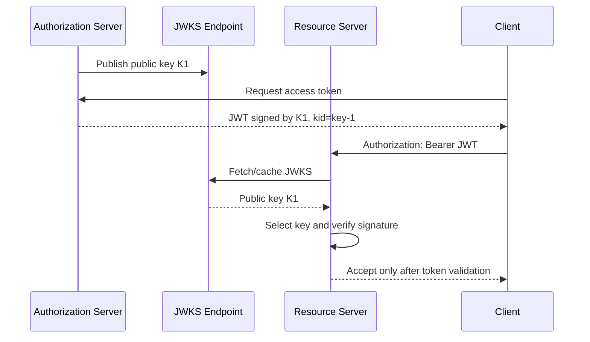
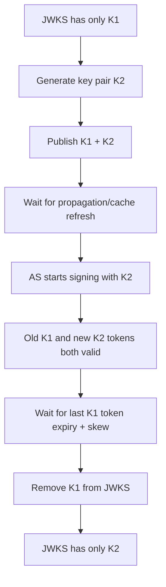

# Key Rotation, New kids, Old Keys, and Unreachable JWKS

A JWT Resource Server verifies access token signatures using public keys published by the Authorization Server. Public keys are typically distributed via **JWKS (JSON Web Key Set)**. When the Authorization Server rotates signing keys, the Resource Server must simultaneously handle tokens signed with the old key, new tokens carrying a new `kid`, and scenarios where the JWKS endpoint is temporarily unreachable.

Safe key rotation is an overlapping process. The Authorization Server must **publish the new public key before it starts signing tokens with the new private key**, retain the old public key in the JWKS long enough for the Resource Server to verify unexpired old tokens, and only then retire the old key. The Resource Server must cache JWKS deliberately, handle unknown `kid` values, bound retries, and maintain fail-closed behavior whenever a signature cannot be verified.

This lesson belongs to the **Integration Verification** chapter and focuses on the meaning of `kid` and JWKS, the publish-before-sign sequence, the overlap window between new and old keys, caching and refreshing, outages, Spring Security configuration, integration testing, operational observability, rollbacks, and handling compromised keys.

> **Illustrative context:** Orders API runs on Spring Boot 3.x / Spring Security 6.x and receives JWT access tokens from `https://id.example.com`. The Authorization Server signs tokens with RSA. The Resource Server fetches public keys from `https://id.example.com/oauth2/jwks`. URLs, key IDs, and tokens in this guide are examples.

## 1. Signing Key and JWKS Model

### 1.1. Authorization Server Holds the Private Key; Resource Server Uses the Public Key

In an asymmetric signing model:

- The Authorization Server holds the private signing key and uses it to sign JWTs.
- The Authorization Server publishes the corresponding public key via JWKS.
- The Resource Server fetches the JWKS, selects the matching public key, and verifies the JWT signature.
- The private key never appears in the JWKS or gets sent to the Resource Server.



The Resource Server must validate the entire token profile: signature, issuer, audience, timestamps, allowed algorithms, and domain validators. Fetching a public key does not automatically make a token valid.

### 1.2. A JWKS Is a Set of Public JWKs

A JWKS has a standard structure:

```json
{
  "keys": [
    {
      "kty": "RSA",
      "kid": "orders-signing-2026-01",
      "use": "sig",
      "alg": "RS256",
      "n": "BASE64URL_MODULUS",
      "e": "AQAB"
    }
  ]
}
```

| Field | Meaning |
|---|---|
| `keys` | List of JWKs in the key set |
| `kty` | Key type, such as RSA or EC |
| `kid` | Key ID used to select the matching key |
| `use` | Intended use, typically `sig` for signing |
| `alg` | Associated algorithm if published |
| `n`, `e` | RSA public modulus and exponent |
| `crv`, `x`, `y` | EC curve and public key coordinates |

A JWKS publishes only public parameters. Never expose private parameters such as RSA `d`, `p`, `q`, or the EC private scalar on this endpoint.

### 1.3. kid Selects a Key; It Does Not Verify the Signature

A JWT protected header may contain:

```json
{
  "alg": "RS256",
  "kid": "orders-signing-2026-01",
  "typ": "JWT"
}
```

`kid` is a key identifier. The Resource Server uses it to locate a candidate public key in the JWKS. The verifier must still cryptographically verify the signature using that public key.

Never treat `kid` as proof that a token is trustworthy. An attacker can craft a JWT with any `kid`. A token is valid only when its signature verifies against a trusted public key and all other validators pass.

`kid` should be unique within an issuer/key set. When rotating, assign a new ID to the new public key; never reuse the same `kid` for different key material while caches may still retain the old key. If an issuer mints multiple token types, manage key IDs and key usage to avoid selecting the wrong signing key.

Never source keys from URLs declared inside the JWT header such as `jku` or `x5u`. The JWKS URI must come from trusted application configuration or metadata; trusting a token-controlled URL lets an attacker point the verifier to their own key set.

## 2. Why Rotate Signing Keys?

Private signing keys may need to change due to scheduled rotation cycles, algorithm or key-size upgrades, KMS/HSM migrations, key-management infrastructure changes, limiting exposure of long-lived keys, or responding to a suspected compromise.

Periodic rotation reduces the lifetime of each private key. However, rolling over in the wrong order can prevent the Resource Server from verifying new tokens or unexpired old tokens.

### 2.1. Signing with the New Key Before Publishing Its Public Key

1. The Authorization Server starts signing tokens with private key K2.
2. JWTs carry header `kid=key-2`.
3. The JWKS endpoint still publishes only K1.
4. The Resource Server cannot find K2 and rejects the tokens.

### 2.2. Removing the Old Key Too Early

1. The Authorization Server has stopped signing with K1.
2. Some K1 access tokens are still within their validity window.
3. The JWKS endpoint deletes public K1.
4. Any Resource Server that refreshes its JWKS can no longer verify valid K1 tokens.

Both mistakes can trigger widespread 401s. A safe rollover requires an overlap window.

## 3. Rollover Procedure: Publish First, Sign Second, Retire Last

A standard rotation has three phases:

1. **Pre-publication:** generate K2 and publish public key K2 alongside K1.
2. **Switch signing:** once K2 has propagated and Resource Servers have had a chance to fetch the updated JWKS, the Authorization Server switches to signing tokens with K2.
3. **Retirement:** wait until the last K1 token expires plus clock skew and a safety margin, then remove public key K1.



### 3.1. Phase 1: Generate New Key and Publish Public Key

The Authorization Server generates a new key pair:

- Private K2 is stored in an HSM/KMS or secure key store.
- Public K2 is added to the JWKS.
- The JWKS continues to include public K1 for verifying older tokens.
- K2's key ID differs from K1's.
- Verify the JWKS is reachable via the exact hostname, TLS certificate, and network path used by Resource Servers.

Example JWKS during the overlap phase:

```json
{
  "keys": [
    {
      "kty": "RSA",
      "kid": "orders-signing-2025-12",
      "use": "sig",
      "alg": "RS256",
      "n": "PUBLIC_MODULUS_K1",
      "e": "AQAB"
    },
    {
      "kty": "RSA",
      "kid": "orders-signing-2026-01",
      "use": "sig",
      "alg": "RS256",
      "n": "PUBLIC_MODULUS_K2",
      "e": "AQAB"
    }
  ]
}
```

Never include private keys in the response. If the JWKS is distributed via CDNs or across multiple regions, confirm the update has reached all edges before switching the signing key.

### 3.2. Phase 2: Wait for Propagation Before Signing with K2

After public K2 is published, allow time for Resource Servers to pick up the updated key set. The wait depends on JWKS cache TTL, refresh behavior, instance/region count, CDN/proxy caches, Authorization Server replication, and each workload's network path.

Once you confirm verifiers can retrieve public K2, switch the Authorization Server's active signing key to K2. New tokens carry `kid=orders-signing-2026-01`.

Do not rely on a single JWKS check from an admin workstation. Verify across network zones/regions and representative Resource Server instances.

### 3.3. Phase 3: Retain K1 Until Old Tokens Expire

After switching, the JWKS continues to publish both K1 and K2:

- Tokens issued before the switch carry K1's `kid`.
- Tokens issued after the switch carry K2's `kid`.
- The Resource Server verifies each token using its matching key ID.
- The Authorization Server stops signing any new tokens with K1.

Remove K1 only after the last K1 token has expired plus clock skew and a safety margin. Measure from the **issuance time of the last K1 token** and its real maximum lifetime, not merely from the switch timestamp.

Conservative planning formula:

```text
oldKeyRemovalTime >=
    lastTokenIssuedWithOldKey
    + maximumOldTokenLifetime
    + acceptedClockSkew
    + operationalSafetyMargin
```

If access token TTL varies by client/grant or long-lived tokens are issued, calculate from actual issuance data and Authorization Server policy.

### 3.4. What Does Cache TTL Affect?

JWKS cache TTL governs when a Resource Server observes a newly added or removed key. It does not eliminate the need to keep the old public key published for as long as old tokens remain valid. Some instances may refresh early while others still serve a cached copy; the rollout plan must absorb this lag.

## 4. How the Resource Server Selects Keys and Handles a New kid

Upon receiving a JWT, a verifier typically executes:

1. Parse the protected header.
2. Identify the issuer/key source from trust configuration.
3. Look up a JWK matching `kid`, key type, algorithm, and usage.
4. Verify the signature.
5. Run validators for issuer, audience, timestamps, and policy.
6. Create an Authentication only after all required steps succeed.

```text
Incoming JWT
    |
    v
Parse protected header
    |
    +-- alg not allowed -> reject
    |
    v
Read kid
    |
    v
Find matching public JWK in trusted JWKS
    |
    +-- no matching key -> refresh/resolve according to JWK source
    |       |
    |       +-- still missing / fetch failed -> reject
    |
    v
Verify cryptographic signature
    |
    v
Validate issuer, audience, exp, nbf, token profile
    |
    v
Create JwtAuthenticationToken
```

### 4.1. An Unknown kid Does Not Automatically Mean a Forged Token

The Resource Server may lack the key simply because the Authorization Server just rotated keys and the cache is stale. The JWK source may attempt to refresh the key set to locate the new key. If `kid` is still missing after refreshing, the token cannot be verified and must be rejected.

Never accept a token just because a JWKS fetch failed. An unknown `kid` must resolve against a trusted key source.

### 4.2. Unknown kids Can Be Abused to Induce Load

An attacker can send floods of forged JWTs containing random `kid` values. If every token triggers a fresh JWKS request, both the Resource Server and Authorization Server can become overloaded.

Consider cache/refresh behavior, rate limiting at the gateway/JWKS endpoint, timeouts, connection pools, retry budgets, JWT/header size caps, and unknown-kid metrics. Never write an unbounded retry loop when `kid` is missing. Unknown-key refresh mechanisms must be rate-limited and tested against your actual library implementation and version.

### 4.3. kid Does Not Replace an Algorithm Allowlist

The JWT header also specifies `alg`. The Resource Server must accept only preconfigured algorithms. Never let an attacker dictate the algorithm or coerce the verifier into using the wrong key type. Public JWKs must match the permitted key type and algorithms.

For instance, an RSA public key must be used only with the RSA algorithms accepted by the application. Never switch algorithms merely because a token header asks for another one.

## 5. JWKS Caching and Its Impact on Rotation

JWKS are commonly cached to avoid hitting the Authorization Server on every request. Caching improves latency and lowers load, while shifting when Resource Servers notice newly added or retired keys.

Important factors include: cache TTL, HTTP cache headers if honored by the client, cache implementation, refresh-on-unknown-`kid` behavior, cross-instance invalidation, timeouts, and behavior when the cache expires while the endpoint is unreachable.

### 5.1. Overly Long Caches Delay New Key Adoption

If the JWKS cache lives too long, a Resource Server may keep holding a key set containing only K1 after the Authorization Server publishes K2. Once the AS begins signing with K2, the verifier may fail to find `kid=key-2`.

Some JWK sources refresh when a key is not found; never rely on that alone to skip the propagation window. Configure TTL explicitly and test unknown-kid refresh behavior on your library version.

### 5.2. Overly Short Caches Increase Dependency on the JWKS Endpoint

A very short TTL forces the Resource Server to fetch the key set more frequently. When the JWKS endpoint slows down or goes offline, more requests can be disrupted and higher fetch rates add load to the issuer.

Choose TTL based on rotation frequency, the JWKS endpoint's availability SLO, instance count, unknown-kid refresh behavior, emergency key-revocation needs, and acceptable key-update lag. No single TTL fits every system.

### 5.3. Caching Is Not Instant Key Revocation

If Resource Servers still hold an old public key in cache, removing the key from the JWKS origin does not immediately stop every instance from accepting tokens signed by that key.

This matters especially during private-key compromise. JWKS removal may take effect only upon cache refresh or invalidation. Emergency response requires additional controls such as short TTLs, active cache invalidation, policy-based key denial, or revoking affected tokens.

### 5.4. Do Not Assume Every Cache Serves Stale Data During an Outage

When the JWKS endpoint is unreachable:

- If the needed public key is still in cache and the JWK source allows serving that cached entry, tokens may continue verifying.
- If the cache has expired, been invalidated, or lacks the needed key, the verifier cannot fetch the key and must reject the token.
- A cache/provider with stale-if-error behavior behaves differently from one without it.
- An unknown `kid` still cannot be verified if its public key cannot be retrieved.

Actual behavior depends on the JWK source, cache, and version. Test it rather than assuming every outage either falls back to cached keys or fails immediately.

## 6. Unreachable JWKS Endpoint: Situational Handling

JWKS outages can stem from DNS, TLS certificates, network policies, proxies, load balancers, HTTP 5xx responses, timeouts, or malformed JSON responses.

| Scenario | Possible Handling | Safe Behavior |
|---|---|---|
| Key still in valid cache | Can verify using cached key | Proceed if signature and validators pass |
| Cache expired, JWKS fetch succeeds | Fetch updated key set | Verify with the new keys |
| Cache expired, JWKS fetch fails | No key source available | Reject tokens requiring that key |
| JWT carries new kid, stale cache | JWK source may refresh | Accept only after finding the key and verifying signature |
| kid absent from refreshed JWKS | No matching key | Reject |
| Malformed JWKS JSON | Key set cannot be trusted | Reject and alert |
| Invalid TLS certificate | Trusted channel cannot be established | Reject fetch; fix TLS/trust |
| DNS/network timeout | Cannot retrieve key | Never bypass verification |

### 6.1. Fail Closed When Signatures Cannot Be Verified

If the Resource Server lacks a trusted public key to verify a token, it must never:

- Accept the token because the payload looks valid.
- Skip signature verification during a JWKS endpoint error.
- Use a caller-supplied public key from the JWT header as a trust anchor.
- Temporarily allow all scopes.
- Downgrade the token to anonymous or a service identity without an explicit policy.

For protected APIs, unverifiable requests should end in authentication failure, typically 401. Exact error response details depend on the exception handler and API contract.

### 6.2. Distinguish Token Verification Errors from Business Errors

A JWKS outage is a dependency failure at the authentication boundary. Do not return 403 `insufficient_scope`, because the token was never verified and authorities were never established. Never let network exceptions from JWK fetches leak as unhandled 500s; map errors via Resource Server error handling and track them separately.

### 6.3. Avoid Excessive Synchronous Retries on the Request Path

Brief bounded retries can absorb transient network blips, whereas repeated retries per request can amplify an outage. Enforce bounded connect/read timeouts, a small retry budget, jittered backoff if supported by the transport, circuit breakers/bulkheads at the proper layer, and no unbounded retries on every unknown `kid`.

If the key cannot be obtained within the time budget, reject the request and let clients retry according to API policy.

## 7. Configuring Spring Security Resource Server

### 7.1. Configuring Issuer and JWKS URI in Spring Boot

Example:

```yaml
spring:
  security:
    oauth2:
      resourceserver:
        jwt:
          issuer-uri: https://id.example.com
          jwk-set-uri: https://id.example.com/oauth2/jwks
```

This configuration tells the Resource Server the trusted issuer and the URI for fetching the JWK Set. Combining both properties supplies the JWKS URI directly while still validating the issuer claim per your Spring Security/Boot configuration.

Check exact property names and behavior on your active Spring Boot/Spring Security version. Never assume setting the JWKS URI automatically validates audience; audience typically needs an extra validator.

### 7.2. Configuring the Decoder Directly

You can construct a decoder from a JWKS URI:

```java
@Bean
JwtDecoder jwtDecoder() {
    String jwkSetUri = "https://id.example.com/oauth2/jwks";
    String issuer = "https://id.example.com";

    NimbusJwtDecoder decoder =
        NimbusJwtDecoder.withJwkSetUri(jwkSetUri).build();

    decoder.setJwtValidator(
        JwtValidators.createDefaultWithIssuer(issuer)
    );

    return decoder;
}
```

This illustrates combining a JWKS key source with issuer validation. If the application needs audience validation, attach a dedicated validator. Review your version's default validators and current decoder wiring before replacing Spring Boot's auto-configured bean.

### 7.3. Adding an Audience Validator

```java
OAuth2TokenValidator<Jwt> audienceValidator = jwt -> {
    if (jwt.getAudience().contains("orders-api")) {
        return OAuth2TokenValidatorResult.success();
    }

    OAuth2Error error = new OAuth2Error(
        "invalid_token",
        "Required audience is missing",
        null
    );

    return OAuth2TokenValidatorResult.failure(error);
};
```

Composing validators:

```java
OAuth2TokenValidator<Jwt> issuerValidator =
    JwtValidators.createDefaultWithIssuer(issuer);

OAuth2TokenValidator<Jwt> validator =
    new DelegatingOAuth2TokenValidator<>(
        issuerValidator,
        audienceValidator
    );

decoder.setJwtValidator(validator);
```

Never replace the default timestamp/issuer validators with a standalone audience validator unintentionally. Validators must be composed to retain all mandatory checks.

### 7.4. Algorithm Allowlist

Configure the decoder to accept only the signing algorithms agreed upon with the issuer. RSA example:

```java
NimbusJwtDecoder decoder = NimbusJwtDecoder
    .withJwkSetUri(jwkSetUri)
    .jwsAlgorithm(SignatureAlgorithm.RS256)
    .build();
```

Builder method names and overloads may vary across Spring Security versions. If the issuer migrates from RS256 to PS256 or ES256, roll out the change cleanly across both AS and Resource Server; never open an unrestricted allowlist for "temporary compatibility."

### 7.5. Cache Configuration

Nimbus/Spring expose JWK source/cache hooks that vary across versions. Before adding a custom cache:

1. Inspect the actual JWK source used by your decoder.
2. Check the version's default cache and refresh behavior.
3. Verify TTL, size, eviction, and error behavior.
4. Check whether stale-if-error is supported.
5. Check whether unknown `kid` triggers a refresh and is rate-limited.
6. Ensure all Resource Server instances share a consistent policy.

If your version exposes cache hooks on the Nimbus decoder builder or JWK source, configure them through the supported API. Never layer an external cache outside the decoder that double-caches the key set with unpredictable TTLs.

## 8. Multi-Instance Rotation Rollout Procedure

### 8.1. Before Switching

- Generate K2 in KMS/HSM.
- Publish public K2 alongside K1.
- Verify JWKS JSON, `kid` uniqueness, and key usage.
- Verify JWKS reachability from every network zone/region.
- Confirm Resource Server caches can pick up K2 or refresh on unknown `kid`.
- Prepare dashboards for unknown `kid`, JWKS fetch latency, and JWT verification failures.

### 8.2. During the Switch

- Switch the active signing key at the Authorization Server via a controlled rollout.
- Confirm newly issued tokens carry K2's `kid`.
- Route new tokens through representative Resource Server instances.
- Watch 401/invalid-signature and unknown-kid rates.
- If errors spike, you can roll back the signing key to K1 while K1 remains published in the JWKS.

Rollback is safe only if private K1 remains protected and authorized for use. If K1 was compromised, never roll back to K1.

### 8.3. After the Switch

- Track when the last K1 token was issued.
- Wait maximum lifetime + skew + safety margin.
- Confirm no K1 tokens remain eligible for acceptance under policy.
- Remove K1 from the JWKS.
- Verify Resource Servers refresh the key set and continue verifying K2 tokens.
- Store an audit record of key creation, publication, activation, and retirement timestamps.

### 8.4. Do Not Depend on a Single Machine's Clock

The timestamp of the last K1 token should come from reliable Authorization Server operational telemetry, not an estimate from one pod. Keep NTP/clocks synchronized and align clock skew between issuer and resource servers. If token lifetimes differ by client or grant, use the real maximum.

## 9. Handling a Compromised Old Key

Scheduled rotation and emergency key compromise are two distinct scenarios. In scheduled rotation, keep K1 in the JWKS to verify unexpired K1 tokens. In a compromise, continuing to trust K1 allows an attacker to mint valid tokens with the leaked private key.

Emergency steps may include:

1. Stop signing new tokens with the compromised key.
2. Remove/disable the compromised public key from the JWKS.
3. Actively invalidate/flush JWK caches where possible.
4. Add a deny rule by issuer/key ID or token policy in the Resource Server.
5. Revoke affected tokens to the extent supported by the system.
6. Generate a new key, publish it, and switch signing under emergency procedures.
7. Confirm every Resource Server instance has applied the updated policy.
8. Investigate token scope, logs, and downstream usage.

### 9.1. JWKS Removal Alone May Not Be Enough

An instance still caching public K1 can continue verifying K1-signed JWTs until its cache refreshes or expires. If an attacker holds private K1, they can forge mathematically valid JWTs. During a compromise, combine policy-level key ID/token denial with emergency cache invalidation.

### 9.2. Token Revocation Differs from Key Revocation

- **Token revocation:** invalidating an individual token or grant.
- **Key revocation:** ceasing trust in all tokens signed by a signing key.
- **JWKS removal:** changing the published public key set.
- **Cache invalidation:** forcing Resource Servers to discard cached key sets.

These actions are related, not equivalent. Offline JWT validation does not automatically learn that a token was revoked without an additional mechanism.

## 10. Integration Testing Against a Test JWKS Endpoint

To test rotation and outages, run a test JWKS endpoint whose payload and HTTP errors you control. You can use MockWebServer, WireMock, or an equivalent HTTP test server.

The goal is for the real decoder to make HTTP calls and verify signatures with real test public keys. This differs from mocking `JwtDecoder` to return a prebuilt `Jwt` object.

### 10.1. Generating Two Test Key Pairs

In the test fixture:

- Generate RSA key pairs K1 and K2.
- Sign old JWTs with private K1 and `kid` `key-1`.
- Sign new JWTs with private K2 and `kid` `key-2`.
- Have the JWKS server return public K1/K2 per phase.
- Point the Resource Server's real Nimbus decoder to the test JWKS URL.

Never use production private keys. Test keys can be generated during test setup or stored as fixed fixtures in test resources.

### 10.2. Testing a Successful Rollover

1. JWKS returns K1.
2. Decoder verifies token K1.
3. JWKS updates to K1 + K2.
4. Refresh the cache in a test-controlled manner.
5. Decoder verifies token K2.
6. Decoder continues verifying unexpired token K1 during overlap.
7. Once policy permits retiring K1 and JWKS retains only K2, token K2 remains valid.
8. Token K1 is rejected after the key set refreshes and it is no longer permitted.

Avoid tests that depend on long sleeps. Use controllable clocks if supported by validators, along with cache/test-server hooks to trigger refreshes deterministically.

### 10.3. Testing Unknown kid

- Current JWKS contains only K1.
- Send a JWT with `kid` K2.
- Verify the decoder performs its version-specific refresh/lookup behavior.
- Update JWKS to include K2.
- Verify token K2 passes once the key source obtains the updated set.
- Send a nonexistent `kid` and verify the request is rejected.

If testing refresh rates, assert the exact number of JWKS requests with caching and retries under test control. Do not assume the implementation calls the endpoint exactly once unless caching is explicitly controlled.

### 10.4. Testing JWKS Outage While Cached Keys Remain

1. Fetch JWKS containing K1 successfully.
2. Make the JWKS server return 503 or time out.
3. Send token K1 while the cache is still valid.
4. Assert behavior matching your actual cache/JWK source.
5. Record whether requests served from cache or attempted a re-fetch.

This test verifies continued verification from cached keys under your chosen policy.

### 10.5. Testing JWKS Outage After Cache Expiration

- Let the cache expire or actively invalidate it.
- Make the JWKS endpoint unreachable.
- Send a token requiring K1.
- Verify the Resource Server does not skip signature verification and rejects the token when no trusted key is obtainable.
- Verify response/error mapping and dependency-failure metrics.

### 10.6. Testing Malformed JWKS and TLS/Network Errors

Cover HTTP 404/500/503, timeouts, DNS resolution failures, invalid TLS certificates, malformed JSON, JWKS missing `keys`, JWKs missing public parameters, duplicate/ambiguous key IDs per parser behavior, and keys with incompatible `use`/`alg`.

You do not need to test every network fault in every module, but critical decoder and deployment error paths must be covered.

## 11. Signature and Key Selection Tests

| Token | Header kid | Signature | JWKS | Expected |
|---|---|---|---|---|
| Token A | key-1 | K1 private | Has K1 | Valid if claims pass |
| Token B | key-2 | K2 private | Has K1 + K2 | Valid after key set updates |
| Forged token | key-1 | K2 private | Has K1 | Invalid signature |
| Unknown token | key-99 | Key absent from JWKS | Lacks key-99 | Rejected |
| Old token | key-1 | K1 private | Only K2 | Rejected after refresh per policy |
| Expired token | key-2 | K2 private | Has K2 | Rejected due to exp |
| Wrong-issuer token | key-2 | K2 private | Has K2 | Rejected due to issuer |
| Wrong-audience token | key-2 | K2 private | Has K2 | Rejected due to audience |

One vital test is **matching kid with wrong signature**. It proves the verifier does not accept a token merely because it found the key ID.

## 12. Monitoring JWKS and Key Rotation in Production

Useful metrics:

| Metric | Purpose |
|---|---|
| JWKS fetch success/failure | Track key set retrieval health |
| JWKS fetch latency | Detect slow endpoints |
| JWKS cache hit/miss | Understand cache utilization |
| Unknown kid count | Spot rotations or forged tokens |
| JWT signature validation failure | Detect key mismatches, attacks, or misconfiguration |
| JWT issuer/audience failure | Track token profile violations |
| Decoder dependency failure | Separate JWKS/network outages from permission errors |
| Current signing kid (AS) | Confirm which key the AS is actively using |
| JWKS published key IDs | Audit the published key set |
| Last successful JWKS refresh | Measure cache freshness |

These are suggested metrics; not all are emitted out of the box by Spring Security. You may need to instrument the JWK source/HTTP client or use structured logging. Avoid putting raw tokens, full JWTs, subjects, or caller-supplied `kid` values into high-cardinality metric labels.

### 12.1. Recommended Alerts

- Sustained JWKS fetch failures.
- Sudden spike in unknown-kid occurrences.
- Signature validation failures spiking after rotation.
- JWKS key set missing the current signing kid.
- New public key not appearing in one or more regions.
- Old key removed before the overlap window elapsed.
- Decoder failure rate exceeding threshold.
- JWKS endpoint TLS certificate nearing expiration.

### 12.2. Rotation Auditing

Record administrative events: key pair generated, public key published, key promoted to active signing key, last token signed with old key, old key retired, cache invalidation/emergency denial triggered, and who/what workflow approved the change.

Audit events must never contain private keys or access tokens.

## 13. Incident Runbook

### 13.1. New Tokens Fail with 401 Immediately After Rotation

Check in order:

1. Decode the protected header to read `kid` and `alg` (for diagnostics only, never treat as verified).
2. Confirm the live JWKS includes a public key with that `kid`.
3. Confirm that public key matches the private key the AS is signing with.
4. Check whether Resource Servers can fetch the JWKS.
5. Check cache/unknown-kid refresh behavior and cross-instance propagation.
6. Check the algorithm allowlist.
7. Check signature, issuer, audience, `exp`, and `nbf`.
8. Compare errors by region/pod to spot cache or network divergence.

Never "fix" this by disabling signature validation.

### 13.2. Old Tokens Fail with 401 During Overlap

- Confirm the old public key is still present in the JWKS.
- Confirm the old token has not expired.
- Confirm the old token's `kid` points to the right key ID.
- Check whether caches picked up a JWKS response missing the old key.
- Confirm the AS did not accidentally reuse a `kid` for new key material.
- Check whether the old token satisfies issuer/audience/algorithm rules.

### 13.3. JWKS Endpoint Unreachable

- Check DNS, TLS, proxies, firewalls, and HTTP status codes.
- Check cache hit/miss rates and last successful refresh time.
- Determine whether tokens rely on cached keys or need a new key.
- Maintain fail-closed behavior for unverifiable tokens.
- Restore the JWKS service or network path.
- Monitor decoder failures and unknown-kid rates after recovery.

Never start signing with a new key while Resource Servers cannot fetch the new public key, unless an alternative trusted distribution channel is already deployed and verified.

## 14. Common Mistakes

1. **Switching signing keys before publishing the new public key:** Resource Servers cannot find the new `kid`.
2. **Deleting the old public key immediately after stopping signing:** unexpired old tokens fail verification.
3. **Reusing a kid for different key material:** caching and key selection become ambiguous.
4. **Trusting kid without verifying the signature:** attackers can set any `kid`.
5. **Trusting jku/x5u from JWT headers:** verifiers can be redirected to untrusted key sources.
6. **Omitting issuer/audience validators:** tokens signed by the right key for another resource/issuer can be accepted without checks.
7. **Permitting arbitrary algorithms:** increases algorithm confusion and weak-config risk.
8. **Assuming JWKS outages always serve cached keys:** behavior depends on cache/JWK source and TTL.
9. **Assuming JWKS outages always fail every token immediately:** cached keys may continue verifying valid tokens.
10. **Unbounded JWKS retries:** unknown `kid` floods can trigger refresh storms.
11. **Treating JWKS removal as instant revocation:** caches can keep holding old public keys.
12. **Rolling back to a compromised key:** reintroduces the security breach.
13. **Testing only with a mocked JwtDecoder:** skips HTTP fetching, JWKS parsing, key selection, and signature verification.
14. **Not testing across instances/regions:** a rollout can succeed on one pod and fail on another.
15. **Not monitoring current kid and last refresh:** makes AS-to-RS drift hard to spot.

## 15. Pre-, Mid-, and Post-Rotation Checklist

| Phase | What to Verify |
|---|---|
| Preparation | K2 generated and private key stored securely |
| Preparation | K2 has a fresh `kid`, never reused |
| Publish | JWKS includes both K1 and K2 |
| Publish | Public K2 contains no private parameters |
| Publish | JWKS reachable from all Resource Server regions |
| Propagation | Cache/refresh behavior understood and tested |
| Switch | AS begins signing new tokens with K2 after propagation |
| Overlap | K1 remains published in JWKS |
| Overlap | Unexpired K1 tokens continue verifying |
| Overlap | New K2 tokens verify cleanly |
| Retirement | Last K1 token issuance time identified |
| Retirement | Maximum lifetime + clock skew + safety margin elapsed |
| Retirement | K1 removed after retention window |
| Post-rotation | Resource Servers fetch updated JWKS and verify K2 tokens |
| Outage | Timeouts, cache policy, and fail-closed behavior configured |
| Emergency | Cache invalidation/deny policy ready for key compromise |
| Observability | JWKS fetch, unknown kid, and signature-failure metrics active |
| Audit | Publish, activate, last-old-token, and retire timestamps recorded |

## 16. References

- [RFC 7517 — JSON Web Key (JWK)](https://www.rfc-editor.org/rfc/rfc7517): JWK and JWKS formats.
- [RFC 7515 — JSON Web Signature (JWS)](https://www.rfc-editor.org/rfc/rfc7515): protected headers, algorithms, and signatures.
- [RFC 7519 — JSON Web Token (JWT)](https://www.rfc-editor.org/rfc/rfc7519): JWT claims and token structure.
- [RFC 8725 — JSON Web Token Best Current Practices](https://www.rfc-editor.org/rfc/rfc8725): algorithm verification, issuer/key validation, and JWT security best practices.
- [RFC 9068 — JWT Profile for OAuth 2.0 Access Tokens](https://www.rfc-editor.org/rfc/rfc9068): access token profile and validation.
- [Spring Security — JWT Resource Server](https://docs.spring.io/spring-security/reference/servlet/oauth2/resource-server/jwt.html): Nimbus decoder, issuer, and JWK Set URI configuration.
- [Spring Security — OAuth2 Resource Server](https://docs.spring.io/spring-security/reference/servlet/oauth2/resource-server/index.html): Servlet Resource Server architecture.
- [Nimbus JOSE + JWT](https://connect2id.com/products/nimbus-jose-jwt): JWK, JWKS, JWT processing, and remote key sources.
- [OWASP JSON Web Token for Java Cheat Sheet](https://cheatsheetseries.owasp.org/cheatsheets/JSON_Web_Token_for_Java_Cheat_Sheet.html): practices for securing JWTs in Java.

**Conclusion:** Safe key rotation requires publishing the new public key first, waiting until Resource Servers can retrieve it, switching signing to the new `kid`, retaining the old key for as long as old tokens remain valid, and only then retiring it. JWKS caching governs when instances observe updates; unknown `kid`s and outages must be handled with strict bounds while the Resource Server always fails closed when no trusted public key is available to verify a signature. In tests, use a real decoder and a controllable test JWKS endpoint to verify rollover, caching, key selection, and failure behavior.
