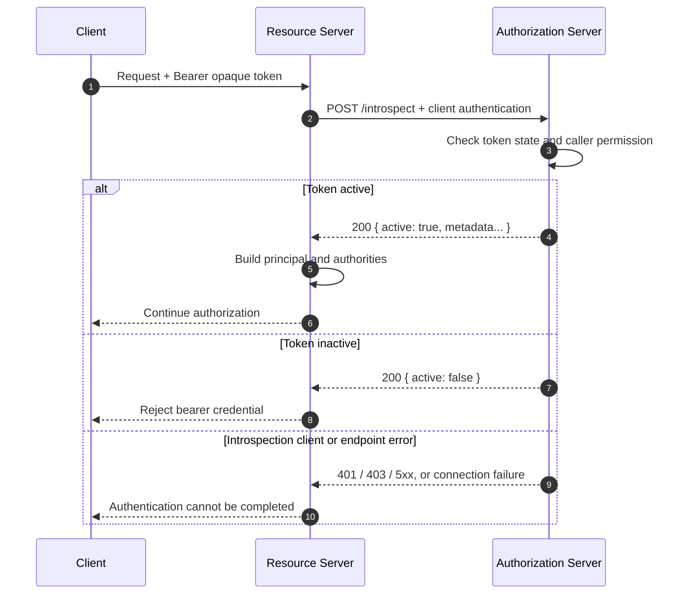

# Introspection active=false, Missing Metadata, and Credential Failures

In an OAuth 2.0 Opaque Token Resource Server, the access token is typically an opaque string that the API cannot decode and verify locally. The Resource Server sends the token to the Authorization Server via a **token introspection endpoint** and receives a response describing the token's status and any metadata the authority chooses to disclose. During integration, three scenarios must be clearly separated:

- **active=false:** the Authorization Server replied that the token is not active. This is a valid business outcome of introspection; the Resource Server must reject that credential.
- **Missing or invalid metadata:** the response violates the RFC 7662 contract or lacks a claim required by the API. This may be a malformed response, or an active token lacking information required by the API's own policy.
- **Credential/connection failures to the introspection endpoint:** the Resource Server could not verify the token due to wrong client credentials, endpoint rejection of the client, TLS/network failures, or upstream unavailability. This is not evidence that the user's token was revoked.

Lumping these cases into one generic outcome makes it hard for operations teams to distinguish an invalid token from a misconfigured Resource Server; worse, a flawed system might accidentally permit requests when token verification fails. This lesson focuses on RFC 7662 semantics, how Spring Security handles opaque tokens, how to validate metadata against your API contract, and how to test each outcome.

## 1. The Introspection Flow in a Resource Server

A Resource Server does not decode an opaque token itself. It sends the token to the configured endpoint and uses the Authorization Server's response to build an Authentication.



There are **two sets of credentials** in this flow:

1. The Bearer token sent by the caller to the Resource Server. This is the credential being verified.
2. The client credentials or client authentication mechanism the Resource Server uses to call the introspection endpoint. This is the Resource Server's own credential.

These two credentials have different subjects, purposes, and lifecycles. `active=false` describes the introspected token; `invalid_client` at the introspection endpoint usually describes the Resource Server client calling the endpoint.

## 2. active Is a Mandatory Field in RFC 7662

RFC 7662 requires the introspection response to include a boolean `active` attribute. This value indicates whether the token is active according to the Authorization Server.

```json
{
  "active": true,
  "scope": "orders.read orders.write",
  "client_id": "web-client",
  "username": "alice",
  "sub": "user-42",
  "aud": ["orders-api"],
  "iss": "https://idp.example",
  "exp": 1794758400
}
```

Fields other than `active` are metadata returned according to the Authorization Server's policy and the Resource Server's needs. A minimal response for an active token may contain only `active: true` if the contract requires nothing more.

`active` must be a boolean. Values like the string `"true"`, the number `1`, `null`, or a missing attribute are not contract-valid responses. Never rely on JSON truthiness or loose type coercion to decide whether a token is active.

## 3. active=false Is a Valid Result, Not an HTTP Error

An Authorization Server may return:

```http
HTTP/1.1 200 OK
Content-Type: application/json

{
  "active": false
}
```

This means the introspection endpoint processed the request and confirmed the token is inactive. Possible reasons include:

- The token does not exist or is unrecognized by the Authorization Server.
- The token has expired.
- The token has been revoked.
- The token is not permitted for the current resource/caller under the issuer's policy.
- The token is no longer in an acceptable state.

The Authorization Server may intentionally omit detailed reasons to avoid creating an oracle for attackers probing token states. The Resource Server should treat `active=false` as an invalid credential without guessing a specific cause from a minimal response.

Key point: **HTTP 200 describes that the introspection request succeeded; active=false describes the state of the queried token.** Never confuse HTTP success with authorization success.

## 4. How Spring Security Handles active=false

Under default opaque-token configuration, Spring Security uses `OpaqueTokenIntrospector`—typically `NimbusOpaqueTokenIntrospector`—to call the endpoint and convert the response into an `OAuth2AuthenticatedPrincipal`.

When the introspector determines a token is inactive, it rejects introspection instead of creating a principal for the request to proceed. In Spring Security, this is typically represented by `BadOpaqueTokenException`, part of the Resource Server's authentication errors.

Basic configuration example:

```yaml
spring:
  security:
    oauth2:
      resourceserver:
        opaquetoken:
          introspection-uri: https://idp.example/oauth2/introspect
          client-id: orders-resource-server
          client-secret: ${INTROSPECTION_CLIENT_SECRET}
```

Resource Server enabling opaque token support:

```java
@Bean
SecurityFilterChain apiSecurity(HttpSecurity http) throws Exception {
    return http
        .authorizeHttpRequests(auth -> auth
            .requestMatchers("/orders/**")
                .hasAuthority("SCOPE_orders.read")
            .anyRequest().authenticated())
        .oauth2ResourceServer(oauth2 -> oauth2.opaqueToken(
            Customizer.withDefaults()))
        .build();
}
```

Property names and beans are bound by Spring Boot from application configuration. Secrets must come from a secret manager or proper secrets management mechanism; never hardcode secrets into source code, images, or logs.

## 5. Distinguishing active=false from a Missing active Field

These two responses are not equivalent:

```json
{
  "active": false
}
```

```json
{
  "scope": "orders.read",
  "sub": "user-42"
}
```

The first response includes the boolean `active` and confirms the token is inactive. The second lacks the mandatory field; the client has no valid basis to conclude the token is active. It must reject the request and record a response contract error in telemetry.

Some default introspector implementations handle any response where `active` is not boolean `true` along the same inactive-token branch. Therefore, if your system needs to separate **confirmed inactive** from **malformed introspection response**, test your active implementation/version and consider an HTTP-layer adapter that validates the response contract before constructing a principal. Never infer error categories solely from exception messages that can change across versions.

## 6. Metadata Beyond active May Be Optional

RFC 7662 defines many common response attributes, but does not require every Authorization Server to return all of them in every response.

| Attribute | Typical Meaning | When a Resource Server Might Need It |
| --- | --- | --- |
| scope | Permissions granted to the token | When the API maps scopes to authorities |
| sub | Subject the token represents | Ownership, auditing, user-level authorization |
| client_id | OAuth client issued the token | Client policy, workload classification |
| username | Username per issuer | Display/auditing when permitted by contract |
| aud | Resource/audience the token targets | Separating tokens across multiple APIs |
| iss | Issuer | Trust namespace or multi-issuer policy |
| exp | Expiration timestamp | Acceptance deadline, cache policy |
| iat | Issuance timestamp | Auditing or token-age policy |
| nbf | Not-before timestamp | Time validation if required by contract |
| jti | Token identifier | Correlation/revocation per issuer contract |
| token_type | Token type | Distinguishing token profiles if provided by issuer |

`active=true` does not guarantee the API has all metadata required by business logic. Conversely, an absent claim does not prove the token is inactive under the RFC. Separate **protocol-required fields** from **application-required fields**.

## 7. What If sub, scope, or aud Is Missing?

Decide according to the API contract:

- If an endpoint accepts only service tokens and uses client identity as the principal, a missing `sub` can be acceptable if `client_id` is mandatory and validated.
- If the API enforces user ownership, a stable subject is required. Without a valid subject, ownership cannot be safely determined.
- If an endpoint requires `orders.read`, lacking that scope means the caller lacks authority for the operation.
- If the Resource Server must bind tokens to `orders-api`, missing audience under the internal profile must be rejected.
- If multi-issuer identities are supported, missing `issuer` or an equivalent trust namespace makes subject disambiguation unsafe.
- If caching relies on expiry, missing `exp` prevents calculating a safe TTL deadline.

Never backfill default values such as `admin`, `orders.read`, a default tenant, or a dummy subject. Defaults can turn missing metadata into unintended privilege grants.

## 8. Distinguishing Absent, Empty, and Wrong-Type Metadata

These three responses must be handled per contract:

```json
{ "active": true }
```

```json
{ "active": true, "scope": "" }
```

```json
{ "active": true, "scope": 42 }
```

- **Absent:** the claim is omitted from the response.
- **Empty:** the claim is present but holds no useful value.
- **Wrong type:** the claim violates the contract's expected data type.

If `scope` is optional metadata, absent/empty may mean the token was granted no scopes and therefore receives no scope authorities. If the API requires a specific scope, the token must be denied authorization. If `scope` has the wrong type, the response violates the contract and should be treated as malformed per policy.

Never coerce arbitrary claims to String via `toString()`. Turning the number `42` into `"42"` does not make it a valid scope.

## 9. Scopes and Authorities in Spring Security

The opaque token introspector converts scopes into authorities via a converter. Under default configuration, scopes are mapped to authorities prefixed with `SCOPE_`.

Example:

```json
{
  "active": true,
  "scope": "orders.read orders.write",
  "sub": "user-42"
}
```

Resulting authorities look like:

```text
SCOPE_orders.read
SCOPE_orders.write
```

When `scope` is absent, the Resource Server must not grant any default authority. The request may be authenticated yet lack sufficient permission, resulting in authorization denial.

Example:

```java
.authorizeHttpRequests(auth -> auth
    .requestMatchers(HttpMethod.GET, "/orders/**")
        .hasAuthority("SCOPE_orders.read")
    .requestMatchers(HttpMethod.POST, "/orders/**")
        .hasAuthority("SCOPE_orders.write")
    .anyRequest().denyAll())
```

Never confuse "active token" with "authorized token." `active=true` answers whether the token is still accepted by the issuer; scopes/authorities and domain policies answer whether the caller may perform a specific operation.

## 10. Missing or Wrong Audience

When an API landscape has multiple resource servers, audience prevents tokens issued for API A from being used on API B. However, `aud` is not a mandatory attribute in every introspection response across all profiles.

Example response:

```json
{
  "active": true,
  "scope": "orders.read",
  "sub": "user-42",
  "aud": ["billing-api"]
}
```

If the current endpoint belongs to `orders-api`, this token violates Orders API's audience policy. Even though `active=true`, the API must reject it.

If `aud` is absent, consult the token profile and issuer contract. If the profile mandates audience, an absent `aud` is invalid under API policy. If the system uses a dedicated introspection endpoint per resource and the issuer follows a different contract, there may be an equivalent resource-binding guarantee; document and test it explicitly. Never strip audience validation just to make integration tests pass.

## 11. Principal Name and Subject Need a Clear Contract

`OAuth2AuthenticatedPrincipal` exposes a principal name and an attribute map from the introspection response. Applications should not assume `getName()` always equals the `sub` claim across all introspectors, converters, or token profiles.

If ownership relies on subject, define an explicit identity resolver:

```java
public record ExternalIdentity(String issuer, String subject) {
}

public ExternalIdentity identityOf(
        OAuth2AuthenticatedPrincipal principal) {

    String issuer = principal.getAttribute("iss");
    String subject = principal.getAttribute("sub");

    if (issuer == null || issuer.isBlank()
            || subject == null || subject.isBlank()) {
        throw new BadOpaqueTokenException(
            "Required subject identity metadata is missing");
    }

    return new ExternalIdentity(issuer, subject);
}
```

This example applies to an API whose contract mandates both issuer and subject. If a dedicated introspection endpoint already binds to a fixed issuer, the application can use the verified configured issuer instead of the `iss` claim, while preserving a namespace in the identity model. Never use email or username as a stable subject unless the issuer guarantees stability and uniqueness.

## 12. Writing Custom Post-Introspection Metadata Validation

When a response is active yet lacks claims required by the application, wrap an introspector that has already verified the token:

```java
import java.util.Collection;

import org.springframework.security.oauth2.core.OAuth2AuthenticatedPrincipal;
import org.springframework.security.oauth2.server.resource.introspection.BadOpaqueTokenException;
import org.springframework.security.oauth2.server.resource.introspection.OpaqueTokenIntrospector;

public final class RequiredMetadataIntrospector
        implements OpaqueTokenIntrospector {

    private final OpaqueTokenIntrospector delegate;
    private final String requiredAudience;

    public RequiredMetadataIntrospector(
            OpaqueTokenIntrospector delegate,
            String requiredAudience) {
        this.delegate = delegate;
        this.requiredAudience = requiredAudience;
    }

    @Override
    public OAuth2AuthenticatedPrincipal introspect(String token) {
        OAuth2AuthenticatedPrincipal principal =
            this.delegate.introspect(token);

        Object subject = principal.getAttribute("sub");
        if (!(subject instanceof String value) || value.isBlank()) {
            throw new BadOpaqueTokenException(
                "Required subject metadata is missing");
        }

        Object audience = principal.getAttribute("aud");
        if (!containsAudience(audience, this.requiredAudience)) {
            throw new BadOpaqueTokenException(
                "Required audience metadata is missing or invalid");
        }

        boolean hasReadScope = principal.getAuthorities().stream()
            .anyMatch(authority ->
                authority.getAuthority().equals("SCOPE_orders.read"));

        if (!hasReadScope) {
            throw new BadOpaqueTokenException(
                "Required scope is missing");
        }

        return principal;
    }

    private boolean containsAudience(Object value, String expected) {
        if (value instanceof String audience) {
            return expected.equals(audience);
        }
        if (value instanceof Collection<?> audiences) {
            return audiences.contains(expected);
        }
        return false;
    }
}
```

This decorator illustrates a contract requiring `sub`, `aud`, and `orders.read`. If the application accepts service tokens lacking a user subject, define a separate policy branch keyed on `client_id`; never force every token to carry the same principal shape.

Critically, the delegate must introspect first. If the delegate returns `active=false` or encounters an endpoint error, its exception is preserved and metadata validation does not run. A decorator must never turn a delegate failure into a default principal.

## 13. Registering a Custom OpaqueTokenIntrospector

You can expose a bean wrapping the Nimbus introspector as a delegate:

```java
import org.springframework.beans.factory.annotation.Value;
import org.springframework.context.annotation.Bean;
import org.springframework.context.annotation.Configuration;
import org.springframework.security.oauth2.server.resource.introspection.NimbusOpaqueTokenIntrospector;
import org.springframework.security.oauth2.server.resource.introspection.OpaqueTokenIntrospector;

@Configuration
class OpaqueTokenConfiguration {

    @Bean
    OpaqueTokenIntrospector opaqueTokenIntrospector(
            @Value("${oauth2.introspection-uri}") String uri,
            @Value("${oauth2.introspection-client-id}") String clientId,
            @Value("${oauth2.introspection-client-secret}") String clientSecret) {

        OpaqueTokenIntrospector delegate =
            new NimbusOpaqueTokenIntrospector(uri, clientId, clientSecret);

        return new RequiredMetadataIntrospector(
            delegate, "orders-api");
    }
}
```

Property names depend on the application. You can use `spring.security.oauth2.resourceserver.opaquetoken.*` for Spring Boot's auto-configured introspector, or define a custom bean when custom behavior is needed. Never configure two different introspectors leaving it ambiguous which bean `SecurityFilterChain` picks up.

If you need a custom HTTP client, timeouts, TLS, proxies, or separation between malformed responses and `active=false`, configure `RestOperations` on `NimbusOpaqueTokenIntrospector` or implement a custom HTTP adapter. Ensure the adapter validates the response contract before creating `OAuth2AuthenticatedPrincipal`.

## 14. Introspection Endpoint Client Credentials Are a Separate Credential

The Resource Server typically authenticates to the introspection endpoint using a client ID/secret or another client authentication method supported by the Authorization Server.

Configuration example:

```yaml
spring:
  security:
    oauth2:
      resourceserver:
        opaquetoken:
          introspection-uri: https://idp.example/oauth2/introspect
          client-id: orders-resource-server
          client-secret: ${INTROSPECTION_CLIENT_SECRET}
```

If the client ID/secret is wrong, the endpoint may return 401 Unauthorized or 403 Forbidden, depending on the Authorization Server. This is a **Resource Server** configuration or credential error, not an `active=false` outcome for the caller's token.

Never handle this error by creating an anonymous principal, assigning a default scope, or letting the request continue. The Resource Server has no evidence to authenticate the token.

## 15. Classifying Credential and Trust Failures

There are at least four credential/trust boundaries to consider:

| Layer | Credential or Trust | Example Failure | Meaning |
| --- | --- | --- | --- |
| Caller → Resource Server | Bearer access token | Token inactive/expired | Caller credential rejected |
| Resource Server → Introspection | Client ID/secret or private-key JWT | invalid_client | Resource Server is not authorized to call introspection |
| Resource Server → Introspection | TLS server trust/client certificate | Certificate invalid | Cannot establish a trusted connection |
| Introspection response → Resource Server | Response contract | Missing active, malformed JSON | No valid introspection result |
| Resource Server → Domain API | Service/network identity | Downstream mTLS/auth failure | Failure in downstream call, not introspection |

Exact error names and HTTP statuses depend on the Authorization Server, reverse proxies, and TLS termination. Inspect upstream response bodies/traces in controlled operational tooling; never return client secret details or internal configuration to callers.

## 16. Distinguishing invalid_token, invalid_client, and insufficient_scope

These three terms describe three distinct problems:

- **invalid_token:** the Bearer credential sent to the resource server was rejected (for example, inactive or expired).
- **invalid_client:** the client calling the Authorization Server/introspection endpoint failed authentication or lacks permission.
- **insufficient_scope:** the token was accepted, but lacks the privileges required for the resource/operation.

Under Bearer Token Usage, responses are typically separated as:

| State | API Meaning | Typical HTTP Status |
| --- | --- | --- |
| Missing/invalid bearer token | Authentication failed | 401 |
| Valid token, missing scope | Authentication succeeded, authorization failed | 403 |
| Invalid introspection client | Resource Server could not verify token due to upstream credential error | Must be classified operationally as a dependency/configuration failure |

Never convert `invalid_client` into `invalid_token` in internal telemetry. Even if the default authentication entry point maps everything to 401 at the HTTP boundary, internal logs/metrics must preserve the exception category so operations spots client configuration incidents. If the product requires returning 503 for dependency outages, implement explicit custom error handling without leaking upstream details.

## 17. Introspection Endpoint Returns 401 or 403

When the introspection endpoint returns 401/403, check in order:

1. Is the Resource Server sending the right client ID?
2. Is the secret for the right environment and still valid?
3. Does the client authentication method match the registration at the Authorization Server?
4. Is the client permitted to introspect tokens of this type/resource?
5. Was the token endpoint accidentally configured instead of the introspection endpoint?
6. Is a reverse proxy/gateway stripping or rewriting the Authorization header?
7. Are clocks, TLS trust, and endpoint hostnames accurate?
8. Did client secret rotation occur while pods still hold the old secret?

Do not instruct end users to log in again as the sole response. If every token fails immediately after a deployment, the root cause is likely Resource Server credentials or upstream configuration.

## 18. Introspection Endpoint Returns 5xx, Times Out, or Is Unreachable

These conditions indicate the Resource Server received no trustworthy result:

- HTTP 500/502/503/504.
- Connection refused/reset.
- DNS resolution failure.
- TLS handshake/certificate validation failure.
- Read timeout or connection timeout.
- Truncated or unparseable response body.
- Rate limiting or throttling such as 429.

**Never fail open.** When a token cannot be verified, never grant an Authentication or authorities by guesswork. Reject the request and emit operational signals.

If the API has a custom availability contract, it can return 503 on dependency outages. Under the default Resource Server entry point, exceptions may map to an authentication failure response; do not assume every introspector exception automatically becomes 503. Verify exception translation and HTTP behavior on your deployed version.

## 19. Never Use active=false to Represent Upstream Errors

An anti-pattern is catching all exceptions and returning a principal with default rights, or conversely treating every exception as an inactive token:

```java
// Wrong: an introspection error is turned into a valid principal.
try {
    return delegate.introspect(token);
} catch (Exception ex) {
    return defaultPrincipalWithAdminAuthority();
}
```

An equally wrong variant:

```java
// Wrong: every upstream error is cached as an inactive token.
try {
    return delegate.introspect(token);
} catch (Exception ex) {
    negativeCache.put(tokenFingerprint(token), INACTIVE);
    throw new BadOpaqueTokenException("Inactive");
}
```

Proper handling:

- Reserve `BadOpaqueTokenException` for confirmed unacceptable tokens.
- Keep introspection/dependency exceptions separate to classify endpoint unavailability or client configuration failures.
- Never cache dependency errors as either positive or negative token states.
- Never grant default authorities when metadata is missing.
- Log a safe reason code and correlation/trace ID, never the raw token.

## 20. Malformed Responses and JSON Parser Errors

Malformed responses can include:

- Unparseable JSON.
- Empty or truncated body.
- JSON root is not an object per contract.
- `active` is not a boolean.
- A claim has an unsupported type.
- HTTP 200 whose body is an HTML error/login page from a reverse proxy.
- Content-Type or charset violating the contract.

This is a protocol-boundary failure. Never interpret an HTML error page as an inactive token; likewise, never infer active merely from HTTP 200. The adapter should validate HTTP status, content type, JSON parsing, mandatory `active`, and field types before building a principal.

Valid JSON with `active=true` that lacks an application-required claim is a distinct case: the protocol response may be valid, while the API rejects it under its own metadata policy.

## 21. Optional Metadata That Authorization Still Requires

Suppose an introspection response contains only:

```json
{
  "active": true
}
```

At the protocol level, `active` suffices to say the token is active. Yet if the API requires `orders.read`, `sub`, `aud`, and `tenant`, it cannot perform authorization as expected. Three design options exist:

1. Update the Authorization Server to return the agreed metadata for this client/resource.
2. Use a dedicated introspection client/profile with a richer response contract.
3. Reject the token at the Resource Server when mandatory metadata is missing.

Do not automatically call the UserInfo endpoint on every request to "fill in" metadata without designing caching, subject binding, latency budgets, and trust relationships. UserInfo and introspection are distinct protocol endpoints with different semantics.

## 22. Which Metadata Can an Introspection Client See?

The Authorization Server can scope returned metadata based on the calling introspection client/resource. Two introspection clients querying the same token can receive different responses if issuer policy allows it.

Example:

```text
resource server A:
  active
  scope
  sub
  aud = orders-api

resource server B:
  active
  scope
  client_id
  aud = billing-api
```

This can be intentional design: each resource receives only the data it needs. When a claim is missing, check the **introspection client, resource binding, and issuer policy** before assuming the Authorization Server is broken.

Never use one introspection client's response to authorize calls to a different resource. If caching introspection results, namespace cache keys by authority/client/resource profile.

## 23. Never Assume active=true Grants Access to Every Endpoint

Even when a token is active, the following still apply:

1. The token belongs to an issuer trusted by the Resource Server.
2. Audience/resource binding matches the current API.
3. Scope/authorities are sufficient for the operation.
4. Subject/client identity is valid for the caller type.
5. Tenant membership is valid.
6. Object ownership/ACL permits access.
7. Token profile and client policies are satisfied.

For example, an active token holding only `orders.read` must not be allowed to call `POST /orders`, which requires `orders.write`. Authentication and authorization are two separate steps.

## 24. HTTP Responses and Exception Translation

A Resource Server can encounter:

- Inactive token: authentication fails, typically returning 401 with a Bearer challenge containing `invalid_token`.
- Active token lacking authority on a route/method rule: returns 403.
- Wrong introspection client credentials or unreachable endpoint: the framework may route this through the authentication failure path; if HTTP 503 is required for dependency outages, configure explicit error mapping.

Never expose details such as `client_secret_invalid`, internal introspection URIs, or raw IdP response bodies in HTTP responses to callers. Keep public responses stable; retain categories and correlation context in internal logs for investigation.

## 25. Testing with a Simulated Introspection Endpoint

Integration tests should run the Resource Server against a local/mock introspection server capable of returning scenario-specific responses. This verifies real HTTP requests, Basic/client authentication, JSON responses, timeouts, and exception mapping.

Endpoint fixture example:

```text
POST /oauth2/introspect
Authorization: Basic <test-client-credentials>
Content-Type: application/x-www-form-urlencoded

token=opaque-token-value
```

In tests, never use production secrets. Use dummy client credentials and verify the endpoint receives the expected form request, HTTP method, and client authentication. Avoid printing request bodies containing tokens in test logs outside controlled debugging.

## 26. Testing active=true with Full Metadata

Mocked response:

```json
{
  "active": true,
  "scope": "orders.read",
  "sub": "user-42",
  "aud": ["orders-api"],
  "iss": "https://idp.test"
}
```

Expected:

- Introspection request is sent.
- Resource Server creates an Authentication.
- Principal holds the subject per contract.
- Scope maps to `SCOPE_orders.read`.
- Endpoint requiring `orders.read` succeeds if domain policy also passes.
- Logs contain no raw tokens or client secrets.

This is the happy path, but it does not prove the system handles negative paths safely.

## 27. Testing active=false

Response:

```json
{
  "active": false
}
```

Expected:

- Introspection endpoint returns HTTP 200.
- Resource Server creates no valid Authentication for the caller.
- Protected methods/controllers do not execute.
- HTTP boundary returns an authentication failure per contract (typically 401).
- No fallback to a JWT decoder or an authorized anonymous principal.
- Metrics record an invalid/inactive token without using the raw token as a label.

Do not require the introspection endpoint to return `sub`, `scope`, or a revocation reason on inactive responses; the issuer may intentionally withhold them.

## 28. Testing Missing active, Wrong-Type active, and Malformed Bodies

Create separate responses:

```json
{}
```

```json
{
  "active": "true"
}
```

```text
not-json
```

Expected:

- None of these cases creates a valid Authentication.
- Contract violations are distinguished in the test adapter if the implementation separates them.
- Do not classify them as confirmed revoked tokens if telemetry needs to detect malformed responses.
- Do not retry a contract-violating response indefinitely.
- Alerts/metrics exist if malformed responses occur in volume.

If using the default `NimbusOpaqueTokenIntrospector`, verify the exact behavior of your current version: missing/wrong-type `active` responses may be treated as inactive because it checks for boolean `true`. If you need separate malformed classification, build a contract-aware adapter and test it directly.

## 29. Testing Missing Application-Required Metadata

Example active response lacking `sub`:

```json
{
  "active": true,
  "scope": "orders.read",
  "aud": ["orders-api"]
}
```

Or holding subject yet missing audience:

```json
{
  "active": true,
  "scope": "orders.read",
  "sub": "user-42"
}
```

Expected outcome depends on the contract:
- If the API mandates subject and audience, reject the token.
- If a client token lacks a user subject but carries an authorized client identity, evaluate under a dedicated service-token policy.
- If scope is missing, the authenticated principal lacks required authority; deny the request.
- Never synthesize default claims just to make tests pass.

Tests should assert the exact exception category designed for the adapter/policy rather than asserting a generic exception for everything.

## 30. Testing invalid_client at the Introspection Endpoint

Mock endpoint returns:

```http
HTTP/1.1 401 Unauthorized
Content-Type: application/json

{
  "error": "invalid_client"
}
```

Expected:

- Resource Server creates no Authentication.
- Telemetry records an introspection client authentication/configuration failure.
- Raw client secrets and Authorization headers are not logged.
- Caller token is not recorded as `active=false`.
- Users are not told to change passwords or refresh tokens as if user credentials were definitely wrong.

Add a 403 test if your Authorization Server returns 403 when a client is unauthorized to introspect. Verify your IdP's actual status/error contract.

## 31. Testing Timeouts and Upstream 5xx

These tests simulate slow or failing endpoints:

| Scenario | Expected |
| --- | --- |
| Connection timeout | No Authentication; error category is timeout |
| Read timeout | No Authentication; token is not treated as inactive |
| HTTP 500 | Dependency failure |
| HTTP 503 | Dependency unavailable |
| HTTP 429 | Rate limit; respect retry policy |
| DNS/TLS failure | Cannot verify issuer endpoint |
| Truncated body | Response parse/transport failure |

Never retry indefinitely. Retries must cap attempts, use backoff with jitter, obey a request deadline, and apply only to appropriate transient errors. Never retry 401/403 `invalid_client` as a network glitch.

## 32. Testing Missing and Wrong Scopes

Active response with no scope:

```json
{
  "active": true,
  "sub": "user-42",
  "aud": ["orders-api"]
}
```

Expected: Authentication may be built per contract, yet a request requiring `SCOPE_orders.read` is denied. HTTP typically returns 403 because the token authenticated but lacks authority.

Response with a different scope:

```json
{
  "active": true,
  "scope": "profile.read",
  "sub": "user-42",
  "aud": ["orders-api"]
}
```

Same outcome on orders endpoints. Never map `profile.read` to `orders.read` just to make a test pass.

## 33. Testing That the Introspection Client Sends Proper Credentials

In simulated endpoint tests, verify:

- HTTP method is POST per endpoint contract.
- Token is sent in the `token` form parameter per configured profile.
- Client authentication uses the configured method (e.g., HTTP Basic when configured for Basic).
- No client secret appears in URLs or query strings.
- TLS is enforced in real environments.
- The client never sends credentials to non-allowlisted hosts.
- Redirects never leak Authorization headers to other hosts.

Checking merely that a header exists is insufficient; verify the client identity and form body against configuration.

## 34. Verifying Business Logic Does Not Run When Introspection Fails

To prove fail-closed behavior, use a service or repository spy/mock:

```java
@Test
void inactiveTokenNeverReachesProtectedBusinessOperation() throws Exception {
    mockIntrospectionResponse("""
        {"active": false}
        """);

    mvc.perform(get("/orders")
            .header("Authorization", "Bearer opaque-token"))
        .andExpect(status().isUnauthorized());

    verify(orderService, never()).listOrders();
}
```

This is an illustrative structure. The test context must enable the real Resource Server filter chain and point the introspection URI to the mock endpoint. Never use the `jwt()` post-processor in this test, as it bypasses introspection.

For HTTP 401/403 mapping, rely on your application's actual exception translation. The primary goal is ensuring protected business methods never execute for unverified tokens.

## 35. Unit Testing the Metadata Validator

The metadata decorator can be tested standalone with a fake delegate returning a principal:

```java
import java.util.List;
import java.util.Map;

import org.junit.jupiter.api.Test;
import org.springframework.security.core.authority.SimpleGrantedAuthority;
import org.springframework.security.oauth2.core.DefaultOAuth2AuthenticatedPrincipal;
import org.springframework.security.oauth2.core.OAuth2AuthenticatedPrincipal;
import org.springframework.security.oauth2.server.resource.introspection.BadOpaqueTokenException;
import org.springframework.security.oauth2.server.resource.introspection.OpaqueTokenIntrospector;

class RequiredMetadataIntrospectorTest {

    @Test
    void rejectsPrincipalWithoutSubject() {
        OpaqueTokenIntrospector delegate = token ->
            new DefaultOAuth2AuthenticatedPrincipal(
                "unknown",
                Map.of("active", true, "aud", List.of("orders-api")),
                List.of(new SimpleGrantedAuthority("SCOPE_orders.read")));

        OpaqueTokenIntrospector introspector =
            new RequiredMetadataIntrospector(delegate, "orders-api");

        assertThatThrownBy(() -> introspector.introspect("opaque-token"))
            .isInstanceOf(BadOpaqueTokenException.class);
    }
}
```

This example requires imports and fixtures matching your Spring Security version. Unit tests verify metadata policy; they do not test HTTP calls, client credentials, or Nimbus introspector JSON parsing. Those parts require separate integration tests.

## 36. Testing Separation Between Inactive Tokens and Upstream Errors

Write tests using the same token value while the endpoint returns different responses:

| Mock Introspection Response | Expected Internal Category | Principal |
| --- | --- | --- |
| 200 + active:false | Inactive/bad bearer token | Not created |
| 401 + invalid_client | Introspection client auth failure | Not created |
| 503 | Dependency unavailable | Not created |
| 200 + missing active | Malformed response/implementation-specific inactive branch | Not created |
| 200 + active:true, missing required sub | Application metadata validation failure | Not created |
| 200 + active:true, missing required scope | Authorization denied or token-profile failure per contract | Scope not granted |

Do not assert only that every test throws `AuthenticationException`. Assert the specific error class at the introspector/adapter layer while verifying the HTTP boundary blocks the request.

## 37. Logging and Metrics Without Exposing Tokens

Never log:

- Raw opaque tokens.
- Authorization headers or Basic credentials.
- Client secrets/private keys.
- Full introspection responses if they contain PII.
- Subjects/emails as unbounded-cardinality metric labels.

Safe to log:

```json
{
  "event": "opaque_token_introspection_failed",
  "issuer_alias": "internal-idp",
  "resource_server": "orders-api",
  "reason": "invalid_client",
  "http_status": 401,
  "correlation_id": "request-correlation-id"
}
```

Use an enum/allowlisted reason such as `inactive`, `client_authentication`, `timeout`, `upstream_5xx`, `malformed_response`, `required_metadata_missing`. Never expose raw HTTP client exception messages to callers; messages can contain URLs, headers, or configuration details.

Metrics should use bounded labels: `issuer_alias`, `resource_server`, `outcome`, `reason`, `http_status_class`. Never use token values, `sub`, email, `jti`, or arbitrary raw URLs as metric labels.

## 38. Retries, Circuit Breakers, and Availability

Introspection is a network dependency on the authentication path. Configure:

- Short connect timeouts and read timeouts fitting your latency budget.
- Bounded connection pools.
- Bounded retries for transient timeouts/429/5xx where appropriate.
- No retries on `invalid_client`, malformed responses, or confirmed inactive tokens.
- Circuit breakers/bulkheads if used, with **fail-closed** fallback.
- Alerts on abnormal spikes in error rates or latency.

An open circuit breaker does not make a token active or inactive; it simply indicates the dependency cannot currently serve requests. If the API should return 503 instead of 401 in that case, define and test custom error mapping. Never fall back to a default principal when a circuit opens.

## 39. Introspection Caching Must Preserve Semantics

When caching introspection results:

- Cache positive results only after `active` and the metadata contract pass validation.
- Bound positive TTL by `exp` if that claim is part of the contract.
- Namespace cache keys by introspection authority/client/resource profile.
- Never cache timeouts, 429, 5xx, TLS, or client-auth errors as inactive.
- Cache negative results only for confirmed inactive tokens, with short TTLs aligned to revocation SLOs.
- Missing metadata must never turn into a cached positive result.
- Token fingerprints must avoid storing raw bearer tokens in cache keys or logs.

Positive caching can keep a revoked token accepted until TTL expires. Tests checking `active=false` right after revocation must account for cache hits/stale windows when caching is enabled.

## 40. Integration Checklist for an Introspection Client

Before going to production, verify:

1. Introspection URI is exact and belongs to a trusted issuer.
2. Client ID and authentication method are registered with the Authorization Server.
3. Secrets/certificates/private keys are managed and rotated.
4. TLS certificate and hostname validation are active.
5. Request method and form body follow the endpoint contract.
6. Response `active` is properly typed as a boolean.
7. Optional vs. required metadata is documented.
8. Scope mapping and audience policies match the resource.
9. Subject identity carries an explicit issuer namespace.
10. Timeouts, retries, rate limits, and circuit breakers are bounded.
11. Error categories are preserved in telemetry.
12. Raw tokens, secrets, and PII are redacted.
13. Negative tests prove fail-closed behavior.
14. Multi-pod configuration/secret rotation stays synchronized.

These are integration configuration and operational checks; they do not replace your application's threat model or authorization policies.

## 41. Runbook When All Opaque Tokens Are Suddenly Rejected

If all opaque token requests start failing simultaneously:

1. Check the latest deployment/config change to the introspection URI.
2. Verify client ID, secret version, and client authentication method.
3. Check whether the introspection endpoint is returning 401/403, 429, or 5xx.
4. Check TLS trust, DNS, proxies, firewalls, and network routes.
5. Inspect response body/Content-Type and `active` field type.
6. Check whether the Authorization Server changed its policy or metadata contract.
7. Check clock skew and token expiry if only a subset of tokens fails.
8. Check for stale caches or wrong cache namespaces if pods behave inconsistently.
9. Compare error categories and issuer aliases across instances.
10. Restore verified credentials/configuration, then test active, inactive, and endpoint-error paths.

Do not ask end users to reset passwords en masse before determining whether the failure lies in bearer tokens or the introspection client.

## 42. Runbook When Only Some Tokens Are Rejected

If only a subset of tokens fails:

1. Check whether the Authorization Server is returning `active=false`.
2. Check whether tokens expired, were revoked, or belong to another client/grant.
3. Check whether the introspection client is authorized to introspect those tokens.
4. Compare `scope`, `aud`, `sub`, `iss`, and token profile against the contract.
5. Inspect the application-required metadata validator.
6. Check tenant membership/ACLs if authentication succeeded yet authorization failed.
7. Distinguish 401 from invalid credentials from 403 from insufficient scope/domain policy.
8. Never log raw tokens while gathering evidence.

If `active` is `true` while scope is missing, the token authenticated but lacked privileges. If `active` is `false`, that is the Authorization Server's status verdict on the token.

## 43. Common Design Mistakes

| Mistake | Consequence | Fix |
| --- | --- | --- |
| Treating HTTP 200 as active | `active:false` tokens get accepted | Check boolean `active` |
| Treating `active:false` as endpoint outage | Wrong telemetry and pointless retries | Classify inactive results separately |
| Defaulting missing `active` to true | Fails open | Reject malformed responses |
| Treating `invalid_client` as a bad user token | Misdirected caller investigation | Classify introspection client credentials separately |
| Catching all exceptions and building a principal | Bypasses authentication | Fail closed |
| Treating optional metadata as always required | Rejects contract-valid tokens | Separate RFC fields from app-required claims |
| Granting a default authority when scope is missing | Privilege escalation | Never grant default privileges |
| Comparing only `sub` | Subject collisions across issuers | Namespace identities by issuer |
| Logging raw tokens to debug | Credential leak | Redact and use correlation IDs |
| Caching timeouts as inactive | Prolonged false rejections | Never cache dependency errors |
| Caching `active` indefinitely | Revoked tokens remain usable | Enforce TTL, expiry caps, and invalidation |
| Retrying 401 `invalid_client` endlessly | Amplifies load and masks config bugs | Never retry permanent auth failures |

## 44. References

- [RFC 7662 — OAuth 2.0 Token Introspection](https://www.rfc-editor.org/rfc/rfc7662.html): request/response protocol, `active` attribute, and metadata.
- [RFC 6750 — OAuth 2.0 Bearer Token Usage](https://www.rfc-editor.org/rfc/rfc6750.html): `invalid_token`, `insufficient_scope`, and HTTP error semantics.
- [Spring Security 6.5 — Opaque Token Resource Server](https://docs.spring.io/spring-security/reference/6.5/servlet/oauth2/resource-server/opaque-token.html): opaque token configuration, introspection, and principals.
- [Spring Security API — NimbusOpaqueTokenIntrospector](https://docs.spring.io/spring-security/site/docs/6.5.x/api/org/springframework/security/oauth2/server/resource/introspection/NimbusOpaqueTokenIntrospector.html): default introspector and HTTP client configuration.
- [Spring Security API — OpaqueTokenIntrospector](https://docs.spring.io/spring-security/site/docs/6.5.x/api/org/springframework/security/oauth2/server/resource/introspection/OpaqueTokenIntrospector.html): introspection interface to wrap or replace.
- [Spring Security API — BadOpaqueTokenException](https://docs.spring.io/spring-security/site/docs/6.5.x/api/org/springframework/security/oauth2/server/resource/introspection/BadOpaqueTokenException.html): exception for rejected opaque tokens.

## 45. Conclusion

`active=false` is a valid response telling you the Authorization Server does not accept the token at introspection time. Responses missing `active` or using the wrong type provide no proof the token is active and must be rejected. Metadata fields such as `sub`, `scope`, `aud`, `iss`, and `exp` may be optional under the RFC, yet each API must specify which claims are mandatory for its own token profile and authorization policies.

`invalid_client`, TLS, timeout, 429, or 5xx errors happen on the Resource Server's path to the introspection endpoint. They mean the Resource Server could not verify the bearer token; they must never be turned into a valid principal or arbitrarily recorded as confirmed inactive. Keep error categories distinct, fail closed, redact logs, and test against a simulated endpoint to verify behavior.

**Core takeaway:** *Create an Authentication only after introspection confirms `active=true` and all mandatory metadata of your resource contract passes validation. Whenever the introspection client or endpoint fails, there is no basis to let the request proceed.*
