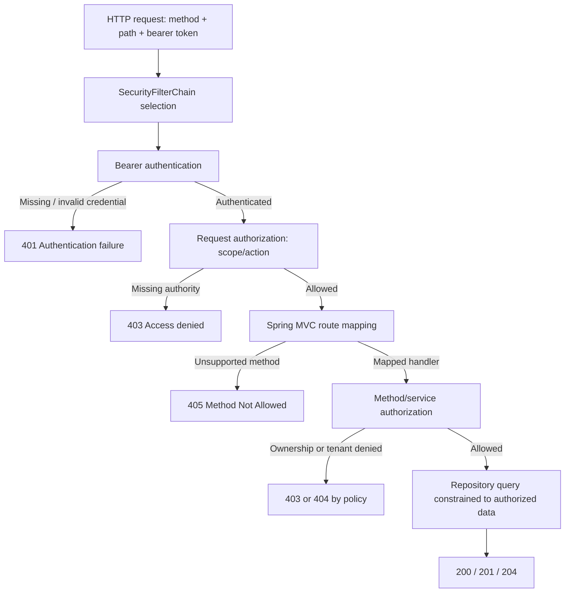

# Authentication, Scope, Ownership, and HTTP Method Matrix

An endpoint on a Spring Security OAuth 2.0 Resource Server can receive requests in many states: no token, an invalid token, a valid token lacking scope, a token with scope where the user does not own the data, or a request using an unauthorized HTTP method. Testing only one happy path and one 401 still lets many authorization bugs slip through.

A systematic approach builds a test matrix across four axes:

1. **Authentication:** Is a Bearer token present and valid?
2. **Scope/action authorization:** Does the authenticated principal hold permission for the requested action?
3. **Ownership/tenant:** Does the principal have access to the specific object and tenant requested?
4. **HTTP method/route:** Are the request method and path supported by the API, and does that method enforce the right policy?

These four axes test distinct boundaries. Invalid tokens typically yield **401**; valid tokens missing scope typically yield **403**; out-of-scope objects may return **403 or 404** per information-disclosure policy; unsupported controller methods typically yield **405**, though security matchers may reject the request before Spring MVC ever resolves a route.

This lesson constructs a test matrix for a Spring Security Servlet Resource Server using request matchers, method security, ownership checks in services/repositories, and MockMvc. The same principles apply to WebFlux with WebTestClient and reactive method security.

> **Principle:** Authenticate the principal once at the security boundary, validate scope for the action, and enforce permissions on the specific object/tenant. Never treat a broad scope as proof that a user owns every object, and never rely on HTTP method alone for authorization.

## 1. Four Decision Layers for a Request

A request to Orders API can traverse these layers:



Exact ordering can shift when applications add filters, exception handlers, or custom authorization managers, yet these responsibilities must stay separated:

| Layer | Question | Example Decision |
|---|---|---|
| Chain selection | Which security chain owns the request? | API chain uses JWT |
| Authentication | Is the token trustworthy? | 401 if signature/issuer/expiry fails |
| Request authorization | May the principal invoke this action? | 403 if `orders.write` is missing |
| Route mapping | Does a controller support this method/path? | 405 or 404 |
| Object authorization | Does the principal have access to this specific order? | 403 or 404 |
| Data access | Is the query constrained by tenant/owner? | Return only permitted records |

Never collapse every failure into "token invalid." A user can hold a completely valid token and still be barred from reading someone else's order.

## 2. Defining the Token Contract and Authority Mapping

Suppose Orders API trusts the configured issuer and audience, and access tokens look like:

```json
{
  "iss": "https://issuer.test",
  "sub": "user-123",
  "aud": ["orders-api"],
  "scope": "orders.read orders.write",
  "tenant_id": "shop-a",
  "exp": 1900000000
}
```

Spring Security typically maps the `scope` claim into authorities prefixed with `SCOPE_`:

| Scope Claim | GrantedAuthority |
|---|---|
| orders.read | SCOPE_orders.read |
| orders.write | SCOPE_orders.write |
| orders.cancel | SCOPE_orders.cancel |

When a rule requires the exact authority `SCOPE_orders.read`, it checks that exact string. If `hasRole("ADMIN")` is used, Spring checks `ROLE_ADMIN`; that is a different convention from OAuth scopes.

### 2.1. Do Not Confuse Scope with Ownership

A token carrying `orders.read` allows the user to call order-reading functionality, but does not mean the user may read every order in the system.

```text
user-123:
  scope = orders.read
  tenant = shop-a

order-42:
  tenant = shop-a
  owner = user-456
```

Scope suffices to invoke the GET endpoint, yet object policy can still deny access because `order-42` belongs to `user-456`. If the system defines an admin role permitted to read all orders in a tenant, express that rule explicitly in policy.

### 2.2. A Tenant Claim Does Not Prove Current Membership

If a token carries `tenant_id=shop-a`, the API must check whether the issuer is trusted, whether the claim sits in a valid audience/profile, and whether policy accepts a membership snapshot until token expiry or requires live membership lookup.

When memberships can be revoked immediately, an old tenant claim inside a JWT does not update itself. Use live membership checks, token versions, or a revocation mechanism matching your freshness requirements.

## 3. Defining the Permission Matrix Before Writing Tests

Sample matrix for Orders API:

| HTTP Method | Endpoint | Required Scope | Ownership / Policy |
|---|---|---|---|
| GET | /api/orders | orders.read | List only orders within permitted tenant/user scope |
| GET | /api/orders/{id} | orders.read | Owner or order-reader/admin in tenant |
| POST | /api/orders | orders.write | Principal authorized to create in current tenant |
| PATCH | /api/orders/{id} | orders.write | Owner or editor/admin in tenant |
| DELETE | /api/orders/{id} | orders.delete | Owner or delete-admin per policy |
| POST | /api/orders/{id}/cancel | orders.cancel | Owner or cancellation operator |
| GET | /api/public/catalog | None | Public data |
| OPTIONS | API CORS preflight | CORS policy | Handle valid preflights only |

This is an example. Applications must define methods, scopes, and ownership rules from their real business contract. Never reuse `orders.write` across PATCH, DELETE, and cancel if their risk levels differ.

### 3.1. Building a Per-Principal Permission Table

Example test data:

| Principal | Tenant | Scope | Object |
|---|---|---|---|
| user-A | shop-a | orders.read, orders.write | Owner of order-A |
| user-B | shop-a | orders.read | Owner of order-B |
| user-C | shop-b | orders.read, orders.write | Owner of order-C |
| user-D | shop-a | Lacks orders.read | Owns no order |
| admin-A | shop-a | orders.read, orders.delete | Tenant administrator |

The test suite should cover:
- Right scope, right owner, right tenant.
- Right scope, wrong owner.
- Right scope, wrong tenant.
- Right owner, missing scope.
- Right tenant, invalid token.
- Admin role permitted to bypass owner restrictions per policy.
- Principal lacking live membership despite an active tenant claim in the JWT.

## 4. Authentication Matrix: Missing Token, Invalid Token, and Valid Token

Verify authentication ahead of scope and ownership.

| Credential | Protected Endpoint | Typical Outcome | Meaning |
|---|---|---|---|
| No Authorization header | GET /api/orders | 401 | Unauthenticated |
| Malformed Bearer token | GET /api/orders | 401 or 400 depending on malformation | Credential rejected |
| JWT with bad signature | GET /api/orders | 401 | Token cannot be verified |
| JWT with wrong issuer | GET /api/orders | 401 | Issuer not trusted |
| JWT with wrong audience | GET /api/orders | 401 | Token not meant for Orders API |
| Expired JWT | GET /api/orders | 401 | Token past validity |
| Valid JWT | GET /api/orders | Proceeds to authorization | User permission not yet decided |
| Valid JWT missing scope | GET /api/orders | 403 | Authentication passed, authorization failed |

Crucially, never return 401 for a valid token lacking permission. If every failure returns 401, clients cannot tell whether to re-authenticate or request different permissions.

### 4.1. Testing 401 with a Real Bearer Header

To test Bearer authentication, send the Authorization header via MockMvc through the real filter chain:

```java
mockMvc.perform(get("/api/orders")
        .header(
            HttpHeaders.AUTHORIZATION,
            "Bearer invalid-token"
        ))
    .andExpect(status().isUnauthorized());
```

Ensure `JwtDecoder` or the fake JWKS is configured so the test fixture token is genuinely rejected. With malformed JWTs, the parser may reject before signature verification; to test bad signatures specifically, construct a structurally valid compact JWT signed by an untrusted key.

### 4.2. Never Use mockJwt to Prove Authentication

```java
mockMvc.perform(get("/api/orders")
        .with(jwt().authorities(
            new SimpleGrantedAuthority("SCOPE_orders.read")
        )))
    .andExpect(status().isOk());
```

This is a clean way to test authorization with a simulated Authentication. It does not prove the header token was parsed, the signature was verified, issuer/audience validators ran, or JWKS was fetched.

Separate the two test types:
- Mock JWTs for fast scope/action/ownership logic tests.
- Real signed JWTs in Bearer headers for authentication integration tests.

## 5. Scope/Action Matrix

Once a token is valid, scopes govern which actions the principal may invoke.

Policy example:

```java
@Bean
SecurityFilterChain ordersSecurity(HttpSecurity http) throws Exception {
    return http
        .securityMatcher("/api/**")
        .sessionManagement(session ->
            session.sessionCreationPolicy(
                SessionCreationPolicy.STATELESS
            )
        )
        .authorizeHttpRequests(auth -> auth
            .requestMatchers("/api/public/**").permitAll()
            .requestMatchers(HttpMethod.GET, "/api/orders/**")
                .hasAuthority("SCOPE_orders.read")
            .requestMatchers(HttpMethod.POST, "/api/orders/*/cancel")
                .hasAuthority("SCOPE_orders.cancel")
            .requestMatchers(HttpMethod.POST, "/api/orders/**")
                .hasAuthority("SCOPE_orders.write")
            .requestMatchers(HttpMethod.PATCH, "/api/orders/**")
                .hasAuthority("SCOPE_orders.write")
            .requestMatchers(HttpMethod.DELETE, "/api/orders/**")
                .hasAuthority("SCOPE_orders.delete")
            .anyRequest().denyAll()
        )
        .oauth2ResourceServer(oauth2 ->
            oauth2.jwt(Customizer.withDefaults())
        )
        .build();
}
```

More specific rules precede broader rules. For instance, the cancel route is a POST requiring `orders.cancel`, so it must come before the general POST matcher requiring `orders.write`.

If the POST cancel matcher sits after `POST /api/orders/**`, requests match the write rule first and never reach the cancel rule. Authorization matcher order matters.

### 5.1. Scope-by-Method Verification Table

| Method / Action | Scope Present | Scope Missing | Invalid Token |
|---|---:|---:|---:|
| GET order | 200 or object-policy outcome | 403 | 401 |
| POST create | 201 | 403 | 401 |
| PATCH update | 200/204 | 403 | 401 |
| DELETE order | 204 | 403 | 401 |
| POST cancel | 200/204 | 403 | 401 |

Success status codes depend on endpoint contracts. This table captures the security decision ahead of business responses.

### 5.2. Broad Scopes Do Not Automatically Authorize Every Method

If a token holds `orders.write` without `orders.delete`, PATCH may succeed while DELETE must be denied. Never map all write operations to a single scope when business policy distinguishes them.

### 5.3. Verify Both Granted Scopes and Scope Mapping

If the issuer emits a string `scope` claim, Spring Security's default converter maps it to `SCOPE_` authorities. If the issuer emits an `scp` array or custom permissions, configure a matching `JwtAuthenticationConverter` and ensure fixtures mirror that schema.

Tests should verify:
- Tokens with scopes map to the right authorities.
- Tokens missing scopes receive no default authorities.
- Empty/null/malformed claims grant no unintended authorities.
- Roles and scopes do not mix up prefixes.
- Custom converters never skip issuer/audience validation.

## 6. Ownership Matrix: User Has Scope but Does Not Own the Object

Ownership is object-level authorization. It typically requires the resource's data and the relationship between principal and resource.

Order example:

```json
{
  "id": "order-A",
  "tenantId": "shop-a",
  "ownerSubject": "user-A",
  "status": "PENDING"
}
```

Matrix:

| Token Subject | Scope | Context Tenant | Order Owner / Tenant | Expected per Policy |
|---|---|---|---|---|
| user-A | orders.read | shop-a | user-A / shop-a | Allowed |
| user-B | orders.read | shop-a | user-A / shop-a | 403 or 404 |
| user-A | Missing orders.read | shop-a | user-A / shop-a | 403 before object policy |
| user-C | orders.read | shop-b | user-A / shop-a | 404 or 403 |
| admin-A | orders.read + admin policy | shop-a | user-A / shop-a | Allowed if admin policy permits |
| user-A | orders.read | Revoked membership | user-A / shop-a | Denied per membership freshness policy |

### 6.1. Checking Ownership Using the Verified Subject

Compare the owner against the subject from the decoder-verified `Jwt`. Never read owner identity from caller-supplied query parameters, request bodies, or headers.

Service example:

```java
@Service
public class OrderQueryService {

    private final OrderRepository orders;
    private final TenantAccessPolicy tenantPolicy;

    public OrderQueryService(
            OrderRepository orders,
            TenantAccessPolicy tenantPolicy) {
        this.orders = orders;
        this.tenantPolicy = tenantPolicy;
    }

    @PreAuthorize("hasAuthority('SCOPE_orders.read')")
    public OrderDto findVisibleOrder(UUID orderId, Jwt jwt) {
        String subject = jwt.getSubject();
        String tenantId = tenantPolicy.requireActiveTenant(jwt);

        return orders
            .findByIdAndTenantIdAndOwnerSubject(
                orderId,
                tenantId,
                subject
            )
            .map(OrderDto::from)
            .orElseThrow(() -> new OrderNotFoundException(orderId));
    }
}
```

Method security must be enabled with `@EnableMethodSecurity`. This example illustrates an owner-only read policy. If admins or delegated actors may read orders, put that logic in an explicit access policy and test each branch.

### 6.2. Scoping Queries by Tenant and Owner

```sql
SELECT *
FROM orders
WHERE id = :orderId
  AND tenant_id = :authorizedTenant
  AND owner_subject = :verifiedSubject;
```

avoids loading another tenant's or owner's object into the application layer. If policy grants admin access, the query/policy must include the verified admin condition.

Never query by global ID and check ownership only in the UI. The UI is not a security boundary.

### 6.3. 403 or 404 for Objects Not Owned by the User?

Both choices can be valid depending on your threat model:

- **403:** the server confirms the resource exists, but the principal lacks permission.
- **404:** the server conceals whether the resource exists within the principal's scope.

When using 404 to prevent enumeration, behave consistently for nonexistent orders and existing non-visible orders. Do not let response bodies, timing, counts, or log correlation leak the distinction to callers.

### 6.4. Ownership Does Not Have to Be a Single Owner Column

An order might be shared with collaborators, teams, or roles inside a tenant. Policies may then rely on ACLs, assignments, memberships, or relationships. "Ownership" in the matrix means object-level access; tests must mirror the real relationship model.

## 7. Tenant Isolation Is a Separate Dimension of Ownership

A user may belong to multiple tenants with different permissions in each:

```text
user-A:
  shop-a: orders.read, orders.write
  shop-b: orders.read
  shop-c: no membership
```

A test checking only `subject=user-A` and `scope=orders.read` is insufficient. Tenant context must be tested.

| Principal | Requested Tenant | Membership | Expected |
|---|---|---|---|
| user-A | shop-a | Active | Allowed if object policy passes |
| user-A | shop-b | Active read-only | GET allowed, POST denied |
| user-A | shop-c | None | 403/404 per policy |
| user-B | shop-a | Active, not owner | Per ACL/owner policy |
| user-A | shop-a | Revoked after token issuance | Denied after freshness window |

Tenant ID may originate from path, host, or token claim, yet every source must be bound to verified membership. Path `/tenants/shop-a` does not grant access to `shop-a` by itself.

### 7.1. Never Treat Request-Supplied Tenant as Trusted Context

Wrong:

```java
String tenantId = request.getHeader("X-Tenant-Id");
return repository.findByTenantId(tenantId);
```

A caller can swap that header freely. Headers are only selector/context inputs; the server must verify the subject holds membership/permission in that tenant before querying.

### 7.2. Verifying Current Membership

If a token carries a tenant claim while membership can be revoked during the token's lifetime, policy can:
- Query a membership service/database per request.
- Cache membership with a bounded TTL.
- Use a tenant membership version.
- Honor the snapshot until token expiry if risk policy accepts it.

The test matrix must cover an unexpired old token after membership revocation. Expected results must match the freshness contract.

## 8. HTTP Method Is Part of the Authorization Contract

The same path can require different permissions per HTTP method:

```text
GET    /api/orders/42  -> orders.read
PATCH  /api/orders/42  -> orders.write
DELETE /api/orders/42  -> orders.delete
```

Never write a path-only rule that accidentally lets a `read` scope execute DELETE. Bind methods/actions explicitly.

### 8.1. Order Specific Matchers Before Broad Matchers

Example:

```java
.authorizeHttpRequests(auth -> auth
    .requestMatchers(HttpMethod.POST, "/api/orders/*/cancel")
        .hasAuthority("SCOPE_orders.cancel")
    .requestMatchers(HttpMethod.POST, "/api/orders/**")
        .hasAuthority("SCOPE_orders.write")
    .anyRequest().denyAll()
)
```

The cancel route must be evaluated before the general POST rule. Whenever adding a new endpoint, update controller mappings, authorization matchers, and the test matrix together.

### 8.2. Unsupported Methods Can Return 405 or Be Blocked Earlier by Security

Spring Security filters run before `DispatcherServlet` route mapping. Therefore, if a request lacks a token and a matcher requires authentication for that path, it may receive 401 before Spring MVC ever notices the unsupported method.

If a valid token matches no authorization rule:
- `anyRequest().denyAll()` can return 403 ahead of route mapping.
- `anyRequest().authenticated()` lets the request pass authorization, after which MVC returns 405/404.
- A custom matcher may produce a different outcome.

Do not assume every wrong method always returns 405. Test the exact status for your configuration and identify which layer rejected the request.

### 8.3. HEAD

Spring MVC typically supports HEAD for GET mappings per framework semantics, whereas an authorization matcher using `HttpMethod.GET` may not match HEAD as a GET rule. Decide explicitly whether HEAD is permitted under `orders.read` and write matching rules and tests accordingly.

Do not assume proxies, servlet containers, and Spring Security normalize methods identically across all setups.

### 8.4. OPTIONS and CORS Preflight

A CORS preflight is typically an OPTIONS request carrying `Origin`, `Access-Control-Request-Method`, and `Access-Control-Request-Headers`. It is not a business OPTIONS request.

Configure CORS properly and let the CORS filter handle preflights per policy. If permitting OPTIONS via `permitAll`, scope it to your API/CORS design; never treat `OPTIONS permitAll` as permitting business operations. Actual GET/POST/PATCH tests still require Authorization headers and separate authorization assertions.

### 8.5. Method Override and Method Tunneling

If the application or a proxy supports method overrides via headers or parameters, verify which method Spring Security matchers inspect and which method `DispatcherServlet` executes. Never enable method overrides casually; if enabled, test both original and overridden methods to prevent rule bypasses.

## 9. Configuring Request Matchers for the Method/Scope Matrix

Complete example:

```java
@Bean
SecurityFilterChain ordersSecurity(HttpSecurity http) throws Exception {
    return http
        .securityMatcher("/api/**")
        .sessionManagement(session ->
            session.sessionCreationPolicy(
                SessionCreationPolicy.STATELESS
            )
        )
        .authorizeHttpRequests(auth -> auth
            .requestMatchers("/api/public/**").permitAll()
            .requestMatchers(HttpMethod.OPTIONS, "/api/**").permitAll()
            .requestMatchers(HttpMethod.GET, "/api/orders/**")
                .hasAuthority("SCOPE_orders.read")
            .requestMatchers(HttpMethod.POST, "/api/orders/*/cancel")
                .hasAuthority("SCOPE_orders.cancel")
            .requestMatchers(HttpMethod.POST, "/api/orders/**")
                .hasAuthority("SCOPE_orders.write")
            .requestMatchers(HttpMethod.PATCH, "/api/orders/**")
                .hasAuthority("SCOPE_orders.write")
            .requestMatchers(HttpMethod.DELETE, "/api/orders/**")
                .hasAuthority("SCOPE_orders.delete")
            .anyRequest().denyAll()
        )
        .oauth2ResourceServer(oauth2 ->
            oauth2.jwt(Customizer.withDefaults())
        )
        .build();
}
```

Notes:
- The OPTIONS rule above illustrates authorization only; CORS configuration must still define allowed origins, methods, and headers.
- The POST cancel matcher precedes the broader POST orders matcher.
- `anyRequest().denyAll()` locks down undefined routes/methods explicitly.
- If HEAD is needed, add matchers/behavior per contract.
- Public routes remain inside the Resource Server chain, so an invalid Bearer token can fail authentication before reaching `permitAll`.

## 10. Combining Request Authorization and Method Security

Request matchers fit coarse-grained HTTP method/path authorization. Method security fits rules tied to service operations/methods. You can use both to guard two distinct boundaries.

Enabling method security:

```java
@Configuration
@EnableMethodSecurity
class MethodSecurityConfiguration {
}
```

Service:

```java
@Service
public class OrderCommandService {

    @PreAuthorize("hasAuthority('SCOPE_orders.write')")
    public OrderDto updateOrder(
            UUID orderId,
            UpdateOrderCommand command,
            Jwt jwt) {
        // Load only an order visible to this subject and tenant.
        // Apply business validation and persist the update.
        return null;
    }

    @PreAuthorize("hasAuthority('SCOPE_orders.delete')")
    public void deleteOrder(UUID orderId, Jwt jwt) {
        // Apply object-level delete policy.
    }
}
```

This is an illustrative skeleton; the implementation must run ownership/tenant checks before mutating data. Method security cannot infer order ownership from a method name alone.

### 10.1. Avoid Guarding Only Controllers

If `@PreAuthorize` sits only on controllers, another service can call the service method directly and bypass controller rules. For sensitive operations, enforce policy at the service boundary or in a policy component shared by every entry point.

### 10.2. Avoid Guarding Service Methods with Scope Alone While Omitting Object Policy

`@PreAuthorize` checking `orders.write` proves only that the principal holds the scope. It does not prove the principal is allowed to modify the passed `orderId`. Ownership/tenant checks must still run.

### 10.3. Method Security and Proxies

Spring method security relies on proxies/AOP. Self-invocation within the same bean bypasses the proxy, so annotations on internally invoked methods may not fire as expected. Design clean service boundaries and test calls through real Spring beans/proxies.

## 11. Object Authorization via a Policy Component

When rules go beyond simple owner equality, extract a policy component:

```java
@Component
public class OrderAccessPolicy {

    public boolean canRead(
            Jwt jwt,
            Order order,
            TenantMembership membership) {

        if (!membership.isActive()) {
            return false;
        }

        if (!membership.tenantId().equals(order.getTenantId())) {
            return false;
        }

        boolean owner =
            order.getOwnerSubject().equals(jwt.getSubject());

        boolean tenantReader =
            membership.hasPermission("orders.read.all");

        return owner || tenantReader;
    }
}
```

Then the service loads membership and the object in a controlled sequence:

```java
@PreAuthorize("hasAuthority('SCOPE_orders.read')")
public OrderDto readOrder(UUID id, Jwt jwt) {
    TenantMembership membership =
        membershipService.requireActiveMembership(
            jwt.getSubject(),
            resolveAuthorizedTenant(jwt)
        );

    Order order = orderRepository
        .findByIdAndTenantId(id, membership.tenantId())
        .orElseThrow(() -> new OrderNotFoundException(id));

    if (!orderAccessPolicy.canRead(jwt, order, membership)) {
        throw new OrderNotFoundException(id);
    }

    return OrderDto.from(order);
}
```

This example uses 404 for non-visible objects. If policy prefers 403, map the exception accordingly. Keep behavior consistent across detail, list, count, export, and search endpoints.

### 11.1. Apply the Same Policy to Lists and Details

A common bug checks ownership on the detail endpoint while the list endpoint filters only by tenant—or returns a tenant-wide count despite filtering the rows. Every object access path must enforce the same policy:

- GET /orders/{id}
- GET /orders
- GET /orders/search
- GET /orders/count
- Export/report endpoints
- Background jobs accessing data under user context

The test matrix should verify both collections and individual resources.

## 12. Building Fixtures for Principals and Resources

Keep test data readable:

```text
Principals:
  alice:
    sub = user-alice
    tenant = shop-a
    authorities = orders.read, orders.write

  bob:
    sub = user-bob
    tenant = shop-a
    authorities = orders.read

  carol:
    sub = user-carol
    tenant = shop-b
    authorities = orders.read, orders.write

  admin:
    sub = admin-a
    tenant = shop-a
    authorities = orders.read, orders.delete
    membership permission = orders.read.all

Orders:
  order-a:
    tenant = shop-a
    owner = user-alice

  order-b:
    tenant = shop-a
    owner = user-bob

  order-c:
    tenant = shop-b
    owner = user-carol
```

These fixtures let tests verify:
- Alice reads/updates order-a.
- Alice reading order-b is denied under owner-only policy, or allowed under tenant-reader policy only with explicit authority/membership.
- Bob reads order-b, yet cannot update it without `orders.write`.
- Carol cannot access order-a because she belongs to another tenant.
- Admin reads order-b if membership permission allows.
- A `shop-a` token cannot query `shop-b` merely by changing the path.

Avoid test data where every user owns every order; such fixtures cannot detect broken ownership checks.

## 13. MockMvc: Testing Scope and Ownership with Simulated JWT Authentication

For the authorization matrix, Spring Security Test can build a simulated `JwtAuthenticationToken`:

```java
mockMvc.perform(get("/api/orders/{id}", orderId)
        .with(jwt()
            .jwt(jwt -> jwt
                .subject("user-alice")
                .claim("tenant_id", "shop-a")
            )
            .authorities(
                new SimpleGrantedAuthority("SCOPE_orders.read")
            )))
    .andExpect(status().isOk());
```

Common imports/static imports:

```java
import static org.springframework.security.test.web.servlet.request.SecurityMockMvcRequestPostProcessors.jwt;
import static org.springframework.test.web.servlet.request.MockMvcRequestBuilders.get;
import static org.springframework.test.web.servlet.result.MockMvcResultMatchers.status;

import org.springframework.security.core.authority.SimpleGrantedAuthority;
```

In this test:
- Principal subject is `user-alice`.
- Tenant claim is `shop-a`.
- `orders.read` authority is granted.
- Service/repository fixtures must contain an order owned by `user-alice` in `shop-a`.

### 13.1. Testing Missing Scope

```java
mockMvc.perform(get("/api/orders/{id}", orderId)
        .with(jwt()
            .jwt(jwt -> jwt.subject("user-alice"))
            .authorities(
                new SimpleGrantedAuthority("SCOPE_profile.read")
            )))
    .andExpect(status().isForbidden());
```

The request carries an Authentication, yet lacks `orders.read`. When request matchers block ahead of the controller, the object service should not be invoked.

### 13.2. Testing Right Scope, Wrong Owner

```java
mockMvc.perform(get("/api/orders/{id}", orderOwnedByBob)
        .with(jwt()
            .jwt(jwt -> jwt
                .subject("user-alice")
                .claim("tenant_id", "shop-a")
            )
            .authorities(
                new SimpleGrantedAuthority("SCOPE_orders.read")
            )))
    .andExpect(status().isNotFound());
```

Expect 404 under an anti-enumeration policy. If your application returns 403, adjust the assertion per contract. Tests must prove the service/object policy ran, not just the request matcher.

### 13.3. Testing Right Owner, Wrong Tenant Context

```java
mockMvc.perform(get("/api/tenants/{tenant}/orders/{id}",
            "shop-b",
            orderOwnedByAliceInShopA)
        .with(jwt()
            .jwt(jwt -> jwt
                .subject("user-alice")
                .claim("tenant_id", "shop-a")
            )
            .authorities(
                new SimpleGrantedAuthority("SCOPE_orders.read")
            )))
    .andExpect(status().isNotFound());
```

The path requests `shop-b` while the principal context permits only `shop-a`. The tenant resolver/policy must deny before returning data.

### 13.4. Testing Admin Override

When an admin holds `orders.read.all` in the tenant:

```java
mockMvc.perform(get("/api/orders/{id}", orderOwnedByBob)
        .with(jwt()
            .jwt(jwt -> jwt
                .subject("admin-a")
                .claim("tenant_id", "shop-a")
            )
            .authorities(
                new SimpleGrantedAuthority("SCOPE_orders.read")
            )))
    .andExpect(status().isOk());
```

Membership fixtures must explicitly grant that admin permission. Never name a subject `admin` and let policy infer privileges from the username.

## 14. Parameterized Tests for Methods and Scopes

One clean structure defines cases carrying method, path, authority, and expected status:

```java
record MethodCase(
    HttpMethod method,
    String path,
    String requiredScope,
    String grantedScope,
    int expectedStatus
) {}
```

Example cases:

```java
static Stream<Arguments> methodCases() {
    return Stream.of(
        Arguments.of(
            HttpMethod.GET,
            "/api/orders/order-a",
            "orders.read",
            "orders.read",
            200
        ),
        Arguments.of(
            HttpMethod.GET,
            "/api/orders/order-a",
            "orders.read",
            "orders.write",
            403
        ),
        Arguments.of(
            HttpMethod.PATCH,
            "/api/orders/order-a",
            "orders.write",
            "orders.write",
            200
        ),
        Arguments.of(
            HttpMethod.DELETE,
            "/api/orders/order-a",
            "orders.delete",
            "orders.read",
            403
        )
    );
}
```

This illustrates test structure; endpoint success statuses and method mappings must match your application. In JUnit parameterized tests, each case should send the right HTTP method, attach the right authority, and set up matching object-policy fixtures.

### 14.1. Do Not Test Scope on Only One Method

If tests exercise only GET, a matcher bug could let DELETE slip through. Test each sensitive method plus at least one unsupported method.

### 14.2. Never Expect the Same Status for Every Failure

- Missing token: 401.
- Invalid token: 401.
- Valid token missing scope: 403.
- Valid token with scope on non-visible object: 403/404.
- Method without handler: 405/404 if security lets the request reach MVC; possibly 403 if security denies first.
- Invalid preflight: CORS rejection per policy.

Expected results must pinpoint the failing layer.

## 15. Full Method Matrix

Under the example policy above:

| Principal / Token | GET /orders/{id} | POST /orders | PATCH /orders/{id} | DELETE /orders/{id} |
|---|---:|---:|---:|---:|
| Anonymous | 401 | 401 | 401 | 401 |
| Invalid JWT | 401 | 401 | 401 | 401 |
| Alice: read + write, owner | 200 | 201 | 200/204 | 403 if lacking delete |
| Bob: read only, owner | 200 | 403 | 403 | 403 |
| Carol: read + write, other tenant | 404/403 | Per tenant policy | 404/403 | 404/403 |
| Alice: read + write, non-owner | 404/403 | 201 if allowed to create in tenant | 404/403 | 404/403 |
| Admin: read + delete, tenant admin | 200 if admin-read policy | 403 if lacking write | 403 if lacking write | 204 if delete policy permits |

The table assumes:
- Authentication is verified.
- Scopes are checked per method.
- Ownership/tenant are checked for object operations.
- Admin override is an explicit policy.
- POST create has no pre-existing owner; tenant membership and create permission are checked instead.

### 15.1. POST Create Must Validate Tenant and Input Data

On `POST /orders`, no pre-existing object owner exists yet. The API must verify the principal may create orders in the tenant, then assign the owner server-side from the verified subject or policy. Never accept `ownerSubject` from the request body so callers can pick another owner.

### 15.2. PATCH Must Not Allow Arbitrary Owner Changes

If a PATCH payload includes `ownerSubject` or `tenantId`, treat those as sensitive attributes. Never bind the entire DTO directly onto the entity. Allow ownership or tenant transfers only through dedicated workflows with explicit permissions and auditing.

### 15.3. DELETE Needs Its Own Policy

Holding `orders.write` does not imply permission to delete orders. Deletion may also be forbidden for paid, in-fulfillment, or settled orders. Both scope authorization and business-state rules need tests.

## 16. Method Security with Object Expressions

Spring Security can use `@PreAuthorize` to invoke a policy bean:

```java
@PreAuthorize("@orderPolicy.canRead(authentication, #orderId)")
public OrderDto read(UUID orderId) {
    return orderService.load(orderId);
}
```

The policy can query membership/ownership and return a boolean. Watch out for:
- Policy queries adding extra database round trips.
- Policy and service loading the object with different conditions.
- Returning `true` merely because the principal holds a broad scope.
- Mapping boolean `false` inconsistently when using 404 anti-enumeration.
- Creating N+1 policy lookups in collection endpoints.

One pattern loads the object via a tenant-constrained repository method and evaluates policy on the loaded entity. Another queries directly by principal/tenant/ACL so non-visible objects are never returned to the service.

## 17. Repository-Level Authorization and IDOR

IDOR (Insecure Direct Object Reference) happens when an API accepts a caller-controlled identifier and returns or mutates the object without checking permissions on that object.

Dangerous example:

```java
Order order = repository.findById(orderId).orElseThrow();
return OrderDto.from(order);
```

Without an ownership/tenant filter or post-query check, any user with `orders.read` can probe arbitrary IDs.

Safer:

```java
Order order = repository
    .findByIdAndTenantIdAndOwnerSubject(
        orderId,
        authorizedTenant,
        verifiedSubject
    )
    .orElseThrow(() -> new OrderNotFoundException(orderId));
```

Or use repository queries joined with live ACL/membership tables. Ensure all update/delete queries include owner/tenant predicates as well:

```sql
UPDATE orders
SET status = :newStatus
WHERE id = :orderId
  AND tenant_id = :authorizedTenant
  AND owner_subject = :verifiedSubject;
```

Check the updated row count. If it equals 0, fail per policy. This avoids time-of-check/time-of-use gaps between ownership verification and mutation, though complex workflows may still need transactions or locking.

## 18. Lists, Searches, Counts, and Exports Need the Same Matrix

A system might protect `GET /orders/{id}` while forgetting to filter `GET /orders`. A user cannot read another order's detail, yet still sees it in lists or counts.

Verify:
- Lists return only objects inside tenant/owner/ACL scope.
- Search filters cannot accept arbitrary owner/tenant parameters to bypass policy.
- Counts include only visible records.
- Pagination does not reveal total counts of unauthorized records.
- Exports/reports enforce the same access policy.
- Bulk endpoints validate every ID, not just the first one.
- Batch actions never partially process unauthorized records without an explicit contract.

For bulk requests:

```json
{
  "orderIds": ["order-a", "order-b", "order-c"],
  "action": "cancel"
}
```

if one ID is unauthorized, the application must follow an explicit policy: fail atomically, return per-item results, or skip non-visible items. Never let responses expose data about objects the caller cannot view.

## 19. Testing HEAD, OPTIONS, and Unsupported Methods

Separate table for HTTP method edge cases:

| Request | Question to Verify | What Outcome Depends On |
|---|---|---|
| HEAD /api/orders | Does it follow the GET policy? | Matchers, MVC HEAD support |
| OPTIONS preflight | Does CORS handle it properly? | CorsConfigurationSource/filter |
| OPTIONS business endpoint | Does it have a dedicated handler/policy? | Controller mappings and security rules |
| PUT /api/orders/{id} | Does the API support PUT? | 405 or security denial |
| TRACE /api/orders | Is it blocked by container/security? | Server configuration |
| PATCH with invalid body | Does authorization or validation run first? | Filter/handler/business validation |
| POST cancel | Does it match the specific cancel scope? | Order of `requestMatchers` |

### 19.1. HEAD Policy

If HEAD should require the same read permission, declare it explicitly:

```java
.requestMatchers(
    HttpMethod.GET,
    "/api/orders/**"
).hasAuthority("SCOPE_orders.read")
.requestMatchers(
    HttpMethod.HEAD,
    "/api/orders/**"
).hasAuthority("SCOPE_orders.read")
```

Depending on MVC mappings and version, HEAD may dispatch through GET handlers while security matchers still need explicit verification. Test with real HEAD requests rather than assuming from GET.

### 19.2. CORS Preflight

Example CORS configuration:

```java
@Bean
CorsConfigurationSource corsConfigurationSource() {
    CorsConfiguration config = new CorsConfiguration();
    config.setAllowedOrigins(List.of("https://app.example.test"));
    config.setAllowedMethods(
        List.of("GET", "POST", "PATCH", "DELETE", "OPTIONS")
    );
    config.setAllowedHeaders(
        List.of("Authorization", "Content-Type")
    );

    UrlBasedCorsConfigurationSource source =
        new UrlBasedCorsConfigurationSource();
    source.registerCorsConfiguration("/api/**", config);
    return source;
}
```

Enable CORS in the filter chain per application config. A CORS preflight does not prove the user holds any scope; it only checks which browser origins, methods, and headers may make cross-origin requests. The actual request must still pass authentication, scope, and ownership policies.

## 20. Negative Cases You Must Not Miss

Beyond baseline cases, add:
- JWT with valid signature but wrong issuer.
- JWT with valid issuer but wrong audience.
- Expired JWT or JWT before `nbf`.
- Token missing `sub` or required tenant claim per profile.
- Token with scope whose membership was revoked.
- Token with `read` scope calling PATCH/DELETE.
- Token with right scope targeting another user's object.
- Token with right tenant targeting another tenant's object.
- Owner user whose account is disabled.
- Admin scope without admin membership in that specific tenant.
- Bulk request containing one unauthorized object.
- Method override or path normalization disallowed by policy.
- HEAD and OPTIONS differing from GET/POST policies.
- Request to a route without a handler or outside a chain.
- Public route carrying an invalid Bearer token when inside the Resource Server chain.

These cases catch bugs at different layers. Do not assert response status alone; where appropriate, verify services/repositories were not invoked or queries included tenant/owner predicates.

## 21. Confirming the Right Layer Rejected the Request

To understand a test failure, inspect:
- Was the Bearer decoder invoked?
- Was `JwtAuthenticationToken` created?
- Which authorization matcher matched?
- Was the controller invoked?
- Did method security trigger through the proxy?
- Was the ownership policy invoked?
- Did the repository query include tenant/owner predicates?

For example, a missing scope must be blocked before the controller/service when request matchers handle coarse authorization. Object ownership denials must happen after the token authenticated and scopes passed.

Tests can use Mockito `verify`:

```java
verify(orderQueryService, never())
    .findVisibleOrder(any(), any());
```

for the missing-scope case. For the wrong-owner case, the service may be called while the repository returns only visible objects or the policy denies access. Pick assertions matching real boundaries rather than fragile implementation details.

## 22. WebFlux Equivalents

In WebFlux, the same concepts apply:
- `SecurityWebFilterChain` selects the filter chain by matcher.
- `ReactiveJwtDecoder` verifies JWTs.
- `authorizeExchange`/`pathMatchers` enforce path/method rules.
- Reactive method security guards service methods.
- `WebTestClient` sends HTTP requests.
- Repositories/policies still enforce owner and tenant boundaries.

Request matcher example:

```java
@Bean
SecurityWebFilterChain apiSecurity(ServerHttpSecurity http) {
    return http
        .authorizeExchange(exchanges -> exchanges
            .pathMatchers(HttpMethod.GET, "/api/orders/**")
                .hasAuthority("SCOPE_orders.read")
            .pathMatchers(HttpMethod.POST, "/api/orders/**")
                .hasAuthority("SCOPE_orders.write")
            .anyExchange().denyAll()
        )
        .oauth2ResourceServer(oauth2 ->
            oauth2.jwt(Customizer.withDefaults())
        )
        .build();
}
```

WebTestClient example:

```java
webTestClient.get()
    .uri("/api/orders/order-a")
    .headers(headers -> headers.setBearerAuth(signedToken))
    .exchange()
    .expectStatus().isOk();
```

Use `mockJwt` for authorization tests and signed bearer tokens with a real `ReactiveJwtDecoder` for signature/claims integration. Inside reactive policies, never invoke blocking repositories or call `block()` on the event loop.

## 23. Minimum Test Suite Organized by Group

| Group | Minimum Cases | Goal |
|---|---|---|
| Authentication | no token, malformed, bad signature, expired, wrong issuer/aud | 401 and decoder behavior |
| Scope | right scope, missing scope, wrong action's scope | 200/403 per action |
| Ownership | owner, non-owner, admin, missing object | Object-level policy |
| Tenant | same tenant, other tenant, revoked membership | Tenant isolation/freshness |
| HTTP method | GET, POST, PATCH, DELETE, cancel, unsupported, HEAD | Method-specific rules |
| Collection | list, search, count, export, bulk | No out-of-policy record leaks |
| CORS | valid/invalid preflight, actual request | Browser boundary |
| Integration | signed JWT + real decoder + MockMvc/WebTestClient | End-to-end authentication |

You can use parameterized tests for the scope/method matrix, while ownership and tenant scenarios usually read better with dedicated fixtures.

## 24. Example End-to-End Test Case from Token to Object

An order-read test can be modeled as:

```text
Request:
  GET /api/tenants/shop-a/orders/order-a

Authentication:
  JWT signature valid
  issuer = trusted issuer
  audience = orders-api
  subject = user-alice
  tenant_id = shop-a

Authorization:
  authority = SCOPE_orders.read

Object:
  id = order-a
  tenant = shop-a
  owner = user-alice

Expected:
  200 OK
```

Non-owner variant:

```text
Request:
  GET /api/tenants/shop-a/orders/order-b

Authentication:
  Same valid JWT, subject=user-alice

Authorization:
  SCOPE_orders.read present

Object:
  id = order-b
  tenant = shop-a
  owner = user-bob

Expected:
  404 Not Found (anti-enumeration policy)
```

Missing-scope variant:

```text
Request:
  GET /api/tenants/shop-a/orders/order-a

Authentication:
  JWT valid, subject=user-alice

Authorization:
  orders.read absent

Expected:
  403 Forbidden
  Object service is not invoked
```

Invalid-token variant:

```text
Request:
  GET /api/tenants/shop-a/orders/order-a

Authentication:
  JWT signature invalid

Expected:
  401 Unauthorized
  Controller/service is not invoked
```

These four variants on the same route show each layer owning a distinct decision.

## 25. Common Design Mistakes

1. **Testing only valid tokens.** Misses missing scopes, wrong owners, and tenant isolation bugs.
2. **Treating scope as ownership.** `orders.read` does not grant access to every order.
3. **Treating a tenant claim as live membership.** JWT snapshots go stale after membership revocation.
4. **Taking owner identity from path/body/header.** Callers can supply someone else's ID.
5. **Guarding only the detail endpoint.** Lists, counts, exports, and bulk endpoints can leak data.
6. **Using one scope for every HTTP method.** Read scopes might accidentally allow mutations.
7. **Ordering broad matchers before specific ones.** Cancel routes may mistakenly match `orders.write`.
8. **Assuming wrong methods always return 405.** Security may block ahead of `DispatcherServlet`.
9. **Skipping HEAD/OPTIONS tests.** Method edge cases can take different rule paths.
10. **Annotating only controllers.** Services may be invoked from other entry points.
11. **Using self-invocation with method security.** Proxies skip internal calls.
12. **Querying by global ID and relying on the UI.** Creates IDOR vulnerabilities.
13. **Returning 403/404 inconsistently.** Leaks resource existence across responses.
14. **Mocking Authentication and claiming JWTs are validated.** `jwt()` proves nothing about signatures.
15. **Failing to verify services/repositories didn't run on missing scope.** Requests may have crossed unintended boundaries.
16. **Not testing admin overrides per tenant.** Tenant A's admin may mistakenly work in tenant B.
17. **Ignoring revoked memberships.** Unexpired tokens retain old access beyond the freshness SLA.
18. **Neglecting bulk operations.** A single unauthorized ID can expose or alter other records.
19. **Returning 401 for every failure.** Clients lose the ability to distinguish authentication from authorization.
20. **Logging bearer tokens on test failure.** CI artifacts can retain credentials.

## 26. Release Checklist

- [ ] Issuer, audience, claim formats, and authority mappings are explicitly documented.
- [ ] Every HTTP method has a specific scope/action policy.
- [ ] Specific matchers precede broader matchers.
- [ ] Public endpoints have defined behavior for no token, valid tokens, and invalid tokens.
- [ ] Missing/invalid tokens are tested separately from missing scopes.
- [ ] Valid tokens missing scope return the expected authorization contract status.
- [ ] Owner and tenant are verified from the authenticated principal and live policy.
- [ ] Owner/tenant are never trusted solely from request bodies or headers.
- [ ] Detail, list, search, count, export, and bulk endpoints apply the same object policy.
- [ ] Admin overrides are scoped by tenant and explicit permissions.
- [ ] Membership revocation defines a freshness policy and is tested with old tokens.
- [ ] GET/POST/PATCH/DELETE/cancel each have dedicated tests.
- [ ] HEAD/OPTIONS and unsupported methods have verified expected behavior.
- [ ] It is clear when wrong methods return 403, 404, or 405.
- [ ] Method security is enabled and service boundaries are tested through proxies.
- [ ] Query/update/delete statements carry proper tenant/owner/ACL predicates.
- [ ] Mock JWT tests are separated from signed-token integration tests.
- [ ] Tests verify controllers/services/repositories are skipped when earlier layers reject.
- [ ] CORS preflight is tested separately from actual requests.
- [ ] Raw JWTs, Authorization headers, and secrets are never logged in tests/CI.

## 27. References

- [Spring Security — Authorize HTTP Requests](https://docs.spring.io/spring-security/reference/servlet/authorization/authorize-http-requests.html): request matchers, HTTP methods, and authorization rules.
- [Spring Security — Method Security](https://docs.spring.io/spring-security/reference/servlet/authorization/method-security.html): `EnableMethodSecurity`, `PreAuthorize`, and method authorization.
- [Spring Security — JWT Resource Server](https://docs.spring.io/spring-security/reference/servlet/oauth2/resource-server/jwt.html): JWT authentication, authority mapping, and decoders.
- [Spring Security — Testing](https://docs.spring.io/spring-security/reference/servlet/test/index.html): MockMvc test support.
- [Spring Security — MockMvc OAuth2](https://docs.spring.io/spring-security/reference/servlet/test/mockmvc/oauth2.html): `jwt` request post-processor and mock JWT authentication.
- [RFC 6750 — OAuth 2.0 Bearer Token Usage](https://www.rfc-editor.org/rfc/rfc6750): Bearer authentication errors and `insufficient_scope`.
- [RFC 7519 — JSON Web Token](https://www.rfc-editor.org/rfc/rfc7519): `iss`, `sub`, `aud`, `exp`, and registered claims.
- [OWASP API Security Top 10 — Broken Object Level Authorization](https://owasp.org/API-Security/editions/2023/en/0xa1-broken-object-level-authorization/): per-object access control.
- [OWASP Authorization Cheat Sheet](https://cheatsheetseries.owasp.org/cheatsheets/Authorization_Cheat_Sheet.html): deny-by-default and enforcing authorization on every request.
- [OWASP REST Security Cheat Sheet](https://cheatsheetseries.owasp.org/cheatsheets/REST_Security_Cheat_Sheet.html): HTTP methods, status codes, and REST API security.

**Conclusion:** An integration matrix must test token validity, scope/action, object ownership/tenant, and HTTP method independently. A valid token only authenticates the principal; scope permits an action class; ownership policy determines which objects the principal may touch; method matchers bind each HTTP verb to its required authority. Use MockMvc to combine these axes, signed JWTs to verify real authentication, and repository/policy assertions to catch IDOR or tenant leaks. **A request succeeds only when all four layers satisfy the API contract.**
