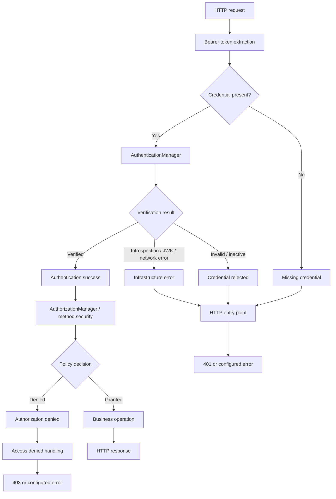

# Metrics for Authentication Success, Rejected Tokens, and Infrastructure Errors

A Resource Server needs to know **how many authentications succeed, how many tokens are rejected, how many authorization decisions are denied, and how many token verifications fail due to infrastructure**. These numbers reveal anomalous credentials, misconfigurations, Authorization Server outages, and performance degradation before users report errors.

Each outcome category must be measured separately. An inactive token, expired JWT, or bad signature is a credential rejection. A valid token lacking scope or resource ownership is an authorization denial. An introspection endpoint timeout, `invalid_client` response, TLS error, or unavailable JWK endpoint is a verification/infrastructure issue. Under a default configuration, these can all surface as HTTP 401, yet their operational meanings are completely different.

This lesson belongs to the **Performance and Operations** chapter of Spring Security OAuth 2.0 / OIDC Resource Server. It focuses on choosing metrics, instrumenting authentication and introspection, categorizing errors, avoiding high cardinality, building dashboards/alerts, and testing metrics with Micrometer.

## 1. Four Outcome Categories to Measure

Before creating metrics, classify events by where the decision occurs:

| Category | Example | Meaning |
| --- | --- | --- |
| **Authentication success** | Valid JWT signature; opaque token introspected as active | Resource Server created an Authentication |
| **Credential rejection** | Expired token, inactive token, bad signature, invalid issuer/audience | Caller was not authenticated |
| **Authorization denial** | Missing scope, role, tenant membership, or ownership | Caller authenticated, but is not permitted to perform the operation |
| **Infrastructure/verification error** | Introspection timeout, Resource Server invalid client, TLS/DNS/JWK endpoint failure | Resource Server could not complete verification or security dependency |

You can add a **missing credential** category for requests lacking a Bearer header. That is an authentication-required request rejected in the filter chain, not necessarily an `AuthenticationManager` or introspection call.

Never collapse all four categories into a single `security.failure` metric. Looking only at total 401/403 counts prevents operators from telling whether users sent bad tokens, policies denied access, or the identity provider is failing.

## 2. Measurement Points in the Request Lifecycle



Each point can emit distinct metrics:

- Filter chain/request instrumentation measures missing-token requests and HTTP outcomes.
- Authentication manager/provider measures authentication results.
- Opaque introspector measures endpoint call counts, latency, and responses/errors.
- JWT decoder/JWK retrieval instrumentation measures key refreshes and key-fetch failures.
- Authorization manager or policy bean measures allow/deny decisions.
- HTTP server instrumentation measures overall latency and status codes.

Measuring at the right boundaries avoids double-counting one request as multiple token rejections.

## 3. Authentication Success Is Not HTTP 2xx

A request can authenticate successfully and then be denied authorization, returning 403. Conversely, a public request can return 200 with no authentication at all.

Therefore:

- Authentication success metrics count how often the Resource Server builds a valid Authentication.
- Authorization granted metrics count policy allow decisions.
- HTTP success metrics count 2xx responses on endpoints.
- Never use HTTP 2xx as a proxy for successful authentications.

One request can increment authentication success and authorization denied in the same trace. That is normal and provides much better signal than a single combined outcome metric.

## 4. Credential Rejection Differs from Authorization Denial

Examples:

| Request | Authentication | Authorization | Typical HTTP Outcome |
| --- | --- | --- | --- |
| Missing Bearer token on protected endpoint | None | Not executed | 401 |
| Expired JWT | Rejected | Not executed | 401 |
| Opaque token introspection returns active=false | Rejected | Not executed | 401 |
| Valid token missing orders.write | Success | Denied | 403 |
| Valid token with scope but not order owner | Success | Denied | 403 or 404 per API contract |
| Bad introspection client credentials | Unverifiable | Not executed | May traverse default auth failure mapping; needs dedicated infra metric |

HTTP statuses are useful for clients and high-level dashboards, but do not replace internal reason categories.

## 5. Choosing Metrics by Operational Question

A good metric answers a concrete question:

| Question | Appropriate Metric |
| --- | --- |
| How many authentications succeeded? | Counter by outcome |
| How many credentials were rejected? | Counter by bounded rejection reason |
| How many authorization denials occurred? | Counter by fixed policy/resource label |
| How slow is introspection? | Timer/histogram |
| How often is the identity provider failing? | Counter by dependency/error category |
| Are JWK refreshes failing? | Key-retrieval counter and timer |
| How many protected requests return 401/403/5xx? | HTTP server request metrics |
| Is the circuit breaker open? | Gauge/state metric |
| Is the introspection cache effective? | Hit/miss counters and cache size gauge |

Do not create metrics just because a field is available. Every metric and tag should serve a clear operational purpose.

## 6. Counters, Timers, Gauges, and Distributions

Micrometer provides these primary meter types:

- **Counter:** number of times an event occurs, such as authentication success/rejection or introspection error.
- **Timer:** count and duration of an operation, such as calling the introspection endpoint.
- **Distribution summary:** distribution of a numeric quantity, such as response size or mapped authority count if genuinely needed.
- **Gauge:** current state, such as waiting connections or cache entry count.

Never use a gauge to count cumulative events. Never use a counter for latency. For timers, enable appropriate histograms/percentiles to observe p50/p95/p99 rather than looking only at averages.

## 7. Naming Metrics Consistently

An illustrative naming set:

| Metric | Type | Meaning |
| --- | --- | --- |
| security.authentication.events | Counter | Authentication success/failure events |
| security.authentication.rejections | Counter | Credential rejections by reason |
| security.authorization.decisions | Counter | Authorization granted/denied |
| security.introspection.responses | Counter | Introspection outcomes |
| security.introspection.duration | Timer | Introspection latency |
| security.introspection.errors | Counter | Errors calling introspection |
| security.jwks.refreshes | Counter | JWK refresh outcomes |
| security.jwks.refresh.duration | Timer | Time to fetch JWK set |
| security.dependency.errors | Counter | Identity provider/dependency errors |
| http.server.requests | Timer | HTTP request counts and latency |

Metric names should stay consistent across services. With Micrometer's Prometheus registry, names are normalized to Prometheus style—typically underscores and meter-type suffixes. Check the actual exposed names on the Actuator Prometheus endpoint or your target registry.

## 8. Use Bounded Tags

Tags allow grouping metrics, yet every unique tag combination creates a time series. Use only finite, controlled values:

```text
outcome = success | rejected | error
mechanism = jwt | opaque | other
reason = expired | inactive | bad_signature | invalid_client | timeout | malformed_response | insufficient_scope
resource = orders_api | inventory_api | billing_api
status_class = 2xx | 4xx | 5xx
```

Map these values from an allowlist in code. For unrecognized exceptions, map to `other` or `unknown`; never use raw exception messages as tags.

A metric with 5 outcomes, 2 mechanisms, 8 reasons, and 4 resources can produce up to 320 series before counting other tags. Estimate cardinality before deploying.

## 9. Avoid High Cardinality and Sensitive Data

Never place the following into metric tags:

- Raw access tokens or per-request unique token fingerprints.
- `sub`, username, email, session ID, or user ID.
- `jti`, correlation ID, trace ID, or request ID.
- Full URLs with arbitrary path parameters or query strings.
- Raw exception messages, stack traces, or introspection responses.
- Client-supplied headers that can hold unbounded values.

One million users must not create one million time series. Use access-controlled logs/traces for per-request investigation; metrics are strictly for aggregates.

Hashing tokens does not solve cardinality. Each token's hash is still a distinct value and produces just as many series as raw tokens.

## 10. Measuring Authentication with Spring Security Events

Spring Security emits authentication application events such as `AuthenticationSuccessEvent` and `AbstractAuthenticationFailureEvent`. They are useful for counting outcomes processed by `AuthenticationManager`/`ProviderManager`.

Example listener:

```java
import org.springframework.context.event.EventListener;
import org.springframework.security.authentication.event.AbstractAuthenticationFailureEvent;
import org.springframework.security.authentication.event.AuthenticationSuccessEvent;
import org.springframework.stereotype.Component;

import io.micrometer.core.instrument.Counter;
import io.micrometer.core.instrument.MeterRegistry;

@Component
public class AuthenticationMetrics {

    private final MeterRegistry registry;

    public AuthenticationMetrics(MeterRegistry registry) {
        this.registry = registry;
    }

    @EventListener
    public void onSuccess(AuthenticationSuccessEvent event) {
        increment("success");
    }

    @EventListener
    public void onFailure(AbstractAuthenticationFailureEvent event) {
        increment("failure");
    }

    private void increment(String outcome) {
        Counter.builder("security.authentication.events")
            .description("Authentication manager outcomes")
            .tag("outcome", outcome)
            .register(registry)
            .increment();
    }
}
```

The event publisher must be wired into the `AuthenticationManager`/`ProviderManager` handling authentication. Depending on how your app constructs filter chains and managers, do not assume every failure emits an event. Write tests to verify your application's wiring.

## 11. Authentication Events Do Not Cover Requests Missing Credentials

Protected requests lacking a Bearer token are typically stopped by the authorization/filter-chain entry point before `AuthenticationManager` validates any token. Malformed Bearer tokens can also fail during resolve/extract before the provider runs.

Accordingly, the listener above does not necessarily count:
- Requests missing an Authorization header.
- Authorization headers with the wrong scheme.
- Bearer tokens that fail parsing before `AuthenticationManager`.
- Public requests without credentials.

Use HTTP request metrics or a filter/observation at the security boundary to capture those cases. Never mechanically add HTTP 401 counts to authentication failure events, as one request may already be counted in both places.

## 12. Classifying Authentication Failures with a Reason Enum

A useful dashboard needs stable reason categories:

| Reason | Typical Source | Category |
| --- | --- | --- |
| expired | JWT exp/time validation or inactive introspection | Credential rejection |
| bad_signature | JWT signature verification | Credential rejection |
| issuer_mismatch | JWT/introspection issuer policy | Credential rejection |
| audience_mismatch | Resource audience validation | Credential rejection |
| inactive | Introspection returns active false | Credential rejection |
| malformed_token | Bearer/JWT parser | Credential rejection |
| introspection_client_auth | Invalid Resource Server client | Infrastructure/configuration |
| introspection_timeout | HTTP client timeout | Infrastructure |
| introspection_unavailable | DNS/TLS/5xx/connection error | Infrastructure |
| malformed_introspection_response | Response contract/parser | Dependency/protocol error |

Some framework versions surface multiple failures under the same exception type. Where distinction is needed, instrument at the layer where detail is still intact (HTTP client/adapter) and map exceptions to a reason enum. Never rely on exception message text that can change across versions.

## 13. Measure Authorization Decisions Separately

Successful authentication does not guarantee successful authorization. Measure policy decisions in request authorization, method security, or domain policy beans.

For example, a policy service can increment a counter on each decision:

```java
public boolean canReadOrder(Authentication authentication, Order order) {
    boolean granted = policyAllows(authentication, order);

    Counter.builder("security.authorization.decisions")
        .tag("resource", "orders_api")
        .tag("operation", "read")
        .tag("decision", granted ? "granted" : "denied")
        .register(registry)
        .increment();

    return granted;
}
```

This example illustrates a single decision point. If PreAuthorize also publishes events while the policy bean increments a counter, the same denial could be counted twice. Pick one canonical boundary per policy type and document what the metric represents.

Never use arbitrary method names or object IDs as tags. Use pre-declared operation/resource labels.

## 14. Recording Authorization Denial Reasons

You can distinguish these categories:

- scope_missing
- role_missing
- tenant_membership_denied
- ownership_denied
- resource_state_denied
- policy_denied
- unknown

Never put subjects, tenant IDs, document IDs, or policy expressions into metrics. When investigating a specific denial, log a controlled event with a trace ID and protected identity per retention/access policy.

Do not label every `AccessDeniedException` as insufficient scope. Method security can deny due to SpEL, domain ownership, or tenant membership; instrument the reason in the policy bean where context exists.

## 15. Measuring Opaque Token Introspection

An opaque-token Resource Server calls the introspection endpoint to verify token state. This is a network operation with its own latency and error modes.

Measure at a minimum:

- Active introspection responses.
- Rejected responses (inactive/invalid per introspector).
- Endpoint invocation errors.
- p50/p95/p99 latency.
- Upstream HTTP status class if the adapter can extract it safely.
- Cache hits/misses if introspection caching is enabled.

An `active=false` response is a token rejection. A timeout or `invalid_client` is a verification/infrastructure error. Never combine the two.

## 16. Wrapping `OpaqueTokenIntrospector` with a Micrometer Timer

You can instrument right around the delegate to record duration and outcome:

```java
import org.springframework.security.oauth2.core.OAuth2AuthenticatedPrincipal;
import org.springframework.security.oauth2.server.resource.introspection.BadOpaqueTokenException;
import org.springframework.security.oauth2.server.resource.introspection.OpaqueTokenIntrospector;

import io.micrometer.core.instrument.Counter;
import io.micrometer.core.instrument.MeterRegistry;
import io.micrometer.core.instrument.Timer;

public final class MeteredOpaqueTokenIntrospector
        implements OpaqueTokenIntrospector {

    private final OpaqueTokenIntrospector delegate;
    private final MeterRegistry registry;

    public MeteredOpaqueTokenIntrospector(
            OpaqueTokenIntrospector delegate,
            MeterRegistry registry) {
        this.delegate = delegate;
        this.registry = registry;
    }

    @Override
    public OAuth2AuthenticatedPrincipal introspect(String token) {
        Timer.Sample sample = Timer.start(registry);

        try {
            OAuth2AuthenticatedPrincipal principal =
                delegate.introspect(token);

            record(sample, "active");
            return principal;
        } catch (BadOpaqueTokenException ex) {
            record(sample, "rejected");
            throw ex;
        } catch (RuntimeException ex) {
            record(sample, "error");
            throw ex;
        }
    }

    private void record(Timer.Sample sample, String outcome) {
        sample.stop(Timer.builder("security.introspection.duration")
            .description("Time spent introspecting an opaque access token")
            .tag("outcome", outcome)
            .register(registry));

        Counter.builder("security.introspection.responses")
            .tag("outcome", outcome)
            .register(registry)
            .increment();
    }
}
```

This decorator records three outcomes at the introspector boundary: principal returned, token rejected by the introspector, and exception when the operation could not complete. `BadOpaqueTokenException` can represent an inactive token or certain invalid responses depending on implementation; the `rejected` metric does not assert all of them are revocations.

If you need to separate malformed responses from confirmed inactive tokens, the HTTP adapter must classify the response before the exception is normalized. Never use tokens as tags or log them inside the decorator.

## 17. Register the Decorator Exactly Once

A Spring Resource Server accepts a custom `OpaqueTokenIntrospector` bean. Wrap the default or explicitly configured delegate, then ensure that exact bean is used by the `SecurityFilterChain`.

Conceptual wiring example:

```java
@Bean
OpaqueTokenIntrospector meteredIntrospector(
        MeterRegistry registry,
        @Value("${oauth2.introspection-uri}") String uri,
        @Value("${oauth2.client-id}") String clientId,
        @Value("${oauth2.client-secret}") String clientSecret) {

    OpaqueTokenIntrospector delegate =
        new NimbusOpaqueTokenIntrospector(uri, clientId, clientSecret);

    return new MeteredOpaqueTokenIntrospector(delegate, registry);
}
```

Property names are application-specific examples. If Boot already auto-configured an introspector, avoid creating two competing beans or wrapping an unused delegate. Test with real requests through the Resource Server filter chain to confirm metrics increment once per call.

## 18. `active=false` vs. Introspection Infrastructure Errors

These outcomes must stay distinct:

| Upstream Result | Metric Outcome | Interpretation |
| --- | --- | --- |
| HTTP 200, active=true | active | Token confirmed active by issuer |
| HTTP 200, active=false | rejected | Credential rejected |
| HTTP 401, invalid_client | error / client_auth | Resource Server client failed authentication |
| HTTP 403 | error / client_forbidden | Client lacks permission to introspect per policy |
| HTTP 429 | error / rate_limited | Upstream rate limiting |
| HTTP 5xx | error / upstream_unavailable | Dependency failure |
| Timeout/DNS/TLS | error / transport | Verification result not received |
| Malformed response | error or rejected per adapter contract | No trustworthy response |

The basic decorator emits only active, rejected, and error. For granular reasons, instrument the HTTP adapter/`RestOperations` and map statuses/exceptions to a bounded enum. Do not infer `invalid_client` from `BadOpaqueTokenException` if the delegate discards that detail.

## 19. Measuring JWT Validation and JWK Retrieval

A JWT Resource Server verifies tokens locally once matching JWKs are present. It does not necessarily call the Authorization Server on every request. Hence JWK fetch/refresh counts do not equal JWT authentication counts.

Measure separately:

- JWT authentication successes and rejections.
- JWK set fetch/refresh counts and latency.
- JWK endpoint 4xx/5xx, TLS/DNS, and timeout errors.
- Unknown `kid`/key rotation events if safely observable.
- Cache hits/misses or refresh failures if managing the JWK source/cache directly.

Never create a metric time series per `kid`. You can record `key_lookup=hit|refresh|miss` or `outcome=success|error` with a small enum.

When the JWK endpoint is unavailable yet the cache still holds valid keys, JWTs can keep verifying depending on cache behavior. Metrics must separate refresh failures from token verification failures; never assume every token is invalid simply because a refresh failed.

## 20. Pairing HTTP Request Metrics with Security Metrics

Spring Boot Actuator/Micrometer typically provides `http.server.requests` with fields such as method, normalized URI, status, outcome, and exception depending on instrumentation configuration.

Use this metric to see:
- 2xx/4xx/5xx ratios per route.
- Latency of protected endpoints.
- Spikes in 401/403 requests.
- 5xx and latency spikes coinciding with IdP outages.

Security metrics supply the internal reasons that HTTP metrics cannot see. An HTTP 401 may be a missing token, invalid token, or introspection error mapped to an authentication failure. Correlate both signals by trace or time window rather than stuffing every reason into URI/status tags.

## 21. Never Use Raw URIs as Tags

Routes like:

```text
GET /orders/1001
GET /orders/1002
GET /orders/1003
```

should be normalized to a route template such as `/orders/{id}`. Using raw paths creates a new time series for every order ID.

Likewise, never place query strings, tokens, user IDs, or headers in tags. Use framework-provided route templates or fixed resource names.

## 22. Measuring Infrastructure Errors by Dependency

Emit separate metrics for each security dependency:

| Dependency | Metrics to Collect |
| --- | --- |
| Authorization Server introspection | Request count, latency, status/error category |
| JWK Set endpoint | Refresh count, duration, failures |
| DNS/TLS/network | Transport failure count |
| Secret/config provider | Secret retrieval/rotation failures |
| Distributed cache | Read/write errors, latency, hits/misses |
| Database membership/ACL | Query latency, errors, timeouts |
| Metrics exporter/backend | Scrape/export failures |

Never combine database ownership query errors with token introspection errors. Both can fail protected requests, yet their owners and remediations differ.

## 23. HTTP Status Alone Cannot Classify Dependency Failures

For instance, suppose the introspection endpoint returns `invalid_client`. The Resource Server cannot verify the Bearer token. Default exception translation may route the failure through the authentication failure path and return 401; an app with custom availability handling might return 503 for a dependency outage.

Therefore, dashboards need two dimensions:

- **Public HTTP outcome:** status 401, 403, 5xx.
- **Internal verification outcome:** inactive, invalid token, introspection client auth, timeout, upstream unavailable, malformed response.

Do not alter the HTTP contract arbitrarily just to make metrics easier to classify. If switching 401 to 503, weigh client behavior, caching, retries, and security disclosure.

## 24. Computing Success and Rejection Rates with the Right Denominator

Example operational formulas:

```text
authentication_success_rate =
  successful_authentications
  / (successful_authentications + credential_rejections)

credential_rejection_rate =
  credential_rejections
  / (successful_authentications + credential_rejections)

verification_infrastructure_error_rate =
  verification_infrastructure_errors
  / verification_attempts
```

Exclude authorization denials from the credential rejection rate: those callers already authenticated. Exclude infrastructure errors from the credential rejection rate: tokens may be valid while the Resource Server simply cannot check them.

Missing credentials can be tracked separately against total requests, since token verification was never even started. Document denominators on dashboards so viewers do not misinterpret rates.

## 25. Overview Dashboard for a Resource Server

A practical dashboard can be organized into rows:

1. **Traffic:** request rate, 2xx/401/403/5xx, and p95/p99 HTTP latency.
2. **Authentication:** successes, credential rejections, and missing credentials.
3. **Authorization:** granted/denied by fixed resource/operation.
4. **Introspection:** active/rejected/error, p50/p95/p99 latency, upstream status.
5. **JWK:** refresh success/failure, refresh duration, key-lookup behavior.
6. **Dependencies:** IdP availability, DNS/TLS errors, cache/database failures.
7. **Capacity:** connection pools, request queues, circuit breaker state.
8. **Privacy/quality:** unknown-reason ratio and metric series count.

Include filters for environment, service, region, and resource server. Avoid filtering by user or token.

## 26. Alerting on Authentication and Infrastructure Incidents

Alerts should focus on actionable shifts:

- Introspection error rate exceeds threshold over a sustained window.
- Introspection p95/p99 latency breaches the authentication latency budget.
- `invalid_client` appears across multiple pods after a secret rotation or deploy.
- JWK refreshes fail repeatedly or unknown-key rates spike suddenly.
- HTTP 5xx rises alongside identity provider errors.
- Authentication successes drop sharply while traffic remains steady.
- Circuit breakers open or connection pool wait counts climb.
- Unknown-reason metrics rise, signaling newly unclassified exceptions.

Never page on-call for isolated invalid tokens. Rejected tokens are a normal part of the security boundary; tune thresholds, rates, and anomaly detection, optionally paired with WAF/security events.

## 27. Distinguishing Attack Traffic from Outages

Common patterns:

| Signal | Likely Area to Investigate |
| --- | --- |
| Invalid tokens rise while introspection/JWK stay healthy | Clients sending expired/bad tokens or credential probing |
| `invalid_client` spikes across all pods | Secret/client registration/rotation |
| Timeouts and 5xx rise with introspection p95 | Authorization Server or network overload |
| 403s rise while authentication successes stay steady | Scope/role/tenant/ownership policy or client behavior |
| 401s rise without matching authentication events | Missing/malformed Bearer headers or pre-AuthenticationManager errors |
| Only one issuer/resource affected | Trust config, issuer metadata, or resource-specific policy |
| Only right after key rotation | JWK refresh/cache/`kid` handling |

These are investigative leads, not automatic conclusions. Confirm with redacted traces/logs and upstream telemetry.

## 28. Introspection Caching and Hit/Miss Metrics

If the Resource Server caches introspection results, measure:

- `security.introspection.cache` with `result=hit|miss`.
- Active/rejected outcomes served from cache vs. upstream.
- Cache lookup latency.
- Entry counts and evictions if needed.
- Invalidation events and errors.
- Age of positive results if policy permits measuring it.

Cache hits lower latency and upstream load, but widen the window where revoked tokens remain accepted. Dashboards should show cache hit ratio alongside positive TTL/staleness window so operators understand the trade-off.

Never cache timeouts/5xx as inactive. Never cache `invalid_client` as a token rejection. Cache keys must never expose raw tokens in logs; use a keyed fingerprint if a safe, managed key representation is needed.

## 29. Logs, Traces, and Metrics Serve Different Purposes

| Signal | Used For | Example |
| --- | --- | --- |
| Metrics | Trends, rates, alerting, capacity | 12% introspection errors over 5 minutes |
| Logs | Redacted event details | reason=introspection_timeout, traceId=... |
| Traces | Cross-service relationships and timing | Orders API -> introspection endpoint -> database |
| Audit events | Evidence of policy actions/decisions | Principal X allowed/denied reading resource Y |

Do not turn metrics into audit logs. Never log raw tokens for searchability. Trace baggage is not a place for claims or credentials.

## 30. Redacting Credentials and Limiting Telemetry Data

Never record:
- Authorization headers, opaque tokens, JWTs, or refresh tokens.
- Introspection client secrets, Basic Authorization headers, or private keys.
- Full JWT/introspection claims containing PII.
- User emails/subjects as metric tags.
- Raw request bodies containing credentials.

Safe to record:
- Outcome enums.
- Reason categories.
- Resource server/service aliases.
- HTTP status classes.
- Correlation/trace IDs in access-controlled logs.
- Configured issuer aliases, never caller-supplied URLs.

Metrics are usually shared more broadly than logs. Constrain metric tags even more strictly.

## 31. Metrics When Method Security Denies Access

When denial occurs at PreAuthorize, pick an appropriate instrumentation point:

- An authorization event publisher if configured and verified to emit events.
- A policy bean emitting metrics at the domain decision point.
- A wrapper around `AuthorizationManager` to measure request-level decisions centrally.

Do not increment a counter in the controller and again in the service for the same denial. State clearly whether a metric counts policy decisions or request responses. One request can involve multiple authorization decisions, such as scope, tenant, and ownership checks.

For method security, if specific reasons like `ownership_denied` are needed, instrument inside the policy bean that holds full context. Generic `AccessDeniedException` events may lack domain reasons.

## 32. Testing Authentication Event Metrics

Testing event listeners must verify the event publisher is wired into the manager. Example test direction:

```java
@SpringBootTest
class AuthenticationMetricsTest {

    @Autowired
    MeterRegistry registry;

    @Test
    @WithMockUser
    void successfulAuthenticationEventIsCounted() {
        // Invoke a path that authenticates through the configured manager.
        // Assert the expected counter increased by one.
    }
}
```

`@WithMockUser` can populate `SecurityContext` for tests without running `AuthenticationManager`. Hence the snippet above is only a skeleton: to test `AuthenticationSuccessEvent`, perform real authentication through the manager/provider or test the listener via controlled event publication.

Never conclude event integration works solely from a test annotated with `@WithMockUser`.

## 33. Testing Introspection Timers and Outcome Counters

The decorator can be tested with `SimpleMeterRegistry` and a stub delegate:

```java
@Test
void activeResponseRecordsSuccessMetric() {
    SimpleMeterRegistry registry = new SimpleMeterRegistry();

    OpaqueTokenIntrospector delegate = token -> activePrincipal();
    OpaqueTokenIntrospector metered =
        new MeteredOpaqueTokenIntrospector(delegate, registry);

    metered.introspect("opaque-test-token");

    assertThat(registry.counter(
        "security.introspection.responses",
        "outcome", "active").count()).isEqualTo(1.0);

    assertThat(registry.timer(
        "security.introspection.duration",
        "outcome", "active").count()).isEqualTo(1);
}
```

Write matching tests for delegates throwing `BadOpaqueTokenException` and a runtime exception representing a dependency failure. Confirm outcomes are `rejected` and `error` respectively, and that exceptions are rethrown so Security blocks the request.

Tests need not—and must not—put token values into metric labels.

## 34. Testing HTTP Statuses and Security Metrics Together

Use MockMvc or integration tests with the real Resource Server filter chain:

| Test Input | Typical HTTP Expectation | Metrics That Must Increment |
| --- | --- | --- |
| Valid token, sufficient permissions | 2xx | Authentication success; authorization granted |
| Expired JWT | 401 | Credential rejection |
| Opaque active=false | 401 | Introspection rejected |
| Token missing scope | 403 | Authentication success; authorization denied |
| Token with scope but wrong owner | 403/404 per contract | Authentication success; ownership denied |
| Introspection timeout | Per configured error mapping | Introspection error/timeout |
| Introspection invalid_client | Per configured error mapping | Infrastructure/client-auth error |
| Request without Bearer token | 401 if protected | Missing credential/request outcome |

Each test should also assert that protected business methods do not execute when authentication fails. For infrastructure errors, confirm errors are not recorded as `active=false`.

## 35. Testing Cardinality and Privacy

Beyond checking counter increments, verify:

- Many distinct tokens do not create new meters.
- Many distinct subjects do not create new tags.
- Arbitrary exception messages are never used as labels.
- Correlation/trace IDs appear only in logs/traces, never as metric tags.
- Unknown reasons map to `other`.
- Route parameters are normalized.
- No Authorization headers or tokens appear in test logs.

A simple test can introspect hundreds of dummy tokens and assert the total meter count stays fixed across the bounded outcomes. This catches high-cardinality bugs early.

## 36. Controlling Metric Volume in Multi-Pod Environments

When running multiple replicas:
- Each pod keeps a local registry and exporters/scrapers collect per instance.
- Dashboards aggregate via `sum`/`rate`, while retaining service, instance, or region to isolate a misbehaving pod.
- Avoid putting pod UIDs or deployment hashes on every metric if backend cardinality is tight; rely on standard platform labels.
- Check scrape intervals, retention, and remote-write limits.
- Keep metric names and tag schemas consistent across releases.

One pod holding an old secret can emit `invalid_client` errors while others stay healthy. Keep the `instance` label at the scrape/platform layer to spot it rather than injecting arbitrary hostnames into every application metric.

## 37. Example Prometheus Queries

If counter `security.authentication.events` has an `outcome` tag, exporters typically normalize it to `security_authentication_events_total`.

Authentication success rate:

```promql
sum(rate(security_authentication_events_total{outcome="success"}[5m]))
```

Failure event rate:

```promql
sum(rate(security_authentication_events_total{outcome="failure"}[5m]))
```

Introspection error share among introspection outcomes:

```promql
sum(rate(security_introspection_responses_total{outcome="error"}[5m]))
/
clamp_min(sum(rate(security_introspection_responses_total[5m])), 1)
```

p95 introspection latency when the timer is exported as a histogram:

```promql
histogram_quantile(
  0.95,
  sum by (le) (
    rate(security_introspection_duration_seconds_bucket[5m])
  )
)
```

Exact metric names depend on the registry/exporter and naming conventions. Inspect real exposition output before adding queries to dashboards. Use `clamp_min` or handle zero denominators to avoid `NaN` during zero traffic.

## 38. Setting SLOs for Verification Dependencies

You can define dedicated SLOs for token verification:

- **Availability:** share of introspection/JWK verification operations completing without dependency errors.
- **Latency:** p95/p99 introspection time stays within the request budget.
- **Correctness:** invalid tokens are never accepted; valid active tokens are not rejected due to misconfiguration.
- **Freshness:** how long caches can hold positive results after revocation stays within the revocation SLO.

Do not use authentication success rate as the identity provider's availability SLO. A wave of expired tokens drops the success rate even while the IdP is healthy. Dependency SLOs must exclude credential rejections and measure transport/upstream errors separately.

## 39. Runbook When Authentication Success Drops Suddenly

When the success rate drops:

1. Compare traffic rates to see if request volume changed.
2. Separate credential rejections from infrastructure errors.
3. Check HTTP 401/403/5xx by route and resource server.
4. Check JWT expired/issuer/audience/signature reasons.
5. For opaque tokens, inspect active/rejected/error counts and introspection latency.
6. Check `invalid_client`, secret rotation, TLS/DNS, and upstream status.
7. For JWTs, check JWK refreshes/unknown keys after rotation.
8. Check recent deployments/config changes and variance across pods.
9. Inspect redacted traces/logs for a representative failing request.
10. Change configs or credentials only after confirming root cause.

If rejections spike while dependency metrics stay healthy, investigate callers, clients, and token issuance before restarting Resource Servers.

## 40. Runbook When Introspection Errors Rise

1. Inspect timeouts, 429s, 5xx responses, and client-auth errors separately.
2. Compare p95/p99 latency with connection pool utilization.
3. Check Authorization Server health, rate limits, and capacity.
4. Check client ID/secret versions and rotation rollouts.
5. Check DNS, TLS chains, hostnames, proxies, and network routes.
6. Verify response `Content-Type` and JSON contract.
7. Check whether retries/circuit breakers are causing request amplification.
8. Check cache hit ratio and stale positive window.
9. Check whether errors are concentrated in a single region or pod.
10. Restore the dependency or config per approved runbook and confirm metrics recover.

Never treat `invalid_client` by tight-loop retrying. It is usually a credential/configuration issue that needs fixing.

## 41. Runbook When 403s Rise While Authentication Is Steady

If authentication success is normal while 403s climb:

- Check whether scope/authority mappings changed.
- Check client registrations and requested scopes.
- Check newly deployed PreAuthorize policies or request matchers.
- Check tenant membership or ownership changes.
- Check role-to-authority converters.
- Check ACL/membership caches and invalidation.
- Compare denial reasons by fixed resource/operation.
- Verify 403 responses match the API contract rather than masking another error.

Do not rotate client secrets or restart the IdP if metrics show authentication still succeeds and the issue is authorization.

## 42. Common Anti-Patterns

| Anti-Pattern | Consequence | Fix |
| --- | --- | --- |
| Counting all 401s as invalid tokens | Missing tokens and IdP outages get mixed together | Measure requests, credentials, and dependencies separately |
| Counting all 403s as insufficient scope | Ownership/tenant denials vanish | Instrument at policy decision points |
| Mixing introspection timeouts with active=false | Wrong alerts, retries, and runbooks | Separate rejected from error |
| Measuring HTTP statuses only | Internal reasons hidden | Add security-specific metrics |
| Tagging by `sub` or token | Cardinality explosion and data exposure | Use bounded enums |
| Tagging by exception message | Time series blow up | Map to a reason allowlist |
| Using average latency | Masks tail latency | Timer histograms with p95/p99 |
| Counting authentication via 2xx | Public endpoints skew numbers | Count Authentication events |
| Assuming all failure events fire | Pre-AuthenticationManager errors missed | Instrument filter/request boundaries |
| Retrying every introspection error | Amplifies load on a failing IdP | Bounded retries by error category |
| Alerting on every invalid token | Alert noise | Threshold/rate/anomaly and abuse detection |
| Using metrics as audit logs | Insufficient detail, wrong tool | Use controlled audit events |

## 43. References

- [Spring Security 6.5 — Observability](https://docs.spring.io/spring-security/reference/6.5/servlet/integrations/observability.html): observations for authentication and authorization.
- [Spring Security 6.5 — Authentication Events](https://docs.spring.io/spring-security/reference/6.5/servlet/authentication/events.html): authentication success/failure events and event publishers.
- [Spring Security 6.5 — Opaque Token Resource Server](https://docs.spring.io/spring-security/reference/6.5/servlet/oauth2/resource-server/opaque-token.html): opaque token introspection and custom introspectors.
- [Spring Security 6.5 — JWT Resource Server](https://docs.spring.io/spring-security/reference/6.5/servlet/oauth2/resource-server/jwt.html): JWT validation and JWK Set retrieval.
- [Spring Boot — Actuator Metrics](https://docs.spring.io/spring-boot/reference/actuator/metrics.html): Micrometer registry and metrics endpoints.
- [Micrometer — Meters](https://docs.micrometer.io/micrometer/reference/concepts/meters.html): counters, timers, gauges, tags, and cardinality.
- [Prometheus — Naming](https://prometheus.io/docs/practices/naming/): naming conventions and metric labels.
- [Prometheus — Instrumentation](https://prometheus.io/docs/practices/instrumentation/): choosing metrics and designing instrumentation.

## 44. Conclusion

A Resource Server must measure **authentication successes**, **credential rejections**, **authorization denials**, and **verification infrastructure errors** separately. An inactive token or expired JWT is a credential outcome; a missing scope or ownership failure is a policy decision; introspection `invalid_client`, timeouts, TLS errors, or JWK refresh failures are infrastructure issues. HTTP status codes collapse these scenarios together, so metrics must be placed at the proper boundaries.

Micrometer counters fit outcome counts, timers fit latency, and gauges fit current state. Spring Security authentication events help measure provider outcomes when the event publisher is wired properly; an `OpaqueTokenIntrospector` decorator directly measures introspection outcomes and latency. HTTP request metrics complement them with overall status, route, and latency data.

Keep metric tags as finite enums, and never use tokens, subjects, correlation IDs, or exception messages as labels. Dashboards should expose traffic, 401/403/5xx rates, authentication/authorization outcomes, introspection/JWK latency, and dependency errors. Tests must prove metrics increment once, leak no credentials, and distinguish rejected tokens from verification failures.

**Core takeaway:** *Count security outcomes where the decision happens; measure infrastructure errors separately from rejected tokens so dashboards and alerts point to the right remediation.*
