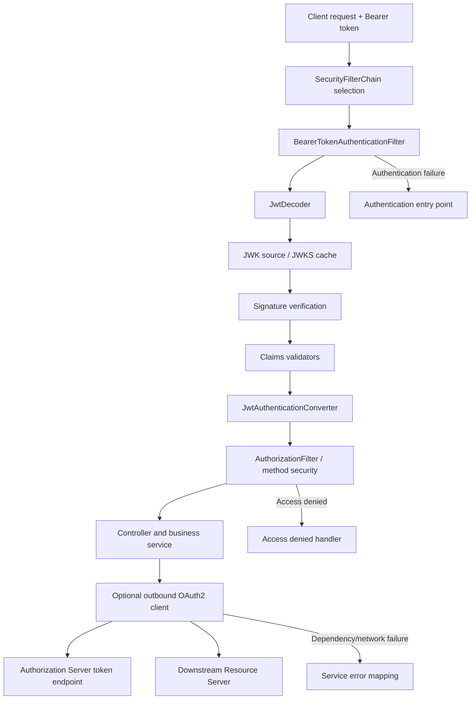

# Distinguishing Signature, Claims, and Permission Errors from Connection or Configuration Errors

When a Spring Security OAuth 2.0 Resource Server rejects a request, the HTTP status code usually only indicates that the request was rejected somewhere in the security flow. It does not always reveal the root cause. A token with a bad signature, a validly signed token with the wrong audience, a valid token missing a scope, an unreachable JWKS endpoint, and a misconfigured issuer can all produce similar-looking logs or responses if you look only at HTTP 401.

To operate effectively, separate errors by boundary:

1. **Signature/key errors:** the JWT cannot be verified with any public key trusted by the Resource Server.
2. **Claims/token validation errors:** the signature is valid, but issuer, audience, timestamps, or required claims fail validation.
3. **Authorization errors:** the token authenticated, yet the principal lacks the required scope/authority or object/tenant permission.
4. **Identity infrastructure connection errors:** failure to reach discovery metadata, JWKS, token introspection, or token endpoints.
5. **Downstream API connection errors:** the Resource Server authenticated the inbound request, but the service fails to call the next API.
6. **Configuration/runtime errors:** wrong URI, registration, client authentication method, truststore, clock, filter chain, or authority converter.

This lesson provides a layered diagnostic workflow, guidance on reading exceptions and HTTP responses, safe observability setup, symptom lookup tables, and testing techniques using fake JWKS/Authorization Servers. The goal is separating **genuinely invalid credentials** from **temporary inability to verify credentials**, handling both security and availability properly.

> **Operational principle:** Never conclude from a single status code. Combine exception type/cause, originating component, request correlation ID, dependency traces, and configuration state. Never log raw JWTs, refresh tokens, client secrets, or Authorization headers.

## 1. View the Entire Request Path Before Reading Logs

A request to the Orders API may pass through:



Each node has distinct failure modes. For example:
- A bad signature is a token/key trust issue.
- A wrong audience is a token contract issue.
- A missing scope is an authorization issue.
- A DNS failure to JWKS is dependency connectivity.
- A token endpoint returning `invalid_client` is client configuration/credentials.
- Payments API returning 403 is downstream authorization, not necessarily an Orders API authentication error.

### 1.1. Identify Which Role the Application Is Playing

A single Spring Boot service can simultaneously act as:
- Resource Server: validating inbound access tokens.
- OAuth2 Client: acquiring outbound tokens.
- Client calling a downstream Resource Server.
- OIDC client: logging users in and processing ID tokens.

Specify which flow failed. An outbound OAuth2 Client failure should not be misdiagnosed as an inbound JWT failure simply because both involve OAuth.

### 1.2. Distinguish Which Dependency Is Being Called

| Dependency | When Is It Called? | What For? |
|---|---|---|
| OIDC discovery metadata | When configured for discovery via issuer URI, depending on decoder initialization | Locate issuer metadata and JWKS endpoint |
| JWKS endpoint | When decoder needs public keys or must refresh the key set | Verify JWT signatures |
| Introspection endpoint | When Resource Server validates opaque/reference tokens | Ask AS if token is active and get metadata |
| Token endpoint | When OAuth2 Client requests access/refresh tokens or token exchange | Issue outbound tokens |
| Downstream API | After inbound request passes policy and service calls another API | Perform business operations |

JWKS is not called on every request once keys are cached. Hence an earlier successful request does not prove the JWKS endpoint is reachable right now; the decoder may be using cached keys.

## 2. Diagnose in Order: Authentication First, Authorization Second

When encountering an error, start with these questions:

1. Did the request enter the expected `SecurityFilterChain`?
2. Was the Bearer token extracted?
3. Is the Resource Server using a JWT decoder or an opaque token introspector?
4. Did the decoder/introspector receive a response from its dependency?
5. If a key/response arrived, did token verification succeed?
6. Did claims validators accept the token?
7. Was `Authentication` constructed with the expected authorities?
8. Where did authorization rules or method security deny access?
9. If the request passed security, which business or downstream call failed?

Following this sequence prevents mistaking a scope error for a signature error or a JWKS timeout for a forged token.

## 3. Signature and Key Lookup Errors

In a JWT Resource Server, the decoder must locate a trusted public key and verify the JWS signature before claims are used to build a principal.

### 3.1. Common Causes

- The token was signed with a private key different from the public key currently in JWKS.
- The JWT header carries a `kid` absent from JWKS.
- JWKS rotated, yet the Resource Server still caches old keys or has not picked up the new key.
- The AS and Resource Server point to different realms, tenants, or issuers.
- The token uses an algorithm outside the allowlist.
- The token was modified after signing or truncated/corrupted by a proxy.
- The public JWK is wrong or its key material does not match the private signing key.
- The JWKS response is malformed or lacks a matching signing key.

### 3.2. Signals to Look For

Logs may include exceptions from:
- `JwtException` or `BadJwtException`.
- `JOSEException`/`BadJOSEException` in the cause chain.
- Failure to find a matching key by `kid`.
- Signature verification failure or unsupported algorithm.
- Failure parsing compact serialization.

Exact exception names vary by Spring Security/Nimbus version and how exceptions are wrapped. Inspect the root cause and originating component rather than relying solely on message text.

### 3.3. How to Verify

1. Safely inspect the decoded JWT header in a test environment or from a test fixture; never log production tokens.
2. Note `alg` and `kid`.
3. Confirm which JWKS URI the Resource Server actually uses.
4. Check whether the public JWKS includes a key with that `kid`.
5. Check whether `kty`/`alg`/`use`/`key_ops` are compatible with the token signature.
6. Verify the token was signed by the matching private key.
7. Check cache/rotation timing if keys recently changed.

Never treat payload decoding as proof a token is valid. Base64URL decoding merely reads claims; it does not verify signatures.

### 3.4. Unknown `kid` Differs from Bad Signature

| Case | Meaning |
|---|---|
| `kid` missing from JWKS | Decoder cannot find a candidate key |
| `kid` present in JWKS but signature fails | Candidate key exists, yet signature does not verify |
| `kid` matches but key material changed | Possible key rotation/cache issue or `kid` management violation |
| JWKS endpoint unreachable | Cannot fetch new key set; insufficient evidence to call token invalid |
| Malformed JWKS JSON | Dependency responded, yet key set data is unusable |

Do not lump unknown `kid`s and JWKS network outages into the same incident. One may be a token signed by an untrusted key; the other may be a broken key-distribution infrastructure.

### 3.5. Key Rotation and Caching

A safe rotation flow usually includes overlap:
1. Publish the new public key alongside the old public key.
2. Begin signing tokens with the new key.
3. Wait for old tokens to expire and decoders/caches to update.
4. Remove the old public key after the calculated overlap window.

Removing the old key before old tokens expire causes requests carrying old tokens to fail. Signing with the new key before the new public key propagates causes new tokens to be rejected by Resource Servers.

When investigating:
- Record when the new key was published.
- Record when the AS started using the new `kid`.
- Record when each Resource Server instance fetched JWKS.
- Compare cache states across instances.
- Do not assume the cache is broken just because one instance still holds the old key; inspect the decoder's cache policy and refresh triggers.

## 4. Claims Validation: Valid Signature, Yet Token Still Rejected

A JWT with a valid signature can still be inappropriate for the current API. Claims validation binds the token to the trusted issuer, resource, time window, and profile.

### 4.1. Issuer Mismatch

Suppose the Resource Server trusts:

```yaml
spring:
  security:
    oauth2:
      resourceserver:
        jwt:
          issuer-uri: https://issuer.example.test/realms/shop
```

Yet the JWT carries `iss` from a staging issuer:

```json
{
  "iss": "https://issuer-staging.example.test/realms/shop"
}
```

The signature might verify if both issuers share key material, yet the issuer validator must still reject the token if the issuer does not match. The issuer is part of the trust contract, not an arbitrary label.

Common configuration mistakes:
- Using a staging issuer URI in production.
- Wrong realm/tenant path.
- Trailing slash mismatch or non-canonical issuer URL.
- Discovery metadata returning an issuer that does not match configuration.
- Reverse proxy rewriting host/scheme so metadata advertises a different issuer.
- Token issued by a different identity provider.

### 4.2. Wrong Audience for the Resource Server

The Orders API expects audience `orders-api`. A token with `aud` `payments-api` must not be accepted at the Orders API merely because issuer and signature are valid.

Check:
- Whether the token encodes `aud` as a string or array.
- Whether the expected audience matches the resource identifier issued by the AS.
- Whether the decoder has an audience validator configured.
- Whether a gateway or AS is issuing overly broad shared audiences.
- Whether the API points to the right issuer and environment.

Spring Security should never be configured to accept any audience simply because the signature verifies. For APIs with audience requirements, attach a dedicated validator and test wrong-audience tokens.

### 4.3. Expired Token or Token Not Yet Valid

Primary timestamp claims:
- `exp`: token is no longer valid after this instant.
- `nbf`: token is not valid before this instant.
- `iat`: issuance time, optionally used by application profile/freshness policies.

Possible causes:
- The token genuinely expired.
- Clock skew between the AS, application host, or container.
- Incorrect timezone or clock configuration.
- Inappropriately configured clock skew tolerance.
- Test fixture generated with a fixed clock while the decoder uses the system clock.
- Requests queued or retried too long before reaching the Resource Server.

Compare UTC timestamps between the token and host/container. Do not look solely at local dashboard display times if dashboards convert timezones.

### 4.4. Missing or Mistyped Required Claims

A token may be validly signed yet lack `sub`, `tenant_id`, or a profile claim required by application policy. A claim might also have the wrong type—for example, `scope` as a JSON array when the converter expects a space-delimited string.

Distinguish:
- Claim validation: token rejected because a mandatory claim fails checks.
- Authority conversion: token accepted, yet the converter fails to produce expected authorities.
- Business policy: token valid, yet tenant/object relationship denies access.

If a claim is a mandatory condition for the token itself to be considered valid, enforce it in a validator. If it governs only a specific operation's policy, check it at the authorization or service layer.

## 5. Authorization Errors: Authentication Already Succeeded

Key indicator: the Resource Server built an `Authentication` from the token, yet the request is denied for insufficient permissions.

Common causes:
- Token lacks the required scope.
- Scope is present in the token, yet the converter maps the wrong prefix or claim name.
- Rule requires `ROLE_ADMIN`, while the token only produces `SCOPE_admin`.
- Request matcher requires a different scope than the AS issued.
- Method security denies the service operation.
- User has the scope, yet does not own the target object.
- User has the scope, yet tenant membership is no longer active.
- Delegated token lacks the actor/delegation claim required by downstream policy.

### 5.1. 403 Usually Indicates Access Denied

Example:

```java
.authorizeHttpRequests(auth -> auth
    .requestMatchers(HttpMethod.GET, "/api/orders/**")
        .hasAuthority("SCOPE_orders.read")
    .requestMatchers(HttpMethod.POST, "/api/orders/**")
        .hasAuthority("SCOPE_orders.write")
    .anyRequest().denyAll()
)
```

A valid token carrying `orders.read` calling `POST` is rejected at authorization. This is neither a signature error nor an issuer error.

### 5.2. Inspect Authority Mapping

By default, Spring Security typically maps the `scope` claim to `SCOPE_` authorities. For example:

```json
{
  "scope": "orders.read orders.write"
}
```

can produce:
- `SCOPE_orders.read`
- `SCOPE_orders.write`

If your token actually uses `scp`, `permissions`, or `roles`, configure the converter accordingly. Do not immediately modify tokens or the AS upon seeing 403; first inspect the actual `Authentication` authorities in safe debug logs or tests.

### 5.3. `hasRole` vs. `hasAuthority`

`hasRole("ADMIN")` typically applies the `ROLE_` prefix and checks `ROLE_ADMIN`. `hasAuthority("SCOPE_orders.read")` checks the exact authority string.

A rule calling `hasRole("orders.read")` looks for `ROLE_orders.read` instead of `SCOPE_orders.read`. That is a configuration mismatch, not an invalid token.

### 5.4. Sufficient Scope, Yet Object Policy Denies Access

If a token carries `orders.read` yet the user does not own the order or does not belong to that order's tenant, object-level policy may return 403 or 404. Inspect logs at the service/repository boundary:
- Who is the authenticated subject?
- Where was the tenant context resolved from?
- Is the current membership active?
- Which tenant/owner owns the object?
- Which policy denied the action?

Never log personal data or full domain objects solely to trace the cause.

### 5.5. A Downstream 403 Does Not Mean the Inbound Token Is Wrong

The Orders API might authenticate the user and authorize the operation, and then the Payments API rejects the outbound token for lacking `payments.create`. In that case:
- Inbound authentication at Orders succeeded.
- The outbound token may be valid yet lack a scope or have the wrong audience.
- The 403 response came from the Payments API.
- Traces must distinguish caller, outbound registration, and downstream service.

Record clearly which service emitted the response; logging only the final status at a gateway easily leads to misdiagnosis.

## 6. Connection Errors to JWKS, Discovery, and Introspection

A dependency can become unreachable even when tokens are completely valid.

### 6.1. JWKS Endpoint Timeouts / DNS / TLS

Causes:
- DNS fails to resolve the host.
- Egress/network policy blocks outbound traffic.
- Misconfigured proxy.
- Expired TLS certificate or untrusted CA.
- Hostname/SAN mismatch.
- Connect timeout or read timeout.
- JWKS endpoint returning 5xx or rate-limiting.
- Wrong URL path or unsupported redirect.

Signals:
- `WebClient`/`RestOperations`/HTTP client exceptions.
- `ConnectException`, `UnknownHostException`, `SocketTimeoutException`.
- `SSLHandshakeException` or certificate path errors.
- HTTP 5xx/429 from the JWKS endpoint.
- No fresh JWK response in the dependency trace.

A JWKS connection error does not prove the token has a bad signature. If the decoder holds a key cache, some tokens may still verify; new tokens using an uncached `kid` will fail.

### 6.2. OIDC Discovery Failure

When configured with an issuer URI for discovery, the Resource Server may need to call the metadata endpoint to find `jwks_uri`. Discovery errors occur when:
- The issuer URL is wrong.
- The metadata endpoint is unreachable.
- The discovery response omits `jwks_uri` or has a mismatched issuer.
- A proxy rewrites URLs incorrectly.
- Certificates or DNS fail.

When configuring `jwk-set-uri` directly, discovery calls may not sit on the startup/request path; however, issuer validation must still be configured per the trust contract. Never remove issuer validation just to silence a discovery error.

### 6.3. Opaque Token Introspection Failure

An opaque-token Resource Server calls the introspection endpoint to ask whether a token is active. Distinguish:
- Successful introspection response with `active=false`: token is not accepted.
- Introspection endpoint returns `invalid_client`: wrong client credentials or configuration.
- Endpoint timeout/DNS/TLS: dependency unavailable.
- Endpoint returns 5xx/429: Authorization Server is failing or throttling.
- Malformed JSON/schema response: protocol or provider integration bug.

`active=false` is a token verification result. No response due to a network outage is a dependency failure. The two situations need separate alerts and handling.

### 6.4. Status Code Alone Cannot Distinguish Outage from Invalid Token

Depending on the Spring Security version, authentication manager, decoder/introspector, exception wrapping, and custom entry point, dependency failures can be mapped differently. Some verification failures surface as 401 even though the root cause was failing to fetch keys or an introspection response.

Therefore:
- 401 with `invalid_token` and a bad-signature/claims cause is usually a credential failure.
- 401 whose root cause is timeout/TLS/DNS to JWKS/introspection may be an infrastructure failure.
- 5xx may indicate a dependency failure mapped to a server error.
- Avoid forcing every dependency failure to 401, which makes clients needlessly refresh tokens.
- If you want to return 503 for an unavailable dependency, implement custom error mapping separating authentication errors from service errors, backed by tests and without exposing internal details to callers.

## 7. Token Endpoint Errors and OAuth2 Client Configuration

When the application requests outbound tokens, errors belong to the OAuth2 Client / token endpoint path.

### 7.1. Protocol Errors from the Token Endpoint

| OAuth Error/Response | Common Cause | What to Check |
|---|---|---|
| `invalid_client` | Wrong client ID/secret, wrong client auth method, expired credentials | Registration and client authentication method |
| `invalid_grant` | Invalid or expired authorization code, refresh token, or subject token | Grant inputs, redirect URI, token expiry, exchange policy |
| `invalid_scope` | Scope not allowed for client or resource | Scope registration and AS policy |
| `unauthorized_client` | Client not permitted to use grant type | AS client configuration |
| `unsupported_grant_type` | AS does not support grant or malformed request | `grant_type` and provider capabilities |
| `invalid_target` | Unaccepted resource/audience | Resource identifier/allowlist |
| HTTP 429 | Rate limit | Token acquisition volume and retry policy |
| HTTP 5xx | AS/server failure | Provider status and incidents |

### 7.2. Connection Errors to the Token Endpoint

DNS, TLS, connection refused, timeout, or proxy errors are not `invalid_grant`. They indicate the application could not communicate with the token endpoint.

Check:
- Actual `token-uri`.
- DNS and routing from the container/host.
- TLS trust chain and hostname.
- Proxy and egress rules.
- Connect and read timeouts.
- AS health and rate limits.
- Whether the client secret was injected at runtime.

Never log token request form bodies because they may hold client secrets, refresh tokens, or subject tokens.

### 7.3. Misconfigured Client Registration

Example configuration:

```yaml
spring:
  security:
    oauth2:
      client:
        registration:
          payments-service:
            provider: shop-issuer
            client-id: orders-service
            client-secret: "<secret-injected-at-runtime>"
            authorization-grant-type: client_credentials
            scope:
              - payments.create
        provider:
          shop-issuer:
            token-uri: https://issuer.example.test/oauth2/token
```

Common errors:
- The registration ID referenced in code does not match config.
- Wrong grant type.
- `token-uri` points to the wrong environment.
- Secret missing from container environment.
- Client auth method does not match AS.
- Scope not granted by AS.
- Missing `resource`/`audience` parameter required by provider contract.
- Service uses a reactive manager in a servlet flow or vice versa.

### 7.4. Client Credentials and OBO Are Not Interchangeable

If a downstream operation requires user permissions, falling back to a `client_credentials` service token can create a confused deputy. If OBO/token exchange fails, never automatically fall back to a broader-privilege service token. Diagnostics must confirm the request uses the right grant type and principal semantics.

## 8. Connection Errors to Downstream Resource Servers

After inbound token authentication and authorization succeed, the business service may call a downstream API.

Distinguish responses:
- **Downstream 401:** outbound token invalid at downstream, wrong audience/issuer/signature/expiry, or client auth failure at gateway.
- **Downstream 403:** valid token, yet lacking scope/role or denied by object policy.
- **Downstream 404:** resource missing or hidden per anti-enumeration policy.
- **Downstream 429:** rate limited.
- **Downstream 5xx:** target service failed.
- **Connect/DNS/TLS/timeout:** failed to establish connection or response did not arrive in time.

Never turn all of these into an inbound 401. If the Orders API authenticated the caller yet the Payments API timed out, that is an Orders operation dependency error—typically mapped to 502/503/504 per API contract.

### 8.1. Distinguish HTTP Responses from Transport Exceptions

| Failure | HTTP Response Present? | Evidence |
|---|---|---|
| Downstream returns 403 | Yes | Response status/body/headers from downstream |
| Downstream returns 503 | Yes | HTTP 503 response |
| DNS failure | No | `UnknownHostException` |
| Connection refused | No | `ConnectException` |
| TLS handshake failure | No | `SSLHandshakeException` |
| Response timeout | No, or incomplete response | `TimeoutException`/`ReadTimeout` |
| JSON decoding failure | Response received, yet body unparseable | `Codec`/`DecodingException` |

With `WebClient`, transport failures may be wrapped in `WebClientRequestException`, whereas HTTP status failures usually flow through `WebClientResponseException` or status handlers depending on invocation style. Inspect the cause chain and redacted remote response metadata.

### 8.2. Timeouts and Retries

Configure sensible timeouts for:
- Discovery/JWKS retrieval.
- Token endpoints.
- Introspection.
- Downstream APIs.

Retries fit only transient errors and require budgets/backoff. Never retry invalid signatures, `invalid_client`, `invalid_grant`, or `invalid_scope` as network errors. Never retry non-idempotent business `POST`s without an idempotency key.

### 8.3. Connection Pool Exhaustion

If a connection pool is exhausted, requests can time out before ever leaving the host. Check:
- Pending acquire count.
- Active/idle connections.
- Acquire timeout.
- Response latency.
- Downstream saturation.
- Whether request/response bodies are properly consumed and released.

This is a performance/connectivity issue, not a JWT error.

## 9. Quick Symptom Triage Table

| Symptom | Most Likely Category | Next Evidence to Check |
|---|---|---|
| JWT parses, yet signature verification fails | Signature/key | `alg`, `kid`, trusted JWKS, and signing key |
| Unknown `kid` | Key distribution/rotation | JWKS response, cache, publication timing |
| Valid signature, yet issuer mismatch | Claims/configuration | `iss` in token vs. expected issuer |
| Valid signature, yet audience mismatch | Claims/API contract | `aud` vs. expected resource identifier |
| Token expired / `nbf` invalid | Claims/clock | `exp`/`nbf` in UTC and host clocks |
| 403 with valid `Authentication` | Scope/authorization | Granted authorities and matched rule |
| Correct scope, yet object returns 404 | Ownership/tenant policy | Subject, authorized tenant, object visibility |
| Valid token, yet empty authority list | Converter/claim mapping | `scope`/`scp`/`roles` schema and converter |
| JWKS fetch timeout | Network/dependency | DNS/TLS/egress/HTTP client trace |
| Introspection `active=false` | Token state | AS response and token status |
| Introspection timeout | Network/dependency | Endpoint availability, timeouts, client auth |
| Token endpoint `invalid_client` | Client configuration | Client ID, auth method, secret injection |
| Token endpoint `invalid_scope` | OAuth policy/configuration | Requested vs. allowed scopes |
| Token endpoint DNS/TLS failure | Network/dependency | DNS, certificates, proxy, egress |
| Downstream 401 | Outbound credential | Outbound `aud`/`iss`/`exp`/signature |
| Downstream 403 | Downstream authorization | Granted scope/actor/object policy |
| Downstream timeout | Network/availability | Connection pool, latency, timeouts |
| 405 or 403 on wrong HTTP method | Route/security matcher | Handler mapping and method-specific rules |

This table guides investigation; it does not replace exception causes and traces.

## 10. Reading Logs and Exceptions Effectively

### 10.1. Log by Failure Layer

A structured log event should capture non-sensitive fields:

```json
{
  "event": "resource_server_authentication_failed",
  "service": "orders-api",
  "request_id": "req-42",
  "failure_layer": "jwt_claim_validation",
  "reason_code": "audience_mismatch",
  "issuer_alias": "shop-issuer",
  "expected_audience": "orders-api",
  "http_status": 401
}
```

Never log:
- Raw access tokens or ID tokens.
- `Authorization` headers.
- Refresh tokens.
- Client secrets or private keys.
- Full JWT payloads containing PII.
- Token endpoint form bodies.
- Private JWKs.

You may log `kid` or an issuer alias if logging policy allows it. Do not log subject/email/tenant identifiers unless necessary; if correlation is needed, use an internal identifier or controlled hash.

### 10.2. Use Correlation IDs End-to-End

Every request carries a request ID/trace ID. Propagate trace context to:
- Orders API.
- JWKS/introspection/token endpoint client spans if supported by instrumentation.
- Payments API.
- Database/policy services.

Never use tokens as trace IDs. Never place tokens in baggage or span attributes.

### 10.3. Preserve Root Cause While Redacting Secrets

Logging exception types, root cause classes, and dependency host aliases helps categorization. Avoid logging request URLs with sensitive query parameters, HTTP bodies, or headers carrying credentials.

Examples of useful fields:
- Exception class.
- Failure layer.
- Logical dependency name.
- DNS/TLS/timeout category.
- Remote status code if present.
- Duration.
- Retry count.
- Request/trace ID.

### 10.4. Do Not Leave Debug Logging Enabled Indefinitely

In local/test environments, you might enable:

```yaml
logging:
  level:
    org.springframework.security: DEBUG
    org.springframework.web.reactive.function.client: DEBUG
```

Enable only deliberately and verify logging filters/redaction first. Production should use time-bounded, service-scoped, and sampled diagnostic log toggles. HTTP client debug logs can inadvertently record headers or bodies.

## 11. Metrics and Alerting

Track low-cardinality metrics:

| Metric | Meaning |
|---|---|
| `resource_server_authentication_failures_total` | Authentication failures by failure category |
| `jwt_validation_failures_total` | JWT validation failures |
| `jwks_fetch_duration_seconds` | Time to fetch JWKS |
| `jwks_fetch_failures_total` | JWKS dependency failures |
| `introspection_requests_total` | Introspection call count |
| `introspection_failures_total` | Introspection failures by category |
| `oauth2_token_requests_total` | Token endpoint requests by grant/client alias |
| `oauth2_token_request_failures_total` | Token endpoint failures |
| `downstream_client_requests_total` | Downstream calls by service/status |
| `downstream_client_duration_seconds` | Latency of downstream calls |
| `http_client_connection_errors_total` | Outbound connection errors |
| `connection_pool_pending_acquire` | Connection pool pressure |

Never use raw tokens, subjects, emails, request IDs, or URLs containing object IDs as metric labels. They create high cardinality and can leak sensitive data.

### 11.1. Alert by Error Category

- Sudden jump in invalid signatures / unknown `kid`s: check signing-key rotation, token issuer, and key distribution.
- Spike in wrong issuer/audience: check deployment config, client environments, and token audience policy.
- Spike in 403s: check scope issuance, converters, role/policy changes, and object authorization.
- JWKS fetch failures: check identity infrastructure, DNS, TLS, and egress.
- Token endpoint 5xx/timeouts: check AS availability and connection pools.
- Rising `invalid_client`: check credential rotation and client auth config.
- Rising downstream timeouts/5xx: check target service, network, and pool saturation.

A 401 spike might be clients sending old tokens after a deploy; a JWKS timeout spike is infrastructure. Alerts should separate failure categories instead of counting total 401s alone.

## 12. Component-by-Component Configuration Checks

### 12.1. JWT Resource Server

Check:
- `issuer-uri` matches the right environment and realm.
- `jwk-set-uri` is right if configured directly.
- Issuer validator remains enabled when using `jwk-set-uri`.
- Audience validator matches the resource identifier.
- Algorithms are allowlisted.
- Clock and clock skew.
- Claim converter and authority prefix.
- `SecurityFilterChain` matchers and order.
- Custom `AuthenticationEntryPoint`/`AccessDeniedHandler`.

### 12.2. Opaque Token Resource Server

Check:
- `introspection-uri`.
- Introspection client ID/secret or client auth method.
- TLS trust.
- `active`/claims responses.
- Introspection timeout.
- Cache policy if enabled.
- Behavior when AS is unavailable.

### 12.3. Outbound OAuth2 Client

Check:
- Registration ID.
- Provider ID.
- `token-uri`.
- Grant type.
- Client ID and secret injection.
- Client authentication method.
- Scopes and `resource`/`audience` parameters.
- `AuthorizedClientManager` matching Servlet vs. Reactive stack.
- Authorized client principal/cache isolation.
- Token expiry and reauthorization behavior.

### 12.4. Downstream WebClient

Check:
- Base URL.
- TLS/truststore.
- DNS/egress/proxy.
- Connect/response timeouts.
- Connection pool.
- `Authorization` header populated from the right token provider.
- Inbound token is never forwarded accidentally.
- Status/error mapping.
- Retries/idempotency.
- Zero credential logging.

## 13. Incident Triage Workflow

Follow this sequence to avoid changing multiple configs at once:

**Step 1 — Gather request context.** Record request ID, service/instance, route, HTTP method, UTC timestamp, and response status. Do not collect raw tokens.

**Step 2 — Identify the failure boundary.** Inbound Resource Server, authorization policy, outbound token endpoint, JWKS/introspection, or downstream API?

**Step 3 — Identify the token type.** JWT or opaque? Access token or ID token? Which issuer/environment issued it? Use safe aliases or `kid` if needed.

**Step 4 — Read the exception chain.** Classify parser, signature, claims, authorization, protocol, network, TLS, or timeout.

**Step 5 — Inspect dependency traces.** Were HTTP requests sent to JWKS/token/introspection/downstream? Did a response arrive, or did transport fail?

**Step 6 — Compare runtime configuration.** Issuer, audience, JWKS URI, token URI, client registration, auth method, scopes, truststore, proxy, and environment variables.

**Step 7 — Reproduce with fixtures.** Use test keys/JWKS and fake endpoints to reproduce signature/claims errors; use mock servers to reproduce timeouts, 4xx, 5xx, and TLS failures.

**Step 8 — Fix the right layer and verify.** Add a regression test for the root cause, watch post-deploy metrics, and verify trust or permissions were not widened unintentionally.

Never rotate signing keys, alter audience validators, or grant broader scopes just to make an error go away. Every trust or policy change requires justification and a verifying test.

## 14. Testing to Distinguish Signature, Claims, and Authorization

A test suite can use the same test key and fake JWKS, varying only one condition per case.

| Case | Signature | Claims | Authority | Expected |
|---|---|---|---|---|
| Valid | Valid | issuer/aud/time valid | sufficient scope | 200 |
| Wrong signature | Invalid | appears valid | sufficient scope | 401 |
| Wrong issuer | Valid | wrong `iss` | sufficient scope | 401 |
| Wrong audience | Valid | wrong `aud` | sufficient scope | 401 |
| Expired | Valid | past `exp` | sufficient scope | 401 |
| Future `nbf` | Valid | `nbf` not reached | sufficient scope | 401 |
| Missing scope | Valid | valid | missing scope | 403 |
| Wrong tenant/object | Valid | token valid | sufficient scope | 403/404 per policy |

Vary only one primary variable per test. If a test has both a bad signature and a wrong audience, you cannot tell which validator rejected first.

### 14.1. Testing Signatures with an Untrusted Key

- Generate key A and key B.
- Have fake JWKS publish only public key A.
- Sign a token with private key B.
- Send token B to the protected endpoint.
- Assert the Resource Server rejects it.

Keep all other claims valid so failure isolates cleanly to key/signature.

### 14.2. Testing Claims with a Valid Signature

- Sign a token with key A.
- Publish public key A.
- Keep issuer/audience/time valid, changing only audience or issuer in an isolated test.
- Assert the decoder rejects during claims validation.

Do not use `mockJwt` in this test, as it bypasses the signature/claims decoder path.

### 14.3. Testing Authorization with a Valid Token

- Sign a token with valid issuer/audience/time.
- Publish the matching key.
- Issue the token without the required scope.
- Send a real bearer header or use a mock JWT if testing only rules.
- Assert authentication succeeds and authorization rejects.

When using a real signed JWT, verify 403 and confirm the controller/service never executes when the request matcher blocks upfront.

## 15. Testing Connection Errors with Fake Dependencies

### 15.1. Fake JWKS Server

Use WireMock/MockWebServer to simulate:
- Valid JWKS 200.
- JWKS 404.
- JWKS 500.
- Timeout.
- Connection refused.
- Untrusted TLS certificate.
- Malformed JSON.
- JWKS lacking the `kid` requested by the token.

Not every dependency failure maps to the same HTTP status on the Resource Server. Tests must verify the exact mapping of your Spring Security version and custom entry point.

### 15.2. Fake Introspection / Token Endpoint

Simulate:
- `active=true`.
- `active=false`.
- `invalid_client`.
- `invalid_grant`.
- `invalid_scope`.
- 429.
- 500.
- Timeout/DNS/TLS.
- Schema-invalid JSON responses.

Never send production credentials in tests. Use test-only client IDs/secrets and fake servers.

### 15.3. Fake Downstream API

Simulate responses:
- 401: outbound token invalid.
- 403: missing downstream authority.
- 404: object not visible.
- 429: rate limit.
- 503: dependency unavailable.
- Timeout/connect failure.

Verify the Orders API preserves the distinction between inbound authentication success and downstream failure. Never turn a downstream timeout into an invalid-bearer response.

### 15.4. Testing Retries and Timeouts

Verify:
- Timeouts complete within the request budget.
- Retries occur only for selected transient errors.
- `invalid_client`/`invalid_grant`/`invalid_scope` are never retried.
- Non-idempotent payment `POST`s are never retried without idempotency protection.
- Connection pools do not queue pending requests indefinitely.
- Dependency recovery does not require a restart if the client/cache supports recovery.

## 16. Distinguishing Configuration Errors from Runtime Errors

| Type | Example | Signal |
|---|---|---|
| Bad static config | Wrong issuer URI/token URI | Repeats consistently on every request |
| Bad/uninjected secret | `invalid_client` | Token endpoint returns protocol error |
| Environment drift | Works in dev, fails in prod | Differs in properties, DNS, truststore, egress |
| Runtime network outage | JWKS/token endpoint timeout | Starts at a point in time with transport causes |
| Key rotation mismatch | Unknown `kid`/bad signature after rollout | Correlates with key-rotation timing |
| Clock drift | Tokens abnormally expired/not-yet-valid on some nodes | Clock skew across hosts |
| Authority mapping regression | 403 after converter/token-schema change | Authentication succeeds, authorities differ from expected |
| Policy regression | 403/404 after changing ownership/tenant rules | Principal/object context changed |
| Pool saturation | Timeouts climb under load | Pending acquires / active connections climb |

Configuration errors typically reproduce deterministically; outages usually correlate with time, specific instances, or dependency health. Still, secret rotations, rolling deployments, and cache state can cause errors to appear on only a subset of instances.

## 17. Status Codes and Mapping Errors to the API

An API should follow a clear contract:

| Failure Category | Usually Appropriate Response | Notes |
|---|---|---|
| Missing/invalid inbound credential | 401 | Bearer challenge |
| Valid credential, missing scope/permission | 403 | Do not ask client to re-login |
| Object not visible | 404 or 403 | Pick per anti-enumeration policy |
| Unsupported HTTP method | 405 | If request reaches MVC mapping |
| Dependency unavailable | 503 | When service cannot verify or execute due to dependency outage, per API contract |
| Upstream/downstream gateway failure | 502/503/504 | Depends on failure and gateway/service role |
| Invalid client configuration | Often 5xx at service boundary or deployment failure | Never expose secrets or config details to clients |
| Malformed bearer request | 400 or 401 depending on protocol failure | Distinguish `invalid_request` from `invalid_token` |

Not every application must use the exact same mapping. What matters:
- Keep 401 for genuine authentication failures.
- Keep 403 for authorization failures.
- Surface dependency outages clearly in telemetry.
- Never return stack traces, issuer secrets, or internal JWKS URLs to clients.
- Never turn a dependency error into "user token invalid" when the system can distinguish them and the API contract supports it.

## 18. Health Checks and Readiness

Never call the token endpoint on every liveness probe. That adds load and turns AS outages into restart loops.

Separate:
- **Liveness:** process is alive; event loop/thread pool is responsive.
- **Readiness:** service has essential dependencies available to serve traffic per policy.
- **Dependency telemetry:** JWKS/token/introspection/downstream latency and error rates.

If the service uses cached JWKS, readiness does not necessarily have to fail immediately when the JWKS endpoint is briefly unreachable. Evaluate:
- Are keys needed for current tokens already cached?
- Can new tokens with unseen `kid`s be verified?
- Are stale keys acceptable, and for how long?
- Does the threat model permit continuing with cached keys during an AS outage?
- Does the service use mandatory online opaque introspection on every request?

Never expose access tokens or client secrets in health responses. Health endpoints should report only high-level dependency status.

## 19. Security and Operations During an Identity Infrastructure Outage

When JWKS/introspection/token endpoints are unavailable, deciding whether to keep serving depends on the token model and policy:

- JWTs using cached public keys can still verify tokens covered by the cache.
- JWTs using a new uncached `kid` cannot be verified.
- Opaque token introspection usually requires calling the AS online, unless the app caches introspection results.
- An OAuth2 Client can keep using cached authorized clients/tokens until they expire.
- New token exchanges cannot execute while the AS token endpoint is down.

Never automatically accept unverified tokens or skip audience/issuer checks to preserve availability. Failing open breaks the trust boundary. When relying on cached state, explicitly define maximum stale age, token lifetimes, revocation implications, and alerts.

### 19.1. Graceful Degradation

Possible measures:
- Keep public endpoints that do not depend on the identity provider operational.
- Reject protected operations requiring fresh credentials.
- Use cached JWKS within defined policy.
- Return 503 for dependency outages when the application can distinguish them.
- Cap retries and avoid retry storms.
- Retain read-only mode if business policy permits and permissions can still be verified.

Never execute sensitive mutations when authority/object policies cannot be verified per contract.

## 20. A Practical Playbook for a Sudden 401 Spike

When dashboards report rising 401s:

1. Break down 401s by service, route, and instance.
2. Break down failure reasons: signature, issuer, audience, expiry, missing token, resolver.
3. Check for recent issuer/JWKS/key/deployment changes around that timestamp.
4. Check unknown-`kid` rates and JWKS fetch errors.
5. Check clock drift across nodes.
6. Check whether clients are sending ID tokens or tokens from another environment.
7. Compare valid vs. invalid token behavior using test fixtures.
8. Check whether a gateway is stripping or duplicating the `Authorization` header.
9. Check whether a custom entry point collapses all exceptions into 401.
10. Monitor error rates after applying fixes.

If 401s rise alongside JWKS timeouts, investigate network and key distribution before asking users to sign in again. If signature/claims failures rise while JWKS is healthy, inspect issuer, audience, key rotation, and token clients.

## 21. Playbook for a Sudden 403 Spike

When 403s spike:
1. Confirm inbound token authentication succeeded.
2. Inspect mapped authority lists without logging sensitive raw claims.
3. Compare scopes issued by the AS before and after rollout.
4. Check converters, prefixes, and claim schemas.
5. Check request matchers per HTTP method.
6. Check method security and self-invocation/proxying.
7. Check tenant membership, owner/ACL, and policy versions.
8. Check whether a downstream service emitted the 403 or the Orders API itself.
9. Compare service/client registrations and outbound token audience/scope.
10. Add regression tests for the action and object policy.

Do not grant broad scopes as a quick fix before identifying which rule denied access.

## 22. Ordered Troubleshooting Checklist

| Question | If No | Action |
|---|---|---|
| Did the request hit the right Resource Server chain? | No | Check matchers/order/fallback |
| Was the Bearer token extracted? | No | Check headers/resolver/proxy |
| Was the decoder/introspector invoked? | No | Check filter chain |
| Is JWKS/introspection reachable? | No | Check DNS/TLS/proxy/timeouts |
| Is the key/token response valid? | No | Check `kid`/JWKS or `active` response |
| Is the signature valid? | No | Check signing key, `alg`, and token integrity |
| Are issuer/audience/timestamps valid? | No | Check claims and validators |
| Was `Authentication` created? | No | Inspect validation exception/cause |
| Were authorities mapped properly? | No | Check converter and claim schema |
| Are scope/action permitted? | No | Check AS grants and request matchers |
| Do owner/tenant policies permit it? | No | Check membership/ACL/object queries |
| Did the outbound token request succeed? | No | Check registration/client auth/AS |
| Is downstream reachable? | No | Check DNS/TLS/pool/timeouts |
| Did downstream permit the token? | No | Check audience/scope/actor/object policy |

This table is an evidence-gathering procedure, not a mandate to turn on all debug logging in production.

## 23. Common Operational Mistakes

1. **Looking only at status 401.** Mistakes JWKS/introspection outages for invalid tokens.
2. **Decoding a JWT and trusting its claims.** Readable payloads do not prove valid signatures.
3. **Lumping signature and claims into one generic error.** Wrong keys and wrong audiences require different investigations.
4. **Lumping 401 and 403 together.** Authentication and authorization have different remediations.
5. **Confusing inbound and outbound tokens.** A downstream 401 does not necessarily mean the caller's token is bad.
6. **Mixing issuer environments.** Staging tokens are rejected in production.
7. **Missing an audience validator.** The API may accept tokens meant for another resource.
8. **Widening scopes to silence 403s.** Causes privilege expansion.
9. **Not monitoring JWKS cache/rotation.** Key rollouts break instance by instance.
10. **Ignoring clock drift.** Tokens get treated as expired or not yet valid.
11. **Logging `Authorization` headers.** Leaks credentials in logs/traces.
12. **Retrying every token endpoint error.** Causes retry storms on `invalid_client`/`invalid_grant`.
13. **Falling back to another token when exchange fails.** Can break subject/actor/audience semantics.
14. **Enabling HTTP body debug logs in production.** Risks recording secrets and tokens.
15. **Letting readiness probes hit the token endpoint continuously.** Adds load during AS outages and triggers restart loops.
16. **Lacking dedicated dependency metrics.** Cannot separate identity outages from client token failures.
17. **Testing only with mocked decoders.** Misses real network, JWKS, and TLS behavior.
18. **Testing only with fake 200 responses.** Misses timeouts, 429s, 5xx, and malformed responses.
19. **Failing to check downstream origin of 401/403.** Blames inbound authentication erroneously.
20. **Editing trust config mid-incident without tests.** Can unintentionally widen issuer, audience, or algorithm trust.

## 24. Pre-Release Operations Checklist

- [ ] Architecture diagram covers inbound Resource Server, outbound OAuth2 Client, and downstream dependencies.
- [ ] JWT decoder and opaque token introspector are clearly distinguished.
- [ ] Issuer and audience validators are explicitly configured.
- [ ] Algorithm allowlist and key sources are restricted.
- [ ] Runbooks exist for JWKS endpoint, caching, and key rotation.
- [ ] Clock synchronization and clock skew are monitored.
- [ ] Scope converters and authorization rules have tests.
- [ ] Object ownership and tenant policies have dedicated tests.
- [ ] Token endpoint registrations, grant types, and client auth methods are verified.
- [ ] DNS, TLS, proxies, egress, and timeouts are verified per dependency.
- [ ] Downstream 401/403s are distinguished from inbound 401/403s.
- [ ] Logs capture failure category, exception cause class, and correlation ID.
- [ ] Logs and traces contain no tokens, secrets, or `Authorization` headers.
- [ ] Metrics separate invalid tokens, authorization denials, and dependency failures.
- [ ] Alerts separate JWKS, introspection, token endpoint, and downstream issues.
- [ ] Retries apply only to transient errors with budgets and backoff.
- [ ] Health/readiness checks do not issue continuous token requests.
- [ ] Fake JWKS tests cover signatures, `kid`, issuer, audience, and timestamps.
- [ ] Fake token endpoint tests cover OAuth errors and network failures.
- [ ] Fake downstream tests cover 401/403/429/5xx/timeouts.
- [ ] API error mapping preserves semantics without leaking internal details.

## 25. References

- [Spring Security — JWT Resource Server](https://docs.spring.io/spring-security/reference/servlet/oauth2/resource-server/jwt.html): JWT decoder, JWKS, issuer, and validation.
- [Spring Security — Opaque Token Resource Server](https://docs.spring.io/spring-security/reference/servlet/oauth2/resource-server/opaque-token.html): introspection and opaque token authentication.
- [Spring Security — OAuth2 Client Core](https://docs.spring.io/spring-security/reference/servlet/oauth2/client/core.html): client registration and authorized client management.
- [Spring Security — OAuth2 Client Authorized Clients](https://docs.spring.io/spring-security/reference/servlet/oauth2/client/authorized-clients.html): token acquisition and authorized client lifecycle.
- [Spring Framework — WebClient](https://docs.spring.io/spring-framework/reference/web/webflux-webclient.html): HTTP client, response handling, and transport errors.
- [RFC 7515 — JSON Web Signature](https://www.rfc-editor.org/rfc/rfc7515): JWS signatures and compact serialization.
- [RFC 7517 — JSON Web Key](https://www.rfc-editor.org/rfc/rfc7517): JWK/JWKS and public key distribution.
- [RFC 7519 — JSON Web Token](https://www.rfc-editor.org/rfc/rfc7519): registered claims `iss`, `sub`, `aud`, `exp`, `nbf`, and `iat`.
- [RFC 8725 — JSON Web Token Best Current Practices](https://www.rfc-editor.org/rfc/rfc8725): algorithms, issuer, audience, and JWT validation guidance.
- [RFC 6750 — OAuth 2.0 Bearer Token Usage](https://www.rfc-editor.org/rfc/rfc6750): `invalid_token`, `invalid_request`, and `insufficient_scope`.
- [RFC 7662 — OAuth 2.0 Token Introspection](https://www.rfc-editor.org/rfc/rfc7662): introspection request/response and active token semantics.
- [OWASP Logging Cheat Sheet](https://cheatsheetseries.owasp.org/cheatsheets/Logging_Cheat_Sheet.html): log event design and excluding sensitive data.

**Conclusion:** Identify errors at the exact boundary: signature/key, claims, authority/object policy, identity dependency, token endpoint, or downstream API. Signature and claims failures are typically invalid credentials; missing scopes are authorization denials; DNS/TLS/timeouts are dependency problems; `invalid_client`/`invalid_scope` are OAuth client or policy configurations. HTTP status is just one signal, while exception causes and dependency traces reveal the root cause. **Keep failure categories separate across logs, metrics, tests, and API mapping; never relax trust or grant broader permissions just to mask a connectivity incident.**
