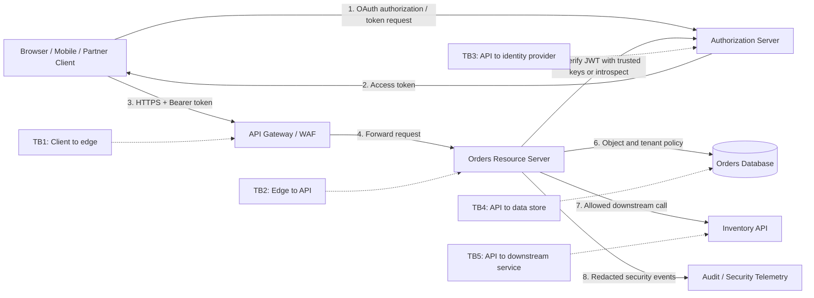

# Threat Modeling and Trust Boundaries of an API

## 1. Why Does a Resource Server Need Its Own Threat Model?

An OAuth 2.0 Resource Server is not just an endpoint with Bearer authentication enabled. It sits between multiple components with different trust levels: clients, the Authorization Server (AS), an API gateway, internal services, storage systems, message brokers, and external providers.

Each component can be misconfigured or compromised in different ways. A JWT with a valid signature can still be used with the wrong audience. A request that has passed through a gateway can still carry forged headers. A user with a valid scope can still read data belonging to another tenant if the API skips object-level authorization checks. An internal service can accidentally forward a Bearer token to an untrusted host.

A **threat model** is a structured way to describe the assets to protect, the actors that may attack, the data flow paths, the trust boundaries, the weaknesses that can be exploited, and the mitigations. For an OAuth 2.0/OIDC Resource Server, the threat model must cover both the token lifecycle and the authorization logic inside the API.

This lesson belongs to the **Secure Deployment** chapter of the **Spring Security OAuth 2.0 OIDC Resource Server** module. Its goal is to build a practical threat model for an API using Spring Security, identify trust boundaries, analyze STRIDE/abuse cases, and turn the results into configuration, tests, and operational procedures.

> **Foundational principle:** Trust must be established at each boundary with specific credentials, validation, and policies. Being inside an internal network, passing through a gateway, or having a valid JWT signature alone is not enough to grant access to data.

---

## 2. Scope and Terminology

A Resource Server API receives an access token to protect resources. The API can verify a JWT locally or introspect an opaque token via the AS.

| Term | Meaning in the Threat Model |
|---|---|
| **Resource Owner** | The entity that has the authority to grant access to a resource; usually an end user. |
| **Client** | The application requesting an access token and calling the API. A client can be a public client or a confidential client. |
| **Authorization Server (AS)** | Issues access tokens and manages clients, grants, consent, keys, and token policies. |
| **Resource Server (RS)** | The API that receives tokens, verifies credentials, and decides whether a request is allowed. |
| **Access token** | A credential representing permission to access a resource; it can be a JWT or an opaque token. |
| **ID Token** | An OIDC token describing the user authentication result for an OIDC client; not by default an API access token. |
| **Principal / subject** | The identity represented by Authentication. In a token, the subject is usually in the `sub` claim. |
| **Actor / client** | The component performing an action; it can be an OAuth client or a service calling on behalf of a user. |
| **Audience** | The resource server or group of resources for which the token is issued to be used. |
| **Scope / authority** | An API/action-level permission represented in a token or Authentication. |
| **Trust boundary** | A point where data, identity, or permissions cross from one trust domain to another and must be re-verified. |
| **Threat actor** | A person or system capable of exploiting a weakness to achieve an unauthorized goal. |

### 2.1. A Threat Model Is Not Just JWT Checking

JWT validation is one part of the threat model. A secure API must also consider:

- Who is allowed to call the endpoint?
- Is the user allowed to act on the specific object?
- Does the token have the right resource audience?
- Can a client spoof identity via headers?
- Can the API be forced to call an internal URL or an attacker-controlled host?
- Can tokens be leaked through logs, traces, browser storage, or outbound requests?
- Can a valid request cause excessive consumption of CPU, database connections, or introspection quota?
- When the AS, JWKS, or a downstream service fails, does the API fail closed or accidentally fail open?

### 2.2. Distinguishing Authentication and Authorization

**Authentication** answers: is the credential valid and which principal does it represent?

**Authorization** answers: is that principal allowed to perform this action on this specific resource?

For example, a JWT with a valid signature and the `orders:read` scope only proves that the token is accepted under the trust policy and that the principal has an API-level authority. It does not by itself prove that Alice is allowed to read order 42 or that the order belongs to Alice's tenant.

---

## 3. Identifying Assets to Protect

A threat model should start with assets, not with a list of technologies.

| Asset | Examples | Impact if Compromised |
|---|---|---|
| **Access token** | User or service JWT or opaque token | An attacker impersonates the principal within the token's permissions. |
| **Signing private key** | The AS's JWT signing key | An attacker self-issues forged tokens trusted by the RS. |
| **JWKS / public key metadata** | Public keys, key IDs, issuer metadata | Incorrect key discovery can break validation or cause trusting the wrong key. |
| **Client secret / private key** | Credential of a confidential OAuth client | An attacker obtains tokens using the client identity or impersonates the client. |
| **Refresh token** | Long-lived token of an OAuth client | Can maintain access after the access token expires. |
| **User identity** | Subject, tenant, roles, authentication context | Impersonation or incorrect privilege assignment. |
| **Business data** | Orders, invoices, profiles, payment records | Unauthorized disclosure, modification, or deletion of data. |
| **Tenant boundary** | tenantId, organizationId, accountId | Cross-tenant access and violation of data isolation. |
| **Authorization policy** | Scope mapping, role mapping, object policy | Over-granted or bypassed permissions. |
| **Service identity** | Workload identity, mTLS certificate, client credentials | A service impersonates another service or receives excessive permissions. |
| **Audit trail** | Actor, subject, action, resource, timestamp | Loss of investigation capability and accountability. |
| **Availability** | API capacity, database, introspection endpoint | DoS, resource exhaustion, or business disruption. |
| **Secrets and configuration** | Issuer URI, client credentials, truststore | Trust boundaries altered or credentials leaked. |

### 3.1. Classifying Data and Credentials

Not all data has the same sensitivity level. You should classify:

- Public data: can be made public.
- Internal data: intended only for authorized staff/services.
- Confidential business data: customer, transaction, or contract data.
- Sensitive personal data: personal data requiring strict access control and auditing.
- Security credentials: tokens, signing keys, client secrets, private keys, and session identifiers.

An access token must be treated as a **secret bearer credential**. Never put tokens in logs, URLs, metric labels, error responses, or support documents.

### 3.2. Defining Impact Before Choosing Controls

A token for reading a public catalog and a token for modifying payments have different impacts. The threat model should explicitly document:

- Confidentiality: data can be read without authorization.
- Integrity: data can be modified or deleted.
- Availability: the service can be slowed down or stopped.
- Accountability: it is impossible to determine who performed an action.
- Privacy/compliance: personal or regulated data is exposed.
- Lateral movement: compromising one service leads to compromising other services.

---

## 4. Identifying Actors and Attacker Capabilities

Do not assume attackers are only outsiders on the Internet. Risk sources can come from compromised legitimate clients, internal users, leaked service accounts, or third-party dependencies.

| Actor | Possible Capabilities | Common Objectives |
|---|---|---|
| **Anonymous Internet attacker** | Send arbitrary requests, fuzz headers/body/path, generate high load | Auth bypass, parser exploits, DoS, SSRF. |
| **Authenticated low-privilege user** | Holds a valid token with limited scopes | Read other users' objects, escalate privileges, cross tenant boundaries. |
| **Malicious OAuth client** | Has legitimate client registration or stolen credentials | Request wrong scopes, replay tokens, abuse grants. |
| **Compromised browser/mobile app** | Can extract tokens from app runtime/storage | Exfiltrate tokens and call APIs on behalf of the user. |
| **Compromised internal service** | Has network reachability and may possess workload credentials | Pivot to downstream services, relay tokens, spoof headers. |
| **Malicious tenant administrator** | Administrative permissions within their tenant | Attempt to access another tenant's data or abuse delegated access. |
| **Insider/operator** | Access to logs, configuration, secrets, or production console | Read data/tokens, alter trust configuration, delete audit trails. |
| **Compromised third-party service** | Receives outbound requests or callbacks | Capture relayed tokens, exploit SSRF/redirects. |
| **Compromised AS / signing key** | Can issue tokens or sign trusted JWTs | Impersonate any principal and permission across all resources trusting the issuer. |

### 4.1. Explicitly Stating What the Attacker Does Not Have

A threat model should state concrete assumptions, for example:

- The attacker does not have access to the AS's private signing key.
- The attacker can send Internet requests and knows the API URL.
- The attacker can register a normal user account.
- The attacker can control certain inputs such as path parameters, search filters, and webhook URLs.
- The attacker can replay a leaked access token until the token expires or is revoked.
- The attacker can call the service directly if network ingress is not restricted.

If an assumption is wrong, the security conclusion can be wrong. For example, if an API can be called directly bypassing the gateway, you cannot rely on a gateway authorization header as a trust anchor.

---

## 5. Drawing a Data-Flow Diagram and Marking Trust Boundaries

Before choosing Spring Security configuration, draw the request flow from client to data store.



The dotted lines are trust boundaries that require specific controls. This diagram is only an example; a system might not use a gateway, or might use opaque tokens, a service mesh, or multiple Resource Servers.

### 5.1. Trust Boundary 1: Client to Internet Edge

Data crossing the boundary:

- HTTP method, path, query, headers, and body.
- Bearer access token.
- Client-supplied identifiers such as userId, tenantId, or accountId.
- File uploads, search filters, and callback URLs.

Threats:

- Token theft/replay.
- Header spoofing.
- Request smuggling or parser discrepancy between proxy and app.
- Oversized payload, path traversal, injection, or malformed input.
- Brute force and request flooding.

Controls:

- Mandatory HTTPS; HSTS for browser-facing origins where appropriate.
- Validate request size, content type, schema, and encoding.
- Rate limit by IP, client, principal, and endpoint as appropriate.
- Do not trust identity/role/tenant headers from the client.
- Limit uploads, pagination, filter complexity, and execution time.
- Protect tokens in browser/mobile clients according to the platform's threat model.

### 5.2. Trust Boundary 2: Gateway to Resource Server

A gateway can terminate TLS, route requests, enforce coarse rate limits, and add correlation metadata. However, the API still needs to understand clearly what the gateway has verified.

Mandatory questions:

- Does the gateway only route requests or also validate access tokens?
- Does the API verify tokens independently?
- If the gateway adds `X-Authenticated-User`, who can call the API directly?
- Does the gateway strip client-sent headers before adding trusted headers?
- Does the internal hop use TLS/mTLS?
- Do network policies block bypassing the gateway?
- Do the gateway and the API share the same issuer, audience, and authorization policy?

Do not accept headers such as `X-User-Id`, `X-User-Roles`, or `X-Tenant-Id` as proof of identity if requests can reach the API from an unauthenticated source.

If the API trusts identity headers from the gateway, you must prove the gateway is a trusted proxy: incoming headers are stripped, new values are overwritten, direct ingress is blocked, the hop is authenticated, and header integrity is protected.

### 5.3. Trust Boundary 3: Resource Server to Authorization Server/JWKS

JWT validation typically requires public keys from a JWKS endpoint. Opaque tokens require an introspection call.

Threats:

- Trusting the wrong issuer or key source.
- JWKS/discovery URL configured to point to an untrusted host.
- Compromised DNS or TLS trust.
- AS outage causing authentication failures or request backlogs.
- Introspection endpoint flooding.
- Key rotation/caching creating an inconsistent verification window.

Controls:

- Configure issuer/JWKS/introspection URIs from trusted deployment config.
- Use HTTPS and certificate validation.
- Do not take arbitrary discovery URLs from requests or token claims.
- Restrict outbound network and egress.
- Cache JWKS/introspection according to an explicit policy.
- Timeouts and bulkheads for the AS dependency.
- Monitor key rotation and validator failures.
- Fail closed when new credentials cannot be verified, in line with the designed availability policy.

### 5.4. Trust Boundary 4: Resource Server to Database

Token authentication does not protect data if queries lack tenant/object constraints.

Threats:

- BOLA/IDOR: changing an order ID to read another user's object.
- Tenant escape: changing the tenant identifier in a request.
- Mass assignment: user writing sensitive fields such as owner, tenant, or approval status.
- SQL/NoSQL injection.
- Overly broad queries causing data exfiltration or DoS.

Controls:

- Check owner/tenant at the service/repository boundary.
- Derive principal identity from the verified Authentication.
- Do not take tenant/owner from client input as the source for authorization decisions.
- Apply constraints in the query or policy layer.
- Use a DTO allowlist instead of binding entities directly.
- Database least privilege, parameterized queries, and auditing.

### 5.5. Trust Boundary 5: Resource Server to Downstream API

If the API relays tokens or uses service credentials, this is an independent boundary.

Threats:

- User token sent to a host outside the allowlist.
- Downstream trusts a token with the wrong audience.
- Service identity has overly broad permissions.
- Caller-controlled headers spoof user/tenant.
- SSRF or redirects leak credentials.
- Downstream lacks object-level authorization checks.

Controls:

- Dedicated `WebClient` per destination/trust domain.
- Fixed base URL or allowlisted service discovery.
- Separate audience and scope for downstream services.
- Token exchange or client credentials when a different credential is needed.
- mTLS/workload identity for service-to-service communication.
- Do not log the `Authorization` header.
- Downstream independently verifies credentials and authorizes requests.

---

## 6. STRIDE Applied to an OAuth2/OIDC Resource Server

STRIDE is a way to categorize threats into six groups: Spoofing, Tampering, Repudiation, Information Disclosure, Denial of Service, and Elevation of Privilege.

| Category | Question for the Resource Server | Examples |
|---|---|---|
| **Spoofing** | Can an attacker impersonate a user, client, service, or issuer? | Forging `X-User-Id` header, using a token from a fake issuer. |
| **Tampering** | Can an attacker alter a token, request, or authorization metadata? | Modified JWT payload, altered tenant ID, role claim trusted from the wrong source. |
| **Repudiation** | Can actions be denied because auditing is insufficient? | Logs omit subject, actor, resource, or correlation ID. |
| **Information Disclosure** | Can tokens or business data be leaked? | `Authorization` header in logs, BOLA, token relay to an external host. |
| **Denial of Service** | Can CPU, memory, connections, or AS quota be exhausted? | Token flood, introspection flood, expensive queries. |
| **Elevation of Privilege** | Can a user/service gain permissions beyond policy? | Wrong scope mapping, confused deputy, missing tenant check. |

### 6.1. Spoofing

Items to verify:

- JWT signature is verified with a key belonging to the configured issuer.
- Issuer claim matches the expected issuer.
- Audience includes the API's resource identifier.
- Token type/profile is checked if required by the contract.
- Client identity is not inferred from caller-supplied headers.
- Trusted proxy strips and overwrites forwarded identity headers.
- Service-to-service requests authenticate workload identity.

### 6.2. Tampering

A signed JWT protects the integrity of claims if the signature is verified properly. However, request data outside the token still requires validation.

For example, an attacker sends a valid token but changes the path:

```http
GET /api/orders/other-users-order HTTP/1.1
Authorization: Bearer <valid-access-token>
```

The signature does not protect the path, query, or body. The API must verify permissions on the resource referenced by the request.

### 6.3. Repudiation

A useful audit event should contain:

- UTC timestamp.
- Correlation/trace ID.
- Stable subject/principal identifier.
- Client ID or actor/service identity if applicable.
- Action and resource identifier.
- Verified tenant context.
- Outcome (allowed/denied).
- Policy/reason category.
- Source service or gateway identity.

Do not log raw tokens, refresh tokens, client secrets, or full sensitive request bodies. The audit trail must have its own access control and retention policy; logs can be modified or deleted by an attacker with operational privileges if unprotected.

### 6.4. Information Disclosure

Specifically check:

- `Authorization` header in access logs, debug logs, and distributed traces.
- Exception bodies containing JWT claims.
- Error responses containing internal hostnames/stack traces.
- CORS allowing unnecessary origins.
- Object ID enumeration.
- Token relay to external services.
- Cache keys or metric labels containing tokens.
- Sensitive data in actuator/debug endpoints.

### 6.5. Denial of Service

A Resource Server can consume resources at multiple stages:

- Parsing large JWTs or complex JSON.
- Signature verification.
- JWKS refresh.
- Introspection HTTP calls.
- Database queries.
- Serialization/deserialization.
- Downstream fan-out.
- Password/client credential or token endpoint dependencies.

Enforce limits on header/token length, body size, request rate, concurrency, timeouts, pagination, query complexity, and connection pools. Set dedicated timeouts for the AS/downstream services and use bulkheads so a failing dependency does not exhaust all worker threads.

### 6.6. Elevation of Privilege

Common privilege escalation paths come from:

- Converter mapping claims incorrectly.
- Wrong role hierarchy or authority prefix.
- Overly broad scopes.
- Missing tenant/object ownership checks.
- Using an ID Token instead of an access token.
- Accepting the wrong audience.
- Trusting user role headers.
- Services able to relay user tokens to any destination.
- Confused deputy: a service uses its own permissions to perform an action the user is not allowed to perform.

---

## 7. Access Token Trust Boundary: Issuer, Audience, Scope, and Subject

An access token is only trustworthy when the Resource Server checks the full contract.

### 7.1. Issuer: Who Issued It?

The `iss` claim must match a trusted issuer. Do not use an issuer URL taken from a request parameter or automatically trust any issuer declared by the token.

If an application trusts multiple issuers, you need an explicit mapping: issuer → key source → token profile → tenant/client policy. Do not group all issuers into one trust domain if they have different semantics and security postures.

### 7.2. Audience: Which API Is the Token For?

Example:

```json
{
  "iss": "https://auth.example.test/realms/platform",
  "sub": "alice-123",
  "aud": ["orders-api"],
  "scope": "orders:read",
  "exp": 1890003600
}
```

A token intended for `orders-api` is not automatically allowed to call `inventory-api`. A valid signature only confirms that the token was signed by a trusted issuer and was not modified. Audience limits which resources accept the token.

Do not add all microservices to the audience just to reduce 401 errors. Issue per-resource tokens, or use token exchange or workload credentials when calling other services.

### 7.3. Subject: Who Does the Token Represent?

`sub` usually identifies the principal. However, its exact meaning depends on the issuer and token type. Do not assume all tokens have the same subject semantics:

- A user-delegated token may represent an end user.
- A client credentials token may represent an OAuth client/service.
- Token exchange may represent both a subject and an actor.
- A multi-tenant issuer may require combining issuer + subject or tenant context to form a unique identifier.

Do not use email/username as a stable security key if the issuer can change its value. Use a stable identifier defined by the contract.

### 7.4. Scope: At What Level Is the Permission?

Scopes typically represent API/action-level permissions, for example:

- orders:read
- orders:write
- inventory:read
- payments:refund

A scope does not by itself prove the user is allowed to act on every object in the API. An endpoint may require `orders:read`, yet the service must still verify that the order belongs to an authorized user/tenant.

### 7.5. Token Type and ID Token Confusion

An OIDC ID Token confirms authentication information for the client. A Resource Server should only accept access tokens with the right profile. Do not accept an ID Token merely because it is a JWT with a valid signature.

If the issuer supports the RFC 9068 JWT access-token profile, you can enforce `typ`/claims according to the agreed profile. Do not apply a single `typ` rule across all issuers if the contract does not specify it.

---

## 8. Threat Model for JWT Validation

A JWT is a self-contained token. The RS typically verifies the signature with a public key and checks claims locally.

A validation policy must consider:

1. Signature and allowed algorithm.
2. Trusted issuer.
3. API audience.
4. Expiration and not-before.
5. Token type/profile when required.
6. Required claims.
7. Scope/authority conversion.
8. Tenant/subject mapping.
9. Custom business constraints.

### 8.1. Signature Is Not Authorization

A JWT with a valid signature can still be:

- Expired.
- Before `nbf`.
- From the wrong issuer.
- For the wrong audience.
- An ID Token.
- Missing required scopes.
- Representing a client instead of a user.
- Carrying an unauthorized tenant.
- Not permitted to read a specific object.

Each validation layer answers a different question.

### 8.2. Algorithm and Key Trust

Do not blindly accept an algorithm just because the token header declares it. Use a decoder/framework configured with allowed algorithms and key sources belonging to a trusted issuer. Avoid writing custom JWT verification by Base64-decoding and comparing the payload manually.

Risks to check:

- Algorithm confusion or weak algorithms.
- Non-existent Key ID (`kid`) or one that triggers abnormal key lookups.
- Duplicate key IDs or bad metadata in JWKS.
- Key rotation not being updated.
- Public keys fetched from untrusted URLs inside the token/header.
- Decoder accepting a key incompatible with the algorithm/profile.

### 8.3. JWKS and Discovery Are Outbound Trust

`issuer-uri` or `jwk-set-uri` are trust configurations. If an attacker controls the URI, the RS could be directed to an attacker server or an internal network.

Do not take issuer/JWKS URLs from:

- Query parameters.
- Client-sent headers.
- `jku` or `x5u` claims not permitted by policy.
- Uncontrolled dynamic tenant metadata.
- Arbitrary redirects.

For multi-issuer/multi-tenant systems, issuer lookup must use an allowlisted registry and restrict network egress.

### 8.4. Key Rotation

The threat model needs to ask:

- How long before signing with a new key does the AS publish it?
- How long does the RS cache JWKS?
- Does an unknown `kid` trigger a refresh?
- Can refreshes be flooded?
- How long are old keys retained to validate still-valid tokens?
- If a key is compromised, how quickly can it be revoked/denied?

Do not remove an old key too early if tokens signed with it are still valid; nor keep a compromised key longer than necessary. Have an incident procedure for signing-key compromise.

---

## 9. Threat Model for Opaque Tokens and Introspection

An opaque token cannot be verified independently by the RS via JWT parsing. The RS sends the token to an introspection endpoint and receives status and metadata.

### 9.1. Trust Boundary with the Introspection Endpoint

You must verify:

- The introspection URI belongs to a trusted AS.
- The RS authenticates to the AS using confidential client credentials or a supported mechanism.
- Connections use HTTPS and certificate validation.
- Request timeouts and error handling are configured.
- The `active` response is handled properly.
- Scope, audience, subject, and tenant attributes are mapped properly.
- Tokens are not logged in request bodies or HTTP wire logs.

### 9.2. Availability and Caching

If the introspection server is slow or failing, the RS may not be able to verify new tokens. Do not fail open and allow requests simply because the AS is unavailable.

Caching introspection results can reduce latency, but creates a stale authorization window. The TTL should consider token expiry, revocation SLA, and endpoint sensitivity.

### 9.3. Distinguishing Inactive Tokens from Dependency Failures

- `active=false`: the token is inactive; authentication is rejected.
- Timeout/5xx: the AS could not provide a current result.
- 401/403 from the introspection endpoint: may indicate an RS credential/configuration issue.
- Malformed response: cannot construct a trustworthy principal.

Do not map all dependency failures to an anonymous request and continue processing. Fail closed for authentication; map availability errors according to the API contract and alert operations.

---

## 10. Authorization Trust Boundary: Scope Is Not Enough

A common mistake is stopping at authority checks:

```java
.requestMatchers(HttpMethod.GET, "/api/orders/**")
    .hasAuthority("SCOPE_orders:read")
```

The rule above protects the endpoint-level capability. It does not answer whether the user has permission to read a specific order.

### 10.1. Broken Object Level Authorization (BOLA)

Suppose Alice has an `orders:read` token. She calls:

```http
GET /api/orders/1001 HTTP/1.1
Authorization: Bearer <alice-access-token>
```

Then changes the path to:

```http
GET /api/orders/1002 HTTP/1.1
Authorization: Bearer <alice-access-token>
```

If order 1002 belongs to Bob but the API only checks the scope, Alice can read Bob's data. This is BOLA/IDOR.

### 10.2. Ownership Checks at the Service Layer

Example:

```java
@Service
public class OrderQueryService {

    private final OrderRepository orders;

    public OrderQueryService(OrderRepository orders) {
        this.orders = orders;
    }

    public Order getOrder(String orderId, Jwt jwt) {
        String subject = jwt.getSubject();
        String tenantId = requiredTenant(jwt);

        return orders.findByIdAndTenantId(orderId, tenantId)
            .filter(order -> order.isVisibleTo(subject))
            .orElseThrow(OrderNotFoundException::new);
    }

    private String requiredTenant(Jwt jwt) {
        Object value = jwt.getClaims().get("tenant_id");
        if (!(value instanceof String tenantId)
                || tenantId.isBlank()) {
            throw new AccessDeniedException("Missing tenant context");
        }
        return tenantId;
    }
}
```

This is an illustrative example. Claim names, tenant semantics, and ownership policies must follow the issuer/business contract. You can use repository queries to bind the tenant from the start rather than loading an arbitrary object and checking afterward.

### 10.3. Do Not Take the Tenant from the Request as Authority

Unsafe example:

```java
// Do not use the caller-supplied tenant as the source of authorization decisions.
String tenantId = request.getHeader("X-Tenant-Id");
return repository.findByTenantIdAndId(tenantId, orderId);
```

A client can alter the header. If the API allows a user to select one tenant among multiple tenants they are allowed to access, that selection must be verified against server-side checked membership/entitlements.

### 10.4. Combining Endpoint Policy and Object Policy

A complete authorization decision may require:

- Valid token.
- Correct audience.
- Scope/authority for the action.
- Principal is active and not disabled.
- Valid tenant context.
- User/service has membership.
- Object is within permitted scope.
- Business state permits the action.
- Separation of duties or approval rules if required by the business.

Do not cram all object authorization logic into a single regex matcher or rely solely on an `ADMIN` role.

---

## 11. Confused Deputy and Delegation

A **confused deputy** occurs when a service with its own privileges is persuaded by a caller to use those privileges to perform an action the caller is not allowed to perform.

Example:

1. Alice calls `orders-api` with a token that only has `orders:read`.
2. `orders-api` has broad service credentials to call `payments-api`.
3. Alice sends a request that causes `orders-api` to call the refund endpoint.
4. `orders-api` only checks that the user is authenticated without checking whether Alice has refund permission.
5. `payments-api` sees valid service credentials and executes the refund.

Downstream authenticates `orders-api` correctly, but the upstream API used its service privilege beyond the user's authority.

### 11.1. Distinguishing Subject and Actor

In a delegated call, you need to understand:

- Subject: the user or entity being represented.
- Actor: the service making the request on behalf of the subject.
- Client: the OAuth client that requested the token.
- Resource: the API receiving the token.

A client credentials token usually represents a service, not a user by itself. Do not put a user ID into a header and treat a service token as user delegation.

### 11.2. Credential Options

| Pattern | When Appropriate | What Downstream Must Understand |
|---|---|---|
| **User token relay** | Inbound token has an audience/scope suitable for downstream | User/delegated principal and original authorities. |
| **OAuth2 client credentials** | Task only needs workload identity | Service/client principal. |
| **Token exchange** | Need a new token for downstream audience/scope or delegation chain | Subject/actor and permissions granted by the AS. |
| **mTLS/workload identity** | Authenticate workload at network/service layer | Service identity, optionally combined with OAuth authorization. |

### 11.3. Do Not Escalate Privileges by Silently Swapping Credentials

If `orders-api` swaps a user token for a service token, you must check the user policy before calling downstream and audit both subject and actor. If downstream needs to make delegation decisions independently, use token exchange or a protocol supported by the issuer.

### 11.4. Token Relay Has Its Own Trust Boundary

A `WebClient` with a relay filter can attach a user token to outbound requests. Only use that client for approved destinations. Never use a relay `WebClient` for arbitrary URLs, webhooks, or external APIs.

---

## 12. Header Spoofing and Trusted Proxies

Many systems pass identity via headers behind a gateway. This is an easily misunderstood trust boundary.

Example headers:

```http
X-Authenticated-User: alice-123
X-Authenticated-Roles: ADMIN
X-Tenant-Id: tenant-a
X-Forwarded-For: 203.0.113.10
```

If a client can send these headers itself and the gateway does not strip/overwrite them, the API can trust forged data.

### 12.1. Conditions for Trusting Identity Headers

Only consider trusting proxy-issued headers if all of the following conditions are met:

- The API only receives traffic from the trusted proxy per network policy.
- The proxy strips all corresponding identity headers from client requests.
- The proxy generates new values from verified authentication.
- The proxy-to-API hop is protected by TLS/mTLS or an equivalent mechanism.
- Direct ingress cannot bypass the proxy.
- The API authenticates the proxy/workload identity.
- Header schema, encoding, and duplicate-header behavior are agreed upon.
- Tests prove spoofed headers from clients are not retained.

Even with trusted identity headers, the API still needs authorization at the endpoint and object levels.

### 12.2. Forwarded Headers

`X-Forwarded-For`, `Forwarded`, and `X-Forwarded-Proto` can be spoofed if the proxy chain is misconfigured. Only trust forwarded headers from proxy hops in the trusted proxy list. Do not use an IP from an arbitrary header as an identity or security principal.

### 12.3. Do Not Use CORS as Access Control

CORS is a browser policy controlling which origin's JavaScript can read a response. CORS does not prevent `curl`, mobile apps, backends, or attackers from calling the API directly. The API must still authenticate and authorize every request.

---

## 13. Browser, Cookies, CSRF, and CORS in the Threat Model

A Resource Server may receive Bearer tokens from a browser application or via cookies/sessions. The two models have different threat profiles.

### 13.1. Bearer Token in the Authorization Header

A browser app usually attaches the `Authorization` header explicitly. The browser does not automatically send that header to every site like cookies, but XSS can read the token if it resides in JavaScript-accessible storage or runtime.

Controls:

- Mitigate XSS with output encoding, CSP, and dependency hygiene.
- Use the authorization code flow with PKCE for public clients.
- Keep access tokens short-lived and audience-scoped.
- Do not store tokens in `localStorage` if the threat model requires protection against persistent XSS; consider a BFF or an appropriate storage/runtime strategy.
- Do not put tokens in URLs.
- Allowlist only necessary origins in CORS, without treating it as authorization.

### 13.2. Cookie Authentication

Cookies are sent automatically by browsers according to domain/path/SameSite rules. If an API uses cookie/session authentication, CSRF is a critical threat because an attacker can make the browser send requests that the user did not intentionally initiate.

Controls:

- CSRF tokens and appropriate `SameSite` policy.
- `Secure` and `HttpOnly` cookie flags.
- Check `Origin`/`Referer` according to an appropriate policy.
- Separate stateless Bearer-only APIs from browser session chains if the architecture requires it.
- Do not disable CSRF for a chain using cookies/sessions just because the endpoint is REST.

### 13.3. CSRF Is Not the Only Browser Issue

XSS can run inside a trusted origin and perform actions under the user's permissions. CSRF protection does not block XSS. Both the frontend and the API must be protected.

### 13.4. CORS Policy

CORS configuration should:

- Only allow origins that are actually needed.
- Only allow needed methods/headers.
- Never combine wildcard origin with credentials.
- Never arbitrarily reflect the `Origin` header.
- Handle preflight without bypassing authorization for the actual request.
- Not return tokens or sensitive data in unnecessary response headers.

---

## 14. SSRF and Outbound Trust

An API may call downstream services based on a URL or identifier supplied by the client. If the outbound HTTP client carries credentials, SSRF can turn the API into a proxy to steal tokens or access internal metadata.

### 14.1. Dangerous Example

```java
public Mono<String> fetch(String userSuppliedUrl) {
    return relayWebClient.get()
        .uri(userSuppliedUrl)
        .retrieve()
        .bodyToMono(String.class);
}
```

If `relayWebClient` attaches the current Bearer token, an attacker can supply a URL pointing to a server they control. The token can be sent to an unauthorized destination.

### 14.2. Controls for Outbound Destinations

- Use fixed base URLs in configuration.
- Map service IDs to allowlisted destinations.
- Validate scheme, host, and port.
- Block loopback, link-local, private ranges, and cloud metadata endpoints via network policy.
- Check DNS resolution and DNS rebinding risks.
- Do not follow redirects to untrusted origins when credentials may be forwarded.
- Use egress firewalls/network policies.
- Do not let request bodies or query parameters control arbitrary destinations.
- Separate token-relay `WebClient` instances from public/external `WebClient` instances.

### 14.3. JWKS/Discovery Are Also Outbound Requests

Issuer discovery and JWKS retrieval can be abused if URIs are not fixed. Do not create a decoder from a caller-sent issuer without an issuer registry, allowlist, and egress restrictions.

### 14.4. Timeouts and Redirects

Outbound clients need clear timeouts, connection pool limits, and redirect policies. A redirect to another host is a trust boundary transition. Verify the behavior of the HTTP connector in use rather than assuming the `Authorization` header is always handled safely.

---

## 15. Token Theft, Replay, and Proof of Possession

An OAuth 2.0 Bearer token has the property that any party possessing the token can use it within its permissions. Therefore, a stolen token can be replayed.

### 15.1. Sources of Token Leakage

- Browser storage or XSS.
- Compromised mobile devices.
- Application logs/debug logs.
- Distributed tracing or APM capture.
- Proxy/access logs.
- Crash dumps or heap dumps.
- CI artifacts and test reports.
- Support tickets/screenshots.
- URL query strings and `Referer` headers.
- Outbound requests to the wrong host.
- Message queues or databases storing tokens long-term.

### 15.2. Mitigating Token Replay

- Short access token lifetime commensurate with risk.
- Audience restriction.
- Least-privilege scopes.
- TLS on every hop.
- Protect tokens on both client and server.
- Do not log/persist raw tokens without an explicit credential vault design.
- Appropriate revocation/introspection policy.
- DPoP or mutual-TLS-bound access tokens if the ecosystem supports them and the threat model requires proof of possession.

DPoP and mTLS-bound tokens reduce the usability of a stolen token independently, but do not eliminate all replay or endpoint compromises. The protocol must be implemented properly across the client, AS, and RS.

### 15.3. Refresh Tokens Belong to a Different Boundary

A Resource Server typically only needs an access token. Refresh tokens are held by the OAuth client or a dedicated token-management component. Do not send refresh tokens to the API merely to extend sessions and do not log them.

---

## 16. Multi-Tenant Trust Boundary

A multi-tenant API risks cross-tenant leakage if tenant context is not verified at every layer.

### 16.1. A Tenant Claim Does Not Prove Membership by Itself

Example token:

```json
{
  "sub": "alice-123",
  "tenant_id": "tenant-a",
  "aud": ["orders-api"],
  "scope": "orders:read"
}
```

The RS should trust the `tenant_id` claim only when:

- The issuer has been verified.
- The claim has clear semantics in the token contract.
- The issuer only issues tenant membership after checking entitlements.
- The subject/client is permitted to operate in that tenant.
- Token audience and scope are appropriate.

Do not trust `tenant_id` from path/header/body without checking membership.

### 16.2. Users Belonging to Multiple Tenants

If a user is allowed to choose their active tenant, the API must verify the user is a member of that tenant. An access token with a subject does not necessarily restrict the user to a single tenant.

You can use an issuer-issued tenant claim or a server-side membership lookup. If the client sends a tenant selector, treat it as a requested context that must be authorized, not as proof.

### 16.3. Tenant Isolation at the Data Layer

Apply tenant filters in repositories/queries or database row-level security where appropriate. Use composite keys and constraints to avoid querying by a single object ID alone.

Example:

```java
Optional<Order> findByTenantIdAndId(
    String tenantId,
    String orderId
);
```

This is defense in depth. Application authorization still needs to verify that the actor has permission to act on the object within that tenant.

### 16.4. Background Jobs and Event Consumers

Message events may contain a tenant ID and user ID. Consumers should not trust the payload as a credential. Authenticate the producer/service identity, validate schema/signatures if required by the protocol, and enforce tenant policy at processing time.

---

## 17. OIDC and the Boundary Between Client Authentication and API Authorization

OIDC adds an identity layer on top of OAuth 2.0. An ID Token is issued to an OIDC client to confirm an authentication event. An access token is used to access resources.

The threat model needs to verify:

- The API only accepts access tokens conforming to the contract.
- The client verifies the ID Token according to its own OIDC flow.
- `nonce`, `state`, and PKCE are used properly in the corresponding authorization flow.
- Do not treat an ID Token as an access token simply because it has a valid signature.
- Do not trust the `email` claim unless `email_verified` is verified according to policy.
- Authentication assurance (`acr`, `amr`, `auth_time`) is only used when the issuer contract and validation are clear.
- The API does not infer that a user just re-authenticated solely from the `iat` of an ID Token.

### 17.1. `sub` Is Scoped to the Issuer

The same subject string from two different issuers does not necessarily refer to the same user. If the system trusts multiple issuers, principal identity should be namespaced by issuer or mapped explicitly.

### 17.2. Client Identity and User Identity Differ

A token may contain both `client_id` and `sub`. Do not assume `client_id` is a user. In the client credentials flow, the principal usually represents a service/client. Authorization policies must distinguish user-delegated calls from workload calls.

---

## 18. Spring Security: Configuring a Resource Server According to Trust Policy

A security configuration should reflect the threat model: protect only the required API paths, require explicit authorities, and deny by default.

Servlet Resource Server example:

```java
@Configuration
@EnableWebSecurity
@EnableMethodSecurity
public class ApiSecurityConfig {

    @Bean
    SecurityFilterChain apiSecurity(HttpSecurity http)
            throws Exception {
        return http
            .securityMatcher("/api/**")
            .sessionManagement(session -> session
                .sessionCreationPolicy(SessionCreationPolicy.STATELESS))
            .csrf(AbstractHttpConfigurer::disable)
            .authorizeHttpRequests(auth -> auth
                .requestMatchers(HttpMethod.GET, "/api/orders/**")
                    .hasAuthority("SCOPE_orders:read")
                .requestMatchers(HttpMethod.POST, "/api/orders/**")
                    .hasAuthority("SCOPE_orders:write")
                .anyRequest().denyAll())
            .oauth2ResourceServer(oauth ->
                oauth.jwt(Customizer.withDefaults()))
            .build();
    }
}
```

`csrf(AbstractHttpConfigurer::disable)` in the example is only appropriate for a stateless API chain authenticated via the `Authorization: Bearer` header and not relying on cookies/sessions. If a chain uses cookie authentication or browser sessions, corresponding CSRF protection is required.

Key imports:

```java
import org.springframework.context.annotation.Bean;
import org.springframework.context.annotation.Configuration;
import org.springframework.http.HttpMethod;
import org.springframework.security.config.Customizer;
import org.springframework.security.config.annotation.method.configuration.EnableMethodSecurity;
import org.springframework.security.config.annotation.web.builders.HttpSecurity;
import org.springframework.security.config.annotation.web.configuration.EnableWebSecurity;
import org.springframework.security.config.annotation.web.configurers.AbstractHttpConfigurer;
import org.springframework.security.config.http.SessionCreationPolicy;
import org.springframework.security.web.SecurityFilterChain;
```

### 18.1. Configuring Issuer and Audience

Configuring the issuer tells the Resource Server which issuer is trusted and its associated discovery/JWKS metadata. Audience must be checked against the API's resource identifier.

Decoder example:

```java
@Bean
JwtDecoder jwtDecoder() {
    String issuer = "https://auth.example.test/realms/platform";
    String jwkSetUri =
        "https://auth.example.test/realms/platform/protocol/openid-connect/certs";

    NimbusJwtDecoder decoder =
        NimbusJwtDecoder.withJwkSetUri(jwkSetUri).build();

    OAuth2TokenValidator<Jwt> issuerAndTimestamp =
        JwtValidators.createDefaultWithIssuer(issuer);

    OAuth2TokenValidator<Jwt> audienceValidator = jwt -> {
        if (jwt.getAudience().contains("orders-api")) {
            return OAuth2TokenValidatorResult.success();
        }

        return OAuth2TokenValidatorResult.failure(
            new OAuth2Error(
                "invalid_token",
                "Token audience is not orders-api",
                null
            )
        );
    };

    decoder.setJwtValidator(
        new DelegatingOAuth2TokenValidator<>(
            issuerAndTimestamp,
            audienceValidator
        )
    );

    return decoder;
}
```

Related imports:

```java
import org.springframework.security.oauth2.core.OAuth2Error;
import org.springframework.security.oauth2.core.OAuth2TokenValidator;
import org.springframework.security.oauth2.core.OAuth2TokenValidatorResult;
import org.springframework.security.oauth2.jwt.DelegatingOAuth2TokenValidator;
import org.springframework.security.oauth2.jwt.Jwt;
import org.springframework.security.oauth2.jwt.JwtDecoder;
import org.springframework.security.oauth2.jwt.JwtValidators;
import org.springframework.security.oauth2.jwt.NimbusJwtDecoder;
```

When setting a custom validator, you must keep all required validators for issuer, timestamp, audience, and access-token profile. Do not replace the default validator set with a standalone audience validator.

### 18.2. Opaque Token Configuration

For opaque tokens, the Resource Server uses a configured, trusted introspection endpoint. The introspection client's credential is a secret that must be managed separately. Configure timeouts, connection limits, and observability for the AS dependency.

### 18.3. Method Security and Object Authorization

Method security is useful for capability-level rules:

```java
@PreAuthorize("hasAuthority('SCOPE_orders:read')")
public Order getOrder(String orderId) {
    // Additional tenant and ownership policy still required.
}
```

Method security does not check ownership automatically unless the expression/policy does so. Place object authorization at the service/repository layer where sufficient principal, tenant, and resource context is available.

### 18.4. Deny by Default

Use `anyRequest().denyAll()` or an equivalent policy for the API chain where possible. When adding a new endpoint, developers must actively decide on its authority instead of accidentally allowing the endpoint due to a broad rule placed earlier.

---

## 19. CORS, CSRF, Sessions, and Statelessness Do Not Replace Authorization

Several configurations are frequently mistaken for complete security boundaries:

| Configuration / Mechanism | Solves | Does Not Solve |
|---|---|---|
| CORS | Which browser origins may read responses | API authentication, curl/mobile access, object authorization |
| CSRF token | Forged requests relying on browser auto-sent credentials | XSS, stolen Bearer tokens, missing scopes |
| Stateless session | Not storing `SecurityContext` in a stateful HTTP session | Token replay, BOLA, token theft |
| HTTPS | Protecting data in transit | Logged credentials, endpoint compromise, authorization bugs |
| API Gateway | Routing, edge policy, rate limiting, optional token validation | Object-level policy if the API does not enforce it |
| JWT signature | Integrity and issuer/key authenticity per trust config | Audience, scope, object ownership, revocation |
| Network allowlist | Restricting network reachability | Per-request identity/authorization |

A system requires multiple layers of controls. Never rely on a single mechanism to claim all threats are mitigated.

---

## 20. Service-to-Service Security and Workload Identity

In microservices, each service is a separate principal. An internal network is not an absolute trust domain.

### 20.1. Workload Authentication

You can use:

- OAuth2 client credentials.
- mTLS.
- Service mesh workload identity.
- Private-key JWT client authentication.
- Token exchange for delegated calls.

Credentials must be bound to the service identity and rotated. Do not share one client secret across all services if separate identities can be issued.

### 20.2. Least Privilege for Service Accounts

A service should only have the scopes it needs, such as `inventory:read`, not `inventory:*` or admin permissions. Separate client registrations by workload and environment.

### 20.3. Downstream Must Still Validate

`inventory-api` must verify the token/workload identity it receives. If a token's audience is `orders-api`, `inventory-api` should reject it. Do not rely on DNS names, private subnets, or self-asserted headers.

### 20.4. Token Relay and Token Exchange

Relay keeps the inbound token intact, so it is only appropriate if downstream is authorized to receive that token. Token exchange creates a new token under the AS's policy and is suitable when a different audience/scope/delegation is needed. Client credentials are suitable when only service identity is needed.

---

## 21. Secrets, Key Management, and Configuration Boundaries

### 21.1. Signing Keys

The AS's private signing key requires:

- KMS/HSM or an appropriate secret manager.
- Least-privilege access control.
- Rotation and revocation procedures.
- Key usage auditing.
- Separation between production, staging, and development.
- Controlled backup/recovery.
- Not stored in source code or container images.

The RS normally only needs public keys from JWKS. Never distribute private signing keys to Resource Servers.

### 21.2. Client Secrets

Client secrets for introspection or the client credentials flow require:

- A secret manager.
- Rotation without unexpected downtime.
- Never committed to repositories.
- Never appearing in logs/environment dumps.
- Least-privilege scopes/client permissions.
- Alerts on anomalous secret usage.

If private-key JWT or mTLS is supported, protect private keys/certificates under the same principles.

### 21.3. Issuer/JWKS/Introspection Configuration

These URIs define trust anchors. Manage them via reviewed deployment configuration. Validate schemes/hosts and do not let tenants/users change URIs arbitrarily.

### 21.4. Configuration Drift

If staging and production use different issuers/keys/audiences, bugs may occur only in one environment or unintended broad trust may arise. Use config-as-code, change reviews, and startup validation to detect drift.

---

## 22. Secure Logging, Tracing, and Auditing

Observability is essential for threat detection, yet it can itself become a credential leak vector.

### 22.1. Never Log the Following Values

- `Authorization` header.
- Raw JWT or opaque token.
- Refresh token.
- Client secret.
- Private key/certificate material.
- Full introspection request/response containing the token.
- Unnecessary sensitive claims or personal data.
- Session cookies.

### 22.2. Log Redacted Security Events

Example structure:

```json
{
  "event": "api.authorization.denied",
  "timestamp": "2026-11-15T10:00:00Z",
  "service": "orders-api",
  "route": "GET /api/orders/{id}",
  "subject_ref": "stable-pseudonymous-id",
  "client_id": "web-portal",
  "tenant_ref": "tenant-a",
  "required_authority": "SCOPE_orders:read",
  "reason": "object_not_visible",
  "correlation_id": "req-7f31"
}
```

This is a schema example, not literal values to log verbatim in every system. Pseudonymize identifiers where appropriate and avoid putting PII into metric labels.

### 22.3. Separate Security Audits from Debug Logs

Audit logs require their own integrity, retention, and access policies. Debug logs can be toggled on and off frequently, so do not use them as the sole evidence for critical actions.

### 22.4. Avoid High-Cardinality Metrics

Do not use tokens, user IDs, order IDs, or raw URLs as metric labels. Use route templates, outcomes, error categories, service names, and bounded dimensions.

---

## 23. Availability, Rate Limiting, and Fail-Closed Behavior

A threat model must also consider abuse of valid requests.

### 23.1. Multi-Dimensional Rate Limiting

You can apply rate limits by:

- IP/network source at the edge.
- OAuth client ID.
- Subject or tenant after authentication.
- Endpoint/action.
- Expensive query classes.
- Introspection client/service.
- Concurrent request budget.

Rate limiting by IP alone is insufficient for NAT/shared networks; rate limiting by user alone is insufficient against anonymous floods. Combine edge controls and application-level quotas.

### 23.2. Request Cost Limits

- Max header size and token length.
- Max body size.
- Pagination size.
- Filter/sort allowlists.
- Query timeout.
- Max downstream fan-out.
- Request deadline.
- Connection pools and concurrency.
- Upload/download limits.

### 23.3. Fail Closed When Identity Cannot Be Verified

If the JWT decoder cannot verify the signature/key or opaque introspection does not return a trustworthy result, do not allow the request to proceed as authenticated. You can return 401 for invalid credentials and 5xx/503 for dependency outages according to the contract, but never skip authentication.

### 23.4. Bulkheads and Circuit Breakers

Slow AS/JWKS/introspection/downstream dependencies can take down an API. Use timeouts, dedicated connection pools, concurrency limits, and appropriate circuit breakers/bulkheads. Do not retry every 401/403; retry only transient failures and idempotent requests.

### 23.5. JWKS Refresh Abuse

A high volume of tokens with an unknown `kid` can trigger key refreshes depending on decoder/cache behavior. Limit request rates, monitor JWKS fetches, and use appropriate cache/refresh policies. Do not write an unbounded custom key fetcher.

---

## 24. Sample Threat Register for the Orders API

A threat register clearly records scenario, asset, impact, likelihood, controls, and test evidence.

| ID | Threat Scenario | Asset / Impact | Primary Controls | Evidence |
|---|---|---|---|---|
| T-01 | Attacker uses a forged JWT or alters claims | Identity, business data | Signature, issuer, allowed algorithm, trusted key source | Signed-token test: tampered signature gets 401 |
| T-02 | Token intended for another API is sent to `orders-api` | Resource boundary | Audience validation | Wrong-audience token is rejected |
| T-03 | ID Token is used as an API credential | Identity confusion | Access-token profile/type validation | ID-token fixture is rejected |
| T-04 | Expired or not-yet-valid token is accepted | Credential validity | `exp`, `nbf`, clock skew policy | Fixed-clock boundary tests |
| T-05 | User reads an order of another tenant | Confidential business data | Tenant/object authorization | Cross-tenant test is denied |
| T-06 | Client spoofs `X-User-Id` or role headers | Principal integrity | Strip/overwrite headers, authenticate proxy | Spoofed-header integration test |
| T-07 | Service relays user token to attacker host | Bearer credential | Fixed destination, `WebClient` separation, egress control | External client test without `Authorization` |
| T-08 | Introspection flood overloads the AS | Availability | Rate limit, timeout, cache policy, bulkhead | Load/chaos test |
| T-09 | Token leaked via logs/traces | Credential confidentiality | Header redaction, telemetry policy | Log assertion/scanner |
| T-10 | Orders API uses service credential to refund for an unauthorized user | Integrity, financial impact | Check user action before service call, narrow service scope, delegation | Negative authorization test |
| T-11 | JWKS URL changed to an untrusted host | Trust anchor, SSRF | Config allowlist, TLS, egress policy | Config validation/network policy test |
| T-12 | Gateway bypassed directly | Edge policy | Private ingress, mTLS, independent API auth | Direct-ingress denial test |
| T-13 | Overly broad query exhausts DB | Availability/data exposure | Pagination/query limits, tenant filter, timeout | Query budget/load test |
| T-14 | Signing key compromised | Token authenticity | KMS/HSM, rotation/revocation, incident response | Key-rotation/revocation exercise |
| T-15 | Audit fails to distinguish user and service actor | Accountability | Subject/actor/client fields, immutable audit | Audit event contract test |

### 24.1. Risk Rating

You can rank risk by:

```text
Risk = Likelihood × Impact
```

Use a clearly defined scale for the organization. For example, a BOLA on an endpoint containing financial data has high impact even if the attacker needs a valid account. A debug logging bug that only occurs in local environments has a different likelihood/impact than in production.

Do not use a risk score to skip controls for critical credentials or data boundaries.

### 24.2. Recording Residual Risk

No system eliminates all risks. A threat register should record:

- Unmitigated threat.
- Existing controls.
- Residual impact.
- Owner accepting the risk.
- Next review date.
- Triggers requiring re-evaluation (new client, new issuer, new downstream, new data class).

---

## 25. Testing the Threat Model with Automated Tests

A threat model is valuable when turned into repeatable tests.

### 25.1. Authentication Tests

- Missing Bearer token → protected request rejected.
- Malformed token → no Authentication created.
- Invalid signature → 401.
- Wrong issuer → 401.
- Wrong audience → 401.
- Expired / not-yet-valid token → 401.
- Wrong token type/profile → 401 if profile requires it.
- Inactive opaque token → authentication failure.
- AS/introspection outage → does not fail open.

### 25.2. Authorization Tests

- Sufficient scope for action → allowed at endpoint level.
- Missing scope → 403.
- Correct role/permission mapping.
- User not in tenant → denied.
- User does not own object → denied.
- Client credentials cannot call user-only endpoints if policy forbids it.
- Service identity does not implicitly gain user authorities.
- Mass assignment cannot modify owner/tenant/approval fields.

### 25.3. Trust-Boundary Tests

- Spoofed identity headers from clients are stripped/ignored.
- Direct ingress cannot bypass gateway policy if the architecture requires a gateway.
- External `WebClient` does not relay tokens.
- Redirects do not send credentials to untrusted origins.
- JWKS/discovery hosts belong only to the allowlist.
- CORS does not permit origins outside policy.
- CSRF protection works for cookie/session chains.
- Downstream rejects tokens with the wrong audience.

### 25.4. Abuse/Availability Tests

- Oversized tokens/headers are rejected.
- Oversized bodies are bounded.
- Rate limiting is active.
- Introspection timeouts do not exhaust thread/connection pools.
- Database queries enforce pagination/timeouts.
- Retries do not repeat non-idempotent actions.
- JWKS refresh is not triggered infinitely by unknown key IDs.

### 25.5. Audit/Logging Tests

- `Authorization` header does not appear in application logs.
- Tokens do not appear in trace attributes.
- Denied actions record a reason category.
- Audits include subject, actor, resource, and correlation ID.
- PII/tokens are not included in metric labels.

---

## 26. Integration Testing with MockMvc and Signed JWTs

To test the actual trust policy, keep the real `SecurityFilterChain` and decoder in tests. Use a test signing key, sign tokens with specific claims, and send them in the `Authorization` header.

Example request:

```java
mvc.perform(get("/api/orders/42")
        .header(
            HttpHeaders.AUTHORIZATION,
            "Bearer " + signedToken))
    .andExpect(status().isOk());
```

Create token variants:

- Same key but wrong audience.
- Same audience but wrong issuer.
- Expired.
- Not yet valid (`nbf`).
- Missing scope.
- Wrong token type per profile.
- Tampered signature.
- Non-existent `kid`.

Expected results:

| Case | Rejection Layer | Common HTTP Status |
|---|---|---:|
| Invalid signature/issuer/audience/timestamp | Authentication | 401 |
| Valid token but missing scope | Authorization | 403 |
| Valid token but object does not belong to user | Object authorization | 403 or 404 per policy |
| AS/JWKS dependency unavailable | Authentication dependency/availability | 5xx/503 per contract |
| Oversized payload | Edge/request-size control | 413 or gateway-defined status |

Use the `jwt()` post-processor for authorization-only tests, but do not use it to conclude that signature/issuer/audience/timestamp validation ran.

---

## 27. Incident Response When a Trust Boundary Is Breached

The threat model should indicate actions to take when controls fail.

### 27.1. Exposed Access Token

1. Identify token type, issuer, subject/client, audience, and expiry in a secure environment.
2. Identify where the token may have leaked: logs, traces, browser, proxy, outbound destination.
3. Revoke the token/session or disable the client according to AS capabilities.
4. Rotate client secrets/keys if long-lived credentials were exposed.
5. Inspect audit logs for replay and anomalies.
6. Revoke/reduce client or subject permissions if needed.
7. Redact/delete log copies per retention/privacy policy.
8. Fix the logging/storage path and add a regression test.

### 27.2. Signing Key Compromise

1. Trigger the AS/security team incident response.
2. Stop signing with the compromised key.
3. Publish key rotation/revocation according to protocol and deployment strategy.
4. Update RS trust/cache behavior.
5. Identify tokens signed during the affected window.
6. Revoke sessions/tokens or require re-authentication per policy.
7. Investigate key access and KMS/HSM audits.
8. Check every issuer/resource server trusting that key.

Routine key rotation and key compromise response are two different procedures; a compromise may require removing a key even while valid issued tokens remain active.

### 27.3. BOLA or Cross-Tenant Data Exposure

1. Identify affected endpoints, object types, and tenant scope.
2. Temporarily block the route or enforce a stricter policy if needed.
3. Search audit/access logs by object ID and actor.
4. Determine what data was read/modified/deleted.
5. Notify incident/privacy owners per organizational procedure.
6. Fix the query/service authorization.
7. Add regression tests for same-tenant and cross-tenant cases.
8. Review similar endpoints sharing the same repository/service.

### 27.4. AS/JWKS/Introspection Outage

1. Distinguish invalid tokens from dependency outages.
2. Check DNS, TLS, endpoint health, and client credentials.
3. Check JWKS cache and key rotation state.
4. Monitor backlogs, timeouts, connection pools, and rate limits.
5. Maintain fail-closed behavior for unverified credentials.
6. Never disable validation to restore availability.
7. Restore the AS dependency and verify request flow with a signed/opaque test token.

---

## 28. Process for Threat Modeling a New API

You can apply the following process during design reviews.

### Step 1: Describe the API and Data

Document endpoints, methods, resource types, data classification, tenant model, and downstream dependencies.

### Step 2: List Actors

Include anonymous users, authenticated users, OAuth clients, service accounts, admins, gateways, AS, and third-party services.

### Step 3: Draw Data Flows

Diagram token issuance, inbound requests, validation, authorization, database access, downstream calls, and audit events.

### Step 4: Mark Trust Boundaries

Every transition from client → edge, edge → API, API → AS, API → DB, or API → downstream requires identifying credentials and validation.

### Step 5: Write Abuse Cases

Use STRIDE or attacker-style user stories:

- As a tenant A user, I try to read a tenant B order.
- As a compromised client, I replay a captured token.
- As a caller, I send forged headers to change the subject.
- As an attacker, I control a URL so the API sends tokens to my host.
- As an anonymous user, I flood introspection or expensive endpoints.

### Step 6: Select Controls

Map each threat to one or more concrete controls: signature/issuer/audience, scope, object policy, mTLS, allowlist, rate limit, redaction, timeout.

### Step 7: Define Test Evidence

Every critical control needs test or operational evidence. "Spring Security is enabled" is not sufficient evidence for BOLA or audience validation.

### Step 8: Record Residual Risk and Owner

Record remaining risk, owner, review date, and triggers requiring a threat model update.

### Step 9: Review When Architecture Changes

Update the threat model when:

- Adding an issuer/client.
- Adding or removing a gateway.
- Adding a downstream service.
- Switching from JWT to opaque or vice versa.
- Changing the audience/scope model.
- Adding multi-tenant features.
- Changing token relay/token exchange.
- Adding webhooks, file uploads, or dynamic URLs.
- Changing data classification or compliance requirements.

---

## 29. Pre-Production Review Checklist

| Category | Question |
|---|---|
| **Issuer trust** | Are issuers and key sources fixed/allowlisted? |
| **JWT validation** | Are signature, algorithm, issuer, audience, expiry, not-before, and profile checked? |
| **Opaque validation** | Do the introspection endpoint, client auth, timeout, active state, and cache have clear policies? |
| **Token purpose** | Does the API accept only access tokens with the right profile, without confusing ID Tokens? |
| **Authorization** | Do endpoints have explicit scopes/authorities and default deny? |
| **Object access** | Are ownership, tenant, and business state checked on each resource? |
| **Client/service identity** | Are user, OAuth client, and workload principals distinguished? |
| **Gateway** | Is direct ingress blocked? Are identity headers stripped/overwritten? |
| **Network** | Are TLS/mTLS, egress restrictions, and destination allowlists appropriate? |
| **Outbound calls** | Are tokens prevented from being relayed to external/arbitrary URLs? |
| **Browser** | Are CORS, CSRF, XSS, and token storage evaluated separately? |
| **Secrets** | Are signing keys/client secrets in a secret manager/KMS with rotation? |
| **Logging** | Are tokens/`Authorization` headers redacted from logs/traces/metrics? |
| **Availability** | Are rate limits, body/query limits, timeouts, pools, and bulkheads configured? |
| **Failure behavior** | Does it avoid failing open when tokens cannot be verified? |
| **Audit** | Are subject, actor, resource, action, outcome, and correlation ID captured? |
| **Testing** | Are there negative tests for invalid tokens, wrong audience, missing scope, BOLA, spoofed headers, SSRF, and DoS? |
| **Operations** | Are there runbooks for token/key compromise, AS outage, and cross-tenant exposure? |
| **Residual risk** | Does remaining risk have an owner and a review date? |

---

## 30. Technical References

- [Spring Security — OAuth 2.0 Resource Server JWT](https://docs.spring.io/spring-security/reference/servlet/oauth2/resource-server/jwt.html): JWT decoder, issuer, and validation.
- [Spring Security — OAuth 2.0 Resource Server Opaque Token](https://docs.spring.io/spring-security/reference/servlet/oauth2/resource-server/opaque-token.html): introspection-based authentication.
- [Spring Security — Authorization](https://docs.spring.io/spring-security/reference/servlet/authorization/index.html): request authorization, method security, and authorization managers.
- [OAuth 2.0 Security Best Current Practice — RFC 9700](https://www.rfc-editor.org/rfc/rfc9700.html): current OAuth 2.0 security recommendations.
- [OAuth 2.0 Bearer Token Usage — RFC 6750](https://www.rfc-editor.org/rfc/rfc6750.html): Bearer credentials and threat considerations.
- [JWT — RFC 7519](https://www.rfc-editor.org/rfc/rfc7519.html): JWT claims and token structure.
- [JWT Best Current Practices — RFC 8725](https://www.rfc-editor.org/rfc/rfc8725.html): algorithm, issuer, audience, and JWT validation guidance.
- [JWT Profile for OAuth 2.0 Access Tokens — RFC 9068](https://www.rfc-editor.org/rfc/rfc9068.html): access-token JWT profile.
- [OAuth 2.0 Token Exchange — RFC 8693](https://www.rfc-editor.org/rfc/rfc8693.html): subject/actor delegation and token exchange.
- [OAuth 2.0 Mutual-TLS Client Authentication and Certificate-Bound Access Tokens — RFC 8705](https://www.rfc-editor.org/rfc/rfc8705.html): mTLS and certificate-bound tokens.
- [OAuth 2.0 Demonstrating Proof of Possession — RFC 9449](https://www.rfc-editor.org/rfc/rfc9449.html): DPoP sender-constrained tokens.
- [OpenID Connect Core 1.0](https://openid.net/specs/openid-connect-core-1_0.html): ID Token, authentication context, and OIDC client behavior.
- [OWASP API Security Top 10](https://owasp.org/API-Security/editions/2023/en/): BOLA, broken authentication, resource consumption, SSRF, and API risks.
- [OWASP Threat Modeling](https://owasp.org/www-community/Threat_Modeling): threat modeling approaches.
- [OWASP SSRF Prevention Cheat Sheet](https://cheatsheetseries.owasp.org/cheatsheets/Server_Side_Request_Forgery_Prevention_Cheat_Sheet.html): controlling outbound destinations and SSRF.
- [OWASP Logging Cheat Sheet](https://cheatsheetseries.owasp.org/cheatsheets/Logging_Cheat_Sheet.html): secure logging and data to exclude from logs.

**Conclusion:** The threat model of an OAuth2/OIDC Resource Server must track identity, tokens, and business data across every trust boundary. Identify assets and actors, draw data flows, analyze spoofing/tampering/disclosure/DoS/privilege escalation, and map each threat to controls and test evidence. Spring Security provides the authentication and authorization foundation, but the API must still enforce audience, scope, tenant, object ownership, workload identity, and outbound destinations. A gateway, private network, or JWT signature does not replace those checks. The threat model must be updated whenever issuers, clients, services, data flows, or authorization policies change.
