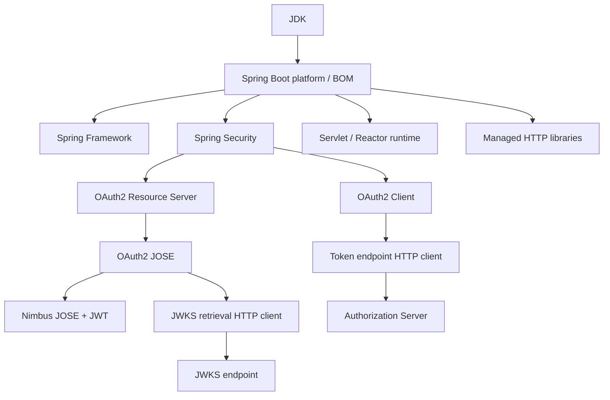

# Aligning Boot, Security, JOSE, and HTTP Library Version Sets

A Spring Security OAuth 2.0 Resource Server application can build cleanly yet still fail at runtime if Spring Boot, Spring Framework, Spring Security, JOSE/Nimbus, and the HTTP client are not part of a compatible version set. Failures typically surface at integration boundaries: classes no longer exist after migration, method signatures change, decoders fail to initialize, the JWKS client uses an unexpected HTTP stack, or the OAuth2 Client cannot reach the token endpoint.

The safe way to upgrade is to identify a **version set on the same release train**, let dependency management select the corresponding versions, and then verify the runtime classpath and actual OAuth code paths. The Spring Boot BOM is usually the primary source of management for Boot applications. When running standalone Spring Security, Spring Security must be managed with a BOM compatible with Spring Framework. JOSE/Nimbus and HTTP libraries must also be aligned against the actual dependency graph rather than upgrading individual artifacts in isolation.

This guide covers how to align those components, inspect the dependency tree, choose an HTTP client for Servlet/WebFlux, handle migrations across Spring generations, and verify JWT/JWKS/token endpoint behavior after upgrading.

> **Principle:** Choose Spring Boot first, and let Boot manage Spring Framework and Spring Security within the same release train. Override a dependency only for a verified compatibility reason, and inspect the entire runtime graph after any change.

## 1. What Components Make Up a Version Set?

A Resource Server typically depends on multiple layers:

| Component | Role in Application | What to Align |
|---|---|---|
| JDK | Runtime, TLS, crypto providers, language/API baseline | Minimum Java version and actual runtime |
| Spring Boot | Auto-configuration, dependency management, starters | Release train and BOM |
| Spring Framework | Servlet/WebFlux, HTTP abstractions, bean lifecycle | Version matching Boot |
| Spring Security | Filter chain, Resource Server, OAuth2 Client, method security | Version managed by Boot |
| Spring Security OAuth2 JOSE | JWT decoder/encoder, JWK integration | Same version as Spring Security modules |
| Nimbus JOSE + JWT | JWS/JWT/JWK/JWKS implementation | Version compatible with Spring Security JOSE |
| Servlet container | Servlet API and request runtime | Matching Jakarta/Servlet generation |
| Reactor / Reactor Netty | Reactive runtime and WebClient connector | Version per Spring Boot dependency management |
| HTTP client | Calling JWKS, token endpoint, introspection, and downstream | Matching client implementation and adapter |
| Test libraries | MockMvc, WebTestClient, WireMock, testcontainers | Do not pull a different Spring/Security generation into test runtime |

Logical dependency diagram:



These paths can use different HTTP abstractions depending on the version and configuration. For example, OAuth2 Client token acquisition and JWT decoder JWKS retrieval do not necessarily use the same HTTP client bean that the application configures for WebClient.

## 2. Start from the Spring Boot Release Train

For Spring Boot applications, the Boot parent/BOM is the starting point for managing Spring libraries and many foundational dependencies.

Gradle Kotlin DSL example:

```kotlin
plugins {
    java
    id("org.springframework.boot") version "<BOOT_VERSION>"
    id("io.spring.dependency-management") version "<PLUGIN_VERSION>"
}

dependencies {
    implementation("org.springframework.boot:spring-boot-starter-web")
    implementation("org.springframework.boot:spring-boot-starter-oauth2-resource-server")
    implementation("org.springframework.boot:spring-boot-starter-oauth2-client")

    testImplementation("org.springframework.boot:spring-boot-starter-test")
    testImplementation("org.springframework.security:spring-security-test")
}
```

The version placeholders above must be replaced with a chosen Boot release for the project. When using the Boot plugin/dependency management, there is no need to pin separate versions for individual Spring Framework or Spring Security artifacts.

### 2.1. Why Let Boot Manage Spring Security?

Boot tests a curated set of Framework, Security, Jackson, Reactor, embedded server, and integration library versions. Upgrading Spring Security on its own while keeping an older Boot version can produce an untested combination.

Risks include:
- Spring Security modules having different method signatures from sibling modules running at runtime.
- Boot auto-configuration calling APIs that are no longer compatible.
- OAuth2 JOSE pulling in a different Nimbus version than the dependency graph expects.
- Test starters pulling in a Spring Test version that differs from the Spring Framework runtime.
- HTTP client transitive dependencies being unintentionally upgraded or downgraded.

If a new Security feature is needed, first look for the Boot release train that supports that Security generation. If Boot cannot be upgraded, check the compatibility matrix and dependency graph before overriding.

### 2.2. Do Not Mix Spring Security Modules Across Major/Minor Versions

Artifacts such as:
- spring-security-core
- spring-security-web
- spring-security-config
- spring-security-oauth2-core
- spring-security-oauth2-jose
- spring-security-oauth2-resource-server
- spring-security-oauth2-client
- spring-security-test

should use the same release version. Mixing 6.x and 7.x modules, or incompatible patch versions, can cause `NoSuchMethodError`, `NoClassDefFoundError`, or differing behavior between compile time and runtime.

### 2.3. Non-Spring Boot Applications

If the application uses standalone Spring Framework/Security, manage Spring Security with its own BOM and manage Spring Framework with a matching release train. Do not arbitrarily pick a new Spring Security version and pair it with an old Spring Framework version.

Maven example:

```xml
<dependencyManagement>
    <dependencies>
        <dependency>
            <groupId>org.springframework.security</groupId>
            <artifactId>spring-security-bom</artifactId>
            <version>SPRING_SECURITY_VERSION</version>
            <type>pom</type>
            <scope>import</scope>
        </dependency>
    </dependencies>
</dependencyManagement>
```

If a Spring Framework BOM is needed, import a version compatible with the chosen Security release line. For Boot applications, do not add a standalone Security BOM unless you have a controlled override plan; two BOMs can compete for version management precedence.

## 3. Compatibility Matrix by Generation

No single fixed table of version numbers holds true for all times and all applications. Spring Boot, Framework, and Security release along release trains; new patch releases can update patch versions while staying on the same major/minor line.

The matrix below describes how to align major generations, not a list of patch versions to copy verbatim:

| Application generation | Spring Framework line | Spring Security line | Typical JDK baseline | Migration concern |
|---|---|---|---|---|
| Boot 2.x generation | Framework 5.x | Security 5.x | Java 8/11 depending on Boot release | javax.servlet, legacy matcher APIs, legacy configuration |
| Boot 2.7 transition | Framework 5.3.x | Security 5.7/5.8 depending on setup | Java 8+ per Boot release | Preparing for Security 6 migration |
| Boot 3.x generation | Framework 6.x | Security 6.x | Java 17+ | Jakarta namespace, Security 6 configuration |
| Boot 4.x generation | Framework 7.x | Security 7.x | Per Boot 4 release baseline | Framework 7/Security 7 migration and API changes |

When choosing specific versions:
1. Choose the target Boot release to run.
2. Read the system requirements for that exact release.
3. Inspect the dependency versions managed by Boot.
4. Confirm that the JDK in build tools, CI, and production runtime all meet the baseline.
5. Only then decide whether any dependency needs to be overridden.

Do not infer the JDK baseline solely from a developer's workstation. The Gradle toolchain, CI image, Docker base image, and production JVM must all match the baseline.

### 3.1. Spring Boot 2 to Boot 3

This is a major migration because Spring Framework 6 and Jakarta EE 9+ move the namespace from `javax` to `jakarta` for many APIs.

Examples:
- javax.servlet.Filter → jakarta.servlet.Filter
- javax.servlet.http.HttpServletRequest → jakarta.servlet.http.HttpServletRequest
- javax.validation.* → jakarta.validation.* in the corresponding validation APIs
- javax.persistence.* → jakarta.persistence.* in the JPA ecosystem

Not every package starting with `javax` moves to `jakarta`; Java SE APIs such as `javax.crypto` remain part of the JDK. Update packages based on API ownership rather than running a blind project-wide find/replace.

### 3.2. Spring Security 5 to 6

Common changes include:
- `WebSecurityConfigurerAdapter` has been removed; use a `SecurityFilterChain` bean.
- Legacy `authorizeRequests`/`antMatchers` are replaced with `authorizeHttpRequests`/`requestMatchers`.
- Lambda DSL is the modern configuration style.
- Method security uses `@EnableMethodSecurity`.
- Servlet types move to Jakarta when running on Framework 6/Boot 3.
- OAuth2 Client/Resource Server APIs and auto-configuration must be reviewed against the target version.

### 3.3. Spring Security 6 to 7

When upgrading to Security 7, read the migration guide and deprecation list for that exact release. Do not assume every Security 6 API still exists or preserves the same semantics. Specifically check:
- DSL configuration.
- Authorization APIs.
- OAuth2 Client managers and token clients.
- JWT/JWK decoder customization.
- Servlet/WebFlux integration.
- Test support and request post-processors.

## 4. Aligning Spring Security and JOSE/Nimbus

A JWT Resource Server uses Spring Security abstractions and a JOSE implementation to handle JWS/JWK.

Common Spring APIs:

| Spring Security API | Responsibility |
|---|---|
| JwtDecoder | Decode and validate JWTs |
| NimbusJwtDecoder | Nimbus-based implementation |
| JwtEncoder | Encode/sign JWTs |
| NimbusJwtEncoder | Nimbus-based encoder |
| JwtAuthenticationConverter | Convert claims into authorities |
| JwtTimestampValidator | Validate exp/nbf |
| OAuth2TokenValidator | Validate issuer/audience/custom claims |
| JWKSource | Key source for signing/verification |

### 4.1. JOSE Artifacts Must Match Spring Security

Typical dependency:

```kotlin
dependencies {
    implementation("org.springframework.boot:spring-boot-starter-oauth2-resource-server")
}
```

The Resource Server starter pulls in the required JWT/JOSE modules via Boot's dependency management. Do not add an arbitrary Nimbus version just to use a new API.

If source code directly imports Nimbus APIs to generate test keys, sign tokens, or read JWKs, declaring the Nimbus dependency directly may be appropriate so the dependency is explicit in the build file. However, its version should still come from the active Boot/Security dependency management.

### 4.2. Checking the Effective Nimbus Version

Using Gradle:

```powershell
.\gradlew dependencyInsight --dependency nimbus-jose-jwt --configuration runtimeClasspath
```

Or view the full dependency tree:

```powershell
.\gradlew dependencies --configuration runtimeClasspath
```

If using Maven:

```powershell
mvn dependency:tree -Dincludes=com.nimbusds:nimbus-jose-jwt
```

Determine:
- Which module pulls in Nimbus.
- Whether multiple candidate versions exist.
- Which version is selected.
- Whether any explicit constraint/force overrides it.
- Whether `compileClasspath` and `runtimeClasspath` resolve the same version.

### 4.3. Avoid Forcing Nimbus via `resolutionStrategy` Without Evidence

The following example can break compatibility:

```kotlin
configurations.all {
    resolutionStrategy {
        force("com.nimbusds:nimbus-jose-jwt:<ARBITRARY_VERSION>")
    }
}
```

A newer Nimbus version is not automatically compatible with an older Spring Security version. Internal APIs, constructors, exception behavior, or JWK cache behavior may change.

If a security advisory forces an override:
1. Identify the CVE and affected range.
2. Check whether Spring Boot/Security already has a patch release.
3. Review release notes and compatibility.
4. Override via dependency management with a clear scope.
5. Run real JWT/JWKS tests and inspect the runtime graph.
6. Document the reason and when to remove the override.

### 4.4. Using a Decoder/Encoder Does Not Mean Adding Nimbus Directly

If you only need to validate JWTs, prefer the `JwtDecoder` abstraction. If you need to sign internal tokens, consider `JwtEncoder`. Use Nimbus directly only when lower-level JOSE/JWK control is needed, for example:
- Generating signed JWT fixtures.
- Building test JWK/JWKS sets.
- Creating key rotation tests.
- Inspecting protected header/kid/algorithm.
- Handling specific JOSE profiles.

Keep business code dependent on Spring abstractions whenever possible to limit the blast radius when the JOSE implementation is upgraded.

## 5. Aligning HTTP Clients for OAuth Flows

A Resource Server/Client can use an HTTP stack in multiple places:

- JWT decoder fetching JWKS.
- Opaque token introspector calling the introspection endpoint.
- OAuth2 Client calling the token endpoint.
- WebClient/RestClient calling downstream APIs.
- OIDC client calling discovery/user-info endpoints.

Do not assume a single `WebClient` bean configuration automatically governs all of those requests. Each component can have its own HTTP client abstraction and customization point depending on the Spring version.

### 5.1. RestTemplate, RestClient, and WebClient

| Client | Usage Style | When Appropriate | Notes |
|---|---|---|---|
| RestTemplate | Blocking, synchronous | Existing Servlet applications | Still usable; verify migration path and request factory |
| RestClient | Blocking, fluent API | Spring Framework applications supporting this API | Not reactive; check exact Framework version |
| WebClient | Reactive/non-blocking, can also be invoked differently depending on API | WebFlux or integrations needing a reactive client | Built on Reactor and a connector |
| JDK HttpClient | JDK HTTP API | Simple clients or custom integrations | Requires suitable adapter/wiring with Spring components |
| Apache HttpClient 5 | External HTTP stack | Advanced pool, TLS/proxy/connection controls | Package/API differs from HttpClient 4 |
| Reactor Netty | Reactive transport | Standard WebClient reactive stack | Version must match Reactor/Spring dependency management |

Choose the client based on the application model and transport requirements. Do not introduce blocking HTTP calls onto a reactive event loop just to standardize on one library.

### 5.2. Servlet Applications

A Servlet Resource Server typically processes inbound requests on servlet threads. OAuth2 Client can use a Servlet-oriented authorized client manager and token response client. Downstream calls can use `RestClient`, `RestTemplate`, or `WebClient` depending on architecture.

When configuring the token endpoint HTTP client, verify the customization point API for the exact Spring Security version. Do not copy bean configurations from another version without confirming the classes/methods still exist.

### 5.3. WebFlux Applications

WebFlux typically uses:
- `SecurityWebFilterChain`.
- `ReactiveJwtDecoder`.
- `ReactiveOpaqueTokenIntrospector` when using opaque tokens.
- `ReactiveOAuth2AuthorizedClientManager`.
- `WebClient`/Reactor Netty.

Do not use the Servlet-only `OAuth2AuthorizedClientManager` in a reactive flow. Also do not invoke `RestTemplate` or an Apache blocking client directly on the Netty event loop.

### 5.4. Apache HttpClient 4 to 5

Migrating Apache HttpClient 4 → 5 is not just a version bump. Package namespaces and APIs change, for example:
- `org.apache.http.*` belongs to HttpClient 4.
- `org.apache.hc.client5.*` and `org.apache.hc.core5.*` belong to HttpClient 5.

Spring integration factories/request factories also differ by Framework generation. Check:
- Request factory class.
- TLS/SSL configuration.
- Connection pooling.
- Proxy authentication.
- Connection/request/response timeouts.
- Connection eviction/idle validation.
- Retry behavior.
- Metrics instrumentation.

Do not allow both HttpClient 4 and 5 to coexist without good reason. An older dependency can pull 4.x onto the runtime classpath while the application configures 5.x.

### 5.5. Reactor Netty and WebClient

When using `WebClient` with Reactor Netty, keep Reactor Core, Reactor Netty, and Spring WebFlux aligned under compatible dependency management. Do not override `reactor-netty-http` alone while ignoring the `reactor-core`/Netty transitive graph.

When upgrading:
- Verify the active connector.
- Verify the TLS provider and trust configuration.
- Verify connection pool limits.
- Verify response timeout and pending acquire timeout.
- Verify metric names/tags if dashboards depend on them.
- Test success, timeout, connection reset, and TLS failure cases.

## 6. Alignment Matrix by Application Profile

The following table helps guide verification steps and does not replace release notes for specific versions:

| Profile | Boot/Framework/Security | JOSE | Primary HTTP Client | What to Verify |
|---|---|---|---|---|
| Servlet Resource Server, JWT | Same Boot release train | Boot-managed Nimbus via Security JOSE | JWKS client per decoder configuration | Signature, issuer, audience, key cache |
| Servlet Resource Server, opaque token | Same Boot release train | Not required for the introspection path | Introspection HTTP client | active response, client auth, timeout |
| Servlet OAuth2 Client | Same Boot release train | JOSE needed only if app handles JWTs directly | Token response client | registration, grant, client auth |
| WebFlux Resource Server, JWT | Same Boot release train | Boot-managed Nimbus via Security JOSE | Reactive client/connector per decoder | Reactive decode, JWKS retrieval |
| WebFlux OAuth2 Client | Same Boot release train | Depends on token format | Reactive token response client | Reactive manager and token acquisition |
| Hybrid Servlet + downstream reactive | Same release train | Same JOSE dependency graph | May have both blocking and reactive clients | Threading, timeout, bean selection |
| Standalone Spring | Supported Framework/Security release train | Version compatible with Security JOSE | Client matching Framework generation | BOM alignment and container APIs |

### 6.1. Do Not Mix Servlet and Reactive Just Because Both Use OAuth2

Spring Security provides separate abstractions:
- `SecurityFilterChain` and `FilterChainProxy` for Servlet.
- `SecurityWebFilterChain` and `WebFilter` chain for WebFlux.
- `JwtDecoder` and `ReactiveJwtDecoder`.
- `OAuth2AuthorizedClientManager` and `ReactiveOAuth2AuthorizedClientManager`.

Having both `spring-webmvc` and `spring-webflux` in a dependency tree is not automatically wrong; Spring Boot supports using `WebClient` inside MVC applications. However, you must understand the runtime application type and pick the matching security/client managers.

### 6.2. JOSE Is a Shared Layer and Does Not Dictate the Application Model

Nimbus can handle JWT/JWK for both Servlet and Reactive integrations. However, the decoder wrapper, HTTP retrieval path, and lifecycle still differ. Do not infer from shared Nimbus usage that all HTTP client configurations are identical.

## 7. Declaring Dependencies Without Introducing Version Drift

### 7.1. Gradle with Spring Boot Dependency Management

Example:

```kotlin
dependencies {
    implementation("org.springframework.boot:spring-boot-starter-web")
    implementation("org.springframework.boot:spring-boot-starter-oauth2-resource-server")
    implementation("org.springframework.boot:spring-boot-starter-oauth2-client")

    // Add only when application code directly uses WebClient.
    implementation("org.springframework.boot:spring-boot-starter-webflux")

    // Add direct dependency if test source imports Nimbus APIs directly.
    testImplementation("com.nimbusds:nimbus-jose-jwt")

    testImplementation("org.springframework.security:spring-security-test")
}
```

Do not add the WebFlux starter solely to obtain one HTTP client class if the project has a lighter, more appropriate dependency option. If an application runs Servlet MVC while using `WebClient`, understand the dependency/runtime auto-configuration impact and ensure Boot still selects the intended application type.

### 7.2. Maven with Boot Parent

Example:

```xml
<parent>
    <groupId>org.springframework.boot</groupId>
    <artifactId>spring-boot-starter-parent</artifactId>
    <version>BOOT_VERSION</version>
    <relativePath/>
</parent>

<dependencies>
    <dependency>
        <groupId>org.springframework.boot</groupId>
        <artifactId>spring-boot-starter-oauth2-resource-server</artifactId>
    </dependency>
    <dependency>
        <groupId>org.springframework.boot</groupId>
        <artifactId>spring-boot-starter-oauth2-client</artifactId>
    </dependency>
    <dependency>
        <groupId>org.springframework.security</groupId>
        <artifactId>spring-security-test</artifactId>
        <scope>test</scope>
    </dependency>
</dependencies>
```

If using the Boot BOM instead of the parent, import the BOM in `dependencyManagement` and omit explicit versions for BOM-managed dependencies.

### 7.3. Avoid Repeating Version Declarations in Multiple Places

A project drifts easily when:
- The Boot plugin has one version.
- The Boot BOM has another version.
- A Spring Security BOM overrides Security.
- A Nimbus version is pinned in constraints.
- A Reactor Netty version is forced in `resolutionStrategy`.
- A test starter pulls in additional modules.

Centralize versions in a single management source. When an exception exists, document the dependency, reason, scope, and review deadline.

## 8. Inspecting the Dependency Graph Instead of Guessing from the Build File

Build files show only directly declared dependencies. The runtime classpath also includes transitive dependencies, constraints, platforms, capabilities, and exclusions.

### 8.1. Gradle `dependencyInsight`

Inspect each dependency:

```powershell
.\gradlew dependencyInsight --dependency spring-security-core --configuration runtimeClasspath
.\gradlew dependencyInsight --dependency spring-security-oauth2-jose --configuration runtimeClasspath
.\gradlew dependencyInsight --dependency nimbus-jose-jwt --configuration runtimeClasspath
.\gradlew dependencyInsight --dependency spring-webflux --configuration runtimeClasspath
.\gradlew dependencyInsight --dependency reactor-netty-http --configuration runtimeClasspath
.\gradlew dependencyInsight --dependency httpclient5 --configuration runtimeClasspath
```

Read the output to identify:
- Selected version.
- Requested versions.
- Selection reason.
- Dependency path.
- Which constraint/platform applies.
- Whether conflict resolution or force took effect.

### 8.2. Checking `compileClasspath` and `runtimeClasspath`

```powershell
.\gradlew dependencies --configuration compileClasspath
.\gradlew dependencies --configuration runtimeClasspath
.\gradlew dependencies --configuration testRuntimeClasspath
```

An error that appears only at runtime may stem from `runtimeClasspath` differing from `compileClasspath`. Tests may execute with a `testRuntimeClasspath` that differs from the production `runtimeClasspath`, so check all three when investigating linkage errors.

### 8.3. Maven Dependency Tree and Effective POM

```powershell
mvn dependency:tree -Dverbose
mvn help:effective-pom
```

The effective POM shows which BOM and properties ultimately manage versions. The dependency tree shows which artifact brings a library into the graph.

### 8.4. Finding Duplicate Classes and Legacy Dependencies

Look for signs such as:
- Multiple versions of the same Spring module.
- Split versions across Spring Security modules.
- Both HttpClient 4 and 5 present.
- Lingering `javax.servlet` APIs in a Boot 3+ app.
- Reactor Netty overridden out of sync with Spring Boot.
- Nimbus version forced outside dependency management.

Not every duplicate dependency causes a failure, but any cases sharing the same runtime package/API must be understood.

## 9. Version Catalogs, Dependency Locking, and Reproducible Builds

### 9.1. Using a Version Catalog for Plugins and Direct Dependencies

Gradle version catalogs help centralize plugin and directly managed dependency versions. However, you should not manually pin all transitive Spring artifacts in the catalog when the Boot BOM already manages them.

Example:

```toml
[versions]
spring-boot = "<BOOT_VERSION>"
spring-dependency-management = "<PLUGIN_VERSION>"

[plugins]
spring-boot = { id = "org.springframework.boot", version.ref = "spring-boot" }
spring-dependency-management = { id = "io.spring.dependency-management", version.ref = "spring-dependency-management" }
```

Keep a single version source for the Boot plugin and rely on dependency management to select Spring modules.

### 9.2. Dependency Locking

Gradle dependency locking pins the resolved graph. After upgrading the release train:
1. Update the Boot version.
2. Resolve the dependency graph.
3. Run tests.
4. Update the lock state per the repository workflow.
5. Review the lockfile diff.
6. Confirm there are no unexpected transitive versions.

Do not update the lockfile before inspecting the graph; a lockfile only records resolution and does not prove compatibility.

### 9.3. Dependency Verification

If the project uses Gradle dependency verification, update checksum/signature metadata following security procedures after verifying the artifacts. Do not disable verification to bypass unexplained checksum errors.

## 10. Runtime Symptoms of Version Mismatches

| Runtime Error | Possible Cause | What to Check |
|---|---|---|
| NoSuchMethodError | Compile/runtime API version mismatch | Runtime dependency tree and caller artifact |
| NoClassDefFoundError | Class missing at runtime or static initialization failed | Classpath, initial cause, and dependency scope |
| ClassNotFoundException | Class loader cannot find the class | Dependency packaging/optional module |
| NoSuchFieldError | Field changed between versions | Duplicate/overridden artifacts |
| AbstractMethodError | Interface/implementation from different API generations | Module version alignment |
| BeanCreationException creating JwtDecoder | JOSE/JWK/configuration mismatch or invalid property | Nested cause and decoder setup |
| SSLHandshakeException | Truststore/certificate/TLS provider | Runtime trust config, hostname, and CA |
| UnknownHostException | DNS/environment | Resolver, container network |
| WebClientRequestException | Transport/connector failure | Nested cause, Reactor Netty/JDK client |
| UnsatisfiedDependencyException | Auto-configuration or bean type mismatch | Condition report, bean definitions |
| Method/constructor signature mismatch | Split Spring module versions | Boot BOM and dependencyInsight |

### 10.1. `NoSuchMethodError` Is Not a Normal Business Code Bug

For example, the application compiles against an API with a newer method, but the runtime loads an older JAR. The JVM looks for the method and cannot find it. Editing the call site may not resolve the issue; the dependency graph must be fixed so caller and implementation align.

### 10.2. `BeanCreationException` Is a Wrapper, Not the Root Cause

When a `JwtDecoder` or OAuth2 client bean fails to initialize, inspect the nested exception:
- Invalid issuer/JWK URI.
- Unsupported algorithm.
- Missing class.
- Bean ambiguity.
- TLS/client initialization failure.
- Dependency version mismatch.

Do not just rename beans if the root cause is on the classpath.

## 11. Migrating from Spring Security 5 to 6 in a Resource Server

A migration usually consists of several independent changes.

### 11.1. Replacing `WebSecurityConfigurerAdapter` with `SecurityFilterChain`

Legacy configuration:

```java
@EnableWebSecurity
public class SecurityConfig extends WebSecurityConfigurerAdapter {

    @Override
    protected void configure(HttpSecurity http) throws Exception {
        http
            .authorizeRequests()
                .antMatchers("/public/**").permitAll()
                .anyRequest().authenticated()
            .and()
            .oauth2ResourceServer()
                .jwt();
    }
}
```

Bean configuration:

```java
@Configuration
@EnableWebSecurity
public class SecurityConfig {

    @Bean
    SecurityFilterChain securityFilterChain(HttpSecurity http)
            throws Exception {
        return http
            .authorizeHttpRequests(auth -> auth
                .requestMatchers("/public/**").permitAll()
                .anyRequest().authenticated()
            )
            .oauth2ResourceServer(oauth2 ->
                oauth2.jwt(Customizer.withDefaults())
            )
            .build();
    }
}
```

Real applications also need CORS, CSRF, session policy, exception handling, and chain matchers per the application contract. The goal here is to illustrate the new configuration API.

### 11.2. Replacing `antMatchers` with `requestMatchers`

Do not just rename the method. Verify matcher semantics, servlet path, context path, MVC integration, and rule ordering. Test exact request paths/methods after migration.

### 11.3. Jakarta Namespace

Update imports belonging to Jakarta EE APIs to match the dependency generation. Check:
- Servlet filters.
- Servlet listeners.
- Validation annotations.
- Persistence APIs.
- Servlet container.
- Third-party filters and test mocks.

An older dependency using `javax.servlet` may compile on its own yet fail at runtime in a Jakarta servlet container.

### 11.4. Method Security

Review legacy `@EnableGlobalMethodSecurity` and migrate to `@EnableMethodSecurity`. Verify proxy behavior, expression handlers, parameter name discovery, and tests invoking methods through Spring beans.

### 11.5. Test Support

Review:
- `MockMvc` setup.
- `jwt()` request post-processor.
- `@WithMockUser`.
- `TestSecurityContextHolder`.
- `WebTestClient` if using a reactive stack.
- Spring Security test module version.

Do not let `spring-security-test` drift from production Security modules.

## 12. Migrating HTTP Clients

### 12.1. `RestTemplate` Does Not Vanish Automatically on Framework Upgrade

An existing application can continue using `RestTemplate` as long as the API remains supported in the target generation. There is no need to rewrite every HTTP call solely because Boot is being upgraded.

If migrating to `RestClient`:
- Verify the target Framework version provides the required APIs.
- Choose an appropriate request factory.
- Preserve timeout/TLS/proxy/pool behavior.
- Review error handling and message converters.
- Check interceptors and observability.
- Test the token endpoint and downstream behavior.

### 12.2. `WebClient` Is Not Always the Better Choice

`WebClient` fits reactive pipelines or non-blocking requirements. If a Servlet application performs blocking business operations, converting every client call to reactive may increase complexity without clear benefit.

When using `WebClient` in MVC:
- Do not block on the shared event loop.
- Define lifecycle/connection pool ownership.
- Define who owns timeouts and retries.
- Propagate correlation context properly.
- Verify resource cleanup.

### 12.3. HTTP Client Migration Must Preserve Security Semantics

When swapping request factories/connectors, verify:
- The token endpoint still uses the intended client authentication method.
- JWKS fetching still trusts the intended CA/hostname.
- Redirect policies do not leak the `Authorization` header.
- Proxies do not strip or duplicate the `Authorization` header.
- Timeouts are not excessively long.
- Retries do not improperly repeat token issuance or business mutations.
- Error responses do not log client secrets or subject tokens.

## 13. Controlled Step-by-Step Upgrade Process

A recommended workflow:

**Step 1 — Capture baseline.** Record JDK, Boot, Framework, Security, Nimbus, Servlet container, Reactor, HTTP client, and the runtime dependency tree.

**Step 2 — Select target Boot release.** Review system requirements, support window, and migration guide.

**Step 3 — Align build environment.** JDK toolchain, CI image, Gradle/Maven wrapper, and production runtime.

**Step 4 — Update Boot plugin/parent/BOM.** Let Boot select the matching Spring module versions.

**Step 5 — Remove unnecessary explicit overrides.** Check constraints, force rules, exclusions, and the version catalog.

**Step 6 — Apply source migration fixes.** Jakarta imports, `SecurityFilterChain` DSL, request matchers, method security, and HTTP client APIs.

**Step 7 — Align JOSE/Nimbus.** Verify decoder, encoder, JWK parsing, key rotation, and algorithm policy.

**Step 8 — Align HTTP stack.** Verify JWKS/token/introspection/downstream clients have the right connector, TLS, pool, and timeouts.

**Step 9 — Run layered tests.** Unit, MockMvc/WebTestClient, signed JWT/JWKS, fake token endpoint, fake downstream, and packaging.

**Step 10 — Inspect the runtime graph.** Confirm there are no split Spring Security modules, unexpected duplicate HTTP clients, or incompatible `javax` APIs.

**Step 11 — Canary/rollout.** Monitor 401/403 rates, JWKS fetch, token endpoint errors, TLS failures, connection pool metrics, and downstream latency.

**Step 12 — Keep a rollback path.** Know which artifact/image/config is the previous release and avoid changing signing keys or issuers at the same time as a framework upgrade unless necessary.

## 14. Post-Upgrade Test Matrix

| Test Group | What Must Be Proven | Example |
|---|---|---|
| Startup/context | Auto-configuration and bean graph initialize cleanly | ApplicationContext starts |
| JWT positive | Tokens with valid signature/claims are accepted | Signed RS256 JWT |
| JWT negative | Invalid signature/issuer/audience/exp are rejected | Wrong key/claims |
| JWKS retrieval | Decoder fetches keys and handles rotation | Fake JWKS endpoint |
| Opaque token | Active/inactive introspection and network failures | Fake introspection server |
| OAuth2 Client | Token requests send proper grant/client auth/scope | Fake token endpoint |
| HTTP transport | TLS, proxy, timeout, pool behavior preserved | Mock server/TLS fixture |
| Authorization | Scope and method rules did not unintentionally change | GET/POST/PATCH/DELETE matrix |
| Method security | @PreAuthorize still enforces through proxies | Service invocation test |
| Error mapping | 401/403/5xx map as expected | Custom entry point/handler |
| Servlet compatibility | Jakarta container and filters work properly | Embedded server integration |
| Reactive compatibility | WebFilter/ReactiveJwtDecoder work properly | WebTestClient |
| Packaging | Runtime classpath contains the right modules | Boot jar/container smoke test |

### 14.1. Test Behavior, Not Just Compilation

Compilation success does not prove:
- The JWKS endpoint is reachable.
- JWT signatures are verified.
- Issuer/audience validators run.
- Authorities map correctly.
- Token endpoint requests preserve client authentication.
- HTTP clients preserve TLS/proxy/timeouts.
- The runtime JAR is not missing modules.

### 14.2. Use Real Tests at Integration Boundaries

A useful test suite includes:
- RSA test key pair and public JWKS.
- Real signed compact JWTs.
- Fake JWKS endpoint.
- Fake introspection/token endpoint.
- Fake downstream API.
- TLS test certificates when changing HTTP connectors/trust configuration.
- `MockMvc`/`WebTestClient` matching the application model.

Keep authorization tests using mock `Authentication` separate so they stay fast.

## 15. Checking JDK and TLS Providers

The JDK affects more than compilation. It also affects:
- TLS protocol/cipher availability.
- Default truststore.
- Certificate path validation.
- Cryptographic providers.
- DNS resolver behavior.
- HTTP client implementations.
- Reflection/module access.

When upgrading the JDK:
1. Check vendor/distribution and patch level.
2. Check JVM flags and truststore path.
3. Check CA certificates inside containers.
4. Check cipher/TLS policies of the identity provider.
5. Run handshake tests against JWKS/token endpoints.
6. Run signed JWT verification using production algorithms.
7. Check timezone and clock synchronization.

An `SSLHandshakeException` after a JDK upgrade is not necessarily a Spring Security or token bug. The root cause may be the truststore or TLS policy.

## 16. Managing Security Patches and CVEs Across Versions

Do not override a dependency based solely on an advisory without identifying the affected component.

Process:
- Identify the artifact and affected version range.
- Check Boot/Security release notes and managed dependency updates.
- Verify whether the CVE lies on an active code path.
- Prefer a patch release within the same supported release train.
- If an override is unavoidable, verify compatibility and test the graph.
- Document the dependency origin and remediation.
- Track the advisory when the next Boot train release ships.

For Nimbus, HTTP clients, Reactor Netty, and servlet containers, patching one component can pull in transitive changes. Review the full graph and regression tests, not just the direct artifact.

## 17. Runtime Observability After Migration

Monitor before and after rollout:

| Signal | Indicator of Version/Config Regression |
|---|---|
| Startup failures | Bean/constructor/class mismatch |
| 401 rate | JWT decoder, issuer/audience, JWKS, or client token behavior |
| 403 rate | Authority mapping, request matcher, method security |
| JWKS fetch latency/errors | JOSE HTTP client, TLS, DNS, cache |
| Token endpoint latency/errors | OAuth2 Client/token response client |
| Introspection latency/errors | Opaque token HTTP client |
| Downstream latency/errors | WebClient/RestClient/connection pool |
| TLS handshake failures | JDK, truststore, provider, certificate |
| Connection pool pending | Client configuration or downstream saturation |
| NoSuchMethodError/LinkageError | Runtime dependency graph mismatch |

Use the same metric dimensions before and after the upgrade for comparison. Never add raw tokens, subjects, or object IDs as metric labels.

## 18. Version Set Alignment Checklist

- [ ] Build, CI, container, and production JDKs meet the target Boot baseline.
- [ ] Boot plugin/parent/BOM share the same release.
- [ ] Spring Framework is managed by Boot.
- [ ] All Spring Security modules share the same version.
- [ ] spring-security-test matches production Security modules.
- [ ] OAuth2 JOSE is pulled from the same Security release train.
- [ ] Nimbus version is verified via dependencyInsight/dependency tree.
- [ ] No unexplained Nimbus force/override exists.
- [ ] Servlet API uses the right javax/jakarta generation.
- [ ] Servlet container is compatible with target Framework.
- [ ] Reactor and Reactor Netty are under compatible dependency management.
- [ ] HTTP client 4/5 are not unintentionally mixed.
- [ ] RestClient/WebClient/RestTemplate APIs match the Framework version.
- [ ] Servlet and Reactive OAuth2 managers are not used on the wrong stack.
- [ ] JWKS, introspection, and token endpoint HTTP clients have proper TLS/proxy/timeouts.
- [ ] RuntimeClasspath and testRuntimeClasspath have been inspected.
- [ ] No NoSuchMethodError/NoClassDefFoundError/AbstractMethodError remain.
- [ ] Signed JWT/JWKS integration tests pass.
- [ ] OAuth2 Client token endpoint tests pass.
- [ ] Downstream HTTP transport tests pass.
- [ ] 401/403/error mapping did not change unexpectedly.
- [ ] Rollout metrics and rollback artifact/config are clearly defined.

## 19. References

- [Spring Boot Documentation](https://docs.spring.io/spring-boot/documentation.html): system requirements, dependency management, starters, and migration guides.
- [Spring Boot Dependency Versions](https://docs.spring.io/spring-boot/appendix/dependency-versions/index.html): dependency versions managed by each Boot release.
- [Spring Security Reference](https://docs.spring.io/spring-security/reference/index.html): Servlet, WebFlux, Resource Server, and OAuth2 Client APIs.
- [Spring Security Migration Guides](https://docs.spring.io/spring-security/reference/migration/index.html): changes and upgrade instructions across generations.
- [Spring Framework Reference](https://docs.spring.io/spring-framework/reference/): RestClient, RestTemplate, WebClient, Servlet, and WebFlux.
- [Spring Framework Migration Guide](https://github.com/spring-projects/spring-framework/wiki): changes across Framework generations.
- [Nimbus JOSE + JWT](https://connect2id.com/products/nimbus-jose-jwt): JWT/JWS/JWK/JWKS implementation and release information.
- [Apache HttpClient 5 Documentation](https://hc.apache.org/httpcomponents-client-5.5.x/): client APIs, connection management, and TLS configuration.
- [Reactor Netty Reference](https://projectreactor.io/docs/netty/release/reference/): reactive HTTP client/server and connection pool.
- [Gradle Dependency Management](https://docs.gradle.org/current/userguide/dependency_management.html): platforms, constraints, dependency insight, and locking.
- [Maven Dependency Management](https://maven.apache.org/guides/introduction/introduction-to-dependency-mechanism.html): dependency management and transitive dependency resolution.

**Conclusion:** A Resource Server's version set must be aligned as a whole system: JDK, Boot, Framework, Security, JOSE/Nimbus, Servlet or Reactive runtime, and HTTP clients. Use the Boot BOM as the primary version source for Boot applications, avoid mixing Spring Security modules or arbitrarily forcing Nimbus, and inspect the runtime dependency graph rather than just reading the build file. After migration, run tests covering signatures/JWKS, claims, authorization, the token endpoint, and downstream HTTP to confirm both API and transport behavior remain intact. **A consistent dependency graph and an integration test suite tailored to the application profile are the foundation for safe upgrades.**
