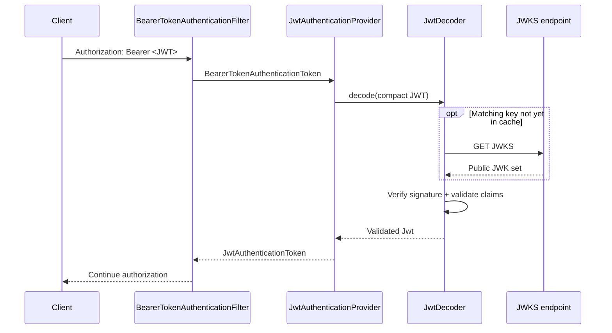
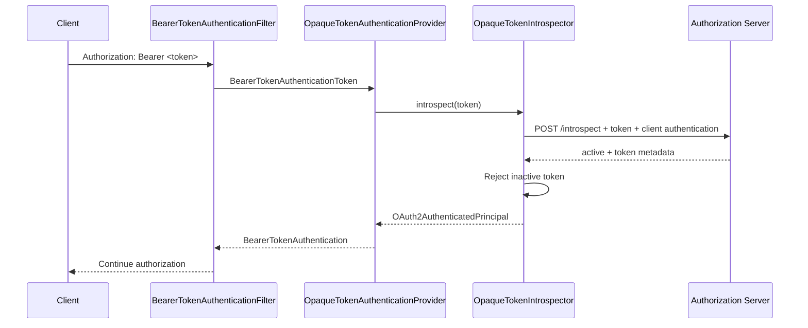

# Replacing Local JWT Verification with Introspection and Comparing Behavior

## 1. The Problem: Who Confirms an Access Token Is Still Valid?

Spring Security Resource Server can validate a Bearer access token in two ways:

- **JWT local validation:** The Resource Server receives a compact JWT, uses a trusted public key to verify the signature, and then validates the issuer, timestamps, audience, and claims per contract. Spring Security typically performs this via `JwtDecoder`, such as `NimbusJwtDecoder`.
- **Opaque token introspection:** The Resource Server sends the token to the Authorization Server's (AS) introspection endpoint. The AS returns metadata about the token, where `active` indicates whether the token is currently considered active. Spring Security performs this via `OpaqueTokenIntrospector`, typically `NimbusOpaqueTokenIntrospector`.

In both cases, the client sends the same kind of HTTP credential:

```http
GET /api/orders HTTP/1.1
Host: api.example.test
Authorization: Bearer <access-token>
```

The difference lies in how the Resource Server verifies the token after extracting the Bearer credential.

**JWT does not mean local validation, and opaque does not mean a specific encryption algorithm.** JWT is a token format; introspection is a protocol for asking the AS about a token's status and metadata. An AS can also allow introspecting a JWT. When switching to introspection, the Resource Server asks the AS instead of deciding locally with `JwtDecoder`.

## 2. Two Authentication Flows

### 2.1. JWT Local Validation

With JWT, the Resource Server can verify tokens without calling the AS on every request:



The decoder verifies the signature using a key fetched from JWKS or configured directly. It also needs validators for issuer, timestamps, audience, and token profile. JWKS fetching is usually cached; therefore, a normal request does not necessarily make a network call to the AS.

### 2.2. Opaque Token Introspection

With introspection, the Resource Server sends the token to the AS over a server-to-server request:



The AS decides whether the token is still active and can return attributes such as `sub`, `scope`, `client_id`, `aud`, `iss`, `exp`, or custom claims. Spring Security uses the returned principal and authorities to continue authorization.

### 2.3. Which Spring Security Components Change

| Stage | JWT | Opaque introspection |
| --- | --- | --- |
| Bearer header extraction | `BearerTokenAuthenticationFilter` | `BearerTokenAuthenticationFilter` |
| Authentication provider | `JwtAuthenticationProvider` | `OpaqueTokenAuthenticationProvider` |
| Verification component | `JwtDecoder` | `OpaqueTokenIntrospector` |
| Resulting principal | `JwtAuthenticationToken` | `BearerTokenAuthentication` with `OAuth2AuthenticatedPrincipal` |
| Source deciding token active state | Decoder and validators at the Resource Server | Introspection response from the AS |
| Per-request network dependency | Usually none, except JWKS fetch/refresh | Usually one introspection request, unless cached |

Both authentication modes share the Bearer filter and authorization layer. Switching does not require changing controllers or the header the client sends.

## 3. When to Choose Introspection?

Introspection is appropriate when the AS needs to retain control over token state at request time:

- Access tokens can be revoked before `exp`.
- The AS needs to invalidate tokens on user logout, account lock, or session revocation.
- Tokens are opaque strings and claims must not be exposed directly to the client.
- The AS has dynamic policy logic to determine whether a token is still active.
- Multiple Resource Servers need to query the same central source of state.

JWT local validation is appropriate when:

- Latency must be minimized and calling the AS per request avoided.
- The Resource Server must continue operating independently when the AS is temporarily unavailable.
- Tokens are short-lived and an expiration-based revocation window (`exp`) is acceptable.
- The AS issues JWTs under a stable contract with well-managed issuer, audience, and key rotation.
- Request volume is high and you do not want the introspection service to become a synchronous dependency on every API call.

Neither option is universally better. You must weigh revocation immediacy, latency, load on the AS, availability, and privacy requirements.

## 4. Current JWT Resource Server Configuration

Example JWT configuration in Spring Boot:

```yaml
spring:
  security:
    oauth2:
      resourceserver:
        jwt:
          issuer-uri: https://login.example.test
          audiences:
            - orders-api
```

`issuer-uri` enables Spring Security to discover issuer metadata to locate the JWKS endpoint and configure issuer validation. Depending on the Spring Boot version, the `audiences` property may be supported to configure audience validation; if not, configure a validator in code.

JWKS can also be configured directly:

```yaml
spring:
  security:
    oauth2:
      resourceserver:
        jwt:
          issuer-uri: https://login.example.test
          jwk-set-uri: https://login.example.test/oauth2/jwks
```

When using `jwk-set-uri`, still keep issuer validation. The public key source and the issuer identity are two separate parts of the trust contract.

Security chain using JWT:

```java
@Bean
SecurityFilterChain api(HttpSecurity http) throws Exception {
    return http
            .authorizeHttpRequests(authorize -> authorize
                    .requestMatchers("/public/**").permitAll()
                    .requestMatchers(HttpMethod.GET, "/api/orders/**")
                        .hasAuthority("SCOPE_orders:read")
                    .requestMatchers(HttpMethod.POST, "/api/orders/**")
                        .hasAuthority("SCOPE_orders:write")
                    .anyRequest().authenticated())
            .oauth2ResourceServer(oauth2 ->
                    oauth2.jwt(Customizer.withDefaults()))
            .build();
}
```

This authorization section can stay unchanged when switching to introspection as long as authority mapping still produces the same authority names.

## 5. Replacing with Opaque Token Introspection in Spring Boot

### 5.1. Configuration via `application.yml`

Replace `jwt` configuration with `opaquetoken`:

```yaml
spring:
  security:
    oauth2:
      resourceserver:
        opaquetoken:
          introspection-uri: https://login.example.test/oauth2/introspect
          client-id: orders-resource-server
          client-secret: ${ORDERS_INTROSPECTION_CLIENT_SECRET}
```

`client-id` and `client-secret` are the Resource Server's server-to-server credentials for calling the introspection endpoint. They are not end-user credentials and must never be sent back to the client.

Store the secret using a secret manager, workload identity, or appropriate secret injection mechanism. Do not commit real values into repositories, images, or shared config files.

Security chain:

```java
@Bean
SecurityFilterChain api(HttpSecurity http) throws Exception {
    return http
            .authorizeHttpRequests(authorize -> authorize
                    .requestMatchers("/public/**").permitAll()
                    .requestMatchers(HttpMethod.GET, "/api/orders/**")
                        .hasAuthority("SCOPE_orders:read")
                    .requestMatchers(HttpMethod.POST, "/api/orders/**")
                        .hasAuthority("SCOPE_orders:write")
                    .anyRequest().authenticated())
            .oauth2ResourceServer(oauth2 ->
                    oauth2.opaqueToken(Customizer.withDefaults()))
            .build();
}
```

When Boot detects the `opaquetoken` properties, it configures a default introspector. Endpoints continue accepting the Bearer header as before.

### 5.2. Explicit Configuration in Java

If explicit configuration is needed:

```java
@Bean
SecurityFilterChain api(HttpSecurity http) throws Exception {
    return http
            .authorizeHttpRequests(authorize -> authorize
                    .anyRequest().authenticated())
            .oauth2ResourceServer(oauth2 -> oauth2
                    .opaqueToken(opaque -> opaque
                            .introspectionUri(
                                    "https://login.example.test/oauth2/introspect")
                            .introspectionClientCredentials(
                                    "orders-resource-server",
                                    introspectionClientSecret)))
            .build();
}
```

This is a Spring Security 6.x configuration API example. In a real application, inject the URI and secret from configuration or a secret manager rather than hardcoding them.

### 5.3. Choose Only One Authentication Mechanism per Chain

In a simple setup, replace `.jwt(...)` with `.opaqueToken(...)` on the active chain. Do not leave two different configurations competing to handle the same Bearer request without an explicit routing design.

If the system needs to support both credential types in parallel during a migration period, explicitly design how the authentication manager/introspector is selected or split chains along intentional boundaries. Do not decide the token type merely by trying to decode the string and falling back arbitrarily; that easily creates inconsistent behavior and weakens the token contract.

## 6. What Does the Introspection Endpoint Receive and Return?

RFC 7662 defines OAuth 2.0 Token Introspection. The Resource Server sends the token to the endpoint over HTTPS and authenticates the client using a method supported by the AS, typically HTTP Basic or another client authentication mechanism.

The request is typically form-urlencoded:

```http
POST /oauth2/introspect HTTP/1.1
Host: login.example.test
Content-Type: application/x-www-form-urlencoded
Authorization: Basic <resource-server-client-credentials>

token=<access-token>
```

Do not log the request body or the `Authorization` header. The body contains the raw access token being checked.

Example response:

```json
{
  "active": true,
  "scope": "orders:read orders:write",
  "client_id": "web-client",
  "username": "user-123",
  "token_type": "Bearer",
  "exp": 1893456000,
  "iat": 1893452400,
  "sub": "user-123",
  "aud": ["orders-api"],
  "iss": "https://login.example.test",
  "jti": "token-reference-123"
}
```

In RFC 7662, `active` is the core attribute; many other attributes are optional or AS extensions. Do not assume every AS returns the same set of claims or the same data types.

### 6.1. What Does `active` Mean?

- `active: true`: according to the AS, the token is currently active and its metadata can be used for authentication/authorization per contract.
- `active: false`: the token is not considered active; the Resource Server must reject it.
- Introspection endpoint error, timeout, or invalid response: the Resource Server has no proof the token is active and must fail closed.

`active: true` does not automatically prove the token is intended for the current API or carries the required scopes. The Resource Server must still validate audience/resource, issuer, timestamps, and authorization metadata per contract.

### 6.2. Why Might the AS Return `active: false`?

For example:

- The token has expired.
- The token was revoked.
- The underlying grant or session was revoked.
- The user or client was disabled.
- The token does not exist or does not belong to the issuer.
- The introspection client is not authorized to inspect the token.
- The AS does not want to disclose whether the token exists.

The Resource Server should not distinguish these details to the caller if doing so leaks internal information.

### 6.3. The Introspection Client Is Not the End-User Client

Credentials calling the introspection endpoint represent the Resource Server. The AS can restrict which Resource Servers may introspect tokens, which token types they can inspect, which resources/audiences the client can receive, which metadata is returned, and rate limits/quotas per client.

Do not use a browser/mobile app's client ID/secret as introspection credentials. Never pass an introspection secret to the frontend.

## 7. Mapping Principal and Scopes in Spring Security

`NimbusOpaqueTokenIntrospector` converts the response into an `OAuth2AuthenticatedPrincipal`. Scopes in the `scope` attribute are typically mapped to authorities with the `SCOPE_` prefix.

Example response:

```json
{
  "active": true,
  "sub": "user-123",
  "scope": "orders:read orders:write",
  "aud": ["orders-api"]
}
```

Resulting authorities may include:

```text
SCOPE_orders:read
SCOPE_orders:write
```

Therefore, the rule:

```java
.requestMatchers(HttpMethod.GET, "/api/orders/**")
    .hasAuthority("SCOPE_orders:read")
```

can remain unchanged after switching to opaque introspection.

### 7.1. Checking `scope` and `scp`

Some AS implementations use `scope` as a space-delimited string; some use `scp` as an array. Verify the introspector's defaults against the actual response and Spring Security version. If the AS returns a custom schema, use a custom `OpaqueTokenIntrospector` or authority converter to map strictly per contract.

Do not assume claims named `roles`, `permissions`, `scp`, and `scope` are equivalent. Define explicit mappings and test with response fixtures.

### 7.2. Principal Name

`sub` is usually the subject identifier, though some ASs may use `username` or another attribute. If application code calls `authentication.getName()`, verify the principal name attribute after migration. Avoid relying on a claim that only existed in the legacy JWT.

### 7.3. The Claim Contract Must Be Stable

If controllers/services need tenant, subject, client ID, or actor information, declare those fields in the introspection response. If the AS does not return them, the application must not silently infer them from the token string.

## 8. Checking Audience and Issuer After Introspection

JWT decoders typically include validators for issuer, timestamps, and audience. Default introspection focuses on the `active` response and principal creation; do not assume every custom JWT audience policy automatically carries over to opaque tokens.

If the AS returns `aud`, you can wrap the introspector to enforce audience:

```java
import java.util.Collection;

import org.springframework.security.oauth2.core.OAuth2AuthenticatedPrincipal;
import org.springframework.security.oauth2.core.OAuth2IntrospectionException;
import org.springframework.security.oauth2.server.resource.introspection.OpaqueTokenIntrospector;

final class AudienceCheckingIntrospector
        implements OpaqueTokenIntrospector {

    private final OpaqueTokenIntrospector delegate;
    private final String expectedAudience;

    AudienceCheckingIntrospector(
            OpaqueTokenIntrospector delegate,
            String expectedAudience) {
        this.delegate = delegate;
        this.expectedAudience = expectedAudience;
    }

    @Override
    public OAuth2AuthenticatedPrincipal introspect(String token) {
        OAuth2AuthenticatedPrincipal principal =
                delegate.introspect(token);

        Object aud = principal.getAttribute("aud");
        boolean matches =
                aud instanceof String value
                        ? expectedAudience.equals(value)
                        : aud instanceof Collection<?> values
                                && values.contains(expectedAudience);

        if (!matches) {
            throw new OAuth2IntrospectionException(
                    "Token is not intended for this resource");
        }

        return principal;
    }
}
```

Configuring the delegate:

```java
@Bean
OpaqueTokenIntrospector ordersIntrospector(
        @Value("${spring.security.oauth2.resourceserver.opaquetoken.introspection-uri}") String introspectionUri,
        @Value("${spring.security.oauth2.resourceserver.opaquetoken.client-id}") String clientId,
        @Value("${spring.security.oauth2.resourceserver.opaquetoken.client-secret}") String clientSecret) {

    OpaqueTokenIntrospector delegate =
            new NimbusOpaqueTokenIntrospector(
                    introspectionUri, clientId, clientSecret);

    return new AudienceCheckingIntrospector(
            delegate, "orders-api");
}
```

When you declare a custom `OpaqueTokenIntrospector` bean, Spring Boot uses it instead of the default introspector. Preserve the delegate's client authentication and behavior.

### 8.1. If the Introspection Response Lacks `aud`

Resource binding cannot be proved from `active: true` alone. There are three architectural solutions:

1. Configure the AS so the introspection response returns the verified audience/resource.
2. Configure a dedicated introspection client per Resource Server and have the AS enforce resource binding during introspection.
3. Use another AS-verified contract to prove the token is intended for this API.

Do not infer audience from scope unless the AS explicitly defines that relationship.

### 8.2. Checking Issuer

The introspection response may contain `iss`, though RFC 7662 does not require every response to include it. If present, the Resource Server can check the issuer per contract. At the same time, the introspection endpoint and client authentication must be configured against the trusted AS over HTTPS.

If the AS does not return `iss`, trust may be anchored to the endpoint/client configuration and AS policy. Document this decision explicitly in the threat model.

## 9. JWT vs. Introspection: Behavioral Comparison

| Aspect | JWT local validation | Opaque introspection |
| --- | --- | --- |
| Call AS on every request? | Usually no; only when fetching/refreshing JWKS. | Usually yes. |
| Core component | `JwtDecoder` and validators. | `OpaqueTokenIntrospector`. |
| Deciding active token state | Based on signature, claims, and local policy. | AS returns `active`. |
| Token revocation | Usually waits for `exp`, or uses denylist/version/supplemental introspection. | Can reflect revocation on the next introspection call. |
| Latency | Lower when keys are cached; mostly CPU/local validation. | Adds a network round trip to the AS. |
| Availability | Can keep verifying using cached keys when the AS is temporarily down. | AS/introspection endpoint is a synchronous dependency. |
| Load on AS | Mostly JWKS fetch/refresh. | Scales with total introspection requests. |
| Caching | JWK set/key caching is commonly used. | Response caching can be added, but stale-active windows must be managed. |
| Token data | Claims sit in the JWT payload and are readable if unencrypted. | Client usually sees only an opaque token reference/string; metadata is returned only to the Resource Server. |
| Centralized control | Policy validation runs mostly at the Resource Server. | AS retains the active decision and can supply fresh metadata. |
| Failure mode | Key fetch/rotation/validator failure; invalid tokens are rejected. | Timeout/5xx/malformed response; token cannot be verified so it is rejected. |
| Scaling | Distributes validation cost across Resource Servers. | AS must scale to total introspection requests. |
| Privacy | Token claims can be read by components holding the token. | AS controls returned metadata; Resource Server sends token to the AS. |

### 9.1. Token Revocation

A validly signed JWT can usually still be verified until it expires, even if the user logs out or the AS marks the session revoked. A self-contained JWT does not inherently know the latest revocation state.

Ways to reduce this window:

- Short access token lifetimes.
- Denylist by `jti` or token fingerprint at the Resource Server.
- Token version/session version checked against centralized state.
- Introspection for routes or tokens requiring near-real-time revocation.

With introspection, the AS can return `active: false` after a token is revoked. Effective immediacy depends on AS consistency, replication delay, and Resource Server caching.

### 9.2. Caching Changes Revocation Semantics

Suppose the Resource Server caches an `active: true` response for 60 seconds. A token is revoked immediately after the first introspection; the Resource Server may continue accepting the token until the cache entry expires.

Therefore, cache TTL is part of your security policy, not merely a performance optimization.

### 9.3. Availability and Fail-Closed Behavior

If the introspection endpoint times out or returns `5xx`, the Resource Server does not know whether the token is still active. The safe behavior is to reject the request, typically returning `401` or an authentication error consistent with your exception mapping.

Do not fall back to "accept the token if it parses as a JWT" when introspection fails. That fallback turns an outage into a bypass of revocation, active-state checks, and audience policies.

If high availability is required, increase the availability of the AS/introspection service, configure appropriate connection pools/timeouts, and cache per policy. Do not fail open.

## 10. Performance and Capacity Planning

With JWT:

- Signature verification and claim validation cost sits inside the Resource Server.
- The JWK set is cached; many requests reuse the public key.
- Network dependencies mainly appear on decoder startup, cache misses, or key rotation.
- Resource Servers can scale horizontally without adding an introspection call per request.

With introspection:

- Each cache miss typically generates an HTTP POST to the AS.
- You must sum the request rate across all Resource Servers.
- The AS must handle client authentication, token state lookups, permissions, and metadata.
- Network latency and connection pools become part of API latency.
- A single introspection outage can impact multiple APIs simultaneously.

Example with 8 Resource Servers, each receiving 2,000 requests/second:

```text
JWT local validation:
  16,000 API requests/second
  ~no 16,000 introspection calls/second
  (JWKS fetch/refresh per cache policy)

Opaque introspection, uncached:
  16,000 API requests/second
  ~16,000 introspection calls/second
```

This is an illustrative calculation; actual traffic, caching, retries, and fan-out will alter request counts. Do not roll out introspection broadly before measuring AS capacity.

### 10.1. Setting Timeouts and Connection Pools

Introspection is a network dependency and requires connection timeouts, response/read timeouts, bounded connection pools, strict TLS verification, bounded retries with backoff, a circuit breaker where appropriate, and metrics for latency/error rates/status codes.

Never retry an authentication request indefinitely. Prolonged retries can pin threads and exhaust the API's connection pool.

### 10.2. Caching Introspection Responses

Do not assume Spring Security automatically provides introspection response caching with business TTLs. If caching is needed, wrap `OpaqueTokenIntrospector` with a cache decorator or use a managed cache layer.

A safe cache needs:

- Short TTL, strictly less than the token's remaining lifetime.
- TTL aligned with the revocation SLA.
- Never caching timeouts/`5xx` errors as active results.
- Caching `active: false` very briefly or according to anti-enumeration policy.
- Bounded size and eviction.
- Never storing raw tokens in key/value logs or metrics.
- An invalidation plan when the AS revokes a token if near-instant revocation is required.

If using the token as a cache key, consider a keyed HMAC so raw credentials never appear in cache diagnostics. Cached values remain security-sensitive data.

### 10.3. Computing TTL from Remaining Lifetime

If the response includes `exp`, the cache TTL must not exceed the remaining lifetime:

```java
Duration ttl = min(
        configuredIntrospectionTtl,
        Duration.between(clock.instant(), tokenExpiration));
```

This is a conceptual formula. Handle missing `exp`, already-expired timestamps, clock skew, and non-positive TTLs per the token contract. If the response lacks expiration, use a very short approved TTL or do not cache.

## 11. Key Rotation in JWT vs. State Changes in Introspection

| Event | JWT local validation | Opaque introspection |
| --- | --- | --- |
| New signing key | Resource Server must fetch the new JWKS and select the new `kid`. | AS introspection processes the token; the Resource Server does not need public keys just to introspect. |
| Old key retired | Cache/refresh behavior determines how fast the Resource Server picks up the new key set. | The AS decides whether tokens signed by the old key remain active. |
| Token revoked | Local validators usually do not know immediately. | The AS can return `active: false` on the next query. |
| AS outage | Cached JWKs can still validate JWTs signed by that key. | Cannot query fresh active state; fails closed when no valid cache entry exists. |

Introspection removes the need for each Resource Server to manage key sets for verifying access tokens, at the cost of higher runtime dependency on the AS.

## 12. Testing Introspection Directly

Before testing the full filter chain, you can test `NimbusOpaqueTokenIntrospector` using a mock HTTP server.

Example using OkHttp `MockWebServer`:

```java
import okhttp3.mockwebserver.MockResponse;
import okhttp3.mockwebserver.MockWebServer;
import okhttp3.mockwebserver.RecordedRequest;
import org.junit.jupiter.api.AfterEach;
import org.junit.jupiter.api.BeforeEach;
import org.junit.jupiter.api.Test;
import org.springframework.security.oauth2.core.OAuth2AuthenticatedPrincipal;
import org.springframework.security.oauth2.server.resource.introspection.NimbusOpaqueTokenIntrospector;

import static org.assertj.core.api.Assertions.assertThat;
import static org.junit.jupiter.api.Assertions.assertEquals;

class OpaqueIntrospectionClientTest {

    private MockWebServer server;

    @BeforeEach
    void start() throws Exception {
        server = new MockWebServer();
        server.start();
    }

    @AfterEach
    void stop() throws Exception {
        server.shutdown();
    }

    @Test
    void sendsTokenToIntrospectionAndBuildsPrincipal() throws Exception {
        server.enqueue(new MockResponse()
                .setResponseCode(200)
                .addHeader("Content-Type", "application/json")
                .setBody("""
                    {
                      "active": true,
                      "sub": "user-123",
                      "scope": "orders:read",
                      "aud": ["orders-api"]
                    }
                    """));

        NimbusOpaqueTokenIntrospector introspector =
                new NimbusOpaqueTokenIntrospector(
                        server.url("/introspect").toString(),
                        "orders-resource-server",
                        "test-secret");

        OAuth2AuthenticatedPrincipal principal =
                introspector.introspect("opaque-test-token");

        assertEquals("user-123", principal.getName());
        assertThat(principal.getAuthorities())
                .extracting("authority")
                .contains("SCOPE_orders:read");

        RecordedRequest request = server.takeRequest();
        assertEquals("POST", request.getMethod());
        assertEquals("/introspect", request.getPath());
        assertThat(request.getBody().readUtf8())
                .contains("token=opaque-test-token");
    }
}
```

The example requires the `MockWebServer` dependency in the test source set. The request body uses form encoding; if the token contains special characters, the library URL-encodes the value before sending.

In real tests, never print request headers/body to test reports because the request contains introspection credentials and tokens. The body assertion here is solely to verify the client sends the expected parameter; use dummy tokens and dummy secrets.

### 12.1. Testing an Inactive Token

Enqueue response:

```json
{
  "active": false
}
```

Calling `introspector.introspect(token)` must throw `OAuth2IntrospectionException`. No principal or authorities are created for an inactive token.

### 12.2. Testing Introspection Server Errors

Test HTTP `401`/`403` from bad introspection client authentication, HTTP `429` from rate limiting, HTTP `500`/`503`, timeouts, malformed JSON, and responses missing `active`.

None of these errors may turn into authentication success. Per exception mapping, callers typically receive `401` for unverifiable credentials; internal logs can categorize dependency outages for operations.

## 13. MockMvc Integration Test Through the Bearer Filter

Testing the introspector directly does not prove the Bearer filter, authentication provider, and authorization rules work together. Send the token via the HTTP header in MockMvc.

### 13.1. Configuring the Test Application

Example with a Spring Boot test context where the introspection URI points to `MockWebServer` and the application uses opaque token mode:

```java
@SpringBootTest
@AutoConfigureMockMvc
class OrdersOpaqueTokenIntegrationTest {

    @Autowired
    MockMvc mockMvc;

    // MockWebServer is started during the test lifecycle.
    // DynamicPropertySource supplies the introspection URI.
    // The test server enqueues a response before each request.

    @Test
    void activeTokenWithReadScopeCanReadOrders() throws Exception {
        mockIntrospectionResponse("""
            {
              "active": true,
              "sub": "user-123",
              "scope": "orders:read",
              "aud": ["orders-api"]
            }
            """);

        mockMvc.perform(get("/api/orders")
                .header(
                        HttpHeaders.AUTHORIZATION,
                        "Bearer opaque-test-token"))
                .andExpect(status().isOk());
    }
}
```

This is a skeleton: the `mockIntrospectionResponse` helper enqueues JSON on the server; `DynamicPropertySource` supplies the URL and dummy client credentials to the Spring context. The security chain must use `opaqueToken` or Boot opaque-token properties and include the full filter setup.

### 13.2. Testing Inactive Token Returns `401`

Enqueue response:

```json
{
  "active": false
}
```

Send:

```http
GET /api/orders HTTP/1.1
Authorization: Bearer revoked-token
```

Expect the request to be rejected, no authenticated principal created, and the business service never invoked.

### 13.3. Testing Active Token Missing Scope Returns `403`

Introspection response:

```json
{
  "active": true,
  "sub": "user-123",
  "scope": "profile:read",
  "aud": ["orders-api"]
}
```

The token is active and intended for the Orders API, but lacks `orders:read`. Authentication succeeds, and authorization rejects `GET` with `403`.

### 13.4. Testing Active Token with Wrong Audience Is Rejected

Response:

```json
{
  "active": true,
  "sub": "user-123",
  "scope": "orders:read",
  "aud": ["inventory-api"]
}
```

If the Resource Server has an audience-checking introspector or the AS enforces resource binding, the request must be rejected. Never rely solely on `active: true`.

### 13.5. Verifying the Business Service Is Not Called

For inactive or wrong-audience tokens:

```java
verify(orderService, never()).findOrders(any());
```

This proves the request was blocked at the authentication layer prior to any business operation.

## 14. Comparing JWT Tests vs. Introspection Tests

| Goal | JWT local validation | Opaque introspection |
| --- | --- | --- |
| Test authorization scopes | `with(jwt())` or signed JWT through filter | Introspection principal with matching scopes |
| Test signature | Signed JWS + trusted public key/JWKS | Not the local introspector's responsibility; test AS/introspection contract |
| Test issuer/audience | JWT validators | AS response/policy and custom introspector |
| Test revocation | Usually requires denylist/state or expired token | Mock `active: false` |
| Test network dependency | JWKS fetch/refresh | Introspection POST |
| Test AS outage | JWKS outage when a new key is needed | Introspection timeout/5xx |
| Test caching | JWK cache/refresh | Introspection response cache and stale window |
| End-to-end test | Bearer header via `JwtAuthenticationProvider` | Bearer header via `OpaqueTokenAuthenticationProvider` |

Do not use `with(jwt())` to claim introspection was tested. That helper creates a mock JWT authentication and bypasses `OpaqueTokenIntrospector`.

## 15. Migrating from JWT to Introspection

Proceed step by step to preserve the contract among the AS, clients, and Resource Server.

### Step 1: Confirm the AS Supports Introspection

Clarify the introspection URI, client authentication method, dedicated Resource Server client ID and credentials, which tokens can be introspected, whether responses include `active`/`aud`/`iss`/`scope`/`sub`/`exp` and what metadata, whether the AS revokes tokens and updates state consistently, and the endpoint's rate limits/quotas/SLA.

### Step 2: Finalize the Token Contract

Confirm the API's audience/resource, issuer trust, scope mapping, principal name, and required application claims. If JWT validators previously enforced `aud`, `iss`, `exp`, or custom claims, carry the corresponding requirements into the introspection policy.

### Step 3: Provision Introspection Credentials

Create a dedicated client for the Resource Server with least privilege. Store the secret in a secret manager and configure TLS/rotation.

### Step 4: Create Introspection Test Fixtures

Mock responses for active tokens with valid audience/scope, inactive/revoked tokens, active tokens with wrong audience, active tokens missing scope, expired/not-yet-valid tokens per contract, introspection client authentication failures, timeouts, `429`, and `5xx`.

### Step 5: Swap the Authentication Mechanism in the Chain

Switch from:

```java
.oauth2ResourceServer(oauth2 ->
        oauth2.jwt(Customizer.withDefaults()))
```

to:

```java
.oauth2ResourceServer(oauth2 ->
        oauth2.opaqueToken(Customizer.withDefaults()))
```

Keep request authorization rules unchanged if authority names and principal mapping stay identical.

### Step 6: Measure Latency and AS Load

Measure introspection p50/p95/p99 latency, request rate, timeouts, error rate, connection pool saturation, and AS capacity. Load-test with a realistic number of Resource Servers.

### Step 7: Controlled Rollout

Deploy per service or via canary traffic. Monitor `401`/`403` rates, introspection latency, AS errors, cache hit ratio (if any), and business success rate. Never log tokens to compare the two mechanisms.

### Step 8: Conditional Rollback

Keep the previous JWT configuration in release/configuration so you can restore it if AS introspection fails to meet SLA. However, rollback is only valid if token format, signing keys, issuer/audience policy, and revocation state are well understood.

Never automatically fall back from introspection to JWT when the endpoint fails. To roll back, perform a controlled, observable configuration change following a runbook; never silently accept tokens within the same request.

## 16. Supporting JWT and Introspection in Parallel During Transition

Some systems must support legacy clients still sending JWTs alongside newer clients sending opaque access tokens, or different APIs with different token contracts.

You can implement this using separate filter chains per route/resource boundary, or an `AuthenticationManagerResolver` with explicitly defined selection rules. Ensure:

1. Each route accepts only the token type announced for it.
2. Each provider enforces issuer/audience/scope per its own contract.
3. A token of the wrong type is never retried against another provider to try to accept it.
4. Provider selection never relies on brittle heuristics like merely checking for dots in the token string.
5. Metrics and logs distinguish provider outcomes without storing raw tokens.

If both JWT and opaque tokens are accepted on the same route, verify both profiles carry the same level of assurance and audience restrictions. Do not relax policies merely to simplify rollout.

## 17. Introspection-Specific Security Considerations

### 17.1. Protecting the Introspection Endpoint

- Call only over HTTPS with certificate validation.
- Authenticate the Resource Server client.
- Grant least privilege to the client.
- Apply rate limits by client and network boundary.
- Never expose the introspection endpoint publicly to arbitrary callers.
- Never let client secrets appear in source code, logs, or exceptions.
- Monitor unusual introspection request patterns.

### 17.2. Protecting the Access Token Sent to the AS

Introspection sends the raw token over the network to the AS. Use TLS and protect logs on both sides. Never put tokens in query strings, tracing baggage, or metric labels.

### 17.3. Fail Closed When Verification Fails

If introspection times out, returns malformed responses, or fails client authentication, create no principal. Never assume a token is valid merely because it looks like a JWT or an opaque string.

### 17.4. Do Not Cache `active` Responses Too Long

Prolonged caching can keep a revoked token active. Set TTLs according to revocation requirements and token expiration. Never cache exceptions or timeouts as active results.

### 17.5. Do Not Trust Metadata Blindly Just Because the AS Returned It

The AS is the trust authority for introspection, yet the Resource Server must still enforce resource-specific policies. If the response returns the wrong audience, wrong scope, or an out-of-contract issuer, reject it.

## 18. Metrics and Logging for Introspection

Useful metrics:

| Metric | Purpose |
| --- | --- |
| `introspection.requests` | Endpoint call count |
| `introspection.duration` | p50/p95/p99 latency |
| `introspection.errors` | Timeouts, 4xx, 5xx, parse failures |
| `introspection.inactive` | Tokens marked inactive by the AS |
| `introspection.cache.hit` | Cache hit ratio if caching is enabled |
| `resource.authentication.failures` | Failures by reason code |
| `resource.authorization.denied` | Denials due to missing scope/permission |

Do not use tokens, subjects, emails, or client secrets as metric tags. These values are both sensitive and high-cardinality.

Safe log:

```json
{
  "event": "resource_server.introspection",
  "resource": "orders-api",
  "outcome": "inactive",
  "dependency": "identity-provider",
  "duration_ms": 18,
  "request_id": "req-7f2a",
  "trace_id": "4bf92f3577b34da6a3ce929d0e0e4736"
}
```

Never log raw tokens, request bodies, `Authorization` headers, introspection client secrets, or full principal attributes.

## 19. Decision Matrix

| Requirement | Favors JWT local validation | Favors introspection |
| --- | --- | --- |
| Low latency and no per-request network hop | Yes | No |
| AS is not a synchronous dependency per API call | Yes | No |
| Near-real-time token revocation | Needs additional mechanisms | Yes, depending on consistency/caching |
| Avoid exposing claims inside token to clients | Disadvantageous if JWT payload is readable | Better fit with opaque tokens |
| AS needs centralized state decisions | Needs additional state checks | Good fit |
| High traffic, limited AS capacity | Usually good fit | Requires caching/AS scaling |
| Resource Server must operate during AS downtime | Possible with cached keys and unexpired tokens | Harder; fails closed |
| Claims/profile can be validated independently | Good fit | Possible, but relies on response contract |

Choose introspection when the benefits of centralized token state/revocation outweigh the network dependency and capacity cost. Choose JWT local validation when latency, independent availability, and scale are top priorities while accepting a lifetime-based revocation window or supplemental mechanisms.

## 20. Comprehensive Test Matrix

| Case | Configuration | Introspection response | Expected |
| --- | --- | --- | --- |
| INT-01 | Opaque mode | `active=true`, valid audience, sufficient scope | 2xx |
| INT-02 | Opaque mode | `active=false` | 401 |
| INT-03 | Opaque mode | `active=true`, wrong audience | 401 |
| INT-04 | Opaque mode | `active=true`, valid audience, missing scope | 403 |
| INT-05 | Opaque mode | HTTP 401/403 from AS | Authentication fails |
| INT-06 | Opaque mode | HTTP 429/5xx | Fail closed, dependency error metric increments |
| INT-07 | Opaque mode | Timeout | No principal created |
| INT-08 | Opaque mode | Malformed JSON/missing `active` | No principal created |
| INT-09 | Opaque mode | `active=true`, missing `exp` per contract | Per policy; reject if `exp` is required |
| INT-10 | Opaque mode | `active=true`, invalid issuer | Reject if issuer validation is required |
| INT-11 | Opaque mode | `active=true`, valid scope, string `aud` | Per response contract |
| INT-12 | Opaque mode | `active=true`, array `aud` | Per response contract |
| JWT-01 | JWT mode | Signed token, valid issuer/audience | 2xx |
| JWT-02 | JWT mode | Invalid signature | 401 |
| JWT-03 | JWT mode | Wrong audience | 401 |
| JWT-04 | JWT mode | Expired token | 401 |
| CACHE-01 | Introspection cache | `active` response cached | Cache hit within TTL |
| CACHE-02 | Introspection cache | Token revoked | Blocked after invalidation/TTL within SLA |
| CACHE-03 | Introspection cache | AS timeout | Do not cache timeout as active |
| MIG-01 | Rollout | Client uses new token contract | Correct provider selected |
| MIG-02 | Rollout | Wrong token type | Reject, no arbitrary fallback |

## 21. Common Pitfalls

1. **Thinking an opaque token is always a specific format:** opaque describes how the Resource Server views the token; an AS can introspect multiple token formats.
2. **Assuming `active=true` is enough:** you must still check audience/resource, scope, and required contracts.
3. **Dropping audience validation when migrating from JWT:** the old JWT validator may have enforced audience; carry that requirement into the AS/introspector.
4. **Not checking principal name:** the application may depend on the `sub` claim or a custom JWT claim.
5. **Assuming identical scope mapping:** `scope` and `scp` responses have different semantics/shapes.
6. **Using end-user secrets for introspection:** the introspection client must be a server-to-server identity.
7. **Omitting timeouts:** a slow AS can exhaust the API's thread/connection pools.
8. **Unlimited retries:** easily triggers retry storms when the AS is degraded.
9. **Failing open on introspection errors:** can accept revoked or unverifiable tokens.
10. **Caching `active` responses too long:** extends the window during which revoked tokens remain accepted.
11. **Caching network errors as active:** a dependency failure is not proof a token is valid.
12. **Forgetting AS load:** every request can generate an extra introspection POST.
13. **Logging introspection request bodies:** the body contains the access token.
14. **Testing only the introspector directly:** fails to verify the Bearer filter and authorization chain.
15. **Testing only `active=false`:** fails to verify scope/audience checks and proper `403`/`401` distinction.
16. **Automatically falling back to JWT when the AS is down:** alters revocation semantics without an explicit decision.
17. **Enabling both providers with no routing policy:** wrong-type tokens may be tried on the alternate path.

## 22. Conversion Checklist

- [ ] AS has a supported introspection endpoint with an appropriate SLA.
- [ ] Resource Server has a dedicated client identity with least privilege.
- [ ] Introspection URI uses HTTPS and TLS verification.
- [ ] Client secret is stored in a secret manager.
- [ ] Response fields and `active` semantics are defined.
- [ ] Audience/resource is enforced at the AS or via a custom introspector.
- [ ] Issuer validation is handled per contract.
- [ ] Scope/authority mapping is tested.
- [ ] Principal name and required application claims remain present.
- [ ] Timeouts, pools, retries, and circuit-breaker policies are designed.
- [ ] Cache TTL aligns with the revocation SLA and `exp`.
- [ ] Never fail open when the AS errors.
- [ ] Logs/metrics contain no tokens or secrets.
- [ ] Both direct introspector tests and MockMvc Bearer integration tests exist.
- [ ] Inactive, wrong audience, insufficient scope, and AS outage cases are tested.
- [ ] Introspection service capacity is measured under expected load.
- [ ] Rollout/rollback have clear configurations and runbooks.
- [ ] No automatic fallback between JWT and introspection outside policy.

## 23. Self-Check Questions

**1. Which component does JWT local validation use?** `JwtDecoder`, typically `NimbusJwtDecoder`.

**2. Which component does opaque introspection use?** `OpaqueTokenIntrospector`, typically `NimbusOpaqueTokenIntrospector`.

**3. Does the client have to change its `Authorization` header when switching?** No; it still sends a Bearer access token.

**4. Which core attribute must an introspection response include?** `active`.

**5. Is `active=true` sufficient to permit an API call?** No; audience/resource, scope, and policy still apply.

**6. Why can introspection support faster revocation than JWT local validation?** The AS can return `active=false` after a token is revoked.

**7. Why does caching delay revocation effectiveness?** The cache can keep returning a stale `active` response until TTL expiration or invalidation.

**8. How should an introspection timeout be handled?** Fail closed; do not create a principal.

**9. Who owns the introspection secret?** The Resource Server client, not the end user.

**10. Why must AS capacity be planned?** Every cache miss or every request can trigger a network call to the introspection endpoint.

**11. Can scope authorization rules stay unchanged?** Yes, if authority mapping after introspection produces the same authority names.

**12. Does `permitAll` skip introspection?** If the Bearer filter is in the chain and the request sends a Bearer token, authentication may still run prior to authorization.

**13. Can a JWT be introspected?** Yes; token format and the introspection mechanism are two separate concepts.

**14. Can an opaque token be validated locally?** Only if another mechanism/contract provides proof; opaque tokens are typically introspected because the Resource Server cannot verify their contents itself.

**15. Why not fall back to JWT when introspection fails?** It can bypass revocation state and change security semantics during a dependency outage.

**16. Which test proves the introspection HTTP call works?** Mock an introspection server, invoke `NimbusOpaqueTokenIntrospector`, and verify the POST request and resulting principal.

**17. Which test proves the filter chain works?** Send `Authorization: Bearer ...` through MockMvc with the real opaque provider and a mock introspection endpoint.

**18. What does an active token missing the required scope return?** Authentication succeeds; authorization typically returns `403`.

**19. What does an inactive token return?** Authentication fails; typically `401`.

**20. When is JWT local validation a better fit?** When latency/availability/scale outweigh near-real-time revocation and token lifetimes are manageable.

## 24. References

- **Spring Security Reference — OAuth 2.0 Resource Server Opaque Token:** configuring introspection, principals, and authorities. https://docs.spring.io/spring-security/reference/servlet/oauth2/resource-server/opaque-token.html
- **Spring Security Reference — OAuth 2.0 Resource Server JWT:** JWT decoder, issuer, JWKS, and validation. https://docs.spring.io/spring-security/reference/servlet/oauth2/resource-server/jwt.html
- **Spring Security API — OpaqueTokenIntrospector:** introspection contract in Resource Server. https://docs.spring.io/spring-security/reference/api/java/org/springframework/security/oauth2/server/resource/introspection/OpaqueTokenIntrospector.html
- **RFC 7662 — OAuth 2.0 Token Introspection:** request/response format and `active` attribute. https://www.rfc-editor.org/rfc/rfc7662
- **RFC 6750 — OAuth 2.0 Bearer Token Usage:** sending Bearer access tokens in the HTTP `Authorization` header. https://www.rfc-editor.org/rfc/rfc6750
- **RFC 7519 — JSON Web Token:** JWT claims and semantics of `iss`, `aud`, `exp`, `nbf`. https://www.rfc-editor.org/rfc/rfc7519
- **RFC 8725 — JSON Web Token Best Current Practices:** issuer/audience validation and JWT risks. https://www.rfc-editor.org/rfc/rfc8725
- **Spring Boot Reference — OAuth2 Resource Server:** property configuration and auto-configuration. https://docs.spring.io/spring-boot/reference/security/oauth2.html

## 25. Conclusion

Switching from JWT local validation to introspection changes where the Resource Server obtains its decision about a token. With JWT, the Resource Server verifies signatures and claims itself using trusted keys; with introspection, the Resource Server queries the Authorization Server and receives metadata alongside the `active` status. The Bearer filter and authorization rules can remain unchanged, while the provider, network dependencies, principal mapping, and failure behavior change.

Introspection shines when centralized token state and rapid reflection of revocation are required. In return, it adds a network hop, load on the AS, latency, and an availability dependency. Caching reduces load at the cost of widening the acceptance window for revoked tokens. When the endpoint errors, the Resource Server must fail closed and never silently fall back to JWT.

A complete migration requires transitioning the full token contract rather than flipping a single line of DSL: preserve audience/issuer/scope policies, verify principal mapping, configure client credentials securely, size capacity, align timeouts/caches with revocation SLAs, and test through the Bearer filter chain. Only once these conditions are verified can a team accurately compare behavior before and after migration.
