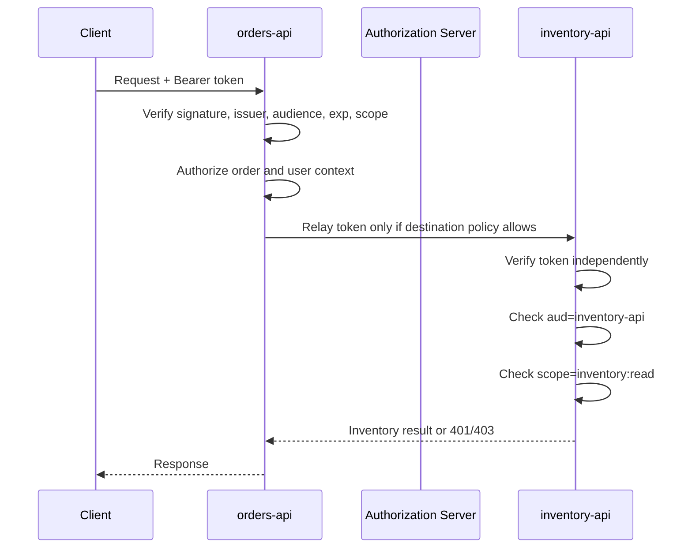
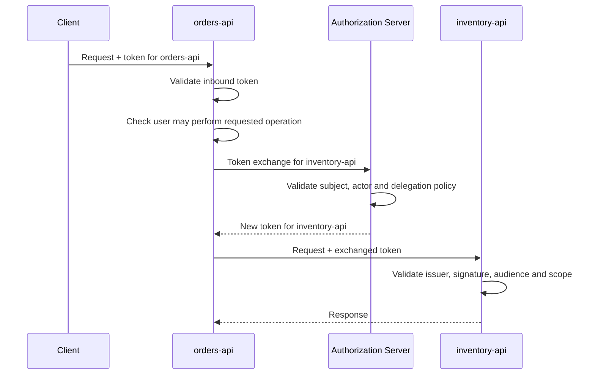

# Relaying Tokens to Approved Services and Validating Audience and Scope

## 1. Goal: Relay Tokens to the Right Destination While Preserving Permission Boundaries

In a multi-service architecture, a Resource Server sometimes needs to call another API on behalf of the current user. For example, `orders-api` receives a request with an access token from a client, then calls `inventory-api` to check stock. Forwarding the inbound access token onto the outbound request is commonly called **Bearer token relay** or **token forwarding**.

Relaying looks simple: take the current token and attach it to the next request's `Authorization: Bearer` header. Yet this operation introduces another trust boundary. The token can be sent to the wrong host, leaked via redirects or logs, or accepted downstream even though the token was never issued for that service.

A validly signed token is not enough to call every API. Each receiving Resource Server must verify at least the issuer, signature, timestamps, audience, and corresponding permission policies. If `orders-api` relays a token whose audience is restricted to itself, `inventory-api` must reject that token. When calling a second service, the system must obtain credentials suited to the target resource, such as token exchange or client credentials.

This lesson belongs to the **Practical Exercises** chapter of the **Spring Security OAuth 2.0 OIDC Resource Server** module. It covers choosing a downstream calling model, restricting allowed destinations, configuring Spring Security/`WebClient`, validating audience and scope downstream, testing negative cases, and operating safely.

> **Core principle:** Only relay Bearer tokens through an HTTP client dedicated to an approved destination. Downstream services must verify tokens and permissions independently. If the audience or scope does not match, acquire a new credential via the proper delegation model; never relax validators just to let requests pass.

---

## 2. Distinguishing Token Relay, Client Credentials, and Token Exchange

These three models solve different needs. They must not be treated as interchangeable implementations.

| Model | Credential sent downstream | Principal represented | When appropriate |
|---|---|---|---|
| **Bearer token relay** | Current inbound access token | User or client represented by the token | The token already carries audience and scope for downstream; downstream is permitted to accept the same credential. |
| **Client credentials** | New access token for the service client | Calling workload/service | Operation needs service-level permissions without carrying delegated user identity. |
| **Token exchange / on-behalf-of** | New access token issued by the AS for downstream | Original subject and actor/service per policy | Need a fresh token with separate audience/scope while preserving delegation context. |

### 2.1. Bearer Token Relay

Example request to the orders API:

```http
GET /api/orders/42 HTTP/1.1
Host: orders.example.test
Authorization: Bearer <user-access-token>
```

`orders-api` calls the inventory API and forwards the same token:

```http
GET /api/inventory/items/sku-123 HTTP/1.1
Host: inventory.internal.example
Authorization: Bearer <user-access-token>
```

This is valid only if the issued token permits access to the inventory API too—for instance, its audience contains `inventory-api` and its scope includes `inventory:read` per the issuer's contract.

If the token has only `orders-api` as its audience, the inventory API must reject it. Never assume that because `orders-api` verified the token, `inventory-api` can skip verification.

### 2.2. Client Credentials

If the inventory API only needs to know which workload is calling, `orders-api` can use OAuth2 client credentials to obtain its own token:

```text
subject = orders-api
audience = inventory-api
scope = inventory:read
```

Downstream sees the service client as the principal. It does not automatically know which end user initiated the action. If business policies require auditing the user, `orders-api` must preserve actor/subject context reliably and check user permissions before calling; never spoof a user via arbitrary headers.

### 2.3. Token Exchange

If the inventory API needs to know the request is performed on behalf of Alice, yet the inbound token is intended only for `orders-api`, token exchange is the better fit.

Conceptual flow:

1. Client sends a token to `orders-api`.
2. `orders-api` verifies the inbound token.
3. `orders-api` asks the AS to exchange the token for the downstream audience/scope.
4. The AS validates delegation permissions and issues a new token.
5. `orders-api` calls `inventory-api` with the new token.
6. `inventory-api` verifies the new token's issuer, audience, expiry, and scope.

RFC 8693 token exchange can carry both subject and actor information. How the AS represents delegation and issuance policies depends on the implementation; a Resource Server never mints a new token by editing JWT claims itself.

### 2.4. Choose the Model Before Writing Code

Answer these questions:

- Does downstream need user identity or only service identity?
- Does the inbound token have the right audience for downstream?
- Does the inbound scope cover the downstream action?
- Does the issuer support token exchange/delegation?
- Does downstream need to distinguish subject from actor?
- Must audits record user, client, service, or all three?
- If the AS fails to issue a new token, how should the request fail?

---

## 3. Data Flow and Trust Boundaries

A relay architecture has at least three boundaries: client → `orders-api`, `orders-api` → `inventory-api`, and each API → Authorization Server/JWKS.



If the inbound token lacks an audience for `inventory-api`, the flow must change:



Each validation step in the diagram is the responsibility of that respective component. Requests traversing an internal network or service mesh still require valid credentials and their own authorization policies.

---

## 4. Audience Is the Resource Boundary

The `aud` claim identifies the resource server or resource group the token was issued for.

Example token intended for `orders-api`:

```json
{
  "iss": "https://auth.example.test/realms/platform",
  "sub": "alice-123",
  "aud": ["orders-api"],
  "scope": "orders:read orders:write",
  "exp": 1890003600
}
```

This token must not be accepted by `inventory-api` by default. `inventory-api` must validate its own audience.

Example token issued for two resources:

```json
{
  "iss": "https://auth.example.test/realms/platform",
  "sub": "alice-123",
  "aud": ["orders-api", "inventory-api"],
  "scope": "orders:read inventory:read",
  "exp": 1890003600
}
```

An issuer may emit multi-audience tokens when authorization policy allows. However, the broader the audience, the more places a stolen token can be used. Prefer narrow, per-resource token audiences.

### 4.1. Do Not Use Issuer in Place of Audience

Issuer answers: who issued the token?

Audience answers: which resource is the token intended for?

Two APIs trusting the same issuer does not mean they should accept the same token. An issuer can issue distinct tokens for many different resources.

### 4.2. Do Not Use Client ID as Audience Unless Specified by Contract

Client ID identifies the OAuth client. Audience identifies the recipient/resource per the token profile. Some systems may use the same string for both concepts, but never assume that.

### 4.3. Validate Every Audience Value by Exact Match

Do not use substring matching such as:

```java
// Unsafe: "inventory-api.attacker.example"
// also contains the string "inventory-api".
boolean allowed = audienceValue.contains("inventory-api");
```

Use an exact string match against the configured resource identifier:

```java
boolean allowed = jwt.getAudience().contains("inventory-api");
```

If the issuer uses URI audiences, match the exact URI per contract. Never normalize in ways that collapse two distinct resource identifiers into one.

---

## 5. Scopes Limit Actions Downstream

Audience states which resource a token is sent to; scope limits which actions that token can perform on that resource.

| Audience | Scope | Meaning |
|---|---|---|
| `orders-api` | `orders:read` | Read the orders API. |
| `inventory-api` | `inventory:read` | Read the inventory API. |
| `inventory-api` | `inventory:write` | Modify inventory if policy permits. |
| `payments-api` | `payments:refund` | Request a refund at the payments API. |

A token with audience `inventory-api` but only scope `orders:read` is still not permitted to read inventory.

### 5.1. Scope Does Not Replace Object-Level Authorization

The `inventory:read` scope grants an API-level capability. `inventory-api` may still need to check:

- The item's tenant or organization.
- Which warehouse the user/service may access.
- Region/business unit.
- Item status.
- Permission to read cost prices or sensitive data.
- Delegation context if the request acts on behalf of a user.

### 5.2. Mapping Scopes to Spring Authorities

Spring Security typically maps scopes to authorities prefixed with `SCOPE_`. For example, `inventory:read` becomes `SCOPE_inventory:read` under the default converter.

A rule might look like:

```java
.requestMatchers(HttpMethod.GET, "/api/inventory/**")
    .hasAuthority("SCOPE_inventory:read")
```

If the issuer uses a different claim like `permissions` or `scp` with custom semantics, configure a matching `JwtAuthenticationConverter`. Never assume all issuers use the same claim format.

### 5.3. Do Not Grant Extra Scopes Just to Fix Downstream Errors

If downstream returns `403`, identify the exact scope truly required and inspect the AS policy. Never add wildcard or admin scopes to a service merely to make requests pass.

---

## 6. Restricting Destinations Allowed to Receive Tokens

This is the single most critical control on the caller side. A `WebClient` capable of relaying Bearer tokens is a credential-bearing HTTP client. If it can call arbitrary URLs, attackers can trick the API into exfiltrating tokens to attacker-controlled hosts.

### 6.1. Create a Dedicated HTTP Client per Downstream Service

Never attach a token-relay filter to a shared `WebClient` used for:

- User-supplied webhook URLs.
- URLs inside request bodies.
- Search/fetch proxies.
- External partner APIs.
- File download URLs.
- Arbitrary callback destinations.

Create a dedicated client with a fixed base URL and a wrapper service exposing only the required operations.

### 6.2. The Allowlist Must Inspect the Actual URI

A destination guard can enforce:

- Scheme is HTTPS.
- Host matches the exact allowed hostname.
- Port belongs to the allowed list.
- No URI user-info is present.
- Path stays within the intended API prefix if required by policy.
- Redirects never automatically forward `Authorization` to another origin.

Do not use naive checks like `endsWith("internal.example")`. An attacker host could be `inventory.internal.example.attacker.test`. Match exact hostnames or use a verified registry.

### 6.3. A Base URL Is Insufficient If Callers Can Pass Absolute URLs

A `WebClient` configured with a base URL can still accept an absolute URI at a call site. Therefore:

- Do not expose a relay `WebClient` as a generic client across unrelated components.
- Wrapper methods should accept business resource identifiers/parameters, never arbitrary URLs.
- Enforce a destination guard at the filter/client boundary.
- Write tests proving absolute URLs outside the allowlist are blocked before any request leaves the process.

### 6.4. DNS and Egress

Hostname allowlists must still be paired with TLS certificate validation and network egress policies. Account for DNS rebinding, DNS compromise, private/link-local addresses, and cloud metadata endpoints if an API handles dynamic destinations.

For a fixed downstream service, egress firewalls or service mesh policies can restrict connections to known service identities/network targets.

---

## 7. Spring Security Servlet: Relaying Inbound Bearer Tokens with `WebClient`

Spring Security provides `ServletBearerExchangeFilterFunction` for Servlet applications. This filter reads the Bearer token from the current authentication and attaches it to outbound requests.

Example client dedicated strictly to the inventory API:

```java
@Configuration
public class DownstreamClientConfiguration {

    private static final String INVENTORY_BASE_URL =
        "https://inventory.internal.example";

    @Bean
    WebClient inventoryRelayWebClient(WebClient.Builder builder) {
        ExchangeFilterFunction destinationGuard =
            (request, next) -> {
                URI uri = request.url();

                boolean allowed =
                    "https".equalsIgnoreCase(uri.getScheme())
                    && "inventory.internal.example"
                        .equalsIgnoreCase(uri.getHost())
                    && (uri.getPort() == -1 || uri.getPort() == 443)
                    && uri.getRawUserInfo() == null;

                if (!allowed) {
                    return Mono.error(
                        new IllegalArgumentException(
                            "Unapproved downstream destination"
                        )
                    );
                }

                return next.exchange(request);
            };

        HttpClient httpClient =
            HttpClient.create().followRedirect(false);

        return builder
            .baseUrl(INVENTORY_BASE_URL)
            .clientConnector(
                new ReactorClientHttpConnector(httpClient)
            )
            .filter(destinationGuard)
            .filter(new ServletBearerExchangeFilterFunction())
            .build();
    }
}
```

Related imports:

```java
import java.net.URI;

import org.springframework.context.annotation.Bean;
import org.springframework.context.annotation.Configuration;
import org.springframework.security.oauth2.server.resource.web.reactive.function.client.ServletBearerExchangeFilterFunction;
import org.springframework.web.reactive.function.client.ExchangeFilterFunction;
import org.springframework.web.reactive.function.client.WebClient;

import reactor.netty.http.client.HttpClient;
import org.springframework.http.client.reactive.ReactorClientHttpConnector;
import reactor.core.publisher.Mono;
```

This example uses the Servlet stack with Reactor Netty. Connector configuration APIs may differ if the application uses a different HTTP connector; keep the destination allowlist and redirect policy principles intact.

### 7.1. Why Include a Destination Guard?

`ServletBearerExchangeFilterFunction`'s job is relaying the token. It is not a destination authorization policy. Place the guard before the relay filter so requests only proceed once the URI is approved.

Configuring a fixed base URL reduces call-site mistakes. The guard inspects the final URI to catch absolute URLs or unintended destinations.

### 7.2. Why Disable Redirects in the Example?

A server allowed to receive the token might return a redirect to a different host. If the HTTP client follows redirects automatically, you must understand exactly how it handles the `Authorization` header across redirects. The safest, easiest-to-reason-about setup is disabling automatic redirects on relay clients. If business logic requires redirects, handle them manually and verify the new destination before sending credentials.

### 7.3. This Filter Does Not Change Audience or Scope

The filter only forwards the current token. It does not:

- Acquire a new token.
- Change the audience.
- Add scopes.
- Perform token exchange.
- Refresh an expired token.
- Check whether downstream will accept the token.

Downstream must still verify the token independently. If the token is not intended for the inventory API, the right outcome is `401`.

### 7.4. Never Register the Relay Filter Globally

Do not add `ServletBearerExchangeFilterFunction` to a global `WebClient.Builder` shared by all outbound calls. Another component might accidentally call a URL outside the trust domain and leak tokens.

Use dedicated beans, clear names, and separate client wrappers per downstream security domain.

---

## 8. Encapsulating Outbound Calls in a Service Client

Business services should not build URLs and attach tokens arbitrarily. Encapsulate valid operations:

```java
@Component
public class InventoryClient {

    private final WebClient inventoryRelayWebClient;

    public InventoryClient(
            @Qualifier("inventoryRelayWebClient")
            WebClient inventoryRelayWebClient) {
        this.inventoryRelayWebClient = inventoryRelayWebClient;
    }

    public Mono<InventoryItem> getItem(String sku) {
        return inventoryRelayWebClient
            .get()
            .uri("/api/inventory/items/{sku}", sku)
            .retrieve()
            .bodyToMono(InventoryItem.class);
    }
}
```

Here callers pass only `sku`. They cannot control scheme, host, or port. Validate `sku` per domain rules and use URI templates to encode path variables safely.

### 8.1. Do Not Accept URLs from Request DTOs

Risky design:

```java
public Mono<String> fetchInventory(String url) {
    return inventoryRelayWebClient.get()
        .uri(url)
        .retrieve()
        .bodyToMono(String.class);
}
```

A safer design exposes methods like `getItem(sku)` or `reserve(sku, quantity)`. The internal client determines the fixed endpoint itself.

### 8.2. Do Not Unconditionally Relay Tokens to Every Endpoint on the Same Host

One host may serve multiple applications or paths. If the downstream security boundary is defined per service host, check both host and audience. If multiple APIs live on the same host, restrict path/method per contract and split clients per resource where needed.

---

## 9. Configuring the Downstream Resource Server to Validate Audience

The inventory API must verify tokens independently. For JWTs, configure a decoder checking signature/key, issuer, timestamps, and audience.

Example:

```java
@Bean
JwtDecoder inventoryJwtDecoder() {
    String issuer = "https://auth.example.test/realms/platform";
    String jwkSetUri =
        "https://auth.example.test/realms/platform/protocol/openid-connect/certs";

    NimbusJwtDecoder decoder =
        NimbusJwtDecoder.withJwkSetUri(jwkSetUri).build();

    OAuth2TokenValidator<Jwt> timestampAndIssuer =
        JwtValidators.createDefaultWithIssuer(issuer);

    OAuth2TokenValidator<Jwt> audienceValidator = jwt -> {
        if (jwt.getAudience().contains("inventory-api")) {
            return OAuth2TokenValidatorResult.success();
        }

        return OAuth2TokenValidatorResult.failure(
            new OAuth2Error(
                "invalid_token",
                "Required audience inventory-api is missing",
                null
            )
        );
    };

    decoder.setJwtValidator(
        new DelegatingOAuth2TokenValidator<>(
            timestampAndIssuer,
            audienceValidator
        )
    );

    return decoder;
}
```

Imports:

```java
import org.springframework.security.oauth2.core.OAuth2Error;
import org.springframework.security.oauth2.core.OAuth2TokenValidator;
import org.springframework.security.oauth2.core.OAuth2TokenValidatorResult;
import org.springframework.security.oauth2.jwt.DelegatingOAuth2TokenValidator;
import org.springframework.security.oauth2.jwt.Jwt;
import org.springframework.security.oauth2.jwt.JwtDecoder;
import org.springframework.security.oauth2.jwt.JwtValidators;
import org.springframework.security.oauth2.jwt.NimbusJwtDecoder;
```

`JwtValidators.createDefaultWithIssuer` includes default issuer and timestamp validation per Spring Security version. The audience validator is composed into the chain so tokens for the wrong resource are rejected.

If custom clock skew or access-token profile validators are needed, build an explicit validator chain retaining all required conditions. Never replace default validators with an audience validator alone.

### 9.1. Audience Claim Can Be a String or an Array in JWT

The JWT `aud` claim can represent one audience or multiple audiences. Spring Security exposes `jwt.getAudience()` as a list of strings, so use an exact membership check.

### 9.2. Multi-Issuer

If the inventory API trusts multiple issuers, maintain a registry mapping issuers to JWKS/trust policies/audience policies. Never accept arbitrary issuers merely because a JWT signature verifies against some key.

### 9.3. Do Not Take JWKS URLs from Inbound Requests

Never use caller-controlled claims/headers to instantiate decoders or fetch keys from arbitrary URLs. Issuer/JWKS configuration is a trust anchor and requires allowlists, TLS, and egress controls.

---

## 10. Downstream Scope and Endpoint Authorization Checks

Once a token passes the decoder, the inventory API must authorize endpoints by scope.

Servlet `SecurityFilterChain` example:

```java
@Bean
SecurityFilterChain inventoryApiSecurity(HttpSecurity http)
        throws Exception {
    return http
        .securityMatcher("/api/**")
        .sessionManagement(session -> session
            .sessionCreationPolicy(SessionCreationPolicy.STATELESS))
        .authorizeHttpRequests(auth -> auth
            .requestMatchers(HttpMethod.GET, "/api/inventory/**")
                .hasAuthority("SCOPE_inventory:read")
            .requestMatchers(HttpMethod.POST, "/api/inventory/reservations/**")
                .hasAuthority("SCOPE_inventory:write")
            .anyRequest().denyAll())
        .oauth2ResourceServer(oauth ->
            oauth.jwt(Customizer.withDefaults()))
        .build();
}
```

Imports:

```java
import org.springframework.context.annotation.Bean;
import org.springframework.http.HttpMethod;
import org.springframework.security.config.Customizer;
import org.springframework.security.config.annotation.web.builders.HttpSecurity;
import org.springframework.security.config.http.SessionCreationPolicy;
import org.springframework.security.web.SecurityFilterChain;
```

This example uses default scope-to-authority mapping. If token claims use a different format, configure a matching converter.

### 10.1. `401` and `403` Outcomes

| Scenario | Common outcome | Meaning |
|---|---:|---|
| Invalid signature | 401 | Invalid credential. |
| Invalid issuer | 401 | Token did not come from a trusted issuer. |
| Audience lacks `inventory-api` | 401 | Token is not intended for this resource. |
| Expired or not-yet-valid token | 401 | Token is no longer/not yet permitted. |
| Valid token lacking `inventory:read` | 403 | Authentication succeeded, insufficient permission. |
| Sufficient scope, denied by object/tenant policy | 403 or 404 per policy | No permission on the specific resource. |

Never handle `401` by blindly retrying the same token repeatedly. Never handle `403` by granting admin permissions to the service.

### 10.2. Object Authorization Is Still Required

A token with `inventory:read` is not automatically permitted to read every warehouse or every tenant. The inventory service must verify ownership, tenant, region, warehouse membership, and domain business policies.

---

## 11. When the Inbound Token Has the Wrong Audience

Suppose the inbound token is:

```json
{
  "iss": "https://auth.example.test/realms/platform",
  "sub": "alice-123",
  "aud": ["orders-api"],
  "scope": "orders:read",
  "exp": 1890003600
}
```

`orders-api` wants to call `inventory-api`. There are three options:

1. Do not call downstream if the user/request lacks business permission.
2. If only workload identity is needed, use a client credentials token with audience `inventory-api` and narrow scopes.
3. If continuing to act on Alice's behalf is required, use token exchange/on-behalf-of per AS policy.

Never edit the token payload and re-sign it with `orders-api`'s key. `orders-api` is not the issuer and has no right to grant authorities to Alice.

### 11.1. Token Exchange per RFC 8693

A conceptual request may contain:

- `grant_type`: the token-exchange grant.
- `subject_token`: the verified inbound token.
- `subject_token_type`: type of the subject token.
- `requested_token_type`: type of token to issue.
- `audience` or `resource`: downstream resource.
- `scope`: required downstream permissions.

Illustrative form parameters:

```http
POST /oauth2/token HTTP/1.1
Host: auth.example.test
Content-Type: application/x-www-form-urlencoded
Authorization: Basic <confidential-client-credential>

grant_type=urn:ietf:params:oauth:grant-type:token-exchange&
subject_token=<inbound-access-token>&
subject_token_type=urn:ietf:params:oauth:token-type:access_token&
requested_token_type=urn:ietf:params:oauth:token-type:access_token&
audience=inventory-api&
scope=inventory:read
```

This is a protocol illustration. `audience`/`resource` parameters and AS delegation support depend on implementation/policy. Use TLS, confidential client authentication, and never log request bodies containing `subject_token`.

### 11.2. Restricting Exchanged Permissions

The AS should verify:

- Is the client calling token exchange authorized to do so?
- Is the subject token still valid?
- Does the subject have permission to request the downstream action?
- Is the actor/service allowed to act on behalf of the subject?
- Is the requested audience in the allowlist?
- Does the requested scope stay within the intersection of granted permissions?
- Does the new token have an appropriate lifetime?

Never let clients freely request arbitrary audiences or scopes.

### 11.3. Do Not Assume Spring OAuth2 Client Automatically Supports Every Token Exchange Grant

`OAuth2AuthorizedClientManager` manages authorized clients and the grant providers configured by the application. Token exchange support depends on Spring Security version, provider, and AS integration. For RFC 8693, verify compatible provider support or implement/customize grant integration per your system's contract. Never simulate token exchange by copying a token and altering claims.

---

## 12. Client Credentials for Workload-to-Workload Calls

If downstream needs only service identity, OAuth2 client credentials are usually simpler than relaying user tokens.

Example client registration configuration:

```yaml
spring:
  security:
    oauth2:
      client:
        registration:
          inventory-service:
            provider: platform
            client-id: orders-api
            client-secret: INVENTORY_CLIENT_SECRET_FROM_SECRET_MANAGER
            authorization-grant-type: client_credentials
            scope:
              - inventory:read
        provider:
          platform:
            token-uri: https://auth.example.test/oauth2/token
```

Keep secrets in a secret manager or secure environment injection; never commit real values to the repository.

### 12.1. Authorized Client Manager

Example manager for service-tier client credentials:

```java
@Bean
OAuth2AuthorizedClientManager inventoryAuthorizedClientManager(
        ClientRegistrationRepository registrations,
        OAuth2AuthorizedClientService authorizedClients) {

    OAuth2AuthorizedClientProvider provider =
        OAuth2AuthorizedClientProviderBuilder.builder()
            .clientCredentials()
            .build();

    AuthorizedClientServiceOAuth2AuthorizedClientManager manager =
        new AuthorizedClientServiceOAuth2AuthorizedClientManager(
            registrations,
            authorizedClients
        );

    manager.setAuthorizedClientProvider(provider);
    return manager;
}
```

### 12.2. `WebClient` Using a Dedicated Service Token

```java
@Bean
WebClient inventoryServiceWebClient(
        WebClient.Builder builder,
        OAuth2AuthorizedClientManager inventoryAuthorizedClientManager) {

    ServletOAuth2AuthorizedClientExchangeFilterFunction oauth2 =
        new ServletOAuth2AuthorizedClientExchangeFilterFunction(
            inventoryAuthorizedClientManager
        );

    oauth2.setDefaultClientRegistrationId("inventory-service");

    return builder
        .baseUrl("https://inventory.internal.example")
        .apply(oauth2.oauth2Configuration())
        .build();
}
```

Key imports:

```java
import org.springframework.security.oauth2.client.AuthorizedClientServiceOAuth2AuthorizedClientManager;
import org.springframework.security.oauth2.client.OAuth2AuthorizedClientManager;
import org.springframework.security.oauth2.client.OAuth2AuthorizedClientProvider;
import org.springframework.security.oauth2.client.OAuth2AuthorizedClientProviderBuilder;
import org.springframework.security.oauth2.client.OAuth2AuthorizedClientService;
import org.springframework.security.oauth2.client.registration.ClientRegistrationRepository;
import org.springframework.security.oauth2.client.web.reactive.function.client.ServletOAuth2AuthorizedClientExchangeFilterFunction;
```

A client credentials token represents `orders-api`. It does not carry Alice's identity. If the request runs on Alice's behalf, verify user permissions before calling and audit both subject and actor; or use token exchange if downstream requires delegated identity.

### 12.3. Authorized Client Manager for Background/Service-Tier Work

`AuthorizedClientServiceOAuth2AuthorizedClientManager` can manage authorized clients outside a specific servlet request. This is useful for service-tier or background operations. For request-centric flows, select a manager/repository aligned with the application's lifecycle and storage policy.

### 12.4. Do Not Ambiguously Share One `WebClient` for Relay and Client Credentials

Both clients carry different principal semantics. Use distinct beans and explicit names:

- `inventoryRelayWebClient`: forwards inbound delegated tokens.
- `inventoryServiceWebClient`: attaches `orders-api`'s workload token.
- `inventoryExchangedTokenClient`: calls downstream using token exchange results if applicable.

Clear naming makes the credential type immediately obvious in code reviews.

---

## 13. Rules Against Sending Tokens Outside the Allowlist

Token relay clients require their own security policy.

### 13.1. Exact Host Allowlist

For example, allow only:

```text
scheme: https
host: inventory.internal.example
port: 443 (or default HTTPS port)
path prefix: /api/inventory/
```

Avoid overly broad hostname regexes. Validate the final destination after `WebClient` resolves the base URL and path template.

### 13.2. Block Caller-Controlled URLs

Never let an endpoint accept `targetUrl` and fetch it via a relay client. If a business requirement genuinely needs dynamic destinations, isolate that flow from token relay, validate the URL, and never attach the inbound `Authorization` header.

### 13.3. Redirect Policy

Disable automatic redirects or configure the client to prevent forwarding credentials to a different origin. If redirects are necessary, follow manually only after validating status, `Location`, scheme, host, port, and credential forwarding behavior.

### 13.4. DNS and TLS

- Use HTTPS.
- Never disable certificate validation.
- Use trusted service discovery.
- Restrict network egress.
- Monitor certificate rotation.
- Never trust client-supplied hostnames.
- Account for DNS rebinding and private IP resolution in systems with dynamic destinations.

### 13.5. Never Pass Tokens in Query Strings

Never send tokens like:

```http
GET /api/inventory/items?access_token=<token>
```

Use the `Authorization` header per Bearer token usage. URLs end up in access logs, browser history, proxy logs, referrers, and analytics.

---

## 14. Preventing Token Leaks via Logs, Traces, and Errors

Token relay introduces more places where tokens can surface:

- `WebClient` wiretap/debug logging.
- HTTP client request logging.
- Gateway access logs.
- APM instrumentation.
- Exception messages.
- Retry diagnostics.
- Distributed tracing baggage/tags.
- Test failure output.

### 14.1. Data Never to Log

Never log:

- Raw `Authorization` headers.
- Compact JWT strings.
- Opaque access tokens.
- Refresh tokens.
- `subject_token` in token exchange requests.
- Client secrets or private keys.
- Full introspection/token endpoint request bodies.
- Token claims containing PII unless strictly necessary.

### 14.2. Logging Redacted Metadata

Safe to record:

- Downstream service identifier.
- Route template.
- Correlation ID.
- HTTP status.
- Error category.
- Latency.
- Policy-approved token issuer/client identifier.
- Pseudonymized subject reference if required for auditing.

Never use tokens as metric labels or visible cache keys.

### 14.3. Exception Handling

Never include raw downstream response bodies or token endpoint responses in client-facing errors. Map failures to stable error categories, preserve correlation IDs, and log redacted details in server-side telemetry.

---

## 15. `SecurityContext` and Async/Background Processing

In Servlet applications, `SecurityContext` is typically tied to the request execution context. Token relay filters rely on the current authentication, so lifecycle matters.

### 15.1. Within a Synchronous Request

On the same request thread, Spring Security can access the current `Authentication` and relay the Bearer token. This is the direct use case for `ServletBearerExchangeFilterFunction`.

### 15.2. Async Tasks and Executors

When crossing thread boundaries, `SecurityContext` may not propagate as developers expect. A task running after the HTTP request finishes must not implicitly rely on thread-local authentication.

Do not solve this by storing raw access tokens in a queue or database for later use. Choose the right pattern:

- Use workload identity when a background job acts as the service.
- Use token exchange when delegation is needed and supported by AS policy.
- Store controlled business actor metadata for auditing.
- Re-check authorization when the job executes.
- Enforce clear expiry/revocation behavior if a task truly requires a delegated credential.

### 15.3. Never Retain Tokens Longer Than Needed by the Request

A Bearer token is a replayable credential. Never store it in scheduled jobs, message payloads, or retry stores without an explicit credential-management design.

### 15.4. Reactive Applications

`ServletBearerExchangeFilterFunction` is designed for Servlet contexts. WebFlux has a different execution/context model; use reactive-stack integration and Reactor Context. Never bring Servlet `ThreadLocal` assumptions into reactive chains.

---

## 16. Handling Errors from Downstream

When calling downstream services, distinguish authentication failures, authorization failures, and availability failures.

| Downstream result | Interpretation | Caller-side action |
|---|---|---|
| `401 invalid_token` | Wrong issuer/signature/audience/time or unaccepted credential | Check credential flow; never retry the same token endlessly. |
| `403 insufficient_scope` | Valid token lacking sufficient permissions | Check requested operation and AS grant; never self-escalate permissions. |
| `404` | Resource missing or hidden per policy | Map per API contract; never leak cross-tenant existence. |
| `429` | Rate limit/quota | Honor `Retry-After` if present; use bounded backoff and idempotency. |
| `5xx` | Downstream/dependency failure | Timeouts, bounded retries for safe operations, circuit breakers. |
| Connection/TLS failure | Network or trust configuration issue | Alert and fix infrastructure; never bypass TLS validation. |
| Token endpoint failure | Failed to acquire a new token | Never fall back to an inbound token with the wrong audience. |

### 16.1. `401` Does Not Always Mean User Login Expired

A downstream `401` may stem from a wrong audience, issuer config mismatch, signing key rotation, or a relay filter missing `SecurityContext`. Diagnose by error category rather than immediately forcing the user to log in again.

### 16.2. Preserve the Meaning of `403`

If `inventory-api` returns `insufficient_scope`, `orders-api` can return a business error or `403` per API contract. Never convert `403` into success or retry with a service-admin token unless the design explicitly permits it.

### 16.3. Retries Do Not Fix Credentials

Retrying does not make a wrong-audience or missing-scope token valid. Retries belong strictly to transient errors and operations with safe semantics. For `POST`/commands, use idempotency keys or deduplication mechanisms.

---

## 17. Testing the Destination Allowlist

The destination guard must be tested independently of token validators.

### 17.1. Required Cases

| Destination | Outcome |
|---|---|
| `https://inventory.internal.example` | Allowed |
| `http://inventory.internal.example` | Blocked |
| `https://inventory.internal.example.attacker.test` | Blocked |
| `https://attacker.test` | Blocked |
| `https://inventory.internal.example:8443` | Blocked if port is outside allowlist |
| `https://user@inventory.internal.example` | Blocked (URI user-info) |
| Caller-passed absolute URL to another host | Blocked before network call |
| Redirect to another origin | Does not automatically forward token |

### 17.2. Testing Without Sending Outbound Requests

Use a mock HTTP server or test connector to verify:

- Approved destinations receive the request.
- `Authorization` header appears only on the dedicated relay client.
- Blocked destinations receive zero requests.
- External clients carry no `Authorization` header.
- Redirects do not trigger a second request carrying the token to another origin.

### 17.3. Do Not Only Test That the Filter Was Invoked

Assert the final destination, actual headers, and request count on the mock server. Testing only that a filter bean exists does not prove tokens are properly restricted.

---

## 18. Testing Audience and Scope Downstream

Use signed JWT test fixtures and a real decoder to test trust boundaries.

### 18.1. Token Matrix

| Token fixture | Audience | Scope | Outcome at `inventory-api` |
|---|---|---|---|
| A | `inventory-api` | `inventory:read` | Allows `GET` if object policy permits. |
| B | `orders-api` | `inventory:read` | `401` due to invalid audience. |
| C | `inventory-api` | `orders:read` | `403` due to missing scope. |
| D | `inventory-api` | `inventory:write` | `GET` read may be denied without read scope. |
| E | Wrong issuer | `inventory:read` | `401`. |
| F | `inventory-api` | `inventory:read`, but expired | `401`. |
| G | `inventory-api` | `inventory:read`, wrong tenant/object | `403` or `404` per policy. |

### 18.2. Test Audience Without a Mock Decoder

A mocked decoder can return a `Jwt` fixture directly and bypass signature/issuer/audience validators. Use mocks for authorization-only tests; use a real decoder with signed tokens for validation integration tests.

### 18.3. Testing Scope Mapping

If using the default converter, test `scope`/`scp` claims in the expected format. If using a custom converter, explicitly test:

- Scopes map to expected authorities.
- Untrusted headers never create authorities.
- Role claims are not confused with scopes.
- Prefixes are never applied twice.
- Empty/missing scopes do not grant default permissions.

### 18.4. Testing Downstream Independently

`inventory-api` must have its own tests proving it rejects wrong-audience tokens even when requests arrive from `orders-api` or a private network. Do not rely solely on tests verifying that the caller validated the token earlier.

---

## 19. End-to-End Integration Tests Across Two Resource Servers

An integration test can spin up:

- A mock Authorization Server/JWKS or test signing key.
- `orders-api` with Resource Server configuration.
- `inventory-api` with issuer/audience/scope validators.
- A mock HTTP server for downstream calls.

Scenarios:

1. Token audience contains only `orders-api`: `orders-api` accepts inbound, relays call to `inventory-api`, `inventory-api` returns `401`.
2. Token audience contains `inventory-api` and scope `inventory:read`: downstream accepts if issuer allows multi-audience tokens.
3. Token audience is `inventory-api` but scope is missing: downstream returns `403`.
4. `orders-api` uses token exchange: AS issues token with audience `inventory-api`; downstream accepts the new token.
5. Token exchange is denied: `orders-api` never falls back to relaying the wrong-audience token.
6. Caller-controlled URL: destination guard blocks before sending the token.
7. Redirect from downstream: client does not follow automatically.
8. Token expires between the two calls: downstream validates against request arrival time.

### 19.1. Observe Both Sides

Tests should verify:

- Which token the caller sent.
- The actual destination.
- Audience/scope of the token received downstream.
- Authentication result.
- Authorization result.
- Audit actor/subject.
- Zero raw tokens in logs.

Never print real tokens into test output or snapshots.

---

## 20. Token Relay and Multi-Tenant Authorization

If a token carries a tenant claim, relaying the token forwards the exact tenant context. Downstream must still understand the semantics and enforce checks.

Example:

```json
{
  "iss": "https://auth.example.test/realms/platform",
  "sub": "alice-123",
  "aud": ["inventory-api"],
  "scope": "inventory:read",
  "tenant_id": "tenant-a",
  "exp": 1890003600
}
```

`inventory-api` must verify:

- Trusted issuer and claim contract.
- Subject belongs to the tenant per policy.
- Token audience matches `inventory-api`.
- Scope permits inventory reads.
- Item/warehouse belongs to the corresponding tenant or resource boundary.

Never trust `X-Tenant-Id` sent by `orders-api` or a client unless a verified service-to-service contract exists and downstream authenticates the header's source. Signed token claims can provide a stronger source of tenant context, still subject to issuer semantics and authorization policies.

### 20.1. Tenant Switching

If a user belongs to multiple tenants, tokens may be issued per active tenant or carry multiple tenant entitlements. Callers must never mutate the tenant claim themselves. To switch tenants, execute the proper authorization/entitlement flow and obtain a new credential/context.

### 20.2. Cross-Service Object Authorization

Each service owns its data and is responsible for object-level access decisions. `orders-api` cannot decide warehouse permissions on behalf of `inventory-api` merely because it authenticated the user.

---

## 21. Observability and Auditing for Delegated Calls

A downstream call may act on behalf of a user while being executed by a service. Audits should distinguish `subject` from `actor`.

Useful fields:

| Field | Meaning |
|---|---|
| `subject` | User/entity being represented, if any. |
| `actor` | Service/client directly invoking downstream. |
| `client_id` | OAuth client receiving the token or related client registration. |
| `audience` | Resource the token was issued for. |
| `scope_set` | Verified permissions; avoid logging full sensitive claims. |
| `downstream_service` | Target service per registry. |
| `action` | Invoked operation. |
| `resource_ref` | Redacted/pseudonymized ID if required. |
| `correlation_id` | Links inbound and outbound events. |
| `outcome` | Allowed, denied, timeout, or dependency failure. |

Never write token strings or token-exchange subject tokens to audits. When investigations require correlation, record token IDs/`jti` or policy-approved identifiers, never bearer credentials.

### 21.1. Metrics

Useful to track:

- Outbound request counts by service/method/status.
- Downstream `401`/`403` rates.
- Token exchange success/failure rates.
- Destination guard rejections.
- Latency and timeouts.
- JWKS/introspection dependency health.
- Rate-limit/quota responses.

Never use raw tokens, user IDs, or resource IDs as metric labels.

---

## 22. Common Design Pitfalls

| Mistake | Risk | Fix |
|---|---|---|
| Relaying tokens on every `WebClient` | Credentials leak to external hosts | Create dedicated per-destination clients. |
| Configuring only base URL | Absolute URLs can override base URL | Guard final URI and wrap calls in service methods. |
| Trusting tokens because caller verified them | Downstream accepts wrong-audience tokens | Downstream validates independently. |
| Omitting audience validators | Tokens for other APIs accepted | Exact audience validation. |
| Checking scopes only at caller | Downstream lacks its own permission enforcement | Downstream validates scope/authorization. |
| Using wildcard/admin scopes | Over-privileged service | Least privilege per action. |
| Using client credentials while auditing as user token | Loss of delegated identity/accountability | Record subject/actor or use token exchange. |
| Editing JWT claims to change audience | Invalidates signature or spoofs issuer | Request a fresh token from the AS. |
| Following redirects with `Authorization` | Tokens leak to another host | Disable redirects or validate manually. |
| Taking URLs from request DTOs | SSRF and token exfiltration | Accept only business identifiers, never destination URLs. |
| Logging `WebClient` headers | Bearer credentials leak | Redact `Authorization` and wire logs. |
| Storing tokens in queues | Replay and long-lived credential exposure | Use workload identity/token exchange at execution time. |
| Mocking decoders in all integration tests | Real signatures/audiences go untested | Use real decoders for validation tests. |
| Retrying `401`/`403` endlessly | Amplifies load without fixing policy | Classify errors and retry only transient failures. |
| Trusting private networks | Lateral movement and service spoofing | TLS/mTLS/workload identity and authorization. |
| Conflating `401` and `403` | Hard diagnosis and unsafe fallbacks | Preserve authentication/authorization semantics. |

---

## 23. Runbook When Downstream Returns `401` or `403`

### 23.1. Downstream Returns `401`

1. Determine whether the token was relayed or newly obtained via client credentials/token exchange.
2. Verify whether a token was attached to the request, without logging the token value.
3. Verify the issuer and key source trusted by downstream.
4. Verify the audience includes downstream's resource identifier.
5. Check `exp`, `nbf`, and clock skew.
6. Check token type/profile if required by downstream.
7. Check key rotation/JWKS caches.
8. Check whether proxies stripped or altered the `Authorization` header.
9. Verify whether the client relay filter executed within the request context.
10. If audience is wrong, switch to token exchange or service credentials per model; never relax validators.

### 23.2. Downstream Returns `403`

1. Confirm the token authenticated successfully.
2. Check which scopes/authorities downstream produced.
3. Check whether the scope matches the HTTP method/endpoint.
4. Check tenant, warehouse, owner, or object policies.
5. Check subject/actor/client identity.
6. Check whether the AS issued the requested scope.
7. Check whether the converter mapping matches the claim format.
8. Never add admin scopes to mask errors.

### 23.3. Destination Guard Blocks a Request

1. Log the downstream service ID and route template.
2. Inspect the final URI's scheme/host/port.
3. Check for absolute URLs or redirects.
4. Inspect service discovery/configuration.
5. Never broaden the allowlist with suffix regexes just to silence errors.
6. When adding a new destination, review trust boundaries, audience, scopes, and egress policies.

### 23.4. Token Exchange Fails

1. Distinguish invalid subject token, unauthorized client, unsupported grant, and denied delegation.
2. Check client authentication against the AS.
3. Verify whether the AS supports RFC 8693 or a provider-specific flow.
4. Check requested audience/resource and scope.
5. Check subject/actor policy.
6. Never fall back to the inbound token if its audience is wrong.
7. Alert on configuration errors or AS outages per severity.

---

## 24. Pre-Production Checklist

| Area | Question |
|---|---|
| **Credential model** | Did you choose relay, client credentials, or token exchange per subject/actor needs? |
| **Destination** | Is there a dedicated HTTP client and an exact scheme/host/port/path allowlist? |
| **Absolute URLs** | Can callers override the base URL? Does the guard inspect the final URI? |
| **Redirects** | Are redirects disabled or validated before forwarding credentials? |
| **TLS** | Are HTTPS and certificate validation enabled on outbound hops? |
| **Audience** | Does downstream exact-match its own audience? |
| **Issuer/signature** | Does downstream independently verify issuer, signature, and allowed algorithms? |
| **Timestamps** | Does downstream check `exp`/`nbf` and clock policy? |
| **Scope** | Do endpoints enforce minimum required scopes? |
| **Object policy** | Are tenant, ownership, and business constraints enforced? |
| **Token exchange** | Does the AS validate subject, actor, requested audience, and scopes? |
| **Client credentials** | Does the service principal hold least privilege and are secrets managed securely? |
| **Async** | Are raw tokens kept out of queues/background stores? |
| **Logging** | Are `Authorization` headers and token endpoint bodies redacted? |
| **Errors** | Are `401`, `403`, `429`, and `5xx` categorized distinctly? |
| **Retries** | Do retries apply only to transient errors and safe operations? |
| **Testing** | Are there negative tests for wrong audience, missing scope, wrong host, and redirects? |
| **Observability** | Are subject/actor audited and metrics free of tokens? |
| **Operations** | Are runbooks ready for token theft, AS outages, and downstream trust failures? |

---

## 25. Technical References

- [Spring Security — OAuth 2.0 Resource Server JWT](https://docs.spring.io/spring-security/reference/servlet/oauth2/resource-server/jwt.html): JWT verification, issuer, and resource server configuration.
- [Spring Security — OAuth 2.0 Resource Server Opaque Token](https://docs.spring.io/spring-security/reference/servlet/oauth2/resource-server/opaque-token.html): introspection and opaque token authentication.
- [Spring Security — OAuth 2.0 Client](https://docs.spring.io/spring-security/reference/servlet/oauth2/client/index.html): authorized clients, client credentials, and OAuth2 client integrations.
- [Spring Security API — ServletBearerExchangeFilterFunction](https://docs.spring.io/spring-security/site/docs/current/api/org/springframework/security/oauth2/server/resource/web/reactive/function/client/ServletBearerExchangeFilterFunction.html): relaying Bearer tokens from Servlet `SecurityContext` to `WebClient`.
- [Spring Security API — ServletOAuth2AuthorizedClientExchangeFilterFunction](https://docs.spring.io/spring-security/site/docs/current/api/org/springframework/security/oauth2/client/web/reactive/function/client/ServletOAuth2AuthorizedClientExchangeFilterFunction.html): attaching OAuth2 authorized client tokens to `WebClient` requests.
- [RFC 6750 — OAuth 2.0 Bearer Token Usage](https://www.rfc-editor.org/rfc/rfc6750.html): Bearer token transport and security considerations.
- [RFC 7519 — JSON Web Token](https://www.rfc-editor.org/rfc/rfc7519.html): registered claims such as issuer, audience, expiration, and subject.
- [RFC 9068 — JWT Profile for OAuth 2.0 Access Tokens](https://www.rfc-editor.org/rfc/rfc9068.html): profile for JWT access tokens.
- [RFC 8693 — OAuth 2.0 Token Exchange](https://www.rfc-editor.org/rfc/rfc8693.html): subject tokens, actors, audiences, and delegation.
- [RFC 9700 — OAuth 2.0 Security Best Current Practice](https://www.rfc-editor.org/rfc/rfc9700.html): current OAuth2 security recommendations.
- [OWASP API Security Top 10](https://owasp.org/API-Security/editions/2023/en/): SSRF, broken authorization, and resource consumption in APIs.

**Conclusion:** Token relay merely forwards inbound credentials; it does not alter audience, grant extra scopes, or turn a token into a credential intended for another service. Create a dedicated `WebClient` for each allowlisted destination, constrain the final URI, control redirects, and protect the `Authorization` header. Downstream services must independently verify signatures, issuer, audience, timestamps, scopes, and object-level permissions. When the inbound token is not intended for downstream, use client credentials if only workload identity is needed, or token exchange if delegation context must be preserved. Test both happy paths and wrong audience, missing scope, unapproved destinations, redirects, and AS failures before deploying.
