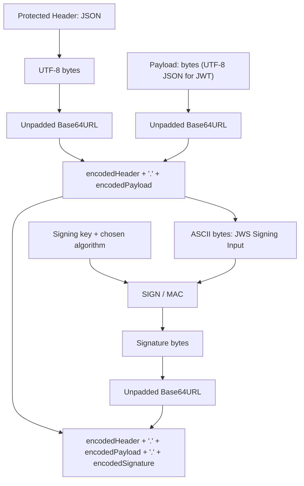
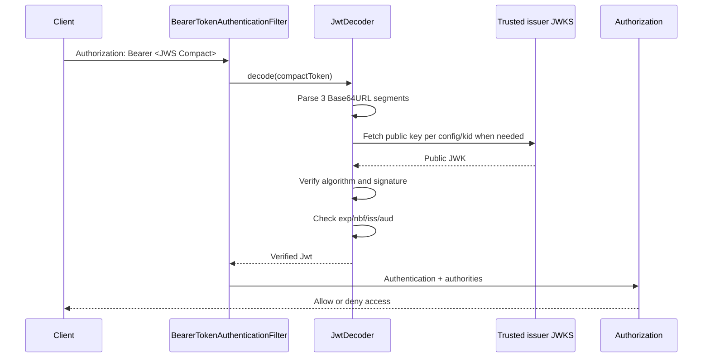

# JWS Compact: Three Components and Base64URL Representation Encoding

In the **Spring Security OAuth 2.0 / OpenID Connect Resource Server** ecosystem, a JWT-formatted access token is usually transmitted over HTTP as a character string resembling:

```text
eyJhbGciOiJSUzI1NiIsInR5cCI6IkpXVCJ9.eyJzdWIiOiJhbGljZSJ9.<base64url_signature>
```

The string above illustrates the structure; `<base64url_signature>` is a placeholder, so it is **not a valid token**. Two dots separate the three components of **JWS Compact Serialization**. Understanding these three parts and the Base64URL rules accurately helps you read logs safely, diagnose Bearer token errors, understand signature verification, and avoid confusing *representation decoding* with *token verification*.

Lesson objectives:

1. Distinguish JOSE, JWS, JWE, and JWT; recognize that JWS Compact consists of exactly three parts.
2. Understand what each part is, how it is encoded, and exactly which bytes are signed.
3. Convert UTF-8 ↔ Base64URL yourself in Java to inspect the representation without mistaking that for verification.
4. Understand how a Spring Resource Server uses trusted keys to verify a JWS before validating claims and permissions.
5. Recognize malformed tokens, invalid signatures, and advanced exceptions to JWS Compact.

## 1. Where Does JWS Compact Fit in JOSE and JWT?

**JOSE (JSON Object Signing and Encryption)** is a family of standards for representing signatures, encryption, and keys in JSON-friendly formats. Several terms commonly appear together:

| Term | Meaning | Relevance to this lesson |
|---|---|---|
| **JWS** — JSON Web Signature | Mechanism for protecting message integrity and authenticating origin using a digital signature or MAC. | Defines the three parts of the Compact string. |
| **JWE** — JSON Web Encryption | Mechanism for encrypting content to protect confidentiality. | JWE Compact typically has **five** parts, not three. |
| **JWK** — JSON Web Key | Format for representing cryptographic key information in JSON. | Public keys for verifying JWS can be published as JWKs. |
| **JWKS** — JSON Web Key Set | Collection of JWKs, usually published at an HTTPS endpoint of the Authorization Server. | Resource Server selects a key to verify the signature. |
| **JWT** — JSON Web Token | Token type carrying claims in JSON format. | A JWT can be protected with JWS or JWE; JWTs signed via JWS Compact are very common. |
| **JWA** — JSON Web Algorithms | Algorithm names and conventions such as `RS256`, `ES256`, `HS256`. | The `alg` value in the header determines the permitted signing/verification mechanism. |

**JWS is a message-protection format; JWT is a content/token type.** A JWS can sign any byte sequence, not necessarily JSON. When the payload is a JWT Claims Set (JSON), JWS Compact is typically the exact JWT string form that clients send in the `Authorization: Bearer ...` header.

To a Resource Server, a JWS Compact string is merely **untrusted input** until signature, algorithm, and required claim validation succeed. Seeing JSON containing `sub`, `scope`, or `roles` does not create identity or permissions.

## 2. Exact Structure of JWS Compact

In standard JWS Compact form, the structure is defined as follows:

```text
BASE64URL(UTF8(JWS Protected Header))
.
BASE64URL(JWS Payload octets)
.
BASE64URL(JWS Signature octets)
```

Written on a single line:

```text
<encoded-protected-header>.<encoded-payload>.<encoded-signature>
          part 1               part 2             part 3
```

The three strings are joined by **two ASCII dots `.`**; each string uses the Base64URL alphabet without `=` padding characters per the JWS representation. For a typical JWT, the protected header and payload are JSON converted to UTF-8 before encoding; the signature consists of **binary bytes**, not a JSON object.

| Position | Original content | Data seen after Base64URL decode | Role |
|---|---|---|---|
| **1. Protected Header** | JSON containing JWS processing parameters, especially `alg`; often includes `typ` and `kid`. | For example `{"alg":"RS256","typ":"JWT","kid":"signing-01"}`. | Describes the algorithm and key hint; protected by the signature. |
| **2. Payload** | Arbitrary octets; in JWT, a JSON Claims Set. | For example `{"sub":"alice","aud":"orders-api","scope":"orders:read"}`. | Signed content; Resource Server uses claims for decisions after verification. |
| **3. Signature** | Digital signature or MAC bytes determined by the algorithm. | Binary bytes; not necessarily convertible to a UTF-8 string. | Proves the header/payload were not altered under the specified key and algorithm. |

### 2.1. Protected Header

Example content before Base64URL encoding:

```json
{
  "alg": "RS256",
  "typ": "JWT",
  "kid": "signing-key-2026-11"
}
```

- `alg`: JWS algorithm name. `RS256` means RSA PKCS#1 v1.5 with SHA-256. This is an essential parameter for signature verification, but the server **must restrict accepted algorithms via configuration** rather than blindly obeying whatever the header asks for.
- `typ`: object type hint, commonly `JWT`. It guides processing but **cannot replace signature, issuer, audience, and token acceptance checks**.
- `kid`: key identifier, useful when the Authorization Server has multiple keys in its JWKS or performs key rotation. It is only a **hint for selecting a key from the configured trusted key set**, not an instruction to download arbitrary keys from the Internet.

With Compact Serialization, this header is a **protected header**: there is no separate *unprotected header* as in some JWS JSON Serialization forms. Every change to the signed header, even whitespace in the JSON, changes the signing input.

### 2.2. Payload

For a JWT access token, the payload is typically a JSON Claims Set:

```json
{
  "iss": "https://idp.example.test/realms/demo",
  "sub": "alice",
  "aud": ["orders-api"],
  "scope": "orders:read",
  "iat": 1890000000,
  "exp": 1890003600
}
```

Common claims:

- `iss` (*issuer*): issuing party; must match an issuer trusted by the Resource Server.
- `sub` (*subject*): subject identifier, such as a user or an application depending on the access token type.
- `aud` (*audience*): intended recipient(s). The API should verify that the audience contains the API's own identifier.
- `iat` (*issued at*), `nbf` (*not before*), `exp` (*expiration*): timestamps in **NumericDate** format (seconds since the Unix epoch, optionally fractional).
- `scope` or `scp`: how a specific Authorization Server expresses OAuth permissions; not a mandatory claim for every JWT.

The examples above only illustrate claims and timestamps; they do not constitute a usable access token. A syntactically valid payload can still be rejected for an invalid signature, wrong issuer/audience, or expiration.

### 2.3. Signature

The signature is not computed by signing the parsed JSON object directly. For standard JWS Compact, the signing input (*JWS Signing Input*) is the string of **the two encoded parts**:

```text
ASCII(BASE64URL(UTF8(protectedHeader)) + "." + BASE64URL(payloadBytes))
```

Then:

```text
signatureBytes = SIGN(signingInputBytes, signingKey, approvedAlgorithm)
encodedSignature = BASE64URL(signatureBytes)
compactJws = encodedHeader + "." + encodedPayload + "." + encodedSignature
```

**The first dot is part of the signing input; the second dot only separates the signature segment.** Both the header and payload are signed, so neither `alg`, `kid`, `sub`, nor `scope` can be modified while keeping the signature valid (unless an attacker holds the signing key or exploits a verification flaw).



### 2.4. Example Splitting the Three Parts

An example with short first two components for readability:

```text
eyJhbGciOiJIUzI1NiJ9.eyJzdWIiOiJhbGljZSJ9.<signature-placeholder>
```

If Base64URL-decoded:

```text
eyJhbGciOiJIUzI1NiJ9   ->  {"alg":"HS256"}
eyJzdWIiOiJhbGljZSJ9   ->  {"sub":"alice"}
<signature-placeholder>  ->  Not a valid Base64URL string
```

The first two encoded segments can restore JSON **without any key**. This is why a JWS-signed JWT **is not secret encrypted data**. The third part is meaningful only if it contains a valid signature matching the signing input and verification key.

## 3. What Does Base64URL Actually Do?

### 3.1. Base64URL Is Byte Encoding, Not Cryptography

Standard Base64 represents groups of 3 bytes as 4 ASCII characters. **Base64URL** is a Base64 variant using an alphabet safe for URLs and tokens:

| Standard Base64 | Base64URL in JWS | Reason |
|---|---|---|
| `A–Z`, `a–z`, `0–9` | Unchanged | Alphanumeric characters remain the same. |
| `+` | `-` | Avoids the plus sign in URL/form contexts. |
| `/` | `_` | Avoids the slash used in URL paths. |
| Trailing `=` for padding | **Padding omitted** | JOSE uses unpadded representation. |

Example with the same two binary bytes `0xFB 0xFF`:

```text
Standard Base64: +/8=
Base64URL:       -_8
```

Unicode strings must be converted to UTF-8 bytes **before Base64URL encoding**. For example, `"đơn hàng"` is not a byte sequence; it requires UTF-8 encoding first and then Base64URL encoding. Signature bytes also pass through Base64URL, without any "convert signature to UTF-8" step because a signature is already binary data.

Easy-to-remember small examples:

| ASCII byte data | Unpadded Base64URL |
|---|---|
| `f` | `Zg` |
| `fo` | `Zm8` |
| `foo` | `Zm9v` |
| `{"alg":"HS256"}` | `eyJhbGciOiJIUzI1NiJ9` |
| `{"sub":"alice"}` | `eyJzdWIiOiJhbGljZSJ9` |

**There is no secret encryption in this step.** A recipient can decode the first two parts without a key. Only the signature protects integrity and authenticates origin under the chosen signing mechanism.

### 3.2. Padding, Length, and Format Errors

Because JWS omits trailing `=` characters, a Base64URL decoder can infer the missing bits directly:

- Length modulo 4 is **0**: no padding needed.
- Remainder **2**: if using a padded Base64 decoder, append `==`.
- Remainder **3**: if needed, append `=`.
- Remainder **1**: not a valid Base64URL representation of input bytes.

A standard JWS Compact string does not contain spaces, newlines, `+`, `/`, or `=` inside any segment. Do not "fix" a malformed token by silently stripping unexpected characters before verification. The signed data is **the exact encoded string** as received.

### 3.3. Java 17: Encoding and Decoding Base64URL

`java.util.Base64` already supports the URL-safe variant. You can run the following demo class independently of Spring:

```java
import java.nio.charset.StandardCharsets;
import java.util.Base64;

public class Base64UrlDemo {
    static String encode(byte[] bytes) {
        return Base64.getUrlEncoder()
            .withoutPadding()
            .encodeToString(bytes);
    }

    static byte[] decode(String encoded) {
        return Base64.getUrlDecoder().decode(encoded);
    }

    public static void main(String[] args) {
        String headerJson = "{\"alg\":\"HS256\"}";
        String payloadJson = "{\"sub\":\"alice\"}";

        String headerSegment = encode(headerJson.getBytes(StandardCharsets.UTF_8));
        String payloadSegment = encode(payloadJson.getBytes(StandardCharsets.UTF_8));

        System.out.println(headerSegment);
        // eyJhbGciOiJIUzI1NiJ9
        System.out.println(payloadSegment);
        // eyJzdWIiOiJhbGljZSJ9

        String decodedHeader = new String(
            decode(headerSegment), StandardCharsets.UTF_8);
        String decodedPayload = new String(
            decode(payloadSegment), StandardCharsets.UTF_8);

        System.out.println(decodedHeader);  // {"alg":"HS256"}
        System.out.println(decodedPayload); // {"sub":"alice"}
    }
}
```

This demo only converts representations. It **does not prove** that `alice` is authenticated and does not detect payload tampering. `Base64.getDecoder()` is for standard Base64; use `getUrlDecoder()` for JWS.

### 3.4. Java: Inspecting the Three Parts Without Validation

To observe Compact Serialization, you can split the string into three parts and read the first two in **a learning program**:

```java
import java.nio.charset.StandardCharsets;
import java.util.Base64;

public class JwsStructureExplorer {
    public static void inspect(String compact) {
        // "\\." is a regex matching a literal dot. -1 keeps empty trailing parts.
        String[] parts = compact.split("\\.", -1);
        if (parts.length != 3) {
            throw new IllegalArgumentException("Standard JWS Compact has 3 parts");
        }

        Base64.Decoder decoder = Base64.getUrlDecoder();
        byte[] headerBytes = decoder.decode(parts[0]);
        byte[] payloadBytes = decoder.decode(parts[1]);
        byte[] signatureBytes = decoder.decode(parts[2]);

        System.out.println("Header: "
            + new String(headerBytes, StandardCharsets.UTF_8));
        System.out.println("Payload (only if UTF-8): "
            + new String(payloadBytes, StandardCharsets.UTF_8));
        System.out.println("Signature bytes: " + signatureBytes.length);
    }
}
```

Keep the boundaries of this example in mind:

1. `split(".")` is wrong in Java because a regex dot means "any character"; you must use `split("\\.", -1)`. The `-1` argument preserves empty segments so formatting errors can be distinguished.
2. A general JWS payload can be binary data, not necessarily a UTF-8 string. Printing the payload as text is only appropriate when you know it is a JWT or text data.
3. The printed JSON objects remain **untrusted**. This structural parser must never be used as a security filter, token validator, or basis for granting access.
4. Do not print real access tokens in production logs. The snippets above are for local synthetic tokens; avoid exposing user data and Bearer credentials.

## 4. Which Bytes Are Signed and Verified?

The easiest mistake when reading about JWS on your own is assuming the decoder verifies the signature over a Java object after JSON parsing. In reality, it must use **the exact two encoded segments received**:

```text
Segment 1: eyJhbGciOiJIUzI1NiJ9
Segment 2: eyJzdWIiOiJhbGljZSJ9

JWS Signing Input (ASCII):
eyJhbGciOiJIUzI1NiJ9.eyJzdWIiOiJhbGljZSJ9
```

If the header JSON `{"alg":"HS256"}` changes to `{ "alg": "HS256" }`, the logical value of `alg` stays the same, but the UTF-8 bytes **differ**, resulting in a different Base64URL string and signing input. Likewise, changing key order, whitespace, or Unicode character representation can break signature matching.

Never "normalize" or re-serialize JSON before verifying a JWS. A proper JOSE library retains the original encoded segments needed for verification.

### 4.1. Common Algorithm Families

| `alg` value | Mechanism | Who holds the signing key? | Who can verify? |
|---|---|---|---|
| `HS256` | HMAC with SHA-256 | Issuer and verifier share a secret. | Any party knowing the secret; the verifier can also generate MACs. |
| `RS256` | RSA RSASSA-PKCS1-v1_5 with SHA-256 | Authorization Server holds the RSA private key. | Resource Server uses the public key. |
| `PS256` | RSA-PSS with SHA-256 | Authorization Server holds the RSA private key. | Resource Server uses the public key. |
| `ES256` | ECDSA P-256 with SHA-256 | Authorization Server holds the EC private key. | Resource Server uses the public key. |
| `EdDSA` | EdDSA family (e.g., Ed25519 when configured) | Issuer holds the private key. | Recipient uses the public key. |

For many independent Resource Server systems, **asymmetric** keys are usually preferred: the API holds only the public key and cannot mint tokens itself. With HMAC, both issuer and verifier know the same secret, so leaking the secret from one API could allow forging tokens accepted by other parties trusting that key.

Important implementation detail: `ES256` in JWS encodes the signature as a fixed-length `R || S` pair (64 bytes for P-256), **not** the ASN.1 DER format used in some ECDSA APIs. JOSE libraries handle that conversion automatically. For `RS256`, the signature bytes are the RSA output defined by the algorithm, then Base64URL-encoded.

### 4.2. Demo Creating a JWS Compact with HMAC SHA-256

The following Java example clearly shows the signing input and how the signature segment is produced. This is code for **learning the JWS mechanism**, using a local sample secret; it is not production code for issuing or verifying access tokens:

```java
import java.nio.charset.StandardCharsets;
import java.util.Base64;
import javax.crypto.Mac;
import javax.crypto.spec.SecretKeySpec;

public class Hs256CompactDemo {
    private static String base64Url(byte[] input) {
        return Base64.getUrlEncoder()
            .withoutPadding()
            .encodeToString(input);
    }

    public static void main(String[] args) throws Exception {
        String header = "{\"alg\":\"HS256\",\"typ\":\"JWT\"}";
        String payload = "{\"sub\":\"alice\",\"scope\":\"orders:read\"}";

        String encodedHeader = base64Url(header.getBytes(StandardCharsets.UTF_8));
        String encodedPayload = base64Url(payload.getBytes(StandardCharsets.UTF_8));

        String signingInput = encodedHeader + "." + encodedPayload;

        // Lab use only: real HMAC secrets must be long, random,
        // securely managed, and fit the trust architecture.
        byte[] labKey = "DEMO-ONLY-NOT-FOR-PRODUCTION-KEY-2026"
            .getBytes(StandardCharsets.UTF_8);

        Mac mac = Mac.getInstance("HmacSHA256");
        mac.init(new SecretKeySpec(labKey, "HmacSHA256"));
        byte[] signature = mac.doFinal(
            signingInput.getBytes(StandardCharsets.US_ASCII));

        String compact = signingInput + "." + base64Url(signature);

        System.out.println("Signing Input: " + signingInput);
        System.out.println("JWS Compact:  " + compact);
    }
}
```

Here:

- We encode the JSON to UTF-8, Base64URL-encode the first two parts, and join them with a dot.
- `Mac.doFinal(...)` processes **the ASCII bytes of the two encoded segments**, not the two raw JSON strings.
- The generated signature is HMAC bytes, Base64URL-encoded and appended as the third segment.
- There is no `iss`, `aud`, or `exp`; this lab payload does not meet production Resource Server requirements even though the signature matches the demo key.

Never treat a "hand-rolled JWT verifier" approach as production code. Real verification must also enforce algorithms, key policies, time claims, issuer, audience, token type, critical header extensions, and malformed parser edge cases. Use battle-tested JOSE/JWT libraries and Spring Security's standard security integration.

### 4.3. What "Valid Signature" Means

With `RS256`, if a trusted private key signed `encodedHeader.encodedPayload`, the library can verify it with the corresponding public key:

```text
Authorization Server:
  private key  +  signing input  -> signature

Resource Server:
  public key   +  signing input  +  signature -> VALID / INVALID
```

A `VALID` result only states that the message was signed with the matching key and has not been altered. It does **not** guarantee the token is used for the right purpose. The Resource Server must still check, at a minimum, `iss`, `aud`, `exp`, and `nbf` per policy; only then should it evaluate scope, roles, and access permissions to the business object.

A token signed by the same issuer can be completely valid cryptographically yet **not intended for the current API**. That is why `aud` validation must never be skipped.

## 5. JWS Compact in the Spring Security Resource Server Flow

A common Spring Boot 3.x JWT Resource Server configuration (using example issuer and audience values) is:

```yaml
spring:
  security:
    oauth2:
      resourceserver:
        jwt:
          issuer-uri: https://idp.example.test/realms/demo
          audiences:
            - orders-api
```

Add the `spring-boot-starter-security` and `spring-boot-starter-oauth2-resource-server` dependencies. With proper configuration, Spring Security operates through these main components:



Example filter chain requiring a valid token on every route except the health endpoint, while restricting order management routes by the `orders:read` scope:

```java
import org.springframework.context.annotation.Bean;
import org.springframework.context.annotation.Configuration;
import org.springframework.http.HttpMethod;
import org.springframework.security.config.Customizer;
import org.springframework.security.config.annotation.web.builders.HttpSecurity;
import org.springframework.security.web.SecurityFilterChain;

@Configuration
class ApiSecurity {
    @Bean
    SecurityFilterChain apiFilterChain(HttpSecurity http) throws Exception {
        return http
            .authorizeHttpRequests(auth -> auth
                .requestMatchers("/actuator/health").permitAll()
                .requestMatchers(HttpMethod.GET, "/api/orders/**")
                    .hasAuthority("SCOPE_orders:read")
                .anyRequest().authenticated())
            .oauth2ResourceServer(oauth -> oauth.jwt(Customizer.withDefaults()))
            .build();
    }
}
```

In this processing chain:

1. Spring extracts the Bearer string from the HTTP header.
2. `JwtDecoder` (typically backed by Nimbus JOSE + JWT) parses the JWS Compact string, verifies the signature against a trusted key, and validates configured claims.
3. Only when decoding and validation succeed does Spring construct the principal and authorities. The default converter typically maps `scope` or `scp` into authorities prefixed with `SCOPE_`.
4. `SecurityFilterChain` and business authorization logic decide which actions the request is permitted to execute.

**Do not manually `split` the token inside a controller** and grant access from the JSON. When you need verified claims, retrieve them via `@AuthenticationPrincipal Jwt` or `JwtAuthenticationToken` in the `SecurityContext`. For JWT access tokens, configuring the issuer URI lets Spring use OpenID Provider / Authorization Server metadata to locate the JWKS; the private signing key remains strictly on the Authorization Server.

### 5.1. `kid` and the JWKS Key Set

A JWKS provided by an issuer can contain multiple public keys:

```json
{
  "keys": [
    {
      "kty": "RSA",
      "kid": "signing-key-2026-11",
      "use": "sig",
      "n": "<RSA-modulus-base64url>",
      "e": "AQAB"
    }
  ]
}
```

When the header contains `"kid":"signing-key-2026-11"`, the decoder can locate the matching public key in the **trusted JWKS**, then verify the algorithm and signature. The placeholder values in the JSON above are not usable keys.

`kid` **does not prove a key is trustworthy**. In particular, never use `jku`/`x5u` values from an unverified token as a URL to download keys from an arbitrary address; doing so can lead to trusting attacker-controlled keys. Metadata/JWKS endpoints must be tied to the configured issuer and system trust policy. Key rotation should publish the new key before signing with it and retain the old key long enough for still-valid tokens.

### 5.2. From Verification Outcome to HTTP Status

| Request | Processing | Typical outcome |
|---|---|---|
| No Bearer token when the endpoint requires authentication | No authentication present | `401 Unauthorized` |
| Token does not have 3 parts, invalid Base64URL, or signature mismatch | Token fails authentication | `401 Unauthorized` |
| Valid signature, but `iss`, `aud`, `exp`, or `nbf` fails | Token rejected by validator | `401 Unauthorized` |
| Completely valid token, but missing `orders:read` | Authentication succeeds, authorization denies | `403 Forbidden` |
| Valid token with scope, but does not own the record | Business-layer authorization denies | Usually `403` or `404` per API contract |
| Valid token with sufficient permissions | Proceeds to controller/service | `200`/`201`... depending on endpoint |

Inspecting token JSON is useful for debugging, but **access decisions cannot be inferred** from decoding the payload. Beyond claims, API policies may also restrict tenant, owner, operation sensitivity, and principal type (human user vs. service account).

## 6. Exceptions and Boundaries of the "Three-Part" Rule

The three-part rule applies to **standard JWS Compact Serialization**. When going deeper into JOSE, a few special cases must be distinguished:

### 6.1. JWE Compact Has Five Parts

An encrypted JWE typically has five parts, also separated by dots:

```text
protectedHeader.encryptedKey.iv.ciphertext.authenticationTag
```

JWE is intended to protect **confidentiality**, unlike JWS which protects integrity and source authenticity. A JWT can be a **signed JWT (JWS)**, an **encrypted JWT (JWE)**, or nested combinations. Therefore, saying "a JWT always has three parts" is imprecise; it is more accurate to say **a JWT signed with JWS Compact typically has three parts**, whereas JWE Compact has five.

### 6.2. JWS JSON Serialization Is Not Necessarily a Three-Part String

JWS also defines `General JSON Serialization` and `Flattened JSON Serialization`. These represent payload/signature as JSON objects and can support multiple signatures or unprotected header parameters where permitted by the format. These are **non-Compact forms**, so `split("\\.")` does not apply to the JSON object.

### 6.3. The `b64=false` Option: A JWS Extension, Not for Typical JWTs

RFC 7797 defines an extension allowing **an unencoded (non-Base64URL) payload** when the protected header includes `"b64":false` and declares it as a critical parameter, for example:

```json
{
  "alg": "HS256",
  "b64": false,
  "crit": ["b64"]
}
```

In this case, the signing input uses the **raw payload bytes** instead of `BASE64URL(payloadBytes)`. Compact form still uses the dot delimiters, though a raw payload has restrictions—for example, it cannot contain dots if three parts must still be split cleanly. **JWT does not use this unencoded payload option**; while learning JWT access tokens in Spring Resource Server, stick to the standard Base64URL model. A JOSE library must properly handle any critical headers it receives and must never ignore an unrecognized extension.

### 6.4. Detached Payload

JWS also supports **detached content**: the payload is transmitted out-of-band and the middle segment in Compact representation can be empty, formatted as `encodedHeader..encodedSignature`. During signature verification, the verifier must be supplied the exact external payload. This is not a standard Bearer JWT; do not mistake it for a logged-in application token.

### 6.5. Unsecured JWT and `alg=none`

An unsecured JWT may carry header `{"alg":"none"}` and an empty signature segment. This is an *unsecured JWT*, providing neither integrity nor origin authentication. **An OAuth Resource Server using signed access tokens must never accept this form** as trusted credentials. An attacker can fabricate JSON with `sub` or `scope` and set `alg` to `none`; a secure verifier will reject it via algorithm policy.

Never automatically switch from `RS256` to `HS256` merely because the header suggests it; that is the *algorithm confusion* vulnerability class. The decoder must be bound to the configured issuer, trusted keys, and allowed algorithms.

## 7. Practicing from Observation to Verification

You can practice across three levels to see the boundaries of each step clearly.

### Step A — Observe Representation Without Concluding the Token Is Valid

Take a **test token** issued by your lab environment; if a token contains sensitive data, never paste it into public decoder websites.

- Check whether the string has two dots separating three parts.
- Base64URL-decode part 1 and inspect `alg`, `typ`, and `kid`.
- Base64URL-decode part 2 and inspect the JSON claims if it is a JWT.
- Decode part 3 into bytes; do not force it into a text string and do not assume this value is meaningful before running the verification algorithm.

The only valid conclusion at this stage is: **the token appears to follow JWS Compact structure**, and some claims look as expected. You cannot yet conclude who is authenticated.

### Step B — Verify Cryptography and Claims with a Library

Configure Spring Security with an appropriate issuer and audience, then use tokens issued by the lab Authorization Server:

- A token signed by the matching private key, not expired, and with valid issuer/audience passes authentication.
- Changing one character in the payload or header (without re-signing) must cause **signature verification failure**.
- Changing one character in the signature must also fail; having three parts never guarantees a valid signature.
- A validly signed token from an untrusted issuer, expired, or intended for another API must be rejected.
- A valid token missing a required scope must be denied **at authorization**, not during parsing/Base64 decoding.

### Step C — Connect Request Access to Business Permissions

Use different access tokens to call, for example, `GET /api/orders/{id}`:

| Token | Signature and required claims | `orders:read` scope | Order ownership | Outcome |
|---|---|---|---|---|
| Token A | Valid | Present | Order owner | Allowed. |
| Token B | Valid | Missing | Order owner | `403` due to missing scope. |
| Token C | Valid | Present | Not order owner | `403`/`404` per policy. |
| Token D | Invalid signature | Listed in JSON | Ignored | `401`. |
| Token E | Valid signature, wrong audience | Listed in JSON | Ignored | `401`. |

Notice the difference between **claim values written in the payload** and **permissions actually recognized by the system**: only after the signature and required claims pass verification can token contents participate in authorization decisions.

## 8. Common Misconceptions and Coding Mistakes

| Misconception or mistake | Correct principle to apply |
|---|---|
| "A JWT is secretly encrypted content." | JWS signs and encodes the payload in Base64URL, so anyone holding the token can read the payload. Use TLS; avoid putting unnecessary sensitive data in claims. |
| "Base64URL-decoding into JSON means verifying the JWT." | Decoding only turns representation into bytes. You must check signature, algorithm, issuer, audience, and timestamps with a trusted verifier. |
| "Take parsed JSON, re-serialize it, then verify the signature." | Verify over the signing input built from the **two original encoded segments**; different serializations yield different signatures. |
| "The signature segment is a JSON/hex string." | It is the Base64URL encoding of **signature/MAC bytes**; decoding produces binary data. |
| "`kid` lets the server fetch a key from any URL in the token." | Select keys only from the trusted key set bound to the configured issuer/trust framework. |
| "Having three parts means a valid access token." | Three parts is only the shape; all security checks must still pass. |
| "A JWT always has three parts." | Standard JWS Compact has three parts; JWE Compact has five parts; a JWT can use either. |
| "A validly signed token is always allowed to call the API." | A signature only protects integrity/source authenticity; `aud`, `scope`, roles, tenant, and ownership are separate checks. |
| "Base64URL is identical to standard Base64; any decoder works." | URL-safe encoding replaces `+`/`/` with `-`/`_` and omits `=`; use the URL-safe decoder. |
| "You can set `alg=none` or switch algorithms for easier testing." | The Resource Server must reject unconfigured algorithms, especially unsecured JWTs. |

## 9. Remembering the Relationship Between Structure and Security

The three components of JWS Compact perform three distinct jobs:

```text
             JWS Compact (typically a signed JWT)
       ┌─────────────────────────────────────────┐
       │  encodedHeader.encodedPayload.signature │
       └─────────────────────────────────────────┘
                  │           │           │
                  ▼           ▼           ▼
          How to verify  Content to    Signature/MAC
          alg, kid, typ   protect     over both parts
                  │           │           │
                  └───────────┴─────┬─────┘
                                    ▼
                         Verify + validate
                                    ▼
                          Authentication
                                    ▼
                       API Authorization
```

**Formula to remember** for JWS Compact with the default Base64URL-encoded payload:

```text
protected = BASE64URL(UTF8(headerJson))
payload   = BASE64URL(payloadBytes)
input     = ASCII(protected + "." + payload)
signature = BASE64URL(SIGN(input, key, algorithm))
JWS       = protected + "." + payload + "." + signature
```

A Resource Server never trusts claims simply because it can decode `payload`. It constructs identity and authorities only after JWS verification, JWT trust validation, and API policy checks all succeed.

### Reference Specifications

- **RFC 7515 — JSON Web Signature (JWS):** Compact Serialization, JWS Signing Input, and protected header structure.
- **RFC 7519 — JSON Web Token (JWT):** JWT Claims Set and claim types such as `iss`, `aud`, `exp`.
- **RFC 7518 — JSON Web Algorithms (JWA):** Signing algorithm names and signature encodings such as `RS256`, `ES256`.
- **RFC 7517 — JSON Web Key (JWK):** JSON representation of keys and key sets.
- **RFC 4648, Section 5 — Base 64 Encoding with URL and Filename Safe Alphabet:** Base64URL alphabet specification.
- **RFC 7797 — JSON Web Signature (JWS) Unencoded Payload Option:** The `b64=false` exception and usage conditions.
- **Spring Security Reference — OAuth 2.0 Resource Server JWT:** Integrating `JwtDecoder`, JWK Set, validators, and claim-to-authority conversion.
