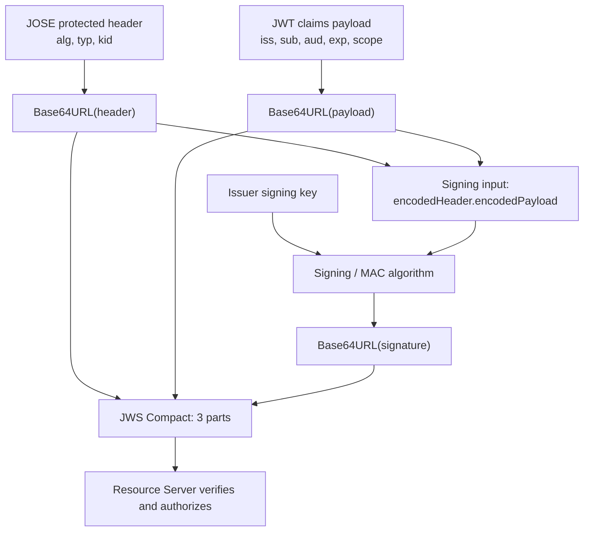
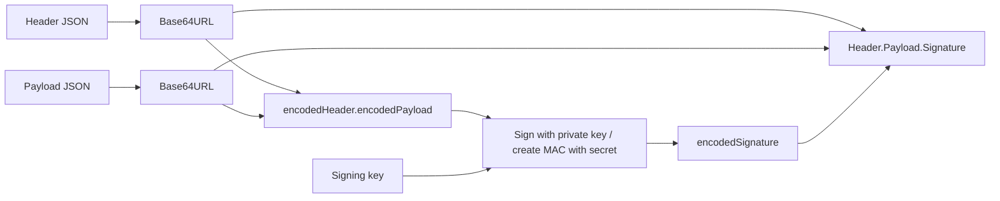
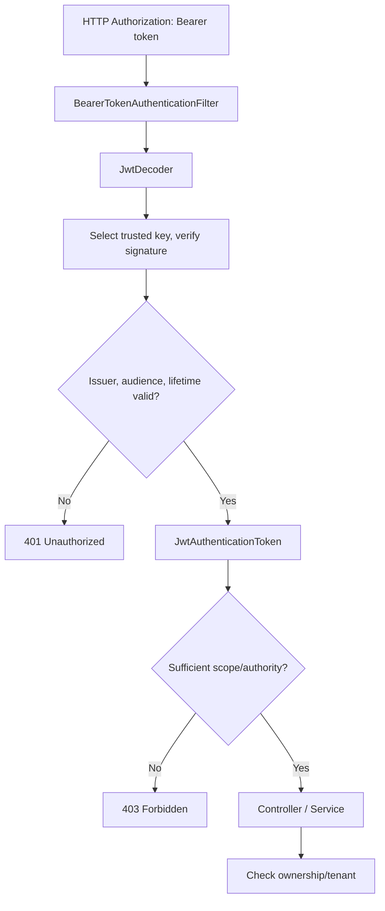
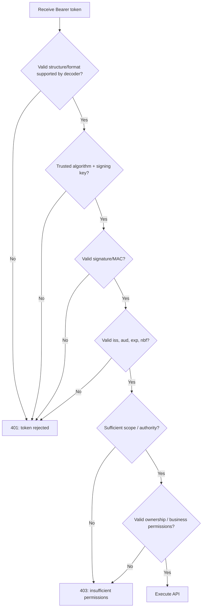

# JOSE Header, Payload, and Signature

## 1. Why Understand Token Structure Before Securing an API?

A Resource Server typically receives an access token when a Client calls an API:

```http
GET /api/orders/42 HTTP/1.1
Host: api.example.com
Authorization: Bearer <access-token>
```

In systems using **JWT access tokens**, the token typically has a shape consisting of three dot-separated segments:

```text
xxxxx.yyyyy.zzzzz
  1     2     3
```

This is the common representation of **JWS Compact Serialization**: segment 1 holds the **JOSE protected header**, segment 2 holds the **payload**, and segment 3 holds the **signature**. Each segment is a Base64URL string; the dots act as delimiters.

This separation helps the API answer three distinct questions:

1. **Header** describes how the token is cryptographically protected and hints at the verification key.
2. **Payload** contains assertions (claims) about the subject, issuer, intended audience, timestamps, and access permissions.
3. **Signature** lets the recipient verify integrity and authenticity against a trusted signing key.

What is especially important: **being able to read the payload does not mean the token is valid; a valid signature also does not mean the API should grant access**. The Resource Server must still check the issuer, audience, lifetime, scopes, and permissions on the specific resource.

### Lesson Objectives

After this lesson, you will be able to:

- Distinguish **JOSE, JWT, JWS, and JWE** and explain why not every JWT has three segments.
- Read the common `alg`, `typ`, and `kid` fields of a JOSE header.
- Explain payload claims and why Base64URL does not keep content confidential.
- Understand exactly which bytes are signed, what a signature proves, and its limitations.
- Describe how Spring Security verifies tokens when acting as an OAuth 2.0 Resource Server.
- Recognize implementation mistakes that cause an API to accept invalid tokens or leak data.

## 2. How Do JOSE, JWT, JWS, and JWE Relate?

**JOSE** (JSON Object Signing and Encryption) is a family of standards for representing cryptographic metadata in JSON. Key concepts include:

| Concept | Full name | Role |
|---|---|---|
| **JOSE** | JSON Object Signing and Encryption | Ecosystem of rules for signatures, encryption, keys, and algorithms |
| **JWS** | JSON Web Signature | Protects data integrity/authenticity via digital signatures or MACs |
| **JWE** | JSON Web Encryption | Protects content confidentiality via authenticated encryption |
| **JWK** | JSON Web Key | JSON representation of a cryptographic key |
| **JWKS** | JSON Web Key Set | Collection of JWKs, commonly used to publish verification keys |
| **JWT** | JSON Web Token | Token format carrying a set of claims as JSON; typically protected by JWS or JWE |

**JWT describes the token content**, while **JWS/JWE describe how that content is protected**.

A commonly signed JWT uses JWS Compact form with **three parts**:

```text
BASE64URL(protected-header).BASE64URL(payload).BASE64URL(signature)
```

A JWT encrypted using JWE Compact has **five parts**:

```text
protected-header.encrypted-key.iv.ciphertext.authentication-tag
```

The parts in Compact form are Base64URL representations corresponding to their JSON or binary data. A JWT can also be nested: signed first, then encrypted on the outside. In that case, the outer layer must be decrypted per policy before verifying and processing the inner content.

> This lesson focuses on **JWTs signed with JWS Compact**, which are most common when a Resource Server receives JWT access tokens. Do not apply a "JWTs always have three parts" rule to handle every JWT variant.

### Data Flow Diagram



## 3. Part One: The JOSE Protected Header

### 3.1. What Does the Header Contain?

Example header:

```json
{
  "alg": "RS256",
  "typ": "JWT",
  "kid": "signing-key-2026-11"
}
```

This is ordinary JSON **before Base64URL encoding**. In JWS Compact, the entire protected header participates in the signed input: changing a single character in the header alters the signing input and invalidates the existing signature.

Common fields:

| Header parameter | Meaning | How the Resource Server should handle it |
|---|---|---|
| `alg` | Signing/MAC algorithm, e.g., `RS256`, `ES256`, `HS256` | Accept only algorithms in the configured policy; never let the token decide the trust level |
| `typ` | Object type hint, e.g., `JWT` or `at+jwt` per profile | Use when specified by the profile; do not treat `typ` alone as proof the token may call the API |
| `kid` | Key identifier, helping locate a matching key in the JWKS | Look up only in a trusted key source; `kid` is untrusted before signature verification |
| `cty` | Content type description, useful for nested structures | Interpret only per the system's profile |
| `crit` | Lists critical header extensions the recipient must understand | Reject if an unsupported critical extension is present |

Other JOSE headers may appear, such as `jwk`, `jku`, `x5c`, and `x5u`. Those fields can carry key or certificate references. **Never arbitrarily fetch keys from a URL specified by the token itself and treat them as trusted**: doing so can lead to accepting attacker-signed tokens or create unwanted network access risks.

### 3.2. Why Must `alg` Be Restricted?

`alg` stands for *algorithm*. Common JOSE algorithms:

| `alg` | Algorithm family | Signing key | Verification key |
|---|---|---|---|
| `HS256` | HMAC-SHA-256 (symmetric MAC) | Shared secret | Same shared secret |
| `RS256` | RSASSA-PKCS1-v1_5 with SHA-256 | RSA private key | RSA public key |
| `PS256` | RSASSA-PSS with SHA-256 | RSA private key | RSA public key |
| `ES256` | ECDSA P-256 with SHA-256 | EC private key | EC public key |
| `EdDSA` | EdDSA signature, curve/key dependent | Private key | Public key |

The algorithms actually supported depend on the library, framework version, and security policy. Do not assume every Resource Server supports all options above.

With `RS256`, `PS256`, `ES256`, or suitable asymmetric signing algorithms, the Authorization Server holds the **private key**; the Resource Server only needs the public key to verify. With `HS256`, signer and verifier share a secret. Because anyone holding the secret can produce a valid MAC, HS256 requires more careful trust boundary design when multiple Resource Servers exist.

A JOSE value named `none` also exists for cases without signature-based integrity protection. **A Resource Server protecting APIs with signed JWTs must never accept `alg=none` as an authenticated token.**

### 3.3. Why Is `kid` Not Proof of Trust?

Suppose a trusted JWKS contains keys `signing-key-2026-10` and `signing-key-2026-11`. When a token has `kid=signing-key-2026-11`, the Resource Server uses that value to locate the matching public key.

However, the header **is read before the signature is verified**. An attacker can send a forged token with any `kid`. Therefore:

- `kid` is only a **key selection hint**, not proof that the token comes from a trusted origin.
- The selected key must belong to the **preconfigured trusted JWKS/keystore**.
- Do not use `kid` as a file path, query, or URL without strict input constraints.
- During key rotation, the verifier can refresh the JWKS under controlled policies.

## 4. Part Two: Payload and JWT Claims

### 4.1. What Is the Payload?

Example payload of an access token:

```json
{
  "iss": "https://id.example.com/realms/shop",
  "sub": "user-417",
  "aud": ["orders-api"],
  "iat": 1893455100,
  "nbf": 1893455100,
  "exp": 1893456000,
  "jti": "tok-8df2a",
  "scope": "orders.read orders.write",
  "client_id": "shop-web"
}
```

In JWS Compact, the payload segment is the Base64URL encoding of the payload bytes. When the payload represents a JWT Claims Set, those bytes are normally the UTF-8 encoding of a JSON object.

Common claims:

| Claim | Meaning | Related check |
|---|---|---|
| `iss` (*issuer*) | Identifier of the token issuer | Does it match the trusted issuer? |
| `sub` (*subject*) | Subject the token refers to | Who is that subject according to the issuer's contract? |
| `aud` (*audience*) | Intended recipients of the token | Was the token issued for this specific API? |
| `exp` (*expiration time*) | Time when the token expires | Has the current time passed expiration? |
| `nbf` (*not before*) | Do not accept the token before this time | Has the token reached its valid start time? |
| `iat` (*issued at*) | Time when the token was issued | Used per token age/lifetime policy if applicable |
| `jti` (*JWT ID*) | JWT identifier | Can support correlation, replay prevention, or revocation by design |
| `scope` or `scp` | Granted OAuth scopes | Does it include the scope needed by the endpoint? |
| `client_id` | Client identifier, if included by the issuer | Does this Client conform to API policy? |

`iss`, `sub`, `aud`, `exp`, `nbf`, `iat`, and `jti` belong to the registered JWT claim names. `scope`, `scp`, and `client_id` depend on the OAuth profile/issuer; they do not automatically appear in every JWT. Some systems also add custom claims such as `tenant_id` or `roles`.

The `exp`, `nbf`, and `iat` timestamps typically use **NumericDate**, measured in seconds since the Unix epoch, not the milliseconds used by many programming APIs. For example, `1893456000` is merely an illustrative future timestamp, **not a real token**.

`aud` can be a string or an array of strings per JWT structure. In Spring Security implementations, normalized claims are accessed through the `Jwt` API.

### 4.2. The Payload Is Not Secret Encrypted Data

For instance, `sub=user-417` is placed in the payload and Base64URL-encoded. Anyone holding the JWS Compact token can Base64URL-decode it to read that value. **Base64URL is data representation encoding, not encryption.**

Therefore, never place sensitive items directly in the payload, such as:

- Passwords, private keys, client secrets, or API keys.
- Sensitive personal data unnecessary for the Resource Server.
- Financial/medical/internal data that the system does not want token holders to read.

If token contents must stay confidential from parties without decryption keys, choose an appropriate mechanism such as **JWE**, or redesign tokens to avoid carrying sensitive data. Even when a token is signed, protect Bearer tokens with HTTPS and avoid logging tokens.

### 4.3. The Payload Is an Assertion, Not Yet an Accepted Fact

A self-declared payload claiming `sub=admin` or `scope=orders.write` has zero security value before signature and issuer verification. An attacker can trivially craft the first two Base64URL segments.

Even after verifying the signature, the Resource Server must still check:

- **Issuer:** the agreed-upon Authorization Server.
- **Audience:** the token was actually issued for this API.
- **Time validity:** valid `exp` and `nbf`; acceptable clock skew per policy.
- **Scope/authorities:** sufficient permissions for the endpoint and HTTP method.
- **Resource permissions:** does the user own this order, belong to the right tenant, and meet business state rules?

A JWT with a valid signature but `aud=billing-api` must be rejected by `orders-api`, even from the same issuer.

## 5. Part Three: How Is the Signature Created?

### 5.1. Which Bytes Are Signed?

For standard JWS Compact, the system first constructs:

```text
encodedHeader  = BASE64URL(UTF8(JOSE protected header JSON))
encodedPayload = BASE64URL(payload bytes)

signingInput = ASCII(encodedHeader + "." + encodedPayload)
```

Then it signs `signingInput` with the configured `alg` algorithm and appropriate signing key:

```text
signatureBytes  = SIGN_OR_MAC(signingInput, signingKey, algorithm)
encodedSignature = BASE64URL(signatureBytes)

compactJws = encodedHeader + "." + encodedPayload + "." + encodedSignature
```

Logical flow:



The signature binds **the exact encoded representation of the signed header and payload**. Modifying `sub`, `exp`, `aud`, `scope`, or `alg` in the token without the right signing key causes signature verification to fail.

In JWS, reordering JSON fields or changing whitespace and re-encoding also changes the signing input: the verifier operates on the received bytes, not by re-canonicalizing parsed JSON to recompute the signature. This explains why you cannot arbitrarily decode, edit, and re-encode while keeping the old signature.

### 5.2. Signing and Verifying with `RS256`

Suppose the Authorization Server holds the RSA private key, and the Resource Server has the matching RSA public key:

1. The Authorization Server builds a header with `alg=RS256` and a `kid` pointing to the signing key.
2. The Authorization Server builds the payload claims and Base64URL-encodes the first two parts.
3. It signs the signing input using the **RSA private key** and the RS256 algorithm.
4. The Resource Server receives the three parts and selects the trusted public key matching `kid`.
5. The Resource Server verifies the signature over **the exact signing input**.
6. If the signature is valid, it proceeds to check issuer, audience, lifetime, and authorization.

The Resource Server **does not need the Authorization Server's private key** to verify RS256. The public key can be published in a JWKS so multiple APIs can verify tokens without being able to sign tokens on the issuer's behalf.

### 5.3. Signing and Verifying with `HS256`

With HS256, the signature is an **HMAC-SHA-256** value rather than an asymmetric digital signature. Signer and verifier share a secret:

```text
macBytes = HMAC_SHA256(sharedSecret, signingInput)
```

Any party holding the secret can both verify and produce valid MACs. Therefore, if multiple APIs share the secret, understand the impact if one API leaks the key. Architectures where an Authorization Server issues JWTs to many Resource Servers usually use asymmetric algorithms so only the AS holds the private key.

**Never confuse an RSA public key with an HMAC secret.** Allowing a token to switch `alg` from RSA to HMAC and treating the RSA public key as an HMAC secret is an *algorithm confusion* flaw seen in improperly implemented verifiers. Modern libraries and explicit algorithm allowlists are essential safeguards.

### 5.4. What Does a Signature Prove, and What Does It Not Prove?

A valid signature verified with a trusted key establishes that the header/payload contents have not been altered since a party with signing capability produced the token under an accepted algorithm.

A signature **does not by itself prove**:

- That the token came from the right Authorization Server, if the API trusts the wrong keys or too many keys.
- That the token is meant for this API; `aud` validation is required.
- That the token is still valid in time; `exp`, `nbf`, and time rules are required.
- That the token has not been revoked; a validly signed JWT may remain valid until expiration without an additional revocation mechanism.
- That the caller can view a specific order; scopes and business-layer authorization are required.
- That the payload is confidential; JWS only signs, it does not encrypt.

## 6. Inspecting a Three-Part JWT Step by Step

Given an illustrative header:

```json
{"alg":"RS256","typ":"JWT","kid":"shop-key-01"}
```

And an illustrative payload:

```json
{
  "iss": "https://id.example.com",
  "sub": "user-417",
  "aud": "orders-api",
  "scope": "orders.read",
  "exp": 1893456000
}
```

After encoding each part and signing, the token is represented as:

```text
BASE64URL(header).BASE64URL(payload).BASE64URL(signature)
```

The three `BASE64URL(...)` labels above are **a structural description, not a valid token string**. A real JWT must be generated by a JOSE library with the appropriate key and algorithm. Never use illustrative tokens in real API calls.

If you need to **inspect the inner data without validating**, you can use the Java standard library to decode *only the first two parts* of a JWS Compact token:

```java
import java.nio.charset.StandardCharsets;
import java.util.Base64;

public class InspectJws {
    public static void main(String[] args) {
        String compactJws = args[0];
        String[] parts = compactJws.split("\\.", -1);

        if (parts.length != 3) {
            throw new IllegalArgumentException("Expected JWS Compact with 3 parts");
        }

        String header = new String(
            Base64.getUrlDecoder().decode(parts[0]),
            StandardCharsets.UTF_8
        );
        String payload = new String(
            Base64.getUrlDecoder().decode(parts[1]),
            StandardCharsets.UTF_8
        );

        System.out.println("UNVERIFIED header: " + header);
        System.out.println("UNVERIFIED payload: " + payload);
    }
}
```

The program above is **solely for learning Base64URL representation**; it does not verify signatures, validate claims, or authorize requests. Never use `InspectJws` output to authenticate requests, never run it with real tokens on untrusted machines/logs, and never hand-roll a JWT verifier for production.

### How Does Base64 Differ from Base64URL?

Base64URL is used to represent bytes more safely in URLs and tokens:

| Standard Base64 | Base64URL |
|---|---|
| Uses `+` and `/` characters | Replaces them with `-` and `_` |
| May end with `=` padding | JOSE Compact uses the unpadded form without `=` |
| Not directly suitable for some URL contexts | Better suited for compact token strings |

Base64URL is still **reversible**, and anyone holding the token can read the header and payload unless there is a JWE encryption layer.

## 7. JWKS, Public Keys, and Key Rotation

In OAuth 2.0/OIDC systems, the Authorization Server typically publishes a **JWKS endpoint** containing public JWKs so Resource Servers can verify asymmetric JWT signatures.

Simulated structural example (key values are placeholders and **cannot be used for real verification**):

```json
{
  "keys": [
    {
      "kty": "RSA",
      "use": "sig",
      "kid": "shop-key-01",
      "alg": "RS256",
      "n": "<rsa-modulus-base64url>",
      "e": "AQAB"
    },
    {
      "kty": "RSA",
      "use": "sig",
      "kid": "shop-key-02",
      "alg": "RS256",
      "n": "<new-rsa-modulus-base64url>",
      "e": "AQAB"
    }
  ]
}
```

Common fields:

- `kty`: key type such as RSA or EC.
- `use`: key usage purpose, such as `sig` for signatures.
- `kid`: identifier used to select the key.
- `alg`: associated algorithm if published.
- `n` and `e`: RSA public key components; EC keys have different fields appropriate to their key type.

**A public JWKS must contain only publishable public key material.** Never place the RSA private exponent or any private key or shared secret into a public JWKS.

### When the Authorization Server Rotates Keys

A key rotation flow typically proceeds as follows:

1. The Authorization Server adds the new public key to the JWKS while keeping the old public key during a transition period.
2. The Authorization Server starts signing new tokens with the new private key and new `kid`.
3. When the Resource Server sees the new `kid`, it refreshes its JWKS cache according to policy and locates the matching key.
4. Existing non-expired tokens continue to verify with the old key.
5. After an appropriate grace period, the issuer retires and removes the old key per security policy.

Important note: **the token cannot dictate the URL used to fetch the public key**. The Resource Server must rely on preconfigured trusted issuer/JWKS locations and verify algorithms and key identity per policy.

## 8. How Does Spring Security Process JOSE Header and Payload?

Spring Security OAuth2 Resource Server provides mechanisms to extract Bearer tokens, validate JWTs via `JwtDecoder`, and convert verified tokens into `Authentication` for application authorization.



### 8.1. Dependencies and Issuer Configuration

For a Spring Boot + Gradle application:

```groovy
dependencies {
    implementation 'org.springframework.boot:spring-boot-starter-web'
    implementation 'org.springframework.boot:spring-boot-starter-security'
    implementation 'org.springframework.boot:spring-boot-starter-oauth2-resource-server'
}
```

Example `application.yml`:

```yaml
spring:
  security:
    oauth2:
      resourceserver:
        jwt:
          issuer-uri: https://id.example.com/realms/shop
```

`issuer-uri` must be the **exact real issuer** published by the Authorization Server. For systems supporting metadata discovery, Spring Security can locate the JWKS endpoint and validate signature, issuer, and timestamps with the corresponding validators.

**Setting `issuer-uri` alone does not mean the API checks audience or specific access permissions.** Add the appropriate application rules.

### 8.2. Scope-Based Endpoint Configuration

```java
import org.springframework.context.annotation.Bean;
import org.springframework.context.annotation.Configuration;
import org.springframework.http.HttpMethod;
import org.springframework.security.config.Customizer;
import org.springframework.security.config.annotation.web.builders.HttpSecurity;
import org.springframework.security.config.http.SessionCreationPolicy;
import org.springframework.security.web.SecurityFilterChain;

@Configuration
public class SecurityConfig {

    @Bean
    SecurityFilterChain apiFilterChain(HttpSecurity http) throws Exception {
        return http
            .csrf(csrf -> csrf.disable())
            .sessionManagement(session -> session
                .sessionCreationPolicy(SessionCreationPolicy.STATELESS))
            .authorizeHttpRequests(authorize -> authorize
                .requestMatchers("/api/public/**").permitAll()
                .requestMatchers(HttpMethod.GET, "/api/orders/**")
                    .hasAuthority("SCOPE_orders.read")
                .requestMatchers(HttpMethod.POST, "/api/orders/**")
                    .hasAuthority("SCOPE_orders.write")
                .anyRequest().denyAll()
            )
            .oauth2ResourceServer(oauth2 ->
                oauth2.jwt(Customizer.withDefaults()))
            .build();
    }
}
```

Under Spring Security's standard mapping, values in the JWT's `scope` or `scp` claim become authorities prefixed with `SCOPE_`. For example, a token with `scope="orders.read orders.write"` receives `SCOPE_orders.read` and `SCOPE_orders.write`.

The example above assumes the REST API uses only Bearer tokens in headers and has no cookie/session authentication. Disabling CSRF **must not be copied blindly** for apps using cookie authentication or browser flows exposed to CSRF risks.

Once scope is satisfied, the Controller/Service must still check ownership, tenant, and data rules. Having `orders.read` does not permit reading everyone's orders.

### 8.3. Adding a Validator for Audience

Suppose this Resource Server accepts only tokens with audience `orders-api`. You can build a `JwtDecoder` with default issuer and timestamp validators plus an audience validator:

```java
import org.springframework.context.annotation.Bean;
import org.springframework.context.annotation.Configuration;
import org.springframework.security.oauth2.core.DelegatingOAuth2TokenValidator;
import org.springframework.security.oauth2.core.OAuth2Error;
import org.springframework.security.oauth2.core.OAuth2TokenValidator;
import org.springframework.security.oauth2.core.OAuth2TokenValidatorResult;
import org.springframework.security.oauth2.jwt.Jwt;
import org.springframework.security.oauth2.jwt.JwtDecoder;
import org.springframework.security.oauth2.jwt.JwtDecoders;
import org.springframework.security.oauth2.jwt.JwtValidators;
import org.springframework.security.oauth2.jwt.NimbusJwtDecoder;

@Configuration
public class JwtValidationConfig {

    @Bean
    JwtDecoder jwtDecoder() {
        String issuer = "https://id.example.com/realms/shop";

        NimbusJwtDecoder decoder =
            (NimbusJwtDecoder) JwtDecoders.fromIssuerLocation(issuer);

        OAuth2TokenValidator<Jwt> issuerAndTime =
            JwtValidators.createDefaultWithIssuer(issuer);

        OAuth2TokenValidator<Jwt> audience = jwt ->
            jwt.getAudience().contains("orders-api")
                ? OAuth2TokenValidatorResult.success()
                : OAuth2TokenValidatorResult.failure(
                    new OAuth2Error("invalid_token", "Invalid audience", null));

        decoder.setJwtValidator(
            new DelegatingOAuth2TokenValidator<>(issuerAndTime, audience));

        return decoder;
    }
}
```

This example illustrates one configuration style on compatible Spring Security versions; real projects should match their Spring version and issuer/validator configuration pattern. Never drop the default validators when adding a custom validator. If the issuer does not emit `aud` equal to `orders-api`, the API must reject the token and the issuance config at the Authorization Server should be fixed rather than removing the audience check.

### 8.4. Reading Verified Claims in a Controller

```java
import java.util.Map;
import org.springframework.security.core.annotation.AuthenticationPrincipal;
import org.springframework.security.oauth2.jwt.Jwt;
import org.springframework.web.bind.annotation.GetMapping;
import org.springframework.web.bind.annotation.RestController;

@RestController
public class WhoAmIController {

    @GetMapping("/api/whoami")
    public Map<String, Object> whoAmI(@AuthenticationPrincipal Jwt jwt) {
        return Map.of(
            "subject", jwt.getSubject(),
            "issuer", jwt.getIssuer().toString(),
            "audience", jwt.getAudience()
        );
    }
}
```

This snippet assumes the token reaching the endpoint contains valid issuer, subject, and audience values. When `Jwt` is supplied by Resource Server JWT authentication, the claims have passed token validation; that still **does not automatically establish business permissions**. The `/api/whoami` endpoint must also be granted an appropriate access rule in `SecurityFilterChain`; the `anyRequest().denyAll()` rule in the previous example would reject it unless explicitly permitted.

## 9. Common Failure Scenarios

| Symptom or mistake | Explanation | Remediation |
|---|---|---|
| Base64URL-decoding the payload and trusting `sub` or `scope` | Anyone can fabricate a payload | Use claims only after verifying signature and issuer |
| Accepting `alg=none` or arbitrary algorithms in the header | Attackers can bypass or trick verification | Enforce allowed algorithms/keys in the verifier |
| Trusting `kid`, `jku`, or `jwk` from the token to establish trust | Allows selecting attacker-controlled keys | Use only configured issuer/JWKS/keystore sources |
| JWT has a valid signature but wrong `iss` | Token was issued by another issuer | Enforce explicit configured issuer/allowlist |
| JWT has a valid signature but wrong `aud` | Token was issued for a different API | Validate the Resource Server's audience |
| Expired JWT | Signature may still match, but token is no longer valid | Validate `exp`, `nbf`, and acceptable clock skew |
| Using an OIDC ID token as an access token | ID tokens serve Client authentication and usually have a different audience | Require an access token intended for the API |
| Assuming a signed token is confidential | JWS payloads are readable | Avoid secrets in claims; consider JWE when encryption is truly needed |
| Having read scope yet viewing someone else's orders | Missing ownership/tenant checks | Enforce permissions on each data object |
| Public JWKS contains a private key | Exposes token-signing capability | Publish only public key components |
| Tokens signed with a new key fail while old tokens work | Resource Server lacks the new public key | Check JWKS refresh policy and `kid` matching |

A request carrying a JWT typically receives `401 Unauthorized` if the token is rejected (invalid signature, issuer, audience, or expired). If the token is valid but lacks `SCOPE_orders.read`, the Resource Server usually returns `403 Forbidden`. Even after passing endpoint checks, the business layer may still deny access if the user does not own the resource.

## 10. Illustrating an Attempt to Tamper with the Payload

Suppose the original token has:

```json
{
  "sub": "user-417",
  "scope": "orders.read"
}
```

Someone could decode the payload and craft a new payload:

```json
{
  "sub": "admin",
  "scope": "orders.read orders.write"
}
```

If they combine the new payload with **the old signature**, the signing input changes, so signature verification fails. If they re-sign it with their own key, the Resource Server still rejects it because that key does not belong to a trusted issuer.

This demonstrates the benefit of JWS: it protects integrity and proves the token is bound to a trusted signing key. However, if an attacker steals **an intact valid Bearer token**, the signature alone cannot stop them from reusing it. That is why HTTPS, secure token handling, short lifetimes, and replay/revocation mitigations are needed when required by the business.

## 11. Analyzing a JWT Error by Layer

When an API receives a token and returns an error, determine which layer failed:



For a JWS-based JWT, inspect carefully:

- **Header:** Is `alg` in the allowlist? Does `kid` match a trusted public key?
- **Signature:** Is the library verifying with the approved algorithm and key?
- **Claims:** Does issuer match? Does audience target this API? Is the token unexpired?
- **Authorities:** Are scopes mapped cleanly to `SCOPE_...` in Spring Security?
- **Business rules:** Does the user or service have permission for the actual target object?

Avoid logging full JWTs, as tokens can carry identifying details and the Bearer token itself is a reusable credential. When troubleshooting, prefer logging error codes, correlation IDs, and masked or explicitly safe fields.

## 12. Self-Check Questions

**Question 1.** Why can you read a JWT payload yet still not conclude the token is valid?

**Answer:** A JWS Compact payload is only Base64URL-encoded. You must verify the signature and claims such as issuer, audience, and lifetime before relying on the token for decisions.

**Question 2.** If the payload changes `scope` from `orders.read` to `orders.write`, is the old signature still valid?

**Answer:** No. Changing the payload alters the signing input, so the signature over the previous input no longer matches.

**Question 3.** Why does `kid` not by itself prove a token is trustworthy?

**Answer:** `kid` in the header is read before verification and can be set arbitrarily by the sender. The API must use it only to pick from **preconfigured trusted keys**, never to trust a key or URL specified by the token.

**Question 4.** A JWT has a valid signature from a trusted issuer and `scope=orders.read`, but `aud=billing-api`. Should `orders-api` accept it?

**Answer:** No. The token is intended for `billing-api`; a Resource Server must validate its own audience.

**Question 5.** How many parts does a JWT have, and how many parts does JWE Compact have?

**Answer:** A JWT signed in JWS Compact form typically has **three parts**; an encrypted JWE Compact has **five parts**. A JWT does not default to a single protection format.

**Question 6.** Can the public key for verifying RS256 be published via JWKS? What about the private key?

**Answer:** The public key can be published so Resource Servers can verify signatures. The private key must remain secret on the token issuer and never be placed in a public JWKS.

## 13. Conclusion

A JWT access token protected with JWS Compact has three parts: **JOSE protected header**, **payload**, and **signature**. The header describes the algorithm and key; the payload carries claims; the signature binds the integrity of header and payload to the signing key.

When Spring Security acts as a Resource Server, its job does not stop at splitting three segments or decoding JSON. The API must **select a trusted key and algorithm → verify the signature → validate issuer, audience, and lifetime → check scopes → enforce business authorization**. Only that full chain allows a Resource Server to trust token information appropriately and protect its APIs.
