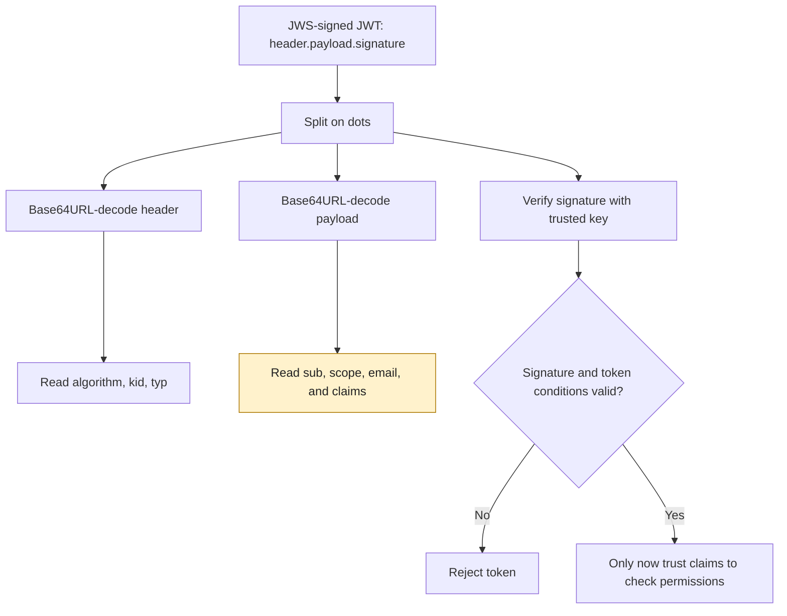

# Signatures Protect Integrity but Do Not Hide Claim Contents

When using **JWT** in **Spring Security OAuth 2.0 / OpenID Connect (OIDC) Resource Server** systems, a common misconception is: "Because a JWT is digitally signed, the information inside is confidential and outsiders cannot read it." This is **false for JWS-signed JWTs**.

**A signature protects integrity and enables verifying the issuing source under a trusted key. A signature does not encrypt the payload.** Anyone holding a standard JWS-formatted JWT can Base64URL-decode the payload to **read its claims**, without needing any signing or verification key. They cannot modify claims arbitrarily and still pass proper signature verification, yet **reading** and **modifying** are two entirely different things.

This lesson focuses on the difference between **signing** and **encryption**, relates them to **JWT/JWS/JWE** in the **JOSE** standard family, and derives practical design decisions for APIs built with Spring Security Resource Server.

## 1. Three Security Properties to Distinguish

| Property | Question answered | Typical mechanism |
|---|---|---|
| **Confidentiality** | Who is allowed to **read the contents**? | Encryption; limiting where tokens appear; access control |
| **Integrity** | Has the content been **altered** accidentally or without authorization? | Digital signature, MAC, authenticated encryption |
| **Authenticity** | Was the data created by **a party holding a trusted key**? | Signature/MAC verification with a properly configured key; issuer and policy checks |

Example: a token contains `"role": "user"`.

- **Eavesdropping:** anyone who obtains the JWS string can decode the payload and see `role=user` and all other claims. A signature **does not prevent reading**.
- **Tampering:** an attacker changes `role=user` to `role=admin`. The content can be re-encoded as Base64URL, but **the old signature is no longer valid**. A properly verifying Resource Server will reject it.
- **Forgery:** an attacker crafts a new JWT claiming `iss` and `role=admin`. Without possessing the trusted signing key, they cannot produce a matching valid signature; the API must also validate issuer, audience, lifetime, permissions, and other required conditions.

> **Key takeaway:** "Cannot be validly modified" is completely different from "cannot be seen."

## 2. How Do JWT, JWS, and JWE Relate?

**JOSE (JSON Object Signing and Encryption)** is a family of standards specifying how to sign, verify, encrypt, and represent keys for JSON or related data. Common terms:

| Term | Role |
|---|---|
| **JWT (JSON Web Token)** | Format for transferring a set of **claims** between parties. A JWT may be protected with JWS or JWE; claims are not confidential by default. |
| **JWS (JSON Web Signature)** | Mechanism protecting integrity and verifying the signing-key holder over content. Compact Serialization usually has **3 segments**. |
| **JWE (JSON Web Encryption)** | Mechanism encrypting content so only parties able to decrypt can view plaintext; Compact Serialization usually has **5 segments**. |
| **JWK / JWKS (JSON Web Key / Key Set)** | Key and key-set representation; Resource Servers typically fetch the issuer's **public keys** via JWKS to verify JWS. |
| **JWA (JSON Web Algorithms)** | Algorithm names/definitions such as `RS256`, `ES256`, `PS256`, `HS256`, or encryption algorithms used in JWE. |

In OAuth 2.0 and OIDC:

- An **access token** *may* be issued as a signed JWT (JWS), an encrypted JWT (JWE), or an **opaque** token. The Resource Server must know which type it receives.
- An OIDC **ID token** is a JWT. It is usually signed and in some configurations may be encrypted.
- A **refresh token** and **authorization code** are not JWTs by default; never apply the "split three segments" assumption to every credential.

A signed JWT **is not synonymous with** an encrypted JWT. Choose the mechanism based on your protection goal: validating integrity, hiding content, or needing both.

## 3. Why Is a Signed JWT Still Readable?

### 3.1. JWS Compact Serialization Structure

Standard JWS Compact form has the structure:

```text
BASE64URL(header).BASE64URL(payload).BASE64URL(signature)
        1                  2                  3
```

The three segments are separated by dots (`.`). For a signed JWT:

**Header** describes the algorithm and may include a key identifier:

```json
{
  "alg": "RS256",
  "typ": "at+jwt",
  "kid": "signing-key-2026-01"
}
```

**Payload** contains the claims set, e.g., an access token for the Orders API:

```json
{
  "iss": "https://login.example.com",
  "sub": "user-42",
  "aud": "orders-api",
  "exp": 2000000000,
  "iat": 1999996400,
  "scope": "orders.read",
  "email": "user@example.com",
  "department": "sales"
}
```

These values are illustrative only. Which claims appear depends on the Authorization Server and token type. `typ=at+jwt` is just one example of a JWT access token type; not every issuer uses it.

**Signature** is the output of the signing/MAC algorithm over the data corresponding to the header and payload. For a JWS with a standard Base64URL payload:

```text
encodedHeader  = BASE64URL(UTF8(headerJson))
encodedPayload = BASE64URL(UTF8(payloadJson))
signingInput   = ASCII(encodedHeader + "." + encodedPayload)
signature      = SIGN(signingInput, signingKey)
compactJws     = encodedHeader + "." + encodedPayload
                 + "." + BASE64URL(signature)
```

`BASE64URL` is a **data representation encoding** that turns bytes into characters safe for URLs and HTTP. It is **not security encryption**:

- It uses no secret key.
- Anyone holding the string can reverse Base64URL.
- Header and payload can be read **without verifying the signature first**.
- The signature binds the signed bytes to the signing key; it **does not make the contents of the first two segments secret**.

### 3.2. Illustrating the Data Paths



Two distinct paths exist:

1. **Reading content**: requires only the token string and can happen in any browser or machine.
2. **Trusting content**: requires verifying the signature, issuer, audience, lifetime, and related security conditions **before** relying on claims to allow access.

A "JWT decoder" tool displaying claims does not mean it has verified the token. A UI showing readable JSON does not prove the token was issued by a trusted system.

### 3.3. Java Example: Reading the Payload Without a Key

The standard Java snippet below only **demonstrates readability**; it does not validate the token and **must never be used as a security check**:

```java
import java.nio.charset.StandardCharsets;
import java.util.Base64;

public class JwtPayloadInspector {
    public static void main(String[] args) {
        if (args.length != 1) {
            throw new IllegalArgumentException("Provide a sample JWS JWT");
        }

        // split with a negative limit preserves empty segments if any.
        String[] parts = args[0].split("\\.", -1);
        if (parts.length != 3) {
            throw new IllegalArgumentException(
                "This example only illustrates 3-part compact JWS"
            );
        }

        String payloadJson = new String(
            Base64.getUrlDecoder().decode(parts[1]),
            StandardCharsets.UTF_8
        );

        // Do not print real JWTs containing sensitive data to shared logs/terminals.
        System.out.println(payloadJson);
    }
}
```

The program takes no `public key`, `private key`, or `secret`, yet it still reads the JSON inside the JWS. It **does not know** whether the signature is valid, whether `iss` is trustworthy, whether `aud` matches the API, or whether the token is expired. That is why **decoding is not verifying**.

Use only sample tokens in a controlled environment for demonstrations. Never paste production tokens into unapproved public JWT decoder websites: beyond exposing claims, **the Bearer token itself** can be stolen.

## 4. How Far Can an Attacker Read, Modify, or Reuse a Token?

Suppose an outsider obtains a **signed** access token:

| Action | Possible? | Why? |
|---|---|---|
| Decode header/payload to view `email`, `sub`, `scope` | **Yes** | Public Base64URL encoding, no key-based decryption step. |
| Change `scope` to `admin` and Base64URL-encode again | **Can craft a fake string**, but validation must **fail** | The signed bytes changed; the old signature no longer matches. |
| Create a new signature using the issuer's public key | **No** with properly used asymmetric signature algorithms | A public key verifies; it cannot sign like a private key. |
| Use a stolen token to call the API while valid | **Possible** with non-sender-constrained bearer tokens | Anyone holding the token can present it like a legitimate client within its existing scopes. |
| Read sensitive data inside the token despite HTTPS URLs | **Yes**, if the token is obtained elsewhere | HTTPS protects transit, not JWT contents when stored elsewhere. |

**Key emphasis:** a signature lets the API detect tampering; it **does not prevent information disclosure** and **does not by itself stop replay of a stolen bearer token**. Mitigating token misuse requires HTTPS, limiting lifetime/scope/audience, protecting storage, and—where appropriate—sender-constrained tokens (such as DPoP or mTLS).

### What Specifically Does a Signature Protect?

- With `RS256`, `ES256`, and `PS256`, the issuer signs with a **private key**, and the resource server verifies with a **public key** established as trusted.
- With `HS256`, the JWS signature is a **MAC** based on a **shared secret**; the verifier also knows the secret and can technically generate MACs. Do not treat a MAC as proof that only the issuer holds a private key the way asymmetric signatures do.
- Both models require proper **key distribution and protection**. A JWT's self-declared `alg` or `kid` has no authority to dictate which algorithm or key the API trusts.

If the signing key is leaked, the signature no longer protects against someone holding that key. If the API skips verification or accepts unsafe algorithms, attackers can forge tokens. Thus **signature strength** depends on both verification enforcement and key management—not merely on having a third segment in the token string.

## 5. Which Claim Contents Risk Exposure?

In a JWT, a **claim** is a name–value pair describing the subject, intended recipient, timestamps, or application data. Typical claims:

| Claim | Meaning | Confidentiality considerations |
|---|---|---|
| `iss` | Token issuer | Usually not secret, though reveals the identity system in use. |
| `sub` | Subject identifier | Can correlate user activity across services; not automatically harmless. |
| `aud` | Permitted token audience | Identifies target service/application, may expose internal topology. |
| `exp`, `iat`, `nbf` | Expiration, issued-at, not-before times | Rarely secret, though exposes token lifecycle. |
| `scope` or `scp` | Granted permissions | Permission metadata; token holders see what actions the client can take. |
| `roles`, `groups` | Roles, groups | Can reveal organizational structure and internal privileges. |
| `email`, `name`, `phone_number`, `address` | Personal data (PII) | **Do not embed if the API does not need them**; readable in JWS. |
| `department`, `customer_id`, `tenant_id` | Business/identity metadata | Assess privacy impact, data leakage, or cross-context correlation. |
| Passwords, OTPs, API keys, private keys, refresh tokens | Secrets capable of granting/restoring access | **Never put into access/ID token claims** just for "convenience." |

Even with `sub` alone, multiple services observing the same static identifier enables user correlation. When cross-service linkage is undesirable, consider audience-scoped or pairwise subject identifiers supported by your OIDC provider and application model.

Practical principles:

1. **Minimize claims**: include only information genuinely needed for authorization checks or protocol operation.
2. **Prefer internal references**: instead of embedding a full user profile, use a low-disclosure identifier and fetch details through an authorized API.
3. **Evaluate the audience and who sees the token**: frontends, API gateways, proxies, partners, and diagnostic tools may all handle the token.
4. **Never use "it is signed" as a justification for placing sensitive data into a token.**
5. **Never display or log full tokens/claims** in applications, gateways, analytics, tracing, crash reports, or support tickets.

Note: hiding claims does not make a token safe to share. Even an **opaque** access token with no readable payload is a sensitive bearer credential.

## 6. Does HTTPS Hide Claims?

**HTTPS/TLS encrypts traffic in transit** between two TLS endpoints, preventing ordinary network eavesdroppers from reading the token on the wire. However, TLS and JWT signatures operate at **two different layers**:

- **TLS protects transit:** from client to the server/gateway terminating TLS.
- **JWS protects content against modification:** verification can still happen after the token passes through intermediate systems.
- **Neither automatically solves all storage security issues:** tokens in browser storage, logs, memory dumps, crash reports, databases, message queues, or telemetry can still be read if those locations are improperly accessed.

Example API call with header:

```http
GET /api/orders HTTP/1.1
Host: api.example.com
Authorization: Bearer ACCESS_TOKEN_VALUE
```

If the connection uses HTTPS, header data is protected on the wire. Still:

- The browser/client holds the access token to send it: authorized extensions, XSS JavaScript, or a compromised host can expose the token depending on storage and access permissions.
- A reverse proxy may terminate TLS before reaching the application: the token exists in plaintext at that legitimate processing hop.
- Logging or tracing middleware may accidentally record the raw `Authorization` header.
- If a token leaks from storage, anyone who obtains it can **read its claims** regardless of whether earlier requests used HTTPS.

This is why protection is required across **issuance**, **transmission**, **usage**, **storage**, **monitoring**, and **revocation/lifetime reduction**.

## 7. When Content Must Be Hidden: JWE and Alternatives

### 7.1. What Is JWE Used For?

**JWE** provides confidentiality by encrypting content for recipients capable of decrypting it. Compact JWE typically has **five segments**:

```text
BASE64URL(protected-header).
BASE64URL(encrypted-key).
BASE64URL(iv).
BASE64URL(ciphertext).
BASE64URL(authentication-tag)
```

When properly designed and implemented:

- Anyone unable to decrypt **cannot read the plaintext payload** via Base64URL decoding alone.
- The **JWE protected header remains visible**, as it is not encrypted inside the ciphertext.
- **Authenticated encryption** in JWE protects the integrity of the ciphertext and associated data per algorithm. However, it does not inherently prove "signed by the issuer" with a private key the way JWS does across all setups.
- Authorized recipients can still read all claims after decryption. Hence **minimizing sensitive claims remains important**.

When both **issuer signature** and **encryption to hide claims** are required, one pattern is a **nested JWT**:

```text
JWT claims
   │
   ▼
JWS: sign claims with issuer key
   │
   ▼
JWE: encrypt JWS for recipient
   │
   ▼
Recipient decrypts JWE → verifies JWS → validates claims
```

A **sign-then-encrypt** mechanism must be agreed upon in the protocol contract: supported algorithms, keys, recipients, nested JWT handling, and validation rules. Never assume adding an encryption layer automatically suffices to verify issuer/audience/authorization.

### 7.2. Is JWE the Default Choice?

Not necessarily. JWE adds complexity around key management, decryption, integration, and operations. Depending on risk, choose accordingly:

| Need | Design approach |
|---|---|
| API needs permission checks without secret data in claims | **JWT/JWS with minimal claims**; validate thoroughly and protect bearer tokens. |
| Prevent intermediaries/clients from reading sensitive metadata embedded in tokens | **JWE** for the intended recipient, or **omit that metadata from the token**. |
| Avoid distributing claims to multiple components | **Opaque access token + introspection**, with proper caching, authorization, and metadata validation. |
| Need detailed user profile after login | Fetch from a dedicated authorized endpoint on demand instead of embedding every field into ID/access tokens. |
| Require both issuer authentication and payload confidentiality | Combined **sign + encrypt** design adhering to standards and actual issuer/recipient support. |

**A note on opaque tokens:** an opaque string prevents clients from reading claims in a standard format, but does not prevent metadata exposure via introspection responses or downstream systems. Nor does it replace bearer token protection.

## 8. Direct Connection to Spring Security Resource Server

Spring Security Resource Server **validates access tokens** before permitting a request to reach an endpoint. For JWS-signed JWTs, the Resource Server typically verifies the signature using a public key fetched from the issuer's JWKS, checks key claims, and converts scopes into authorities.

### 8.1. Example JWT Resource Server Configuration

A Spring Boot 3.x application with Spring Security 6.x typically requires these starters:

```groovy
dependencies {
    implementation 'org.springframework.boot:spring-boot-starter-web'
    implementation 'org.springframework.boot:spring-boot-starter-security'
    implementation 'org.springframework.boot:spring-boot-starter-oauth2-resource-server'
}
```

Example `application.yml`:

```yaml
spring:
  security:
    oauth2:
      resourceserver:
        jwt:
          issuer-uri: https://login.example.com
          audiences:
            - orders-api
```

Goals of this configuration:

- `issuer-uri` specifies the trusted issuer; when standard discovery is supported, Spring locates metadata and the required JWK set address.
- When your Spring Boot/Spring Security version supports `audiences`, this property verifies the JWT was issued for `orders-api`. If your version does not support it, configure an `OAuth2TokenValidator<Jwt>` to check `aud`.
- A valid signature is only **one condition**. The API must still check lifetime, audience, scopes/authorities, and business permissions.

Example endpoint configuration in Spring Security 6:

```java
package com.example.orders;

import org.springframework.context.annotation.Bean;
import org.springframework.context.annotation.Configuration;
import org.springframework.http.HttpMethod;
import org.springframework.security.config.Customizer;
import org.springframework.security.config.annotation.web.builders.HttpSecurity;
import org.springframework.security.web.SecurityFilterChain;

@Configuration
public class ApiSecurityConfiguration {

    @Bean
    SecurityFilterChain apiSecurityFilterChain(HttpSecurity http)
            throws Exception {
        return http
            .authorizeHttpRequests(auth -> auth
                .requestMatchers(HttpMethod.GET, "/api/orders/**")
                    .hasAuthority("SCOPE_orders.read")
                .anyRequest().authenticated()
            )
            .oauth2ResourceServer(oauth2 ->
                oauth2.jwt(Customizer.withDefaults())
            )
            .build();
    }
}
```

Depending on the issuer, the `scope` or `scp` claim is mapped to `SCOPE_*` authorities by default. For instance, `orders.read` typically becomes `SCOPE_orders.read`. If the provider uses a custom permission representation, customize `JwtAuthenticationConverter`. This is **authority mapping**, not a mechanism to hide claims.

### 8.2. Verified Claims Can Be Read by the Application

Once the Resource Server validates a token, Spring Security can inject the `Jwt` object into a controller:

```java
import org.springframework.security.core.annotation.AuthenticationPrincipal;
import org.springframework.security.oauth2.jwt.Jwt;
import org.springframework.web.bind.annotation.GetMapping;
import org.springframework.web.bind.annotation.RestController;
import java.util.Map;

@RestController
public class ProfileController {

    @GetMapping("/api/my-subject")
    public Map<String, Object> mySubject(
            @AuthenticationPrincipal Jwt jwt) {
        // Return only genuinely necessary information, not all claims.
        return Map.of("subject", jwt.getSubject());
    }
}
```

This shows how to use claims **after** Spring Security has validated the access token, assuming the endpoint is properly protected and the issuer provides `sub` per contract. Even though Spring verifies the signature, claims in the JWT are **not automatically encrypted**. Avoid logging patterns like the following when real tokens may contain private data:

```java
// AVOID: risks leaking personal data and permission metadata
// log.info("JWT claims: {}", jwt.getClaims());
// log.debug("Authorization header: {}", authorizationHeader);
```

Instead, log operationally necessary details (request ID, verification outcome, error category, endpoint), without recording raw bearer tokens. If identity correlation is required for investigation, consider sensitivity-reduced/masked internal identifiers and an appropriate retention policy.

### 8.3. Is a Valid Signature Enough to Accept a Token?

**No.** Suppose the API receives a token validly signed by `https://login.example.com`, yet:

- `aud` is `billing-api`, not `orders-api`;
- `exp` has expired;
- `scope` does not contain `orders.read`;
- the token is an ID token with `aud` pointing to an OIDC client;
- the token belongs to another tenant or the user has no permission to view the requested order.

The Resource Server must still reject or block the action under the corresponding condition. **Proper signing** only confirms integrity and evidence tied to the signing key; it **does not grant unrestricted access**.

In particular, a **signed ID token** can have the exact same three-part JWS format as an access token. That does not turn an ID token into an API access token. An API must accept only the **token type**, **audience**, and **permissions** defined by the protocol and system.

### 8.4. Does Resource Server Decrypt JWE Automatically?

Spring Security's standard `oauth2ResourceServer().jwt()` configuration targets **verifying signed JWTs** via `JwtDecoder`. Do not assume setting `issuer-uri` also enables the application to decrypt **JWE**.

If the Authorization Server issues encrypted JWT/JWE tokens, explicitly design **decryption capability on the resource server**, decryption key management, and post-decryption token verification. Depending on the library, format, and deployment, this may require a custom integration/decoder or handling JWE at an appropriate boundary. The API must still satisfy issuer, audience, lifetime, and authorization checks as usual.

Never "fix" code by "Base64URL-decoding the middle segment of a JWE" and treating it as claims: in a JWE, the payload is ciphertext, and its processing flow differs from JWS.

## 9. Pitfalls When Verifying JWT/JOSE Signatures

Tamper protection fails if the resource server verifies incorrectly. Key operational principles:

1. **Do not trust `alg` from a token as a free choice of algorithm.** Configure the verifier to allow only algorithms supported by the issuer and permitted by the API contract; reject `alg=none` tokens when signed tokens are required.
2. **Do not arbitrarily fetch keys from token-supplied URLs.** Headers like `jku` or `x5u` must be restricted or strictly controlled; never turn them into an untrusted key source outside an allowlist.
3. **Do not treat `kid` as proof of trust.** `kid` is only a hint for picking a key from an already trusted key set, not permission to select arbitrary files, URLs, or keys.
4. **Distinguish asymmetric from symmetric algorithms.** Never allow a public key meant for `RS256` verification to be misused as a shared secret for `HS256` in a flawed verifier.
5. **Validate `iss`, `aud`, `exp`, `nbf`, and other requirements.** A valid signature with the wrong audience or expired timestamp must still be rejected.
6. **Control key lifecycles.** Support clean rotation and JWKS updates; handle revoked tokens and compromised keys according to system policy.
7. **Do not use claims for authorization before verification.** You may decode for technical inspection, but all security decisions must rely on verified data.
8. **Limit data embedded in tokens.** Signatures do not protect confidentiality; the more PII a token contains, the higher the impact of any exposed copy.

To verify JWTs in Java, prefer maintained security libraries such as Spring Security Resource Server components with proper issuer/audience configuration rather than writing JWS verification from scratch.

## 10. Four Practical Scenarios

### Scenario 1 — A Partner Reads the Email Address in an Access Token

The Authorization Server issues a signed JWT containing `email`, `phone_number`, and `scope`. A partner application receives the token to call the API.

**What happens:** the partner can decode the payload and view those claims even without holding the issuer's private key. The signature is valid, yet does not hide the content.

**Remediation:** include only claims the API genuinely requires; consider moving profile data to an authorized endpoint, or using opaque tokens or JWE if the model requires hiding content between parties.

### Scenario 2 — A User Edits a Token to Claim Admin Role

A user takes a valid JWT, changes the JSON from `"role":"user"` to `"role":"admin"`, and re-encodes it with Base64URL.

**What happens:** the signature no longer matches the new header/payload. A properly verifying Resource Server returns an authentication error, typically `401 Unauthorized`/`invalid_token`.

**Remediation:** verify signatures and claims with a trusted decoder, and never rely on client-decoded and resubmitted JSON to grant permissions.

### Scenario 3 — Logs Accidentally Record the Raw Bearer Token

A gateway logs full HTTP headers while debugging; `Authorization: Bearer ...` lands in a log store accessible to many people.

**What happens:** anyone reading the logs can decode the signed JWT's claims. If the token has not expired and is not sender-constrained, it can also be replayed to call the API.

**Remediation:** redact `Authorization` headers, cookies, and tokens from logs/traces; apply proper access controls and retention to telemetry; enforce short token lifetimes and revocation where needed.

### Scenario 4 — Using JWE While Assuming All Metadata Is Hidden

A team switches from JWS to JWE to hide user profile fields.

**What happens:** ciphertext protects claims, yet the JWE protected header remains readable and token details can still leak at the target app, in post-decryption logs, or in API responses. If the bearer token is stolen, encrypting claims also **does not stop someone holding the token** from presenting it to the API.

**Remediation:** encrypt when necessary, while continuing to minimize claims, enforce authorization, protect tokens, verify metadata, and manage keys properly.

## 11. Thought Exercise and Self-Check

A system issues a signed JWT with payload:

```json
{
  "iss": "https://login.example.com",
  "sub": "employee-117",
  "aud": "inventory-api",
  "scope": "inventory.read",
  "salary": 35000000,
  "exp": 2000000000
}
```

Assume the issuer's signature is valid. Answer each question:

1. **Can the Client learn `salary` without the private key?** — **Yes.** Upon receiving a JWS, the client simply Base64URL-decodes the payload. `salary` is an inappropriate claim to distribute broadly.
2. **Can the Client change `salary` to another value and keep using that JWT?** — It cannot pass proper signature verification using the old signature; the JWT has been altered.
3. **Should `orders-api` accept this token?** — **No**, because `aud=inventory-api`, even though the signature is valid.
4. **If the token is encrypted as a JWE, can an outsider read `salary`?** — If JWE is implemented properly and they cannot decrypt it, they cannot read that plaintext claim. However, `salary` can still be exposed at the recipient after decryption.
5. **What is the best approach for the `salary` claim?** — Remove it from the token if not needed for authorization checks; if needed, expose it through a specifically authorized API rather than copying sensitive data into every access token.

## 12. Takeaways When Designing JWTs for a Resource Server

- **JWS/signed JWT:** verifies **integrity and signing-key holder**, **does not keep claim contents confidential**.
- **Base64URL:** merely **encoding**; being decodable does not mean the token is verified.
- **JWE/encrypted JWT:** use when you genuinely need to **hide claims** from parties unable to decrypt; you must still protect tokens and enforce permissions.
- **HTTPS:** protects **data in transit**, does not by itself protect claims from someone already holding the token or from insecure token storage.
- **Spring Security Resource Server:** trust claims **only after** verifying the token and checking issuer/audience/lifetime/permissions; never confuse ID tokens with access tokens and never log bearer tokens.
- **Data design:** the less private or secret data embedded in access tokens or ID tokens, the smaller the blast radius if a token leaks.

A practical rule of thumb when reviewing JWTs is: **assume everyone who receives a signed JWT can read all of its claims.** If a claim must not be visible in that scenario, change the token's data design, sharing flow, or encryption mechanism.
