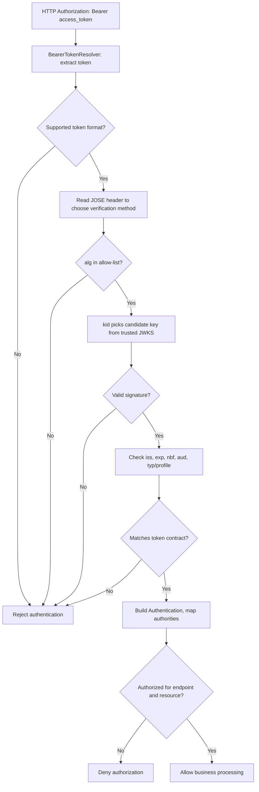

# `alg`, `kid`, `typ` and the Distinct Roles of Each Header Field in JWT/JOSE

## 1. Context: The Resource Server Must Understand the JOSE Header Properly

In **OAuth 2.0 / OpenID Connect (OIDC)** systems, a Spring Security Resource Server can protect APIs using **JWT access tokens**. A signed JWT typically uses **JSON Web Signature (JWS)**. A JWS carries a **JOSE header** describing how to process the signature and may contain metadata identifying the token type.

Three very common fields are:

- **`alg` (algorithm):** the cryptographic algorithm used to create or verify the JWS signature. It governs **how integrity and cryptographic authenticity** of the message are verified.
- **`kid` (key ID):** the key identifier. It helps the verifier **locate the right candidate key** in a trusted key set; by itself, it does not prove the token is trustworthy.
- **`typ` (type):** the type of JOSE object represented, such as `JWT` or `at+jwt`. It aids **distinguishing token context/type**, not user permissions or identity.

Although all three reside in the JOSE header, they answer three distinct questions:

| Field | Question the field addresses | Input to which step? | What it does NOT mean |
|---|---|---|---|
| `alg` | "Which algorithm should be used to verify the signature?" | Cryptographic verification, within allowed algorithms | Does not by itself decide which algorithms the API trusts |
| `kid` | "Which key in the configured key store might apply?" | Key/JWK lookup, supporting key rotation | Does not by itself establish issuer, subject, or permissions |
| `typ` | "What object/token type is this declared to be?" | Format contract validation and preventing token-type confusion | Does not replace `aud`, `iss`, signature, or authorization |

**Core principle:** the JOSE header is supplied by the token sender. Before verifying the signature with a trusted key, every value read from the token—including both header and payload—is **unauthenticated data**. The Resource Server may use `alg` and `kid` as *hints to look up the verification method*, but trust policy must always come from **server-side configuration**.

## 2. How Do JOSE, JWS, JWE, and JWT Differ?

**JOSE** (*JSON Object Signing and Encryption*) is a family of standards using JSON to sign and encrypt data. Common terms:

| Concept | Role | Relation to the header |
|---|---|---|
| **JWT** (*JSON Web Token*) | Format representing a claims set as a JSON object; commonly used as a token | A JWT can be protected by JWS or JWE |
| **JWS** (*JSON Web Signature*) | Protects integrity and cryptographic authenticity via signature/MAC | `alg` identifies the signing or MAC algorithm |
| **JWE** (*JSON Web Encryption*) | Protects confidentiality via content encryption | `alg` relates to key management/encryption key wrapping; `enc` identifies the content encryption algorithm |
| **JWK** (*JSON Web Key*) | JSON structure describing a cryptographic key | `kid` can link a JOSE header to a JWK |
| **JWKS** (*JSON Web Key Set*) | Collection of JWKs typically published at an endpoint | Resource Server can use it to obtain trusted public keys |

A JWT access token is commonly a **signed JWT in JWS Compact Serialization**:

```text
BASE64URL(UTF8(JOSE protected header))
    .
BASE64URL(UTF8(claims payload))
    .
BASE64URL(signature)
```

Example for *structural* inspection, not a real token:

```text
eyJhbGciOiJSUzI1NiIsImtpZCI6InNpZ24tMjAyNi0wMSIsInR5cCI6ImF0K2p3dCJ9
.
eyJpc3MiOiJodHRwczovL2lkLmV4YW1wbGUuY29tIiwiYXVkIjoib3JkZXJzLWFwaSJ9
.
SIGNATURE_PLACEHOLDER
```

After Base64URL-decoding the first part, the JOSE header might be:

```json
{
  "alg": "RS256",
  "kid": "sign-2026-01",
  "typ": "at+jwt"
}
```

The payload is the **JWT Claims Set**, for example:

```json
{
  "iss": "https://id.example.com",
  "sub": "user-123",
  "aud": "orders-api",
  "scope": "orders.read",
  "iat": 1909996400,
  "exp": 1910000000
}
```

**Header and payload are two distinct regions.** `alg`, `kid`, and `typ` reside in the JOSE header; `iss`, `aud`, `sub`, `scope`, and `exp` are JWT claims. A typical signed JWT can be *decoded* to read the header and payload, but readability does not mean the signature has been verified. Base64URL is **data representation encoding**, not confidentiality encryption.

A JWT can also be encrypted using JWE. JWE Compact Serialization typically has **five components**, so never assume every bearer token has three parts and is a JWS; an opaque access token may not even be a JWT.

### 2.1. Is a Signature-Protected Header Trustworthy from the Start?

In JWS Compact Serialization, the JOSE header is a **protected header**: the Base64URL bytes of the header together with the payload are covered by the signature. However, the signature proves the header was not tampered with **only after verification succeeds** using a trusted key and permitted algorithm.

The processor must read certain fields first to pick a verification key or algorithm. This does not contradict "never trust unauthenticated data," provided that:

1. Those values are used only to select among **preconfigured allowed options**.
2. Token values are never treated as commands to dynamically add new algorithms, keys, or key sources.
3. After verification succeeds, the server still checks issuer, audience, lifetime, token type, and permissions against API policy.

Some JWS JSON Serialization forms also support an *unprotected header*; this lesson focuses on **compact JWTs** common in OAuth 2.0 Resource Servers, where the header used is the protected header.

## 3. `alg`: Signing/Verification Algorithm, Not Trust Policy

### 3.1. What Does `alg` Mean in JWS?

In JWS, `alg` specifies the algorithm used to produce the signature or MAC value. For example:

```json
{
  "alg": "RS256",
  "kid": "issuer-rsa-2026",
  "typ": "at+jwt"
}
```

`RS256` is RSA PKCS#1 v1.5 Signature with SHA-256. If the Resource Server is configured to trust the issuer and its corresponding RSA public key, the JWT decoder can use this parameter to verify the signature. However, **never permit RS256 implicitly merely because the token declares `alg=RS256`**; trusted algorithms must be preconfigured in the API's settings.

Common JOSE algorithms:

| `alg` | Family | What does the signer use? | What does the verifier use? | Points to note |
|---|---|---|---|---|
| `RS256` | RSA + SHA-256 | RSA private key | RSA public key | Common with public JWKS |
| `PS256` | RSA-PSS + SHA-256 | RSA private key | RSA public key | RSA-PSS signature variant |
| `ES256` | ECDSA P-256 + SHA-256 | EC private key | EC public key | Requires handling the proper key type and JOSE signature encoding |
| `EdDSA` | EdDSA | Matching private key | Matching public key | Requires library/issuer support for the matching algorithm and key type |
| `HS256` | HMAC + SHA-256 | Shared secret | Same shared secret | No public/private key pair; requires managing the secret on the verifier |
| `none` | Unsecured JWS | No signing | No signature to verify | **Never accept** for bearer access tokens protecting an API |

A few notes:

- **`RS256` is not "RSA encryption."** In JWS, RSA is used for **digital signatures**.
- With asymmetric algorithms, the Authorization Server holds the private key; the Resource Server usually only needs the public key.
- With `HS256`, the verifier also holds the secret capable of signing tokens. Use it only when the trust model truly fits, never casually across multiple Resource Servers.
- `none` is an algorithm value described in JWT/JOSE specs for cases without signature protection. For a **Resource Server requiring signed JWT access tokens**, tokens lacking a valid signature must be rejected.

### 3.2. Preventing Algorithm Confusion Attacks

Suppose the system expects access tokens signed by the issuer with `RS256`, but an attacker crafts a header:

```json
{
  "alg": "HS256",
  "kid": "issuer-rsa-2026",
  "typ": "at+jwt"
}
```

If a verifier blindly trusts the `alg` declared by the token and misuses an RSA public key as an HMAC secret, it falls victim to **algorithm confusion / key confusion**. Modern security libraries enforce key-type and algorithm constraints to block this vulnerability class, yet implementers must still explicitly configure permitted algorithms.

Design principles:

- Maintain an **algorithm allow-list** matching the issuer contract; for example, allow only `RS256` if the API's issuer only signs with RS256.
- Distinguish symmetric (`oct`) from asymmetric (`RSA`, `EC`, `OKP`) keys per standard; never reinterpret key usage based on unverified input.
- Never use `alg` to decide to fetch secrets or load keys from an untrusted external source.
- Never "fall back" to a weaker algorithm or `none` simply because RS256 verification failed.
- When supporting multiple algorithms, configure exact allowed **issuer / algorithm / key** combinations rather than enabling every algorithm the library supports.

### 3.3. `alg` Has a Different Meaning in JWE

Do not apply the "signature algorithm" meaning to every JOSE header.

A JWE can have a protected header:

```json
{
  "alg": "RSA-OAEP-256",
  "enc": "A256GCM",
  "cty": "JWT"
}
```

Here:

- `alg` specifies the **key management** algorithm used in JWE (e.g., how the content encryption key is protected or established).
- `enc` specifies the **content encryption** algorithm.
- `cty=JWT` can indicate that the inner content is another JWT, common in nested JWTs.

Therefore, whenever you see `alg`, ask: **are we handling JWS or JWE?** Spring Security Resource Server's standard JWT decoder focuses on validating **signed JWS access tokens**. If the issuer emits encrypted JWT/JWE tokens, add explicit JWE decryption and—for nested JWTs—inner JWT signature verification per contract; do not treat a JWE as a three-part JWS to verify directly.

## 4. `kid`: Locate the Right Key, Do Not Establish Trust

### 4.1. Role of `kid`

`kid` stands for **key identifier**. It is typically a string enabling the Resource Server to find the appropriate key from the key set published by the Authorization Server:

```json
{
  "alg": "RS256",
  "kid": "rsa-key-2026-11",
  "typ": "at+jwt"
}
```

An illustrative JWKS:

```json
{
  "keys": [
    {
      "kty": "RSA",
      "kid": "rsa-key-2026-07",
      "use": "sig",
      "alg": "RS256",
      "n": "PUBLIC_MODULUS_OLD_BASE64URL",
      "e": "AQAB"
    },
    {
      "kty": "RSA",
      "kid": "rsa-key-2026-11",
      "use": "sig",
      "alg": "RS256",
      "n": "PUBLIC_MODULUS_NEW_BASE64URL",
      "e": "AQAB"
    }
  ]
}
```

The `n` strings above are **placeholders illustrating JWK fields**, not usable Base64URL moduli. For an RSA JWK, `n` and `e` are **public key** components; private keys must never be published on a public JWKS endpoint.

Typical flow:

```text
JWT header: kid = rsa-key-2026-11, alg = RS256
                    |
                    v
Preconfigured trusted issuer
                    |
                    v
Issuer's JWKS (TLS, configured / trusted discovery endpoint)
                    |
                    v
Locate JWK matching kid + compatible key type/algorithm/usage
                    |
                    v
Verify JWS signature
                    |
                    v
Validate iss, aud, exp, nbf, scope, token type...
```

`kid` is a **key selection hint**, not a signature or origin certificate. Two different issuers can both use `kid="key-1"`; key IDs are not globally unique across the Internet. Thus keys must be looked up within the **specific trusted issuer's key set**, not in a pooled keystore shared indiscriminately across issuers.

### 4.2. Is `kid` Mandatory?

Not every JWS is required to carry `kid`. With a single key or another convention, the verifier can select the key per defined policy. However, many systems maintain multiple keys simultaneously, making `kid` very useful—especially during key rotation.

**A missing `kid` does not automatically mean a token is forged.** Acceptance or rejection depends on the token profile, the JWT decoder, and how many matching keys exist in the key store. If the issuer's contract **requires `kid`**, the Resource Server can enforce that requirement. Never invent "try a random key" fallback logic just to let tokens missing metadata pass checks.

### 4.3. Key Rotation: The Most Common Reason for `kid`

Suppose the issuer initially signs tokens with `rsa-key-2026-07`. When rotation arrives:

1. The issuer generates a new key pair with `kid=rsa-key-2026-11`.
2. The JWKS is updated to publish the new key while retaining the old public key during a transition window.
3. Newly issued tokens carry `kid=rsa-key-2026-11` and are signed with the new private key.
4. The Resource Server looks up `kid`, fetching or refreshing its JWKS cache within the trusted endpoint scope.
5. Only after older tokens expire (per issuer policy) should the old key be removed from the verification key set.

During the transition window, the JWKS can hold multiple valid keys. "Signature verification failing right after rotation" usually stems from stale JWKS caches or unsynchronized configuration; never work around it by disabling signature checks.

### 4.4. Do Not Let `kid` Control the Key Source

`kid` is untrusted input. Manual implementation pitfalls to avoid:

- Using `kid` directly as a filename to read a secret, creating path traversal risks like `../private-key`.
- Interpolating `kid` into a URL and fetching keys from a caller-controlled host, creating SSRF or key injection risks.
- Selecting a key from a different issuer due to a colliding key ID.
- Trying "every key everywhere" when `kid` is not found, blurring issuer boundaries and algorithm policies.
- Failing to bound `kid` size or lookup frequency, leading to expensive key-lookup resource exhaustion.

Related headers such as `jku` (JWK Set URL), `jwk` (embedded JSON key), and `x5u` (certificate URL) must likewise be governed by **strict trust policies**. Never automatically follow URLs/keys requested by an arbitrary JWT. In Spring Security Resource Server, the standard approach is to configure a **trusted issuer or JWKS URI** so the decoder manages its key set securely.

## 5. `typ`: Identify Object Type, Not Replace Permission Checks

### 5.1. What Is `typ` Used For?

`typ` is the **type header parameter**, helping distinguish the kind of JOSE object carried. Two common examples:

```json
{
  "alg": "RS256",
  "kid": "sign-1",
  "typ": "JWT"
}
```

```json
{
  "alg": "RS256",
  "kid": "sign-1",
  "typ": "at+jwt"
}
```

- `JWT` indicates the represented object is a JSON Web Token. This is commonly seen in many ID tokens or general-purpose JWTs.
- `at+jwt` is used by **RFC 9068 — JWT Profile for OAuth 2.0 Access Tokens** to identify JWT access tokens conforming to that profile. The full media type `application/at+jwt` is also permitted by the profile.
- A token missing `typ` does not automatically prove it is not a JWT. Whether `typ` is mandatory and which value is required depend on the **protocol profile** agreed upon by the system.

With `typ`, the meaning is **token/object classification**. It carries no roles, scopes, identity, or API permissions.

### 5.2. Why Is `typ` Useful in OAuth 2.0/OIDC?

An Authorization Server or OpenID Provider can issue multiple JWTs for different purposes:

| Token | Intended consumer | Real-world `typ` examples | What else must be verified besides `typ` |
|---|---|---|---|
| RFC 9068 OAuth 2.0 JWT access token | Resource Server / API | `at+jwt` or `application/at+jwt` | Signature, issuer, API audience, validity window, and permissions |
| OIDC ID token | OIDC Client / Relying Party | Often `JWT` or per provider contract | Signature, issuer, `aud=client_id`, `nonce` when required, OIDC rules |
| JWT for events or other protocols | Dedicated protocol consumer | May have a custom type | Correct object type, right audience, and profile-specific checks |
| Non-RFC 9068 JWT access token | Resource Server / API | May be `JWT` or omit `typ` per provider | Issuer's token contract and API authorization checks |

**Do not assume every OAuth 2.0 access token has `typ=at+jwt`.** RFC 9068 describes one specific profile. If your system adopts that profile, the Resource Server should enforce all profile requirements, including type and relevant claims. If the issuer does not use that profile, follow the issuer's actual contract rather than imposing profile rules arbitrarily.

### 5.3. Token Substitution / Cross-JWT Confusion

Suppose the same OP issues:

**JWT access token** for `orders-api`:

```json
{
  "alg": "RS256",
  "kid": "sign-1",
  "typ": "at+jwt"
}
```

```json
{
  "iss": "https://id.example.com",
  "sub": "user-123",
  "aud": "orders-api",
  "scope": "orders.read",
  "exp": 1910000000
}
```

**OIDC ID token** for the `web-client` application:

```json
{
  "alg": "RS256",
  "kid": "sign-1",
  "typ": "JWT"
}
```

```json
{
  "iss": "https://id.example.com",
  "sub": "user-123",
  "aud": "web-client",
  "exp": 1910000000,
  "nonce": "nonce-from-login-request"
}
```

Both tokens can come from the **same issuer**, be signed with the **same private key** (identical `kid`), and use the same `alg`. Yet they have **different intended consumers**. `orders-api` must reject the ID token meant for `web-client`, even though its signature and expiration are valid.

`typ=at+jwt` helps prevent token mix-ups when the API enforces RFC 9068. Even so, **checking `typ` alone is not enough**: a token typed `at+jwt` with the wrong `aud` or an invalid signature must still be rejected.

### 5.4. How Does `typ` Differ from `cty`?

Both are header parameters, yet they describe two different aspects:

- **`typ` (type):** the type of the JOSE object *itself*.
- **`cty` (content type):** the type of the content inside the JOSE object's payload, useful in **nested JWTs**.

For example, a JWE wrapping another JWT can use `cty: "JWT"` to signal that the decrypted plaintext is a JWT. `cty=JWT` **does not mean** the outer JWE object can be treated directly as a signed access token; the recipient must still decrypt and verify according to the profile's order.

## 6. Distinguishing the JOSE Header from JWT Claims

A common source of confusion is treating `alg`, `kid`, and `typ` as if they were authorization data.

| Location | Field | Meaning | Resource Server check |
|---|---|---|---|
| **JOSE header** | `alg` | JWS algorithm | In allow-list; matches key type |
| **JOSE header** | `kid` | Key lookup ID in key store | Selected from trusted issuer's JWKS; verify signature |
| **JOSE header** | `typ` | Declared token/object type | Matches expected profile, if required by profile |
| **JWT claims** | `iss` | Issuer | Exact configured trusted issuer |
| **JWT claims** | `aud` | Intended token recipient | Contains the audience of the API being called |
| **JWT claims** | `sub` | Subject described by token | Used per issuer contract; do not infer permissions from `sub` alone |
| **JWT claims** | `exp`, `nbf`, `iat` | Time bounds | Token is currently valid, within reasonable clock skew |
| **JWT claims** | `scope` / `scp` | Granted permission scope | Checked against required endpoint permissions |
| **JWT claims** | `azp` or `client_id` | Associated client per profile | Checked when required by the token contract |

**`kid` is not `sub`**: key ID identifies a key; subject identifies a principal.

**`typ` is not `aud`**: type describes the token kind; audience specifies who the token is intended for.

**`alg` is not `scope`**: algorithm protects the signature; scope describes access permissions.

Even after signature verification, the API must verify permissions for the **specific target resource**, such as whether the user is allowed to read orders in that tenant. `scope=orders.read` is rarely enough to grant access to every order.

## 7. Order in Which a Resource Server Processes a JWT Access Token

For a protected HTTP API, the processing flow can be illustrated as:



The diagram shows **logical responsibilities**, not a rigid internal step order for every JWT library. A decoder may combine certain steps, yet the key invariant is **never granting business permissions based on unverified headers or payloads**.

In Spring Security, the components typically involved are:

- **`BearerTokenAuthenticationFilter`** extracts the Bearer access token from the request.
- **`JwtDecoder` / `NimbusJwtDecoder`** decodes, verifies the signature, and runs validators.
- **`JwtAuthenticationProvider`** uses the verified JWT to create an `Authentication`.
- **`JwtAuthenticationConverter`** maps relevant claims into principal and authorities; standard scopes typically become `SCOPE_...`.
- **Security authorization rules** decide whether the endpoint and resource allow the action.

Not every dot-containing token is a JWT or handled by a JWT decoder; if the AS issues **opaque tokens**, the Resource Server should use opaque-token introspection per contract rather than looking for `alg`, `kid`, and `typ` inside an opaque string.

## 8. Configuring Spring Security Resource Server

### 8.1. Simple Configuration by Issuer

Suppose the API accepts JWT access tokens from a trusted issuer:

```yaml
spring:
  security:
    oauth2:
      resourceserver:
        jwt:
          issuer-uri: https://id.example.com/realms/demo
```

With the Spring Boot `spring-boot-starter-oauth2-resource-server` dependency and an appropriate security chain, Spring Security can discover the issuer's metadata/JWKS to verify tokens.

Key points to understand:

- The JWKS is selected from the **configured issuer**, not from any self-declared URL inside an arbitrary JWT.
- The JWT decoder uses JOSE headers `alg`/`kid` as inputs to verification against trusted keys.
- Issuer configuration enables verifying the issuer and default JWT checks suitable for the decoder.
- **Each API's audience** must be explicitly verified per deployment contract; never infer it from `kid`, `typ`, or merely a valid signature.
- If the API requires **RFC 9068 `at+jwt`**, configure a token-type/profile validator compatible with your Spring Security version alongside audience and issuer checks.

Never drop an arbitrary public key into a decoder just to "make tokens work" before establishing the proper issuer and token contract.

### 8.2. Example Restricting `alg` and Validating Audience

When you need to explicitly configure the JWKS URI and accepted signing algorithm, you can register a custom `JwtDecoder`. The example below trusts only **RS256** and requires audience `orders-api`.

```java
import org.springframework.context.annotation.Bean;
import org.springframework.context.annotation.Configuration;
import org.springframework.http.HttpMethod;
import org.springframework.security.config.Customizer;
import org.springframework.security.config.annotation.web.builders.HttpSecurity;
import org.springframework.security.oauth2.core.OAuth2Error;
import org.springframework.security.oauth2.core.OAuth2TokenValidator;
import org.springframework.security.oauth2.core.OAuth2TokenValidatorResult;
import org.springframework.security.oauth2.core.DelegatingOAuth2TokenValidator;
import org.springframework.security.oauth2.jose.jws.SignatureAlgorithm;
import org.springframework.security.oauth2.jwt.Jwt;
import org.springframework.security.oauth2.jwt.JwtDecoder;
import org.springframework.security.oauth2.jwt.JwtValidators;
import org.springframework.security.oauth2.jwt.NimbusJwtDecoder;
import org.springframework.security.web.SecurityFilterChain;

@Configuration
public class ResourceServerSecurity {

    private static final String ISSUER =
            "https://id.example.com/realms/demo";

    private static final String JWKS_URI =
            "https://id.example.com/realms/demo/protocol/openid-connect/certs";

    @Bean
    SecurityFilterChain apiFilterChain(HttpSecurity http) throws Exception {
        return http
                .authorizeHttpRequests(auth -> auth
                        .requestMatchers(HttpMethod.GET, "/api/orders/**")
                        .hasAuthority("SCOPE_orders.read")
                        .anyRequest().authenticated())
                .oauth2ResourceServer(oauth2 ->
                        oauth2.jwt(Customizer.withDefaults()))
                .build();
    }

    @Bean
    JwtDecoder jwtDecoder() {
        NimbusJwtDecoder decoder =
                NimbusJwtDecoder.withJwkSetUri(JWKS_URI)
                        .jwsAlgorithm(SignatureAlgorithm.RS256)
                        .build();

        OAuth2TokenValidator<Jwt> issuerAndTime =
                JwtValidators.createDefaultWithIssuer(ISSUER);

        OAuth2TokenValidator<Jwt> audience = jwt ->
                jwt.getAudience().contains("orders-api")
                        ? OAuth2TokenValidatorResult.success()
                        : OAuth2TokenValidatorResult.failure(
                                new OAuth2Error(
                                        "invalid_token",
                                        "The token is not intended for orders-api",
                                        null));

        decoder.setJwtValidator(
                new DelegatingOAuth2TokenValidator<>(
                        issuerAndTime, audience));

        return decoder;
    }
}
```

Reading the example by each field's responsibility:

1. `jwsAlgorithm(SignatureAlgorithm.RS256)` defines the JWS algorithm the API **explicitly trusts**. Headers with `alg=HS256` or `alg=none` cannot alter this policy.
2. `JWKS_URI` is a **preconfigured** address; the decoder uses keys from that set to verify the JWS. `kid` helps select the right key from that set.
3. `JwtValidators.createDefaultWithIssuer(...)` checks the issuer and default time-related JWT validations.
4. The audience validator requires `aud` to contain `orders-api`; having matching `alg` and `kid` cannot substitute for this check.
5. `hasAuthority("SCOPE_orders.read")` checks the scope mapped to an authority under default configuration. Checking permissions on a **specific order** still belongs to application logic.

**This is an illustrative configuration for an RS256-signed JWS JWT access token.** Replace the JWKS URI and issuer with real, matching values. If the issuer uses ES256, PS256, or another algorithm, the allow-list must match the contract and decoder capabilities; never blindly allow all algorithms. If multiple `SecurityFilterChain` beans are needed, configure matchers to match real application routes.

### 8.3. Validating `typ=at+jwt` Under RFC 9068

Suppose the Authorization Server commits to **JWT Profile for OAuth 2.0 Access Tokens (RFC 9068)**. Then `typ` is part of the token contract: the API must distinguish this access token profile from other JWTs while checking issuer, audience, signature, lifetime, and claims per the profile.

Depending on your Spring Security version, you can use the framework's built-in *at+jwt* validation support or configure a dedicated validator. Points to distinguish:

- **JOSE header type** validation may occur during the library's JWT decoding step.
- Some decoder versions enforce a default `typ` check; when implementing a custom type policy, understand how it interacts with the defaults so you neither reject valid `at+jwt` tokens nor accidentally bypass type checks altogether.
- A custom validator checking only the `typ` string **is not enough** to implement all of RFC 9068; the profile also governs audience, issuer, required claims, and access token processing rules.
- An API not using RFC 9068 **must not assume** only tokens with `typ=at+jwt` are access tokens. Rely on the token provider's actual profile.

During an OIDC login flow, an ID token can still be signed with the exact same RS256 and `kid`. Therefore, validating the proper token type and audience forms the real security boundary.

## 9. Failure Scenarios and How to Interpret Them Correctly

### 9.1. `alg` Changed from RS256 to HS256

For example, an attacker modifies only the header to:

```json
{"alg":"HS256","kid":"rsa-key-1","typ":"at+jwt"}
```

If payload/signature do not match, the token must be rejected. More importantly, the Resource Server must never accept HS256 when the API trusts only RS256. **Never conclude that "whatever `alg` the token declares, the decoder must follow."**

### 9.2. `alg=none`

```json
{"alg":"none","typ":"at+jwt"}
```

An unsigned token does not meet the protection requirements of a signed-token API. `typ=at+jwt` cannot turn an unsigned token into a valid access token. A Resource Server requiring signed JWTs must reject it.

### 9.3. `kid` Does Not Exist in the JWKS

Header:

```json
{"alg":"RS256","kid":"key-does-not-exist","typ":"at+jwt"}
```

Common possibilities are a forged token, an unrefreshed JWKS cache after key rotation, or a misconfigured issuer/JWKS. The decoder may refresh the JWKS from the **configured trusted** source when permitted by library policy; if no matching key is found or the signature still fails, reject the token. Never use `kid` to search for keys arbitrarily on the Internet.

### 9.4. Matching `kid` but Invalid Signature

A token can copy `kid` from a real token while tampering with the payload:

```json
{"alg":"RS256","kid":"trusted-key-1","typ":"at+jwt"}
```

Matching `kid` only causes the decoder to pick the corresponding **candidate key**; the signature will still fail if the token creator lacked the corresponding private key. Hence, **kid match ≠ verified signature**.

### 9.5. `typ=JWT` When the Token Is the Provider's JWT Access Token

If the Authorization Server does **not** use RFC 9068 and issues JWT access tokens with `typ=JWT` (or omits `typ`), the Resource Server cannot declare the token invalid based on type alone. Enforce the issuer's token policy, especially `aud`, issuer, signature, lifetime, and scopes. Conversely, if the API enforces RFC 9068, that represents a **profile mismatch**.

### 9.6. An ID Token Sent by Mistake to a Resource Server

```text
ID token:
  alg = RS256
  kid = common-key-2026
  typ = JWT
  aud = web-client

Access token:
  alg = RS256
  kid = common-key-2026
  typ = at+jwt
  aud = orders-api
```

Two tokens sharing `alg`/`kid` does not mean they are interchangeable. The Resource Server requires an access token intended for `orders-api`; the OIDC Client is the party that verifies the ID token intended for `web-client`.

### 9.7. Header Contains `jku` Pointing to an Attacker Server

```json
{
  "alg": "RS256",
  "kid": "attacker-key",
  "jku": "https://attacker.example/keys.json",
  "typ": "at+jwt"
}
```

If an API blindly fetches an arbitrary `jku` and trusts keys at that URL, an attacker can sign tokens with their own key and tell the Resource Server to "verify" with that same key. The safe rule is to trust only key sources bound to trusted issuer configuration and never let JOSE headers dynamically expand the trust store.

### 9.8. A JWT from Another Issuer Shares the Same `kid`

Two Authorization Servers can both name a key `kid=key-1`. If an application merges JWKS from multiple issuers into a single pool without distinguishing issuer, a colliding key ID can cause selecting the wrong key. Multi-issuer designs must bind **issuer → JWKS → algorithm → audience/policy**. The `iss` claim in an unverified token may only be used as a *hint* to select among **allow-listed** issuers; after verification, the issuer must still be confirmed.

## 10. When Can `alg`, `kid`, and `typ` Be Absent?

| Field | Always required in every JOSE/JWT context? | Expected behavior |
|---|---|---|
| `alg` | For a JWS protected header, `alg` is a core JWS parameter and cannot be arbitrarily ignored during signature verification | Reject missing or unsupported structures per the verifier |
| `kid` | Not mandatory in every JWS | Select keys per contract and policy; never guess keys outside trusted sources |
| `typ` | Profile-dependent; RFC 9068 requires the type for that JWT access token profile | Enforce type values per the active profile; do not assume every JWT has `typ` |

**Common mistake:** assuming `kid` is mandated by the base JWT spec, or assuming `typ` is always `JWT`. In practice, JWT is a format family, and **specific profiles** define additional constraints per use case.

Beyond these three fields, you may encounter `crit` (critical header parameters): if a JOSE object includes extensions marked critical that the verifier **does not understand or support**, it must reject the token per JOSE rules. Never ignore `crit` arbitrarily, as it can alter how signatures or payloads are processed.

## 11. Debugging JOSE Headers Without Weakening Security

When a JWT access token is rejected by Spring Security Resource Server, identify **which step failed**:

| Symptom | Where to look | Possible issue |
|---|---|---|
| Decoder reports unsupported algorithm | JWT/JWS decoder | Issuer uses `ES256` while Resource Server only allows `RS256`; or token has `alg=none` |
| No key found matching `kid` | JWKS / cache / key rotation | JWKS cache not refreshed after key rotation, wrong issuer, or token from wrong source |
| Key found, but signature verification failed | JWT verifier | Tampered token, wrong private key, issuer/configuration mismatch |
| Type header mismatch | Token profile / `typ` validator | API requires `at+jwt` but received another JWT type; possible profile mismatch |
| Signature valid, but wrong issuer | Claims validator | Misconfigured JWKS/issuer or token from another trust domain |
| Signature and issuer match, but wrong audience | Claims validator | Token issued for another app/API, e.g., an ID token |
| Token valid, but returns 403 | Authorization | Missing scope, authority, role, or resource permission |

In diagnostics, log only **failure reasons and non-sensitive metadata**, minimizing identifying contents. Never log raw Bearer tokens or full `Authorization` headers; if you need to observe `kid`/`alg`, bound their length, sanitize output, and never treat unverified metadata as fact. Never write private keys, shared secrets, or real tokens into logs.

You can *decode* the JWT header to inspect `alg`/`kid`/`typ`, though decoding performs no signature verification:

```javascript
// Illustrates structural inspection for debugging only.
// Never use the output as proof of a valid token.
const firstPart = token.split(".")[0];
const base64 = firstPart.replace(/-/g, "+").replace(/_/g, "/");
const header = JSON.parse(
  atob(base64.padEnd(Math.ceil(base64.length / 4) * 4, "="))
);
console.log({
  alg: header.alg,
  kid: header.kid,
  typ: header.typ
});
```

This snippet assumes an environment supporting `atob` and a header decodable as JSON; it is not meant to replace a JWT library, does not handle JWE or format variants, and **must not be run with real tokens on untrusted tools or websites**. Verification must be performed by the Resource Server using an appropriate cryptographic library and configuration.

## 12. Summary of Design Principles

When building or integrating a Spring Security OAuth 2.0/OIDC Resource Server, keep in mind:

1. **`alg` selects how to verify the signature within server-allowed bounds**; never turn a token's self-declared value into an authorization policy or dynamically widen trusted algorithms.
2. **`kid` locates a candidate key in a trusted JWKS**; it supports key rotation but does not prove the token was validly signed. The signature must still be verified.
3. **`typ` distinguishes the token/JOSE object type**; for RFC 9068 JWT access tokens, the expected type is `at+jwt` or `application/at+jwt`. Type does not replace `aud` and access checks.
4. **JWS and JWE use `alg` in different contexts**: JWS refers to signing/MAC; JWE refers to key management for encryption, paired with `enc`. Identify the token form before processing.
5. **The header becomes trustworthy only once the signature is verified** with a trusted key and algorithm; even then, claims must be validated against the expected issuer, audience, lifetime, and profile.
6. **Never accept an ID token as an access token** merely because they share the same issuer, `alg`, or even `kid`. Tokens must be issued for the right recipient and purpose.
7. **Never let JOSE headers drive arbitrary network or file-system access.** `kid`, `jku`, `x5u`, and `jwk` must be constrained by trust policy.
8. **Separate token authentication from business authorization**: a valid signature and valid type do not grant access to all data. Enforce scopes, roles, tenants, and object-level permissions.

A concise mental summary:

```text
             JOSE HEADER                  JWT CLAIMS
       +---------------------+     +-------------------------+
       | alg: how to verify  |     | iss: who issued it      |
       | kid: select key     |     | aud: who it is for      |
       | typ: token type     |     | sub: subject            |
       +---------------------+     | exp: when it expires    |
                  |                | scope: granted scopes   |
                  v                +-------------------------+
       Signature / trusted key                  |
                  |                             |
                  +--------------+--------------+
                                 v
                     Resource Server authentication
                                 |
                                 v
                     API Authorization
```

**Technical conclusion:** `alg` governs **signature verification**, `kid` aids **key selection**, and `typ` aids **token classification**. No single field proves on its own that a request should be admitted to the API. The Resource Server grants access only after the token is verified and satisfies the issuer, audience, token profile, and authorization policies.

## 13. Standard and Framework References

- **RFC 7515 — JSON Web Signature (JWS)**: `alg`, `kid`, JOSE protected header, and JWS verification. https://www.rfc-editor.org/rfc/rfc7515
- **RFC 7516 — JSON Web Encryption (JWE)**: distinguishing `alg` and `enc` in JWE. https://www.rfc-editor.org/rfc/rfc7516
- **RFC 7517 — JSON Web Key (JWK)**: key/JWKS structure and key identifier. https://www.rfc-editor.org/rfc/rfc7517
- **RFC 7518 — JSON Web Algorithms (JWA)**: `RS256`, `HS256`, `ES256`, `none`, and other JOSE algorithms. https://www.rfc-editor.org/rfc/rfc7518
- **RFC 7519 — JSON Web Token (JWT)**: JWT Claims Set, `typ`, nested JWT, and security notes. https://www.rfc-editor.org/rfc/rfc7519
- **RFC 8725 — JSON Web Token Best Current Practices**: avoiding algorithm confusion, cross-JWT confusion, and validating audience/issuer and token type. https://www.rfc-editor.org/rfc/rfc8725
- **RFC 9068 — JWT Profile for OAuth 2.0 Access Tokens**: `at+jwt` type, claims, and profile-compliant JWT access token validation. https://www.rfc-editor.org/rfc/rfc9068
- **Spring Security Reference — OAuth 2.0 Resource Server JWT**: configuring issuer, JWKS, algorithms, and validators. https://docs.spring.io/spring-security/reference/servlet/oauth2/resource-server/jwt.html
