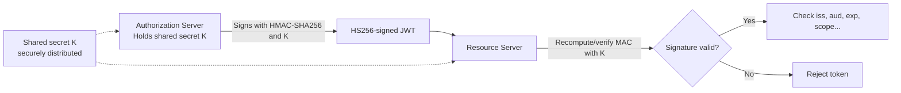
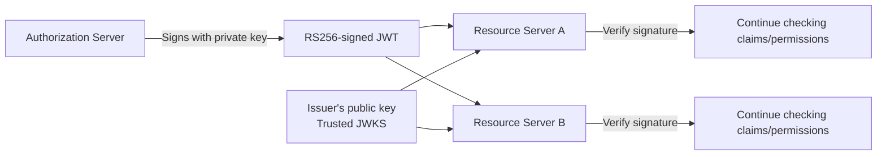

# Symmetric Keys, Asymmetric Keys, and Distinguishing Signing Keys from Verification Keys

## 1. The Problem in JWT and JOSE

In a **Spring Security OAuth 2.0/OIDC Resource Server** system, an API typically receives access tokens as JWTs. A JWT contains information such as the issuer (`iss`), subject (`sub`), audience (`aud`), expiration (`exp`), and permissions (`scope`). However, **being able to read claims does not mean they are trustworthy**. The Resource Server must verify that the token was genuinely created by a trusted issuer and that its contents have not been modified.

JOSE (JSON Object Signing and Encryption) provides the underlying cryptographic mechanisms for JWT. For JWTs signed with **JWS (JSON Web Signature)**, two key-management models are common:

- **Symmetric key:** both signer and verifier hold the same **shared secret key**; e.g., JWS with `HS256`.
- **Asymmetric keys:** the signer holds the **private key**; verifiers use the corresponding **public key**; e.g., JWS with `RS256`, `PS256`, or `ES256`.

This difference determines who is capable of issuing tokens, who can only verify tokens, and how the Authorization Server shares keys with Resource Servers.

> **Principle:** "Signing key" and "verification key" are named after their **roles in signing and signature verification**. With HMAC, they are the same secret. With asymmetric signatures, they are two distinct keys in the same key pair.

## 2. How Does a JWS-Signed JWT Work?

A JWT in **JWS Compact Serialization** has three dot-separated parts:

```text
BASE64URL(protected-header).BASE64URL(payload).BASE64URL(signature)
```

Illustrative structure:

```text
eyJhbGciOiJSUzI1NiIsImtpZCI6ImtleS0yMDI2LTAxIn0
.
eyJpc3MiOiJodHRwczovL2xvZ2luLmV4YW1wbGUudGVzdCJ9
.
<signature-bytes-encoded-with-base64url>
```

In practice, the three parts are joined on one line. The **JWS protected header** might be:

```json
{
  "alg": "RS256",
  "typ": "JWT",
  "kid": "key-2026-01"
}
```

Illustrative payload:

```json
{
  "iss": "https://login.example.test",
  "sub": "user-123",
  "aud": "orders-api",
  "scope": "orders:read",
  "iat": 1893452400,
  "exp": 1893456000
}
```

The timestamps here are placeholder data; this example is not a usable access token.

Signing applies the chosen algorithm to the **signing input**:

```text
signingInput = BASE64URL(header) + "." + BASE64URL(payload)
signature    = SIGN(signingKey, signingInput)
```

Upon receiving the JWT, the verifier computes/verifies the signature against the exact same signing input and trusted key:

```text
VERIFY(verificationKey, signingInput, signature)
```

If an attacker alters the payload—for example, changing `scope` from `orders:read` to `orders:write`—the signing input changes. Without possessing a key authorized to sign, the attacker cannot produce a valid signature for the altered content.

**Important:** JWS protects **integrity** and proves the token was signed by a holder of the appropriate key; it **does not encrypt** the header or payload for confidentiality. Anyone holding a standard JWS token can Base64URL-decode the payload. Therefore, never place passwords, secret keys, or overly sensitive data into a JWT merely because the token is signed.

### 2.1. JWT, JWS, and JWE Are Not Synonyms

| Concept | Role |
| --- | --- |
| **JWT** (JSON Web Token) | Format representing claims; typically protected by JWS or JWE. |
| **JWS** (JSON Web Signature) | Signing/MAC mechanism verifying content integrity and signing origin. |
| **JWE** (JSON Web Encryption) | Encryption mechanism keeping content confidential; has its own key model and algorithms. |
| **JWK** (JSON Web Key) | JSON representation of a cryptographic key, which may be public, private, or symmetric as appropriate. |
| **JWKS** (JSON Web Key Set) | Collection of JWKs, typically published by the OP/Authorization Server so Resource Servers can fetch public keys for signature verification. |

This lesson focuses on **JWS signing and verification** and does not conflate that with JWE encryption and decryption.

## 3. Symmetric Keys: The Same Secret Signs and Verifies

For JWS using **HMAC**, such as `HS256`, both the issuer and verifier must know **the exact same secret key**.



To verify an HMAC signature, the Resource Server must hold secret `K`. This has a critical security consequence:

**Any party capable of verifying with a shared secret also possesses sufficient cryptographic material to mint a valid HMAC signature itself.** There is no cryptographic "verify-only, cannot-sign" boundary among services that share the secret.

If the secret leaks from one Resource Server, an attacker can compute valid MACs for forged payloads. Checks on `iss`, `aud`, or `scope` remain necessary, yet cannot restore origin trust once the key authenticating token origin is compromised.

### 3.1. How Does `HS256` Sign?

`HS256` stands for **HMAC using SHA-256**, not "256-bit RSA" and not merely taking SHA-256 of the JWT:

```text
signature = HMAC-SHA256(secretK, signingInput)
```

Example flow:

1. The Authorization Server holds a strong secret `K` generated by a secure random number generator.
2. The server builds protected header `{"alg":"HS256","typ":"JWT"}` and the claims.
3. The server computes HMAC-SHA256 over the signing input and appends the signature to the JWS.
4. The Resource Server holds **the same secret `K`** to recompute the MAC and compare safely.
5. After the signature passes, the API proceeds to check issuer, audience, expiration, scope, and data policies.

For `HS256`, the secret should be a random value of **at least 256 bits (32 bytes)** per the algorithm's key requirements. A guessable password like `my-secret` does not qualify merely because it is called "secret." For HMAC SHA-384/SHA-512 algorithms, the required key length increases accordingly.

### 3.2. When Are Symmetric Keys Appropriate?

HMAC can be useful within a small deployment scope where few parties verify tokens and secret sharing is tightly controlled. However, in architectures with many independent Resource Servers, sharing a single secret creates issues:

- Every API holds a copy of a sensitive secret.
- If one API is compromised, the secret can impact many other APIs.
- Mechanisms are needed for secret distribution, read access control, key rotation, and synchronized rollout across every verifier.
- It is hard to strictly separate **token-issuance authority** from **token-verification authority**.

Therefore, in OAuth 2.0/OIDC systems with an Authorization Server and multiple independent Resource Servers, asymmetric signatures generally provide cleaner trust boundaries.

## 4. Asymmetric Keys: Private Key Signs, Public Key Verifies

Asymmetric signatures rely on **a mathematically related key pair**:

- **Private key:** kept secret on the token issuer to perform **signing**.
- **Public key:** can be distributed to Resource Servers to **verify signatures**.



A Resource Server needs only the public key; **it does not need and must never hold the issuer's private key**. The public key cannot create new signatures that a verifier will accept. As a result, leaking one API's verification configuration does not immediately expose the ability to mint new tokens.

### 4.1. Common Asymmetric JWS Algorithms

| `alg` | Algorithm family | Signing key | Verification key |
| --- | --- | --- | --- |
| `RS256` | RSASSA-PKCS1-v1_5 with SHA-256 | RSA private key | RSA public key |
| `PS256` | RSASSA-PSS with SHA-256 | RSA private key | RSA public key |
| `ES256` | ECDSA with P-256 curve and SHA-256 | EC private key | EC public key |
| `EdDSA` | Edwards-curve Digital Signature Algorithm; e.g., Ed25519 per profile/provider | Matching EdDSA private key | Matching EdDSA public key |

Algorithms cannot be swapped arbitrarily. An RSA key pair cannot verify `ES256` tokens; `RS256` and `PS256` are also two distinct signing schemes even though both use RSA keys. Issuer and verifier must agree on allowed algorithms, matching key types, and token profile rules.

### 4.2. Example RSA Key Lifecycle

Example generating an RSA key pair for **local experimentation**:

```bash
openssl genpkey -algorithm RSA -pkeyopt rsa_keygen_bits:3072 -out private.pem
openssl pkey -in private.pem -pubout -out public.pem
```

`private.pem` holds the private key and must be protected like a secret. `public.pem` holds the matching public key and can be supplied to verifiers once bound to a trusted issuer source.

In production, private keys should be managed via KMS/HSM, a secret manager, or a secure keystore with proper access controls, audit logging, and rotation policies. Never commit `private.pem` to Git, never publish private keys in a public JWKS, and never write private keys to logs.

Signing is **not** "encrypting the payload with the private key and decrypting with the public key." With `RS256`, the algorithm produces a signature via RSASSA-PKCS1-v1_5 and the SHA-256 hash function; the public key checks the signature under the matching algorithm. Calling it "encrypting with the private key" confuses digital signatures with confidentiality encryption.

## 5. Comparing Signing Keys and Verification Keys Across Models

| Criterion | Symmetric key (e.g., `HS256`) | Asymmetric keys (e.g., `RS256`) |
| --- | --- | --- |
| What does the issuer use to sign? | Shared secret `K` | **Private key** |
| What does the Resource Server use to verify? | **The same secret `K`** | Matching **Public key** |
| Are signing key and verification key identical? | **Yes, the same secret** | **No, two distinct keys of a key pair** |
| Can the verification key be published? | **No**; publishing the secret breaks the model. | **Yes**, once bound to the verified issuer/key source. |
| Can the verifier mint valid new signatures? | **Yes**, since it knows the secret. | **No**, if it only holds the public key. |
| Scaling across many APIs | Requires securely distributing the secret to many places. | Many APIs can consume the public key/JWKS. |
| If the verification key leaks | Secret is exposed, creating token-forgery risk. | Public key is meant to be shared; does not expose the private key. |
| Key rotation | Must coordinate secret replacement across signers and verifiers. | Can publish multiple public keys by `kid` during a transition window. |

**The term "verification key" does not automatically mean "public key."** It is a public key only when the signing algorithm is asymmetric. With HMAC, the verification key is still a secret and must remain confidential.

## 6. How JWKS, JWK, and `kid` Help a Resource Server Pick the Right Public Key

In OIDC and OAuth 2.0 JWT Resource Servers, the Authorization Server typically exposes a trusted **JWKS endpoint**, such as:

```text
https://login.example.test/oauth2/jwks
```

A JWKS can contain **multiple public keys**:

```json
{
  "keys": [
    {
      "kty": "RSA",
      "use": "sig",
      "kid": "rsa-2026-01",
      "alg": "RS256",
      "n": "<base64url-encoded-modulus>",
      "e": "AQAB"
    },
    {
      "kty": "RSA",
      "use": "sig",
      "kid": "rsa-2026-02",
      "alg": "RS256",
      "n": "<base64url-encoded-modulus>",
      "e": "AQAB"
    }
  ]
}
```

The `n` values above are placeholders explaining structure, not valid RSA moduli. In an RSA public JWK:

- `kty: RSA` specifies the RSA key type.
- `n` and `e` are the **public** key components.
- `use: sig` indicates the key is used for signatures.
- `alg` hints at the algorithm associated with the key; actual permitted algorithms must be governed by verifier configuration and trust policy.
- `kid` is the key identifier, helping pick the right key when multiple keys exist.

**A public JWKS must never contain private RSA JWK components**, such as `d`, `p`, `q`, or secret CRT parameters. For HMAC, an `oct` JWK stores the secret in `k`; **never place an `oct` JWK containing a secret on a public endpoint**.

### 6.1. How Does a Resource Server Use `kid`?

Suppose the JWS protected header is:

```json
{
  "alg": "RS256",
  "kid": "rsa-2026-02",
  "typ": "at+jwt"
}
```

This example follows a JWT access token profile using `typ: at+jwt`; not every JWT access token from every provider uses this exact value.

The Resource Server then:

1. Receives the Bearer token.
2. Reads the protected header for the algorithm and `kid` hint.
3. Looks up **the public key set from the preconfigured trusted issuer**, selecting a key matching `kid`, key type, and algorithm.
4. Verifies the signature.
5. Validates `iss`, `aud`, `exp`, `nbf` (if present), token type/profile, and access permissions.

`kid` **does not prove a key is trustworthy**. An attacker-crafted token can set any `kid`. Never allow an arbitrary `kid` header to select keys outside the trusted issuer's key set; likewise, never blindly trust a `jku`/`x5u` URL carried inside a token to fetch keys, as that opens key-substitution or SSRF risks without strict origin-validation policies.

### 6.2. Why Does a JWKS Have Multiple Keys?

The classic reason is **rotation**:

1. The Authorization Server signs with private key **A**; the JWKS publishes public key A.
2. The server generates a new key pair **B** and publishes public key B alongside A.
3. The server switches to signing new tokens with private key B and sets `kid=B`.
4. The Resource Server can verify both older tokens (signed by A) and newer tokens (signed by B).
5. Once tokens signed with A have expired per policy, A can be removed from the JWKS.

Resource Servers and JWT libraries typically cache the JWKS. Account for cache TTL, key refresh upon encountering a new `kid`, token lifetimes, clock skew, and emergency procedures when a key is compromised. Removing an old public key too early will cause valid non-expired tokens to fail verification.

## 7. JWT Resource Server in Spring Security: Verifying with a Public Key

In the standard model, **the Authorization Server signs access tokens with a private key**, while **the Resource Server verifies them using only the public key**. The Resource Server can use OIDC/OAuth Authorization Server metadata to discover the JWKS.

Example Spring Boot configuration:

```yaml
spring:
  security:
    oauth2:
      resourceserver:
        jwt:
          issuer-uri: https://login.example.test/realms/demo
```

With an issuer supporting standard discovery, Spring Security can obtain public key/JWKS details from metadata and verify JWT signatures. Specifying `issuer-uri` also enables checking the `iss` claim via the corresponding validator configuration.

The Resource Server **does not need** the JWT-issuing private key, **does not need** an Authorization Server secret to verify `RS256` tokens, and gains no ability to sign JWTs simply by reading the JWKS.

Example endpoint protection policy:

```java
@Configuration
class ApiSecurityConfig {

    @Bean
    SecurityFilterChain apiSecurity(HttpSecurity http) throws Exception {
        return http
                .authorizeHttpRequests(auth -> auth
                        .requestMatchers(HttpMethod.GET, "/api/orders/**")
                            .hasAuthority("SCOPE_orders:read")
                        .anyRequest().authenticated())
                .oauth2ResourceServer(oauth2 ->
                        oauth2.jwt(Customizer.withDefaults()))
                .build();
    }
}
```

In typical configurations, Spring Security maps the `scope`/`scp` claim into authorities prefixed with `SCOPE_`, though exact mapping depends on the issuer's claim format and converter setup.

### 7.1. Audience Must Also Be Checked

Verifying the signature with the issuer's public key only proves the token was signed by the matching private key. It **does not prove the JWT was issued for the current API**: the issuer may sign tokens for many applications, including **OIDC ID tokens** meant for other clients.

For example, when an API requires audience `orders-api`, you can configure a dedicated decoder and validator:

```java
@Configuration
class JwtValidationConfig {

    private static final String ISSUER =
            "https://login.example.test/realms/demo";

    private static final String EXPECTED_AUDIENCE = "orders-api";

    @Bean
    JwtDecoder jwtDecoder() {
        NimbusJwtDecoder decoder = NimbusJwtDecoder
                .withIssuerLocation(ISSUER)
                .build();

        OAuth2TokenValidator<Jwt> standard =
                JwtValidators.createDefaultWithIssuer(ISSUER);

        OAuth2TokenValidator<Jwt> audience = jwt ->
                jwt.getAudience().contains(EXPECTED_AUDIENCE)
                        ? OAuth2TokenValidatorResult.success()
                        : OAuth2TokenValidatorResult.failure(
                                new OAuth2Error(
                                        "invalid_token",
                                        "Unexpected JWT audience",
                                        null));

        decoder.setJwtValidator(
                new DelegatingOAuth2TokenValidator<>(standard, audience));

        return decoder;
    }
}
```

This example uses Spring Security types `JwtDecoder`, `NimbusJwtDecoder`, `JwtValidators`, `Jwt`, `OAuth2TokenValidator`, `OAuth2TokenValidatorResult`, `OAuth2Error`, and `DelegatingOAuth2TokenValidator`. Depending on your Spring Security version, check the corresponding builder and algorithm/JWKS configuration APIs. The sample above demonstrates **issuer + audience**; access-token profile rules, required claims, and scope mappings must match the real Authorization Server.

If the issuer does not expose discovery metadata, the application can configure a verified trusted `jwk-set-uri`; even then, explicitly enforce issuer and required claims per policy rather than relying solely on the signature.

## 8. How Does a Resource Server Verify HMAC with a Secret?

When an Authorization Server issues JWTs signed with `HS256`, the Resource Server must hold the same shared secret. You cannot use an RSA public key from a JWKS to verify HMAC, nor treat `HS256` as a substitute for `RS256`.

Example HMAC decoder configuration in a Spring Security application:

```java
@Configuration
class HmacJwtConfig {

    private static final String ISSUER = "https://issuer.example.test";
    private static final String AUDIENCE = "internal-api";

    @Bean
    JwtDecoder jwtDecoder(
            @Value("${security.jwt.hmac-base64}") String encodedSecret) {

        byte[] rawSecret = Base64.getDecoder().decode(encodedSecret);
        if (rawSecret.length < 32) {
            throw new IllegalArgumentException(
                    "HS256 requires a strong key of at least 32 bytes");
        }

        SecretKey secretKey =
                new SecretKeySpec(rawSecret, "HmacSHA256");

        NimbusJwtDecoder decoder = NimbusJwtDecoder
                .withSecretKey(secretKey)
                .macAlgorithm(MacAlgorithm.HS256)
                .build();

        OAuth2TokenValidator<Jwt> audience = jwt ->
                jwt.getAudience().contains(AUDIENCE)
                        ? OAuth2TokenValidatorResult.success()
                        : OAuth2TokenValidatorResult.failure(
                                new OAuth2Error(
                                        "invalid_token",
                                        "Unexpected audience",
                                        null));

        decoder.setJwtValidator(
                new DelegatingOAuth2TokenValidator<>(
                        JwtValidators.createDefaultWithIssuer(ISSUER),
                        audience));

        return decoder;
    }
}
```

The application can load `security.jwt.hmac-base64` from environment variables, a secret manager, or secure configuration. The value must be Base64 encoding **a genuinely random secret**, not a simple hand-typed password. Never place production secrets in Git or public configuration images.

**The symmetric and asymmetric setups in Sections 7–8 are mutually exclusive alternatives**; do not register two `JwtDecoder` beans for the same purpose without an explicit routing design. The Resource Server must know exactly which algorithm is approved for each token source.

### 8.1. Why Not Share One Secret Across All APIs?

If every service accepting `HS256` tokens holds the secret to verify them, any service holding that secret can also mint a validly signed JWT. A secret leak in one service compromises the trust boundary of the entire system.

If HMAC must be used in a multi-API environment, consider scoping keys per resource, avoiding reuse across purposes, restricting secret access, rotating keys, and enforcing `iss`/`aud` consistently. Asymmetric signatures usually separate **issuer** and **verifier** roles much more cleanly.

## 9. Which Signing Key Does the Token Issuer Need?

An OIDC Provider or OAuth 2.0 Authorization Server is configured to sign JWTs using the selected algorithm:

| Issuance algorithm | Material the issuer must hold | Material the verifier needs |
| --- | --- | --- |
| `HS256` | Shared HMAC secret | Same HMAC secret |
| `RS256` | RSA private key | RSA public key |
| `PS256` | RSA private key | RSA public key |
| `ES256` | EC P-256 private key | EC P-256 public key |
| `EdDSA` | Matching EdDSA private key | Matching EdDSA public key |

To highlight the difference at the Spring Security JOSE level, here is an example of a **signing-side** component creating an RSA `JwtEncoder` from a JWK containing the private key:

```java
@Configuration
class SigningKeyConfig {

    @Bean
    JwtEncoder jwtEncoder(
            RSAPublicKey publicKey,
            RSAPrivateKey privateKey) {

        RSAKey signingJwk = new RSAKey.Builder(publicKey)
                .privateKey(privateKey)
                .keyID("rsa-signing-2026-01")
                .build();

        JWKSet jwkSet = new JWKSet(signingJwk);
        JWKSource<SecurityContext> jwkSource =
                new ImmutableJWKSet<>(jwkSet);

        return new NimbusJwtEncoder(jwkSource);
    }
}
```

This snippet illustrates the `NimbusJwtEncoder` and Nimbus JOSE APIs (`RSAKey`, `JWKSet`, `JWKSource`, `ImmutableJWKSet`, `SecurityContext`). It assumes `RSAPublicKey` and `RSAPrivateKey` beans are created/loaded from a secure key management system; it **does not** implement a full Authorization Server, token endpoint, client validation, grant types, scopes, or rotation.

To issue OAuth 2.0/OIDC tokens in real applications, use a compliant Authorization Server/OP with formal key management. Signing an arbitrary JWT yourself **does not automatically make it a trusted OAuth 2.0 access token**.

On a Resource Server, signing code like `JwtEncoder` with a private key is **unnecessary**. The API should use `JwtDecoder` and public keys/JWKS to fulfill its verification role.

## 10. Protecting Algorithms: Do Not Let the JWT Decide Everything

The protected header contains `alg`, but that field is supplied by the token sender. The Resource Server must configure an **accepted algorithm allowlist** per issuer and key type. Never use naive logic that unconditionally says "use whatever `alg` the token specifies."

A dangerous example of **algorithm confusion**: an application intends to verify RSA signatures with a public key, yet accepts `HS256` and uses that exact public key data as an HMAC secret. Because the public key is public, an attacker can compute a valid MAC over a forged token. Modern JOSE libraries help block such key misuse, yet configurations and custom code must still enforce these rules:

1. Trust issuers and key sources **from server configuration**, not from an arbitrary URL inside the JWT.
2. Permit only algorithms compatible with the **key type** and the issuer/token profile policy.
3. Never accept `alg: none` for tokens where the API requires a signature.
4. Never coerce a public key into an HMAC secret or guess algorithm types from unauthenticated data.
5. Validate `iss`, `aud`, `exp`, timestamps, token type/profile, scopes, and API-specific conditions after signature verification succeeds.

The `typ` parameter can also help distinguish JWT profiles, such as `at+jwt` in the OAuth 2.0 JWT Access Token Profile. However, the Resource Server should use it per the issuer contract alongside other checks; `typ` alone cannot replace audience validation or authorization.

## 11. Signing and Encryption Are Two Different Operations

In learning materials, saying "RSA encrypts with the private key and decrypts with the public key" easily causes misunderstandings. Keep the two purposes separate:

| Purpose | Digital signature (JWS) | Encryption (JWE or other encryption protocol) |
| --- | --- | --- |
| Primary question | Was the data modified? Was it signed by the holder of the right key? | Who can read the contents? |
| Typical asymmetric model | **Private key signs**, **public key verifies** | Sender uses recipient's public key to protect the key/content; recipient uses matching private key to decrypt or unwrap. |
| Typical symmetric model | Same secret used for HMAC signing/verification. | Secret key used for the matching encryption and decryption algorithm. |
| Does a JWS-signed token hide the payload? | **No**. | JWE is designed to keep the payload confidential. |

Even though a JWS payload is readable, that does not mean it can be modified without detection. Conversely, an encrypted payload does not guarantee it is a valid API access token unless proper JOSE configuration and authentication/authorization checks are enforced.

## 12. Common Real-World Failures and How to Diagnose Them

| Symptom | Likely cause | Targeted checks |
| --- | --- | --- |
| `RS256` JWT rejected due to signature | Wrong public key, JWKS not updated with `kid`, tampered token, or algorithm not permitted. | Check issuer, JWKS config, `kid`, and algorithm allowlist; check rotation timing. |
| `HS256` JWT rejected by API | API uses wrong shared secret, wrong Base64 decoding, or decoder configured only for RSA. | Check secret from secret manager and allowed algorithms; never log the secret. |
| API is given `public.pem` but code tries to sign tokens | Mixing up signing vs. verification roles. | Only the issuer holds the private key; API uses `JwtDecoder` with the public key. |
| JWT has a valid signature yet returns 401 | Wrong issuer, audience, expired, or failed validator/token type check. | Separate **signature validation** from **claim validation**. |
| JWT has valid signature and claims yet returns 403 | Access token lacks the permission required by the endpoint. | Check `scope`/`scp`, authority mapping, and tenant/ownership policies. |
| New token with new `kid` fails verification | JWKS cache or key rotation rollout out of sync. | Verify the new public key was published before signing and check cache refresh policy. |
| `HS256` token can be re-signed by a receiving service | Shared secret was shared with verifiers. | Re-evaluate trust boundaries and consider moving to asymmetric signatures. |
| API unexpectedly accepts ID token instead of access token | Missing token audience/type/profile or scope checks. | Enforce proper access-token validation rather than relying solely on the issuer's signature. |

When investigating errors, never print raw tokens, private keys, shared secrets, or sensitive data into logs. Prefer logging request IDs, key IDs, verified issuer, error codes, and timestamps; never automatically fetch keys from URLs supplied in unverified tokens.

## 13. Practical Scenarios

### Scenario A: One Authorization Server and Three Resource Servers

The Authorization Server issues `RS256` JWTs. Three independent APIs receive tokens from users and must verify signatures. Proper allocation:

- The Authorization Server keeps the **RSA private key** to sign.
- The Authorization Server publishes the **RSA public key** via a JWKS tied to a trusted issuer.
- All three Resource Servers use only the **public key** to verify; each API validates its own audience and scopes.

If one API leaks its public key, an attacker still lacks the private key needed to issue new validly signed JWTs.

### Scenario B: Two APIs Share an HMAC Secret

The Authorization Server issues `HS256`; both APIs hold the same HMAC secret to verify. One API leaks the secret. Consequently, an attacker can sign JWS tokens with that secret; merely labeling an API a "verifier" does not make its key read-only. Treat the leaked secret as an incident affecting the entire trust domain sharing that key, and execute incident response and rotation per policy.

### Scenario C: Signed Successfully, Yet the API Still Rejects

An `RS256` JWT has a valid signature and is not expired, yet `aud` is `account-ui` while the API expects `orders-api`. The token **must be rejected** by the orders API due to the wrong audience. A signature confirms the token's trusted origin, **not that the token is appropriate for every Resource Server**.

### Scenario D: Resource Server Sees Two Public Keys in the JWKS

The JWKS contains keys A and B because the issuer is rotating keys. The token carries `kid=B`. The Resource Server selects public key B from the trusted JWKS and verifies the signature. It does **not** pick an arbitrary new URL or treat `kid=B` itself as proof of signature validity.

## 14. Self-Check Questions

**1. With `HS256`, can the verification key be made public?** No. It is the exact shared secret used to sign; anyone holding the secret can create valid HMAC signatures.

**2. With `RS256`, does the Resource Server need the private key?** No. The Resource Server needs only a trusted RSA public key to verify signatures and validators to check claims.

**3. Why can't you conclude a JWT is valid just because its signature verifies?** Because the JWT may target another audience, be expired, have the wrong token type, or lack sufficient scopes for the API.

**4. Is `kid` a secret?** No. It is a key-selection hint; the verifier must still use preconfigured trusted key sources and algorithms.

**5. Should a JWKS publish the RSA private exponent `d`?** No. A public JWKS contains only public material; private keys must be protected at the issuer.

**6. Does a JWS token hide the payload contents?** No. To keep payload contents confidential, consider JWE or an appropriate data-handling design.

**7. Does a valid signature replace authorization checks?** No. After verification, issuer/audience/time/token-type checks, API permissions, and data policies are still required.

## 15. Essential Reference Specifications

- **RFC 7515 – JSON Web Signature (JWS):** signature/MAC format and protected header.
- **RFC 7517 – JSON Web Key (JWK):** key representation and JWKS sets.
- **RFC 7518 – JSON Web Algorithms (JWA):** algorithm names and mechanics such as `HS256`, `RS256`, `PS256`, and `ES256`.
- **RFC 7519 – JSON Web Token (JWT):** claim and token structure.
- **RFC 8725 – JWT Best Current Practices:** algorithm validation, token-type separation, audience validation, and mitigating algorithm confusion.
- **RFC 9068 – JWT Profile for OAuth 2.0 Access Tokens:** specific requirements when access tokens follow the JWT access-token profile.

A design with clear security boundaries places **signing authority** at the issuer and **verification authority** at the Resource Server. With HMAC, both authorities rest on **the same secret**; with asymmetric signatures, they are separated by **private key** and **public key**. This is a foundational distinction when designing OAuth 2.0/OIDC with JWTs in Spring Security.
