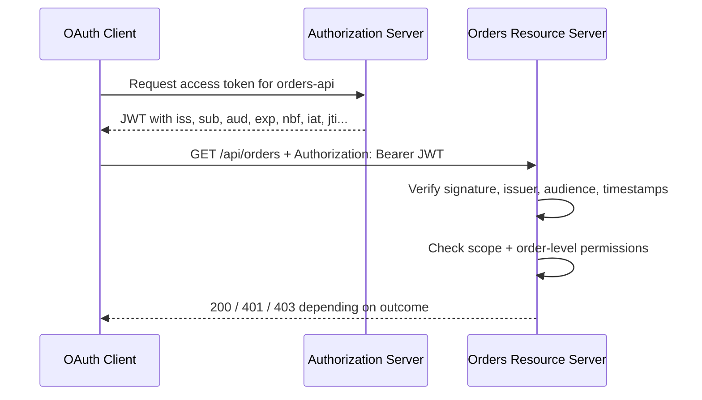
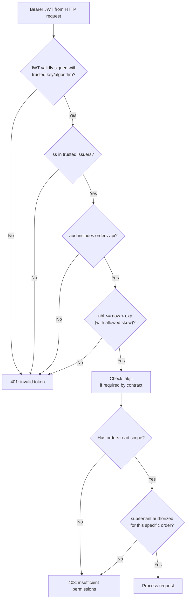

# `iss`, `sub`, `aud`, `exp`, `nbf`, `iat`, `jti` and Their Meaning in an Access Token Contract

In a **Spring Security OAuth 2.0/OIDC Resource Server**, receiving an access token is not enough to conclude that the API is allowed to fulfill a request. The API needs to know **who issued** the token, **which subject** it represents, **which API** it is intended for, **within what time window** it is valid, and **whether a specific issuance can be uniquely identified**. The seven standard JWT registered claims — `iss`, `sub`, `aud`, `exp`, `nbf`, `iat`, `jti` — are key pieces of information for expressing that contract.

This document focuses on the meaning and usage of each claim in the **contract between the Authorization Server (AS) and the Resource Server (RS)**, distinguishing what Spring Security can verify automatically from what the application must enforce additionally. Examples use **JWT** access tokens on the Spring Security Servlet stack; with opaque access tokens, much of the same information may be returned via introspection, though an API must never assume that every token is a JWT.

## 1. What Is an "Access Token Contract"?

An access token contract is the set of rules agreed upon by **the token issuer** and **the API receiving the token**. It is not merely a JSON structure; it answers concrete questions:

1. Which issuers does the API trust, and how are their signing keys or token introspection verified?
2. Which resource/API is the token intended for?
3. Is the subject in the token a user, an application client, or another kind of principal?
4. From what timestamp is the token valid, when does it expire, and when was it issued?
5. Does the API need a per-token identifier for tracking, replay control, or revocation support?
6. Once the token is valid, which permission scopes and business data does the API rely on to allow a specific operation?

A solid contract must be expressed through concrete configuration and validation policies, because **a validly signed JWT does not mean the JWT is intended for the current API**.

### Participating Parties

| Party | Related Responsibilities |
|---|---|
| **Authorization Server / Identity Provider** | Authenticate/authorize according to the corresponding OAuth 2.0 flow; decide claims; sign JWTs or provide introspection; publish issuer and appropriate keys |
| **OAuth client** | Request access tokens, store and present bearer tokens in an approved manner |
| **Resource Server** | Verify received tokens, check issuer/audience/timestamps, evaluate scopes/authorities and resource policies |
| **Downstream service** | When receiving an access token at a subsequent hop, independently verify that the token is intended for it and holds sufficient permissions |



The names `iss`, `sub`, `aud`, `exp`, `nbf`, `iat`, and `jti` originate from **RFC 7519 (JSON Web Token)**. However, RFC 7519 defines the **general semantics** of these claims, while which claims must be present depends on the **JWT profile and application contract**. For example, a JWT access token conforming to **RFC 9068** has stricter requirements than an arbitrary JWT; an OIDC ID token has its own purpose and verification rules.

## 2. Examining a JWT Access Token Against the Contract

A typical JWT has the form:

```text
BASE64URL(header).BASE64URL(payload).BASE64URL(signature)
```

Illustrative payload example:

```json
{
  "iss": "https://identity.example.com/realms/shop",
  "sub": "user-842",
  "aud": ["orders-api"],
  "exp": 1893459600,
  "nbf": 1893456000,
  "iat": 1893456000,
  "jti": "tok-28f9c36e-5d84-4f5f-b2be-6c532e7712a3",
  "scope": "orders.read orders.write",
  "client_id": "shop-web"
}
```

The numeric timestamps in the example above correspond to:

- `iat = 1893456000`: 00:00:00 UTC, 2030-01-01;
- `nbf = 1893456000`: the token is not accepted before this timestamp;
- `exp = 1893459600`: 01:00:00 UTC, 2030-01-01; the token expires at this timestamp.

This example is only a **learning payload**, not an actually signed JWT. Any claim supplied by a client must be treated as **untrusted data until the entire token has been properly verified**. Never Base64-decode the payload and use `sub`, `scope`, or `tenant_id` for authorization decisions while skipping verification.

### Quick Reference Table of the Seven Claims

| Claim | Full Name | Core Question | Common Data Type |
|---|---|---|---|
| `iss` | Issuer | **Who issued the token?** | Issuer identifier string |
| `sub` | Subject | **Which subject is the token about?** | Subject identifier string |
| `aud` | Audience | **Who is the token intended to be received by?** | String or array of strings |
| `exp` | Expiration Time | **When does the token expire?** | NumericDate (seconds) |
| `nbf` | Not Before | **What is the earliest time the token is accepted?** | NumericDate |
| `iat` | Issued At | **When was the token issued?** | NumericDate |
| `jti` | JWT ID | **Which specific issuance/token is this?** | Token identifier string |

Do not lump `iss`, `sub`, and `aud` together into a single identity concept. They refer to **three distinct roles**: the issuer, the described subject, and the intended recipient. Likewise, `exp`, `nbf`, and `iat` are three different timestamps and are not interchangeable.

## 3. `iss` — Issuer: Who Issued the Token?

`iss` identifies the entity that **issued the JWT**. In practice, the issuer is usually an HTTPS URI published by the IdP/Authorization Server:

```json
{
  "iss": "https://identity.example.com/realms/shop"
}
```

The Resource Server must have a **preconfigured set of trusted issuers**. If it receives a token self-declaring `iss=https://attacker.example`, the API cannot trust the token just because it points to a JWKS hosted by the attacker. `iss` is first and foremost a **value to be verified**, not a license for the API to dynamically pick a new issuer.

### 3.1. `iss` Is an Origin Verification Condition

For a signed JWT, the API must coordinate:

1. Obtain verification keys from a source **configured as trusted**.
2. Verify the signature, algorithm, and necessary JOSE constraints.
3. Check whether the actual `iss` matches an allowed issuer.
4. Proceed to validate `aud`, validity timestamps, and policy rules.

A valid signing key paired with an issuer not in the contract is still a rejected token. Conversely, an expected `iss` string paired with an invalid signature must also be rejected.

Example:

```text
API trusted issuer:
  https://identity.example.com/realms/shop

Token 1:
  iss = https://identity.example.com/realms/shop   -> continue validation

Token 2:
  iss = https://identity.example.com/realms/partner -> reject if not configured as trusted

Token 3:
  iss = http://identity.example.com/realms/shop    -> not the same issuer
```

The issuer address should be matched against the exact agreed value; never normalize different values into the same issuer by stripping paths, changing schemes, or relying on similar domain names. Seemingly minor differences can represent a **different realm, tenant, or issuer**.

### 3.2. `iss` in Multi-Tenant / Multi-Issuer Systems

If an API accepts tokens from multiple issuers, manage a list of trusted issuers and their corresponding validators. Never follow the pattern "read `iss` from an unverified JWT → fetch JWKS from whatever URL it gives → accept."

For instance, `sub=user-42` from two different issuers can represent **two independent subjects**:

```text
(iss = https://idp-a.example.com, sub = user-42)
(iss = https://idp-b.example.com, sub = user-42)
```

With federated identities, systems typically preserve the `iss + sub` context or map them to an application-managed internal identifier.

## 4. `sub` — Subject: Who Is the Identified Principal?

`sub` identifies **the subject about which the claims in the token make statements**:

```json
{
  "sub": "user-842"
}
```

In tokens representing a user, `sub` is typically a stable user identifier scoped to the issuer. However, **`sub` does not have to be a user** in every OAuth flow:

- In the Authorization Code flow, the access token may carry the end user's `sub` per the IdP contract.
- In the Client Credentials flow with no direct human user, the subject may be the client/service identity or another subject per the profile/issuer.
- With token exchange, delegated access, and certain architectures, the represented subject depends on the new token's semantics, actor, and issuer policy.

Therefore, an API must never assume that "having a `sub`" means "an interactively logged-in human user."

### 4.1. `sub` Is Neither an Email Nor an Access Permission

False assumptions:

```text
sub = user-842
=> User owns all orders prefixed with 842                 (false)
=> User has admin rights after logging in once           (false)
=> The sub value equals the current email address        (not guaranteed)
```

`sub` helps the API associate a token with a principal. Policies such as "may this user view this order" must check **ownership, tenant, role, or business relationship** against trusted data:

```text
Verified JWT:
  iss = https://identity.example.com/realms/shop
  sub = user-842
  scope = orders.read

Order to read:
  id = ORD-123
  owner = user-900

Result:
  The token may be valid, yet user-842 is not permitted to read ORD-123.
```

Even when `scope=orders.read`, permission on **individual objects** is still decided by the Resource Server.

### 4.2. Identifier Stability

By design, prefer using `sub` per the issuer contract rather than mutable emails or usernames. Do not use `sub` from an external issuer to directly overwrite local accounts without an identity-linking workflow. In OIDC, subject identifiers can be **public** or **pairwise**, causing the same user to have different `sub` values across clients/sectors by design; identity correlation must follow the actual identity contract.

## 5. `aud` — Audience: Which Resource Was the Token Issued For?

`aud` specifies **the intended recipients of the JWT**. For an access token serving a Resource Server, this is typically the API identifier or resource indicator agreed upon by the Authorization Server and the API:

```json
{
  "aud": ["orders-api"]
}
```

If an application is strictly the **Orders API**, it must not accept a token whose `aud` is exclusively for the **Payments API**, even if `iss` is correct and the signature is valid.

```text
Orders API requires:
  aud contains "orders-api"

Token A:
  iss = valid issuer
  aud = ["orders-api"]    -> matching audience

Token B:
  iss = valid issuer
  aud = ["payments-api"]  -> wrong audience, must reject
```

This is a defense against **token substitution**: a credential issued for one place being presented at another.

### 5.1. `aud` Can Be a String or an Array

Per JWT, `aud` can be:

```json
{"aud": "orders-api"}
```

or:

```json
{"aud": ["orders-api", "reporting-api"]}
```

For an API requiring the `orders-api` audience, the check is **whether that value belongs to the declared audience set**. Never switch to matching a raw JSON string literally or using `contains("orders")` as a partial substring match. Allowing a token to carry multiple audiences must be governed by issuance contracts and security policy; restricting audiences generally reduces the risk of a single token being accepted across multiple systems.

### 5.2. Audience Is Different from Scope

These two claims answer two independent questions:

| Question | Relevant Data |
|---|---|
| "Is the token intended for the Orders API?" | `aud` |
| "Was the token granted permission to read orders?" | `scope` / `scp` depending on IdP |
| "May the caller view order ORD-123?" | Owner/tenant/data-state policy |

For instance, a token with `scope=orders.read` but `aud=payments-api` must still **not** be usable at the Orders API. Conversely, a token with `aud=orders-api` but lacking `orders.read` still does not have sufficient permission for an order-reading endpoint.

### 5.3. Access Token Audience Differs from ID Token Audience

An OIDC **ID token** usually has `aud` set to the `client_id` of the OIDC client, because the ID token is issued for the client to understand the user authentication result. An **access token** is issued to access a Resource Server.

Example:

```text
ID token:
  aud = shop-web
  intended recipient = OIDC client

Access token:
  aud = orders-api
  intended recipient = Orders Resource Server
```

Never take an ID token sent by a browser and treat it as an API bearer access token merely because both are signed JWTs from the same issuer. An API must require the **exact credential type and audience** defined in its contract.

### 5.4. Calling Another Service Does Not Inherit Audience

```text
Client -- token aud=orders-api --> Orders API
Orders API -- same token? -------> Payments API
```

The Payments API must reject the token if its audience does not contain `payments-api`. To call on behalf of a user, you may need an IdP-supported **token exchange/on-behalf-of** flow that issues a new token for the Payments API; to call under a service identity, use **client credentials**. Never modify the `aud` field in the payload and forward it: altering the payload invalidates the JWT signature.

## 6. `exp` — Expiration Time: When Does It Expire?

`exp` represents the point in time **on or after which the token must no longer be accepted**. Per RFC 7519, processing requires that **the current time be before `exp`**:

```json
{
  "exp": 1893459600
}
```

Logical rule:

```text
now < exp     -> satisfies expiration check (assuming other checks pass)
now >= exp    -> token has expired
```

If `exp=01:00:00 UTC`, then at exactly `01:00:00 UTC` the token **has already expired**, not one second later. Libraries may allow a small configurable **clock skew**, so the effective boundary is subject to your clock skew policy.

### 6.1. `exp` Is Not a Duration

`exp` is an **absolute point in time**, not a TTL:

```text
iat = 1893456000
exp = 1893459600
Derived TTL = exp - iat = 3600 seconds
```

A JWT `NumericDate` is represented in **seconds since the Unix epoch**, not milliseconds like Java's `System.currentTimeMillis()`. Many integration bugs stem from passing a millisecond value into a claim expecting seconds, pushing the expiration far into the future.

In Java code:

```java
import java.time.Instant;

long issuedAtEpochSeconds = Instant.parse("2030-01-01T00:00:00Z")
    .getEpochSecond();
long expiresAtEpochSeconds = Instant.parse("2030-01-01T01:00:00Z")
    .getEpochSecond();
```

When using Spring Security's API, timestamps on `Jwt` are typically exposed as `Instant` (such as `jwt.getExpiresAt()`), avoiding manual timestamp parsing.

### 6.2. Expiration Does Not Mean Revocation

A token whose `exp` has not arrived may still be **no longer valid** because permissions were revoked, the user was disabled, or a security incident occurred. With offline-validated JWTs, verifying the signature and `exp` **cannot automatically detect** a recent revocation event.

Options depend on risk level:

- Short TTLs to limit the window in which a leaked bearer token can be abused.
- Re-checking current business permissions for sensitive resources.
- Using introspection, stateful mechanisms, or revocation lists when the contract requires early revocation effectiveness.
- Establishing key rotation and incident response procedures in case a signing key is compromised.

Never promise "logging out immediately invalidates the JWT" if the system only checks the signature and `exp`.

## 7. `nbf` — Not Before: When Does Validity Begin?

`nbf` specifies the timestamp **before which the JWT must not be accepted**:

```json
{
  "nbf": 1893456000
}
```

Logical rule:

```text
now < nbf     -> token is not yet valid for use
now >= nbf    -> satisfies Not Before check
```

For example, an IdP issues a token at `00:00:00 UTC` but sets `nbf=00:05:00 UTC` to delay activation. During the first 5 minutes, the token may have a valid signature and a distant `exp`, yet the Resource Server must reject it because **it is not yet within its valid time window**.

### 7.1. Relationship Between `nbf`, `iat`, and `exp`

A typical token has:

```text
iat <= nbf < exp
```

In many cases, `nbf = iat`. However, `iat` and `nbf` are **not synonymous**:

- `iat` states when the token was created/issued.
- `nbf` states the earliest time the token may be used.
- `exp` states when the token expires.

This ordering is a common expectation in many contracts, not an excuse to skip validating each timestamp individually. If a system requires extra consistency checks—such as rejecting tokens where `nbf > exp` or whose lifetime exceeds policy—the application can add a validator per the contract.

### 7.2. Clock Skew

Clocks across the IdP, gateway, and API are not always perfectly synchronized. Therefore, many libraries allow a small **clock skew tolerance** when evaluating `exp` and `nbf`. For example, a 30-second tolerance prevents a freshly issued token from being rejected by an API whose clock lags by a few seconds.

Never use a huge clock skew to "fix" drifted system clocks or mis-issued tokens; doing so **widens the window during which tokens are accepted**. Synchronizing server clocks (NTP) and choosing a deliberate tolerance is the proper approach.

## 8. `iat` — Issued At: Time of Issuance

`iat` indicates **when the JWT was issued**, commonly used to calculate token age, correlate security events, or enforce age limits:

```json
{
  "iat": 1893456000
}
```

`iat` is useful in contracts such as:

- Access tokens must not exceed a defined maximum age.
- Accept only tokens issued after a policy cutoff, such as after a client/user was required to re-authenticate.
- Correlate token issuance logs with API activity.
- Diagnose clock skew issues or token issuance cycles.

However, **`iat` is not automatically the start-of-validity timestamp**; that role belongs to `nbf`. A token with an `iat` "in the future" indicates possible clock misconfiguration or suspicious data; an application may reject it under its own policy, but **should not assume every JWT validator checks for future `iat` out of the box**.

### 8.1. Maximum Age Policy

Suppose an application defines:

```text
maxTokenAge = 10 minutes
now         = trusted system time
iat         = issuance time claimed by the token
```

An additional policy could be:

```text
now - iat <= 10 minutes
AND iat <= now + allowedClockSkew
AND exp > now
```

These checks **only make sense after the token's issuer and signature have been verified**; otherwise, a client could forge `iat`. For most APIs, a TTL contract and `exp` check are sufficient; a dedicated max-age rule is appropriate when there is an explicit security requirement.

### 8.2. Do Not Treat `iat` as the Last Login Time

A token may be issued via a refresh or token exchange without any new interactive login. Consequently, an access token's `iat` is **when this token was issued**, not when the user entered a password, completed MFA, or last authenticated.

If business logic needs proof of **when the user authenticated**, OIDC provides the `auth_time` claim in appropriate contexts. Do not substitute `iat` for `auth_time`.

## 9. `jti` — JWT ID: Unique Token Identifier

`jti` is a unique identifier string for a **specific JWT**:

```json
{
  "jti": "tok-28f9c36e-5d84-4f5f-b2be-6c532e7712a3"
}
```

Its primary purpose is to distinguish **individual token issuances**, even when multiple tokens share the same `iss`, `sub`, `aud`, `scope`, and similar timestamps. `jti` values should be generated with negligible collision probability across tokens issued by a given issuer; multi-issuer environments must avoid confusing identical `jti` values across different sources.

### 9.1. What Is `jti` Used For?

| Purpose | How `jti` Is Used | Limitations |
|---|---|---|
| Incident investigation / audit | Attach token ID to events after authentication succeeds | Never log the full raw bearer token |
| Identifying a specific issuance | Correlate a request with a specific token | Must include `iss` context; `jti` does not represent the user |
| Revocation list | Store `iss + jti` of invalidated tokens for the required lifetime | Only effective if every enforcing point checks state |
| Detecting reuse in one-time protocols | Track consumed state of *one-time* tokens/credentials | Has no effect automatically just because the claim exists |
| Distributed tracing | Correlate token events across authorized services | Requires access control on logs and linked metadata |

### 9.2. `jti` Alone Does Not Prevent Replay

Bearer access tokens are normally used **multiple times** before expiring:

```http
GET /api/orders/123
Authorization: Bearer SAME_VALID_TOKEN
```

```http
GET /api/orders/456
Authorization: Bearer SAME_VALID_TOKEN
```

Both requests can be completely legitimate. If a Resource Server simply sees that a `jti` has been used once and blocks all subsequent requests, the application breaks normal bearer token usage.

Controlling replay requires defining **what is being protected against replay**:

- For a **business operation** (such as a payment), use an **idempotency key** and transaction state per policy; an access token's `jti` is not a per-request idempotency key.
- For a **one-time credential**, the system must persist used state and reject subsequent attempts per that protocol.
- For **proof of key possession by the sender**, consider sender-constrained tokens such as DPoP or mTLS-bound tokens, with full proof verification on the receiving side.
- For **JWT revocation**, you need a distributed state check or sufficiently short token lifetimes matching the risk model.

Do not equate `jti` with an automatic anti-replay mechanism in Spring Security.

## 10. How the Seven Claims Fit Together: A Complete Validation Decision

Consider an access token with this payload:

```json
{
  "iss": "https://identity.example.com/realms/shop",
  "sub": "user-842",
  "aud": ["orders-api"],
  "iat": 1893456000,
  "nbf": 1893456000,
  "exp": 1893459600,
  "jti": "t-001",
  "scope": "orders.read"
}
```

The Orders API contract specifies:

```text
trusted issuer = https://identity.example.com/realms/shop
required audience = orders-api
scope required for GET /api/orders/{id} = orders.read
per-order permission = owner/tenant/business authorization
```

A typical decision flow:



The diagram highlights two stages:

- **Authentication / token validation:** determines whether the token is trustworthy, timely, and intended for this API.
- **Authorization:** determines whether the token's principal/permissions allow the operation on the specific resource.

`iss`, `aud`, and timestamps are conditions of the **token acceptance contract**. `sub` serves as the principal input to **business policies**. `jti` typically supports **token lifecycle/tracing**. `iat` supplies issuance timing for additional checks. None of these claims automatically replaces object-level authorization decisions.

## 11. How Does Spring Security Verify These Claims?

With a Servlet Resource Server authenticating JWTs, Spring Security typically uses `BearerTokenAuthenticationFilter` to extract the token, `JwtDecoder` to decode and verify it, and then produces a `JwtAuthenticationToken` holding the `Jwt`.

Example Spring Boot/Spring Security configuration:

```yaml
# application.yml
spring:
  security:
    oauth2:
      resourceserver:
        jwt:
          issuer-uri: https://identity.example.com/realms/shop
```

```java
import org.springframework.context.annotation.Bean;
import org.springframework.context.annotation.Configuration;
import org.springframework.security.config.Customizer;
import org.springframework.security.config.annotation.web.builders.HttpSecurity;
import org.springframework.security.web.SecurityFilterChain;

@Configuration
public class ApiSecurityConfig {
    @Bean
    SecurityFilterChain securityFilterChain(HttpSecurity http) throws Exception {
        return http
            .authorizeHttpRequests(auth -> auth
                .requestMatchers("/actuator/health").permitAll()
                .requestMatchers("/api/orders/**").hasAuthority("SCOPE_orders.read")
                .anyRequest().authenticated())
            .oauth2ResourceServer(oauth2 ->
                oauth2.jwt(Customizer.withDefaults()))
            .build();
    }
}
```

With `issuer-uri` and the default JWT decoder configured by Spring Security, the API typically validates the signature, `iss`, `exp`, and `nbf`. **Do not assume the API's audience is already validated just because `issuer-uri` is set.** Audience must be bound according to the API contract using the appropriate configuration or validator. Likewise, future `iat`, maximum TTL, or a `jti` denylist **are not default policies automatically implied by `issuer-uri`**.

### 11.1. Configuring a Custom Validator for `aud`

Spring Security 6 example using `NimbusJwtDecoder` and explicit fixed audience configuration:

```yaml
app:
  security:
    issuer: https://identity.example.com/realms/shop
    audience: orders-api
```

```java
import org.springframework.beans.factory.annotation.Value;
import org.springframework.context.annotation.Bean;
import org.springframework.context.annotation.Configuration;
import org.springframework.security.oauth2.core.DelegatingOAuth2TokenValidator;
import org.springframework.security.oauth2.core.OAuth2Error;
import org.springframework.security.oauth2.core.OAuth2TokenValidator;
import org.springframework.security.oauth2.core.OAuth2TokenValidatorResult;
import org.springframework.security.oauth2.jwt.Jwt;
import org.springframework.security.oauth2.jwt.JwtDecoder;
import org.springframework.security.oauth2.jwt.JwtValidators;
import org.springframework.security.oauth2.jwt.NimbusJwtDecoder;

@Configuration
public class JwtContractConfig {

    @Bean
    JwtDecoder jwtDecoder(
            @Value("${app.security.issuer}") String trustedIssuer,
            @Value("${app.security.audience}") String requiredAudience) {

        // Keys are selected based on the application-configured issuer, not from
        // a URL supplied by an unverified token.
        NimbusJwtDecoder decoder =
            NimbusJwtDecoder.withIssuerLocation(trustedIssuer).build();

        // Includes default validators and trusted issuer validation.
        OAuth2TokenValidator<Jwt> issuerAndTime =
            JwtValidators.createDefaultWithIssuer(trustedIssuer);

        // Require the token to be issued specifically for this Resource Server.
        OAuth2TokenValidator<Jwt> audience = jwt ->
            jwt.getAudience().contains(requiredAudience)
                ? OAuth2TokenValidatorResult.success()
                : OAuth2TokenValidatorResult.failure(
                    new OAuth2Error(
                        "invalid_token",
                        "Access token is not intended for orders-api",
                        null));

        decoder.setJwtValidator(
            new DelegatingOAuth2TokenValidator<>(issuerAndTime, audience));
        return decoder;
    }
}
```

Key points to note:

- `withIssuerLocation(trustedIssuer)` relies on the application-configured issuer to construct the decoder and locate keys from the appropriate metadata/JWKS.
- `JwtValidators.createDefaultWithIssuer(...)` combines the default JWT checks with the issuer constraint; do not drop timestamp checks when adding audience validation.
- `jwt.getAudience().contains(requiredAudience)` treats audience as a set of values, working whether the JWT carries one or multiple audiences.
- The error description string is kept generic; never leak tokens or secrets.
- Decoder configuration **does not replace** scope and resource-level authorization checks in controllers or services.

A system may configure audience via other APIs or conventions depending on the Spring Boot/Spring Security version. What must remain constant is **enforcing explicit audience validation before granting access**.

### 11.2. Reading Verified Claims in the Application

Once the token is successfully authenticated by Spring Security, a controller can receive `Jwt` via `@AuthenticationPrincipal`:

```java
import java.time.Instant;
import java.util.List;

import org.springframework.security.core.annotation.AuthenticationPrincipal;
import org.springframework.security.oauth2.jwt.Jwt;
import org.springframework.web.bind.annotation.GetMapping;
import org.springframework.web.bind.annotation.RestController;

@RestController
public class OrderController {
    private final OrderService orderService;

    public OrderController(OrderService orderService) {
        this.orderService = orderService;
    }

    @GetMapping("/api/orders")
    public List<OrderDto> myOrders(@AuthenticationPrincipal Jwt jwt) {
        String subject = jwt.getSubject();
        String tokenId = jwt.getId();
        Instant issuedAt = jwt.getIssuedAt();
        Instant notBefore = jwt.getNotBefore();
        Instant expiresAt = jwt.getExpiresAt();
        List<String> audiences = jwt.getAudience();

        // Delegate data retrieval to the business layer by verified subject.
        // Remaining values can be used for controlled policy/audit purposes.
        return orderService.findOrdersForSubject(subject);
    }
}
```

`findOrdersForSubject` here is an illustrative application-defined method, not a built-in Spring Security API. In multi-issuer or multi-tenant systems, passing only `subject` may not be enough: include the **verified issuer/tenant** or a properly mapped internal principal identifier. Never expose all claims in debug responses to end users merely because you can read them from `Jwt`.

### 11.3. `iat` and `jti` When Custom Policies Are Needed

Spring Security provides `OAuth2TokenValidator<Jwt>` infrastructure to add constraints such as:

```text
iat does not exceed now + allowedClockSkew
exp - iat does not exceed maxAccessTokenLifetime
(iss, jti) is not in the revoked token list
```

Only add checks that the contract genuinely requires. For example, if the IdP allows `iat` to be absent in a given token type under the contract, define explicitly how missing claims are handled; if the API only accepts JWT access tokens conforming to a profile that mandates `iat`/`jti`, you can require their presence. Do not turn `jti` into a rule blocking reuse of every bearer token, as analyzed earlier.

## 12. What Is Mandatory? JWT, JWT Access Token, and OIDC ID Token

Distinguish between the **base specification** and a **specific profile**. Simply seeing "JWT" does not tell you whether a token is an access token or an ID token.

| Context | Key Takeaway |
|---|---|
| **RFC 7519 — Generic JWT** | Defines syntax and semantics of registered claims; whether a claim must be present depends on the application/profile |
| **RFC 9068 — JWT Profile for OAuth 2.0 Access Tokens** | Defines a profile for JWT access tokens with stricter claim sets and acceptance rules; e.g., `iss`, `sub`, `aud`, `exp`, `iat`, `jti` are important profile fields |
| **OpenID Connect — ID Token** | Serves the OIDC client during authentication; has its own rules for `iss`, `sub`, `aud`, `exp`, `iat`, and conditional claims |
| **Opaque OAuth access token** | The Resource Server does not interpret a JWT payload directly; relies on introspection or a supported verification contract |

For example, the JWT header of an RFC 9068 token may include a type hint:

```json
{
  "alg": "RS256",
  "typ": "at+jwt",
  "kid": "key-2029-12"
}
```

`typ` helps distinguish the JWT type under the contract, but **must never be used alone** as proof of a valid token: the Resource Server still must verify the signature, issuer, audience, timestamps, and profile rules. A system supporting multiple token formats must explicitly declare which profiles are accepted.

### 12.1. Comparison Table of Claim Semantics by Purpose

| Claim | JWT OAuth Access Token | OIDC ID Token |
|---|---|---|
| `iss` | Access token issuer | OIDC provider issuing the ID token |
| `sub` | Subject per access token contract; may be user or service principal | Authenticated user subject per OIDC semantics |
| `aud` | Targeted Resource Server/API | Targeted OIDC client, typically identified by `client_id` |
| `exp` | Access token lifetime at the API | ID token lifetime for client-side verification |
| `nbf` | Start of validity if used by token/profile | Not a mandatory core claim in every ID token |
| `iat` | Access token issuance time | ID token issuance time; not the login time |
| `jti` | JWT identifier to distinguish individual tokens per profile | May be present, but not a mandatory proof of OIDC login flow |

Even though claim names overlap, **the intended recipients and purposes are different**. Resource Server APIs must not accept an ID token merely because it has `iss`, `sub`, `exp`, and a valid signature.

## 13. Common Mistakes and the Correct Contractual View

| Mistake | Consequence | Proper Design |
|---|---|---|
| "A valid JWT signature lets it call every API under the same IdP." | Token can be abused across services | Verify both `iss` **and** `aud` for the specific Resource Server |
| Take `iss` from any token and fetch JWKS from that URL | Token sender can control the trust source | Only select issuers/JWKS from a trusted configured list |
| Treat `sub` as an email or username | Identity confusion on rename, email change, or multi-issuer | Use issuer-scoped subject identifiers and careful identity mapping |
| Having `sub` implies a recently logged-in human user | Fails for client credentials and token exchange | Inspect principal type and grant/delegation per contract |
| `scope=orders.read` means access to all orders | Cross-user/cross-tenant data leaks | Enforce record-level and tenant-level authorization |
| Accept `aud=payments-api` at Orders API | Cross-API token substitution | Enforce the designated audience |
| Interpret `exp` as remaining seconds | Token accepted at wrong times | Use absolute NumericDate |
| Write `exp` in milliseconds | Token appears valid for thousands of years | Standardize on seconds since Unix epoch |
| Use `iat` instead of `nbf` | Wrong start-of-validity check | Check `nbf` separately; `iat` only states issuance time |
| Assume future `iat` is always rejected automatically | Accepts tokens with unreasonable issuance times under custom contracts | Add an `iat` validator when required |
| Believe `jti` automatically stops replay | Leaked bearer tokens can still be reused | Requires real state/protocol anti-replay protection |
| Block a second request with the same `jti` | Breaks normal bearer token usage | Use `jti` for identification/revocation; separate business idempotency |
| Assume unexpired `exp` means unchanged permissions | Fails to reflect permission changes or revocation promptly | Check current permissions or add stateful checks |

## 14. Contract Application Scenarios

### Scenario A — Valid Issuer, Wrong Audience

```json
{
  "iss": "https://identity.example.com/realms/shop",
  "sub": "user-842",
  "aud": ["payments-api"],
  "exp": 1893459600
}
```

Orders API trusts this issuer, but the token was only issued for Payments API. **Expected outcome: reject the token** even though the signature and timestamps may be valid. For a Bearer API, this is typically a token authentication error (HTTP 401).

### Scenario B — Valid Token, Future `nbf`

```text
now = 2030-01-01T00:02:00Z
iat = 2030-01-01T00:00:00Z
nbf = 2030-01-01T00:05:00Z
exp = 2030-01-01T01:00:00Z
```

The token has been issued, but **its validity window has not started yet**. The API rejects it unless the difference falls within the configured skew tolerance, which should never be set arbitrarily wide.

### Scenario C — Same `sub`, Different `iss`

```text
Token 1: iss=https://idp-a.example.com, sub=staff-01
Token 2: iss=https://idp-b.example.com, sub=staff-01
```

Even if the API trusts both issuers, `staff-01` is not necessarily the same person. When storing ownership, use the issuer/subject pair or a governed internal principal mapping.

### Scenario D — Two Tokens for the Same User and Scope, Different `jti`

```text
Token A:
  iss=trusted-issuer, sub=user-842, aud=orders-api
  scope=orders.read, jti=t-001

Token B:
  iss=trusted-issuer, sub=user-842, aud=orders-api
  scope=orders.read, jti=t-002
```

Both may be concurrently valid. `jti` helps distinguish them in audits or revocation lists, but **does not give token B broader permissions**. Permissions remain governed by scope and resource policies.

### Scenario E — API Needs to Actively Invalidate a Token Before Expiration

If the system maintains a denylist keyed by `iss+jti`:

```text
JWT:
  iss = issuer-A
  jti = t-001
  exp = 01:00 UTC

Denylist:
  (issuer-A, t-001) -> revoked at 00:20 UTC
```

After 00:20 UTC, **every Resource Server enforcing revocation must check the denylist**. If an API only checks the signature and `exp`, it may keep accepting the JWT until 01:00 UTC. That is an operational property of stateful checks, not a syntax error in `jti`.

### Scenario F — Receiving an ID Token Instead of an Access Token

A client sends an ID token with `aud=shop-web` to the Orders API, which requires `aud=orders-api`. Even if `iss`, `sub`, and the signature are valid, this is still **not a valid API credential**. The Resource Server must enforce its own token contract rather than dropping audience validation just to "make it work."

## 15. Designing the Contract Between Authorization Server and Resource Server

A solid internal protocol document should answer every field clearly:

| Contract Component | Example Policy for Orders API |
|---|---|
| Accepted issuer | `https://identity.example.com/realms/shop` |
| Verification mechanism | Signed JWT, public keys fetched from configured issuer's JWKS |
| Token type/profile | Access token per agreed IdP profile; do not accept ID tokens |
| Required audience | `orders-api` |
| Subject | Principal identifier scoped to issuer, mapped to corresponding user/service |
| Time semantics | `exp` and `nbf` verified; governed small clock skew |
| Issued at | `iat` used for token age/audit; additional validator if max age is enforced |
| Token ID | `jti` used for correlation/revocation if stateful checks are deployed |
| Authorization | `orders.read`, `orders.write` combined with ownership/tenant and business rules |
| Token propagation | When calling other APIs, obtain a token with the target API's audience/permissions |
| Logging and protection | Never log bearer tokens; manage TLS, signing keys, clock sync, and revocation events |

The contract should specify **how missing claims are handled**. For example, if a JWT access token follows a profile requiring `jti`, the API should verify `jti` is present to enforce that profile. However, a syntactically valid RFC 7519 JWT does not automatically mandate every claim in the table; you cannot declare any missing claim invalid without first specifying the profile.

### Questions to Finalize Before Implementation

1. **Which access token type(s)** does the API accept (which JWT profile, opaque tokens, or both on separate channels)?
2. How many values can `iss` take? Who is authorized to update the trusted issuer set?
3. Is `aud` a URI/resource indicator or a stable service name? Are multi-audience tokens issued?
4. Does `sub` represent a user, a service principal, or vary by grant type? How are multi-issuer identities mapped?
5. What is the maximum `exp` lifetime? How are `nbf` and clock skew configured?
6. Is `iat` only for auditing or also for enforcing a maximum token age?
7. Is `jti` mandatory? Who stores and queries revocation state, and for how long?
8. At which layer are object-level and tenant-level authorizations enforced?

## 16. Conclusion: Seven Claims Are Seven Facts, Not Seven Permissions

You can remember them in three groups:

```text
Origin and scope of applicability:
  iss  -> WHO issued it?
  sub  -> WHICH SUBJECT does the token describe?
  aud  -> WHO IS IT INTENDED FOR?

Time validity:
  iat  -> WHEN WAS IT ISSUED?
  nbf  -> WHEN MAY USE BEGIN?
  exp  -> WHEN DOES IT EXPIRE?

Single token identity:
  jti  -> WHICH SPECIFIC TOKEN is this across issuances?
```

In Spring Security, `JwtDecoder` and validators verify the conditions you have configured. The API **must still require the right audience, enforce scope authorization, and verify permissions on specific data**. An access token with all seven claims present and a valid signature can still be rejected because it is not intended for the API, has not reached its valid time window, or the subject is not permitted to perform the requested action.

### References

- [RFC 7519 — JSON Web Token (JWT)](https://www.rfc-editor.org/rfc/rfc7519) — semantics of registered claims and NumericDate.
- [RFC 9068 — JWT Profile for OAuth 2.0 Access Tokens](https://www.rfc-editor.org/rfc/rfc9068) — JWT access token profile constraints.
- [RFC 8725 — JSON Web Token Best Current Practices](https://www.rfc-editor.org/rfc/rfc8725) — separating JWT types, validating issuer/audience, and safe token handling.
- [RFC 6750 — OAuth 2.0 Bearer Token Usage](https://www.rfc-editor.org/rfc/rfc6750) — transmitting and protecting bearer tokens.
- [RFC 7662 — OAuth 2.0 Token Introspection](https://www.rfc-editor.org/rfc/rfc7662) — checking opaque tokens and token status/metadata.
- [OpenID Connect Core 1.0](https://openid.net/specs/openid-connect-core-1_0.html) — semantics and verification of OIDC ID tokens.
- [Spring Security Reference — OAuth 2.0 Resource Server (Servlet)](https://docs.spring.io/spring-security/reference/servlet/oauth2/resource-server/index.html) — configuring bearer token authentication.
- [Spring Security Reference — JWT Resource Server](https://docs.spring.io/spring-security/reference/servlet/oauth2/resource-server/jwt.html) — configuring JWT decoders and validators.
