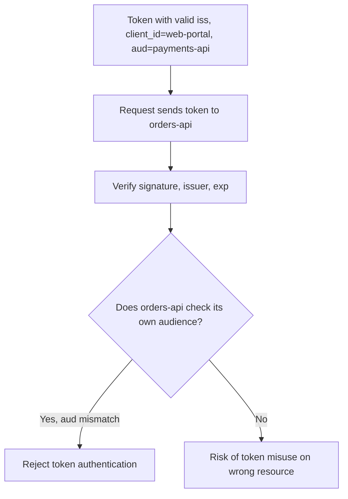
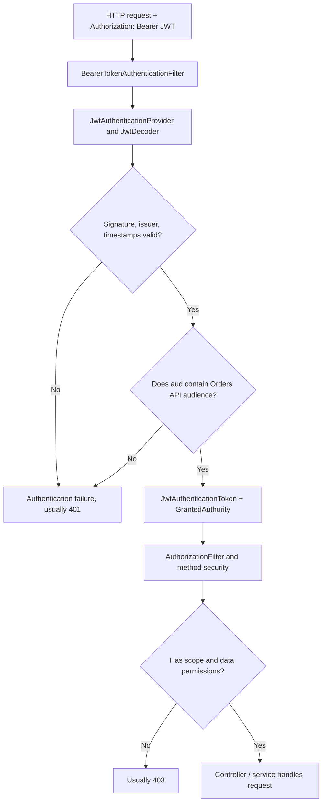

# API Audience Differs from the Calling Application's `client_id`

In OAuth 2.0/OIDC, an access token can carry several claims related to the participating parties: `iss`, `aud`, `client_id`, `sub`, `scope`, and sometimes `azp`. Although they appear side by side, **an access token's `aud` and the calling application's `client_id` answer two different questions**:

- **`aud` (audience):** Which **Resource Server/API** is the token issued for?
- **`client_id`:** Which **OAuth client (application)** requested or received the token?

For example, the `web-portal` application requests an access token to call `orders-api`. In that case, `client_id=web-portal`, whereas `aud` may be `https://api.example.test/orders` or a resource name like `orders-api`, depending on the contract with the Authorization Server.

For **Spring Security OAuth 2.0 Resource Server**, this distinction is especially critical: the API must verify that the token **was issued for the API itself** before deciding the caller's scopes, roles, client identity, or data permissions.

> **Remember:** `client_id` indicates which application requested the token, whereas `aud` indicates who is permitted to receive the token. A token issued by the right issuer to the right application may still **not be intended for the API** receiving the request.

## 1. Three Roles in an OAuth 2.0 Journey

Consider an e-commerce system:

| Role | Example | Responsibility |
|---|---|---|
| **OAuth Client** | `web-portal` | Application registered with the Authorization Server that requests an access token using the appropriate flow. |
| **Authorization Server (AS)** | `https://login.example.test/realms/shop` | Authenticates, applies grant policies, issues tokens, and restricts which resources may receive tokens. |
| **Resource Server (RS)** | Orders API at `https://api.example.test` | Receives access tokens, validates them, checks audience, and enforces API authorization. |

Example identifier agreement:

```text
Issuer:           https://login.example.test/realms/shop
OAuth client ID:  web-portal
API:              Orders API
API Audience:     https://api.example.test/orders
Read scope:       orders.read
Write scope:      orders.write
```

**Audience is an agreed-upon resource identifier, not necessarily the full URL of the HTTP request.** An API serving `GET /api/orders/42` and `GET /api/orders/43` can share the audience `https://api.example.test/orders`. Never derive the expected audience from the incoming request's path or `Host` header.

```mermaid
sequenceDiagram
    participant C as OAuth Client (web-portal)
    participant AS as Authorization Server
    participant RS as Resource Server (orders-api)
    C->>AS: Request token for resource=orders-api; client_id=web-portal
    AS->>AS: Validate client, resource, scope per policy
    AS-->>C: Access token (aud=orders-api; client_id=web-portal)
    C->>RS: GET /api/orders/42 + Authorization: Bearer ...
    RS->>RS: Validate issuer, signature/status, time, aud
    RS->>RS: Check scope and permission on order 42
    RS-->>C: Data or appropriate error
```

A single service can play both roles at once. For instance, the Orders service is a **Resource Server** when receiving a token from `web-portal` and an **OAuth client** when requesting its own token to call the Inventory API. When the role changes, the token's audience changes to match the target API.

## 2. An Illustrative JWT Access Token

Suppose the AS issues a JWT access token according to the contract:

```json
{
  "iss": "https://login.example.test/realms/shop",
  "sub": "user-123",
  "aud": ["https://api.example.test/orders"],
  "client_id": "web-portal",
  "scope": "orders.read",
  "iat": 1794715200,
  "exp": 1794718800
}
```

This is an **illustrative payload**, not a validly signed JWT. Being readable JSON does not make the claims trustworthy: the Resource Server must verify the signature and required conditions before acting on them.

| Claim | Question It Answers | In This Example |
|---|---|---|
| `iss` | **Who issued the token?** | The Authorization Server for the `shop` realm. |
| `aud` | **Who is the token intended for?** | Orders API, identified by `https://api.example.test/orders`. |
| `client_id` | **Which OAuth client requested/received the token?** | `web-portal`. |
| `sub` | **Which subject does the token represent?** | `user-123`. |
| `scope` | **Which permission scopes were granted?** | `orders.read`. |
| `exp` | **When does the token expire?** | Unix timestamp. |
| `iat` and `nbf` (if present) | **When was the token issued/valid from?** | Used with time validators per contract. |

In the **JWT Profile for OAuth 2.0 Access Tokens (RFC 9068)**, audience and client ID have well-defined semantics. However, OAuth 2.0 does not mandate that every access token in the world be a JWT or contain all of the claims above. A system may issue **opaque tokens** and provide metadata via introspection; a custom JWT may follow different claim conventions. Always check your issuer's contract.

### 2.1. The Access Token Audience Is the Target Recipient

Per RFC 7519, `aud` can be a string:

```json
"aud": "https://api.example.test/orders"
```

or an array:

```json
"aud": [
  "https://api.example.test/orders",
  "https://api.example.test/inventory"
]
```

If a token carries multiple audiences, each Resource Server must confirm that **its own identifier** is in the list, then continue applying further checks.

**Audience is not:**

- The caller's OAuth client ID, unless the token was issued for that client itself under a separate contract such as an OIDC ID token.
- A username or `sub`.
- Any hostname or path arbitrarily chosen by the caller.
- A permission like `orders.read`.
- The Authorization Server address or `jwks_uri`.

Usually an API with many routes still uses **one audience identifier**, while specific endpoints and data are governed by authorization.

### 2.2. `client_id` Is the Application Requesting/Holding the Token

Consider four OAuth clients:

```text
web-portal
mobile-shop
nightly-report-job
partner-integration
```

All of them can be issued tokens by the AS to access the **same API**:

```text
web-portal          --\
mobile-shop          --+--> aud = https://api.example.test/orders
nightly-report-job  --/
```

Conversely, the same `web-portal` application can receive two tokens for two different APIs:

```text
client_id = web-portal
      |
      +--> Token A: aud = https://api.example.test/orders
      |
      +--> Token B: aud = https://api.example.test/payments
```

Therefore, **having the same `client_id` does not make two tokens interchangeable**, and **having the same `aud` does not mean tokens come from a single client**.

### 2.3. `sub` Is Not `client_id`

In a user-present flow:

```text
sub       = user-123
client_id = web-portal
aud       = https://api.example.test/orders
```

`sub` can be the represented user; `client_id` is the OAuth application requesting the token; `aud` is the target API.

In the **client credentials grant**, there is no logged-in user. Depending on the issuer, `sub` may identify a service principal or the client itself, sometimes matching `client_id`. Having identical values **does not change the semantics** of those claims. An API should not assume an access token always represents an end user.

### 2.4. `scope` Is a Separate Authorization Condition

Suppose a token has the Orders API audience but only `scope=orders.read`:

```text
GET  /api/orders/42  -> may be allowed if data permissions are satisfied
POST /api/orders     -> rejected if orders.write is required
```

**Audience determines which API may receive the token; scope indicates the granted set of operations.** Permission to read order 42 may also depend on tenant, ownership, roles, or business rules.

## 3. The Access Token Contract Between AS, Client, and API

Never leave the Resource Server to "guess" the audience. The AS administration team and the API development team must agree beforehand.

Example Orders API contract:

| Item | Value or Policy |
|---|---|
| Trusted issuer | `https://login.example.test/realms/shop` |
| Resource Server | Orders API |
| Expected audience | `https://api.example.test/orders` |
| OAuth clients permitted to request access | `web-portal`, `mobile-shop`, `nightly-report-job` per AS config |
| Read scope | `orders.read` |
| Write scope | `orders.write` |
| Token format | Signed JWT or opaque token with introspection |
| Client identity | `client_id` claim or equivalent trusted metadata |
| Subject | User/service principal depending on grant and issuer |
| Additional conditions | Timestamps, token type, tenant, data-permission policy |

The three parties have distinct responsibilities:

1. **Authorization Server:** Issue only audiences and scopes allowed for the client/request; never issue overly broad tokens for every resource.
2. **OAuth client:** Request a token intended for the API it plans to call and send that token in the HTTP request.
3. **Resource Server:** Validate the token, then verify the exact audience per trusted configuration; never accept a token intended for another resource.

If the AS issues overly broad audiences to every client, the Resource Server still needs audience validation, and the system must also tighten **token issuance policy** to enforce least privilege.

## 4. How Does the AS Determine Audience?

How audience is assigned depends on the Authorization Server and integration contract:

- **API/resource registration config:** A client is authorized to request tokens for a registered API.
- **Mapping from client or scope:** The AS selects the audience based on client, scope, grant, or policy.
- **OAuth 2.0 Resource Indicators (RFC 8707):** The client sends a `resource` parameter requesting a token for a specific protected resource.
- **Token exchange or issuer-specific mechanism:** A token with a new audience is issued for downstream calls under an allowed policy.

### 4.1. Resource Indicators Are Not Client IDs

RFC 8707 defines the `resource` parameter to indicate the API expected to receive the access token. Example token request in a system supporting RFC 8707:

```http
POST /oauth2/token HTTP/1.1
Host: login.example.test
Content-Type: application/x-www-form-urlencoded
Authorization: Basic <client-credentials-example>

grant_type=client_credentials&scope=orders.read&resource=https%3A%2F%2Fapi.example.test%2Forders
```

In this request:

- The OAuth client identity comes from client registration/authentication for the corresponding flow.
- `scope=orders.read` requests read permission.
- `resource=https://api.example.test/orders` requests a token usable at the Orders API.
- The AS verifies whether the client is permitted to request that scope and resource.

**Not every AS supports the `resource` parameter.** Some providers use a custom `audience` parameter, console-based API configuration, or custom policies. Follow the actual capabilities of your issuer rather than treating a vendor-specific parameter as a universal OAuth standard.

Furthermore, the `resource` value in the request does not force the resulting `aud` to match character-for-character. The AS may reject it or map it to an appropriate resource identifier. The Resource Server must check **the audience emitted by the AS per the contract**, never reading `resource` directly from an incoming API HTTP request.

### 4.2. The Token Response Does Not Necessarily Have a Top-Level Audience Field

Example OAuth response:

```json
{
  "access_token": "<JWT-or-opaque-access-token>",
  "token_type": "Bearer",
  "expires_in": 300,
  "scope": "orders.read"
}
```

Here there is no `aud` in the outer JSON. With a JWT, `aud` may live inside the token payload. With an opaque token, the Resource Server may obtain this information via introspection, if the AS publishes it. **Never infer audience solely from `scope` or `client_id`.**

## 5. Wrong Audience Can Cause Token Substitution

Suppose the same issuer issues tokens for multiple APIs:

```text
shared issuer: https://login.example.test/realms/shop

Orders API:
  expected aud = https://api.example.test/orders

Payments API:
  expected aud = https://api.example.test/payments
```

A token issued for the Payments API:

```json
{
  "iss": "https://login.example.test/realms/shop",
  "client_id": "web-portal",
  "aud": ["https://api.example.test/payments"],
  "scope": "payments.read",
  "exp": 1900000000
}
```

Suppose a client or attacker sends this token to the Orders API:

```http
GET /api/orders/42 HTTP/1.1
Host: api.example.test
Authorization: Bearer <token-for-payments-api>
```

If the Orders API only validates **signature, issuer, and expiry** and then applies an overly broad rule like `authenticated()`, the token meant for the Payments API could accidentally be accepted. This is a **token substitution / token redirect** vulnerability.



**A token signed by a trusted issuer does not mean every Resource Server under that issuer may accept it.** Each API must verify that it is itself an authorized audience.

Audience validation does not replace permission checks; its purpose is to confirm that the token **is allowed to be used at this API**. Scopes and business policies decide **what is allowed at this API**.

## 6. Why Can't `client_id` Substitute for Audience?

A common mistake is letting requests through whenever:

```text
token.client_id == "web-portal"
```

This may be useful as an **additional client-restriction policy**, but it does not prove the token is meant for the Orders API. `web-portal` may hold multiple access tokens for different resources.

A similar configuration mistake:

```yaml
# Semantically wrong if web-portal is only an OAuth client ID:
spring:
  security:
    oauth2:
      resourceserver:
        jwt:
          issuer-uri: https://login.example.test/realms/shop
          audiences:
            - web-portal
```

That configuration declares that the Resource Server expects tokens with `aud=web-portal`. If `web-portal` is an **OIDC client ID**, that value is typically the **ID token's** audience, while the Orders API needs its own audience.

Proper configuration under the example contract:

```yaml
spring:
  security:
    oauth2:
      resourceserver:
        jwt:
          issuer-uri: https://login.example.test/realms/shop
          audiences:
            - https://api.example.test/orders
```

This confirms that the token was issued for the **Orders API**, regardless of which client the AS permitted to call it.

### When Is a Policy Based on `client_id` Needed?

Sometimes an API restricts privileged operations to specific integrations:

```text
POST /api/orders/import is allowed only if:
  - Access token was issued by a trusted issuer;
  - aud contains https://api.example.test/orders;
  - scope contains orders.import;
  - client_id is in the import-applications allowlist;
  - Data/tenant permissions satisfy policy.
```

In that case, `client_id` is an **additional condition checked after token validation**, not a substitute for audience.

Never read `client_id` from the request body, query string, or an unverified JWT and treat it as a trusted client identity. Also, `client_id` is an **identifier, not a secret**: it does not by itself prove the current request comes from the original application installation. With bearer tokens, anyone who copies the token can present the same `client_id`; use sender constraints such as DPoP or mTLS if your threat model requires it.

## 7. OIDC ID Tokens Have `aud=client_id` — Why the Confusion?

In **OpenID Connect**, an ID token is issued to the **OIDC client / relying party** to convey user authentication details. Consequently, the **ID token's** audience is typically the client ID:

```json
{
  "iss": "https://login.example.test/realms/shop",
  "sub": "user-123",
  "aud": "web-portal",
  "exp": 1900000000,
  "iat": 1899996400
}
```

However, an **access token for a Resource Server** might look like:

```json
{
  "iss": "https://login.example.test/realms/shop",
  "sub": "user-123",
  "aud": "https://api.example.test/orders",
  "client_id": "web-portal",
  "scope": "orders.read",
  "exp": 1900000000
}
```

Comparison:

| Property | OIDC ID Token | OAuth Access Token for Orders API |
|---|---|---|
| Intended recipient | OIDC client `web-portal` | Orders API |
| `aud` | Usually `web-portal` (client ID) | Resource Server identifier, e.g., `https://api.example.test/orders` |
| Purpose | Provide identity authentication info to the relying party | Authorize API access per granted permissions |
| Send in API bearer header? | **No** | Yes, if the token is valid under API policy |
| API authorization | Does not provide an API permission contract | Based on scopes/claims and Resource Server policy |

An ID token may also be a JWT signed by the issuer with the same JWKS key set as an access token. **A valid signature does not make it an access token.** If an API accepts an ID token due to wrong audience checks or ignoring token purpose, *cross-JWT confusion* bugs can occur.

### How Does `azp` Relate?

OIDC defines `azp` (*authorized party*) in the context of ID tokens. Some providers also include `azp` in **access tokens** to indicate the calling application:

```json
{
  "aud": "https://api.example.test/orders",
  "azp": "web-portal"
}
```

However, `azp` is not guaranteed to appear with consistent semantics across every OAuth 2.0 access token. In RFC 9068, `client_id` is the standard claim for identifying the OAuth client. If your issuer uses `azp` or a custom claim for client identity, document it explicitly in the contract and map it accurately.

In all cases, `azp` or `client_id` **never replaces** the Resource Server's audience.

### Distinguishing Access Token Types

RFC 9068 specifies that JWT access token profiles use a distinct JWT type such as `typ=at+jwt`. If the AS uses this profile, the API should configure appropriate token-type validation in addition to issuer, signature, audience, timestamps, and permissions. If the AS uses another format, follow that token contract. There is no universal rule that "any signed JWT = valid access token" across all systems.

## 8. At Which Layer Does the Resource Server Evaluate Audience?

With Spring Security Servlet, the typical JWT flow is:



Logically:

1. Spring Security reads the bearer token from the header.
2. `JwtDecoder` verifies the signature and JWT conditions.
3. The audience validator ensures the token **is intended for this API**.
4. The converter transforms scopes into authorities, e.g., `orders.read` → `SCOPE_orders.read`.
5. Authorization checks endpoints, methods, and data permissions.

**Audience validation belongs to token authentication**, because a token intended for another API must be rejected even if signed by a trusted issuer. **Scope and data permissions belong to authorization**, because a token meant for the right API may still lack permission to perform the action.

## 9. Configuring Spring Boot Resource Server with Audience

For Spring Boot versions supporting the audience property:

```yaml
spring:
  security:
    oauth2:
      resourceserver:
        jwt:
          issuer-uri: https://login.example.test/realms/shop
          audiences:
            - https://api.example.test/orders
```

Key points:

- `issuer-uri` configures the trusted issuer and retrieves signing keys via discovery/JWKS when appropriate.
- `audiences` sets the audience that **the Resource Server must find** in the JWT token.
- Do not put `web-portal` into `audiences` simply because it is the client ID.
- Use expiration, signature, issuer, and token-type validators matching your design.

Spring Boot/Spring Security versions may differ in property support and how auto-configuration builds the decoder. When declaring a custom `JwtDecoder`, ensure the audience validator is actually registered rather than only existing in YAML configuration.

### 9.1. HTTP Rules Combined with Audience

```java
@Configuration
public class SecurityConfig {

    @Bean
    SecurityFilterChain apiSecurity(HttpSecurity http) throws Exception {
        return http
            .authorizeHttpRequests(auth -> auth
                .requestMatchers(HttpMethod.GET, "/public/health")
                    .permitAll()
                .requestMatchers(HttpMethod.GET, "/api/orders/**")
                    .hasAuthority("SCOPE_orders.read")
                .requestMatchers(HttpMethod.POST, "/api/orders/**")
                    .hasAuthority("SCOPE_orders.write")
                .anyRequest().authenticated()
            )
            .oauth2ResourceServer(oauth2 ->
                oauth2.jwt(Customizer.withDefaults()))
            .build();
    }
}
```

Imports:

```java
import org.springframework.context.annotation.Bean;
import org.springframework.context.annotation.Configuration;
import org.springframework.http.HttpMethod;
import org.springframework.security.config.Customizer;
import org.springframework.security.config.annotation.web.builders.HttpSecurity;
import org.springframework.security.web.SecurityFilterChain;
```

With the default JWT scope converter, `scope=orders.read` is converted to `SCOPE_orders.read`. **Audience does not automatically grant scopes**, and `hasAuthority("SCOPE_orders.read")` does not verify that the token was meant for the Orders API.

This code snippet illustrates HTTP policy only. Policies such as CSRF, CORS, sessions, exception handling, and method security must be applied according to your API's real architecture.

## 10. Writing a Custom Audience Validator for Explicit Control

When configuring `JwtDecoder` directly, you can add an `OAuth2TokenValidator<Jwt>` to verify audience.

```java
@Configuration
public class JwtValidationConfig {

    private static final String ISSUER =
        "https://login.example.test/realms/shop";

    private static final String EXPECTED_AUDIENCE =
        "https://api.example.test/orders";

    @Bean
    JwtDecoder jwtDecoder() {
        NimbusJwtDecoder decoder =
            NimbusJwtDecoder.withIssuerLocation(ISSUER).build();

        OAuth2TokenValidator<Jwt> defaultValidators =
            JwtValidators.createDefaultWithIssuer(ISSUER);

        OAuth2TokenValidator<Jwt> audienceValidator = jwt -> {
            if (jwt.getAudience().contains(EXPECTED_AUDIENCE)) {
                return OAuth2TokenValidatorResult.success();
            }

            OAuth2Error error = new OAuth2Error(
                "invalid_token",
                "Access token is not intended for Orders API",
                null
            );
            return OAuth2TokenValidatorResult.failure(error);
        };

        decoder.setJwtValidator(
            new DelegatingOAuth2TokenValidator<>(
                defaultValidators, audienceValidator
            )
        );

        return decoder;
    }
}
```

Imports for the snippet above:

```java
import org.springframework.context.annotation.Bean;
import org.springframework.context.annotation.Configuration;
import org.springframework.security.oauth2.core.OAuth2Error;
import org.springframework.security.oauth2.core.OAuth2TokenValidator;
import org.springframework.security.oauth2.core.OAuth2TokenValidatorResult;
import org.springframework.security.oauth2.core.DelegatingOAuth2TokenValidator;
import org.springframework.security.oauth2.jwt.Jwt;
import org.springframework.security.oauth2.jwt.JwtDecoder;
import org.springframework.security.oauth2.jwt.JwtValidators;
import org.springframework.security.oauth2.jwt.NimbusJwtDecoder;
```

Explanation:

1. `NimbusJwtDecoder.withIssuerLocation(ISSUER)` configures the decoder based on the trusted issuer and supported key discovery mechanism.
2. `JwtValidators.createDefaultWithIssuer(ISSUER)` provides the default validators, including issuer and timestamps per library version.
3. `jwt.getAudience()` returns the audience collection from the decoded JWT; check that it contains the Resource Server's identifier.
4. `DelegatingOAuth2TokenValidator` combines the **default validators** with the **audience validator**.
5. If the audience is missing, JWT authentication fails before the request can be authorized as a valid caller.

**Never replace all default validators with only an `aud` check.** Doing so would inadvertently drop existing issuer or timestamp checks. When applying to a project, follow the exact Spring Security APIs and defaults of your running version.

Never derive `EXPECTED_AUDIENCE` from the HTTP `Host` header or from the `aud` claim of an unverified token. This is **API-side trust configuration**, not a request-determined value.

### 10.1. Can an API Accept Multiple Audiences?

During a resource identifier migration, an API might need to accept two AS-approved values:

```java
private static final Set<String> ALLOWED_AUDIENCES = Set.of(
    "https://api.example.test/orders",
    "orders-api-v2"
);

OAuth2TokenValidator<Jwt> audienceValidator = jwt -> {
    boolean accepted = jwt.getAudience()
        .stream()
        .anyMatch(ALLOWED_AUDIENCES::contains);

    return accepted
        ? OAuth2TokenValidatorResult.success()
        : OAuth2TokenValidatorResult.failure(
            new OAuth2Error(
                "invalid_token",
                "Unexpected access-token audience",
                null
            )
        );
};
```

Additional import: `java.util.Set`.

Only add audiences if **they genuinely represent the current Resource Server** and align with the AS contract. Never allow every audience in the organization just to "fix a 401 error," as doing so erases resource boundaries.

### 10.2. Multiple Issuers or Multiple Tenants

Different issuers may follow different audience conventions. If accepting tokens from multiple issuers, maintain **trusted issuer → allowed audience** mappings and corresponding decoders/validators:

```text
issuer tenant-A → expected audience orders-api-A
issuer tenant-B → expected audience orders-api-B
```

Never trust an arbitrary issuer URL read from an unverified JWT to automatically fetch keys/metadata and accept the token. The list of trusted issuers must be controlled by application policy.

## 11. Opaque Access Tokens Still Need Resource Boundaries

An opaque access token does not necessarily expose claims that a Resource Server can read by parsing a JWT. The API typically calls **token introspection** (RFC 7662) to obtain trusted status and metadata.

Example response:

```json
{
  "active": true,
  "iss": "https://login.example.test/realms/shop",
  "sub": "user-123",
  "client_id": "web-portal",
  "aud": ["https://api.example.test/orders"],
  "scope": "orders.read",
  "exp": 1900000000
}
```

When metadata is available:

- `active: true` indicates the token is currently active per introspection policy.
- `client_id` identifies the OAuth client that received the token.
- `aud` still indicates which Resource Server is the intended recipient.
- `scope` remains the permission scope and must be checked against endpoint policies.

Do not conclude "the token is active so it must be meant for this API" if the introspection contract does not guarantee resource binding. Spring Security uses `OpaqueTokenIntrospector` to retrieve principal information; if audience validation is needed and not enforced by default, add the check in the introspector/provider layer or a trusted authentication component before creating `Authentication`.

If the AS does not return `aud`, clarify **how the AS guarantees the token is only for the current Resource Server** (such as resource-scoped introspection or API-specific tokens). Never treat `client_id` as a substitute for audience.

## 12. One Client Calling Multiple APIs and the Token Forwarding Problem

Suppose the Orders API receives an access token from `web-portal` to read an order, and then the Orders service needs to call the Inventory API.

```text
web-portal -> Orders API -> Inventory API

Token arriving at Orders API:
  aud = https://api.example.test/orders

Token Inventory API expects:
  aud = https://api.example.test/inventory
```

If the Orders service **forwards the exact same token to Inventory**, Inventory must reject it unless it carries the Inventory audience. Never allow forwarding tokens with the wrong audience simply because two APIs share an issuer.

Appropriate design patterns include:

- The Orders service requests **its own token** for Inventory using client credentials when the call is service-to-service and permitted by policy.
- The Orders service performs **OAuth Token Exchange (RFC 8693)** to obtain a token intended for Inventory when acting on behalf of the user and supported by the Authorization Server.
- The architecture may intentionally issue multi-audience tokens, though it must carefully account for blast radius, scopes, and authorization policies of every participating API.

Core takeaway: **a token for the Orders API is not automatically valid at the Inventory API**.

### Multi-Audience Access Tokens Must Be Deliberately Designed

Example:

```json
{
  "aud": [
    "https://api.example.test/orders",
    "https://api.example.test/inventory"
  ],
  "client_id": "web-portal",
  "scope": "orders.read inventory.read"
}
```

If the AS intentionally issues a multi-audience token, each API can verify its own audience in the list. However, such a token works across **multiple resources**, increasing the impact if the token is leaked. Keep audiences and scopes scoped to least privilege.

## 13. Distinguishing 401 and 403 Errors in Audience Scenarios

Suppose the Orders API requires `aud=https://api.example.test/orders` and the order-reading endpoint requires `SCOPE_orders.read`.

| Scenario | Token Authentication | Authorization | Typical HTTP Status |
|---|---|---|---|
| Missing token on a protected endpoint | No valid Authentication | Denied | `401` |
| JWT with tampered signature | Fails | Not evaluated as a valid caller | `401` |
| JWT with valid signature but wrong `iss` | Fails | Not evaluated | `401` |
| JWT with valid issuer but `aud=payments-api` | **Audience failure** | Not evaluated | `401` |
| JWT with valid audience but missing `orders.read` | Succeeds | Missing authority | `403` |
| JWT with valid audience and scope, unauthorized for order 42 | Succeeds | Ownership/tenant denied | `403` or `404` per information-hiding policy |
| JWT with valid audience and sufficient resource permissions | Succeeds | Succeeds | `200` if business processing succeeds |
| JWT with matching `client_id=web-portal` but wrong audience | **Audience failure** | Denied | `401` |
| JWT with valid audience, blocked by a client-specific policy | Succeeds | Client-specific policy denies | Typically `403` |

**An audience error is a token authentication failure at the Resource Server**, even if the token would be valid at another API. **A scope error is an authorization failure**, where the token passed authentication but lacks permission for the operation.

Exact HTTP responses also depend on exception handling and custom configuration, but this distinction pinpoints which layer needs fixing.

### Sample Request for Observation

```bash
curl -i \
  "https://api.example.test/api/orders/42" \
  -H "Authorization: Bearer <ACCESS_TOKEN>"
```

Use test tokens in appropriate environments; never put real tokens into documentation, public places, or logs.

When a `401` is returned, check in order:

1. Is the bearer header formatted properly?
2. Is the token the right **access token** type?
3. Is the signature or introspection valid?
4. Are issuer and `exp`/`nbf` timestamps valid?
5. Does the `aud` claim contain the **configured API identifier**?
6. Are the decoder and audience validator actually active?
7. Did the AS issue the audience the client requested under the contract?

When a `403` is returned, inspect scopes, authorities, HTTP matchers, method security, client allowlists, and record-level permissions.

### What Should Be Logged?

You can log safe diagnostic events:

```text
event=ACCESS_DENIED
reason=INVALID_AUDIENCE
expected_audience=https://api.example.test/orders
issuer_configured=https://login.example.test/realms/shop
request_route=/api/orders/{id}
request_id=<internal-request-id>
```

Never log raw access tokens, refresh tokens, private keys, or sensitive data. Diagnostic details should be bounded to comply with your real logging policy.

## 14. Misconceptions and Consequences

### "In OIDC, audience must equal client ID"

That is the standard rule for an **ID token intended for an OIDC client**, not the default way to determine the audience of an access token intended for an API. A Resource Server must use the audience issued by the AS for that resource under the contract.

### "Client ID is a string in the JWT, so use it as the expected audience"

**Semantically wrong** if client ID is the name of the application requesting the token. Configure the **Resource Server** audience, such as `https://api.example.test/orders`.

### "Right issuer and valid signature means any API under that issuer can accept it"

One issuer can issue tokens for dozens of APIs. The signature authenticates the issuing source; the audience restricts the intended recipient. Missing audience validation opens the door to token substitution.

### "Scope `orders.read` proves the token belongs to the Orders API"

Scope expresses operation permissions and does not uniquely identify an API. Multiple Resource Servers might use identical scope names. Audience and scope must be verified independently.

### "Client ID proves the caller is the right application"

`client_id` is typically a public identifier. A copied bearer token still carries the same `client_id`. If you need protection against replay of stolen tokens, consider DPoP or mTLS-bound access tokens with full sender-constraint validation.

### "Every access token has a JWT payload containing `aud`"

OAuth 2.0 does not mandate that access tokens be JWTs. Opaque tokens must be validated via an appropriate mechanism, usually introspection. When an AS does not return `aud`, verify how it binds resources before accepting tokens.

### "Expected audience can be taken from the Host header"

The `Host` header and request URL can change across gateways or reverse proxies and are request-supplied data. Expected audience must come from **trusted API configuration** or an architecturally governed trusted mapping, never from a client-supplied string.

### "Multi-audience tokens are always more convenient"

They can be convenient in some flows, but they expand the set of resources sharing a single bearer token. Prefer narrowing audience to what is needed and reducing privileges wherever possible.

## 15. Scenario Exercises with Answers

**Scenario A — Two clients calling the same Orders API.** Tokens from `web-portal` and `mobile-shop` both have `aud=https://api.example.test/orders`, while `client_id` differs. **Conclusion:** Both can pass audience validation; whether the operation is allowed still depends on scope and policy.

**Scenario B — Same client calling two APIs.** `web-portal` presents an access token with `aud=https://api.example.test/payments` to the Orders API. **Conclusion:** The Orders API must reject it for wrong audience, even though `client_id` and the signature are valid.

**Scenario C — Using an ID token as an access token.** An ID token has `aud=web-portal` and is signed by the right issuer. The client sends it in `Authorization: Bearer ...` to the Orders API. **Conclusion:** The API must reject the wrong token type; a valid signature/issuer does not turn an ID token into an access token.

**Scenario D — Client credentials.** A token has `sub=nightly-report-job`, `client_id=nightly-report-job`, `aud=https://api.example.test/orders`. **Conclusion:** Even though `sub` and `client_id` match, the audience still targets the Orders API; scope and authorization policies still apply.

**Scenario E — Configuring only `issuer-uri`.** The API has:

```yaml
spring:
  security:
    oauth2:
      resourceserver:
        jwt:
          issuer-uri: https://login.example.test/realms/shop
```

**Conclusion:** This does not yet express the expected audience for the Orders API. Add `audiences` if supported by your framework version, or add an audience validator to enforce the exact resource.

**Scenario F — API A calling API B.** A token arriving at API A has `aud=api-a`, and A forwards the exact token to B, which requires `aud=api-b`. **Conclusion:** B must reject it. A needs a token issued for B via an appropriate flow or token exchange.

**Scenario G — Token with right audience but wrong scope.** A token has `aud=https://api.example.test/orders`, `client_id=web-portal`, `scope=profile`. **Conclusion:** Authentication may succeed, but an endpoint requiring `SCOPE_orders.read` must reject authorization.

## 16. Contract Template and Questions to Align Before Deployment

Before integrating a Resource Server with a new Authorization Server, the API and identity teams should clarify:

1. **Issuer:** What is the exact issuer URL? Are there multiple realms/tenants?
2. **Access token:** Which JWT profile or opaque token format is used? How are access tokens distinguished from ID tokens?
3. **Audience:** Which identifier represents the API? Are one or multiple values permitted?
4. **How tokens are requested for the API:** Resource Indicators, client/API registration, scope mapping, or vendor-specific mechanisms?
5. **Client identity:** Is there a `client_id` claim in the JWT/introspection? If `azp` is used, is its meaning defined in the contract?
6. **Subject:** Does `sub` represent a user or a service principal for each grant?
7. **Authorization:** Which scopes does the API use, and what additional ownership/tenant permissions are required?
8. **Token validation:** Where are issuer, signature/introspection, time, audience, and token-purpose checks enforced?
9. **Downstream APIs:** How do services obtain dedicated tokens or use token exchange?
10. **Operations:** How are audience failures monitored and reported without leaking bearer tokens in logs?

The contract can be summarized concisely as:

```text
Authorization Server:
  issuer = https://login.example.test/realms/shop

OAuth Client:
  client_id = web-portal

Resource Server:
  name = orders-api
  expected_audience = https://api.example.test/orders

Access token:
  iss = https://login.example.test/realms/shop
  aud includes https://api.example.test/orders
  client_id = web-portal
  scope includes orders.read

Resource Server decision:
  validate issuer + signature/status + time + audience
  then authorize scope + ownership/tenant
```

With this contract, every component clearly answers: **who issued it**, **which application requested it**, **which API is allowed to receive it**, and **which permissions were granted**. Those four questions cannot substitute for one another.

## 17. Standard References for Further Reading

- [RFC 7519 — JSON Web Token (JWT)](https://www.rfc-editor.org/rfc/rfc7519): syntax and semantics of `iss`, `sub`, `aud`, and standard claims.
- [RFC 9068 — JWT Profile for OAuth 2.0 Access Tokens](https://www.rfc-editor.org/rfc/rfc9068): rules for JWT access tokens, audience, client ID, and token type.
- [RFC 8707 — Resource Indicators for OAuth 2.0](https://www.rfc-editor.org/rfc/rfc8707): requesting access tokens for a specific protected resource via the `resource` parameter.
- [RFC 8693 — OAuth 2.0 Token Exchange](https://www.rfc-editor.org/rfc/rfc8693): exchanging tokens for downstream APIs when supported by the Authorization Server.
- [RFC 7662 — OAuth 2.0 Token Introspection](https://www.rfc-editor.org/rfc/rfc7662): validating opaque tokens and returned metadata.
- [OpenID Connect Core 1.0](https://openid.net/specs/openid-connect-core-1_0.html): audience and authorized party of ID tokens in OIDC.
- [Spring Security Reference — OAuth 2.0 Resource Server JWT](https://docs.spring.io/spring-security/reference/servlet/oauth2/resource-server/jwt.html): JWT validation in Resource Server, issuers and validators, mapping scopes to authorities.

**Key takeaway:** When the Orders API receives a bearer access token, the first requirement is that **the token was issued by a trusted issuer and carries the Orders API's audience**. Only then should it evaluate the calling application (`client_id`), scopes, subject identity, and permissions on specific resources.
