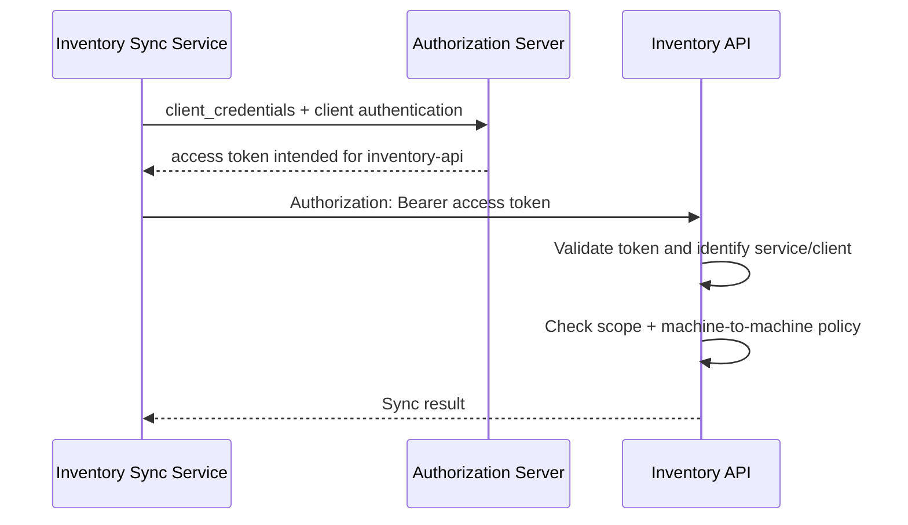
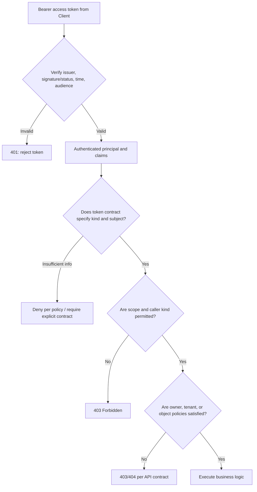

# Subject Represents a User or an Application Depending on Token Type and Issuer

In OAuth 2.0, a Resource Server receives an **access token** to authenticate API access. The access token may contain a `sub` (*subject*) field, but **`sub` does not automatically always mean the ID of a human user sitting in front of a screen**. Depending on the token grant type (*grant*), token format, profile, and Authorization Server contract, the subject may represent a user, an application, a workload, or another security principal.

This detail is especially important when coding a **Spring Security OAuth 2.0 Resource Server**. Under the default JWT configuration, `JwtAuthenticationToken.getName()` typically reads the `sub` claim. If business code sees `authentication.getName()` and assumes it is a `userId`, a machine-to-machine token could be treated as a user token, leading to wrong access permissions, incorrect ownership data, or corrupted audit records.

Consider the same endpoint receiving two successfully authenticated access tokens:

Example A — access token issued in a user context:

```json
{
  "iss": "https://login.example.com/realms/shop",
  "sub": "user-123",
  "client_id": "web-app",
  "aud": ["orders-api"],
  "scope": "orders.read"
}
```

Example B — access token for a background processing application:

```json
{
  "iss": "https://login.example.com/realms/shop",
  "sub": "billing-worker",
  "client_id": "billing-worker",
  "aud": ["orders-api"],
  "scope": "orders.read"
}
```

Both payloads above only **illustrate claims**, not complete usable JWTs. In Example A, `sub` is a user. In Example B, `sub` is an application. In both, `client_id` identifies the OAuth Client; `aud` identifies the API intended to receive the token; `scope` describes the granted permissions. **You cannot treat the presence of the `sub` claim as proof that the subject is a user.**

## 1. Distinguishing Subject, Client, Actor, and Resource Owner

OAuth 2.0 involves several roles. An access token is issued in the context of a Client, yet **the Client is not necessarily identical to the subject the token represents**.

| Concept | Practical Interpretation | Example |
| --- | --- | --- |
| **Subject (`sub`)** | The subject identified in the token under the issuer/token profile contract. | `user-123` or `billing-worker`. |
| **OAuth Client (`client_id`)** | The application registered with the Authorization Server that participated in requesting the token. | `web-app`, `billing-worker`, `backend-service`. |
| **Resource Owner** | The entity capable of granting access to a resource; in user flows, usually the End-User. | A customer consenting for an app to read orders. |
| **Actor / acting party** | The party directly making the call or acting on behalf of another subject when delegation is used. | A backend calling an API on behalf of a user via token exchange. |
| **Audience (`aud`)** | The service/API intended to receive the token. | `orders-api`. |
| **Authority / scope** | Operation permissions accepted by the Resource Server from the validated token. | `SCOPE_orders.read`. |

Three distinct questions must be answered:

1. **Who/what is the subject?** What does the `sub` field mean in this token?
2. **Which application requested or is using the token?** What do `client_id`, `azp`, or actor claims mean per the issuer?
3. **What does the token permit?** Which API may receive it, which scopes are granted, and which business objects may be accessed?

Never collapse all three questions into a single `userId` property.

### Subject Is Not Necessarily the Party Sending the HTTP Request

A web frontend may call an API through a backend using a user's access token. In that case, `sub` may be the user while the direct HTTP request to the API is sent by the backend. In a machine-to-machine flow, both the Client and the subject may represent the same application. With token exchange or delegation, the subject and actor can be two different principals.

Thus, the question "Who is calling the API?" sometimes has **multiple valid answers at different layers**: network caller, OAuth Client, subject, and delegated actor. The token contract must specify which layer governs a given security decision.

## 2. How Grant Type and Token Type Affect `sub` Semantics

### 2.1. Authorization Code in a User Context

In an Authorization Code flow with a user, the Authorization Server performs an authorization step involving the End-User. The access token accepted by the API typically carries a subject tied to that user if the token profile defines it that way.

An illustrative access token:

```json
{
  "iss": "https://login.example.com/realms/shop",
  "sub": "user-123",
  "client_id": "shop-web",
  "aud": ["orders-api"],
  "scope": "orders.read profile.read",
  "exp": 1900000000
}
```

In this example:

- `sub = user-123`: the subject is a user per the issuer contract.
- `client_id = shop-web`: the Client requesting the token is the web application; **not the user ID**.
- `aud = orders-api`: the token is intended for this API.
- `scope`: permissions granted for resource access; the API still needs to verify owner and tenant.

Not every Authorization Server issues access tokens with the exact same claim names or structure, even for the same OAuth flow. Always read the **access token contract published by the issuer for the Resource Server**.

### 2.2. Client Credentials in Machine-to-Machine Flows

In OAuth 2.0 **Client Credentials**, the Client requests a token using the **application's own** identity and credentials. This flow does not require a logged-in End-User. Therefore, a token issued to `inventory-sync` does not inherently carry any user identity.



Some issuers set `sub` equal to `client_id` in Client Credentials tokens; others may use an internal subject identifier, a separate claim, or another representation. **Never assume `sub == client_id` is a universal rule across all providers.** Similarly, do not rely on those two values differing to conclude that a token definitely represents an End-User.

Example token from an issuer:

```json
{
  "iss": "https://login.example.com/realms/shop",
  "sub": "service-account-8735",
  "client_id": "inventory-sync",
  "aud": ["inventory-api"],
  "scope": "inventory.write",
  "exp": 1900000000
}
```

Here `sub` is an issuer-managed **service account**, while `client_id` is the OAuth Client. If the API has business rules specific to the `inventory-sync` application, define explicitly whether to match `client_id`, `sub`, or both under which issuer context.

More important than syntax: **never treat the `sub` of a Client Credentials token as the owner of personal user data** unless the system has an explicit authorization and mapping mechanism.

### 2.3. Token Exchange, On-Behalf-Of, and Delegation

In some architectures, service A receives a user request and requests another token to call service B **on behalf of the user**. The issued token may express:

- `sub`: the user on whose behalf permissions are exercised.
- `client_id`: the Client requesting the token.
- `act` or an equivalent claim: the actor performing the action on behalf of the subject, **if supported by the provider's token profile**.
- `aud`, `scope`: API B and the specific granted permissions.

An illustrative payload in the style of an actor claim:

```json
{
  "iss": "https://login.example.com/realms/shop",
  "sub": "user-123",
  "client_id": "order-bff",
  "act": {
    "sub": "order-bff"
  },
  "aud": ["payment-api"],
  "scope": "payments.create"
}
```

The `act` claim **does not automatically appear in every access token**, nor is there a single universal actor mapping across all providers. If your system uses token exchange or delegation, follow the profile actually issued by the Authorization Server and accepted by the Resource Server. Never allow clients to inject `act` or `sub` claims themselves to claim they are "acting on behalf of user X."

### 2.4. OIDC ID Token Is a Different Case

In an **OIDC ID Token**, `sub` has the standard meaning of the End-User identifier published by the OpenID Provider to the OIDC Client. However, a Resource Server must not infer from this that `sub` in **every access token** is also an End-User.

| Token | Purpose | How Should `sub` Be Interpreted? |
| --- | --- | --- |
| **OIDC ID Token** | OIDC Client verifies the login event and End-User identity. | OIDC contract for ID Tokens. |
| **User access token** | Access protected resources in a user context. | Access-token profile and issuer contract; usually an End-User. |
| **Client Credentials access token** | Access protected resources in an application context. | Issuer contract for service/client subjects. |
| **Exchanged/delegated access token** | Access on behalf of a subject or with a designated actor. | Token-exchange/delegation profile, distinct subject and actor. |

**Never send an ID Token in place of an access token to a Resource Server.** Even though an ID Token is a validly signed JWT, its audience is usually the OIDC Client; the API must validate the token type and the audience intended for the API itself.

## 3. Is `sub` Guaranteed to Always Be Present and Stable?

That depends on the **access token format and token profile**.

- For a JWT access token conforming to a specific profile such as the OAuth 2.0 JWT Access Token Profile, there are explicit requirements for claims and subject interpretation. The Resource Server must follow the agreed profile.
- For a custom issuer JWT, the claim set may differ; a subject, client, or grant claim may appear under a custom name.
- For an **opaque access token**, the Resource Server does not read claims from the token string; subject information may reside in the introspection result or metadata supplied by the Authorization Server, per contract.

Never draw identity conclusions simply because a JWT **has a readable payload**. JSON whose signature/issuer/audience has not been verified is untrusted data.

### Subject Stability and Scope

In OIDC, `sub` is often paired with `iss` to identify a user. The same `sub` value under **two different issuers** does not mean the same account:

```text
(iss=https://login-a.example.com, sub=123) ≠
(iss=https://login-b.example.com, sub=123)
```

With OIDC *pairwise subject identifiers*, the same End-User can receive different `sub` values for different Clients/sectors depending on the issuer's implementation. Therefore, **do not assume two different `sub` values are necessarily two different real-world people** unless an explicit account-linking mechanism exists.

Do not use email, display name, or preferred username as a substitute for stable identity linking, because those attributes can change, be absent, or collide across issuers.

## 4. The Resource Server Must Authenticate the Token Before Interpreting Subject

Suppose the API receives:

```http
POST /api/reports/generate HTTP/1.1
Host: api.example.com
Authorization: Bearer <access-token>
```

A payload containing `sub = admin` proves nothing about whether the caller is an administrator. The Resource Server must authenticate the token via the appropriate mechanism:

**For JWTs:**

1. Verify the signature using trusted public keys and allowed algorithms from the configured Authorization Server.
2. Validate `iss`, timestamps (`exp`, `nbf`), and default validators.
3. Verify `aud` matches the API; add an audience validator if your current configuration does not enforce it yet.
4. Validate any token type/profile constraints and mandatory claims agreed upon by the system.
5. Only upon success extract subject, Client identity, and authorities from the token for authorization decisions.

**For opaque tokens:**

1. Submit the token via the introspection mechanism supported by the Authorization Server or a trusted validator per contract.
2. Verify token status and returned metadata, including required API constraints.
3. Build the principal and authorities from the trusted result.

**Never use the UserInfo endpoint as a substitute for access token validation.** UserInfo is an OIDC protected resource providing profile claims to a Client holding an appropriate access token; it is not a general-purpose validation method for arbitrary APIs.

## 5. Default Behavior in Spring Security Resource Server

With Spring Security's JWT Resource Server configuration, the pipeline typically proceeds as:

```text
Authorization: Bearer token
  -> BearerTokenAuthenticationFilter
  -> AuthenticationManager
  -> JwtAuthenticationProvider + JwtDecoder
  -> JWT validated and converted to JwtAuthenticationToken
  -> SecurityContext
  -> authorization rules / controller / service
```

`JwtAuthenticationToken` represents the authentication result. In the common default configuration:

- The principal is a `Jwt` object accepted by the decoder.
- `Jwt.getSubject()` returns the `sub` claim if present in the JWT.
- `authentication.getName()` typically derives from the `sub` claim.
- Scope values from `scope` or `scp` are typically mapped to authorities prefixed with `SCOPE_`.

**Spring Security does not guarantee that `sub` is a human user simply because the principal name comes from `sub`.** The framework validates the token and maps claims; the business meaning of those claims must be defined by the access token contract.

This controller method:

```java
@GetMapping("/api/whoami")
public String whoAmI(Authentication authentication) {
    return authentication.getName();
}
```

may return `user-123` for a user token and `inventory-sync` for a machine token. Both results can be valid while representing **two completely different kinds of identity**. An endpoint named `/whoami` is therefore only appropriate when the API contract clearly states that "who" means the authenticated principal rather than assuming a user account.

## 6. Separating User and Application Identities in Business Design

A common mistake is representing every API caller with the same variable:

```java
// Anti-pattern example: authentication.getName() is always assumed to be userId.
String userId = authentication.getName();
return orderRepository.findByOwnerUserId(userId);
```

If a `client_credentials` token also carries the `orders.read` scope, that code may query the wrong data, record inaccurate audits, or make a service account look like a user account.

Instead, define an explicit **caller kind** in your domain:

```java
public enum CallerKind {
    USER,
    SERVICE
}

public record CallerIdentity(
    CallerKind kind,
    String issuer,
    String subject,
    String clientId
) {}
```

This is an application data type, **not a built-in Spring Security class**. It lets services receive a contract-classified identity rather than an ambiguous `userId` string.

| Field | Meaning | Notes |
| --- | --- | --- |
| `kind` | User or service per the token contract. | Never guess from whether `sub` looks like an email or UUID. |
| `issuer` | The authenticated token issuer. | Needed to separate subject namespaces. |
| `subject` | The verified `sub` value. | Depending on token type, may represent a user or an app. |
| `clientId` | Client identified from verified claims. | Do not assume it always equals subject. |

For multi-tenant systems, you can add a verified `tenantId` or map it from trusted data. Never accept a client-declared header like `X-Caller-Kind: USER` or `X-Tenant-Id: ...` as proof of authentication.

## 7. How to Distinguish USER vs. SERVICE Without Guessing

There is no universal formula across all issuers such as:

```text
sub == client_id   => SERVICE
sub != client_id   => USER
```

Both comparisons can be wrong. A service account may have an internal `sub` distinct from `client_id`; another provider may apply complex mappings for users or actors.

**The proper approach** is to have the Authorization Server issue tokens following an explicit contract. For example, your own system might agree on a custom claim **signed by the issuer**:

```json
{
  "iss": "https://login.example.com/realms/shop",
  "sub": "service-account-8735",
  "client_id": "inventory-sync",
  "aud": ["inventory-api"],
  "scope": "inventory.write",
  "principal_type": "service"
}
```

In another system, this field might be named `token_kind`, `gty`, `grant_type`, or not exist at all. **`principal_type` in this example is a custom convention, not a standard claim every OAuth 2.0 issuer must emit.**

An illustrative `CallerIdentityResolver` verifying the agreed claim contract:

```java
import org.springframework.security.access.AccessDeniedException;
import org.springframework.security.oauth2.jwt.Jwt;
import org.springframework.stereotype.Component;

@Component
public class CallerIdentityResolver {

    public CallerIdentity resolve(Jwt jwt) {
        String issuer = jwt.getIssuer().toString();
        String subject = jwt.getSubject();
        String clientId = jwt.getClaimAsString("client_id");
        String principalType = jwt.getClaimAsString("principal_type");

        if (subject == null || subject.isBlank()) {
            throw new AccessDeniedException("Missing subject");
        }

        CallerKind kind;
        if ("user".equals(principalType)) {
            kind = CallerKind.USER;
        } else if ("service".equals(principalType)) {
            kind = CallerKind.SERVICE;
        } else {
            throw new AccessDeniedException("Unknown principal type");
        }

        if (kind == CallerKind.SERVICE &&
            (clientId == null || clientId.isBlank())) {
            throw new AccessDeniedException("Missing client identity");
        }

        return new CallerIdentity(kind, issuer, subject, clientId);
    }
}
```

The code above **assumes** the trusted issuer emits the `principal_type` claim according to a mutually agreed contract. Accepting the JWT, signature, issuer, audience, and other checks still belongs to `JwtDecoder` and Resource Server policies. With multiple issuers, each issuer may need its own adapter/validator and mapping logic. **If there is no reliable signal distinguishing caller kind, deny operations requiring classification and redesign the token contract** rather than guessing.

### Why Must You Also Check the Issuer?

A claim like `"principal_type": "service"` is only meaningful when the **trusted issuer** actually commits to issuing and enforcing it. If the API accepts multiple issuers, do not allow issuer A to assert roles/identities that only issuer B is authorized to grant. Policy may require explicit mapping:

```text
Issuer A -> sub is user ID, client_id is OAuth Client, principal_type=user/service.
Issuer B -> subject resides in introspection metadata with issuer-specific mapping.
Issuer C -> accepts only machine tokens for background administration APIs.
```

That is a **hypothetical contract example**, not a universal default rule. The Resource Server must configure the corresponding trust sources and verify that tokens originate from an authorized issuer.

## 8. Example Spring Security Configuration Authorizing by Caller Type

For Spring Boot 3 / Spring Security 6, declare dependencies:

```gradle
dependencies {
    implementation 'org.springframework.boot:spring-boot-starter-security'
    implementation 'org.springframework.boot:spring-boot-starter-oauth2-resource-server'
}
```

Configure the JWT issuer:

```yaml
spring:
  security:
    oauth2:
      resourceserver:
        jwt:
          issuer-uri: https://login.example.com/realms/shop
```

The URL is illustrative; in real deployments, it must match the issuer of accepted tokens.

### SecurityFilterChain and Functional Scopes

```java
import org.springframework.context.annotation.Bean;
import org.springframework.context.annotation.Configuration;
import org.springframework.http.HttpMethod;
import org.springframework.security.config.Customizer;
import org.springframework.security.config.annotation.web.builders.HttpSecurity;
import org.springframework.security.config.http.SessionCreationPolicy;
import org.springframework.security.web.SecurityFilterChain;

@Configuration
public class ApiSecurityConfig {

    @Bean
    SecurityFilterChain apiSecurity(HttpSecurity http) throws Exception {
        return http
            .securityMatcher("/api/**")
            .csrf(csrf -> csrf.disable())
            .sessionManagement(session -> session
                .sessionCreationPolicy(SessionCreationPolicy.STATELESS))
            .authorizeHttpRequests(auth -> auth
                .requestMatchers(HttpMethod.GET, "/api/orders/**")
                    .hasAuthority("SCOPE_orders.read")
                .requestMatchers(HttpMethod.POST, "/api/jobs/sync")
                    .hasAuthority("SCOPE_inventory.sync")
                .anyRequest().denyAll())
            .oauth2ResourceServer(oauth2 -> oauth2
                .jwt(Customizer.withDefaults()))
            .build();
    }
}
```

Here, `oauth2ResourceServer(...jwt(...))` sets up **Bearer JWT authentication**. `hasAuthority(...)` adds a **scope authorization** layer. Nothing in this snippet automatically verifies whether the caller is a USER or a SERVICE; that is the responsibility of the next policy layer.

Disabling CSRF in this example assumes the API uses only explicit Bearer tokens in headers, not cookies automatically sent by browsers for authentication. If the application also uses session/cookie login, configure CSRF appropriately.

### Controller Allowing Only Users to Read Personal Orders

```java
import org.springframework.http.HttpStatus;
import org.springframework.security.core.annotation.AuthenticationPrincipal;
import org.springframework.security.oauth2.jwt.Jwt;
import org.springframework.web.bind.annotation.GetMapping;
import org.springframework.web.bind.annotation.PathVariable;
import org.springframework.web.bind.annotation.RestController;
import org.springframework.web.server.ResponseStatusException;

@RestController
public class OrderController {

    private final CallerIdentityResolver identities;
    private final OrderService orders;

    public OrderController(
            CallerIdentityResolver identities,
            OrderService orders) {
        this.identities = identities;
        this.orders = orders;
    }

    @GetMapping("/api/orders/{id}")
    public OrderDto find(
            @PathVariable long id,
            @AuthenticationPrincipal Jwt jwt) {

        CallerIdentity caller = identities.resolve(jwt);
        if (caller.kind() != CallerKind.USER) {
            throw new ResponseStatusException(HttpStatus.FORBIDDEN);
        }

        return orders.findOwnedOrder(
            id, caller.issuer(), caller.subject());
    }
}
```

`OrderService` and `OrderDto` are illustrative application types; `findOwnedOrder` must verify owner/tenant in business data rather than relying on scope alone. Because the controller checks caller kind, a service token carrying `orders.read` still **cannot impersonate a user** to view personal orders. In larger applications, the same policy can live in a service or method-security component so it applies consistently across entry points.

### Controller Allowing Only Services to Trigger Background Jobs

```java
@PostMapping("/api/jobs/sync")
@ResponseStatus(HttpStatus.ACCEPTED)
public void runSync(@AuthenticationPrincipal Jwt jwt) {
    CallerIdentity caller = identities.resolve(jwt);

    if (caller.kind() != CallerKind.SERVICE ||
        !"inventory-sync".equals(caller.clientId())) {
        throw new ResponseStatusException(HttpStatus.FORBIDDEN);
    }

    inventoryService.scheduleSync(caller.issuer(), caller.subject());
}
```

This is an illustrative method placed in a controller with `identities` and `inventoryService` injected; corresponding web imports are required. The `SecurityFilterChain` above enforces `SCOPE_inventory.sync`; this method adds constraints on **principal kind and allowed Client**. In a real project, configure the Client allowlist per environment rather than hardcoding arbitrarily.

**Why check both scope and caller kind?** Scope states which operations the token may request; caller kind states who is exercising those permissions and which resources may be accessed. A service token with broad scopes does not automatically represent every user.

## 9. Verifying Audience and Contract Claims at the Token Layer

Before using `principal_type`, `sub`, or `client_id` for authorization, the Resource Server must verify that the token has the right issuer and the right audience. Configuring `issuer-uri` generally sets up issuer/time validators, **but never assume your application's audience is already validated properly**.

Example adding an audience validator in Spring Security 6:

```java
import java.util.List;

import org.springframework.context.annotation.Bean;
import org.springframework.context.annotation.Configuration;
import org.springframework.security.oauth2.core.DelegatingOAuth2TokenValidator;
import org.springframework.security.oauth2.core.OAuth2TokenValidator;
import org.springframework.security.oauth2.jwt.Jwt;
import org.springframework.security.oauth2.jwt.JwtClaimValidator;
import org.springframework.security.oauth2.jwt.JwtDecoder;
import org.springframework.security.oauth2.jwt.JwtValidators;
import org.springframework.security.oauth2.jwt.NimbusJwtDecoder;

@Configuration
public class JwtValidationConfig {

    private static final String ISSUER =
        "https://login.example.com/realms/shop";

    @Bean
    JwtDecoder jwtDecoder() {
        NimbusJwtDecoder decoder =
            NimbusJwtDecoder.withIssuerLocation(ISSUER).build();

        OAuth2TokenValidator<Jwt> defaults =
            JwtValidators.createDefaultWithIssuer(ISSUER);

        OAuth2TokenValidator<Jwt> audience =
            new JwtClaimValidator<List<String>>(
                "aud",
                values -> values != null &&
                    values.contains("orders-api"));

        decoder.setJwtValidator(
            new DelegatingOAuth2TokenValidator<>(defaults, audience));
        return decoder;
    }
}
```

This configuration **illustrates a single API**; for `inventory-api` in earlier examples, replace `orders-api` with the appropriate audience or design independent security chains/APIs. Never omit default validators when adding audience validation.

If the API strictly depends on an agreed claim such as `principal_type`, you can add a validator rejecting tokens missing or misusing it right in the decoder. Policy should distinguish token authentication failures from authorization failures:

- Token invalid against the mandatory Resource Server profile: typically returns `401`.
- Valid token lacking operation permission or not the allowed caller kind for that feature: typically returns `403`.

Never use a self-declared HTTP header claim as a substitute for data from a verified JWT.

## 10. With Opaque Access Tokens, Never Force the Principal to Be a JWT

Spring Security also supports opaque tokens via introspection. Illustrative configuration:

```yaml
spring:
  security:
    oauth2:
      resourceserver:
        opaquetoken:
          introspection-uri: https://login.example.com/oauth2/introspect
          client-id: ${INTROSPECTION_CLIENT_ID}
          client-secret: ${INTROSPECTION_CLIENT_SECRET}
```

The security filter chain then chooses `.opaqueToken(Customizer.withDefaults())` instead of `.jwt(...)`, depending on architecture. The introspection response may contain:

```json
{
  "active": true,
  "sub": "service-account-8735",
  "client_id": "inventory-sync",
  "scope": "inventory.write",
  "exp": 1900000000
}
```

In this mechanism, `Authentication` is typically a `BearerTokenAuthentication`, with an `OAuth2AuthenticatedPrincipal` holding trusted attributes from introspection. Whether `sub` represents a user or a service is still governed by the **Authorization Server contract**. Never cast the principal to `Jwt`, and never guess caller kind from what the token string looks like.

Example reading attributes from an introspected principal in an authenticated endpoint:

```java
@GetMapping("/api/caller")
public Map<String, Object> caller(Authentication authentication) {
    OAuth2AuthenticatedPrincipal principal =
        (OAuth2AuthenticatedPrincipal) authentication.getPrincipal();

    return Map.of(
        "principalName", principal.getName(),
        "clientId", String.valueOf(principal.getAttribute("client_id"))
    );
}
```

This snippet only illustrates **applying opaque token configuration** where the endpoint guarantees the principal has the expected type, while `client_id`/`sub` values may be absent depending on the issuer. Real APIs must handle missing mandatory claims, classify callers per profile, and avoid returning sensitive data in responses. If an endpoint can receive multiple principal types, inspect the type rather than casting blindly as in the example.

## 11. Consequences of Misusing Subject

### 11.1. Data Exposure from Treating a Service Token as a User Token

Suppose an API defines the rule:

```text
GET /api/orders/{id}
Requires SCOPE_orders.read
```

If a service token also carries `orders.read`, a code path that only checks scope and queries data by `sub` might let a service access a user-facing endpoint. Distinguish **user-owned order** policies from **service-to-service inventory sync** policies, even if both share the same JWT issuer.

### 11.2. Recording the Wrong Subject in Audits

If an audit table only has a `user_id` column and every event logs `authentication.getName()`, the `inventory-sync` service will appear as a fake "user." A clearer audit schema might include:

```text
event_time
issuer
principal_type       // USER | SERVICE | ...
principal_subject    // verified sub value
oauth_client_id      // client_id if issued
delegated_actor      // when supported by profile and present
tenant_id            // if needed, from a trusted source
action
resource_id
outcome
trace_id
```

Never write raw access tokens or refresh tokens to logs or audits. If you need an event correlation key, use a request ID or a token identifier permitted by policy rather than copying the full credential.

### 11.3. `sub` Collisions Across Issuers

Two different issuers can both emit `sub = 123`. If the database stores only `123`, the API risks merging unrelated accounts. Namespace identifiers by issuer and principal kind, and map to internal IDs where appropriate.

### 11.4. Using a Client Credentials Token in Place of a User Identity

A background job can be **authorized to act on data**, which does not make the job the personal owner of those records. Business rules may permit a service to process all records within an authorized tenant; that is a **separate policy** that must be modeled explicitly and scoped strictly to its purpose.

### 11.5. Confusing `client_id`, `azp`, or Grant Claims with Subject

Some issuers include `azp` (*authorized party*) or a custom claim indicating the grant. Each claim's meaning depends on the token profile; never mechanically replace `sub` with `azp` or `client_id`. Nor should grant type be inferred from the request body when an API accepts Bearer access tokens: the Resource Server must rely on data from the verified token/introspection or an accompanying protected contract.

## 12. Scenario Handling Four Different Requests

Suppose `orders-api` has an endpoint for reading personal orders, while `inventory-api` has a sync endpoint meant for services:

| Request and Token | What Does Subject Mean? | Illustrative Decision |
| --- | --- | --- |
| `GET /api/orders/42` with user token `sub=user-123`, `orders.read` | User `user-123`. | Allow only if order 42 belongs to the matching user/tenant. |
| `GET /api/orders/42` with service token `sub=inventory-sync`, `orders.read` | Application/service. | Reject under user-only policy, even though scope is valid. |
| `POST /api/jobs/sync` with valid service token having `inventory.sync` | Authenticated service. | Allow if the service is on the allowlist and satisfies policy. |
| `POST /api/jobs/sync` with valid user token having `inventory.sync` | User. | Reject when the endpoint is service-only. |

Reusing the same scope name between a user token and a machine token is a hypothetical assumption to highlight a common pitfall: **scope does not by itself determine principal kind**. Real APIs should design scopes and policies so caller privileges are unambiguous.

Authentication success alone is not enough to grant access:



When `kind` cannot be determined under the contract, never fabricate a `sub` or invent a synthetic user to proceed. A fail-closed policy can return an authorization error; if the token violates the mandatory profile, reject it immediately during validation.

## 13. Guide to Defining the Access Token Contract with the Authorization Server

Before writing subject-handling code, the token-issuing team and the Resource Server team should align on the following:

| Question | Example Agreement |
| --- | --- |
| **Which issuer(s) does the API trust?** | `https://login.example.com/realms/shop`. |
| **Which audience(s) does the API accept?** | `orders-api` or `inventory-api` per endpoint/service. |
| **Which token formats are supported?** | JWT access token per agreed profile, or opaque token via introspection. |
| **What is `sub` for user tokens?** | Issuer-managed End-User ID. |
| **What is `sub` for machine tokens?** | Client ID or service-account ID per issuer; never assume. |
| **How are users distinguished from services?** | Trusted `principal_type` claim, endpoint/issuer policy, or dedicated profile verified by a validator. |
| **Is `client_id` present?** | Claim name, data type, and relationship to `sub`. |
| **Does delegation exist?** | Which actor/subject mechanism is supported and how the API interprets it. |
| **How are scopes/roles mapped?** | `orders.read` → `SCOPE_orders.read`; custom roles accepted only via trusted mapping. |
| **Where do business permissions reside?** | Ownership/tenant/membership in services and databases. |
| **How do claim changes or token revocation work?** | TTL, introspection, refresh/revocation, and permission-update policy. |

The values above are examples. One issuer may emit the same `sub` across multiple token types; another may emit dedicated subjects for service accounts. The Resource Server must implement **the actual contract**, not copy assumptions from another provider.

## 14. Testing User Token vs. Machine Token Distinction

A meaningful test suite should cover:

| Case | What Must Be Proven |
| --- | --- |
| Valid user token with sufficient scope, matching owner. | API returns permitted data. |
| Valid user token with wrong owner/tenant. | Rejected by data policy (`403`/`404`). |
| Valid machine token with the same scope as user endpoint. | Not mistaken for a user. |
| Valid service token for background job. | Allowed when both scope and client/actor policy pass. |
| User token calling a service-only job. | Rejected even though the JWT is valid. |
| Token missing mandatory classification claim. | Rejected per policy; never guesses caller kind. |
| JWT with wrong issuer, audience, signature, or expired. | Rejected at authentication step (`401`). |
| Two issuers emitting the same `sub`. | Identities are not merged erroneously in mapping/audit. |
| Token with delegated actor. | Audit and authorization follow the subject/actor contract. |

Spring Security Test can create a mock `JwtAuthenticationToken` via the `jwt()` helper to test claim/scope policies. However, `jwt()` mock tests **do not prove** that the production decoder properly verifies signatures, issuers, or audiences. Test real token validation or integrate against a dedicated test issuer/JWK Set when end-to-end verification is needed.

During debugging, log only permitted metadata such as issuer, principal kind, Client ID, and trace ID per data policy. Avoid logging raw Bearer tokens or full claims containing personal data.

## 15. Connecting the Concepts in Resource Server Design

Think of `sub` as an **identifier within a governed namespace**, rather than a self-explanatory business attribute:

```text
Access Token
  |
  +-- Validate trust origin
  |     issuer, signature/status, time, audience
  |
  +-- Interpret access token contract
  |     token profile, subject, client, actor, kind
  |
  +-- Construct application caller identity
  |     USER / SERVICE / DELEGATED ...
  |     issuer + subject + client identity
  |
  +-- Enforce authorization policies
        scope, role, owner, tenant, data policy
```

**Core takeaway:** `sub` can represent a user or an application depending on the access token and issuer. Spring Security validates the token and exposes the principal, but **the Resource Server must define how to interpret that principal according to a trusted contract**. Distinguishing `sub` from `client_id`, knowing explicitly when a token represents a user versus a service, and enforcing resource-level authorization will prevent identity confusion, over-privileged access, and inaccurate audit trails.
