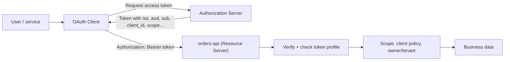
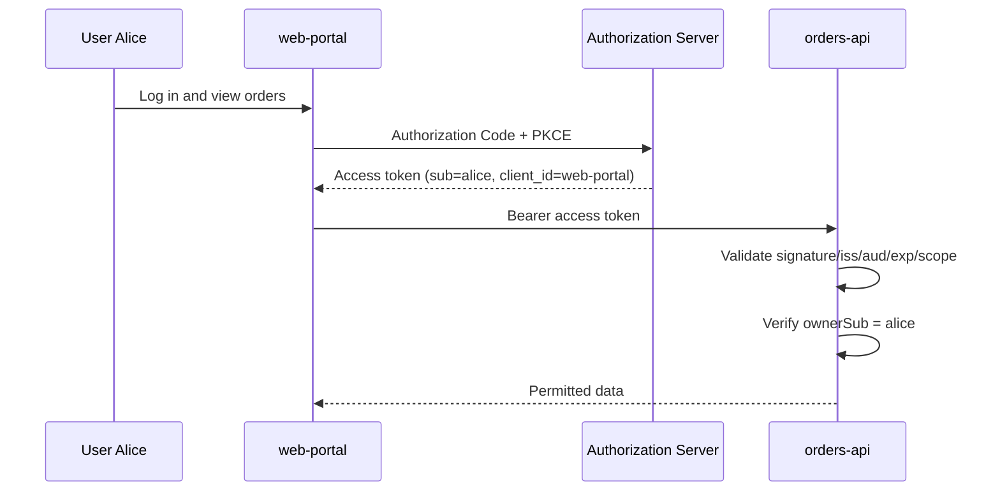

# `azp`, `client_id`, and Additional Claims: Interpreting by Access Token Profile

In a **Spring Security OAuth 2.0 / OIDC Resource Server** system, the API receives an access token issued by an Authorization Server. Many tokens contain fields such as `sub`, `aud`, `scope`, `azp`, `client_id`, `roles`, `tenant_id`, or `act`. The hard part is not parsing the JSON; it is understanding **who each claim refers to, what it means under which standard or token profile, and whether there is sufficient basis to use it in an access decision**.

Two questions are frequently conflated:

- **Who is the subject represented in the token?** Usually expressed via `sub`, though its semantics vary by grant type and issuer contract.
- **Which OAuth client requested the token?** Under the RFC 9068 JWT access token profile, the `client_id` claim answers this question. In an OIDC **ID Token**, `azp` has a standardized meaning as *authorized party*, i.e., the client receiving the ID Token. Some providers also put `azp` into **access tokens** as a provider-specific claim; in that case you must read the specific profile documentation rather than assuming it substitutes for `client_id`.

This lesson walks from the trust model to building a claim contract, examples of three token profiles, how to read them in Spring Security, decision-making mechanics, and a testing plan. All hosts, clients, users, and data in the examples are illustrative.

## 1. An Access Token Contract Starts by Identifying the Right Roles

Suppose there are four components:

- **Identity Provider / Authorization Server (AS):** authenticates users when needed, evaluates authorization requests, and issues tokens.
- **Web client** `web-portal`: requests an access token via Authorization Code + PKCE to call the API on behalf of a user.
- **Batch client** `partner-batch`: requests an access token via Client Credentials for automated background synchronization.
- **Resource Server** `orders-api`: exposes endpoints, verifies tokens, and enforces access policies.

On a request such as:

```http
GET /api/orders/42 HTTP/1.1
Host: orders.example.test
Authorization: Bearer <ACCESS_TOKEN>
```

The Resource Server must answer distinct questions:

| Question | Commonly Used Data | What You Need to Know |
|---|---|---|
| **Who issued the token?** | `iss` | Accept only trusted issuers; verify signature or introspection against that issuer. |
| **Which API is this token intended for?** | `aud` | Token must target `orders-api`; `aud` does not indicate who requested the token. |
| **Is the token still valid?** | `exp`, `nbf`, `iat` | Validate timestamps per profile; `iat` does not replace `exp`. |
| **Which subject does the token represent?** | `sub` | May be a user or a client/service depending on grant and profile. |
| **Which client requested the token?** | `client_id`, or an issuer-specific claim like `azp` | Never infer from `sub` or `aud`. |
| **Which operation privileges were granted to the client?** | `scope`/`scp`, `roles`, `permissions` | Requires mapping rules and binding to audience. |
| **Does the request have permission on a specific record?** | `sub`, `tenant_id`, DB records | An additional business decision, never implied merely by a valid signature. |
| **Is delegation happening through an intermediary actor?** | `act`, `may_act`, other claims | Meaningful only if the issuer emits them under a corresponding delegation profile. |
| **Is the token sender-constrained?** | `cnf`, mTLS certificate, or DPoP proof | Must verify actual key/certificate proof, not merely read claims. |

Relationship diagram:



**`sub`, `client_id`, and `aud` are three distinct axes.** Having two values happen to match in a Client Credentials token does not make those three fields synonymous.

## 2. Standards and Token Profiles to Distinguish

OAuth 2.0 itself does not require every access token to be a JWT. A token may be an opaque string, an RFC 9068-compliant JWT, or a custom format agreed upon by both parties. How `azp` and `client_id` are interpreted therefore depends on the **token profile**.

| Profile / Specification | Token Addressed | Key Rule to Remember |
|---|---|---|
| **OAuth 2.0 Framework (RFC 6749)** | Access tokens in general | Defines issuing/consuming tokens; does not require JSON claims. |
| **OIDC Core** | **ID Token** | Defines `azp` (*authorized party*) as an **optional** claim; if present, its value is the OAuth 2.0 Client ID of the party to whom the ID Token was issued. |
| **JWT Profile for OAuth 2.0 Access Tokens (RFC 9068)** | Standardized JWT access token | `client_id` is **required**. The `typ` header must indicate the access token type, typically `at+jwt`. |
| **OAuth 2.0 Token Exchange (RFC 8693)** | Access tokens, including exchanged tokens | Defines `client_id` as the client that requested the token and adds claims like `act`/`may_act` for certain cases. |
| **OAuth 2.0 Token Introspection (RFC 7662)** | Introspection response for access tokens | `active` is required; `client_id` is **optional**, unlike RFC 9068's mandatory rule. |
| **IdP-specific profile** | Access tokens issued by a specific vendor/tenant | May use `azp`, `gty`, `realm_access`, `resource_access`, `tenant_id`, etc.; check actual docs and issuance contract. |

The word **"required"** must always carry its scope: `client_id` is required **in an RFC 9068-compliant JWT access token**, not in every OAuth 2.0 access token. Likewise, `azp` is standardized **for OIDC ID Tokens**, not as a mandatory claim of RFC 9068 JWT access tokens.

### 2.1. Example RFC 9068 JWT Access Token

The JWS protected header looks like:

```json
{
  "alg": "RS256",
  "typ": "at+jwt",
  "kid": "signing-key-01"
}
```

Illustrative payload:

```json
{
  "iss": "https://auth.example.test/realms/training",
  "sub": "user-123",
  "aud": ["orders-api"],
  "exp": 1890003600,
  "iat": 1890000000,
  "jti": "token-001",
  "client_id": "web-portal",
  "scope": "orders:read"
}
```

This is **illustrative pre-signing JSON**, not a usable Bearer token. Under the RFC 9068 profile:

- Claims `iss`, `sub`, `aud`, `exp`, `iat`, `jti`, and `client_id` are mandatory profile claims.
- `client_id = web-portal` says the `web-portal` client requested the token; it does **not** say `web-portal` owns the order.
- `sub = user-123` represents the subject; in a user-present flow, typically the authorizing user.
- `aud = orders-api` requires the Resource Server to be an authorized recipient; it does not turn `web-portal` into the target audience.
- `scope = orders:read` describes permissions granted regarding `orders-api`; the Resource Server still must check permissions on individual resources.
- `typ = at+jwt` prevents confusing an **ID Token** with an **access token**; when strictly enforcing RFC 9068, the Resource Server must verify this token type per standard.

If an IdP uses a different access-token profile, it may not include `typ` or `client_id` as shown above. In that case, do not claim the token "complies with RFC 9068" merely because the payload is a JWT; instead, agree explicitly on the issued profile and validate against that profile.

### 2.2. Why `client_id` in a Token Does Not Equal Client Authentication at the API

`client_id` is the **identifier** of the OAuth client that requested the token. It is not a client secret and not proof that the process sending the current HTTP request is the original process that requested the token.

In principle, a **Bearer token** can be presented by any party possessing a valid token. Even when the `client_id` claim is signed and checked properly, if the token is stolen, the API will still see `client_id = web-portal` on the replayed token. When you need to bind the token to the presenter, use an appropriate sender-constrained mechanism such as **mutual TLS** or **DPoP**, along with verifying the corresponding proof/certificate and `cnf` claim.

Requiring `client_id` to be on an allowlist can serve as **one authorization layer**; it does not replace Bearer token validation, scope checks, tenant/ownership rules, API limits, or proof-of-possession mechanisms.

## 3. What Is `azp`, and When Is It Meaningful?

In **OpenID Connect Core**, `azp` stands for *authorized party*. It is an optional claim of an **ID Token**: if present, it must contain the OAuth 2.0 Client ID of the party to whom the ID Token was issued.

Example decoded ID Token:

```json
{
  "iss": "https://auth.example.test/realms/training",
  "sub": "user-123",
  "aud": ["web-portal"],
  "azp": "web-portal",
  "exp": 1890003600,
  "iat": 1890000000
}
```

This ID Token is **intended for the OIDC client `web-portal`**; it is not an access token to send to `orders-api`. `aud = web-portal` itself indicates the intended recipient of the ID Token. When an ID Token contains `azp`, the OIDC client must interpret and verify the claim under the applicable ID Token validation rules.

OIDC Core also specifies how to check `azp` when an ID Token has multiple audiences: the client must handle the presence and value of `azp` following the OIDC Core ID Token validation algorithm. Do not blindly copy **ID Token** rules over to **JWT access tokens** if the access token profile does not specify them.

### 3.1. Why Do Access Tokens Sometimes Contain `azp` Too?

Some identity providers, such as implementations with custom token schemas, also add `azp` to **access tokens** to indicate the client involved in issuance/authorization. Illustrative example of a vendor profile:

```json
{
  "iss": "https://auth.example.test/realms/training",
  "sub": "user-123",
  "aud": ["orders-api"],
  "azp": "mobile-app",
  "scope": "orders:read",
  "exp": 1890003600
}
```

If your IdP guarantees in its configuration docs that **in this access token profile** `azp` carries the client ID that requested the token, the Resource Server can use `azp` per that contract. However, there is no universal guarantee that every OAuth access token contains `azp`, or that `azp` always means the same thing as `client_id`.

Two critical implementation rules:

1. **Never assume `azp == client_id`.** When client identity is needed, select the claim defined by the **issuer's specific token profile**. If a token contains both claims, the contract must state whether they are required to match and how mismatches are handled.
2. **Never accept an ID Token as a Bearer access token.** A token with a valid signature containing `azp` and `sub` must still be rejected if it is an ID Token intended for a client rather than for the Resource Server.

### 3.2. When Both `client_id` and `azp` Are Present

Suppose an issuer emits:

```json
{
  "iss": "https://auth.example.test/realms/training",
  "aud": ["orders-api"],
  "sub": "user-123",
  "client_id": "web-portal",
  "azp": "mobile-app",
  "scope": "orders:read"
}
```

**Never pick one using a silent fallback priority** like "prefer `client_id` if present, otherwise use `azp`" and grant access. These two fields may belong to different rules. You must know the exact token profile: did the token go through token exchange; how does the vendor define `azp`; are both required to match; did the schema change after an IdP upgrade?

Under a contract requiring them to match, the token above must be rejected per contract. Under a profile where `azp` has a distinct meaning, do not impose a rule the issuer never promised. If you cannot explain it unambiguously, **do not use an ambiguous field as an authorization basis**.

## 4. The Meaning of `client_id` and `sub` Changes by OAuth Flow

### 4.1. Authorization Code + PKCE: Token Tied to User and Client

An interactive application where a user logs in:



Illustrative token:

```json
{
  "iss": "https://auth.example.test/realms/training",
  "aud": ["orders-api"],
  "sub": "alice",
  "client_id": "web-portal",
  "scope": "orders:read"
}
```

In this flow, `sub` is typically **user Alice**, while `client_id` is the **`web-portal` application**. If Alice also uses a mobile app, another token may share the same `sub` while having `client_id = mobile-app`. Keeping the user constant does not mean tokens share the same client.

Distinct conditions can apply simultaneously:

- Alice is permitted to read **orders owned by Alice**.
- `web-portal` is permitted to call the API under client management policy.
- Scope `orders:read` allows the read operation category, without granting access to every order.
- The API accepts the token only when `aud` contains `orders-api`.

### 4.2. Client Credentials: No Logged-In User

A batch job `partner-batch` can request a token via `client_credentials`:

```json
{
  "iss": "https://auth.example.test/realms/training",
  "aud": ["orders-api"],
  "sub": "partner-batch-service-subject",
  "client_id": "partner-batch",
  "scope": "orders:import"
}
```

Under RFC 9068, in a grant **with no resource owner**, `sub` should represent the client application using an identifier chosen by the issuer. It is **not** a "currently logged-in human user." Nor is `sub` required to match `client_id` byte-for-byte; an issuer may assign a separate subject identifier to the application.

Consequences:

- An endpoint requiring "order owner is user Alice" cannot automatically treat `partner-batch-service-subject` as Alice's identity.
- Service-to-service privileges should be defined separately via scopes, roles, client policies, and appropriate tenant constraints.
- In audits, distinguish **service subjects** from **interactive users**; never synthesize a user from email, username, or client name.
- If the product supports workload identities/service accounts, define their path in business logic and test them separately.

### 4.3. Token Exchange and Multi-Hop Delegation

In multi-service architectures, client A may exchange a token at the Authorization Server for a new token to call backend B. RFC 8693 uses `act` (*actor*) to represent the current acting party, and `may_act` to describe a party authorized to become an actor in the right context.

Example newly issued access token after token exchange, with some claims omitted:

```json
{
  "iss": "https://auth.example.test",
  "aud": ["orders-api"],
  "sub": "alice",
  "client_id": "api-gateway",
  "act": {
    "sub": "gateway-service"
  },
  "scope": "orders:read"
}
```

In a token exchange contract designed like this:

- `sub = alice` is the represented **subject**.
- `act.sub = gateway-service` is the **actor** performing the current action; the actor may have an identifier distinct from the OAuth client.
- `client_id = api-gateway` is the OAuth client that requested the **new** token per the definition of `client_id`; it does not automatically record the full history of prior clients.
- Deeper nested actors, if present, can describe delegation history; RFC 8693 specifies rules for using the current actor and actor chain in access control.

Never equate `act.sub`, `client_id`, and `azp`. They answer different questions and appear only when the issuer actually applies a profile containing those claims. Never conclude "the real user is Alice" if a service-to-service token lacks a corresponding delegation rule.

### 4.4. Same Fields, Different Conclusions

| Case | How `sub` Should Be Interpreted | How `client_id` Should Be Interpreted | Remaining Question to Resolve |
|---|---|---|---|
| Authorization Code + PKCE | Resource owner/user (usually) | Web/mobile client that requested the access token | Which records may this user access? |
| Client Credentials | Issuer-assigned application/service identifier | OAuth client requesting the token | May this workload perform the operation, and in which tenant? |
| Token Exchange | Represented subject per issued token | Client requesting the new token | Which actor is acting, and what level of delegation is allowed? |
| Opaque token via introspection | `sub` value if supplied by server | `client_id` value **if** supplied by server | Are `active`, scope, and issuer/context trusted and sufficient? |
| OIDC ID Token | Authenticated user | Usually **not** expressed via `client_id`; client receives ID Token via `aud`/`azp` | This token lets a client authenticate a user; it is not an API credential. |

## 5. Additional Claims: Interpret by Semantics, Not by Field Name

A token may carry many additional claims. Some are standardized with specific semantics; others are entirely vendor- or application-defined. Without an explicit schema contract, **never turn them into security decisions just because a field name sounds plausible**.

### 5.1. Origin, Validity, and Purpose Group

| Claim / Header | Meaning | Safe Interpretation |
|---|---|---|
| `iss` | Issuer | Match exactly against trusted issuers; claim must come from a verified token. |
| `aud` | Audience | API must appear in the audience list, regardless of `client_id` or `azp`. |
| `exp` / `nbf` | Expiration / Not Before | Validator checks against clock and policy clock skew. |
| `iat` | Issued At | Useful for profile/audit checks; does not replace expiration checks. |
| `jti` | Unique token ID within issuer scope | Supports audit/anti-replay/revocation **if the system has matching infrastructure**; `jti` alone does not revoke a token. |
| `typ` header | Token classification (e.g., `at+jwt`) | If conforming to RFC 9068, verify the expected type to avoid accepting ID Tokens as access tokens. |
| `alg`, `kid` headers | Signing algorithm and key hint | Decoder accepts only allowed algorithms and fetches keys from trusted JWKS; never fetch keys from a token-supplied URL. |

### 5.2. Subject, Client, and Authentication Session Group

| Claim | May Indicate | Limitations |
|---|---|---|
| `sub` | Token subject | In Client Credentials, not assumed to be a human user; must pair with `iss` to preserve namespace. |
| `client_id` | OAuth client requesting the token | Mandatory in RFC 9068; not proof the presenter holds the client secret. |
| `azp` | Authorized party per OIDC ID Token; or issuer-specific meaning in access tokens | Never use as a universal alias for `client_id`. |
| `sid` | Session ID in some OIDC profiles | Does not automatically mean the access token is still valid or unrevoked; verify profile and logout mechanisms. |
| `auth_time` | Time the user performed authentication | Meaningful only when emitted by the issuer in a user context; not necessarily present in Client Credentials. |
| `amr` | Authentication Methods References | Authentication methods used; does not automatically mean "MFA is sufficient" without agreed values/standards. |
| `acr` | Authentication Context Class Reference | Authentication assurance level; requires contract on each ACR value and API requirement. |
| `nonce` | Replay/session binding in OIDC client flow | Belongs to OIDC ID Token validation; never used as an API access token privilege. |

**`auth_time`, `acr`, and `amr` can support step-up authentication policies**, provided the Resource Server trusts only issuer-guaranteed values and understands exact boundaries. For instance, an MFA requirement must specify the exact set of acceptable `acr`/`amr` values, `auth_time` freshness, and behavior when the claim is absent.

### 5.3. Authorization Group

| Claim | Common Representation | Notes |
|---|---|---|
| `scope` | Space-delimited string, e.g., `"orders:read orders:write"` | Scopes must be meaningful for the resource in `aud`. |
| `scp` | String or array depending on issuer | Never assume format without configuring a matching converter. |
| `roles` / `groups` / `entitlements` | String, array, or custom structure | Design mapping into `GrantedAuthority` and scope privileges by resource/tenant. |
| `permissions` | Vendor-specific fine-grained permission list | Not a universal standard JWT claim; understand namespace and issuing authority. |
| `authorization_details` | Rich Authorization Requests (RFC 9396) details when used | Never flatten arbitrarily into scopes; data typically has its own structure and constraints. |

In Spring Security Resource Server JWT, the default converter typically reads `scope`/`scp` into authorities prefixed with `SCOPE_`; **`client_id` or `azp` never automatically creates privileged authorities**. If a token carries `roles`, define a converter compatible with the data type and issuer, then enforce both privilege and object-level rules.

### 5.4. Organization, Tenant, and User Info Group

Common claims include `tenant_id`, `organization_id`, `org_id`, `email`, `email_verified`, `preferred_username`, `name`, `locale`, or `department`. These are usually supplemental data or part of an **issuer-specific contract**.

Do not infer:

- That `email` or `preferred_username` is a stable user primary key. Emails can change, collide across systems, be absent, or be unverified.
- That `tenant_id` automatically grants access to every resource in that tenant. The API must compare the trusted tenant against the tenant stored on the record and verify matching roles/scopes.
- That `groups = ["admins"]` always equals admin privileges for this API. IdP groups may serve another purpose, belong to another namespace, or lack direct mapping.
- That a `department` claim implies purchasing approval. Business conditions require authoritative data and dedicated workflows.

In multi-issuer systems, `sub = "123"` can exist under two different issuers and refer to two different principals. When storing subjects in a database, prefer a composite key **(issuer, subject)**, plus tenant if needed. `client_id` is likewise meaningful only within its respective issuer/authorization server namespace.

### 5.5. Delegation and Proof-of-Possession Group

- `act` in RFC 8693 indicates the current actor in a delegation/impersonation scenario. Do not read nested actors as co-authorized users.
- `may_act` indicates a party authorized to act as an actor in a token exchange context; it is not a direct API access scope.
- `cnf` (*confirmation*) specifies a key or binding information confirming authorization to use the token. DPoP may use `cnf.jkt`; mTLS may use `cnf["x5t#S256"]`. The Resource Server must verify the **current request's** proof/certificate against the token binding.
- Claims such as `gty`, `token_use`, `ver`, `realm_access`, or `resource_access` depend on the IdP and token profile. They can be useful, yet carry no universal OAuth meaning unless agreed upon by both parties.

In particular, **a signed `client_id` does not make a token sender-constrained**; never skip DPoP/mTLS verification simply because you know which client requested the token.

## 6. Opaque Tokens and Introspection: Where Do You Read `client_id`?

When an access token is an opaque string, the Resource Server cannot arbitrarily Base64URL-decode it to read a payload. Instead, it calls the Authorization Server's **introspection endpoint** per RFC 7662 using securely managed credentials.

Hypothetical response:

```json
{
  "active": true,
  "scope": "orders:read",
  "client_id": "web-portal",
  "sub": "alice",
  "aud": "orders-api",
  "iss": "https://auth.example.test",
  "exp": 1890003600
}
```

Per RFC 7662, `active` is a required field in the introspection response, whereas `client_id` is **optional**. A valid response may omit `client_id`. The Authorization Server must protect the introspection endpoint, and the Resource Server must verify the response comes from a trusted AS before enforcing audience/scope conditions per contract.

When `active = false`, the AS should return minimal information beyond that status; never infer "who the client is" or why the token is inactive from missing fields. With introspection, response caching must balance latency against timely enforcement of permission changes or token revocation.

In Spring Security, the JWT branch and the opaque branch have different principal types. Code calling `((JwtAuthenticationToken) authentication).getToken()` works only for JWTs; for opaque tokens, Spring typically provides `BearerTokenAuthentication` and `OAuth2AuthenticatedPrincipal`. Therefore, **client identity extraction logic should be designed per profile** or behind an application-controlled abstraction.

## 7. Building an Access Token Contract Before Writing Authorization Code

The contract must define which data is required, who issues it, in which token type, and how every mismatch is handled. A suitable template for `orders-api`:

| Case / Claim | RFC 9068 JWT User Profile | RFC 9068 JWT Service Profile | Vendor Access Token Profile Using `azp` |
|---|---|---|---|
| Trust source | Issuer A, JWKS A | Issuer A, JWKS A | Issuer B, JWKS B |
| Target audience | `aud` contains `orders-api` | `aud` contains `orders-api` | `aud` contains `orders-api` |
| Token type | Header `typ=at+jwt` | Header `typ=at+jwt` | Per issuer B's own rules |
| Subject `sub` | User ID | Service subject | Per issuer B's definition |
| Client identity | **`client_id` required** | **`client_id` required** | `azp` if issuer B guarantees it carries client ID |
| `azp` | Not required by default | Not required by default | Required per **custom contract**, not RFC 9068 |
| Operation rights | Defined `scope`/roles | Workload-specific scopes | Explicitly specified JSON claim path |
| Data-owning principal | (iss, sub), plus tenant when needed | Dedicated service-to-service policy | Mapped per issuer B's profile |
| Missing mandatory profile claim | Reject token | Reject token | Reject token or deny access per agreed policy boundary |

These are **examples of three different profiles**, not a recommendation for one API to enable all three at once. Each issuer/profile introduces a different trust boundary and security requirements. Without a multi-issuer requirement, accepting a single explicit profile is usually easier to govern.

### 7.1. Items That Must Be Written Into the Contract

1. **Issuer**: exact URI, JWKS/introspection endpoint, signing key and algorithm policy.
2. **Token type**: RFC 9068 JWT access token, vendor-specific JWT access token, opaque token, or sender-constrained token.
3. **Audience**: specific API/resource name; tokens intended for frontend apps or another API must be rejected.
4. **Supported grants**: Authorization Code, Client Credentials, Token Exchange; define `sub` and actor (if any) for each grant.
5. **Client identity**: which claim is authoritative (`client_id` or `azp`), data type, required vs. optional, relationship to issuer, and behavior when absent.
6. **Authorization data**: scope/role/permissions, JSON path, data type, namespace, and mapping to endpoint permissions.
7. **Business data**: tenant/organization, trustworthiness and update cadence, and database reconciliation.
8. **Extensions**: `act`, `cnf`, `acr`, `amr`, etc.—under which standard/profile they apply, and which validator checks them.
9. **Error states**: malformed/bad signature/wrong issuer/wrong audience/missing mandatory claim are typically authentication failures; valid tokens lacking privilege are authorization failures.
10. **Compatible changes**: who owns claim/profile versioning, migration plans, and testing with real tokens.

### 7.2. Rules for Missing and Mistyped Claims

An API requiring a client ID for partner policies must define clear behavior when a token:

- Lacks `client_id` in an **RFC 9068 token**: treat as a profile violation; never treat it as a "public client."
- Has `client_id` as an array/object instead of a string: reject per schema; never call `toString()` and match.
- Has `client_id = ""` or only whitespace: treat as invalid per policy.
- Has `azp` but lacks `client_id` under an issuer supporting only RFC 9068: never silently fall back to `azp`.
- Has both `client_id` and `azp` with different values: follow defined policy; never guess.
- Has an unrecognized client ID while carrying a valid scope: if the endpoint is restricted to registered clients, reject at the authorization layer.
- Has a valid scope and client ID but wrong `aud`: reject at the authentication layer before evaluating scopes.

**Fail closed** is the default rule: without sufficient trusted data to evaluate a policy, do not grant access.

## 8. Implementing in Spring Security: Verify First, Interpret Second

The examples below use **Java 17+, Spring Boot 3.x / Spring Security 6.x**, assuming an issuer capable of issuing RFC 9068 JWT access tokens. Note that these snippets are implementation building blocks for an API and must match your Authorization Server's actual configuration.

### 8.1. Configuring Issuer and Audience

Required dependencies:

```xml
<dependencies>
    <dependency>
        <groupId>org.springframework.boot</groupId>
        <artifactId>spring-boot-starter-web</artifactId>
    </dependency>
    <dependency>
        <groupId>org.springframework.boot</groupId>
        <artifactId>spring-boot-starter-security</artifactId>
    </dependency>
    <dependency>
        <groupId>org.springframework.boot</groupId>
        <artifactId>spring-boot-starter-oauth2-resource-server</artifactId>
    </dependency>
</dependencies>
```

```yaml
spring:
  security:
    oauth2:
      resourceserver:
        jwt:
          issuer-uri: https://auth.example.test/realms/training
          audiences:
            - orders-api
```

This configuration instructs Spring Resource Server to verify JWTs against the trusted issuer/JWKS and validate the API's audience. It **does not automatically enforce every RFC 9068 requirement**, such as the `at+jwt` token type and `client_id` schema. When strict RFC 9068 compliance is required, use the dedicated access-token profile validator and enforce the accepted token type; see the next section.

### 8.2. Validator for the RFC 9068 Profile

Spring Security provides support for building a dedicated `at+jwt` validator. Example declaring a `JwtDecoder` when the API accepts only RFC 9068 JWT access tokens:

```java
package com.example.orders.security;

import org.springframework.context.annotation.Bean;
import org.springframework.context.annotation.Configuration;
import org.springframework.security.oauth2.jwt.Jwt;
import org.springframework.security.oauth2.jwt.JwtDecoder;
import org.springframework.security.oauth2.jwt.JwtValidators;
import org.springframework.security.oauth2.jwt.NimbusJwtDecoder;

@Configuration
class JwtProfileConfig {
    private static final String ISSUER =
        "https://auth.example.test/realms/training";
    private static final String AUDIENCE = "orders-api";

    @Bean
    JwtDecoder jwtDecoder() {
        // Token type will be verified by AtJwtValidator per the RFC 9068 profile.
        NimbusJwtDecoder decoder = NimbusJwtDecoder.withIssuerLocation(ISSUER)
            .validateTypes(false)
            .build();

        decoder.setJwtValidator(
            JwtValidators.createAtJwtValidator()
                .issuer(ISSUER)
                .audience(AUDIENCE)
                .build()
        );
        return decoder;
    }
}
```

**Precondition:** the issuer's actual tokens must conform to RFC 9068, including the `typ=at+jwt`/`application/at+jwt` header and required claims. If your issuer does not emit this profile, you cannot simply "turn on `at+jwt` checking" and expect all vendor tokens to keep working. When checking `client_id` against a multi-client allowlist for **a specific endpoint**, enforce the client check at a separate authorization layer.

When declaring a custom `JwtDecoder`, your bean replaces part of Spring Boot's auto-configuration; be sure to keep appropriate `iss`, `aud`, `exp`, `nbf`, and token-type validators active. Never create a decoder that merely parses tokens without verifying signatures.

> **Version note:** The `JwtValidators.createAtJwtValidator()` API and its builders may vary across Spring Security versions; verify against your exact dependency version before applying. The security goal is independent of builder APIs: verify signature, issuer, audience, validity window, token type, and profile-mandated claims.

### 8.3. Reading `client_id` Safely from `JwtAuthenticationToken`

Once a JWT passes the decoder, Spring Security provides a `JwtAuthenticationToken`. If the API needs to know which client requested the token, read the **exact claim promised by the profile**:

```java
package com.example.orders.security;

import org.springframework.security.core.Authentication;
import org.springframework.security.oauth2.server.resource.authentication.JwtAuthenticationToken;
import org.springframework.stereotype.Component;

@Component("partnerClientGate")
public class PartnerClientGate {

    public boolean allow(Authentication authentication) {
        if (!(authentication instanceof JwtAuthenticationToken auth)
                || !authentication.isAuthenticated()) {
            return false;
        }

        Object rawClientId = auth.getToken().getClaims().get("client_id");

        // RFC 9068: client_id must be the string of the client that requested the token.
        // Do not fall back to azp in this profile.
        return rawClientId instanceof String clientId
            && "partner-batch".equals(clientId);
    }
}
```

Why not use `authentication.getName()`? By default, `JwtAuthenticationToken#getName()` maps to `sub`, the token's **subject**, not `client_id`. In user grants, `getName()` is typically the user; in Client Credentials, the subject may match or differ from the client ID depending on the issuer.

If a vendor contract specifies `azp` instead of `client_id`, build **a dedicated parser for that profile** with checks on issuer, data type, allowed values, and mismatch rules; never alter the RFC 9068 parser to "check both and take whichever is present."

### 8.4. Guarding an Endpoint with Both Scope and Client Policy

Enable method security to express two independent conditions: the caller holds the operation permission, and the access token was issued to a client on the approved partner list.

```java
package com.example.orders.security;

import org.springframework.context.annotation.Bean;
import org.springframework.context.annotation.Configuration;
import org.springframework.http.HttpMethod;
import org.springframework.security.config.Customizer;
import org.springframework.security.config.annotation.method.configuration.EnableMethodSecurity;
import org.springframework.security.config.annotation.web.builders.HttpSecurity;
import org.springframework.security.config.annotation.web.configurers.AbstractHttpConfigurer;
import org.springframework.security.config.http.SessionCreationPolicy;
import org.springframework.security.web.SecurityFilterChain;

@Configuration
@EnableMethodSecurity
public class ApiSecurityConfig {

    @Bean
    SecurityFilterChain apiSecurity(HttpSecurity http) throws Exception {
        return http
            // Suitable only for stateless APIs using Bearer in the Authorization header.
            .csrf(AbstractHttpConfigurer::disable)
            .sessionManagement(session ->
                session.sessionCreationPolicy(SessionCreationPolicy.STATELESS))
            .authorizeHttpRequests(auth -> auth
                .requestMatchers(HttpMethod.POST, "/api/partner/payments")
                    .hasAuthority("SCOPE_payment:create")
                .anyRequest().denyAll())
            .oauth2ResourceServer(oauth2 -> oauth2.jwt(Customizer.withDefaults()))
            .build();
    }
}
```

```java
package com.example.orders.api;

import org.springframework.http.ResponseEntity;
import org.springframework.security.access.prepost.PreAuthorize;
import org.springframework.web.bind.annotation.PostMapping;
import org.springframework.web.bind.annotation.RestController;

@RestController
public class PartnerPaymentController {

    @PostMapping("/api/partner/payments")
    @PreAuthorize("@partnerClientGate.allow(authentication)")
    public ResponseEntity<Void> createPayment() {
        // Example only illustrates access control before running business logic.
        return ResponseEntity.accepted().build();
    }
}
```

When `partner-batch` receives a valid token for `orders-api` with the `payment:create` scope, the request reaches the controller. Another client with the same scope that is not on the allowlist receives `403`. A Bearer token with an invalid signature, wrong issuer/audience, expired timestamp, or wrong profile type is rejected earlier at authentication, typically `401`.

These are only the **first two conditions on the endpoint**. Real payment-creation logic must additionally check whether the partner account is active, tenant/business agreements, amount limits, idempotency, auditing, and system-appropriate anti-duplication or anti-fraud rules.

### 8.5. When There Are Multiple Issuers or Multiple Profiles

Never choose a profile by immediately trusting **unverified** `iss` or `azp` values in a raw token. With multiple issuers, the verifier must use an allowlist of permitted issuers, each bound to its own key/metadata configuration, and only then apply that issuer's claim mapper and policies.

You can design a formal interpretation type:

```java
public record TokenClientIdentity(
    String issuer,
    String clientId,
    String sourceClaim
) { }
```

| Trusted Profile After Validation | Field for Client Identity | Behavior When Missing |
|---|---|---|
| `RFC9068@issuer-A` | `client_id` | Reject because the token violates the contract. |
| `LegacyAccess@issuer-B` | `azp`, per issuer-B docs | Reject or deny per policy; never fall back to an arbitrary claim. |
| `Introspection@issuer-C` | `client_id` if provided by introspection | For endpoints requiring client identity, fail closed if missing; other endpoints may choose scope-only policies. |

The mapping layer must run **only after token verification** and return values with clear provenance. Never pass raw tokens, unverified JSON payloads, or an HTTP `client_id` parameter into this layer. In multi-issuer systems, policies combining `issuer + client ID` must be isolated so client IDs cannot collide across IdP tenants.

## 9. Testing the Contract: Prove Every Condition Fails at the Right Layer

To test accurately, distinguish three layers:

1. **Mapper/policy unit tests:** feed synthetic claims from test fixtures and verify how the application interprets `client_id`, `azp`, data types, missing fields, and mismatches.
2. **HTTP / authorization tests:** verify Spring filter/method security enforcing scopes, allowlists, and business rules. Mocked authentication at this layer keeps focus on policy.
3. **JWT validation / integration tests:** use genuinely signed tokens and a test issuer/JWKS to verify signature, issuer, audience, expiration, `typ`, and mandatory claims. For opaque tokens, test introspection `active` and returned metadata.

### 9.1. Test Matrix

| Scenario | Expected Contract Behavior | Result |
|---|---|---|
| `client_id = partner-batch`, scope `payment:create`, valid token | Correct client and sufficient privileges | Allowed. |
| `client_id = mobile-app`, identical scope | Client not on allowlist | `403`. |
| RFC 9068 token missing `client_id` | Profile violation | Token rejected / fail closed. |
| RFC 9068 token with only `azp = partner-batch` | `azp` cannot substitute for `client_id` | Rejected per RFC 9068. |
| `client_id` is an array/object | Schema violation | Rejected; never coerce with stringify. |
| Empty `client_id` | No usable client ID | Rejected. |
| Right client, missing scope | Insufficient operation privilege | `403`. |
| Token has `scope` and `client_id`, but `aud` omits API | Wrong audience | `401`. |
| ID Token with valid `azp`, `aud` targeting web client | Not an API access token | `401`. |
| Token with `client_id` modified in payload without re-signing | Invalid signature | `401`. |
| Client Credentials token where `sub` differs from `client_id` | Distinct roles, not an anomaly | Evaluated per profile; not rejected merely for differing. |
| Token Exchange with `sub` and `act` | Distinguishes subject/actor/current client | Applies delegation policy; checks actor if required. |
| Introspection returns `active=false` | No valid credential | `401`; ignore additional client/subject fields. |
| Introspection `active=true` but lacks `client_id` | RFC 7662 permits omission | Endpoints requiring a client allowlist must fail closed. |
| User A has scope but accesses User B's order | Scope does not grant ownership | `403`/`404` per API contract. |

Note that the exact HTTP status when a **mandatory claim is missing** depends on where the check runs: if the decoder validator rejects the token as violating the profile, it typically returns `401`; if the token is valid under the profile but rejected by an endpoint policy for lacking an optional field, it typically returns `403`. What matters most is **denying access** in both cases and documenting the policy so clients handle it consistently.

### 9.2. Example Policy Tests with `spring-security-test`

The requests below use `jwt()` from `spring-security-test` to construct mock authentication in MockMvc. This tests **authorization**, not signature verification or `typ`/`aud` validation:

```java
import static org.springframework.security.test.web.servlet.request.SecurityMockMvcRequestPostProcessors.jwt;
import static org.springframework.test.web.servlet.request.MockMvcRequestBuilders.post;
import static org.springframework.test.web.servlet.result.MockMvcResultMatchers.status;

import org.junit.jupiter.api.Test;
import org.springframework.beans.factory.annotation.Autowired;
import org.springframework.boot.test.autoconfigure.web.servlet.AutoConfigureMockMvc;
import org.springframework.boot.test.context.SpringBootTest;
import org.springframework.security.core.authority.SimpleGrantedAuthority;
import org.springframework.test.web.servlet.MockMvc;

@SpringBootTest
@AutoConfigureMockMvc
class PartnerPaymentPolicyTest {

    @Autowired
    MockMvc mvc;

    @Test
    void approvedClientWithScopeCanCall() throws Exception {
        mvc.perform(post("/api/partner/payments")
                .with(jwt()
                    .jwt(token -> token
                        .claim("sub", "service-123")
                        .claim("client_id", "partner-batch"))
                    .authorities(
                        new SimpleGrantedAuthority("SCOPE_payment:create"))))
            .andExpect(status().isAccepted());
    }

    @Test
    void unapprovedClientCannotCallEvenWithSameScope() throws Exception {
        mvc.perform(post("/api/partner/payments")
                .with(jwt()
                    .jwt(token -> token
                        .claim("sub", "service-123")
                        .claim("client_id", "mobile-app"))
                    .authorities(
                        new SimpleGrantedAuthority("SCOPE_payment:create"))))
            .andExpect(status().isForbidden());
    }

    @Test
    void azpIsNotAnAutomaticFallbackForClientId() throws Exception {
        mvc.perform(post("/api/partner/payments")
                .with(jwt()
                    .jwt(token -> token
                        .claim("sub", "service-123")
                        .claim("azp", "partner-batch"))
                    .authorities(
                        new SimpleGrantedAuthority("SCOPE_payment:create"))))
            .andExpect(status().isForbidden());
    }

    @Test
    void approvedClientStillNeedsScope() throws Exception {
        mvc.perform(post("/api/partner/payments")
                .with(jwt()
                    .jwt(token -> token
                        .claim("client_id", "partner-batch"))
                    .authorities(
                        new SimpleGrantedAuthority("SCOPE_orders:read"))))
            .andExpect(status().isForbidden());
    }
}
```

To prove **detection of ID Tokens, wrong issuer/audience, wrong `typ`, bad signatures, and expired tokens**, test `JwtDecoder` with real JWTs signed by a test RSA key pair and a local JWKS configuration. MockMvc tests using `jwt()` can inject arbitrary claims and bypass the decoder, so they **cannot** replace cryptographic validation tests.

### 9.3. Integration Testing with an Authorization Server

When a real IdP environment is available, set up at least four test clients/subjects:

- `web-portal` calling the API on behalf of user Alice via Authorization Code + PKCE.
- `mobile-app` calling the API on behalf of the same user Alice to verify `sub` can match while `client_id` differs.
- `partner-batch` calling the API via Client Credentials to verify `sub` represents a workload.
- A dedicated client for Token Exchange to verify `act`/`sub` and `client_id` in the resulting token.

Store **synthetic/redacted sample tokens** or standardized schema metadata in an access-controlled test repository, never saving real access tokens into logs or source repositories. Verify the exact claims after Resource Server validation and test the corresponding endpoints.

## 10. Common Design Mistakes

### Mistake 1 — Using `azp` as Client ID for Every Token Type

`azp` is an OIDC ID Token concept; an access token vendor may include it, but without universal guarantees. If an API relies on `azp` unconditionally, upgrading the IdP or migrating to RFC 9068 can break policies. Bind the parser to the **verified issuer/profile**.

### Mistake 2 — Assuming `sub` Is Always a Human User

Client Credentials has no resource owner. Using `sub` as a user ID to look up order ownership can route a service token down an inappropriate user business path. Separate user flows from workload flows, or model subjects explicitly for both.

### Mistake 3 — Assuming `client_id` Proves Who Is Calling Over the Network

A Bearer token can be replayed if stolen. When sender binding is required, use mTLS/DPoP and verify key-possession proofs on every request per policy.

### Mistake 4 — Accepting Frontend Tokens as API Access Tokens

An ID Token can be signed by the same IdP and contain `sub`, `azp`, and even `email`. Without checking token type and audience, the API risks token substitution / cross-JWT confusion. Enforce the access token profile and an `aud` dedicated to the Resource Server.

### Mistake 5 — Turning Role/Tenant/Profile Claims into Unfounded Permissions

`roles`, `tenant_id`, `groups`, or `permissions` can be custom claims. Rely on them only under a specific issuer/contract, and keep owner, tenant, and business rules at the appropriate layer.

### Mistake 6 — Authorizing Based on JSON Values Before Verification

JWT payloads are merely Base64URL-encoded; anyone can edit them before signing. Never inspect raw payloads to decide `client_id` or scopes, even if the JSON looks valid. The decoder must verify the signature and claims before a controller or service receives the `Jwt`.

### Mistake 7 — Silent Fallbacks When a Token Lacks a Claim

Patterns such as `client_id ?? azp ?? sub` can unintentionally widen access across profiles. A fallback is justified only when **documented as a tested compatibility rule with a sunset date** and never weakens issuer, token type, or audience checks.

### Mistake 8 — Treating `jti` as a Revocation Mechanism

`jti` is a token identifier. Revoking a token before `exp` requires corresponding infrastructure/design (denylist, introspection, appropriately short token lifetimes, or another mechanism). Simply having `jti` in the payload does not invalidate a token.

## 11. Process for Introducing a New Claim into the API Contract

When the identity team proposes adding `azp`, `client_id`, `organization_id`, or a new attribute, follow this sequence:

1. **Document the purpose**: is the claim for auditing, client identification, operation authorization, data scoping, or UI display?
2. **Identify the profile**: RFC 9068 JWT access token, issuer-specific JWT access token, ID Token, or introspection? Which token types reach the API?
3. **Bind the source**: issuer, signing keys/introspection, audience, and token type; claims must be read only after validation.
4. **Define the schema**: claim path, data type, valid values, required vs. optional, namespace, and behavior when missing.
5. **Define the semantics**: does the claim describe a user, client, actor, tenant, session, or authentication method? Avoid overloading one claim with two undistinguished meanings.
6. **Write the decision rules**: independent conditions for scope/role, client allowlist, ownership, tenant, and proof-of-possession.
7. **Add examples and negative tests**: missing, wrong type, altered values, unrecognized client, token meant for another API, user vs. service differences.
8. **Coordinate deployment with the issuer**: verify the IdP actually emits claims matching the contract, with versioning/migration if schemas change.
9. **Observe safely**: log error categories, masked/hashed client codes where appropriate, and request correlation IDs; never log access tokens, refresh tokens, or sensitive user claims.
10. **Evaluate dynamic updates**: roles/tenants can change within an access token's lifetime; weigh trade-offs among short-lived tokens, token exchange, introspection, and live business lookups.

An example written as a policy:

```text
Permit POST /api/partner/payments only if:
  1. Access token matches the trusted issuer and access-token profile.
  2. The token is valid now, properly signed, and aud includes orders-api.
  3. Scope contains payment:create.
  4. The client_id from RFC9068 is exactly partner-batch.
  5. The business partner account is active and belongs to the target tenant.
  6. Sender-constrained proof is valid if this endpoint requires it.
Otherwise deny according to the failing authentication/authorization layer.
```

This rule demonstrates that **`client_id` is one attribute of the access token contract, not the entire access decision**. For issuers using `azp`, switch the client-identity extraction path only when backed by a formal profile, while keeping all trust, audience, scope, and business checks intact.

## Standard References

- [RFC 9068 — JSON Web Token (JWT) Profile for OAuth 2.0 Access Tokens](https://www.rfc-editor.org/rfc/rfc9068.html): specifies mandatory `client_id` in the JWT access token profile, `typ` `at+jwt`, required claims, and Resource Server requirements.
- [OpenID Connect Core 1.0 — ID Token and the `azp` claim](https://openid.net/specs/openid-connect-core-1_0.html): defines `azp` as an optional *authorized party* of an **ID Token**.
- [RFC 8693 — OAuth 2.0 Token Exchange](https://www.rfc-editor.org/rfc/rfc8693.html): `client_id`, `act`, `may_act`, and delegation contexts.
- [RFC 7662 — OAuth 2.0 Token Introspection](https://www.rfc-editor.org/rfc/rfc7662.html): meaning of `active` and optional `client_id` in introspection responses.
- [RFC 7519 — JSON Web Token (JWT)](https://www.rfc-editor.org/rfc/rfc7519.html): `iss`, `sub`, `aud`, `exp`, `iat`, and `jti` claims.
- [RFC 9396 — OAuth 2.0 Rich Authorization Requests](https://www.rfc-editor.org/rfc/rfc9396.html): how `authorization_details` are described.
- [RFC 9449 — OAuth 2.0 Demonstrating Proof of Possession (DPoP)](https://www.rfc-editor.org/rfc/rfc9449.html) and [RFC 8705 — OAuth 2.0 Mutual-TLS Client Authentication and Certificate-Bound Access Tokens](https://www.rfc-editor.org/rfc/rfc8705.html): binding tokens to the presenter.
- [Spring Security Reference — OAuth 2.0 Resource Server JWT](https://docs.spring.io/spring-security/reference/servlet/oauth2/resource-server/jwt.html): JWT decoding/verification, authority mapping, validation, and `JwtValidators.createAtJwtValidator()`.

When onboarding a new issuer, your first question should be **"Which profile does this token follow, and which claims does the issuer guarantee with what semantics?"**. Only after establishing that clearly can `azp`, `client_id`, and additional attributes be used safely and consistently in Resource Server policies.
