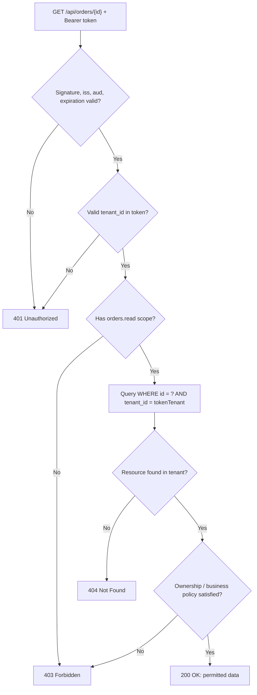
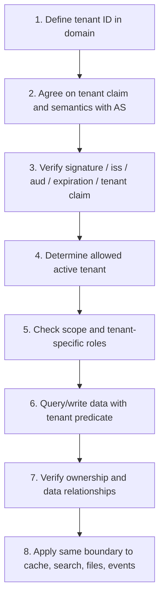

# Tenant Identity and Binding It to Accessed Resources

## 1. The Multi-Tenant Problem When an API Receives an Access Token

Suppose a SaaS order-management system serves two companies:

- **Tenant A — Alpha Corp:** user `alice` owns order `order-101`.
- **Tenant B — Beta Corp:** user `bob` owns order `order-202`.

Both companies call the same REST API:

```http
GET /api/orders/order-101 HTTP/1.1
Host: orders.example.com
Authorization: Bearer <access-token>
```

Spring Security Resource Server can confirm that the token has a valid signature, is unexpired, and carries the `SCOPE_orders.read` authority. Yet those steps alone **do not guarantee** that the caller belongs to Alpha tenant or is allowed to view `order-101`.

If the API fetches data strictly by ID:

```sql
SELECT * FROM orders WHERE id = :order_id;
```

a Client holding a valid Beta token could try substituting Alpha's ID for `order_id`. Authorization flaws of this kind belong to **Broken Object Level Authorization (BOLA)**: permissions are granted at the functional level, while permissions on individual resource objects go unchecked.

For multi-tenant SaaS, the Resource Server must connect three pieces of information:

1. **Trusted tenant identity:** the verified token or identity mechanism states which tenant scope the caller is acting within.
2. **Resource tenant identity:** which tenant owns the order, invoice, file, or record in the system's data store.
3. **Access rules:** scopes, principal kind, business permissions, ownership, and policies allowing or denying cross-tenant access.

**Goal:** Only when the request's authorized tenant scope is compatible with the resource's tenant does the API proceed to evaluate business permissions. This lesson covers the access token contract and how to use it to establish tenant boundaries in Spring Security OAuth 2.0 Resource Server.

## 2. Distinguishing Tenant, User, Client, Issuer, and Resource

These concepts can share identical string values in a particular system, yet fundamentally they are distinct identifiers.

| Concept | Question Answered | Example |
|---|---|---|
| **Tenant** | Which customer or organizational space does the data/access belong to? | `tenant-alpha` |
| **User / subject** | Which principal does the token represent per issuer convention? | `user-417` |
| **OAuth Client** | Which application was issued the token? | `shop-web` or `billing-job` |
| **Issuer (`iss`)** | Which Authorization Server issued the token? | `https://id.example.com/realms/shop` |
| **Audience (`aud`)** | Which Resource Server is the token intended for? | `orders-api` |
| **Scope** | Which group of operations was the token authorized to perform? | `orders.read` |
| **Resource tenant** | Which tenant owns the record in the database? | `orders.tenant_id = tenant-alpha` |

A user may belong to multiple tenants; a tenant has many users and many applications; an OAuth Client may serve one tenant or many tenants depending on the model. Likewise, one Authorization Server may issue tokens for many tenants and many APIs.

Therefore, the following inferences are **unsafe without an explicit contract**:

- `sub` is the tenant ID.
- `iss` is always the tenant ID.
- `aud` indicates which tenant is being accessed.
- Scope `orders.read` means "read orders across all tenants."
- An email domain or subdomain in a URL suffices to prove the caller belongs to that tenant.
- A user who successfully logs in with OIDC automatically has access to all organizational resources.

A valid token must generally be evaluated along **multiple independent dimensions**: **who**, **what they may do**, **at which API**, and **within which tenant**.

### 2.1. What Properties Should a Tenant ID Have?

A tenant ID used for access control should be:

- Stable and unique within the system.
- Clearly defined in format and comparison rules.
- Independent of display names or email domains that can change.
- Created/managed by a trusted system component.
- Reconcilable with the tenant identifier column in business data.

For example, `tnt_01HX4A` or a tenant UUID are illustrative choices. There is no mandatory OAuth 2.0/OIDC tenant ID format: the system must standardize it across the Authorization Server, Resource Server, and data store.

## 3. Access Token Contracts Carrying Tenant Information

### 3.1. Example Token Scoped to Exactly One Tenant

Suppose the application issues a JWT access token with this illustrative payload:

```json
{
  "iss": "https://id.example.com/realms/shop",
  "sub": "user-417",
  "aud": ["orders-api"],
  "exp": 1893456000,
  "nbf": 1893455100,
  "iat": 1893455100,
  "client_id": "shop-web",
  "scope": "orders.read orders.write",
  "tenant_id": "tenant-alpha"
}
```

Where:

- `iss` identifies the issuer that the API must trust.
- `aud` specifies the token was issued to call `orders-api`.
- `exp` and `nbf` bound the time window during which the token is accepted.
- `sub` identifies the subject; in this example, a user.
- `scope` identifies the granted operation groups.
- `tenant_id` identifies the tenant scope **under the system's custom contract**.

**`tenant_id` is neither a mandatory registered JWT claim nor a standard claim emitted by every OAuth 2.0/OIDC provider.** Providers may use `tid`, `org_id`, `organization`, a namespaced URI claim, or something else. The Resource Server needs to know the exact name, data type, source, and semantics; never treat similar-looking claim names as equivalent automatically.

For a single-tenant token contract, a sound rule is: **a JWT access token for a tenant-bound endpoint must carry exactly one valid `tenant_id`**. If an API allows tokens without a tenant claim to access tenant resources, a bypass around data boundaries emerges.

### 3.2. What Should the Contract Specify?

An example contract specification between Authorization Server and Resource Server:

| Component | Example Convention | Guarantee Required |
|---|---|---|
| Token type | Access token for calling `orders-api` | Never accept ID tokens as access tokens |
| Issuer | `https://id.example.com/realms/shop` | Verify exact issuer and signing keys |
| Audience | Contains `orders-api` | Reject tokens issued for other APIs |
| Tenant claim | `tenant_id`, non-empty string | Value belongs to the managed tenant namespace |
| Tenant issuance rule | AS issues only tenants the subject/Client is allowed to represent | Never trust Client-supplied tenant without permission verification |
| Scope | `orders.read`, `orders.write` | Clearly define operations permitted by each scope |
| Subject | `sub` per issuer convention | Distinguish users from services when business logic requires it |
| Validity | `exp`, `nbf`, and related validators | Accept only currently valid tokens |
| Data | `orders.tenant_id` aligned with token tenant namespace | Enforce tenant predicate on reads and writes |
| Switching tenants | Request another access token for the selected tenant or use a defined allowance | Never take a tenant name from the request to escalate privileges |

The contract should also specify policies when a user holds access in multiple tenants, membership changes, cross-tenant requests, or machine-to-machine tokens.

### 3.3. The Access Token Is Proof of Authorization, Not Client-Asserted Data

The following header or query parameter **is not authorization evidence**:

```http
GET /api/orders/order-101 HTTP/1.1
Authorization: Bearer <token-of-tenant-beta>
X-Tenant-ID: tenant-alpha
```

`X-Tenant-ID` can be useful for conveying the **requested** tenant, yet the Client can freely alter header values. The API must never use it to override the verified `tenant_id` from the token.

Likewise, a Client cannot edit a JWT payload from `"tenant_id":"tenant-beta"` to `"tenant_id":"tenant-alpha"` and keep the old signature: signature verification will fail. Yet even a validly signed JWT must still be checked against **the record's actual tenant**.

If the Authorization Server issues a tenant-scoped token based on a Client's selection, **the AS must verify permissions for the selected tenant before issuing the token**. The API should also independently enforce tenant boundaries on the data it manages.

## 4. Two Common Models for Representing Tenant in a Token

### 4.1. One Access Token Bound to One Tenant

Suppose user `user-417` has access to both Alpha and Beta, and is currently working in Alpha. The Client holds a token with `tenant_id=tenant-alpha`. When switching to Beta, the Client requests authorization in Beta's context and receives a separate token with `tenant_id=tenant-beta` after the AS verifies membership/permissions.

Advantages of this model:

- The Resource Server determines the active tenant from **a single verified claim**.
- Reduces confusion over "which tenant is being accessed?"
- Scopes and roles can carry semantics scoped to that exact tenant.
- Easy to enforce `WHERE tenant_id = :tenant_id` in queries.
- Reduces risk of one token accidentally holding privileges across multiple tenants.

In return, the Client needs a proper tenant-switching flow with the Authorization Server rather than just swapping a header or path parameter.

### 4.2. Access Token Permitting Multiple Tenants

Some systems issue tokens carrying a list of accessible tenants:

```json
{
  "sub": "user-417",
  "aud": ["orders-api"],
  "scope": "orders.read",
  "allowed_tenant_ids": ["tenant-alpha", "tenant-beta"]
}
```

`allowed_tenant_ids` is also a **custom claim**. In this model, the Resource Server needs two inputs:

1. The allowed tenant list from the verified token.
2. The **requested tenant**, e.g., `/api/tenants/tenant-alpha/orders/order-101`.

The API checks that `requestedTenantId` is in the allowed tenant set, then queries data **using that exact `requestedTenantId`**. Without this step, a tenant list in the token does not bind the request to a specific tenant.

Multi-tenant tokens require careful attention to token size, membership changes after issuance, and differing permissions across tenants. For instance, if a user has `orders.read` in Alpha but only `orders.write` in Beta, you cannot accurately represent that with a flat `"orders.read orders.write"` scope plus a tenant list; you need a **per-tenant** permission model or narrower tokens.

**Design recommendation:** For standard tenant-bound APIs, one-tenant-per-context tokens simplify security boundaries. If an API requires multi-tenant tokens, the contract must specify the exact tenant–scope–role relationship and how each endpoint validates it.

### 4.3. Separate Tenants by Issuer or Realm

Some IdPs isolate organizations using dedicated issuers/realms, for example:

```text
https://id.example.com/realms/alpha
https://id.example.com/realms/beta
```

In that architecture, `iss` **can** tie to tenant identity, provided the system defines and controls that mapping. Not every system uses one issuer per tenant; conversely, multiple business tenants often share a single issuer.

If accepting multiple issuers, the Resource Server must maintain a **trusted issuer allowlist**, per-issuer keys/validators, and configured issuer-to-tenant mappings. Never extract an arbitrary issuer from a Client request and dynamically fetch its metadata/JWKS to grant trust.

## 5. Tenant in the Token Must Bind to the Resource's Tenant

An API should distinguish three values:

```text
tokenTenant     = tenant_id from the verified access token
requestedTenant = tenant chosen in path/header (if the API accepts a choice)
resourceTenant  = tenant_id stored on the record in the database
```

With a single-tenant access token, the rule is typically:

```text
tokenTenant == resourceTenant
```

If the API puts tenant in the URL path, you also enforce:

```text
tokenTenant == requestedTenant
requestedTenant == resourceTenant
```

Good implementations go further than loading a record and comparing afterward: **include the tenant predicate directly in the data query from the start**.



### 5.1. Querying Data Properly

**Without tenant binding**:

```sql
SELECT id, tenant_id, owner_subject, total
FROM orders
WHERE id = :order_id;
```

**With tenant binding**:

```sql
SELECT id, tenant_id, owner_subject, total
FROM orders
WHERE id = :order_id
  AND tenant_id = :verified_tenant_id;
```

If an endpoint is strictly for users viewing their own data, bind the subject too:

```sql
SELECT id, tenant_id, owner_subject, total
FROM orders
WHERE id = :order_id
  AND tenant_id = :verified_tenant_id
  AND owner_subject = :verified_subject;
```

Here `verified_tenant_id` and `verified_subject` must come from trusted authentication details and the application's token contract, never directly from a Client-supplied body or header. When a record does not belong to the active tenant, the query returns no rows. The API can return `404 Not Found` to minimize leaking whether a record exists in another tenant.

### 5.2. Binding When Creating Resources

Upon receiving:

```http
POST /api/orders HTTP/1.1
Authorization: Bearer <token-tenant-alpha>
Content-Type: application/json

{
  "productId": "product-23",
  "tenantId": "tenant-beta",
  "quantity": 2
}
```

The API **must not** take `tenantId` from the JSON body to set the order's tenant. The server must assign the tenant from the authenticated/authorized context:

```java
String tenantId = jwt.getClaimAsString("tenant_id");
Order order = new Order();
order.setTenantId(tenantId);
order.setProductId(request.productId());
order.setQuantity(request.quantity());
repository.save(order);
```

This Java snippet is a business-layer sketch assuming the claim has already been verified by the decoder/validator. Referenced IDs such as `productId` must also be verified as **belonging to the same tenant** or explicitly shared per policy. Otherwise, data can still leak through relationships between orders and products.

### 5.3. Binding When Updating or Deleting

Mutating operations also require the tenant predicate:

```sql
UPDATE orders
SET status = :new_status
WHERE id = :order_id
  AND tenant_id = :verified_tenant_id;
```

```sql
DELETE FROM orders
WHERE id = :order_id
  AND tenant_id = :verified_tenant_id;
```

The API must check the affected row count and business permissions before executing. Never let a Client alter an existing record's `tenant_id` via PATCH/PUT unless there is a separately governed tenant-migration workflow.

### 5.4. Do Not Protect Only the Primary Table

Given a data model:

```text
Order (tenant_id)
  ├── OrderItem (order_id, product_id)
  ├── Invoice (tenant_id, order_id)
  ├── Attachment (tenant_id, storage_key)
  └── Payment (tenant_id, order_id)
```

Tenant boundaries must hold end-to-end:

- When joining data, ensure related entities never point across unauthorized tenants.
- When serving files, verify the tenant of metadata/files before generating a download URL.
- When caching data, include the tenant in the cache key, e.g., `orders:{tenantId}:{orderId}`, and verify permissions before returning cached results.
- When running background jobs or publishing events, propagate the verified tenant context properly rather than falling back to a poorly controlled default tenant.
- In search/analytics, apply tenant filters across the entire pipeline, including indexes, reports, and exports.

A cross-tenant data leak can happen outside the Controller even when the HTTP endpoint enforces `hasAuthority(...)`.

## 6. Three Control Layers: Token Authentication, Operation Privileges, Resource Privileges

In Spring Security, think of three layers in order:

| Layer | Checks | Rejection Example |
|---|---|---|
| **Authentication / token validation** | Signature, issuer, audience, expiration, mandatory tenant claim | Expired token or missing `tenant_id` per contract → `401` |
| **Endpoint authorization** | Scope/authority for HTTP method and route | `GET /api/orders/42` without `orders.read` → `403` |
| **Resource authorization / tenant isolation** | Token/request tenant vs. record tenant, ownership, tenant-specific roles | Beta token attempting to read Alpha order → `404` or `403` per policy |

A JWT with a valid signature and `tenant_id=tenant-alpha` can still cross tenants if a Service calls `findById(orderId)` without checking tenant. Conversely, a tenant-filtered query does not replace issuer/audience validation: if the API accepts forged tokens, an attacker can simply claim Alpha tenant.

### 6.1. Scope and Role Differ from Tenant

For example, the `orders.read` scope says "may read orders," not "which tenant's orders." A `TENANT_ADMIN` role may mean "administrator within the active tenant," never automatically system-wide administrator.

A complete policy can be expressed as:

```text
Allow GET /api/orders/{id} when
    token is valid for orders-api
    AND token has scope orders.read
    AND order.tenant_id == token.tenant_id
    AND (
        order.owner_subject == token.subject
        OR token has TENANT_ORDER_MANAGER role within token.tenant_id
    )
```

`TENANT_ORDER_MANAGER` is a hypothetical role name; if an application has tenant-scoped roles, define clearly within which tenant the AS/Authorization layer guarantees that role. Never rely on a generic global role name to unlock access across all tenants.

### 6.2. Cross-Tenant Access Is an Exception That Must Be Designed Explicitly

Some legitimate business workflows require administering or aggregating across multiple tenants. Rather than bypassing the tenant filter whenever an `ADMIN` role appears, define an explicit privilege such as `orders.cross-tenant.read` that is tightly granted, audited, and scoped to specific permitted tenants and resources.

For example, an internal reporting service may need an approved tenant list to export aggregate metrics without **permission to view detailed customer data**. Cross-tenant access must be checked by access purpose, principal, granted scope, and data policy; not every internal service gets unrestricted access.

## 7. Configuring Spring Security Resource Server for a Tenant Contract

The example below uses a **JWT Bearer access token**, single issuer, single audience, and one tenant per token. The application runs Spring Boot with modern Spring Security. For opaque tokens, use introspection and validate the tenant attribute in the trusted response per the corresponding contract.

### 7.1. Dependencies and Issuer

With Gradle:

```groovy
dependencies {
    implementation 'org.springframework.boot:spring-boot-starter-web'
    implementation 'org.springframework.boot:spring-boot-starter-security'
    implementation 'org.springframework.boot:spring-boot-starter-oauth2-resource-server'
    implementation 'org.springframework.boot:spring-boot-starter-data-jpa'
}
```

`application.yml` configuration:

```yaml
spring:
  security:
    oauth2:
      resourceserver:
        jwt:
          issuer-uri: https://id.example.com/realms/shop
```

`issuer-uri` must match the Authorization Server's real issuer exactly. Configuring only the issuer does not ensure the token targets `orders-api`, carries a valid `tenant_id`, or has rights on business resources. Those constraints must be configured explicitly.

### 7.2. Requiring Audience and Tenant Claim Directly in the JWT Validator

The following `JwtDecoder` example applies default issuer/time validation while requiring the `orders-api` audience and a non-blank string `tenant_id`:

```java
import org.springframework.context.annotation.Bean;
import org.springframework.context.annotation.Configuration;
import org.springframework.security.oauth2.core.DelegatingOAuth2TokenValidator;
import org.springframework.security.oauth2.core.OAuth2Error;
import org.springframework.security.oauth2.core.OAuth2TokenValidator;
import org.springframework.security.oauth2.core.OAuth2TokenValidatorResult;
import org.springframework.security.oauth2.jwt.Jwt;
import org.springframework.security.oauth2.jwt.JwtDecoder;
import org.springframework.security.oauth2.jwt.JwtDecoders;
import org.springframework.security.oauth2.jwt.JwtValidators;
import org.springframework.security.oauth2.jwt.NimbusJwtDecoder;

@Configuration
public class TokenValidationConfig {

    @Bean
    JwtDecoder jwtDecoder() {
        String issuer = "https://id.example.com/realms/shop";
        String expectedAudience = "orders-api";

        NimbusJwtDecoder decoder =
            (NimbusJwtDecoder) JwtDecoders.fromIssuerLocation(issuer);

        OAuth2TokenValidator<Jwt> audienceValidator = jwt ->
            jwt.getAudience().contains(expectedAudience)
                ? OAuth2TokenValidatorResult.success()
                : OAuth2TokenValidatorResult.failure(
                    new OAuth2Error(
                        "invalid_token", "Invalid audience", null));

        OAuth2TokenValidator<Jwt> tenantValidator = jwt -> {
            Object claim = jwt.getClaims().get("tenant_id");
            boolean valid = claim instanceof String
                && !((String) claim).isBlank();

            return valid
                ? OAuth2TokenValidatorResult.success()
                : OAuth2TokenValidatorResult.failure(
                    new OAuth2Error(
                        "invalid_token", "Missing or invalid tenant_id", null));
        };

        decoder.setJwtValidator(
            new DelegatingOAuth2TokenValidator<>(
                JwtValidators.createDefaultWithIssuer(issuer),
                audienceValidator,
                tenantValidator
            ));

        return decoder;
    }
}
```

Meaning:

- `JwtDecoders.fromIssuerLocation` builds a decoder from metadata/public keys of the trusted issuer and corresponding mechanism.
- `createDefaultWithIssuer` preserves essential default validators, including standard issuer/time checks.
- `audienceValidator` rejects tokens issued for other APIs.
- `tenantValidator` rejects tokens missing a non-blank `String` `tenant_id`.
- Afterward, Controllers/Services can read the validated tenant claim to enforce tenant isolation.

**Important limitation:** `tenantValidator` checks only the **shape** of the claim. Whether that tenant exists, is active, and whether the subject still holds rights in it must be guaranteed by the Authorization Server at issuance or checked by the API/authorization service against trusted data. If immediate membership revocation is required, an unexpired token may not reflect the change; the application needs short token lifetimes, live permission checks, or on-demand revocation.

Hardcoding the issuer above is for illustration only. Real applications should externalize identifiers into environment configuration and align with their exact Spring Security version.

### 7.3. Enforcing Scope Conditions in the FilterChain

```java
import org.springframework.context.annotation.Bean;
import org.springframework.context.annotation.Configuration;
import org.springframework.http.HttpMethod;
import org.springframework.security.config.Customizer;
import org.springframework.security.config.annotation.web.builders.HttpSecurity;
import org.springframework.security.config.http.SessionCreationPolicy;
import org.springframework.security.web.SecurityFilterChain;

@Configuration
public class ApiSecurityConfig {

    @Bean
    SecurityFilterChain apiSecurity(HttpSecurity http) throws Exception {
        return http
            .csrf(csrf -> csrf.disable())
            .sessionManagement(session ->
                session.sessionCreationPolicy(
                    SessionCreationPolicy.STATELESS))
            .authorizeHttpRequests(authorize -> authorize
                .requestMatchers("/api/public/**").permitAll()
                .requestMatchers(
                    HttpMethod.GET, "/api/orders/**")
                    .hasAuthority("SCOPE_orders.read")
                .requestMatchers(
                    HttpMethod.POST, "/api/orders")
                    .hasAuthority("SCOPE_orders.write")
                .anyRequest().denyAll()
            )
            .oauth2ResourceServer(oauth2 ->
                oauth2.jwt(Customizer.withDefaults()))
            .build();
    }
}
```

Spring Security typically maps `scope` or `scp` claims into authorities prefixed with `SCOPE_`, such as `orders.read` to `SCOPE_orders.read`. If the issuer uses a different claim or format, configure an appropriate converter.

`STATELESS` and `csrf.disable()` in this example are intended for a REST API using only Bearer tokens in the `Authorization` header, without cookie-based authentication. If the application uses automatic cookie authentication or other browser flows, evaluate CSRF against your real architecture.

This is the **endpoint check layer**; these rules have no knowledge of which tenant owns an order. Tenant binding must be enforced in the subsequent data-handling layer.

### 7.4. Reading the Verified Tenant in the Controller

Example endpoint retrieving a user's own order:

```java
import java.util.UUID;
import org.springframework.security.core.annotation.AuthenticationPrincipal;
import org.springframework.security.oauth2.jwt.Jwt;
import org.springframework.web.bind.annotation.GetMapping;
import org.springframework.web.bind.annotation.PathVariable;
import org.springframework.web.bind.annotation.RequestMapping;
import org.springframework.web.bind.annotation.RestController;

@RestController
@RequestMapping("/api/orders")
public class OrderController {

    private final OrderService orderService;

    public OrderController(OrderService orderService) {
        this.orderService = orderService;
    }

    @GetMapping("/{orderId}")
    public OrderDto getOwnOrder(
            @PathVariable UUID orderId,
            @AuthenticationPrincipal Jwt jwt) {

        String verifiedTenant = jwt.getClaimAsString("tenant_id");
        String verifiedSubject = jwt.getSubject();

        return orderService.findOwnOrder(
            orderId, verifiedTenant, verifiedSubject);
    }
}
```

In this configuration, `Jwt` represents the access token after passing `JwtDecoder` and declared validators. `verifiedTenant` does not come from an arbitrary path or header. However, this example **assumes `sub` is a user ID per the AS contract**. For Client Credentials tokens where `sub` is a Client ID, the endpoint needs a separate policy; never treat a Client ID as a human order owner.

### 7.5. Tenant-Aware Data Queries in Repository and Service

A Spring Data JPA repository can require ID, tenant, and owner simultaneously:

```java
import java.util.Optional;
import java.util.UUID;
import org.springframework.data.jpa.repository.JpaRepository;

public interface OrderRepository
        extends JpaRepository<OrderEntity, UUID> {

    Optional<OrderEntity> findByIdAndTenantIdAndOwnerSubject(
        UUID id, String tenantId, String ownerSubject);
}
```

Service:

```java
import java.util.UUID;
import org.springframework.http.HttpStatus;
import org.springframework.stereotype.Service;
import org.springframework.web.server.ResponseStatusException;

@Service
public class OrderService {

    private final OrderRepository repository;

    public OrderService(OrderRepository repository) {
        this.repository = repository;
    }

    public OrderDto findOwnOrder(
            UUID orderId, String tenantId, String subject) {

        OrderEntity order = repository
            .findByIdAndTenantIdAndOwnerSubject(
                orderId, tenantId, subject)
            .orElseThrow(() -> new ResponseStatusException(
                HttpStatus.NOT_FOUND, "Order not found"));

        return new OrderDto(order.getId(), order.getStatus());
    }
}
```

This example assumes `OrderEntity` (with fields `id`, `tenantId`, `ownerSubject`, `status`) and a corresponding `OrderDto`, omitting other domain/JPA mapping classes. The critical point is that the repository queries **by both tenant and subject**, rather than calling `findById` alone and risking returning data before checking.

If a manager role may view multiple orders **within the same tenant**, the Service can use `findByIdAndTenantId` after verifying the principal's manager permissions in that tenant. Never drop the tenant predicate just because a tenant-admin role is present.

### 7.6. When the Tenant Appears in the URL

An API may expose the tenant in the URL:

```http
GET /api/tenants/tenant-alpha/orders/40f9... HTTP/1.1
Authorization: Bearer <access-token>
```

When a token is issued for a single tenant, compare the URL tenant against the verified token tenant:

```java
@GetMapping("/api/tenants/{tenantId}/orders/{orderId}")
public OrderDto read(
        @PathVariable String tenantId,
        @PathVariable UUID orderId,
        @AuthenticationPrincipal Jwt jwt) {

    String verifiedTenant = jwt.getClaimAsString("tenant_id");

    if (!verifiedTenant.equals(tenantId)) {
        throw new ResponseStatusException(HttpStatus.FORBIDDEN);
    }

    return orderService.findOwnOrder(
        orderId, verifiedTenant, jwt.getSubject());
}
```

This is a **standalone endpoint example**; to run alongside the FilterChain in Section 7.3, declare matching rules for `/api/tenants/**`. If the application prefers returning `404` for mismatched tenants to avoid leaking existence, apply that policy consistently.

What matters is enforcing both the URL comparison and the data query predicate. Having `tenant-alpha` in the URL does not grant a Beta token access to Alpha.

## 8. Distinguishing User Tokens and Service Tokens in a Tenant Context

### 8.1. User Access Token

With Authorization Code, a user-context token might carry:

```json
{
  "sub": "user-417",
  "client_id": "shop-web",
  "aud": ["orders-api"],
  "scope": "orders.read",
  "tenant_id": "tenant-alpha"
}
```

The Resource Server must verify the token's issuer/audience/expiration, appropriate scope, matching tenant, and user permission on the order. A user may belong to both Alpha and Beta, yet a **single-tenant token** does not permit reading data from the other tenant.

### 8.2. Client Credentials Access Token

With Client Credentials, the token typically represents the Client/service itself:

```json
{
  "sub": "billing-worker",
  "client_id": "billing-worker",
  "aud": ["orders-api"],
  "scope": "orders.payment.update",
  "tenant_id": "tenant-alpha",
  "principal_type": "service"
}
```

`tenant_id` and `principal_type` here **are illustrative conventions**; `sub`, `client_id`, and principal type depend on the issuer. The API must have explicit rules governing which Clients may represent Alpha tenant when the AS issues tokens.

If `billing-worker` serves multiple tenants, there are two design paths: request a dedicated token per authorized tenant, or use an explicitly granted/verified multi-tenant permission mechanism. A Client Credentials token does not inherently possess rights to modify data system-wide. Never read a `tenant_id` sent by the Client in an HTTP request to widen a service token's scope.

### 8.3. When a Token Is Used to Call Another API Downstream

Suppose `orders-api` calls `billing-api`. An access token issued for `orders-api` usually lacks `billing-api`'s audience, so it should never be arbitrarily forwarded. If tenant/user context must be preserved, use an AS-supported token-issuance or delegation mechanism so the downstream API independently verifies its own issuer, audience, tenant, and permissions.

## 9. Data Architecture: Tenant at Every Layer

### 9.1. Shared Database, Shared Schema

Multiple tenants share tables, separated by a `tenant_id` column:

```sql
CREATE TABLE orders (
    id UUID PRIMARY KEY,
    tenant_id VARCHAR(80) NOT NULL,
    owner_subject VARCHAR(150) NOT NULL,
    status VARCHAR(30) NOT NULL
);

CREATE INDEX idx_orders_tenant_id_id
    ON orders(tenant_id, id);
```

This is a simple example; SQL syntax varies by database. Every query over tenant-bound data requires the appropriate tenant predicate. Never rely on hard-to-guess UUIDs as a defense against cross-tenant access.

Database **Row-Level Security (RLS)** can be added where supported. RLS provides defense in depth, provided the tenant context passed to the database is set from a trusted identity and properly scoped to the transaction/connection lifecycle.

### 9.2. Shared Database with Separate Schemas or Separate Databases

Some systems select a schema or database per tenant. In that case, choosing the DataSource/schema must also rely on the **verified tenant**, never solely on an unverified host/header or path value.

Example flow:

```text
verified tenant claim -> tenant authorization -> tenant routing
    -> right schema/database -> query record -> business logic
```

If using `ThreadLocal` to hold tenant context for routing, set and clear it reliably after each request to prevent leaks across pooled threads. For asynchronous, reactive, or message-driven processing, design explicit context propagation rather than assuming thread context automatically follows every execution path.

### 9.3. Caching, Search, Logs, and Events

Other data paths also need tenant binding:

| Component | Risk | Control |
|---|---|---|
| Cache | Beta receives Alpha's cached object because key uses only order ID | Tenant-aware cache keys, e.g., `tenantId:orderId` |
| Search index | Queries entire index even though request is for Alpha only | Apply tenant filter at the search layer |
| Object storage | Generates signed URL for a file belonging to another tenant | Verify file metadata/tenant before issuing URLs |
| Events/queues | Consumer processes an event in the wrong tenant | Propagate trusted tenant context and verify in the consumer |
| Analytics/exports | Reports mix data from multiple tenants | Determine authorized tenant set before querying/exporting |
| Batch jobs | Job defaults to "all tenants" privileges | Use explicit service principals and tenant scopes |
| Audit | Cannot trace cross-tenant access | Log tenant, subject/client, action, and outcome without logging real tokens |

Not every resource belongs to a single tenant; for instance, a global product catalog might be shared. Those cases require an **explicitly declared sharing policy** rather than dropping tenant filters wherever data looks shared.

## 10. Scenarios Prone to Vulnerabilities

### 10.1. Header Tenant Overriding Token Tenant

**Scenario:** Token has `tenant-beta`, request sends `X-Tenant-ID: tenant-alpha`, and the API sets context from the header.

**Flaw:** A Client-controlled header became the authorization source.

**Fix:** With single-tenant tokens, accept the requested tenant only if it matches the token's tenant; with multi-tenant tokens, check membership/permissions against the trusted list/source. Bind queries to the approved tenant.

### 10.2. Sufficient Scope Without Ownership

**Scenario:** `orders.read` is granted to an Alpha user, yet the API returns another Alpha user's order.

**Flaw:** Checked tenant only, omitting record-level permissions.

**Fix:** Beyond the tenant predicate, enforce owner subject, tenant role, or appropriate business policy. **Tenant isolation does not replace authorization between users within the same tenant.**

### 10.3. Token Issued for Another API

**Scenario:** A valid JWT from the right issuer with `tenant_id=tenant-alpha` and `aud=billing-api` is sent to `orders-api`.

**Flaw:** Missing audience binding.

**Fix:** Resource Server accepts only tokens carrying its own API's audience.

### 10.4. Tenant ID Sent in Body During Record Creation

**Scenario:** A POST request contains `tenantId=tenant-beta` while the token is `tenant-alpha`; the API saves the body value.

**Flaw:** Mass assignment or ignoring the principal's tenant context.

**Fix:** Server sets tenant from the authorized context; ignore or reject self-declared `tenantId` values when the API does not allow selecting tenants, and verify tenant for linked entities.

### 10.5. User Removed from Tenant While Token Is Still Unexpired

**Scenario:** The AS updated membership after issuing a JWT with `tenant_id=tenant-alpha`, but the JWT has not expired yet.

**Risk:** The Resource Server may still accept the token until expiration if it only validates locally without checking live state.

**Fix:** Design token lifetimes, refresh cadence, and revocation/entitlement checks according to how quickly privilege changes must take effect. A valid signature does not guarantee membership is always current.

### 10.6. Multiple Issuers While Automatically Trusting Any Issuer

**Scenario:** The Resource Server extracts `iss` from an unverified token, fetches JWKS from that URL, and trusts the returned keys.

**Flaw:** A token sender can stand up its own issuer and keys to forge accepted tokens.

**Fix:** Trust only registered/allowlisted issuers; configure validators/keys per trusted issuer and map valid tenants explicitly.

### 10.7. An "admin" Role Expanding Across All Tenants

**Scenario:** `ROLE_ADMIN` is granted to an Alpha administrator, and code skips the tenant predicate whenever that role is seen.

**Flaw:** A single-tenant role is treated as system-wide privilege.

**Fix:** Distinguish tenant admins from platform admins; grant cross-tenant privileges explicitly, constrain accessible data/actions, and log proper audits.

## 11. Scenario Matrix and Expected Outcomes

Assume the Resource Server requires a valid access token for `orders-api` and `tenant_id` for order endpoints. Scenarios:

| Token / Request | Resource | Expected Outcome |
|---|---|---|
| Alpha token, scope `orders.read`, user is owner | User's order in Alpha | Allow |
| Alpha token, scope `orders.read`, user is not owner and lacks permission to view others | Another user's order in Alpha | Deny |
| Beta token, scope `orders.read` | Alpha order | Deny, typically 404 or 403 |
| Alpha token missing `orders.read` | Alpha order | 403 |
| Token missing `tenant_id` when contract requires it | Alpha order | 401 because token fails validation |
| Valid token with `aud=inventory-api` | Alpha order | 401 due to wrong audience |
| Alpha token, path `/tenants/tenant-beta/...` | Beta order | Deny because path tenant is unauthorized |
| Service token with dedicated permission for Alpha reconciliation | Alpha job/reconciliation | Allow within granted scope |
| Alpha service token | Beta job/reconciliation | Deny unless cross-tenant authorized |
| Platform admin token with specific cross-tenant grant | Data within grant scope | Allow per grant and audit, without dropping global constraints |

Exact HTTP codes depend on the API's error-reporting policy. **`401`** is typical when a token is rejected; **`403`** when an authenticated principal lacks permission; **`404`** may be used to avoid revealing records in another tenant. Whichever code is chosen, the server must never return data across tenant boundaries.

## 12. Designing a Tenant-Aware API from the Ground Up

For a new multi-tenant API, design along this decision chain:



When establishing the contract between the identity system and the API, answer explicitly:

1. **What is the tenant ID?** Namespace, data type, lifecycle, and mutability?
2. **Who puts the tenant into the token?** Based on what membership/Client registration does the AS issue it?
3. **Does one token carry one tenant or multiple tenants?** If multiple, how are differing per-tenant permissions represented?
4. **Which issuers/audiences are trusted?** Are there multiple issuers/realms, and how do they map to tenants?
5. **Is the subject a user or a service?** Is there an explicit principal-identification contract?
6. **How does the API pick the active tenant?** From a verified claim or a matched request selection?
7. **Under what conditions is tenant-bound data read/written?** Are there ownership/tenant roles and data-relationship checks?
8. **How fast must membership changes take effect?** How do token lifetimes, introspection/revocation, and entitlement checks work?
9. **Are there cross-tenant operations?** Where are special privileges, data scopes, and audits defined?

Answering these questions upfront prevents `tenant_id` from becoming a decorative JWT field that fails to actually control access.

## 13. Self-Check Questions

**Question 1.** A valid JWT has `tenant_id=tenant-alpha` and `scope=orders.read`. The Client sends `X-Tenant-ID: tenant-beta`. Can the API directly use the header value to query Beta tenant?

**Answer:** No. Headers are Client-controlled. With single-tenant tokens, the Beta request must be denied; with multi-tenant tokens, verify Beta is within the allowed set and apply matching permissions.

**Question 2.** Is the `orders.read` scope sufficient to read every order within a tenant?

**Answer:** No. The API must still verify record-level permissions: owner, role within the tenant, or applicable policy.

**Question 3.** Can `iss` and `aud` replace `tenant_id`?

**Answer:** Not by default. `iss` identifies the issuer; `aud` identifies the target API. Only when a specific trusted design and mapping exist can tenant be derived from issuer or another structure; `aud` by itself carries no tenant authorization.

**Question 4.** Should a Repository use `findById(orderId)` or `findByIdAndTenantId(orderId, verifiedTenantId)`?

**Answer:** For tenant-bound data, query by both ID and verified tenant. Owner-only endpoints can additionally include the owner subject predicate.

**Question 5.** If a Client Credentials token carries `tenant_id`, can you conclude it represents a human user of that tenant?

**Answer:** No. Client Credentials typically represents a service; the API must determine principal kind and tenant rights per the AS contract rather than assuming `sub` is always a user ID.

**Question 6.** Why must tenant checks appear in caching, file handling, and event consumers?

**Answer:** Because data can leak along paths bypassing the main Controller/Repository. Propagate trusted tenant context and enforce tenant isolation across the entire data flow.

## 14. Conclusion

In a multi-tenant Resource Server, a valid access token is only the **starting point**. The token contract must explicitly define **tenant identity** issued by the AS and verified by the API; issuer, audience, expiration, and scope conditions must be verified independently.

To protect resources, the Resource Server must bind **the verified tenant**, **the authorized request tenant**, and **the tenant stored on the record**. Spring Security handles JWT validation and authority checks; Controllers, Services, Repositories, and all data layers must ensure queries, updates, caches, files, and events always respect tenant boundaries. Moreover, tenant checks never replace ownership and business rules within each tenant.
