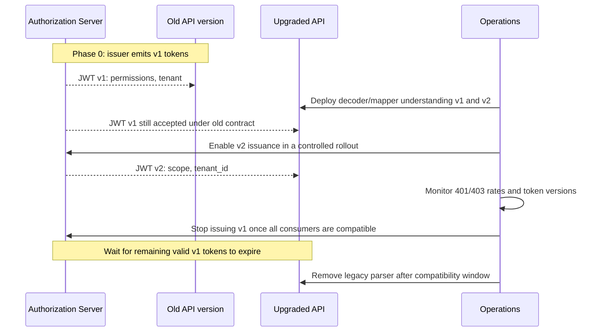

# Managing Claim Changes and Preserving Compatibility Between Issuer and API

## 1. Why Does an Access Token Need a Stable Contract?

In a **Spring Security OAuth 2.0/OIDC** architecture, the Authorization Server (token issuer) and the Resource Server (token-consuming API) are typically deployed, upgraded, and operated independently. When the Authorization Server issues a **JWT access token**, the API must understand certain claims to authenticate requests and make authorization decisions. Together, those claims form an **access token contract** between issuer and consumer.

For example, the Orders API needs to know:

- Which trusted issuer issued the token (`iss`)?
- Is the token intended for the Orders API (`aud`)?
- Is the token still within its validity window (`exp`, `nbf`, and time rules)?
- Which user or client does the request represent (`sub`, `client_id` per profile)?
- Which permissions does the token carry (`scope`, `scp`, or an agreed authorization claim)?
- Which tenant does the request belong to, if the system requires data partitioning (`tenant_id` per internal contract)?

If the issuer renames `scope` to `permissions`, changes `tenant_id` from a string to an object, or changes how `sub` is interpreted, the API may **wrongly reject valid requests**, **misread permissions**, or—worse—**grant unintended access**.

Consequently, managing claim changes is a cross-component protocol design discipline, not just tweaking a JSON-parsing line.

> **Foundational principle:** A validly signed JWT only proves that the token's bytes were issued using the corresponding key and have not been tampered with. The API must still verify **issuer, audience, validity window, token type, and the semantics of every claim** before using the token for access decisions.

### 1.1. Roles Involved

| Role | Responsibility Toward the Token Contract |
| --- | --- |
| Authorization Server / OpenID Provider | Issue access tokens with the committed structure, data types, semantics, and scope. |
| Resource Server | Validate tokens, interpret claims per the contract, and enforce API policies. |
| OAuth 2.0 Client | Request access tokens using the appropriate grant and scope/resource; never fabricate or alter claims. |
| Operations and security teams | Govern changes, distribute keys, monitor migrations, and respond to incidents. |

**An OIDC ID token does not replace an access token:** ID tokens serve user authentication for an OIDC Client and typically have the client ID as audience. APIs must accept access tokens intended for their own resource. Both token types may contain `sub` without sharing the same access contract.

## 2. What Does an Access Token Contract Contain?

A contract must explicitly specify **claim name, data type, semantics, presence requirements, value provenance, and how the API consumes it**, rather than handing over a sample JSON payload and leaving each API to guess.

An illustrative contract table:

| Claim | Typical Type | Importance Level | Rule for the Orders API |
| --- | --- | --- | --- |
| `iss` | String URI | Required by configuration | Must match a trusted issuer; never accept arbitrary issuers. |
| `aud` | String or string array in JWT | Required by API policy | Must contain `orders-api`; reject client/UI-only audiences. |
| `exp` | NumericDate (seconds since Unix epoch) | Required for JWT access tokens under this contract | Token must be unexpired, accounting for reasonable clock skew. |
| `nbf` | NumericDate | Profile-dependent; if present, must be valid | Do not accept token before its valid start time. |
| `iat` | NumericDate | Per profile | Can enforce max token age and aid diagnostics. |
| `sub` | String | Varies by grant, needs clear convention | Subject identifier within issuer scope; never assume it is always a user ID. |
| `client_id` | String | Per issuer/profile | Identifies the client issued the token; especially important for machine-to-machine. |
| `scope` | Space-delimited string of scopes | Per permission contract | Mapped to authorities for `hasAuthority` checks. |
| `tenant_id` | String | When endpoints handle multi-tenant data | Tenant identifier verified/issued by the issuer per policy; paired with data checks. |
| `jti` | String | Per profile | Unique token ID, useful for tracing and replay/revocation policies if supported. |
| `token_contract_version` | Integer or String | Only when explicit versioning is designed | Selects the approved contract interpretation rules; never skips validation steps. |

Claims `iss`, `aud`, `exp`, `iat`, `sub`, and `jti` are standardized in JWT; others may come from the OAuth 2.0 JWT Access Token Profile or a custom issuer agreement. Not every access token is a JWT: an **opaque access token** expresses its access contract through introspection responses rather than directly readable claims.

### 2.1. Spell Out Details Easily Assumed Implicitly

A solid contract should answer:

1. **Required or optional claim?** When absent, reject the token, grant empty permissions, or apply an approved default?
2. **Exact data type?** Is `scope` a space-separated string, or is `scp` an array? Is `tenant_id` a string or a number? Is `null` allowed?
3. **Is the data source trustworthy?** Does the claim come from a verified account, policy engine, client metadata, or user-entered input?
4. **What are the semantics?** Does `orders:read` cover only one's own orders or all orders? Does `sub` represent a user, a service principal, or an `issuer + subject` pair?
5. **At which step does the API use the claim?** Token validation, principal resolution, authority mapping, tenant filtering, or UI display?
6. **Who can change it, who approves it, and what is the advance notice window?** Establish clear owners for both the issuer and consuming APIs.

In particular, **never treat a claim's existence as proof of privilege** unless the contract defines how that claim is verified, where it originates, and how it is interpreted.

## 3. Example: Legacy Contract vs. New Contract

Suppose an Authorization Server has issued JWT access tokens for `orders-api` for years. The legacy version used `permissions` and `tenant`; the issuing team wants to migrate to the more standard `scope` claim and a more consistent `tenant_id`.

**Legacy token (v1) — illustrative payload:**

```json
{
  "iss": "https://login.example.test/realms/shop",
  "sub": "user-123",
  "aud": ["orders-api"],
  "exp": 1893456000,
  "iat": 1893452400,
  "permissions": ["orders.read", "orders.write"],
  "tenant": "tenant-42"
}
```

**New token (v2) — illustrative payload:**

```json
{
  "iss": "https://login.example.test/realms/shop",
  "sub": "user-123",
  "aud": ["orders-api"],
  "exp": 1893456000,
  "iat": 1893452400,
  "scope": "orders:read orders:write",
  "tenant_id": "tenant-42",
  "token_contract_version": 2
}
```

These are decoded payloads for instructional purposes, **not usable signed JWTs**. All domains and values are hypothetical.

Two distinct dimensions of change must be managed separately:

- **Structural change:** `permissions` array becomes `scope` string; `tenant` becomes `tenant_id`.
- **Potential semantic change:** Does `orders.read` truly mean the same thing as `orders:read`? Do they share the exact same data scope, tenant conditions, operation types, and grant policies?

Never simply rename a claim and assume compatibility. If legacy `orders.read` allowed reading only one's own orders while new `orders:read` is interpreted as reading all orders, that rename introduces **privilege escalation**.

During an upgrade, a request carrying an old token can still hit a new API, and a request carrying a new token can still hit an un-upgraded API. Both cases must be accounted for in the rollout plan.

## 4. Classifying Changes: Compatible vs. Breaking

| Change Type | Example | Impact |
| --- | --- | --- |
| Adding an optional, non-policy claim | Adding `request_context`, ignored by old APIs. | Usually compatible if clients/APIs do not enforce closed schemas and no data leaks occur. |
| Requiring a new claim on the API side | New API requires `tenant_id`, old tokens lack it. | **Breaking** for previously issued unexpired tokens. |
| Removing or renaming a claim | Dropping `permissions`, keeping only `scope`. | **Breaking** for APIs still reading the old claim. |
| Changing data type | `scope` string to array; `tenant_id` string to object. | **Breaking** for existing parsers, validators, and mappers. |
| Changing semantics while keeping the name | `sub` changes from user ID to service ID; `orders:read` widens access. | **Semantically and security breaking**, even though schema stays valid. |
| Changing permission list representation | `permissions` from string array to nested objects. | Breaking for current converters; requires new schema/mapping. |
| Changing audience | `orders-api` to `api-v2` while API accepts only `orders-api`. | Causes **401 invalid_token** on older APIs. |
| Changing issuer | `iss` URL changes during realm/tenant migration. | Breaking for issuer validators, metadata, and trust policies. |
| Changing algorithm / JWKS key | Signing key A to B, or switching JWS algorithms. | JOSE operational change; requires trust/algorithm and key-rotation coordination. |
| Narrowing or splitting granted privileges | Revoking `orders:write` or splitting into finer scopes. | Can cause **403 insufficient_scope** and altered business behavior. |
| Adding a contract version | Adding optional `token_contract_version`. | Usually compatible if old APIs ignore it; breaking if new APIs require it prematurely. |

Not every "additive" change is safe. For example, adding a `roles` field and letting the API automatically turn every role into an authority can unintentionally broaden privileges. The API must explicitly specify which claims participate in security decisions.

### 4.1. Syntactic Compatibility Differs from Semantic Compatibility

If an old token has:

```json
{ "scope": "orders:read" }
```

and a new token also has:

```json
{ "scope": "orders:read" }
```

then **identical schemas do not guarantee identical privileges**. The issuer may have changed policy: previously the scope allowed reading only the current user's orders, whereas now it allows reading orders across the entire tenant. APIs depending on the old rule are impacted even though the parser still works.

Every change must be evaluated for both **data compatibility** and **authorization-decision compatibility**.

## 5. What Should Stay Stable, and What May Evolve?

There is no single fixed list for every system, though typically:

**Core claims and trust rules must be strictly governed:**

- `iss`: trusted issuer identity; changes require updating and approving trust configuration.
- `aud`: target resource; never disable audience validation "to fix errors."
- `exp`, `nbf`, `iat`: NumericDate format and time policies.
- `sub`, `client_id`: user/service identity semantics and pairing with issuer.
- Privilege claims: meanings of scopes, roles, and permissions; relationship to endpoints and tenants.

**Extension claims can evolve under governance:**

- Display names, locale, UI hints, and metadata outside authorization.
- New optional claims with documented data types and value provenance.
- New authorization fields only after every affected API understands and agrees on their interpretation.

When adding custom claims, use clear names that avoid colliding with reserved/registered claims and define ownership. Avoid stuffing profile data or PII into access tokens because **JWS is signed, not encrypted by default**; anyone holding the token can read the payload.

## 6. Putting the Contract Into Machine-Readable Documentation

A wiki page helps explain intent; a **structured schema/contract** also enables automated test generation and change control.

Example contract spec maintained jointly by the issuer and API teams:

```yaml
contract: orders-api-access-token
issuer: https://login.example.test/realms/shop
audience: orders-api
token_kind: oauth2-access-token
serialization: jwt
accepted_algorithms:
  - RS256
required_claims:
  iss: string
  aud: string-or-string-array
  exp: numeric-date
  sub: string
optional_claims:
  nbf: numeric-date
  iat: numeric-date
authorization:
  active_format: scope-string
  scopes:
    - orders:read
    - orders:write
  legacy_format:
    claim: permissions
    type: string-array
    mappings:
      orders.read: orders:read
      orders.write: orders:write
tenant:
  active_claim: tenant_id
  legacy_claim: tenant
  type: string
  required_for:
    - /api/orders/**
change_policy:
  migration: consumer-first
  reject_ambiguous_claim_sets: true
```

This is an **illustrative convention document**, not a Spring Boot configuration file recognized by the framework. In real deployments, this information can be expressed using JSON Schema, OpenAPI `securitySchemes` paired with profile docs, custom schemas, or test fixtures. OpenAPI describes security schemes and scopes, but does not automatically capture the structure and semantics of every JWT claim; dedicated documentation is needed for that.

The contract document should accompany **real signed sample tokens in a test environment**, representative payload fixtures, and exact specifications for missing, mistyped, or invalid claims.

## 7. Safe Migration Strategy: Consumer First, Issuer Second

When changing claims, the least disruptive pattern is **upgrading the Resource Server's reading capability before the Authorization Server begins issuing the new format**.



### Phase 0 — Inventory Consumers and Finalize the Contract

Identify every Resource Server, gateway, background worker, batch job, and authorization service reading access tokens or introspection responses. Avoid checking only one primary API and overlooking internal services.

Lock down the v1 → v2 mapping, for example:

| V1 | V2 | Equivalence Condition |
| --- | --- | --- |
| `permissions: ["orders.read"]` | `scope: "orders:read"` | Same endpoint, ownership, and tenant limits. |
| `permissions: ["orders.write"]` | `scope: "orders:write"` | Same write privileges; does not silently expand to bulk/admin. |
| `tenant: "tenant-42"` | `tenant_id: "tenant-42"` | Same tenant identifier in the data store. |
| `sub: "user-123"` | `sub: "user-123"` | Same subject within issuer; does not switch to email/username. |

Fields without a confirmed mapping must be treated as **incompatible** until an explicit decision is made.

### Phase 1 — Deploy APIs That Understand Both Versions

The Resource Server accepts either v1 or v2 tokens and **normalizes** them into a consistent internal model, such as `SCOPE_orders:read`. This is the **dual-read** step.

Key points:

- Both v1 and v2 must still pass issuer, audience, signature, and expiration checks.
- Prefer **explicitly enumerated mappings**; never blindly take any permission name and replace dots with colons to mint authorities.
- Never unconditionally merge privileges from two different claims. A token containing both `permissions` and `scope` with conflicting values must follow an explicit rule—typically rejecting the token or verifying equivalence before picking a claim.
- Never turn a missing or mistyped claim into a default admin role.
- Every API instance in a rolling deployment must be upgraded before the issuer sends the new format to that instance's traffic.

### Phase 2 — Controlled Rollout of New Tokens

The Authorization Server can enable v2 token issuance for a pilot group of clients/tenants, or in a small staging slice. Every issuance rule must clearly indicate **which token uses which format** for diagnostics.

If a **dual-write** phase emitting both old and new claims in the same token is needed, ensure:

- Both old and new values represent **the exact same privileges**.
- The API defines behavior if either is missing or conflicting.
- The token does not bloat past reverse-proxy header limits or cookie limits if a client accidentally stores tokens in cookies.
- Existing applications do not treat the two claims as **two independent privilege sources** and accidentally union them.

Another option is issuing **v1 to older clients and v2 to newer clients** by policy and client registration. This requires strict control over which client gets which token and whether every downstream API accepts it.

### Phase 3 — Monitor, Sunset v1, and Remove Compatibility Code

Stop issuing old tokens only after confirming all consumers understand the new tokens. Even then, wait for **previously issued unexpired v1 access tokens** to finish their lifetime, accounting for caches, clock skew, and refresh/reissue policies. If clients can still refresh or re-authorize to obtain v1 tokens, the transition window must cover that duration as well.

Once no valid v1 tokens remain in circulation, the API removes the legacy branch. Removing it is itself a contract change requiring monitoring, not a harmless code cleanup.

## 8. Spring Security Example: Reading Two Permission Structures in Parallel

Suppose v1 has `permissions` as a string array and v2 has `scope` as a space-delimited string. The API accepts:

```json
{ "permissions": ["orders.read"] }
```

or:

```json
{ "scope": "orders:read" }
```

The API **rejects tokens carrying both simultaneously in this migration pattern** to avoid conflicting privilege sources. This rule is a **contract decision of the example**, not a mandatory OAuth 2.0 rule.

### 8.1. Step One: Validate Issuer, Audience, and Schema

Spring Security can use `NimbusJwtDecoder` with `OAuth2TokenValidator` instances:

```java
@Configuration
class AccessTokenDecoderConfig {

    private static final String ISSUER =
            "https://login.example.test/realms/shop";
    private static final String AUDIENCE = "orders-api";
    private static final Set<String> LEGACY_PERMISSIONS =
            Set.of("orders.read", "orders.write");

    @Bean
    JwtDecoder jwtDecoder() {
        NimbusJwtDecoder decoder =
                NimbusJwtDecoder.withIssuerLocation(ISSUER).build();

        OAuth2TokenValidator<Jwt> standard =
                JwtValidators.createDefaultWithIssuer(ISSUER);

        OAuth2TokenValidator<Jwt> audience = jwt ->
                jwt.getAudience().contains(AUDIENCE)
                        ? OAuth2TokenValidatorResult.success()
                        : error("Unexpected audience");

        OAuth2TokenValidator<Jwt> contract = jwt -> {
            boolean current = jwt.getClaims().containsKey("scope");
            boolean legacy = jwt.getClaims().containsKey("permissions");

            // This pattern requires strictly one of the two formats.
            if (current == legacy) {
                return error("Ambiguous or missing permission claim");
            }

            if (current) {
                Object raw = jwt.getClaim("scope");
                return raw instanceof String
                        ? OAuth2TokenValidatorResult.success()
                        : error("scope must be a string");
            }

            Object raw = jwt.getClaim("permissions");
            if (!(raw instanceof Collection<?> items)
                    || items.stream().anyMatch(
                            item -> !(item instanceof String name)
                                    || !LEGACY_PERMISSIONS.contains(name))) {
                return error("Invalid legacy permissions");
            }

            return OAuth2TokenValidatorResult.success();
        };

        decoder.setJwtValidator(
                new DelegatingOAuth2TokenValidator<>(
                        standard, audience, contract));
        return decoder;
    }

    private static OAuth2TokenValidatorResult error(String description) {
        return OAuth2TokenValidatorResult.failure(
                new OAuth2Error("invalid_token", description, null));
    }
}
```

This example illustrates Java 17+ using Spring Security classes `JwtDecoder`, `NimbusJwtDecoder`, `JwtValidators`, `Jwt`, `OAuth2TokenValidator`, `OAuth2TokenValidatorResult`, `DelegatingOAuth2TokenValidator`, and `OAuth2Error`; imports are omitted to focus on the claims contract. Real configuration must match your active Spring Security/JWT provider version.

What this validator enforces:

1. Signature and default JWT checks run via the underlying decoder/validator.
2. `iss` must match the trusted issuer, and `aud` must contain `orders-api`.
3. The privilege claim must appear in **exactly one format**, preventing parser guesswork.
4. V1 permits only permissions with a confirmed mapping.
5. If a token violates the contract, the API **rejects** it instead of assigning permissions on a "best effort" basis.

The privilege requirement above is an illustrative policy for `orders-api` endpoints. Real systems may have valid tokens without scopes for certain endpoints; adjust schemas and validators to match the approved contract rather than mechanically forcing a claim requirement onto every token type.

### 8.2. Step Two: Normalize Claims into a Single Authority Model

`JwtAuthenticationConverter` uses a converter to transform both valid token shapes into identical authorities:

```java
@Configuration
class AccessTokenAuthoritiesConfig {

    private static final Map<String, String> LEGACY_TO_SCOPE =
            Map.of(
                    "orders.read", "orders:read",
                    "orders.write", "orders:write");

    @Bean
    JwtAuthenticationConverter jwtAuthenticationConverter() {
        JwtAuthenticationConverter converter =
                new JwtAuthenticationConverter();
        converter.setJwtGrantedAuthoritiesConverter(
                this::convertAuthorities);
        return converter;
    }

    private Collection<GrantedAuthority> convertAuthorities(Jwt jwt) {
        Set<String> normalized = new LinkedHashSet<>();

        if (jwt.getClaims().containsKey("scope")) {
            String scope = jwt.getClaimAsString("scope");
            if (scope != null && !scope.isBlank()) {
                normalized.addAll(
                        Arrays.asList(scope.trim().split("\\s+")));
            }
        } else {
            Collection<?> permissions = jwt.getClaim("permissions");
            for (Object value : permissions) {
                // The contract validator has already verified legacy values.
                normalized.add(LEGACY_TO_SCOPE.get((String) value));
            }
        }

        return normalized.stream()
                .filter(name -> name != null && !name.isBlank())
                .map(name -> (GrantedAuthority)
                        new SimpleGrantedAuthority("SCOPE_" + name))
                .toList();
    }

    @Bean
    SecurityFilterChain apiSecurity(
            HttpSecurity http,
            JwtAuthenticationConverter converter) throws Exception {
        return http
                .authorizeHttpRequests(auth -> auth
                        .requestMatchers(HttpMethod.GET, "/api/orders/**")
                            .hasAuthority("SCOPE_orders:read")
                        .requestMatchers(HttpMethod.POST, "/api/orders/**")
                            .hasAuthority("SCOPE_orders:write")
                        .anyRequest().authenticated())
                .oauth2ResourceServer(oauth2 ->
                        oauth2.jwt(jwt ->
                                jwt.jwtAuthenticationConverter(converter)))
                .build();
    }
}
```

The `JwtDecoder` and `JwtAuthenticationConverter` beans in both snippets belong to the **same JWT Resource Server setup**. The decoder verifies validity and contract compliance; the converter solely turns already-validated tokens into Spring authorities.

The example uses Java's `Map`, `Set`, `Collection`, `LinkedHashSet`, `Arrays`, `GrantedAuthority`, and `SimpleGrantedAuthority`. Real configurations need proper package imports. If you already have a custom `JwtAuthenticationConverter`, merge the logic per your application architecture to avoid bean conflicts.

**Why not union all privilege claims?** If a token carries both `scope: "orders:read"` and `permissions: ["orders.write"]`, unioning both would grant `orders:write` even though the issuer may have designated `scope` as the new source of truth. The validator above rejects ambiguous tokens right at authentication.

### 8.3. Tenant Claim Changes Require Equal Caution

Never write code like:

```java
String tenant = jwt.getClaimAsString("tenant_id");
if (tenant == null) {
    tenant = "default-tenant";  // Unsafe if this is an authorization-governing claim.
}
```

In a multi-tenant system, an unverified default can cause cross-tenant access. When reading both `tenant` (v1) and `tenant_id` (v2), require **a single valid claim in a defined format**, map it to an internal `TenantContext`, and reject missing or conflicting values on tenant-required endpoints.

A validated token tenant must still be paired with **record-level permissions**, user–tenant relationships, and system policies. A `tenant_id` string alone does not authorize reading every record belonging to that tenant.

## 9. Versioning: Do You Need a Version Claim?

Simple changes can use **consumer-first** without a version claim: the Resource Server distinguishes v1/v2 via a well-defined format. However, when a contract undergoes several simultaneous changes, you can introduce a dedicated claim:

```json
{
  "token_contract_version": 2,
  "scope": "orders:read",
  "tenant_id": "tenant-42"
}
```

If using a version claim:

- Fix the data type—such as an integer—and specify the scope of each version.
- The API accepts only approved versions; **never automatically accept any greater version**.
- If version and schema conflict, reject the token or follow a strict, tested rule.
- Avoid maintaining many branches indefinitely; every legacy version needs an owner and an end-of-support date.
- A version claim never replaces `iss`, `aud`, `exp`, signature, and authorization checks.

Never use `jti` or `kid` as a "contract version": `jti` identifies an individual token and `kid` selects a signing key; both serve entirely different purposes.

### 9.1. Choosing an Issuance Strategy

| Strategy | Best When | Watch Out For |
| --- | --- | --- |
| Consumer-first + single issuer switch | Few changes; all APIs can upgrade first. | APIs must support v1/v2 long enough for old tokens to expire. |
| Dual-write old and new claims | Consumers are diverse and need transition time. | Never union privileges from both claims; check equivalence and token size. |
| Emit v1/v2 per client registration | Clients upgrade at different paces. | Do not let clients self-select versions beyond policy; track emitted formats. |
| Explicit version claim | Multiple structures or subtle semantic shifts. | Manage allowlist and deprecation lifecycle. |
| New issuer for new contract | Major security-boundary shift separating realms/trust domains. | Resource Server must explicitly configure multiple trusted issuers; more complex migration. |

## 10. Compatibility Windows Must Account for Token Lifetime

Suppose v1 tokens have a maximum lifetime of **15 minutes**. If v1 issuance stops at 10:00, older APIs or upgraded APIs can still receive a v1 token issued at 09:59 that stays valid until 10:14. You cannot delete legacy code at 10:00 just because the issuer switched over.

Minimum waiting window to consider:

```text
coexistence_window >= max_lifetime_of_last_issued_v1_access_token
                      + accepted_clock_skew
                      + relevant_cache_or_distribution_margin
```

This is a **design estimation formula**, not a fixed standard constant. In practice, also check whether tokens sit in queues, gateways/caches, clients, or batch jobs. If refresh tokens or re-issuance flows continue minting v1 access tokens, measure from the **last moment a v1 token can possibly be issued**.

Conversely, when an old format must be retired urgently due to a security flaw, waiting out the window is not enough. Use appropriate incident controls: tighten validation policy, invalidate tokens, rotate keys, change issuer/keys, or enforce introspection/revocation per system capability while balancing service disruption.

### 10.1. Valid Old Token Rejected Because New API Dropped Its Parser

A common failure mode:

1. 09:50: Authorization Server issues a v1 token valid for 30 minutes.
2. 10:00: API deploys a release reading only v2 claims.
3. 10:05: Client sends the unexpired v1 token with valid signature/issuer/audience, yet the API fails to read its privileges.
4. The API returns **403** if the token authenticates but the converter produces no authorities, or **401** if the new API enforces a v2 claim validator and rejects the token.

This is a contract failure between issuer and consumer; **refreshing or logging in again may mask the symptom**, whereas the durable fix is scheduling compatibility windows and controlled rollouts.

## 11. Coordinating Multiple Resource Servers and Multiple Issuers

One Authorization Server can issue tokens for multiple APIs with distinct audiences:

```text
orders-api     expects aud = orders-api
payments-api   expects aud = payments-api
profile-api    expects aud = profile-api
```

Changing a `scope` or `tenant_id` claim can affect each API differently. Avoid building a system-wide converter that turns every `roles` claim into identical authorities across all APIs. Each resource must retain its own audience, scope, ownership, and business-permission policies.

When migrating from `https://login-old.example.test` to `https://login-new.example.test`, a Resource Server cannot merely edit the `iss` string or implicitly trust both:

- Each issuer needs its own metadata/JWKS, algorithms, and validation policy.
- If allowing multiple issuers, configure an **explicit allowlist** and separate trust chains per issuer, e.g., via `JwtIssuerAuthenticationManagerResolver` with approved issuers.
- Never accept arbitrary caller-supplied issuers, and never fetch JWKS from a URL inside an untrusted JWT.
- Enforce permissions and audiences separately per trust domain.
- When removing the old issuer, account for old token lifetimes and clients not yet migrated.

Changing an issuer is usually a **trust-boundary change**, not merely renaming a data field.

## 12. Distinguishing Claim Changes from Signing Key / JWKS Changes

An issuer can perform **key rotation** without changing a single claim. For example, older JWTs carry `kid=A` and newer JWTs carry `kid=B`, while both public keys A and B appear in the JWKS during the transition.

Conversely, an issuer can rename claims while signing with the exact same key pair. These change axes are independent:

| Change Axis | Directly Impacted Component | Compatibility Mechanism |
| --- | --- | --- |
| Claim schema/semantics | Parsers, validators, authority converters, API business logic | Schema versioning, dual-read, migration windows, contract tests. |
| Key or JWS algorithm | JWT decoder/JWKS cache and algorithm policy | Publish new key before signing with it, serve old/new public keys, govern algorithms. |
| Issuer and audience | Trust validation and resource binding | Explicit trust policies, verify `iss`/`aud` per token. |

**Never disable signature, issuer, or audience checks to preserve claim compatibility.** That weakens security boundaries instead of solving the contract problem.

## 13. What If the Access Token Is Opaque?

Not every Authorization Server issues JWT access tokens. With an **opaque access token**, the API calls an introspection endpoint to determine whether the token is active and retrieve metadata/claims, such as:

```json
{
  "active": true,
  "client_id": "order-web",
  "sub": "user-123",
  "aud": ["orders-api"],
  "scope": "orders:read",
  "exp": 1893456000,
  "tenant_id": "tenant-42"
}
```

Here, the "claims contract" still exists, residing in the **introspection response** or the normalized principal built by the Resource Server:

- The issuer must document introspection response attributes and their semantics.
- The API must verify `active`, audience/authorization context, and privileges per provider config; never treat every `active: true` token as authorized for every API.
- Changing the type of `scope` or `tenant_id`, or the semantics of `sub`, can still break converters and policies.
- Introspection caches need bounded TTLs; token revocation or claim updates at the issuer may not take effect immediately while cached.

Never treat an opaque token as a Base64URL-decodable JWT. Nor assume JWT and opaque tokens from the same issuer automatically share identical claim shapes; verify the formal contract for each flow.

## 14. Testing the Contract Between Issuer and Resource Server

Privilege-related changes should be tested with **real tokens signed in a test environment** or a test issuer with an appropriate key pair, validators, and claim contract. Comparing raw JSON payloads alone fails to exercise the full signature/decoder/authorization pipeline.

### 14.1. Minimum Test Matrix

| Test Scenario | Expected Outcome |
| --- | --- |
| Valid v1 JWT with `permissions: ["orders.read"]` | API maps to `SCOPE_orders:read` and grants appropriate read access. |
| Valid v2 JWT with `scope: "orders:read"` | API maps to the same authority and behaves identically to v1. |
| V1 with `orders.read` vs. v2 with `orders:read` on same data | Identical business/ownership decisions when defined as equivalent. |
| V1 with an unmapped permission | Reject token under strict contract or handle per defined policy; never grant arbitrary privileges. |
| Token with conflicting `permissions` and `scope` | Reject per example contract; never union privileges. |
| Mistyped privilege claim, e.g., `scope` as array instead of string | Rejected by contract validator unless explicitly supported. |
| Valid scope but wrong `aud` | **401 invalid_token**, never treated as an access token for this API. |
| Right audience but wrong issuer or signature | **401 invalid_token**. |
| Expired token or future `nbf` | **401 invalid_token** per time rules. |
| Valid token missing endpoint scope | **403 Forbidden** (typically `insufficient_scope`). |
| Right scope but wrong tenant/ownership | Rejected at business/data authorization layer. |
| OIDC ID token for UI client sent to API | Rejected by audience/token profile; never accepted merely because signed by same issuer. |
| Token with v1 privileges rejected by new API before expiry window | Tests must catch the compatibility regression. |

In business tests, do not compare HTTP status codes alone. Compare **authorization decisions** for semantically equivalent tokens, and verify that cases meant to be denied do not become permitted after migration.

### 14.2. Two-Sided Contract Tests

**At the issuer:** verify JWTs are signed with the selected algorithm, carry exact `iss`, `aud`, required claims, types, and version mappings; when formats change, update sample tokens/fixtures through review.

**At the Resource Server:** run tests against tokens of each version and fail-closed tests for missing/mistyped/conflicting claims; verify resulting authorities and access decisions. Use fixtures with controlled timestamps so tests do not fail due to wall-clock expiration.

**In integration:** run a client obtaining tokens from a test-environment issuer and calling the real API; observe 401, 403, scopes, tenants, and business permissions. This catches discrepancies between unit-test mocks and actual provider mappings.

With multiple consumers, run each API's contract tests before enabling the new format on the issuer. When exhaustive pre-testing is impossible, use a bounded canary with clear rollback criteria.

## 15. Post-Migration Observability and Diagnostics

A rollout can trigger 401/403 errors while users see only "API is broken." You need operational signals to classify failures:

| Signal | What to Investigate |
| --- | --- |
| 401 spike after issuer claim change | API is rejecting the new schema, or wrong audience, issuer, signature, or token type. |
| 403 spike without a 401 spike | Tokens authenticate, yet authority mapping failed, scope semantics shifted, or a new business policy blocks access. |
| Errors affecting only one client/tenant | Issuer emits different versions per client, client uses wrong-audience token, or tenant mapping is wrong. |
| Errors affecting only some API instances | Rolling deployment has inconsistent decoder/converter versions. |
| Errors appearing when `kid` changes | Likely JWKS rotation/caching or algorithm policy, not necessarily claims. |
| Unexpired old tokens rejected | API removed legacy logic before the compatibility window ended. |

Useful metrics: request counts by **verified** token contract version, 401/403 rates per service, share of legacy tokens still in flight, mapping failure rates, and canary metrics. Emit version labels in metrics/logs **only after the token has passed appropriate validation**, never trusting arbitrary caller-crafted claims.

When logging, never log raw access tokens, secrets, refresh tokens, PII, or full claim sets. Log error codes, endpoints, request IDs, verified versions, and normalized audiences/issuers as permitted by security policy. Keep sensitive root-cause details inside access-controlled internal logs; public responses should be consistent and avoid over-disclosure.

### 15.1. Runbook for Debugging 401 and 403

1. Confirm the request **carries a Bearer access token** and the gateway forwarded the header.
2. For **401**, isolate whether the failure is signature, issuer, audience, expiration, token profile, or claim validator.
3. For **403**, inspect which authorities were produced after normalization and which privileges the endpoint requires.
4. Check whether the token is v1/v2 and which converter version the API instance is running.
5. Compare against the published contract: data types, permissions, tenant, claim names, and rollout timing.
6. If caused by migration, trigger the prepared rollback/canary switch; never disable security validators as a "hotfix."

## 16. Contract Change Process for Issuing and API Teams

A claim change should include a **proposal**, **compatibility assessment**, **test evidence**, **rollout plan**, and **legacy retirement date**.

Questions to resolve before deployment:

1. Which claim is changing? Are name, type, semantics, or privilege provenance changing?
2. How many consumers, endpoints, gateways, and jobs depend on that claim?
3. Is it guaranteed that old and new tokens yield identical authorization decisions for equivalent privileges?
4. What is the maximum lifetime of old tokens? Can any client still receive v1 via refresh/reissue?
5. Which API versions must upgrade first? Which criteria gate enabling v2 on the issuer?
6. Which metrics confirm migration success, and which thresholds trigger rollback?
7. Who owns the decision to remove the legacy branch, and what is the end-of-support date?

The issuing team must never change claims silently. Nor should the API team invent unpromised aliases and treat them as privileges. Maintain one contract version approved by both sides, backed by tests preserved across every change.

## 17. Anti-Patterns to Avoid

### 17.1. Accepting Every Claim Name That "Looks Like a Privilege"

For instance, letting an API ingest `roles`, `groups`, `permissions`, and `scope` and merge all of them into authorities. Display claims or organizational groups can accidentally turn into business privileges. **Accept only privilege sources and mappings explicitly defined in the contract.**

### 17.2. Disabling Audience Validation to Keep Old Tokens Working

A validly signed JWT from the same issuer can still be intended for an OIDC Client or another resource. Dropping `aud` validation creates the risk of accepting misplaced tokens. When changing resource identifiers, run an explicit, time-bounded trusted-audience transition plan without broadening unintended access.

### 17.3. Falling Back to a Default Tenant or Default Privilege When a Claim Is Missing

If `tenant_id` is absent, assigning `default` or the first tenant risks cross-tenant data access. For security-relevant claims, schema errors must **fail closed** per the contract.

### 17.4. Assuming Refresh Tokens Solve All Compatibility Errors

Refresh tokens can obtain fresh access tokens after an issuer changes format, yet they do not fix unexpired old tokens in flight, un-updated clients, wrong audiences, or API converters that do not yet recognize the new format.

### 17.5. Changing Scope Semantics Without Updating API Policy

If `orders:read` shifts from "own orders" to "all tenant orders," keeping the string name unchanged can prevent schema checks from catching the security change. Always test both **semantics and authorization impact**, not just JSON shape.

### 17.6. Packing All User State into JWTs

JWTs can be cached and reused until expiration. If permissions, tenants, or roles change after issuance, an API validating JWTs strictly offline continues seeing stale claims. Privileges requiring immediate enforcement may need short-lived access tokens, introspection, revocation, or live policy checks depending on architecture.

## 18. Application Scenarios

### Scenario A — New API Deployed While Issuer Still Emits Old Tokens

The API supports dual-read for `permissions` and `scope` alongside issuer/audience validators. In-flight v1 tokens still access equivalent operations, letting the issuer deploy on a safer schedule.

### Scenario B — Issuer Changes `scope` from String to Array

This is a data-type change that can break existing mappers and even violate an agreed access-token profile. Propose a new explicitly named/typed claim or versioned structure rather than silently mutating `scope`'s type. The API supports the new shape only after contract and tests are updated.

### Scenario C — Validly Signed JWT with Right Audience, Missing Tenant Claim

If `tenant_id` is required to partition data, the API must reject per contract policy (in the token validator or authorization layer). Never guess the tenant from email or assign a default tenant.

### Scenario D — Two Token Versions Expressing the Same Read Privilege

If `permissions: ["orders.read"]` and `scope: "orders:read"` are equivalent, the system normalizes both to `SCOPE_orders:read`. `GET /api/orders` enforces a single permission rule regardless of how the issuer formats tokens during transition.

### Scenario E — Changing Issuer During Key Rotation

Changing `iss`, JWKS/`kid`, and claim schemas simultaneously makes diagnosing a 401 spike very difficult. Manage each change axis independently with clear observation and rollback stages—or, if forced to combine them, maintain contract tests covering every supported token/issuer/key combination.

## 19. Standards and Terminology to Reference

- **RFC 6749 — OAuth 2.0 Authorization Framework:** roles of client, Authorization Server, Resource Server, and scopes.
- **RFC 6750 — OAuth 2.0 Bearer Token Usage:** how clients present Bearer access tokens and meanings of `invalid_token`, `insufficient_scope`.
- **RFC 7519 — JSON Web Token (JWT):** registered claims such as `iss`, `sub`, `aud`, `exp`, `iat`, `jti`.
- **RFC 8725 — JSON Web Token Best Current Practices:** audience, algorithm constraints, and preventing cross-context token confusion.
- **RFC 9068 — JWT Profile for OAuth 2.0 Access Tokens:** a standardized profile for JWT access token structure. Apply these profile rules only when your system declares/implements that profile.
- **RFC 7662 — OAuth 2.0 Token Introspection:** metadata and status contract when verifying opaque access tokens via introspection.
- **Spring Security OAuth2 Resource Server:** `JwtDecoder`, `OAuth2TokenValidator`, `JwtAuthenticationConverter`, and JWT/opaque token configuration.

**Closing rule:** Managing claims is managing a **security contract between the issuer and the Resource Server**. For zero-downtime upgrades, document schemas and semantics explicitly, deploy APIs that understand the new format first, test both old and new tokens, monitor 401/403 signals, respect compatibility windows tied to token lifetimes, and remove legacy support only once no valid consumers depend on it. Compatibility must never be bought by weakening signature, issuer, audience, or access-control checks.
