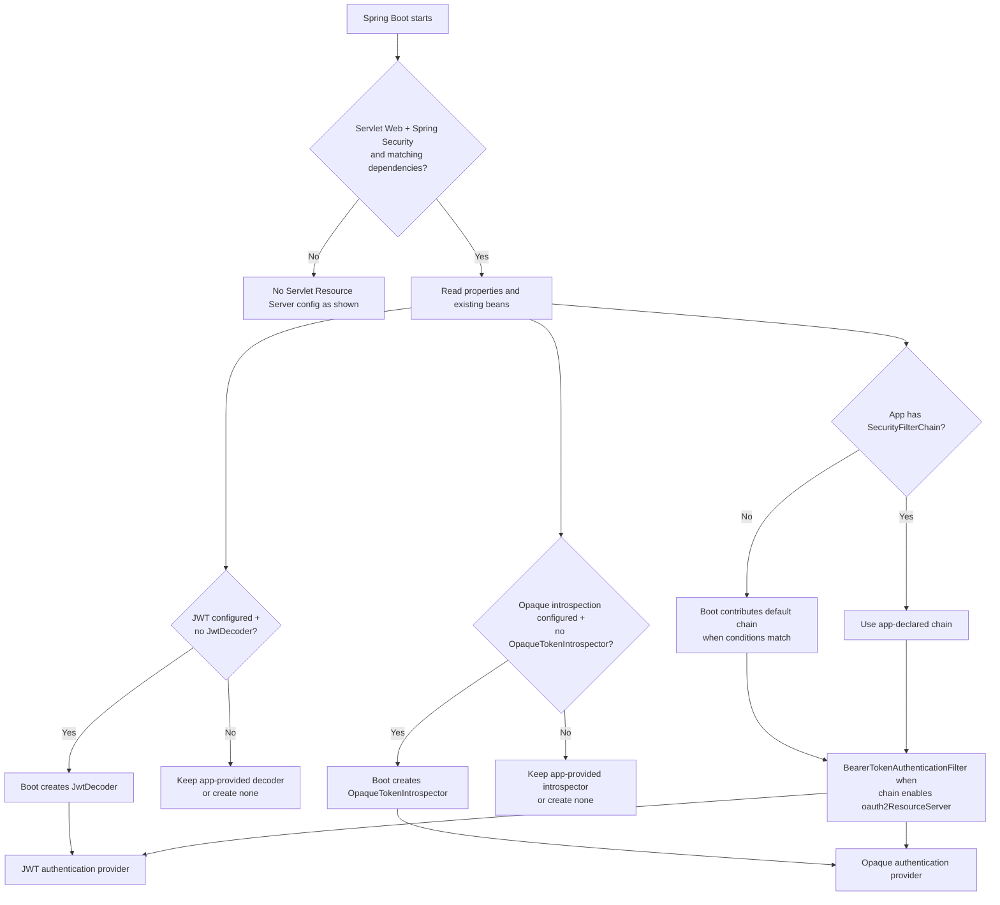
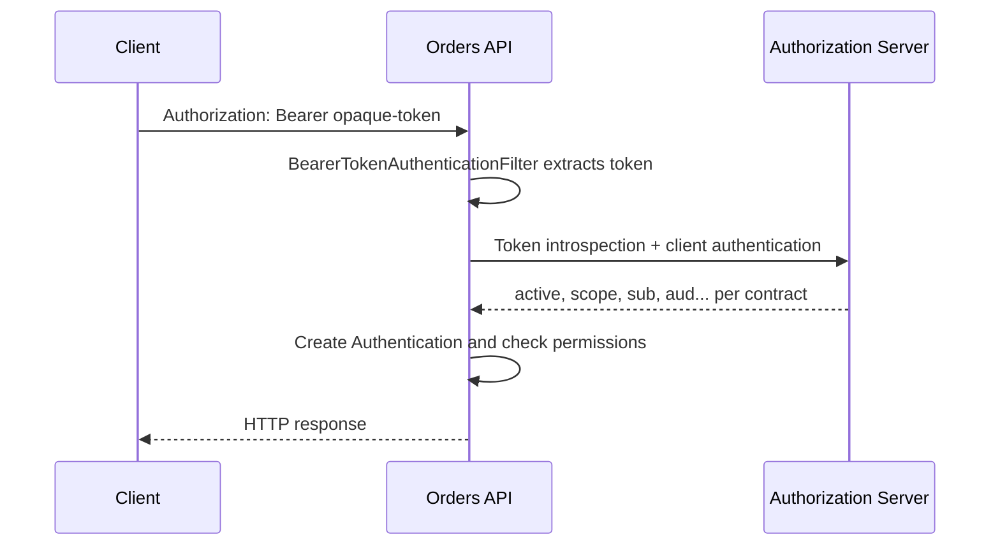
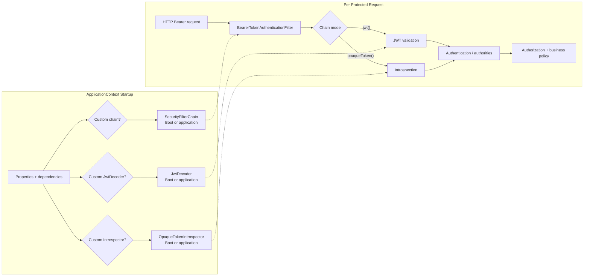

# When Does Spring Boot Auto-Create a Filter Chain, Decoder, or Introspector?

When building a **Spring Security OAuth 2.0/OIDC Resource Server**, many Spring Boot apps only add a dependency and a few lines in `application.yml` to start accepting access tokens via `Authorization: Bearer ...`. This easily leads to the misconception that Spring Boot always auto-creates every security component, or that writing a custom `SecurityFilterChain` keeps all previous Resource Server defaults active.

In reality, **auto-configuration is a set of conditional decisions**. Spring Boot inspects libraries on the classpath, the application type (Servlet/Reactive), declared properties, and beans supplied by the application. It only contributes default configurations when the corresponding conditions match. The three most important components to distinguish are:

1. **`SecurityFilterChain`**: determines which requests go through which filters, what authentication/authorization rules apply, and whether OAuth 2.0 bearer token handling is enabled.
2. **`JwtDecoder`**: verifies and converts a JWT string into a `Jwt` object, including signature, issuer, timestamps, and configured validators.
3. **`OpaqueTokenIntrospector`**: checks tokens via introspection, obtaining principal details and permissions from an Authorization Server or equivalent introspection mechanism.

These three beans **serve different roles and have separate auto-configuration conditions**. Defining one bean does not necessarily disable auto-configuration of the others. This lesson focuses on **Servlet Spring MVC** applications using `HttpSecurity` and `jakarta.servlet`; WebFlux uses `SecurityWebFilterChain`, `ReactiveJwtDecoder`, and `ReactiveOpaqueTokenIntrospector`, which are not drop-in replacements for Servlet types.

## 1. Auto-Configuration Model from Dependencies to HTTP Requests



This diagram is a **conceptual model**: it does not mean both a decoder and an introspector are always created, or used together to authenticate a single request. JWT or opaque mode must be explicitly chosen/configured. Having a bean in the `ApplicationContext` also does not guarantee it is used by the filter chain serving a given endpoint.

### 1.1. Two Commonly Confused Phases

**At startup:** Boot decides whether to create each bean; `SecurityFilterChain` configurations are assembled, and classpath/property/bean conditions are evaluated. For certain decoders configured via issuer, querying the IdP's metadata/keys may be deferred until the first token verification depending on version and how the decoder is created.

**At request time:** `FilterChainProxy` selects the matching chain for the request; `BearerTokenAuthenticationFilter` reads the bearer token; the JWT provider calls `JwtDecoder` or the opaque provider calls `OpaqueTokenIntrospector`; authorization runs only after authentication. **Boot does not re-create beans per request.**

## 2. Baseline Conditions: Classpath, Application Type, and Configuration

Spring Boot does not guess whether a string in `Authorization` is a JWT or an opaque token without configuration. Minimum conditions typically include:

| Factor | JWT Resource Server | Opaque token Resource Server |
|---|---|---|
| Web runtime | Servlet web application for `SecurityFilterChain` | Servlet web application for `SecurityFilterChain` |
| Spring Security | Security/web and Resource Server classes present | Security/web and Resource Server classes present |
| Specific libraries | `spring-security-oauth2-resource-server` **and** `spring-security-oauth2-jose` for JWT verification | `spring-security-oauth2-resource-server` and appropriate introspection support |
| Verification config | `issuer-uri`, `jwk-set-uri`, `public-key-location`, or custom decoder per version support | `introspection-uri` with credentials or custom introspector |
| Dedicated component | `JwtDecoder` | `OpaqueTokenIntrospector` |
| HTTP integration | Chain configures `.oauth2ResourceServer(...jwt(...))` | Chain configures `.oauth2ResourceServer(...opaqueToken(...))` |

With Spring Boot 3.x, the standard starters are:

```groovy
// build.gradle — example for Spring Boot 3.x
dependencies {
    implementation 'org.springframework.boot:spring-boot-starter-web'
    implementation 'org.springframework.boot:spring-boot-starter-oauth2-resource-server'
}
```

On Spring Boot 4.x, there is a clearer starter name `spring-boot-starter-security-oauth2-resource-server`; the old name is marked deprecated in the Boot 4 starter catalog. Pick dependencies matching **your actual project version**. Starters usually pull in the necessary Spring Security libraries; if declaring modules manually—especially for JWT—do not forget `spring-security-oauth2-jose`.

**Adding only `spring-boot-starter-security` does not make the app an OAuth 2.0 Resource Server.** A plain Spring Security web app may default to HTTP Basic or form login depending on configuration and content negotiation. To authenticate API bearer tokens, you need Resource Server support and token verification configuration.

### 2.1. What Does Boot Configure vs. What Does Spring Security Do?

| Task | Primary actor |
|---|---|
| Read `spring.security.oauth2.resourceserver.*` from YAML/properties | Spring Boot |
| Decide when to contribute default beans | Spring Boot auto-configuration |
| Provide `HttpSecurity`, `SecurityFilterChain`, and `oauth2ResourceServer` DSL | Spring Security |
| Extract bearer token from requests | Spring Security `BearerTokenAuthenticationFilter` and resolver |
| Verify JWT or introspect opaque token | `JwtDecoder` / `OpaqueTokenIntrospector` |
| Check scopes, endpoint permissions, and data permissions | Spring Security authorization and application logic |

Saying "Boot secures the API automatically" is shorthand. More accurately: **Boot assembles default configuration; Spring Security processes requests according to that configuration.**

## 3. When Does Boot Auto-Create `SecurityFilterChain`?

In a Spring MVC app without a user-defined chain, Spring Boot can supply a **default chain**. When JWT Resource Server conditions are satisfied, the conceptual equivalent configuration is:

```java
@Bean
SecurityFilterChain defaultResourceServerChain(HttpSecurity http)
        throws Exception {
    return http
        .authorizeHttpRequests(auth -> auth
            .anyRequest().authenticated())
        .oauth2ResourceServer(oauth2 ->
            oauth2.jwt(Customizer.withDefaults()))
        .build();
}
```

In opaque token mode, the equivalent Resource Server part is:

```java
.oauth2ResourceServer(oauth2 ->
    oauth2.opaqueToken(Customizer.withDefaults()))
```

These two snippets illustrate default behavior; **they do not mean you should declare both chains**. Requests are protected by default; if the app needs public endpoints or specific scopes, declare your own chain intentionally.

### 3.1. What Does the "Missing SecurityFilterChain" Condition Mean?

Spring Boot uses a mechanism equivalent to `@ConditionalOnMissingBean(SecurityFilterChain.class)` in web security configuration. Once the application supplies a `SecurityFilterChain` bean, Boot **defers default chain design** to the application.

Suppose a developer writes:

```java
@Bean
SecurityFilterChain securityFilterChain(HttpSecurity http) throws Exception {
    return http
        .authorizeHttpRequests(auth -> auth
            .anyRequest().authenticated())
        .httpBasic(Customizer.withDefaults())
        .build();
}
```

This is a valid custom chain, yet it **does not enable `oauth2ResourceServer().jwt()`**. Even if `application.yml` still contains `issuer-uri` and Boot created a `JwtDecoder`, `Authorization: Bearer ...` requests **are not automatically authenticated as JWTs** in this chain. On protected endpoints, requests may get 401 according to whichever mechanism is active.

This is the most critical distinction:

> **Declaring a `SecurityFilterChain` replaces the default HTTP security configuration. Do not assume Boot will merge all Resource Server DSL settings into a chain you wrote yourself.**

### 3.2. One Bean Can Affect the Entire Default Configuration

Even when a custom chain only targets one group of paths:

```java
@Bean
@Order(1)
SecurityFilterChain internalChain(HttpSecurity http) throws Exception {
    return http
        .securityMatcher("/internal/**")
        .authorizeHttpRequests(auth -> auth
            .anyRequest().authenticated())
        .httpBasic(Customizer.withDefaults())
        .build();
}
```

The presence of this bean can stop Boot from adding the **global default Resource Server chain**. Without a second chain matching other URLs, paths outside `/internal/**` may **end up unprotected by any Spring Security chain**.

Therefore, with multiple chains, the application must explicitly cover the full set of protected paths and their ordering:

```java
@Configuration
public class MultipleChainsConfig {

    @Bean
    @Order(1)
    SecurityFilterChain internalBasicChain(HttpSecurity http)
            throws Exception {
        return http
            .securityMatcher("/internal/**")
            .authorizeHttpRequests(auth -> auth
                .anyRequest().authenticated())
            .httpBasic(Customizer.withDefaults())
            .build();
    }

    @Bean
    @Order(2)
    SecurityFilterChain apiBearerChain(HttpSecurity http)
            throws Exception {
        return http
            .securityMatcher("/api/**")
            .authorizeHttpRequests(auth -> auth
                .anyRequest().authenticated())
            .oauth2ResourceServer(oauth2 ->
                oauth2.jwt(Customizer.withDefaults()))
            .build();
    }
}
```

This example shows two separate chains and does not yet cover paths outside `/internal/**` and `/api/**`. If the system has other URLs, ensure a chain covers them—for example, a fallback chain with `anyRequest().denyAll()` depending on architecture. **`FilterChainProxy` picks the first matching chain; it never merges rules across two chains for a single request.**

### 3.3. Public Endpoints in a Bearer Chain

APIs commonly expose health endpoints while keeping other paths protected:

```java
@Bean
SecurityFilterChain apiSecurity(HttpSecurity http) throws Exception {
    return http
        .authorizeHttpRequests(auth -> auth
            .requestMatchers("/actuator/health").permitAll()
            .requestMatchers("/api/orders/**")
                .hasAuthority("SCOPE_orders.read")
            .anyRequest().authenticated())
        .oauth2ResourceServer(oauth2 ->
            oauth2.jwt(Customizer.withDefaults()))
        .build();
}
```

`permitAll()` is an authorization-layer decision; it does not remove every authentication filter from the endpoint. For example, a request to a public endpoint carrying a malformed Bearer credential can still be rejected before reaching the controller.

For APIs that do not use sessions/cookies to authenticate actions, you can configure stateless sessions and evaluate CSRF based on the actual credential mechanism. Never disable CSRF mechanically in an app that uses both bearer tokens and form login/cookies.

## 4. When Does Boot Auto-Create `JwtDecoder`?

When valid JWT Resource Server configuration and JWT dependencies are present, and **no application-provided `JwtDecoder` bean exists**, Boot can create a decoder. Minimal issuer-based configuration:

```yaml
# application.yml — Servlet JWT Resource Server
spring:
  security:
    oauth2:
      resourceserver:
        jwt:
          issuer-uri: https://idp.example.com/realms/shop
```

Logically:

```text
Classpath supports Resource Server JWT
AND matches Servlet configuration
AND token verification source is configured
AND no user-provided JwtDecoder bean exists
    => Boot creates default JwtDecoder
```

With `issuer-uri`, the decoder can use standard Authorization Server or OpenID Provider metadata to locate the JWKS URI and verify the issuer. When receiving a token, Spring Security relies on the decoder to verify the signature, time claims such as `exp` and `nbf`, and `iss` per configuration.

**This is a decoder that verifies JWTs, not a bean that issues JWTs.** A Resource Server does not become an OAuth Authorization Server by having a `JwtDecoder`.

### 4.1. `issuer-uri`, `jwk-set-uri`, and Audience

Three properties that are easily mixed up:

| Property | Example value | Role |
|---|---|---|
| `spring.security.oauth2.resourceserver.jwt.issuer-uri` | `https://idp.example.com/realms/shop` | Declares trusted issuer; used for discovery and/or `iss` verification depending on config |
| `spring.security.oauth2.resourceserver.jwt.jwk-set-uri` | `https://idp.example.com/realms/shop/protocol/openid-connect/certs` | Explicitly specifies where to fetch public keys to verify JWT signatures |
| `spring.security.oauth2.resourceserver.jwt.audiences` | `orders-api` | Requires `aud` to contain the audience demanded by the API |

Recommended config when the API knows both the exact issuer and JWKS:

```yaml
spring:
  security:
    oauth2:
      resourceserver:
        jwt:
          issuer-uri: https://idp.example.com/realms/shop
          jwk-set-uri: https://idp.example.com/realms/shop/protocol/openid-connect/certs
          audiences:
            - orders-api
```

When both `issuer-uri` and `jwk-set-uri` are declared, the app knows the JWKS address directly while keeping issuer validation configured. If declaring only `jwk-set-uri`, **do not assume an issuer validator is automatically active** without a clear issuer source. This depends on the token contract and version; if the API must enforce `iss`, configure `issuer-uri` or a matching validator.

`audiences` is supported by Spring Boot to validate token `aud` in modern releases. If replaced with a hand-written `JwtDecoder`, ensure equivalent validators are attached to your custom decoder, since overriding the bean can prevent default settings from applying as expected.

### 4.2. When Must the IdP Be Available?

There are two distinct network operations:

- **Issuer discovery:** fetching metadata to discover the JWKS URI and related details.
- **JWKS retrieval:** fetching public keys to verify signatures.

In modern Spring Security releases, auto-configuration can **defer discovery until the first JWT validation** via `SupplierJwtDecoder`. This allows the app to start up even if the IdP is temporarily unavailable. However, that **does not mean the first request will succeed if the IdP/JWKS remains unreachable**.

If the application builds its own `JwtDecoder` using `JwtDecoders.fromIssuerLocation(issuer)` at bean creation time, discovery can happen **immediately during bean initialization**. Therefore, whether the app "starts up when the IdP is down" depends on the **specific version and how the decoder is built**, and cannot be assumed solely from the presence of `issuer-uri`.

To avoid relying on discovery to find the JWKS URI, configure `jwk-set-uri` directly. The system still needs valid keys available/refreshed when verifying tokens.

### 4.3. Example When You Do Not Need to Declare a Decoder Yourself

If you only need to accept IdP-issued JWTs, verify issuer/audience, and use standard scopes, YAML configuration suffices for the decoder:

```yaml
spring:
  security:
    oauth2:
      resourceserver:
        jwt:
          issuer-uri: https://idp.example.com/realms/shop
          audiences: orders-api
```

You only need a custom chain when customizing endpoint policies—such as making `/public/**` open or requiring `SCOPE_orders.read` on `/api/orders/**`. Even then, **let Boot create the decoder**, while your chain enables `oauth2ResourceServer().jwt()`.

## 5. When Does Boot Auto-Create `OpaqueTokenIntrospector`?

If the application uses **introspection** instead of verifying JWTs locally, Boot can create an `OpaqueTokenIntrospector` bean when the classpath fits, introspection settings are complete, and no custom introspector exists.

```yaml
# application.yml — opaque token introspection
spring:
  security:
    oauth2:
      resourceserver:
        opaquetoken:
          introspection-uri: https://idp.example.com/oauth2/introspect
          client-id: orders-resource-server
          client-secret: ${INTROSPECTION_CLIENT_SECRET}
```

This example uses an environment variable to avoid putting real secrets in source code. Secrets may come from a secret manager, deployment system, or other secure configuration source.

Conceptual model:

```text
Classpath supports Resource Server opaque token
AND introspection-uri + credentials are configured
AND no user-provided OpaqueTokenIntrospector bean exists
    => Boot creates default OpaqueTokenIntrospector
```

In modern configurations, the auto-configured implementation may be `SpringOpaqueTokenIntrospector`. On an incoming request:



Unlike locally verified JWTs, introspection typically triggers a network call to the Authorization Server when a token needs verification. Account for timeouts, endpoint availability, metadata access rights, and caching/revocation policies.

A JWT-formatted token **can still be verified via introspection** if the system intentionally chooses that approach. "Opaque" here describes how the Resource Server validates tokens; it does not prove a token is always an unreadable string without dots.

### 5.1. What If You Define Your Own Introspector?

For example, if the app needs custom timeouts, metrics, or contract-specific token state checks, it can supply:

```java
@Bean
OpaqueTokenIntrospector opaqueTokenIntrospector(
        @Value("${app.introspection.uri}") String introspectionUri,
        @Value("${app.introspection.client-id}") String clientId,
        @Value("${app.introspection.client-secret}") String clientSecret) {

    return SpringOpaqueTokenIntrospector
        .withIntrospectionUri(introspectionUri)
        .clientId(clientId)
        .clientSecret(clientSecret)
        .build();
}
```

Once an `OpaqueTokenIntrospector` bean exists, Boot typically **does not create a second default introspector** for the same conditions. To add custom logic, return a wrapper implementing `OpaqueTokenIntrospector` that delegates to a standard introspector. Never alter introspection results to turn `active=false` into valid authentication.

**Version note:** builder/implementation APIs can vary across Spring Security branches; the example above follows modern branches offering `SpringOpaqueTokenIntrospector.withIntrospectionUri`. When working on a different version, verify the API in that version's reference docs/Javadoc.

### 5.2. Having an Introspector Bean Does Not Mean the Chain Uses It

If the app defines:

```java
@Bean
SecurityFilterChain apiChain(HttpSecurity http) throws Exception {
    return http
        .authorizeHttpRequests(auth -> auth
            .anyRequest().authenticated())
        .oauth2ResourceServer(oauth2 ->
            oauth2.opaqueToken(Customizer.withDefaults()))
        .build();
}
```

then the chain is explicitly configured for opaque token introspection. If a custom chain only enables `jwt()`, having an `OpaqueTokenIntrospector` bean in the context will not make that chain switch to opaque mode.

## 6. The "Back-Off" Rule Operates Independently per Bean

*Back off* means Boot's auto-configuration **steps aside when the application already declares a component for that role**. It is not a switch that "disables all of Spring Security."

| Application declares | Boot config typically backs off | Components Boot can still create |
|---|---|---|
| `@Bean SecurityFilterChain` | Boot's default chain | `JwtDecoder` or `OpaqueTokenIntrospector` if conditions match |
| `@Bean JwtDecoder` | Default JWT decoder | Default chain if no custom chain exists and config fits |
| `@Bean OpaqueTokenIntrospector` | Default introspector | Default chain if no custom chain exists and config fits |
| `@Bean JwtDecoder` and custom chain | Default JWT decoder and default chain | Other beans still decided by their own conditions |
| Custom `SecurityFilterChain` with only `httpBasic()` | Default Resource Server chain | Decoder may exist in context yet remain unused by the chain |

Distinguish **bean registration in the Spring context** from **bean usage in a filter chain**. For example, `JwtDecoder` is a singleton bean; `SecurityFilterChain` establishes the authentication strategy. A decoder sitting in the context unused by any JWT authentication provider will never process bearer tokens.

### 6.1. Having No Custom Bean Does Not Mean Boot Always Creates One

Suppose an app configures no issuer, JWKS, public key, or custom decoder, and only adds the dependency:

```groovy
implementation 'org.springframework.boot:spring-boot-starter-oauth2-resource-server'
```

Do not assume the system magically knows **which key** verifies JWTs or **which endpoint** introspects opaque tokens. Valid verification configuration or an app-supplied bean is required. Depending on classpath and version, the app may start with different default web security or fail when trying to wire a chain that requires a decoder without configuration.

For example:

```java
@Bean
SecurityFilterChain apiChain(HttpSecurity http) throws Exception {
    return http
        .authorizeHttpRequests(auth -> auth
            .anyRequest().authenticated())
        .oauth2ResourceServer(oauth2 ->
            oauth2.jwt(Customizer.withDefaults()))
        .build();
}
```

If there is no `JwtDecoder` and no configuration to build one, creating a JWT-style chain can cause startup to fail with a missing bean/configuration error. **Spring Security does not blindly trust any signature or issuer merely because a developer called `.jwt()`.**

## 7. Declaring Your Own `SecurityFilterChain`: Keeping Resource Server Active

When protecting endpoints by scope, declare a chain that explicitly configures `oauth2ResourceServer`. Example Servlet REST API reading orders with JWT:

```java
import org.springframework.context.annotation.Bean;
import org.springframework.context.annotation.Configuration;
import org.springframework.http.HttpMethod;
import org.springframework.security.config.Customizer;
import org.springframework.security.config.annotation.web.builders.HttpSecurity;
import org.springframework.security.config.annotation.web.configurers.AbstractHttpConfigurer;
import org.springframework.security.config.http.SessionCreationPolicy;
import org.springframework.security.web.SecurityFilterChain;

@Configuration
public class OrdersSecurityConfiguration {

    @Bean
    SecurityFilterChain apiSecurity(HttpSecurity http) throws Exception {
        return http
            // Appropriate for APIs authenticating solely via Bearer header,
            // without using cookies/sessions for write operations.
            .csrf(AbstractHttpConfigurer::disable)
            .sessionManagement(session ->
                session.sessionCreationPolicy(SessionCreationPolicy.STATELESS))
            .authorizeHttpRequests(auth -> auth
                .requestMatchers("/actuator/health").permitAll()
                .requestMatchers(HttpMethod.GET, "/api/orders/**")
                    .hasAuthority("SCOPE_orders.read")
                .requestMatchers(HttpMethod.POST, "/api/orders/**")
                    .hasAuthority("SCOPE_orders.write")
                .anyRequest().authenticated())
            .oauth2ResourceServer(oauth2 ->
                oauth2.jwt(Customizer.withDefaults()))
            .build();
    }
}
```

```yaml
spring:
  security:
    oauth2:
      resourceserver:
        jwt:
          issuer-uri: https://idp.example.com/realms/shop
          audiences:
            - orders-api
```

Here:

- **The application creates `SecurityFilterChain`**; Boot does not contribute a default chain.
- **Boot can still create `JwtDecoder`** from `issuer-uri` and properties since the app did not define its own decoder.
- `oauth2ResourceServer().jwt()` wires the decoder into bearer token authentication.
- `hasAuthority("SCOPE_orders.read")` enforces authority checks; by default, scopes typically map to `SCOPE_...`.
- Access to a **specific order** (owner, tenant, status) must still be enforced in the business layer.

If the resource server also serves web pages using sessions/cookies, do not blindly copy `csrf().disable()` just because this API example uses bearer tokens.

## 8. Declaring Your Own `JwtDecoder`: Keeping Required Validators

An application may need a custom decoder when:

- The IdP uses algorithms/keys or formats requiring non-default configuration.
- You need to enforce audience, token type, custom claims, or token-age limits per a specific contract.
- You need custom control over key discovery, caching, or timeouts.
- You accept multiple governed issuers through an explicitly configured resolver/decoder, rather than trusting arbitrary self-declared `iss` values.

When declaring `@Bean JwtDecoder`, **never assume Boot keeps attaching YAML validators onto your custom decoder**. The application itself must construct a decoder enforcing every security requirement in the contract.

Example JWT decoder with fixed issuer and audience:

```java
import org.springframework.beans.factory.annotation.Value;
import org.springframework.context.annotation.Bean;
import org.springframework.context.annotation.Configuration;
import org.springframework.security.oauth2.core.DelegatingOAuth2TokenValidator;
import org.springframework.security.oauth2.core.OAuth2Error;
import org.springframework.security.oauth2.core.OAuth2TokenValidator;
import org.springframework.security.oauth2.core.OAuth2TokenValidatorResult;
import org.springframework.security.oauth2.jwt.Jwt;
import org.springframework.security.oauth2.jwt.JwtDecoder;
import org.springframework.security.oauth2.jwt.JwtValidators;
import org.springframework.security.oauth2.jwt.NimbusJwtDecoder;

@Configuration
public class OrdersDecoderConfiguration {

    @Bean
    JwtDecoder jwtDecoder(
            @Value("${app.security.issuer}") String issuer,
            @Value("${app.security.audience}") String audience) {

        NimbusJwtDecoder decoder =
            NimbusJwtDecoder.withIssuerLocation(issuer).build();

        OAuth2TokenValidator<Jwt> standard =
            JwtValidators.createDefaultWithIssuer(issuer);

        OAuth2TokenValidator<Jwt> requireAudience = jwt ->
            jwt.getAudience().contains(audience)
                ? OAuth2TokenValidatorResult.success()
                : OAuth2TokenValidatorResult.failure(
                    new OAuth2Error(
                        "invalid_token",
                        "Unexpected audience",
                        null));

        decoder.setJwtValidator(
            new DelegatingOAuth2TokenValidator<>(standard, requireAudience));
        return decoder;
    }
}
```

```yaml
app:
  security:
    issuer: https://idp.example.com/realms/shop
    audience: orders-api
```

This Spring Security 6+ snippet clearly expresses: take the trusted issuer from app config, retain default and issuer validators, and add audience checking. It only handles **token validation**; authorization still resides in the chain, controllers, and services.

**Startup note:** `NimbusJwtDecoder.withIssuerLocation(...).build()` may require metadata discovery when building the decoder. If you rely on Boot's deferred discovery behavior, do not accidentally replace it with an eagerly initialized bean and get surprised when startup requires the IdP to be online.

### 8.1. Setting the Decoder Directly on the DSL

Spring Security supports direct configuration:

```java
.oauth2ResourceServer(oauth2 -> oauth2
    .jwt(jwt -> jwt.decoder(customJwtDecoder)))
```

With this chain, the decoder is passed directly into the DSL instead of automatically looking up `JwtDecoder` from the context for that chain. Local DSL configuration can **override the default selection** and takes precedence for that specific chain. If the application has multiple chains, know which decoder each chain uses.

Similarly, the JWT DSL offers options like `jwkSetUri(...)` to specify the key source. When set directly in the DSL, it is a code-level decision and can win over matching properties. Therefore, if editing `application.yml` does not change behavior, check whether the decoder/JWKS was hardcoded in Java.

## 9. Declaring Your Own `OpaqueTokenIntrospector`: Keeping the Opaque Chain

A system with custom introspection needs can supply an `OpaqueTokenIntrospector` bean so Boot steps aside. That **does not automatically provide Bearer filter handling** if the app already defined a custom chain.

Explicit chain example:

```java
@Bean
SecurityFilterChain opaqueApiSecurity(HttpSecurity http)
        throws Exception {
    return http
        .authorizeHttpRequests(auth -> auth
            .requestMatchers("/health").permitAll()
            .requestMatchers("/api/payments/**")
                .hasAuthority("SCOPE_payments.read")
            .anyRequest().authenticated())
        .oauth2ResourceServer(oauth2 ->
            oauth2.opaqueToken(Customizer.withDefaults()))
        .build();
}
```

Supplying `@Bean OpaqueTokenIntrospector` makes sense when you need to:

- Customize the introspection endpoint connection, timeouts, or client authentication.
- Add observability, controlled caching, and token-status policies.
- Map introspection attributes to principals/authorities per a specific contract.

If standard endpoint and credentials suffice, **property configuration is enough**; do not write a bean merely duplicating default behavior. When customizing, ensure `active` and all Resource Server requirements remain enforced—never turn arbitrary responses from the introspection endpoint into valid principals.

## 10. Can JWT and Opaque Tokens Be Configured Simultaneously?

An application context can contain both a `JwtDecoder` and an `OpaqueTokenIntrospector`, especially with multiple `SecurityFilterChain` beans or composite setups. However, **having both beans does not mean every request tries JWT first and automatically falls back to opaque**.

Example architecture with two endpoint groups using two auth modes:

```text
/api/external/**  -> chain A -> JWT decoder
/api/legacy/**    -> chain B -> opaque introspector
```

The application must configure `securityMatcher` and `@Order` on each chain so requests enter the intended strategy. This is an explicit design choice, not an automatic fallback triggered by setting both `jwt.*` and `opaquetoken.*` in YAML.

A bearer token formatted as a JWT can still be introspected if the active chain selects opaque mode. Conversely, an opaque token string will not become a valid JWT merely because the filter chain picks a JWT decoder.

**Configuration guideline:** Each endpoint group should have one clear contract: which issuer/introspection endpoint applies, how tokens are verified, which audience/scopes are required, and where per-resource permissions are evaluated.

## 11. Decision Table by Real-World Scenario

| Scenario | Boot creates chain? | Boot creates decoder/introspector? | What the application must do |
|---|---|---|---|
| Only Spring Security web, Resource Server not enabled | May create standard web security chain | No basis to create a Resource Server token verifier | Add Resource Server dependency and token verification contract |
| JWT dependency + `jwt.issuer-uri`, no custom beans | **Yes**, default JWT chain if conditions match | **Yes**, `JwtDecoder` | Define appropriate audience/authorization |
| Opaque dependency + introspection properties, no custom beans | **Yes**, default opaque chain if conditions match | **Yes**, `OpaqueTokenIntrospector` | Protect credentials, check scopes and business rules |
| Custom `SecurityFilterChain` + JWT properties | **Does not create default chain** | **May still create `JwtDecoder`** | Call `.oauth2ResourceServer(...jwt...)` in your chain |
| Custom `JwtDecoder` + no custom chain | Default chain may still be created if Resource Server conditions match | **Does not** create default decoder | Enforce signature/issuer/audience/time checks yourself |
| Custom `OpaqueTokenIntrospector` + no custom chain | Default chain may still be created if opaque conditions match | **Does not** create default introspector | Enforce valid introspection outcomes yourself |
| Custom chain enabling only HTTP Basic despite JWT properties | Does not create default JWT chain | Decoder may still exist | Add `.oauth2ResourceServer(...jwt...)` if Bearer is desired |
| Custom chain for one route, no fallback chain | Does not create global default chain | Depends on properties/beans | Explicitly protect remaining routes |
| Only `jwt.issuer-uri` set, JOSE missing from classpath | Cannot finish expected JWT setup | No working JWT decoder created | Fix dependencies |
| Both JWT and opaque properties set without clear routing | Never assume one mode is picked properly | Both beans may exist depending on conditions | Explicitly choose mode per chain |

This table describes **typical** auto-configuration rules; exact condition details vary by Boot/Security version. To be certain for a specific app, inspect the actual beans and condition report from the running version.

## 12. Bean Lifecycle and Startup Effects

Three distinct states are often confused:

```text
1. Which bean does Boot decide to create?
2. Does Spring instantiate that bean SUCCESSFULLY?
3. On incoming requests, does the filter chain ACTUALLY use that bean?
```

**Example 1: Decoder expected, yet startup fails.** The app configures `issuer-uri`, but custom code creates an eager `JwtDecoder` via discovery while the Authorization Server is unreachable. You cannot conclude "Boot doesn't support Resource Server"; the cause is discovery running during custom decoder initialization.

**Example 2: Bean present, yet unused.** `JwtDecoder` appears in the `ApplicationContext`, while a custom chain only enables `formLogin`. The JWT filter is not even in the chain.

**Example 3: Chain enables JWT, yet decoder is misconfigured.** Requests hit the right chain with `Authorization: Bearer`, yet signatures fail due to a wrong JWKS URI. This is a token validation failure, not a missing filter chain.

**Example 4: Valid JWT, yet endpoint returns 403.** The decoder succeeded; scopes/authorities or business permissions were not satisfied. Changing the issuer or writing a new decoder will not fix an authorization denial.

## 13. Distinguishing Startup Failures, 401, and 403

| Symptom | Question to check | Common root causes |
|---|---|---|
| App fails to start; missing `JwtDecoder` | Does a chain call `jwt()` without a valid decoder? | Missing property, classpath, bean, or decoder creation error |
| Startup fails connecting to IdP | Is there an eager/discovery custom decoder? | IdP/metadata endpoint unreachable, bad URL/certificate |
| API returns 401 for Bearer JWT | Did the request enter a JWT Resource Server chain? | Wrong filter chain, expired token, invalid signature/issuer/audience |
| API returns 401 for opaque token | Does the chain use `opaqueToken()`? | Wrong introspection endpoint/client credentials, inactive token |
| API returns 403 | Was the token authenticated and did it have the required authority? | Missing scope, endpoint policy, or data-level permission |
| Bearer token ignored, HTTP Basic prompts instead | Does a custom chain enable only `httpBasic()`? | Declaring `SecurityFilterChain` caused the default Resource Server chain to back off |
| Some URLs are unprotected | Does any chain match those URLs? | Multiple `securityMatcher` chains missing a fallback |
| Changed `issuer-uri` in YAML, yet old key persists | Does code override with `decoder(...)` or `jwkSetUri(...)`? | Explicit DSL/bean overrides properties |
| JWT signature valid, yet wrong-audience token accepted | Are `audiences` or an audience validator enabled? | Only issuer configured, missing audience contract |

### 13.1. Distinguishing Authentication and Authorization over HTTP

```http
GET /api/orders/123 HTTP/1.1
Host: orders.example.com
Authorization: Bearer eyJ...
```

**401 Unauthorized** typically means authentication is missing or invalid for the endpoint: bad signature, expired token, wrong issuer, wrong audience (when validated), or no valid credential in the request.

**403 Forbidden** typically means an authenticated identity lacks permission. For instance, a token with valid `scope=orders.read` where the caller is forbidden from viewing another tenant's order. These two errors must be resolved at different layers.

If the API uses `BearerTokenAuthenticationEntryPoint`, the `WWW-Authenticate: Bearer` header may report RFC 6750 error codes such as `invalid_token` or `insufficient_scope` depending on the situation.

## 14. Inspecting Auto-Configuration Conditions in a Running App

Never guess from YAML alone that every bean was created. When inspecting a specific environment, use built-in diagnostics:

### 14.1. Spring Boot's Condition Evaluation Report

Run the application with `--debug`:

```bash
java -jar orders-api.jar --debug
```

Spring Boot prints the **Conditions Evaluation Report** showing which auto-configurations matched and which did not. Internal class names differ across versions; focus on reasons like "a bean of this type already exists", "missing on classpath", or "property not set" instead of memorizing internal auto-configuration class names.

Illustrative example of reading the report (conceptual, not verbatim Boot stdout):

```text
Resource Server JWT:
  - found relevant classes
  - issuer-uri configured
  - no user JwtDecoder bean -> create default decoder

Web security:
  - user SecurityFilterChain bean found
  - default web chain backs off
```

If using Spring Boot Actuator, `/actuator/conditions` and `/actuator/beans` expose context conditions and beans. Because these endpoints reveal internal architecture, protect them and only expose them when operationally permitted.

### 14.2. Spring Security Logging

In development environments, enable appropriate logging:

```yaml
logging:
  level:
    org.springframework.security: DEBUG
```

Logs reveal configured filter chains and per-request security decisions. Do not enable verbose sensitive logging widely in production; especially never log bearer tokens, client secrets, or raw authorization headers.

### 14.3. Testing Real Requests

With JWT:

```bash
curl -i https://orders.example.com/api/orders/123 \
  -H "Authorization: Bearer ACCESS_TOKEN"
```

With opaque tokens:

```bash
curl -i https://orders.example.com/api/orders/123 \
  -H "Authorization: Bearer OPAQUE_ACCESS_TOKEN"
```

`ACCESS_TOKEN` and `OPAQUE_ACCESS_TOKEN` are placeholders. Whether a request succeeds depends on having a properly issued, unexpired token with the right audience/scope and permissions on the target resource. Separate testing 401/403 behavior from verifying **bean creation**: bean presence is a configuration precondition, whereas HTTP status reflects the combined behavior of the chain and business logic.

## 15. Configuration Scenarios That Frequently Surprise Teams

### 15.1. "I set `issuer-uri`, yet Bearer tokens still don't work"

First check whether a custom `SecurityFilterChain` exists. If so, does that chain include:

```java
.oauth2ResourceServer(oauth2 -> oauth2.jwt(Customizer.withDefaults()))
```

or not? Without it, `issuer-uri` only enables conditional decoder creation/configuration; **it does not modify a chain written by the developer**.

### 15.2. "I declared `JwtDecoder`, yet Boot still added a filter chain"

This **can be completely normal**. Defining `JwtDecoder` only replaces decoder auto-configuration; if no `SecurityFilterChain` is provided, Boot can still contribute the default Resource Server chain. To customize endpoint rules, declare your own chain.

### 15.3. "I declared `SecurityFilterChain`, yet Boot still created `JwtDecoder`"

Also normal behavior. Filter chains and decoders are independent bean types. If you do not want Boot to create a decoder, supply your own `JwtDecoder` or remove the JWT configuration—avoid disabling the decoder while your chain still needs one to function.

### 15.4. "I added `OpaqueTokenIntrospector`, why aren't JWT tokens accepted?"

Having an introspector does not automatically switch a JWT chain to opaque introspection. Check the mode:

```java
// JWT:
.oauth2ResourceServer(oauth2 -> oauth2.jwt(Customizer.withDefaults()))

// Opaque:
.oauth2ResourceServer(oauth2 -> oauth2.opaqueToken(Customizer.withDefaults()))
```

Select the mode based on the **API's token verification contract**. A JWT access token can still be introspected if the system requires that; do not pick the mode purely from whether a token "has three dot-separated segments."

### 15.5. "Why is the app asking for a generated password?"

Without complete Resource Server configuration, when falling back to default web security, Spring Boot may activate form login/HTTP Basic with a generated user. The default password printed in development logs is not an OAuth 2.0 Resource Server token and does not verify JWTs or opaque tokens.

### 15.6. "Why does Boot secure `/actuator/health` too?"

Default web security can cover many endpoints, including Actuator, depending on configuration/version. When providing your own chain, explicitly specify public endpoints, management endpoints, and protection scope. Never expose all of Actuator just to make health checks pass; use `requestMatchers("/actuator/health").permitAll()` or appropriate Boot matchers.

## 16. Summary Diagram: Three Independent Decisions, One Auth Flow



The diagram highlights three implementation questions:

1. **Does a chain match the request and enable the right Bearer mode?**
2. **Does a contract-compliant decoder/introspector exist to verify the token?**
3. **After authentication, are endpoint and data-level authorization rules enforced?**

If (1) is missing, the token verifier sits idle in the context. If (2) is missing, the chain fails on startup or rejects tokens. If (3) is missing, the app authenticates successfully yet grants overly broad or incorrect business access.

## 17. Key Takeaways for Spring Boot Auto-Configuration

**Spring Boot auto-creates `SecurityFilterChain` when no application chain is present and matching web/security conditions hold.** With JWT or opaque Resource Server configured, the default chain typically requires all requests to be authenticated and enables the matching bearer token mode. Whenever you write any custom chain, explicitly re-wire `oauth2ResourceServer()` for endpoints that must accept bearer tokens.

**Spring Boot auto-creates `JwtDecoder` when JWT support, required verification properties, and no custom `JwtDecoder` bean are present.** `issuer-uri`, `jwk-set-uri`, and `audiences` serve distinct purposes; overriding the decoder via a bean or DSL shifts validator responsibility to the application.

**Spring Boot auto-creates `OpaqueTokenIntrospector` when introspection support, endpoint/credentials, and no custom introspector bean are present.** When writing a custom introspector, preserve authentication guarantees and token-status checks per contract.

All three mechanisms are **conditional auto-configuration**, not magic. The most reliable mental model is always identifying **which beans are created**, **which chain uses them**, and **which HTTP requests flow through that chain**.

## References

- [Spring Boot Reference — Spring Security](https://docs.spring.io/spring-boot/reference/web/spring-security.html): default web security and replacing it with `SecurityFilterChain`.
- [Spring Boot Reference — OAuth2 Resource Server](https://docs.spring.io/spring-boot/reference/security/oauth2.html): JWT/opaque properties, audiences, custom beans.
- [Spring Security Reference — OAuth 2.0 Resource Server (Servlet)](https://docs.spring.io/spring-security/reference/servlet/oauth2/): JWT and opaque resource server architecture.
- [Spring Security Reference — JWT Resource Server](https://docs.spring.io/spring-security/reference/servlet/oauth2/resource-server/jwt.html): decoders, issuers, audiences, and overriding defaults.
- [Spring Security Reference — Opaque Token](https://docs.spring.io/spring-security/reference/servlet/oauth2/resource-server/opaque-token.html): introspection and overriding defaults.
- [Spring Boot Reference — Build Systems / Starters](https://docs.spring.io/spring-boot/reference/using/build-systems.html): starter names by Spring Boot version.
- [RFC 6750 — OAuth 2.0 Bearer Token Usage](https://www.rfc-editor.org/rfc/rfc6750): Bearer syntax and access token usage.
