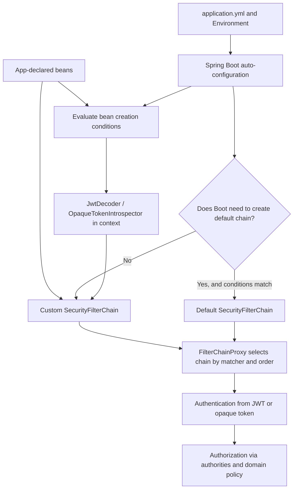

# Custom Beans, DSL Configuration, and Auto-Configuration Override Order

In Spring Boot, the security configuration of an OAuth 2.0 Resource Server does not come from a single place. Part comes from **Spring Boot auto-configuration**, part from **Spring Security** components, and the rest from **beans** or **`HttpSecurity` DSL** declared by the application.

Because of this, adding a `SecurityFilterChain`, `JwtDecoder`, or `OpaqueTokenIntrospector` bean can change behavior even when `application.yml` remains untouched. Understanding which parts Boot creates automatically, which parts *back off* in favor of application beans, and which parts are specified directly in the DSL prevents bugs such as: unauthenticated tokens, JWTs skipping audience validation, scopes not mapping properly, or endpoints falling outside every security chain.

This lesson uses the **Spring Boot 3 and Spring Security 6** configuration style with lambda DSL and `SecurityFilterChain`. Exact auto-configuration conditions and APIs may vary across versions; always verify against your project's running version.

## 1. Three Configuration Layers to Distinguish

| Layer | Source | Examples | Role |
| --- | --- | --- | --- |
| **Auto-configuration** | Spring Boot | Creates `JwtDecoder` from `issuer-uri`, configures default chain when conditions match. | Provides **defaults** when the application has not supplied a matching component. |
| **Application beans** | Developer | `@Bean SecurityFilterChain`, `@Bean JwtDecoder`, `@Bean OpaqueTokenIntrospector`. | Supplies a concrete component, which may cause Boot to **back off** a default bean of the same role. |
| **Spring Security DSL** | Developer inside `SecurityFilterChain` | `.securityMatcher(...)`, `.authorizeHttpRequests(...)`, `.oauth2ResourceServer(...)`. | Determines filters, authentication mechanism, and authorization rules for **that chain**. |

There is no single blanket rule that "DSL always beats bean, bean always beats property" across **all** security aspects. Meaningful precedence must be evaluated step by step:

1. **Bean creation conditions:** Boot creates certain beans only when no matching bean already exists in the context.
2. **Component wiring:** The JWT DSL can use a `JwtDecoder` from the context or one explicitly passed in.
3. **Security chain selection:** A request passes through only the first matching chain in priority order.
4. **Authorization rule selection:** Within the chosen chain, request matchers are evaluated in declaration order.

Let us analyze each layer to see **which configuration actually takes effect**.

## 2. How Does Spring Boot Auto-Configure a Resource Server?

For an application protecting APIs with JWTs, dependencies typically include:

```gradle
dependencies {
    implementation 'org.springframework.boot:spring-boot-starter-security'
    implementation 'org.springframework.boot:spring-boot-starter-oauth2-resource-server'
}
```

A simple configuration:

```yaml
spring:
  security:
    oauth2:
      resourceserver:
        jwt:
          issuer-uri: https://login.example.com/realms/shop
```

When **no related custom beans exist**, Spring Boot can:

- Create a `JwtDecoder` from the issuer/JWK Set properties when auto-configuration conditions match.
- Create a default Resource Server security filter chain when no application chain exists and required conditions are met.
- Let Spring Security accept Bearer tokens, verify JWTs, and build `Authentication`.

With a trusted issuer, the standard decoder verifies signature, issuer, and time constraints according to configured validators. **Do not assume audience is automatically validated per your API's requirements simply because `issuer-uri` is set.** The API must bind its intended recipient via an audience validator or the corresponding audience property if your Spring Boot version supports it.

The issuer in the example is illustrative only. A real system must use a proper access token issuer rather than arbitrarily substituting an ID Token meant for an OIDC Client as an API access token.

### Auto-Configuration Is Conditional

Rather than thinking of Spring Boot as "always creating defaults and then overriding them," view Boot as evaluating conditions on **whether to create default beans**:

```text
No custom SecurityFilterChain
  -> Boot may create default web security / Resource Server chain

App-provided SecurityFilterChain exists
  -> Boot's default web security chain typically backs off
  -> app decides which chain protects which endpoints

No custom JwtDecoder
  -> Boot may create JWT decoder from properties

App-provided JwtDecoder exists
  -> Boot does not create default decoder
  -> app is responsible for configuring that decoder's validation
```

Defining a `SecurityFilterChain` **does not require** creating a custom `JwtDecoder`. Conversely, defining a custom decoder **does not automatically add** endpoint authorization rules. The two bean groups are decided independently.

## 3. How Does Declaring `SecurityFilterChain` Change Boot's Behavior?

Example where the application configures the API itself:

```java
import org.springframework.context.annotation.Bean;
import org.springframework.context.annotation.Configuration;
import org.springframework.http.HttpMethod;
import org.springframework.security.config.Customizer;
import org.springframework.security.config.annotation.web.builders.HttpSecurity;
import org.springframework.security.config.http.SessionCreationPolicy;
import org.springframework.security.web.SecurityFilterChain;

@Configuration
public class ApiSecurityConfig {

    @Bean
    SecurityFilterChain apiSecurity(HttpSecurity http) throws Exception {
        return http
            .securityMatcher("/api/**")
            .csrf(csrf -> csrf.disable())
            .sessionManagement(session -> session
                .sessionCreationPolicy(SessionCreationPolicy.STATELESS))
            .authorizeHttpRequests(auth -> auth
                .requestMatchers(HttpMethod.GET, "/api/orders/**")
                    .hasAuthority("SCOPE_orders.read")
                .requestMatchers(HttpMethod.POST, "/api/orders")
                    .hasAuthority("SCOPE_orders.write")
                .anyRequest().denyAll())
            .oauth2ResourceServer(oauth2 -> oauth2
                .jwt(Customizer.withDefaults()))
            .build();
    }
}
```

The resulting behavior is:

1. The application's `SecurityFilterChain` bean usually causes Boot not to create the **default web security chain**.
2. `.securityMatcher("/api/**")` defines the **scope** for which this chain is selected.
3. `.authorizeHttpRequests(...)` defines authorization rules inside the selected chain.
4. `.oauth2ResourceServer(...jwt(...))` enables JWT Bearer authentication for this chain. The `issuer-uri` property **does not automatically inject Resource Server configuration** into every custom chain.
5. URLs not matching `/api/**` need another chain or an explicit protection decision.

Consider an incomplete configuration:

```java
@Bean
SecurityFilterChain incomplete(HttpSecurity http) throws Exception {
    return http
        .authorizeHttpRequests(auth -> auth
            .anyRequest().authenticated())
        .build();
}
```

You cannot conclude from `issuer-uri` that this chain handles Bearer JWTs; `.oauth2ResourceServer(...)` is not enabled here. If the app requires JWTs, you must declare the matching authentication mechanism.

### A Custom Chain Does Not Necessarily Replace the Decoder

A common setup is:

```text
application.yml: issuer-uri
  -> Boot creates JwtDecoder

@Bean SecurityFilterChain:
  -> developer writes matchers and authorization rules
  -> developer enables oauth2ResourceServer().jwt()
  -> Spring Security uses JwtDecoder already in context
```

Thus, the application customizes endpoints while still using the Boot-managed decoder. **What backs off is the default chain**, not every security bean created by Boot.

## 4. Multiple `SecurityFilterChain` Beans: `@Order` and Matchers Decide

When multiple chains exist, `FilterChainProxy` walks them in priority order and selects **the first chain whose matcher matches the request**. Later chains are **not combined** to widen or restrict permissions on a request already matched by the first chain.

Example with an API chain and a fallback for all other URLs:

```java
import org.springframework.context.annotation.Bean;
import org.springframework.context.annotation.Configuration;
import org.springframework.core.annotation.Order;
import org.springframework.http.HttpMethod;
import org.springframework.security.config.Customizer;
import org.springframework.security.config.annotation.web.builders.HttpSecurity;
import org.springframework.security.config.http.SessionCreationPolicy;
import org.springframework.security.web.SecurityFilterChain;

@Configuration
public class MultiChainSecurityConfig {

    @Bean
    @Order(1)
    SecurityFilterChain apiChain(HttpSecurity http) throws Exception {
        return http
            .securityMatcher("/api/**")
            .csrf(csrf -> csrf.disable())
            .sessionManagement(session -> session
                .sessionCreationPolicy(SessionCreationPolicy.STATELESS))
            .authorizeHttpRequests(auth -> auth
                .requestMatchers("/api/health").permitAll()
                .requestMatchers(HttpMethod.GET, "/api/orders/**")
                    .hasAuthority("SCOPE_orders.read")
                .anyRequest().denyAll())
            .oauth2ResourceServer(oauth2 -> oauth2
                .jwt(Customizer.withDefaults()))
            .build();
    }

    @Bean
    @Order(2)
    SecurityFilterChain fallbackChain(HttpSecurity http) throws Exception {
        return http
            .authorizeHttpRequests(auth -> auth
                .anyRequest().denyAll())
            .build();
    }
}
```

This example shows a deny-by-default fallback policy for safety. In a real application, you may need to allow login pages, static resources, Actuator, or a web UI with matching chains and rules.

Two commonly confused matchers:

| Syntax | Question it answers |
| --- | --- |
| `http.securityMatcher("/api/**")` | **Which chain** applies to the request? |
| `authorizeHttpRequests().requestMatchers(...)` | Once the chain is selected, **which rule** allows or denies the request? |

If the `@Order(1)` chain omits `securityMatcher`, its default matcher matches **every request**, preventing the second chain from ever handling its intended requests. If you only have a `.securityMatcher("/api/**")` chain without a fallback, a URL like `/admin/report` may **bypass every security chain**; Spring Boot does not auto-create a fallback just because unmatched URLs remain.

**`@Order` does not mean one bean is created first to overwrite another.** It primarily dictates the order in which **chains are matched per incoming request**.

## 5. Three Ways a `JwtDecoder` Is Chosen

`JwtDecoder` is responsible for verifying JWTs, running token validators, and returning a `Jwt` that Spring Security can turn into an `Authentication`.

| Case | Where does the decoder come from? | Risks to watch |
| --- | --- | --- |
| **Only properties** `issuer-uri` or JWK Set | Boot creates the decoder when conditions match. | Still need to check API audience/token profile requirements. |
| **App declares `@Bean JwtDecoder`** | App-created bean; Boot typically backs off the default decoder. | Issuer, timestamp, and audience validators must be fully configured. |
| **DSL specifies `jwt.decoder(...)`** | Explicit decoder passed directly to the chain. | That decoder's configuration governs the chain, regardless of other beans in context. |

Local decision model for **a single JWT chain's** decoder:

```text
Does the DSL specify a JwtDecoder directly?
  Yes -> Use the decoder specified on the chain
  No
    -> Spring Security looks up a matching decoder bean in context
       -> App-defined bean if present
       -> Otherwise, Boot-created decoder from properties if conditions match
```

If multiple `JwtDecoder` beans exist without disambiguation, injection may become ambiguous. Use `@Qualifier`, `@Primary` where appropriate, or pass the decoder explicitly to each chain.

### Building a Custom Decoder with an Audience Validator

Suppose the API only accepts JWTs with `aud = orders-api` from a trusted issuer:

```yaml
spring:
  security:
    oauth2:
      resourceserver:
        jwt:
          issuer-uri: https://login.example.com/realms/shop

app:
  security:
    audience: orders-api
```

```java
import java.util.List;

import org.springframework.beans.factory.annotation.Value;
import org.springframework.context.annotation.Bean;
import org.springframework.context.annotation.Configuration;
import org.springframework.security.oauth2.core.DelegatingOAuth2TokenValidator;
import org.springframework.security.oauth2.core.OAuth2TokenValidator;
import org.springframework.security.oauth2.jwt.Jwt;
import org.springframework.security.oauth2.jwt.JwtClaimValidator;
import org.springframework.security.oauth2.jwt.JwtDecoder;
import org.springframework.security.oauth2.jwt.JwtValidators;
import org.springframework.security.oauth2.jwt.NimbusJwtDecoder;

@Configuration
public class TokenValidationConfig {

    @Bean
    JwtDecoder jwtDecoder(
            @Value("${spring.security.oauth2.resourceserver.jwt.issuer-uri}")
                String issuer,
            @Value("${app.security.audience}")
                String audience) {

        NimbusJwtDecoder decoder =
            NimbusJwtDecoder.withIssuerLocation(issuer).build();

        OAuth2TokenValidator<Jwt> defaultValidators =
            JwtValidators.createDefaultWithIssuer(issuer);

        OAuth2TokenValidator<Jwt> audienceValidator =
            new JwtClaimValidator<List<String>>(
                "aud", values -> values != null &&
                    values.contains(audience));

        decoder.setJwtValidator(
            new DelegatingOAuth2TokenValidator<>(
                defaultValidators, audienceValidator));
        return decoder;
    }
}
```

`withIssuerLocation(issuer)` builds a decoder from the issuer's metadata/JWK Set; `createDefaultWithIssuer` retains default timestamp checks along with issuer verification; the audience validator enforces that tokens target `orders-api`.

Because this bean is declared, Boot's `JwtDecoder` auto-configuration **backs off from creating a default decoder**. If you replace it with a decoder built manually from only a JWK Set URI and **forget the issuer validator**, the app loses issuer verification compared to Boot's initial config. Never treat `issuer-uri` remaining in YAML as proof that a custom decoder actually uses it.

Some Spring Boot versions support configuring audiences directly on JWT Resource Server properties. When that property meets requirements and Boot manages the decoder, prefer properties. With a **custom decoder**, verify validation on the actual decoder; do not assume the audience property attaches a validator to a custom bean.

## 6. Specifying a Decoder Directly in the JWT DSL

If different URL groups accept tokens with different issuers or audiences, you can wire a specific decoder per chain:

```java
@Bean
@Order(1)
SecurityFilterChain partnerChain(
        HttpSecurity http,
        @Qualifier("partnerJwtDecoder") JwtDecoder partnerDecoder)
        throws Exception {

    return http
        .securityMatcher("/partner/**")
        .authorizeHttpRequests(auth -> auth
            .anyRequest().hasAuthority("SCOPE_partner.read"))
        .oauth2ResourceServer(oauth2 -> oauth2
            .jwt(jwt -> jwt.decoder(partnerDecoder)))
        .build();
}
```

This is an **illustrative method** to place inside a configuration class with imports for `Bean`, `Order`, `Qualifier`, `HttpSecurity`, `SecurityFilterChain`, and `JwtDecoder`. The `partnerJwtDecoder` bean must also be declared and configured with full validators. The app will also need chains covering URLs outside `/partner/**`.

With `.jwt(jwt -> jwt.decoder(partnerDecoder))`, the decoder passed explicitly in the DSL is used by this chain; having another default decoder in context will not override it. This is useful when handling multiple issuers, audiences, or isolated policies.

Maintenance guidelines:

- Use **one primary place** to define a chain's decoder strategy: Boot's property-driven decoder, a custom bean, or an explicit DSL decoder.
- When multiple decoders exist, name beans, URLs, and audiences clearly for their purpose; never rely on which bean "was created first."
- Avoid configuring the same key source or validator in multiple places assuming the system will merge them automatically.

## 7. `JwtAuthenticationConverter` vs. `JwtDecoder`

`JwtDecoder` checks **whether a token is valid and trustworthy**. `JwtAuthenticationConverter` processes an **already-verified JWT** to build `Authentication` and `GrantedAuthority` instances. Keep these two responsibilities distinct:

| Component | Responsibility |
| --- | --- |
| `JwtDecoder` | Verifies signature, issuer, timestamps, audience, and token profile. |
| `JwtAuthenticationConverter` | Maps verified claims to principal name and authorities. |
| `authorizeHttpRequests` / `@PreAuthorize` | Checks whether the principal is allowed to perform the operation. |
| Domain/service policy | Checks owner/tenant and permissions on specific records. |

Spring Security normally maps `scope`/`scp` to `SCOPE_*` authorities. Custom `roles` claims, however, **do not automatically** become `ROLE_*`.

Example reading roles while preserving scopes:

```java
import java.util.ArrayList;
import java.util.Collection;
import java.util.List;

import org.springframework.context.annotation.Bean;
import org.springframework.security.core.GrantedAuthority;
import org.springframework.security.core.authority.SimpleGrantedAuthority;
import org.springframework.security.oauth2.jwt.Jwt;
import org.springframework.security.oauth2.server.resource.authentication.JwtAuthenticationConverter;
import org.springframework.security.oauth2.server.resource.authentication.JwtGrantedAuthoritiesConverter;

@Bean
JwtAuthenticationConverter roleAndScopeConverter() {
    JwtGrantedAuthoritiesConverter scopeConverter =
        new JwtGrantedAuthoritiesConverter();

    JwtAuthenticationConverter converter =
        new JwtAuthenticationConverter();

    converter.setJwtGrantedAuthoritiesConverter((Jwt jwt) -> {
        Collection<GrantedAuthority> authorities =
            new ArrayList<>(scopeConverter.convert(jwt));

        List<String> roles = jwt.getClaimAsStringList("roles");
        if (roles != null) {
            for (String role : roles) {
                authorities.add(
                    new SimpleGrantedAuthority("ROLE_" + role));
            }
        }
        return authorities;
    });

    return converter;
}
```

To make a chain use the converter, wire it explicitly in the DSL:

```java
@Bean
SecurityFilterChain apiSecurity(
        HttpSecurity http,
        JwtAuthenticationConverter roleAndScopeConverter)
        throws Exception {

    return http
        .securityMatcher("/api/**")
        .authorizeHttpRequests(auth -> auth
            .requestMatchers("/api/admin/**").hasRole("ADMIN")
            .anyRequest().authenticated())
        .oauth2ResourceServer(oauth2 -> oauth2
            .jwt(jwt -> jwt
                .jwtAuthenticationConverter(roleAndScopeConverter)))
        .build();
}
```

These are illustrative methods to place inside a configuration class with matching imports. When integrating into a project, **pick one coherent chain configuration** rather than registering multiple chain beans with overlapping paths unintentionally.

A declared `JwtAuthenticationConverter` bean **should not be assumed to apply automatically to every JWT chain**. When a custom converter is needed, wiring it via `.jwtAuthenticationConverter(...)` makes the intent explicit.

```java
hasAuthority("SCOPE_orders.read") // Mapped orders.read scope
hasAuthority("ROLE_ADMIN")       // ROLE_ADMIN authority
hasRole("ADMIN")                 // By default checks ROLE_ADMIN
```

`hasRole("ADMIN")` is not equivalent to `SCOPE_admin`. Any custom role must come from a verified claim issued by a trusted source, never from a self-asserted client header. And roles/scopes **do not replace** ownership/tenant checks inside the API.

## 8. Opaque Tokens and `OpaqueTokenIntrospector`

For opaque tokens, the Resource Server does not decode JWTs locally and instead typically calls the Authorization Server's introspection endpoint:

```yaml
spring:
  security:
    oauth2:
      resourceserver:
        opaquetoken:
          introspection-uri: https://login.example.com/oauth2/introspect
          client-id: ${INTROSPECTION_CLIENT_ID}
          client-secret: ${INTROSPECTION_CLIENT_SECRET}
```

If the application does not declare its own `OpaqueTokenIntrospector` and auto-configuration conditions match, Boot creates an introspector from these properties.

A custom chain must explicitly enable opaque tokens:

```java
@Bean
SecurityFilterChain opaqueApi(HttpSecurity http) throws Exception {
    return http
        .securityMatcher("/opaque-api/**")
        .authorizeHttpRequests(auth -> auth
            .anyRequest().authenticated())
        .oauth2ResourceServer(oauth2 -> oauth2
            .opaqueToken(Customizer.withDefaults()))
        .build();
}
```

When the app defines its own `OpaqueTokenIntrospector` bean, Boot typically backs off the default introspector. You can also pass a specific introspector in the opaque-token DSL when needed. **Introspection is not OIDC UserInfo:** introspection verifies access token status and metadata; UserInfo supplies user profile claims to an OIDC Client.

In systems supporting both JWT and opaque tokens, clearly define which URLs accept which token type and which authentication mechanism applies. Never infer token types arbitrarily from client-supplied strings without a documented contract and proper verification pipeline.

## 9. Decisions Happen at Different Times



This is a conceptual map of decision points, not a detailed bean lifecycle diagram. The key takeaway is that **each layer has its own decision mechanism**:

- **Properties** feed auto-configuration when default beans are created.
- **Custom beans** can disable default bean registration for that role.
- **DSL** connects decoders, converters, authentication, and authorization for a chain.
- **`@Order` + `securityMatcher`** decides which chain handles each request.

When `issuer-uri`, a `JwtDecoder` bean, and `.jwt(jwt -> jwt.decoder(...))` all coexist, trace **which decoder is actually attached to the chain** and inspect its validators. Security cannot be judged simply by reading a property in YAML.

## 10. Common Override Scenarios

| Change in application | Consequence | Action needed |
| --- | --- | --- |
| Add only `issuer-uri` | Boot may create JWT decoder and default chain when conditions match. | Verify audience and resource policies. |
| Add `@Bean SecurityFilterChain` | Boot's default web chain typically backs off. | Declare JWT/opaque DSL, matchers, and appropriate fallback. |
| Change `authorizeHttpRequests` | Changes endpoint permissions of the chain. | Do not assume JWT validation changed automatically. |
| Add `@Bean JwtDecoder` | Boot skips creating the default decoder. | Configure issuer, timestamps, audience, and other validators yourself. |
| Specify `jwt.decoder(custom)` in DSL | Chain uses the explicitly passed decoder. | Inspect that decoder; avoid conflicting config in multiple places. |
| Add `JwtAuthenticationConverter` | Bean exists in context. | Attach the converter to the chains that need it. |
| Add `OpaqueTokenIntrospector` | Boot may back off default introspector. | Configure endpoint, credentials, and token policies. |
| Two chains match the same URL | Higher-priority chain is chosen. | Define `@Order` and matchers clearly. |
| Only `/api/**` chain exists | Other URLs may fall outside any chain. | Add a fallback chain or policy covering all routes. |
| Add `@Primary` to a decoder | Affects bean selection during injection. | Does not change chain order or decoders passed explicitly in DSL. |

### Scenario A: Property Remains, Yet Validation Disappears

Initially:

```text
issuer-uri in YAML -> Boot creates decoder with issuer validator
```

Then a custom decoder is added:

```text
@Bean JwtDecoder from JWK Set URI -> Boot backs off
custom decoder omits issuer validator -> expected issuer check is lost
```

Solution: explicitly configure validators on the custom decoder, such as `JwtValidators.createDefaultWithIssuer(issuer)` and an audience validator. **Configuring a JWK Set only provides the key source; it does not replace required claim validation.**

### Scenario B: URLs Become Unprotected

Before the change, the default chain protected all requests. After adding `securityMatcher("/api/**")` without a fallback, `/admin/**` may pass through no security chain. Explicitly declare coverage for every URL area served by the app and audit chain matchers.

### Scenario C: Role Converter Declared, Yet Still Getting 403

Possible causes: the converter was never wired into the JWT DSL, the role claim has an unexpected structure, or a rule checks `ROLE_ADMIN` while the token only carries `SCOPE_admin`. Inspect the active chain and authorities produced from the **verified token**; never trust client headers for permissions.

### Scenario D: Updated `issuer-uri`, Yet API Still Uses Old Issuer

If a custom decoder was built with hardcoded URLs or the DSL passes a different decoder, YAML properties may **no longer affect the decoder in use**. Bind URLs from configuration into custom beans or rely on Boot's decoder, avoiding duplicate configuration sources.

## 11. Duplicate Bean Types, `@Primary`, and Multiple Issuers

Suppose the context has two decoders:

```java
@Bean
JwtDecoder ordersJwtDecoder() {
    return buildOrdersDecoder();
}

@Bean
JwtDecoder analyticsJwtDecoder() {
    return buildAnalyticsDecoder();
}
```

These two methods are architectural sketches; `buildOrdersDecoder` and `buildAnalyticsDecoder` must return decoders with complete validators. When Spring Security looks up a `JwtDecoder` without a qualifier, ambiguous injection can occur.

`@Primary` designates a preferred bean for injection, but **does not automatically**:

- Replace a decoder passed directly via `.jwt(jwt -> jwt.decoder(...))`.
- Change the order of `SecurityFilterChain` beans.
- Add issuer/audience validators to a decoder.
- Attach `JwtAuthenticationConverter` to all chains.

For multiple issuers, configure explicit mappings between URLs/issuers/audiences and permitted decoders. If a single endpoint must accept tokens from multiple issuers, use a resolver picking authentication mechanisms from a trusted issuer list—such as `AuthenticationManagerResolver` in an appropriate design. Never let an `iss` value in an **unverified** token direct the app to an arbitrary URL/JWK Set outside an allowlist.

## 12. Authorization Rule Order Inside a Chain

Matcher order inside `authorizeHttpRequests` is independent of chain order:

```java
.authorizeHttpRequests(auth -> auth
    .requestMatchers("/api/admin/**").hasRole("ADMIN")
    .requestMatchers("/api/**").authenticated()
    .anyRequest().denyAll())
```

For `/api/admin/report`, the specific rule is evaluated first, requiring `ROLE_ADMIN`.

If written as:

```java
.authorizeHttpRequests(auth -> auth
    .requestMatchers("/api/**").authenticated()
    .requestMatchers("/api/admin/**").hasRole("ADMIN")
    .anyRequest().denyAll())
```

the broader `/api/**` rule matches first, bypassing the stricter admin rule. Always place specific rules before broad rules and maintain an explicit fallback policy.

Method security with `@EnableMethodSecurity` and `@PreAuthorize` adds a service-layer check:

```java
@PreAuthorize("hasAuthority('SCOPE_orders.read')")
public OrderDto readOrder(long id) {
    return orderService.findVisibleOrder(id);
}
```

Method security does not replace filter-chain authorization. A request can pass web rules yet still be denied at the method level or due to owner/tenant checks in the domain. Conversely, method security only protects entry points that actually invoke the proxied method.

## 13. Inspecting Which Configuration Is Actually Active

When a request is permitted or denied unexpectedly, inspect layer by layer:

1. Identify the Spring Boot/Spring Security versions and Resource Server starter.
2. List the application's `SecurityFilterChain` beans, `@Order`, and `securityMatcher` values.
3. For the chain matching the request, verify whether `.oauth2ResourceServer().jwt()` or `.opaqueToken()` is enabled.
4. Locate any application `JwtDecoder`/`OpaqueTokenIntrospector` beans and any decoders wired directly in the DSL.
5. Verify actual validators: signature/status, issuer, timestamps, audience, and token type/profile where needed.
6. For valid tokens returning 403, check converters, scopes/roles, matcher order, and owner/tenant policies.
7. For unexpectedly permitted endpoints, check for unmatched chains, overly broad matchers, or routes falling outside fallback chains.

In development, Spring Boot can print the auto-configuration condition report when enabling:

```properties
debug=true
```

The condition evaluation report shows which default beans were created or which auto-configurations stepped aside due to application beans. Actuator can also expose a `conditions` endpoint when configured; protect that endpoint in production.

To observe filter chain selection in development:

```yaml
logging:
  level:
    org.springframework.security: DEBUG
```

Enable only necessary log levels and protect log output. Never log raw access tokens, refresh tokens, `Authorization` headers, or introspection credentials.

## 14. Distinguishing Configuration Tests from Authorization Tests

| Scenario | What must be proven |
| --- | --- |
| JWT with right issuer, audience, timestamps, and scope | Request enters the right chain and is permitted per policy. |
| JWT with valid signature, wrong audience | Decoder/validator rejects the token. |
| JWT with wrong issuer or expired | Authentication fails, typically HTTP 401. |
| Valid JWT lacking `SCOPE_orders.read` | Authentication succeeds, authorization denies, typically 403. |
| Valid JWT with scope, wrong owner/tenant | Service/domain policy denies object access. |
| `/api/**` and `/admin/**` requests | Each URL enters the intended chain, no route slips through. |
| Role converter wired in DSL | `ROLE_*` authorities are mapped and enforced properly. |
| Custom decoder + issuer property | Real validation is not lost when Boot backs off. |
| Multiple decoders | Each chain uses the intended decoder bean without ambiguous injection. |
| Opaque token | Uses the right introspection mechanism, never confused with JWT or UserInfo. |

In Spring Security Test, MockMvc's `jwt()` helper builds a simulated JWT principal to test authorization. However, that helper typically **does not verify a real token signature through the decoder**. Testing the decoder with real JWTs or integrating a test Authorization Server/JWK Set proves something different from testing `hasAuthority` rules. Keep both test types when evaluating system security.

## 15. Example Requirement Changes and Where to Configure Them

Suppose an app already runs a JWT Resource Server with `issuer-uri`, and three new requirements arrive:

**Requirement 1: Reading orders requires `orders.read`.** Add a custom `SecurityFilterChain` with `authorizeHttpRequests` and `.oauth2ResourceServer().jwt()`. If Boot's decoder already fits, do not write a custom decoder.

**Requirement 2: Tokens must contain `aud = orders-api`.** If your Boot version supports the audience property and Boot still manages the decoder, configure it via properties. If a custom validator is needed, declare a `JwtDecoder` preserving default validation plus audience checking—and take ownership of the bean since Boot's decoder auto-configuration will back off.

**Requirement 3: Tokens carry `roles: ["ADMIN"]`.** Configure a `JwtAuthenticationConverter` to map roles and wire it into the JWT DSL. This converts already-verified claims into authorities and **does not replace decoder validation**.

If `/api/**` and `/admin/**` require different security chains, specify `securityMatcher`, `@Order`, and a fallback. If they differ only in paths and authorities while sharing the same authentication mechanism, a single chain with targeted rules is often easier to maintain.

## 16. Mental Model to Avoid Accidental Overrides

Each request passes through these decisions:

```text
1. Which beans actually exist in ApplicationContext?
   └─ Created by Boot by default or backed off due to custom bean?

2. Which SecurityFilterChain does FilterChainProxy choose?
   └─ @Order and securityMatcher

3. Which authentication mechanism does the chain use?
   └─ jwt(), opaqueToken(), explicitly wired decoder/introspector

4. How does authentication build principal/authorities?
   └─ JwtDecoder, JwtAuthenticationConverter, opaque principal

5. How is the request authorized?
   └─ requestMatchers, method security, owner/tenant/domain policy
```

**Core takeaway:** Custom beans cause Spring Boot to *back off* parts of auto-configuration; the DSL determines which components a chain uses; `@Order` selects the chain, and `requestMatchers` order selects authorization rules. When you know **which beans are replaced, which components are wired, and which request scope is affected**, you can configure a Resource Server consistently without accidentally bypassing token validation or resource authorization.
