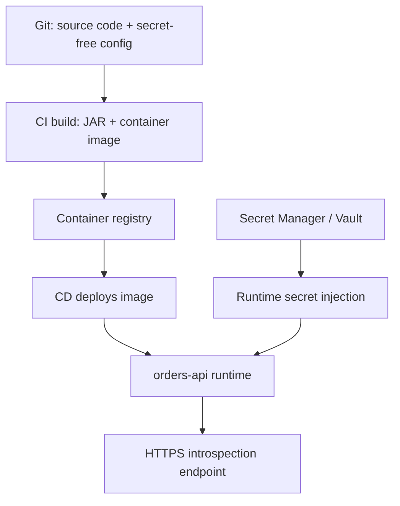
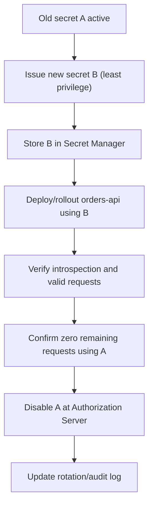

# Managing Introspection Secrets and Keeping Them Out of Source Code

A **Spring Security OAuth 2.0 Resource Server** can validate access tokens using two primary mechanisms: verifying a signed JWT with public keys, or sending the token to the Authorization Server's **OAuth 2.0 Token Introspection Endpoint**. For introspection, the Resource Server typically needs a **client ID** and a **client secret** (or another client authentication mechanism) to be permitted to ask the Authorization Server whether a token is still active. That credential pair belongs to the **Resource Server service**, distinct from the access token sent by the user/client.

This lesson focuses on **configuring and protecting introspection credentials** in Spring Boot/Spring Security: keeping secrets out of source code, injecting them at runtime via environment-appropriate mechanisms, restricting permissions and exposure, rotating secrets, testing failure modes, and operating safely. Examples use Java 17+, Spring Boot 3.x, and Spring Security 6.x; addresses, application names, and config values are illustrative only.

## 1. How Introspection Works and Where Secrets Live

Suppose an application setup has:

- **Client** `web-portal` issued an opaque access token after user login.
- **Resource Server** `orders-api` serving the orders API.
- **Authorization Server / OIDC Provider** `https://auth.example.test` with endpoint `/oauth2/introspect`.
- **Introspection client** `orders-api-introspector` issued dedicated credentials by the Authorization Server to query token status.

High-level flow:

```mermaid
sequenceDiagram
    participant C as Client web-portal
    participant R as Resource Server orders-api
    participant AS as Authorization Server
    C->>R: GET /api/orders + Authorization: Bearer opaque-token
    R->>AS: POST /oauth2/introspect (token + client authentication)
    Note over R,AS: HTTPS; client ID/secret belong to orders-api
    AS->>AS: Verify client is allowed to introspect; check token
    AS-->>R: {"active": true, "scope": "orders:read", ...}
    R->>R: Authenticate token and check API permissions
    R-->>C: 200 or 403 per permissions
```

If `active=false` or the token is unacceptable, the Resource Server must reject the request. If the introspection endpoint itself suffers a network failure or client authentication fails, the Resource Server lacks trustworthy proof to grant access; **never allow the request through** just because the Authorization Server is unreachable.

Introspection uses `POST` per RFC 7662. In common implementations, the HTTP request carries an `application/x-www-form-urlencoded` body:

```http
POST /oauth2/introspect HTTP/1.1
Host: auth.example.test
Authorization: Basic <base64-encoded-client-credentials>
Content-Type: application/x-www-form-urlencoded

token=<opaque-access-token>&token_type_hint=access_token
```

This is a **protocol illustration, not a live command**. `Authorization: Basic ...` only **Base64-encodes** the client username/password; Base64 **is not security encryption**. Secrets and access tokens must only travel over HTTPS to the intended endpoint. Basic credentials remain sensitive if exposed in logs, traces, or HTTP captures.

Example response:

```json
{
  "active": true,
  "iss": "https://auth.example.test",
  "sub": "user-42",
  "client_id": "web-portal",
  "aud": "orders-api",
  "scope": "orders:read",
  "exp": 1890003600
}
```

The two client IDs in this story **do not play the same role**:

| Identifier | Represents | Where it typically appears |
|---|---|---|
| `orders-api-introspector` | Client used to **authenticate the Resource Server to the introspection endpoint**. | Spring `opaquetoken.client-id` config and HTTP auth sent to the Authorization Server. |
| `web-portal` | OAuth client that **requested the access token** for the user. | `client_id` claim in the introspection response if provided by the Authorization Server. |
| `user-42` | Subject of the access token. | `sub` claim in the response if present. |
| `orders-api` | Target resource/API for the token. | `aud` if supported by profile, or Resource Server access boundary enforced by the Authorization Server. |

**Never use the `client_id` returned inside an introspection response as credentials to call the introspection endpoint.** Nor should you substitute a web client secret, Authorization Server admin account, or user refresh token for the Resource Server's dedicated introspection credentials.

## 2. What Counts as a Secret

In this context, values carry different sensitivity levels:

| Value | Sensitivity | Practical policy |
|---|---|---|
| `introspection-uri` | Usually not secret, yet security-critical configuration. | Fixed per environment and trusted issuer; use HTTPS, never accept URLs from requests. |
| `introspection client-id` | Usually an identifier, not secret. | Can live in normal config, yet guard against unauthorized changes/tampering. |
| `introspection client-secret` | **Secret**: proves the Resource Server is allowed to call introspection. | Never hardcode; protect in storage, transit, access control, logging, and rotation. |
| Client-sent access token | **Bearer credential** of a request. | Never log, put in URLs, or persist arbitrarily long-term. |
| Refresh token | **Highly sensitive credential**, typically belonging to the client. | Resource Server does not need it to introspect access tokens. |
| Authorization Server JWT private signing key | **Extremely sensitive private key**. | Resource Server must never receive this signing key to verify JWTs. |
| JWT public key / JWKS | Public for verifying signatures, not secret. | Must come from trusted sources with proper algorithm/issuer rules. |

**Key distinction:** When a Resource Server verifies JWTs via JWKS, it normally only needs **public keys** and supplies no introspection secret. When using opaque tokens, it may need a client secret or stronger client authentication to send introspection requests. Do not apply opaque-token secret management patterns to a JWT decoder that only needs public keys.

If the Authorization Server supports `private_key_jwt` or mutual TLS for the introspection client, the secret to protect may be a **private key** or keystore/certificate material rather than a `client-secret` string. The core rule remains identical: private credentials belong in a secret/key management system, never copied into source code.

## 3. Common Secret Leak Paths

An introspection password can leak without ever being written in an obvious Java `password=...` line:

| Path | Bad example | Why it is dangerous |
|---|---|---|
| Source code | `private static final String SECRET = "real-secret";` | Anyone with access to the repository or history can extract the secret. |
| Committed config file | `application.yml` containing `client-secret: real-secret` | Secret persists in Git history and CI/artifact copies. |
| Tracked env files | `.env`, `application-prod.properties` with real values | `.gitignore` does not remove already-committed data. |
| Docker image | `ENV INTROSPECTION_CLIENT_SECRET=...` or `ARG ...` in Dockerfile | Values can be read via image history, layers, metadata, and build logs. |
| Build/CI/CD | Printing secrets with `echo`, passing via CLI arguments, or enabling shell tracing `set -x` | Secrets end up in logs and process listings. |
| Kubernetes manifest | Pasting password/base64 into a committed `Secret` YAML | Base64 is merely encoding, easily decoded, and Git history keeps the credential. |
| Logs/traces | Enabling HTTP wire logging so `Authorization: Basic` or Bearer tokens appear | Tokens and client credentials can be harvested. |
| Error responses | Returning raw upstream errors with headers/passwords to callers | Leaks internal details and credentials. |
| CI artifacts/diagnostics | Uploading full `env`, heap dumps, or config dumps | Secrets can sit inside runtime memory and configuration. |
| Chat/tickets/snippets | Pasting real tokens or `curl --user id:secret` into discussions | Expands who can view the credential. |

**Never solve this by Base64-encoding or "encrypting" with a key hardcoded right next to the secret.** When the server has everything needed to decrypt itself and the decryption key sits in the repository, the exposed value comes with its own recovery instructions.

## 4. Configuring Spring Resource Server with Externalized Secrets

To illustrate deployment, we use opaque token introspection with `client_secret_basic`. This is built into Spring Boot, provided the Authorization Server supports it and issues matching credentials.

### 4.1. Dependencies and Security Chain

Use Spring Boot Maven BOM/parent for version management:

```xml
<dependencies>
    <dependency>
        <groupId>org.springframework.boot</groupId>
        <artifactId>spring-boot-starter-web</artifactId>
    </dependency>
    <dependency>
        <groupId>org.springframework.boot</groupId>
        <artifactId>spring-boot-starter-security</artifactId>
    </dependency>
    <dependency>
        <groupId>org.springframework.boot</groupId>
        <artifactId>spring-boot-starter-oauth2-resource-server</artifactId>
    </dependency>
    <dependency>
        <groupId>org.springframework.boot</groupId>
        <artifactId>spring-boot-starter-test</artifactId>
        <scope>test</scope>
    </dependency>
    <dependency>
        <groupId>org.springframework.security</groupId>
        <artifactId>spring-security-test</artifactId>
        <scope>test</scope>
    </dependency>
</dependencies>
```

Create `SecurityConfig.java`:

```java
package com.example.orders.security;

import org.springframework.context.annotation.Bean;
import org.springframework.context.annotation.Configuration;
import org.springframework.http.HttpMethod;
import org.springframework.security.config.Customizer;
import org.springframework.security.config.annotation.web.builders.HttpSecurity;
import org.springframework.security.config.annotation.web.configurers.AbstractHttpConfigurer;
import org.springframework.security.config.http.SessionCreationPolicy;
import org.springframework.security.web.SecurityFilterChain;

@Configuration
class SecurityConfig {

    @Bean
    SecurityFilterChain securityFilterChain(HttpSecurity http) throws Exception {
        return http
            // Only appropriate for stateless APIs using Bearer tokens in the Authorization header.
            .csrf(AbstractHttpConfigurer::disable)
            .sessionManagement(s ->
                s.sessionCreationPolicy(SessionCreationPolicy.STATELESS))
            .authorizeHttpRequests(auth -> auth
                .requestMatchers(HttpMethod.GET, "/api/public/ping").permitAll()
                .requestMatchers(HttpMethod.GET, "/api/orders/**")
                    .hasAuthority("SCOPE_orders:read")
                .anyRequest().authenticated())
            .oauth2ResourceServer(oauth ->
                oauth.opaqueToken(Customizer.withDefaults()))
            .build();
    }
}
```

When a client sends an access token to a protected endpoint, Spring Security uses an `OpaqueTokenIntrospector` to validate the token. If the token is active, Spring builds an authentication and maps scopes to `SCOPE_`-prefixed authorities by default. `SecurityFilterChain` then evaluates endpoint permissions.

This is the **opaque token option**. To use JWTs, configure `oauth2ResourceServer(oauth -> oauth.jwt(...))` and `resourceserver.jwt` per your JWT contract; never blindly enable both modes to accept arbitrary tokens without a clear routing policy.

### 4.2. `application.yml` Contains Only Configuration References

Spring Boot configuration:

```yaml
spring:
  security:
    oauth2:
      resourceserver:
        opaquetoken:
          introspection-uri: ${INTROSPECTION_URI}
          client-id: ${INTROSPECTION_CLIENT_ID}
          client-secret: ${INTROSPECTION_CLIENT_SECRET}
```

The `${...}` expressions are **Spring property placeholders**, resolved at runtime from the environment/property sources. The real value of `INTROSPECTION_CLIENT_SECRET` never resides in the committed `application.yml`.

Suggested environment variables:

```text
INTROSPECTION_URI=https://auth.example.test/oauth2/introspect
INTROSPECTION_CLIENT_ID=orders-api-introspector
INTROSPECTION_CLIENT_SECRET=<provided-by-secret-manager-at-runtime>
```

The third line is a descriptive placeholder, **not a secret string** to copy into a real environment. `introspection-uri` and `client-id` can live in deployment config if appropriate; the client secret must be injected from a protected source.

Never add default values like `${INTROSPECTION_CLIENT_SECRET:changeme}` or `${INTROSPECTION_CLIENT_SECRET:dev-secret}` in production config. Such fallbacks can silently take effect when a secret fails to provision. When a mandatory secret is missing, deployment should **fail startup** with an error naming only the missing property—never printing any secret value.

### 4.3. Understanding Environment Variables, Property Sources, and Local Files Accurately

Spring Boot supports many configuration sources: `application.yml`, environment variables, JVM system properties, config trees, Secret Manager integrations, and more. In `${INTROSPECTION_CLIENT_SECRET}`, **that variable must actually exist in the Java process's runtime environment** or in a property source read by Spring Boot.

Common pitfalls:

- Having a `.env` file in the project directory **does not mean Spring Boot loads it automatically**. Your IDE, Docker Compose, or launcher might read `.env`, which is tool behavior rather than Spring Boot default behavior.
- Editing an environment variable on a developer machine **after Java has started** does not update the running JVM.
- Setting a variable in a CI image-build job does not make it present inside the production runtime container.
- JVM system properties and command-line arguments can surface in diagnostics or process listings; avoid passing secrets via `--...client-secret=...` on the command line.
- Enabling actuator `/env`, `/configprops`, or debug logs can accidentally expose metadata/config if not properly secured and sanitized. Restrict access, verify masking, and preferably do not expose sensitive endpoints publicly.

For local work, developers should fetch test secrets from an internal secret store or a managed personal dev setup; never put production credentials on developer laptops. Even an uncommitted local file needs strict filesystem permissions and cleanup.

### 4.4. Two Equivalent Declaration Styles

Spring Boot can also bind environment variable names directly via *relaxed binding*:

```text
SPRING_SECURITY_OAUTH2_RESOURCESERVER_OPAQUETOKEN_INTROSPECTION_URI
SPRING_SECURITY_OAUTH2_RESOURCESERVER_OPAQUETOKEN_CLIENT_ID
SPRING_SECURITY_OAUTH2_RESOURCESERVER_OPAQUETOKEN_CLIENT_SECRET
```

If your platform injects these three names directly, you may not need placeholders in `application.yml`. **Pick one consistent style** so it stays clear where values originate when multiple property sources define the same property. Environment variables can also be read by equally privileged processes, env dumps, or diagnostic tools; protect the runtime, not only Git.

## 5. Choosing Where to Store Secrets by Environment

A sound deployment model separates **long-term storage**, **delivery mechanism**, and **application consumption**.

| Environment | Common secret source | How delivered to Spring Boot | Notes |
|---|---|---|---|
| Developer local | Team secret vault or dev-only secret store | IDE run configuration, short-lived env vars, or permission-restricted mounted file | Use dev-only accounts/credentials; never commit files with secrets. |
| CI tests | CI secret store or short-lived test credentials | Injected into test/deployment jobs as needed | Never print to logs or upload env dumps; restrict job access. |
| Production containers | Cloud secret manager / Vault | Runtime env vars or mounted files | Never put secrets in Dockerfiles, image layers, or public deployment templates. |
| Kubernetes | External Secrets/CSI/managed Secret with RBAC | `secretKeyRef` or mounted file | Kubernetes Secrets are only Base64 in manifests; secure etcd/RBAC/encryption at rest. |
| Bare metal/VM | Vault/secret-agent/systemd credentials/protected config file | Read-only file or service-manager env | Control folder/file permissions, backups, and credential lifecycle. |

**Environment variables are a transport mechanism, not a secret vault.** Secret Managers protect and audit secret reads; once placed into env vars, values reside in process memory/environment. For stricter requirements, use least-privilege file mounts or an agent supplying credentials on demand at runtime.

## 6. Kubernetes Deployment Pattern

Suppose `orders-api` runs in namespace `orders-prod`. Your secrets management system has synced a Kubernetes Secret named `orders-introspection-auth` with keys `client-id` and `client-secret`. This example only **references** it without creating a manifest containing secret values.

```yaml
apiVersion: apps/v1
kind: Deployment
metadata:
  name: orders-api
  namespace: orders-prod
spec:
  replicas: 2
  selector:
    matchLabels:
      app: orders-api
  template:
    metadata:
      labels:
        app: orders-api
    spec:
      serviceAccountName: orders-api
      containers:
        - name: orders-api
          image: registry.example.test/orders-api:<version-digest-or-tag>
          ports:
            - containerPort: 8080
          env:
            - name: INTROSPECTION_URI
              value: "https://auth.example.test/oauth2/introspect"
            - name: INTROSPECTION_CLIENT_ID
              valueFrom:
                secretKeyRef:
                  name: orders-introspection-auth
                  key: client-id
            - name: INTROSPECTION_CLIENT_SECRET
              valueFrom:
                secretKeyRef:
                  name: orders-introspection-auth
                  key: client-secret
```

Requirements outside this YAML snippet:

1. The `orders-introspection-auth` Secret must be provisioned/synced by a controlled secret-management workflow; never put real values in Git.
2. Only workloads in the right namespace and role may read the Secret. RBAC, node access, backups, admission policies, and encryption at rest must be enforced by the organization.
3. **Base64 inside a Kubernetes Secret object is not security encryption.** Anyone able to read `data` can decode it.
4. Updating a Kubernetes Secret **does not automatically update environment variables of running processes**. When injecting env vars via `secretKeyRef`, perform a controlled rolling restart/rollout after rotation.
5. Note that while `kubectl describe pod` omits secret values, anyone permitted to read container environments or exec/debug into the container can extract them. Restrict operational access.
6. Do not assume the service account needs `get secrets` permission when Kubernetes injects `secretKeyRef`. Grant direct Kubernetes API Secret-reading permissions only if the app genuinely calls the Kubernetes API.

### 6.1. Mounting a File Instead of Using Env Vars

Some environments avoid putting secrets into process environments. A secret manager or CSI driver can mount a read-only file at an internal path. With Spring Boot, you can import a **config tree**:

```yaml
spring:
  config:
    import: "configtree:/run/secrets/"
  security:
    oauth2:
      resourceserver:
        opaquetoken:
          introspection-uri: ${INTROSPECTION_URI}
          client-id: ${INTROSPECTION_CLIENT_ID}
          client-secret: ${introspection-client-secret}
```

Then the file:

```text
/run/secrets/introspection-client-secret
```

contains **only the real runtime secret value** provided by the platform. Spring Boot's `configtree:` turns filenames into property names and file contents into property values. The reference `introspection-client-secret` must match the exact filename inside the imported config tree.

Deployment notes for file mounts:

- The path must exist **before** Spring Boot starts, unless an integration supports dynamic resolution.
- Restrict file and directory permissions to the application user/service. Never make them world-readable or expose them in unnecessary shared volumes.
- Never copy this file into the Docker image; never run `COPY secrets/ ...` in a Dockerfile.
- Never enable directory listing or static file serving on the secrets directory.
- When the mounted file updates, Spring Boot **does not automatically recreate the introspector bean or refresh credentials**. Plan a controlled reload mechanism or pod/process restart.
- If the platform already fetches secrets via SDK/API, avoid writing temporary copies to disk unnecessarily and manage cache lifetimes.

Choosing env vars vs. files depends on platform policy. Either is only as secure as its storage, transport, read permissions, and runtime observability controls.

## 7. Docker and CI/CD Patterns to Keep Secrets Out of Artifacts

### 7.1. Docker Images Must Be Independent of Environment Secrets

Example Dockerfile:

```dockerfile
FROM eclipse-temurin:21-jre
WORKDIR /app
COPY target/orders-api.jar /app/orders-api.jar
USER 10001
ENTRYPOINT ["java", "-jar", "/app/orders-api.jar"]
```

The image contains only application code and non-sensitive defaults. Introspection credentials are injected by the platform **at container runtime**. Thus the exact same image deploys to staging and production with different secrets, without rebuilding images just to rotate passwords.

Never use patterns like these in real images:

```dockerfile
# DO NOT USE:
ARG INTROSPECTION_CLIENT_SECRET=super-secret-value
ENV INTROSPECTION_CLIENT_SECRET=super-secret-value
COPY .env /app/.env
RUN echo "client-secret=super-secret-value" >> /app/application.properties
```

Even if deleted in a later layer, values can survive in earlier layers, image history, and build logs. Use build-tool secret mounts only when the **build itself** needs credentials to fetch dependencies; runtime introspection credentials normally **have no place in the build stage**.

### 7.2. Separating Build and Deploy

Pipelines should follow this flow:



Key principles:

- CI builds must run without production secrets; security tests use fake credentials or service stubs.
- Only the **deployment** service account holds rights to fetch/inject secrets. Developers and arbitrary pull requests should not have access to production secrets.
- Never embed secrets into artifacts, caches, Docker layers, test reports, build scans, or build outputs.
- Never dump full environments, HTTP headers, or expanded shell commands. Especially avoid `set -x` in steps handling secrets.
- Restrict which workflows can access secrets: pull requests from untrusted branches must not receive deployment secrets.
- If GitOps automation is used, store references to external secrets or use proper encryption tooling (e.g., SOPS/Sealed Secrets) with keys managed outside the repository; **never push raw Base64 Secrets to Git**.

### 7.3. Local Setup and `.gitignore`

You can commit a template `.env.example` containing **configuration keys** so teammates know how to prepare their environment:

```dotenv
INTROSPECTION_URI=https://auth-dev.example.test/oauth2/introspect
INTROSPECTION_CLIENT_ID=orders-api-introspector-dev
INTROSPECTION_CLIENT_SECRET=
```

Any file holding real secrets, if used locally, must be excluded from version control:

```gitignore
.env
.env.*
!.env.example
secrets/
*.secret
```

However, `.gitignore` **does not remove secrets already tracked by Git**. If a secret was ever committed, revoke/rotate it at the Authorization Server and assess exposure before cleaning Git history per organizational policy. Simply amending the latest commit or adding ignore rules does not invalidate an exposed credential.

## 8. Least Privilege for the Introspection Client

Create a **dedicated introspection client per Resource Server and environment** whenever the Authorization Server supports it. For example:

| Environment/API | Credential | Introspection scope |
|---|---|---|
| `orders-api` in staging | `orders-api-staging-introspector` | Only tokens belonging to appropriate staging resources/scopes. |
| `orders-api` in production | `orders-api-prod-introspector` | Only tokens intended for production `orders-api` per AS policy. |
| `payments-api` in production | `payments-api-prod-introspector` | Only tokens belonging to payments per AS policy. |

Never share one secret across multiple applications if the platform allows separation. When a credential leaks, revocation and auditability are far cleaner when scoped individually.

The Authorization Server must authenticate the client identity before returning introspection data. Configure:

1. **Client authentication method** matching what is supported, e.g., `client_secret_basic`. Disable weak or unnecessary auth methods.
2. **Scoped introspection permission** for that specific client, never a system-wide admin account.
3. **Token/resource limits** restricting which tokens the client may introspect if the IdP supports it, per `aud`/resource/policy.
4. **Environment isolation**: staging never uses production credentials and never introspects production tokens.
5. **HTTPS/TLS trust**: verify hostnames and certificate chains; never disable certificate verification in HTTP clients.
6. **AS auditing**: log client ID, timestamp, and outcome safely; never log raw tokens or secrets.

Authorization Servers differ in how introspection permissions are granted. Never assume creating a client secret automatically grants permission to introspect every token. Know your provider's exact API and permission model.

### 8.1. A Client Secret Is Not a User Password

Client authentication and token introspection operate at two distinct layers:

- Introspection credentials prove **the Resource Server is allowed to ask** about token status.
- Introspection responses confirm whether **the request's access token** is active and what attributes it carries.
- Resource Server security policies decide whether that **active token has sufficient permissions** for the endpoint and target object.

If the introspection client has a valid secret while the request carries an expired or revoked user token, the API must still reject the request. Conversely, an active token does not grant the Resource Server admin rights just because its introspection credential holds broad AS privileges.

## 9. TLS, Networking, and HTTP Handling Rules

Both credentials and access tokens cross the connection to the Authorization Server. Transport security is therefore inseparable from secret protection.

### 9.1. Introspection URL Must Be Fixed and Trusted

Safe example:

```yaml
spring:
  security:
    oauth2:
      resourceserver:
        opaquetoken:
          introspection-uri: https://auth.example.test/oauth2/introspect
          client-id: ${INTROSPECTION_CLIENT_ID}
          client-secret: ${INTROSPECTION_CLIENT_SECRET}
```

Never take `introspection-uri` from a query string, an unverified token, or a client-supplied HTTP header. If a caller can alter that URL, the Resource Server risks **sending its client secret and access token** to an attacker-controlled server—enabling credential theft or SSRF.

When using internal proxies, service meshes, or private CAs, configure trust stores and routing properly and keep endpoint identity verification enabled. Never work around TLS errors with `trustAllCertificates` or `disableHostnameVerification`.

### 9.2. Never Log Sensitive Data at Integration Points

Places to audit for masking/redaction:

- API/ingress HTTP access logs: `Authorization: Bearer ...` headers.
- HTTP client logging: `Authorization: Basic ...` headers sent to introspection.
- Outbound payloads: `token=...` fields in form bodies.
- Tracing/APM: request/response headers, query/body capture, stack traces, and exception messages.
- Application loggers: `Authentication`/principal/claims objects that may hold PII and identifiers.
- Reverse proxies/HTTP gateways sitting in front of the Authorization Server.

Instead of logging raw tokens, log sufficient operational context such as request correlation ID, endpoint, status, a safe internal error code, AS call latency, and the **introspection client ID** (unless prohibited by internal policy).

Never log `client-secret`, inbound introspection tokens, Basic headers, refresh tokens, or full introspection responses containing PII. If you need a token fingerprint for debugging, only consider a hash/HMAC design built to prevent reversal and tracking, with strict retention and access controls; never treat a fingerprint as a credential.

### 9.3. Timeouts and AS Failures

An introspection-based Resource Server depends on the network availability of the Authorization Server. Configure **connection timeouts**, **read timeouts**, connection pool limits, circuit breakers where appropriate, and error-rate monitoring. Exact timeout values depend on your application's SLOs and cannot be one-size-fits-all.

| Incident | Meaning | How to handle |
|---|---|---|
| `active: false` | Token is inactive. | Reject authentication, typically `401` on protected requests. |
| `active: true` yet missing scope | Token is active but lacks the required permission. | Reject authorization, typically `403`. |
| AS returns `401` or `403` to introspection call | Introspection credentials are wrong, expired, or unauthorized. | Treat as upstream config/operational failure; deny request and raise safe ops alert. |
| AS returns `5xx` or times out | Token could not be verified. | **Fail closed**; return server/upstream error per exception handling. Never assume token is active. |
| AS returns invalid JSON / missing `active` | Response violates introspection contract. | Reject token; monitor config/integration failure. |
| SSL handshake/certificate error | Cannot establish a trusted channel. | Never fall back to plain HTTP or disable TLS verification; fix trust/CA. |

**Exact HTTP codes when the AS is unavailable depend on Spring Security version, introspector, and exception handlers.** Never assume every network error returns `401`. What is mandatory is that unverified requests never enter business logic and callers never receive credentials or internal stack traces. Some systems intentionally map upstream failures to `503 Service Unavailable` to signal outage, which should be explicitly implemented and tested.

### 9.4. Introspection Caching and Permission Changes

Caching introspection responses reduces latency, yet **widens the window during which revoked tokens remain trusted**. If caching is used, design:

- TTL shorter than or equal to remaining time until `exp`, or tighter per security policy.
- Tightly scoped cache keys that never expose raw access tokens in logs, metrics, or public keys.
- Cache invalidation when policy requires rapid revocation.
- Clear distinction between `active=false` and transient AS failures; never cache error states wrongly.
- Tests for AS unavailability and expired caches: **never fail open for convenience**.

Sharing one cache across multiple issuers/audiences without explicit namespacing risks breaking trust boundaries.

## 10. Rotating, Expiring, and Revoking Introspection Secrets

No secret stays safe indefinitely. Maintain both a scheduled rotation runbook and a credential-compromise runbook.

### 10.1. Planned Rotation with Minimal Disruption

Workflow when the AS supports **two concurrent credentials** for the same client or allows old/new clients to overlap:



The key is **not revoking A too early** while old pods are still running. After rollout, watch metrics and introspection errors to confirm no workloads still rely on A. If overlapping secrets are unsupported, use two introspection clients or a scheduled maintenance window per AS capabilities; understand downtime and rollback beforehand.

With Kubernetes env vars, secret updates usually require a rolling restart. With mounted files, pods may see updated file contents, yet **Spring's introspector bean does not necessarily reload automatically**; plan a restart/rebind unless a verified reload mechanism is in place. Never log both A and B "for comparison."

### 10.2. When Secret Compromise Is Suspected

Basic incident response procedure:

1. **Assess scope**: which client and environment the secret belongs to, which tokens it can introspect, estimated exposure time, and leak vector (Git/CI/logs/image/human).
2. **Revoke or disable the exposed credential** at the Authorization Server and issue a replacement with minimal disruption.
3. **Update the Secret Manager and redeploy** authorized workloads with the new credential.
4. **Purge/restrict logs and artifacts** containing the secret per your organization's data-incident process; deleting text in Git alone never renders an exposed value safe.
5. **Inspect AS audit logs** for anomalous introspection calls from unexpected IPs/clients or unauthorized token lookups.
6. **Prevent recurrence**: fix pipelines, RBAC, logging, repository secret scanning, image hygiene, and access controls.
7. **Verify recovery**: valid active tokens still succeed; the old secret fails authentication; no stale deployments keep retrying with the old secret.

If a secret ever entered Git history, rotate it **even after running `git filter-repo` or history rewriting**. Clones, mirrors, CI caches, pull requests, and backups may still retain the old secret.

### 10.3. Do Not Automatically Treat Credential Failures as Invalid User Tokens

If the client secret expires, the Resource Server fails to verify **every token**, including completely valid ones. Separate the operational error "AS rejected introspection credentials" from the business/auth outcome "token inactive" so operators know how to fix it. In both cases, **no request may reach the controller** without successful verification.

## 11. Testing Configuration Without Production Credentials

Security tests in dev/test must never require—or contain—production client secrets.

### 11.1. Layer 1: Testing API Permissions with `spring-security-test`

Spring Security Test provides the `opaqueToken()` request post-processor to simulate an authenticated principal and test authorization. This example **bypasses HTTP introspection** to focus on route/scope rules:

```java
package com.example.orders;

import static org.springframework.security.test.web.servlet.request.SecurityMockMvcRequestPostProcessors.opaqueToken;
import static org.springframework.test.web.servlet.request.MockMvcRequestBuilders.get;
import static org.springframework.test.web.servlet.result.MockMvcResultMatchers.status;

import org.junit.jupiter.api.Test;
import org.springframework.beans.factory.annotation.Autowired;
import org.springframework.boot.test.autoconfigure.web.servlet.AutoConfigureMockMvc;
import org.springframework.boot.test.context.SpringBootTest;
import org.springframework.security.core.authority.SimpleGrantedAuthority;
import org.springframework.test.web.servlet.MockMvc;

@SpringBootTest
@AutoConfigureMockMvc
class OrdersAuthorizationTest {

    @Autowired
    MockMvc mvc;

    @Test
    void missingTokenRejected() throws Exception {
        mvc.perform(get("/api/orders/1"))
            .andExpect(status().isUnauthorized());
    }

    @Test
    void tokenWithReadScopePassesRoutePolicy() throws Exception {
        mvc.perform(get("/api/orders/1")
                .with(opaqueToken()
                    .authorities(
                        new SimpleGrantedAuthority("SCOPE_orders:read"))))
            // Assumes a GET /api/orders/1 controller exists and returns 200.
            .andExpect(status().isOk());
    }

    @Test
    void tokenWithoutReadScopeForbidden() throws Exception {
        mvc.perform(get("/api/orders/1")
                .with(opaqueToken()
                    .authorities(
                        new SimpleGrantedAuthority("SCOPE_orders:write"))))
            .andExpect(status().isForbidden());
    }
}
```

This example relies on an application test controller for `/api/orders/1` (without extra owner checks); add a test fixture controller before expecting `200`. `opaqueToken()` creates an Authentication for policy testing and **does not verify** introspection credentials, HTTPS, Basic requests, or AS responses. Those belong in a separate test layer.

### 11.2. Layer 2: Local Introspection Stub

Run a local HTTP test server (e.g., WireMock/MockWebServer) simulating the Authorization Server and point `INTROSPECTION_URI` to that stub in the `test` profile. Fake secrets stay in memory or test fixtures, never real credentials.

Cases to observe in tests:

| Case | Stub response | Resource Server expectation |
|---|---|---|
| Valid introspection request | Stub receives form `POST` with token and valid test Basic creds | Spring processes `active=true`, proceeds to authorization. |
| Wrong secret | Stub returns `401`/`403` on bad Basic authentication | Access denied; safe config error recorded. |
| Missing secret at runtime | Valid introspection client fails to initialize, or startup blocked by config | Fails startup as designed or fails closed; no empty/fallback secret used. |
| Inactive token | `{"active":false}` | API request fails authentication. |
| Active token, missing scope | `{"active":true,"scope":"other:read"}` | Request gets `403` on route requiring `orders:read`. |
| AS timeout or `5xx` | Stub delays/drops connection or returns error | Business logic never runs; operational error observed. |
| Redirect to another host | Stub returns `302` to untrusted location | Never forward client credentials/Bearer tokens to untrusted external hosts. |
| Active introspection, wrong audience | Profile response has mismatched `aud` | API enforces contracted audience; does not trust `active=true` blindly. |

Explicitly verify that the fake secret appears only in the **outbound stub request**, never in API responses, captured logs, test reports, or exception strings. Avoid assertions that print the `Authorization` header on test failures.

In Spring Security, which claims beyond `active` are validated/mapped depends on the introspector and configuration; for instance, validating audience on introspection responses **requires implementing a policy if your system demands it**. Never assume `active=true` automatically guarantees authorization for `orders-api` across all Authorization Servers. Under RFC 7662, response details can be scoped per requester; the AS contract must still define boundaries clearly.

### 11.3. Layer 3: Staging Against a Real Authorization Server

Test using a **staging-dedicated introspection client** issued by the AS, along with staging access tokens:

1. Valid token with matching scope/audience accesses the API.
2. Revoked/expired token returns `active=false` and is rejected by the API.
3. Wrong client secret or disabled client: API denies access and triggers operational alerts.
4. Roll out secret B and confirm traffic stops using A before disabling A.
5. Simulate timeouts/invalid TLS certificates in a controlled setup; requests are rejected without leaking credentials.
6. Verify logs, traces, metrics, ingress, and Authorization Server never record raw access tokens or introspection credentials.

Never copy production credentials into staging "for a quick test." Staging tokens, client IDs, and policies must stay isolated from production.

## 12. Anti-Patterns and Proper Alternatives

### Wrong: Hardcoding Secrets in Java

```java
// DO NOT USE:
String introspectionSecret = "orders-api-prod-secret";
```

**Replace with:** Externalized Spring property injected from a Secret Manager at runtime. Even in a private repository, every clone, CI log, code review, and artifact widens exposure.

### Wrong: Committing Secrets in YAML Because the Repo Is "Private"

```yaml
# DO NOT USE:
spring:
  security:
    oauth2:
      resourceserver:
        opaquetoken:
          client-secret: "prod-secret-value"
```

**Replace with:** `client-secret: ${INTROSPECTION_CLIENT_SECRET}`, keeping the real value in a managed secret store. A private repository does not replace secret management.

### Wrong: Embedding Client Secrets in Dockerfiles or Kubernetes Manifests

```dockerfile
# DO NOT USE:
ENV INTROSPECTION_CLIENT_SECRET=prod-secret-value
```

```yaml
# DO NOT USE:
apiVersion: v1
kind: Secret
data:
  client-secret: <base64-of-prod-secret>
```

**Replace with:** Runtime secret store references, `secretKeyRef`, or platform-managed volume mounts. Never treat Base64 as a security layer.

### Wrong: Reusing the Same Credentials Across All Environments

If staging and production share a secret, a leak in testing compromises production. **Replace with:** Dedicated credentials scoped per environment and resource.

### Wrong: Failing Open When the AS Times Out

```java
// DO NOT USE: anti-pattern illustration only
if (introspectionTimedOut) {
    // Never turn an unverified token into an authenticated user.
    allowRequest();
}
```

**Replace with:** Fail closed; configure timeouts, bounded retries, monitoring, and safe upstream error messages without sensitive data. If adding caching, define formal TTL/revocation and error-handling policies.

### Wrong: Logging Every HTTP Header for Debugging

Logging raw `Authorization: Basic` or `Bearer` headers exposes both introspection secrets and user access tokens. **Replace with:** Masking/redaction before logging, verified across HTTP clients, API gateways, APMs, and exception handlers.

### Wrong: Assuming `client-id` Alone Grants Introspection Access

A client identifier does not authenticate the caller; proper authentication and AS-granted permissions are required. **Replace with:** Register a dedicated introspection client and authenticate with least-privilege credentials.

## 13. Delivery Milestones for an Introspection-Based Resource Server

You can structure delivery into observable milestones:

| Milestone | Task | Expected outcome |
|---|---|---|
| **A. Choose mechanism** | Confirm opaque access tokens, introspection endpoint, and client auth method. | Clear contract between AS and Resource Server. |
| **B. Externalize config** | `application.yml` uses placeholders/property sources with zero real secrets. | Single build artifact works across environments. |
| **C. Provision secrets** | Create least-privilege client; store secret in manager; inject env/file at runtime. | App connects to AS over HTTPS without secrets in Git/images. |
| **D. Protect routes** | Enable `opaqueToken()` and enforce scopes/authorization on endpoints. | Active authorized tokens succeed; insufficient permissions denied. |
| **E. Harden operations** | Timeouts, log redaction, RBAC, TLS, monitoring. | AS/credential failures fail closed; operators diagnose without seeing secrets. |
| **F. Integration testing** | Stub AS and staging tests: active/inactive/wrong secret/network/rotation. | Fail-closed behavior and credential lifecycle verified. |
| **G. Rotation/incident** | Issuing new secrets, rollout, and revoking old secrets. | Controlled credential rotation and tested compromise response. |

Before going to production, owners should have clear answers to:

- **Where does the secret come from?** Who can read, rotate, and audit it?
- **What is the true principal of introspection requests?** Is it scoped to `orders-api` and the right environment?
- **Which endpoint receives the secret?** Is it fixed, HTTPS, and protected against credential forwarding?
- **If the secret is wrong or the AS disconnects, what does the API do?** Does it fail closed with actionable ops signals?
- **During rotation, which Java processes still hold the old secret?** Is a restart/rollout required?
- **Can the secret be found in Git history, images, CI artifacts, logs, traces, or debugging tools?** Are controls and response plans verified?

## 14. Related Terminology and Standards

| Term | Brief meaning |
|---|---|
| **Opaque token** | An access token whose contents the Resource Server does not decode/verify directly like a JWT, typically checked via AS introspection. |
| **Introspection client credential** | Credential the Resource Server uses to authenticate to the AS when calling introspection; not the user's token. |
| **`active`** | Field in an introspection response indicating whether the AS considers the token active. |
| **Client secret rotation** | Issuing a new credential, rolling services onto it, and disabling the old credential. |
| **Least privilege** | Granting only the introspection rights required for the corresponding resource/environment. |
| **Fail closed** | Denying access whenever proof is insufficient to verify a token, rather than allowing by default. |
| **Secret Manager** | Platform that secures, distributes, audits, and optionally rotates secrets. |
| **Config tree** | Spring Boot mechanism mapping filenames/contents to config properties, well-suited for file-mounted secrets. |

Standards and references for implementation:

- [RFC 7662 — OAuth 2.0 Token Introspection](https://www.rfc-editor.org/rfc/rfc7662.html): defines the endpoint, client authorization requirements, and `active` field.
- [RFC 6749 — The OAuth 2.0 Authorization Framework](https://www.rfc-editor.org/rfc/rfc6749.html): client authentication options and access token fundamentals.
- [Spring Security Reference — OAuth 2.0 Resource Server Opaque Tokens](https://docs.spring.io/spring-security/reference/servlet/oauth2/resource-server/opaque-token.html): configuring `introspection-uri`, `client-id`, `client-secret`, and `OpaqueTokenIntrospector`.
- [Spring Boot Reference — Externalized Configuration](https://docs.spring.io/spring-boot/reference/features/external-config.html): placeholders, environment variables, and config trees.
- [Kubernetes Documentation — Secrets](https://kubernetes.io/docs/concepts/configuration/secret/): `Secret` mechanics, mounts, environment variables, and security limits.
- [OWASP Secrets Management Cheat Sheet](https://cheatsheetseries.owasp.org/cheatsheets/Secrets_Management_Cheat_Sheet.html): secret lifecycle, least privilege, auditing, and rotation.

**Guiding principle:** an introspection secret is the Resource Server's credential toward the Authorization Server. Keep secrets in a secret management system, inject them into the process at runtime, restrict read access and permission scope, use HTTPS, prevent exposure in logs/artifacts, and maintain a replacement process for scheduled rotation or compromise. A token may only be accepted by the Resource Server after introspection and all relevant authorization rules succeed.
