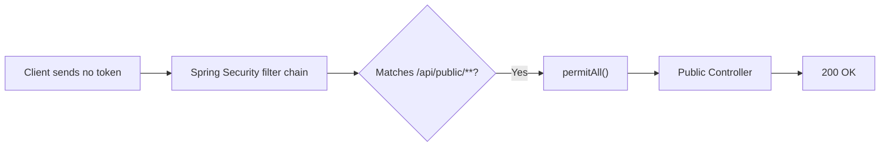
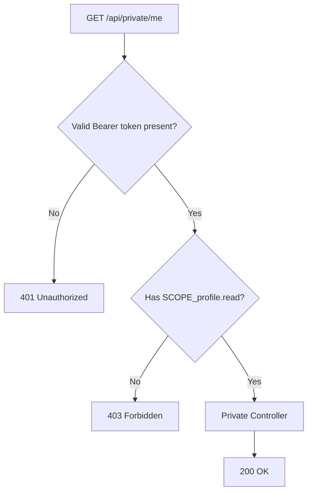
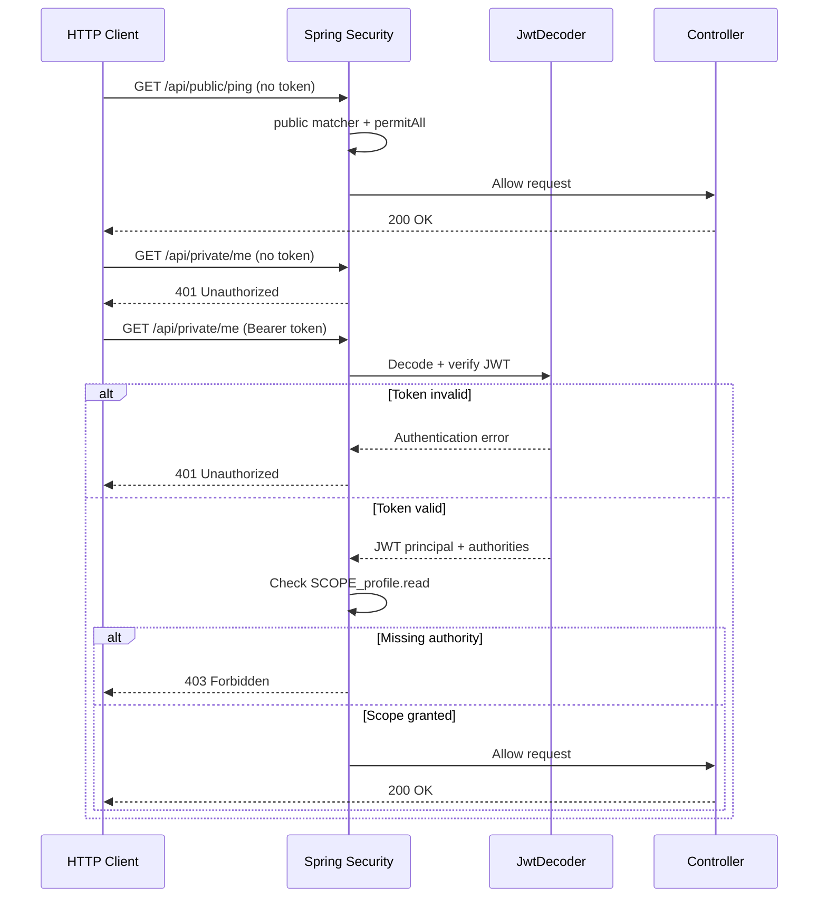

# Verifying a Public Request and a Protected Request

## 1. Practice Objective

When starting to configure a **Spring Security OAuth 2.0 Resource Server**, the first thing to verify is that the API cleanly distinguishes two cases:

1. A **public request** is allowed without sending an access token.
2. A **protected request** is processed only when a valid Bearer access token is present and satisfies the authorization policy.

In this lesson, we build a minimal Spring Boot application with two endpoints:

| Endpoint | Purpose | Policy |
|---|---|---|
| `GET /api/public/ping` | Health/liveness check for the API | `permitAll()`, no token required |
| `GET /api/private/me` | Return authenticated subject details | Requires a JWT access token with `SCOPE_profile.read` authority |

Observable targets are:

- Sending `GET /api/public/ping` **without a token** → `200 OK`.
- Sending `GET /api/private/me` **without a token** → `401 Unauthorized`.
- Sending `GET /api/private/me` **with an invalid Bearer token** → `401 Unauthorized`.
- Sending `GET /api/private/me` **with a valid access token and `profile.read` scope** → `200 OK`.
- Sending `GET /api/private/me` **with a valid access token lacking `profile.read`** → `403 Forbidden`.

The extra cases clearly separate **token authentication** from **authorization**. This lesson focuses on bootstrapping, configuring, and verifying behavior at the Resource Server; login and token issuance belong to the Authorization Server.

> **Prerequisite:** To verify real JWT signatures with `curl`, you need an active Authorization Server or OIDC Provider and a real access token issued for the API. Fake tokens in the examples only exercise failure paths. The MockMvc tests below let you verify routing rules without obtaining a real token, though they do not replace real JWT signature verification.

## 2. How Do Public and Protected Requests Flow Through Spring Security?

A REST API typically has both public resources and protected resources. Spring Security uses `SecurityFilterChain` to process HTTP requests and decide whether to let them reach a Controller.

### 2.1. Public Request

Example:

```http
GET /api/public/ping HTTP/1.1
Host: localhost:8080
Accept: application/json
```

When configured with `requestMatchers("/api/public/**").permitAll()`, requests without credentials can still reach the Controller.



`permitAll()` means **no authorization permissions are required for the matched path**. It does not mean the entire Spring Security filter chain is disabled or that invalid credentials will be ignored.

### 2.2. Protected Request

Example:

```http
GET /api/private/me HTTP/1.1
Host: localhost:8080
Authorization: Bearer <access-token>
Accept: application/json
```

For a protected endpoint, the Resource Server must:

1. Extract the Bearer token from the request.
2. Verify the JWT using the decoder and trusted keys.
3. Validate relevant claims, such as `iss`, expiration, and `aud` if the API enforces audience binding.
4. Convert the verified details into an `Authentication` and authorities.
5. Check which scopes/authorities the endpoint requires.
6. Allow the Controller to execute only when all conditions pass.



**`401` and `403` are two distinct outcomes:** `401` typically indicates the request lacks accepted authentication; `403` indicates the request is authenticated but lacks permission to perform the action.

## 3. Preparing the Spring Boot Project

### 3.1. Environment Requirements

Use:

- A JDK compatible with your project's Spring Boot version, e.g., Java 17 or later for the Spring Boot 3.x line.
- Gradle or Maven matching your project setup.
- A Spring Web and Spring Security application.
- An OAuth 2.0/OIDC Authorization Server able to issue **JWT access tokens** for the Resource Server, or an equivalent test environment.
- An HTTP client tool such as `curl`, Postman, or PowerShell `curl.exe`.

Examples in this lesson use **modern Spring Security with `SecurityFilterChain`** and lambda DSL. Exact packages, APIs, and configuration options must align with your project's Spring Boot/Spring Security version.

### 3.2. Adding Dependencies

With Gradle, add the required starters to `build.gradle`:

```groovy
dependencies {
    implementation 'org.springframework.boot:spring-boot-starter-web'
    implementation 'org.springframework.boot:spring-boot-starter-security'
    implementation 'org.springframework.boot:spring-boot-starter-oauth2-resource-server'
}
```

If using Maven, declare the corresponding starters:

```xml
<dependencies>
    <dependency>
        <groupId>org.springframework.boot</groupId>
        <artifactId>spring-boot-starter-web</artifactId>
    </dependency>
    <dependency>
        <groupId>org.springframework.boot</groupId>
        <artifactId>spring-boot-starter-security</artifactId>
    </dependency>
    <dependency>
        <groupId>org.springframework.boot</groupId>
        <artifactId>spring-boot-starter-oauth2-resource-server</artifactId>
    </dependency>
</dependencies>
```

These snippets assume the project already has the Spring Boot plugin, version, and dependency management configured. Never manually mix Spring Security versions incompatible with the BOM managed by Spring Boot.

### 3.3. Sample Class Layout

A minimal app can organize its files as follows:

```text
src/main/java/com/example/resourceapi/
├── ResourceApiApplication.java
├── SecurityConfig.java
└── ApiController.java

src/main/resources/
└── application.yml
```

Classes share the root package `com.example.resourceapi` so Spring Boot discovers the Controller and configuration automatically.

## 4. Creating Two Endpoints to Test

### 4.1. Application Entry Point

```java
package com.example.resourceapi;

import org.springframework.boot.SpringApplication;
import org.springframework.boot.autoconfigure.SpringBootApplication;

@SpringBootApplication
public class ResourceApiApplication {
    public static void main(String[] args) {
        SpringApplication.run(ResourceApiApplication.class, args);
    }
}
```

### 4.2. Controller with One Public API and One Protected API

```java
package com.example.resourceapi;

import java.util.Map;
import org.springframework.security.core.annotation.AuthenticationPrincipal;
import org.springframework.security.oauth2.jwt.Jwt;
import org.springframework.web.bind.annotation.GetMapping;
import org.springframework.web.bind.annotation.RestController;

@RestController
public class ApiController {

    // Public endpoint: works even without an access token.
    @GetMapping("/api/public/ping")
    public Map<String, String> ping() {
        return Map.of(
            "status", "ok",
            "endpoint", "public"
        );
    }

    // Protected endpoint: accessible only after the JWT is accepted.
    @GetMapping("/api/private/me")
    public Map<String, String> me(@AuthenticationPrincipal Jwt jwt) {
        return Map.of(
            "status", "ok",
            "endpoint", "protected",
            "subject", jwt.getSubject()
        );
    }
}
```

Using `@AuthenticationPrincipal Jwt` on the protected endpoint matches a JWT Resource Server configuration. This example assumes issued access tokens contain a valid `sub` claim so `jwt.getSubject()` returns a non-null subject identifier.

There is no login or token-issuance code here. Clients must obtain an access token from the Authorization Server and present it to the API.

If the API uses opaque access tokens via introspection instead of JWTs, adjust the principal type and claim retrieval to the corresponding Authentication type.

## 5. Configuring Spring Security to Distinguish Both Paths

Create `SecurityConfig.java`:

```java
package com.example.resourceapi;

import org.springframework.context.annotation.Bean;
import org.springframework.context.annotation.Configuration;
import org.springframework.http.HttpMethod;
import org.springframework.security.config.Customizer;
import org.springframework.security.config.annotation.web.builders.HttpSecurity;
import org.springframework.security.config.http.SessionCreationPolicy;
import org.springframework.security.web.SecurityFilterChain;

@Configuration
public class SecurityConfig {

    @Bean
    SecurityFilterChain apiSecurity(HttpSecurity http) throws Exception {
        return http
            .csrf(csrf -> csrf.disable())
            .sessionManagement(session -> session
                .sessionCreationPolicy(SessionCreationPolicy.STATELESS))
            .authorizeHttpRequests(authorize -> authorize
                .requestMatchers(
                    HttpMethod.GET, "/api/public/ping"
                ).permitAll()

                .requestMatchers(
                    HttpMethod.GET, "/api/private/me"
                ).hasAuthority("SCOPE_profile.read")

                .anyRequest().denyAll()
            )
            .oauth2ResourceServer(oauth2 ->
                oauth2.jwt(Customizer.withDefaults()))
            .build();
    }
}
```

Key settings to understand:

| Configuration | Effect |
|---|---|
| `requestMatchers(GET, "/api/public/ping").permitAll()` | Allows public GET without authentication |
| `requestMatchers(GET, "/api/private/me").hasAuthority("SCOPE_profile.read")` | Requires authentication and matching scope |
| `anyRequest().denyAll()` | Denies any request not matching the rules above |
| `oauth2ResourceServer(...jwt(...))` | Enables JWT Bearer token authentication |
| `SessionCreationPolicy.STATELESS` | Does not rely on HTTP sessions to maintain login state |
| `csrf.disable()` | Disables CSRF in this pure Bearer-header API example using no auth cookies |

**Matcher order matters.** Declare specific rules before general rules. If `anyRequest().authenticated()` or an overarching rule is placed before `permitAll`, public access will not behave as intended or configuration may fail depending on syntax.

Disabling CSRF here applies only to REST API architectures **that do not use browser cookies for authentication**. If using sessions/cookies or flows where browsers attach credentials automatically, design proper CSRF protection instead of copying this setting mechanically.

### Why `SCOPE_profile.read`?

With Spring Security's standard default scope mapping, a JWT containing:

```json
{
  "scope": "profile.read"
}
```

is mapped to the authority:

```text
SCOPE_profile.read
```

Some Authorization Servers use `scp` instead of `scope`. If the claim name, scope format, or authority prefix differs from defaults, configure a `JwtAuthenticationConverter` matching the token contract. The Resource Server must rely on permissions issued by the issuer, never trusting a scope sent in a self-chosen client HTTP header.

If an exercise only wants to verify valid tokens without checking scopes yet, replace `hasAuthority("SCOPE_profile.read")` with `authenticated()`. Valid tokens without scopes will then pass endpoint authorization, and the missing-scope `403` case in this lesson's matrix will no longer trigger.

## 6. Configuring the Trusted JWT Issuer

Place in `src/main/resources/application.yml`:

```yaml
server:
  port: 8080

spring:
  security:
    oauth2:
      resourceserver:
        jwt:
          issuer-uri: https://id.example.com/realms/shop
```

The address `https://id.example.com/realms/shop` is an **example** and must be replaced with the exact issuer published by your Authorization Server or OIDC Provider.

When using `issuer-uri`, Spring Security looks up the issuer's metadata, locates the JWKS endpoint, and verifies JWTs using keys published by that trusted source. JWTs are typically validated for signature, issuer, and time constraints per framework configuration.

Requirements for testing with a real token:

1. The issuer in `application.yml` matches `iss` in the issued JWT.
2. The Resource Server can fetch trusted verification keys from the matching issuer/JWKS.
3. The access token has not expired and satisfies time constraints.
4. The token carries scope `profile.read` to pass `/api/private/me` authorization.
5. For secure API design, the token must be issued for **this API's audience**; adding an audience validator is shown in section 11.

If the issuer does not exist, metadata is malformed, or the Resource Server cannot fetch required keys, the app may fail configuration/startup or fail token verification depending on config and version. That differs from a `401` caused by a request genuinely missing a token.

## 7. Starting the Resource Server

With the project's Gradle wrapper:

```bash
./gradlew bootRun
```

With the Maven wrapper:

```bash
./mvnw spring-boot:run
```

On Windows, use `gradlew.bat bootRun` or `mvnw.cmd spring-boot:run` respectively.

Once the app starts and listens on port `8080`, open another terminal to send the requests in the following sections.

Note: This lesson provides commands to run in your own environment. Verifying the API with real requests requires a live issuer, token, and running application; you cannot conclude a system works merely from reading config files.

## 8. Verifying the Public Request: Sending No Token

### 8.1. Sending the HTTP Request

Using `curl`:

```bash
curl -i http://localhost:8080/api/public/ping
```

Depending on version/transport, output looks similar to:

```http
HTTP/1.1 200 OK
Content-Type: application/json

{"status":"ok","endpoint":"public"}
```

`-i` tells `curl` to display both the status line and response headers. JSON field order or extra headers may vary. What to observe:

- HTTP status = **`200 OK`**.
- Response body contains the payload returned by `ping()`.
- The request **has no Authorization header**.
- The Controller executed even without a token.

This is request/response-level evidence that the `permitAll()` matcher allows the public endpoint.

### 8.2. Why Does `200` Matter?

Per configuration, `SecurityFilterChain` sees `GET /api/public/ping` matching `permitAll()`. Because the endpoint requires no authentication, Spring Security does not force the client to supply a JWT before responding.

However, `200` only verifies this public endpoint's behavior. It **does not prove** other endpoints are protected; you must still test a tokenless request against the protected endpoint.

### 8.3. Watch Paths and HTTP Methods

This example only opens **GET** on the exact path `/api/public/ping`. Sending `POST /api/public/ping` is not automatically permitted by the GET rule, nor is there a POST handler in the Controller.

When testing for real, distinguish:

- `404 Not Found`: no matching route or wrong path.
- `405 Method Not Allowed`: route exists but does not support the HTTP method.
- `401 Unauthorized`: request is unauthenticated.
- `403 Forbidden`: access permission denied.

An unexpected HTTP status may come from Controller mappings or `SecurityFilterChain` policies; do not assume every HTTP error is a JWT issue.

## 9. Verifying the Protected Request: Sending No Token

Send:

```bash
curl -i http://localhost:8080/api/private/me
```

Expected response:

```http
HTTP/1.1 401 Unauthorized
WWW-Authenticate: Bearer
```

The response body may be empty or vary with exception handling configuration. What matters is HTTP status **`401`**; the Resource Server blocks unauthenticated requests from reaching `me()`.

Why?

1. Path and method match the `hasAuthority("SCOPE_profile.read")` rule.
2. The request carries no Bearer token.
3. Spring Security has no valid Authentication satisfying the rule.
4. The request is rejected; the Bearer authentication entry point responds with `401`.

If you get `200 OK` instead, a broad `permitAll` rule may cover the endpoint or another filter chain may be matching first. If you get `404`, check the Controller path. If the app is not listening on the port, resolve startup errors before evaluating HTTP statuses.

## 10. Verifying That an Invalid Token Is Rejected

Send a string that is clearly not a valid JWT:

```bash
curl -i \
  -H 'Authorization: Bearer not-a-valid-jwt' \
  http://localhost:8080/api/private/me
```

Expected response:

```http
HTTP/1.1 401 Unauthorized
WWW-Authenticate: Bearer error="invalid_token"
```

This is an illustrative output. The exact `WWW-Authenticate` value may include another error description or custom framework formatting. Either way, a protected endpoint given an invalid Bearer token must reject the request instead of returning data.

Unlike the request in section 9, this request **includes** an Authorization header, yet the token cannot be accepted because its format/signature is invalid or it fails JWT validation.

Never try to "fix" this by changing `/api/private/me` to `permitAll()`. If a real access token still returns `401`, inspect the issuer, signing keys/JWKS, expiration, and validators.

## 11. Verifying a Valid Access Token and Matching Scope

### 11.1. Where Must the Access Token Come From?

The client must obtain an access token from the configured Authorization Server with permission to call the API. For example:

- A user-facing app uses **Authorization Code + PKCE** to obtain a token after proper authorization.
- A backend may use **Client Credentials** if the issuer authorizes that Client to access the API and grants the `profile.read` scope by design.

Both grant types are how the Client **acquires a token**; the Resource Server in this lesson only **receives and verifies the access token**.

Never use an **OIDC ID token** instead of an access token to call an API. An ID token is meant for the OIDC Client and typically has the Client ID as its audience, not necessarily authorized for the Resource Server.

Example valid access token payload under this illustrative contract:

```json
{
  "iss": "https://id.example.com/realms/shop",
  "sub": "user-417",
  "aud": ["resource-api"],
  "exp": 1893456000,
  "scope": "profile.read"
}
```

The `exp` value is illustrative and does not by itself make a token valid. A hand-crafted JSON payload without a real signature from the issuer is **insufficient** to access the endpoint. These claims must come inside an authentic access token issued by the trusted Authorization Server.

### 11.2. Sending a Request with a Bearer Token

In a Bash-like shell, assign the legitimately issued access token to an environment variable:

```bash
export ACCESS_TOKEN='<access-token-issued-by-your-authorization-server>'
```

Then invoke:

```bash
curl -i \
  -H "Authorization: Bearer $ACCESS_TOKEN" \
  http://localhost:8080/api/private/me
```

Response **if the token is valid and carries the required scope**:

```http
HTTP/1.1 200 OK
Content-Type: application/json

{"status":"ok","endpoint":"protected","subject":"user-417"}
```

This body corresponds to a token with `sub=user-417`. Tokens from a real issuer may carry a different subject. Receiving `200` and the body from `me()` proves the request passed both the configured authentication and authorization chain.

**Never commit real tokens**, paste them into public issues, put them in URLs, or log them verbatim. A Bearer access token can be replayed by anyone holding it while valid; always use HTTPS over networks.

### 11.3. When the Token Is Valid Yet Lacks `profile.read`

Suppose a token from the same issuer, unexpired, with the right audience, carries only:

```json
{
  "scope": "orders.read"
}
```

That token can **authenticate successfully**, yet lacks the `SCOPE_profile.read` authority. Therefore `GET /api/private/me` must be denied with **`403 Forbidden`**:

```http
HTTP/1.1 403 Forbidden
WWW-Authenticate: Bearer error="insufficient_scope"
```

Exact header details depend on config/framework, but the core meaning is **the token was accepted for authentication, yet lacks sufficient endpoint permissions**.

You cannot simulate this `403` branch simply by editing a valid token's payload: doing so breaks the signature and triggers `401`. You need a real AS-issued token without the scope, or Spring Security tests that mock Authentication as shown in the next section.

### 11.4. Adding Audience Validation to Confirm the Token Targets This API

Valid issuer and signature alone are not enough in multi-API systems. A token issued for `billing-api` must not be accepted by `resource-api`. To enforce `aud` per the contract above, add a `JwtDecoder` bean:

```java
package com.example.resourceapi;

import org.springframework.context.annotation.Bean;
import org.springframework.context.annotation.Configuration;
import org.springframework.security.oauth2.core.DelegatingOAuth2TokenValidator;
import org.springframework.security.oauth2.core.OAuth2Error;
import org.springframework.security.oauth2.core.OAuth2TokenValidator;
import org.springframework.security.oauth2.core.OAuth2TokenValidatorResult;
import org.springframework.security.oauth2.jwt.Jwt;
import org.springframework.security.oauth2.jwt.JwtDecoder;
import org.springframework.security.oauth2.jwt.JwtDecoders;
import org.springframework.security.oauth2.jwt.JwtValidators;
import org.springframework.security.oauth2.jwt.NimbusJwtDecoder;

@Configuration
public class JwtValidationConfig {

    @Bean
    JwtDecoder jwtDecoder() {
        String issuer = "https://id.example.com/realms/shop";
        String audience = "resource-api";

        NimbusJwtDecoder decoder =
            (NimbusJwtDecoder) JwtDecoders.fromIssuerLocation(issuer);

        OAuth2TokenValidator<Jwt> audienceValidator = jwt ->
            jwt.getAudience().contains(audience)
                ? OAuth2TokenValidatorResult.success()
                : OAuth2TokenValidatorResult.failure(
                    new OAuth2Error(
                        "invalid_token", "Invalid audience", null));

        decoder.setJwtValidator(
            new DelegatingOAuth2TokenValidator<>(
                JwtValidators.createDefaultWithIssuer(issuer),
                audienceValidator
            ));

        return decoder;
    }
}
```

This is an **optional architectural enhancement**, not a prerequisite to quickly test a tokenless public request. The snippet retains the required default issuer/timestamp validators and adds audience checking. When replacing validators manually, never accidentally drop core JWT checks.

Align the `resource-api` audience with the Authorization Server's token-issuance configuration. If tokens are issued with a different audience, fix token issuance rather than removing audience validation to force `200`.

## 12. Automated Test Suite with MockMvc

Testing over HTTP with `curl` shows how the live system handles requests. In a Spring Boot project, you can also write automated tests to verify `permitAll`/`hasAuthority` matchers.

**Testing scope note:** Spring Security Test can **mock JWT Authentication** to test authorization. That technique does not verify real signatures/JWKS/issuers; proving full Resource Server behavior still requires integration tests with a test Authorization Server/real tokens or an appropriate test fixture.

### 12.1. Test Dependencies

With Gradle:

```groovy
dependencies {
    testImplementation 'org.springframework.boot:spring-boot-starter-test'
    testImplementation 'org.springframework.security:spring-security-test'
}
```

If your project uses another test starter managed by your Spring Boot version, use dependencies compatible with your setup.

### 12.2. Testing 200, 401, and 403 on the Same SecurityFilterChain

Example test using JUnit 5 and Spring MockMvc:

```java
package com.example.resourceapi;

import org.junit.jupiter.api.Test;
import org.springframework.beans.factory.annotation.Autowired;
import org.springframework.boot.test.autoconfigure.web.servlet.AutoConfigureMockMvc;
import org.springframework.boot.test.context.SpringBootTest;
import org.springframework.http.MediaType;
import org.springframework.security.core.authority.SimpleGrantedAuthority;
import org.springframework.test.web.servlet.MockMvc;

import static org.springframework.security.test.web.servlet.request
    .SecurityMockMvcRequestPostProcessors.jwt;
import static org.springframework.test.web.servlet.request
    .MockMvcRequestBuilders.get;
import static org.springframework.test.web.servlet.result
    .MockMvcResultMatchers.*;

@SpringBootTest
@AutoConfigureMockMvc
class ApiAccessTest {

    @Autowired
    MockMvc mvc;

    @Test
    void publicEndpointWorksWithoutToken() throws Exception {
        mvc.perform(get("/api/public/ping"))
            .andExpect(status().isOk())
            .andExpect(content().contentTypeCompatibleWith(
                MediaType.APPLICATION_JSON))
            .andExpect(jsonPath("$.endpoint").value("public"));
    }

    @Test
    void privateEndpointWithoutTokenReturns401() throws Exception {
        mvc.perform(get("/api/private/me"))
            .andExpect(status().isUnauthorized());
    }

    @Test
    void privateEndpointWithScopeReturns200() throws Exception {
        mvc.perform(get("/api/private/me")
                .with(jwt()
                    .jwt(builder -> builder.subject("user-417"))
                    .authorities(new SimpleGrantedAuthority(
                        "SCOPE_profile.read"))))
            .andExpect(status().isOk())
            .andExpect(jsonPath("$.subject").value("user-417"));
    }

    @Test
    void privateEndpointWithoutScopeReturns403() throws Exception {
        mvc.perform(get("/api/private/me")
                .with(jwt()
                    .jwt(builder -> builder.subject("user-417"))
                    .authorities(new SimpleGrantedAuthority(
                        "SCOPE_orders.read"))))
            .andExpect(status().isForbidden());
    }
}
```

These tests directly verify the authorization rules in `SecurityFilterChain`. `with(jwt())` creates a simulated JWT principal at the test layer rather than generating a real signed JWT.

If the Spring test context tries to initialize a decoder from a nonexistent issuer, supply a test configuration with a mock `JwtDecoder` or a test issuer/JWKS appropriate for your project. Never assume a test using `with(jwt())` proves production JWKS configuration works.

### 12.3. Real Verification Still Needs Valid and Invalid Tokens

The four tests above confirm:

- `permitAll()` allows the public endpoint without a JWT.
- The protected endpoint returns `401` without credentials.
- A simulated JWT Authentication with `SCOPE_profile.read` passes the endpoint.
- A simulated Authentication lacking the authority receives `403`.

In addition, verify **one real signed access token** and **one invalid token** over real HTTP. Simulated test suites do not replace verifying signatures, issuers/audiences, JWKS synchronization, and token lifetimes in the Resource Server.

## 13. Request Matrix for Evaluating Behavior

| # | Path | Authorization header | Token condition | Expected outcome |
|---|---|---|---|---|
| 1 | `GET /api/public/ping` | Omitted | No token | **200 OK** |
| 2 | `GET /api/private/me` | Omitted | No token | **401 Unauthorized** |
| 3 | `GET /api/private/me` | `Bearer not-a-valid-jwt` | Invalid token | **401 Unauthorized** |
| 4 | `GET /api/private/me` | Real Bearer token | Unexpired, matching issuer and audience, has `profile.read` | **200 OK** |
| 5 | `GET /api/private/me` | Real Bearer token | Valid, yet missing `profile.read` | **403 Forbidden** |
| 6 | `GET /api/private/me` | Expired Bearer JWT | `exp` no longer valid | **401 Unauthorized** |
| 7 | `GET /api/private/me` | Wrong-issuer Bearer JWT | Untrusted issuer | **401 Unauthorized** |
| 8 | `GET /api/private/me` | Wrong-audience Bearer JWT | Audience validator enabled | **401 Unauthorized** |
| 9 | `GET /api/public/ping` | Invalid Bearer token | Filter attempts to authenticate the sent token | **Typically 401**, despite `permitAll()` |
| 10 | `GET /api/public/ping` | Valid Bearer token | Scope not needed for public | **200 OK** |

Row 9 often causes confusion. A `permitAll()` endpoint does not mean the system ignores a Bearer token **that was sent anyway**. When a request carries `Authorization: Bearer ...` and the Resource Server filter processes it, an invalid token can fail the request **before** endpoint authorization runs. To verify a public route works, send a request truly **without a token**, as required here.

In applications with multiple `SecurityFilterChain` beans, you can dedicate a separate chain to public routes. In that case, behavior on invalid tokens depends on the selected chain; inspect your actual configuration before drawing conclusions.

## 14. Interpreting Results Layer by Layer

You can remember the processing sequence like this:



From HTTP outcomes, you can deduce:

**`200` on public:** The public matcher allowed the request, and the Controller exists and succeeded. Says nothing about protected endpoints yet.

**`401` on tokenless protected:** The API enforces authentication for this endpoint and rejected the unauthenticated request.

**`401` with a bad token:** The Resource Server rejected the token. Check format, signature, issuer, audience, and expiration per configured validators.

**`403` with a valid token lacking scope:** Authentication succeeded, yet authorization denied the request; inspect `scope`/`scp` claims and authority mapping rather than disabling security.

**`200` on protected with a valid token:** The request passed the app's endpoint authentication and authorization rules. If the Controller accesses business data, also enforce object-level checks such as ownership or tenant isolation.

## 15. Common Configuration Mistakes When Verifying Both Requests

### 15.1. Public Endpoint Unexpectedly Returns 401

Possible causes:

- Route does not match `requestMatchers`.
- Another filter chain in the configuration is being selected.
- The client accidentally sent an `Authorization` header with an invalid Bearer token, failing token authentication.
- Another security component adds an authentication requirement or a reverse proxy rejects the call before Spring Boot.

Test with a request genuinely lacking `Authorization`, using the exact HTTP method and URL. Inspect matcher order and active filter chains.

### 15.2. Tokenless Protected Endpoint Still Returns 200

This signals a policy problem to review immediately:

- An overly broad `permitAll()` matcher covers `/api/private/me`.
- The request enters a chain without the intended authentication rules.
- The Controller or tested path differs from the protected path in config.
- An upstream layer responds instead of the endpoint under test.

Use explicit matchers and a strict default fallback such as `anyRequest().denyAll()` to avoid accidentally exposing unreviewed endpoints.

### 15.3. Real Token Always Returns 401

Possible causes:

- `issuer-uri` differs completely or in path details from the `iss` claim.
- Metadata/JWKS is unreachable or the matching key cannot be found.
- Token is expired, before `nbf`, or server clocks have significant skew.
- An OIDC ID token was mistakenly sent instead of an access token.
- Token is for another audience while the API enforces an audience validator.
- Signing algorithm or key is rejected by the decoder.

Verify the issuer and trust configuration; never use a decoder that accepts arbitrary signatures or disable validation just to force requests to pass.

### 15.4. Real Token Returns 403 Even Though the JWT Looks Right

A token with a `scope` other than `profile.read` will not satisfy `hasAuthority("SCOPE_profile.read")`. If scopes use an array format or a custom claim name, configure a matching `JwtAuthenticationConverter`.

Do not confuse **Client permissions in the Authorization Server** with **authorities extracted by Spring Security from the token**. A scope only takes effect at the API when actually issued in the token, mapped properly, and enforced by the endpoint policy.

### 15.5. Postman Succeeds, Browser Fails with CORS Error

CORS is separate from authentication and authorization. For cross-origin browser requests, configure CORS on the API for allowed origins, methods, and headers; `OPTIONS` preflight requests can be blocked if security config does not support CORS.

You cannot fix CORS properly by turning every endpoint into `permitAll()`. Verify both CORS policy and authentication/authorization separately.

### 15.6. Returning 404/405 Instead of 200/401

If the Controller was not scanned, the path is wrong, or the HTTP method mismatches, responses may be `404` or `405`. With `anyRequest().denyAll()`, a request failing to match any policy may be denied by security before MVC routing produces a 404/405.

To avoid noise in this exercise, keep the exact two declared endpoints, `GET` method, port `8080`, and exact paths.

## 16. Running with Windows PowerShell

In Windows PowerShell 5.1, `curl` may be an alias for `Invoke-WebRequest` and does not accept the same flags as standard Linux/macOS `curl`. To use `curl -i` consistently, call `curl.exe` explicitly:

```powershell
# Public endpoint
curl.exe -i http://localhost:8080/api/public/ping

# Protected endpoint, no token
curl.exe -i http://localhost:8080/api/private/me

# Protected endpoint, invalid token
curl.exe -i -H "Authorization: Bearer not-a-valid-jwt" http://localhost:8080/api/private/me
```

When you have a real access token and want to test the protected endpoint in PowerShell:

```powershell
$accessToken = "<access-token-from-authorization-server>"
curl.exe -i -H "Authorization: Bearer $accessToken" http://localhost:8080/api/private/me
```

Never save real access tokens in committed or shared scripts. In production, never send Bearer tokens over plain HTTP; the localhost URLs here are for local testing only.

## 17. Extending After Verifying Both Requests

Once public `200` and protected `401`/`200` behave as expected, you can expand your Resource Server configuration:

- **Action-based scopes:** `orders.read` for GET, `orders.write` for POST/PUT.
- **Specific audiences:** tokens issued for `orders-api` cannot be accepted by `billing-api`.
- **Business data protection:** verify the user owns the record or belongs to an allowed tenant.
- **Opaque tokens:** replace `jwt()` with introspection if your Authorization Server issues opaque access tokens.
- **Frontend integration:** configure CORS and safe Client storage/transmission of Bearer tokens.
- **Diagnostics:** track HTTP statuses, error codes, request IDs, and applied policies without logging raw tokens.

These are the next steps when applying Resource Server to a real API; you do not need all of them just to verify the first two requests.

## 18. Self-Check Questions

**Q1.** Why must you send a public request **without a token** to verify `permitAll()`?

**Answer:** It directly tests that the endpoint requires no authentication. An invalid Bearer token sent to a public endpoint can still be rejected by the token authentication filter.

**Q2.** What does a `401` on a tokenless protected endpoint indicate?

**Answer:** Spring Security is requiring an accepted Authentication before allowing access to that endpoint.

**Q3.** Why can an already-authenticated token still return `403`?

**Answer:** The token lacks the `SCOPE_profile.read` authority or fails another authorization rule. Token authentication and action authorization are separate steps.

**Q4.** Does MockMvc's `with(jwt())` test prove a real JWT was signed with the right key?

**Answer:** No. It simulates a JWT Authentication to test authorization; real tokens and a real decoder/JWKS are needed to verify signature validation.

**Q5.** Is `issuer-uri` alone enough to ensure a token was issued for a specific API?

**Answer:** No. Bind the audience per the Resource Server contract if the API must reject tokens issued for other services.

**Q6.** If `GET /api/public/ping` returns `200`, can you conclude the whole API is properly secured?

**Answer:** No. You must separately verify that protected endpoints reject missing and invalid tokens while accepting valid tokens with sufficient permissions.

## 19. Conclusion

With a Spring Security OAuth 2.0 Resource Server, the clearest initial check is creating one **public** endpoint and one **protected** endpoint, then sending requests and observing HTTP statuses.

Configuring `permitAll()` lets the public endpoint return **`200 OK`** without a token. Configuring `oauth2ResourceServer(...jwt(...))` combined with `hasAuthority("SCOPE_profile.read")` causes the protected endpoint to reject missing or invalid tokens with **`401 Unauthorized`**, reject valid tokens lacking permissions with **`403 Forbidden`**, and allow valid, authorized tokens through to the Controller to return **`200 OK`**.

This exercise verifies access boundaries at the HTTP and Spring Security level; in a real application, continue enforcing issuer, audience, token lifetime, and domain-specific data permissions before considering the API fully secured.
