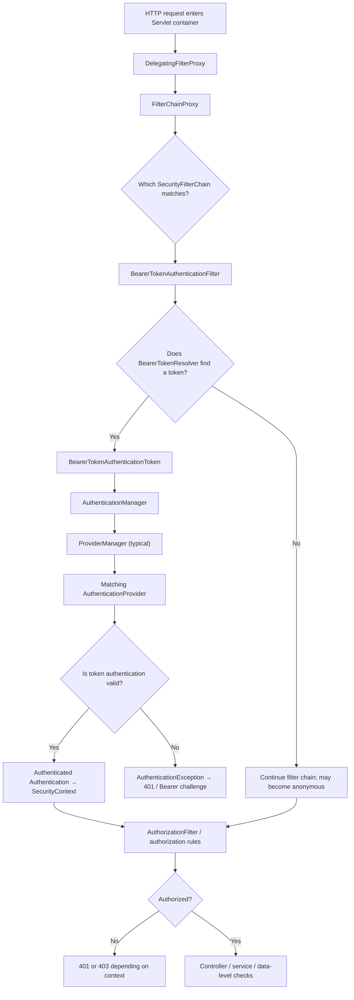
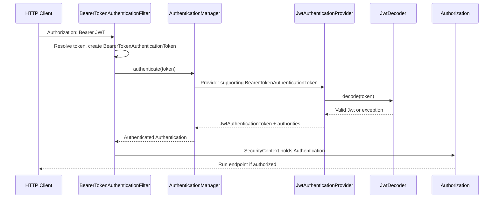
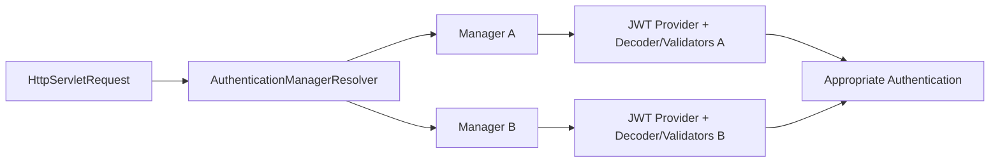

# AuthenticationManager, ProviderManager, and Provider Selection

## 1. Where AuthenticationManager Sits in the Servlet Processing Chain

In a Spring Security application using the **Servlet stack**, an HTTP request passes through a chain of servlet filters before entering a controller. When the request carries login credentials or a Bearer access token, an authentication filter creates an initial `Authentication` object and passes it to **`AuthenticationManager`** for verification.

Three commonly confused concepts:

- **`AuthenticationManager`:** the interface that accepts an `Authentication` and attempts to authenticate it. It is the authentication coordination point used by filters.
- **`ProviderManager`:** the standard `AuthenticationManager` implementation, coordinating a list of `AuthenticationProvider`s.
- **`AuthenticationProvider`:** a component that knows how to authenticate **one or more specific `Authentication` types**; for example, a provider that validates JWTs, introspects opaque tokens, or verifies username/password credentials.

In an OAuth 2.0 Resource Server, `BearerTokenAuthenticationFilter` typically constructs a `BearerTokenAuthenticationToken` from the `Authorization: Bearer ...` header. A matching provider validates the access token and returns an authenticated `Authentication` for Spring Security to store in `SecurityContext`.

**Core rule:** the filter **collects credentials and initiates authentication**; `AuthenticationManager` **coordinates authentication**; the provider **performs authentication**; and the **authorization** step afterward decides whether the request is permitted to enter the API.

### 1.1. Illustrative Scenario

Suppose an orders API requires a Bearer access token:

```http
GET /api/orders/123 HTTP/1.1
Host: api.example.test
Authorization: Bearer <access-token>
```

The Resource Server needs to:

1. Recognize the Bearer credential on the request.
2. Verify the token's signature/validity and ensure it matches the API's issuer, audience, and token profile.
3. Convert permission claims into Spring Security authorities.
4. Store the authentication result in the security context for the current request.
5. Enforce rules such as `SCOPE_orders:read`, and only then run the controller if permitted.

None of these steps require the controller to manually decode tokens or select a JWT provider with `if` statements.

## 2. Overall Flow from HTTP Request to Provider



`DelegatingFilterProxy` bridges the Servlet container to Spring's filter bean. `FilterChainProxy` selects one `SecurityFilterChain` using each chain's `RequestMatcher`. In an application with multiple chains, **the first matching chain** is used; other chains are not sequentially combined to authenticate the same request.

This diagram illustrates the common Bearer token path. The exact ordering and presence of individual filters depend on Spring Security configuration, so always inspect the actual filter chain configuration to understand what is deployed.

### 2.1. Authentication and Authorization Are Two Separate Stages

| Stage | Question | Typical components | Common errors |
| --- | --- | --- | --- |
| Credential extraction | Does the request carry a Bearer token in an allowed location? | `BearerTokenResolver`, `BearerTokenAuthenticationFilter` | Request error or missing credential. |
| Authentication | Is the credential genuine and valid for this system? | `AuthenticationManager`, `ProviderManager`, `JwtAuthenticationProvider` or `OpaqueTokenAuthenticationProvider` | `401 invalid_token` or another authentication failure. |
| Authorization | Is the authenticated principal permitted to call the endpoint? | `AuthorizationFilter`, `AuthorizationManager`, method security | Typically `403 Forbidden` when the token is valid but lacks permission. |
| Data-level authorization | May the principal view/modify this specific order, tenant, or resource? | Service/domain policy, query constraints, method security | By design: 403, 404, or appropriate business error. |

A **successfully authenticated** token does not automatically grant access to every endpoint. Conversely, a request **missing a Bearer token** is not a JWT decoding error: the filter can let the request proceed, and authorization then requires authentication.

## 3. What Does the AuthenticationManager Interface Actually Do?

In Spring Security, `AuthenticationManager` has one core operation:

```java
public interface AuthenticationManager {
    Authentication authenticate(Authentication authentication)
            throws AuthenticationException;
}
```

The input `Authentication` represents an untrusted credential or an authentication request. For example:

- `UsernamePasswordAuthenticationToken`: username/password from form login or Basic authentication.
- `BearerTokenAuthenticationToken`: Bearer token string extracted from an HTTP request.
- Other `Authentication` types created by login mechanisms or the application.

If authentication succeeds, the manager returns an `Authentication` containing a principal, authorities, and an authenticated state. If it fails, the manager throws an appropriate `AuthenticationException`. Within `ProviderManager`, providers can also return `null` internally to pass the opportunity to the next provider.

**`AuthenticationManager` is not necessarily a provider itself.** It is the coordination layer. An implementation may invoke one provider, multiple providers, or delegate to a parent manager.

### 3.1. Authentication Before and After Verification

For a JWT access token, the transformation looks like this:

```text
Input:
  BearerTokenAuthenticationToken
  principal/credentials: unverified access token string
  authenticated: false

  AuthenticationManager.authenticate(...)
      → JwtAuthenticationProvider
      → JwtDecoder + validators
      → JwtAuthenticationConverter

Output:
  JwtAuthenticationToken
  principal: Jwt verified by decoder
  authorities: e.g. SCOPE_orders:read
  authenticated: true
```

For an opaque access token, the provider can return `BearerTokenAuthentication` containing a principal modeled from the introspected token. The exact principal type and authorities differ from JWT, but controllers and authorization still see a valid `Authentication` in `SecurityContext`.

Never treat a self-constructed `Authentication` with `authenticated=true` as proof that Spring validated the token. The trusted object must come from a properly configured provider/manager flow.

## 4. ProviderManager: The AuthenticationProvider Coordinator

`ProviderManager` typically takes a list of providers and tries them in configured order. Each provider implements:

```java
public interface AuthenticationProvider {
    Authentication authenticate(Authentication authentication)
            throws AuthenticationException;

    boolean supports(Class<?> authentication);
}
```

**`supports(...)` is a check on the `Authentication` class**, not a check of JWT signature, audience, or scope. It answers the question: "Can this provider handle an `Authentication` object of this class?"

For instance, `JwtAuthenticationProvider` typically supports `BearerTokenAuthenticationToken`, while `DaoAuthenticationProvider` supports `UsernamePasswordAuthenticationToken`. When receiving a Bearer token, the username/password provider is skipped because `supports(...)` does not match.

### 4.1. Conceptual Provider Selection Algorithm

```text
authenticate(authentication):
    for provider in configuredProviders:
        if not provider.supports(authentication.getClass()):
            continue

        try:
            result = provider.authenticate(authentication)
            if result != null:
                return authenticatedResult
        catch AuthenticationException ex:
            remember ex
            continue if the exception class permits trying other providers

    if no local provider authenticated and parent manager is configured:
        try parent.authenticate(authentication)

    if still no result:
        throw a recorded AuthenticationException,
        or ProviderNotFoundException when no suitable provider handled it
```

This is **conceptual pseudocode**, not Spring Security source code to copy into an application. Certain exceptions—especially account status exceptions or internal errors that must stop immediately—cause `ProviderManager` **not to try subsequent providers**. Exact exception rules depend on the Spring Security implementation in use.

Key points:

1. Providers where `supports(...) == false` are skipped.
2. A provider that supports the type but returns `null` indicates it **cannot decide/handle that specific object**, so the manager can try another provider.
3. A provider that authenticates successfully returns a valid `Authentication`; the manager stops and uses that result.
4. A provider may throw `AuthenticationException`. For certain failure types, the manager may continue to other providers; for fail-fast exceptions, it does not.
5. If no provider can handle it, `ProviderNotFoundException` may be thrown.
6. If a **parent `AuthenticationManager`** is configured, `ProviderManager` may try the parent after local providers fail to authenticate, except on early-stop failures.

### 4.2. When Does Provider Order Matter?

| Provider list | Input `Authentication` | Situation |
| --- | --- | --- |
| `DaoAuthenticationProvider` then `JwtAuthenticationProvider` | `BearerTokenAuthenticationToken` | DAO does not support this token type; JWT provider is evaluated. |
| `JwtAuthenticationProvider` then `DaoAuthenticationProvider` | `UsernamePasswordAuthenticationToken` | JWT provider does not support it; DAO provider is evaluated. |
| Two custom providers both supporting `OneTimeCodeAuthenticationToken` | `OneTimeCodeAuthenticationToken` | Ordering and how each provider returns `null`/throws can affect the outcome. |
| JWT provider and opaque provider both supporting `BearerTokenAuthenticationToken` | Bearer token | **Both could participate**; there is no built-in guarantee that "guessing" whether a token is JWT or opaque is safe. |

When multiple providers support **the same class**, `ProviderManager` does not inspect `iss`, `aud`, or token prefixes before trying providers. Those belong to credential validation inside the provider/decoder and the manager selection policy.

**Do not rely on "lucky ordering" to support multiple access token types with different trust boundaries.** If an API needs multiple issuers, tenants, or mechanisms, design explicit trust sources and selection mechanisms such as separate filter chains or an `AuthenticationManagerResolver`.

## 5. How Does Spring Security Select a Provider in a Resource Server?

### 5.1. JWT Access Tokens

A typical JWT Resource Server configuration:

```yaml
spring:
  security:
    oauth2:
      resourceserver:
        jwt:
          issuer-uri: https://login.example.test/realms/shop
```

And DSL:

```java
@Configuration
class ApiSecurityConfiguration {

    @Bean
    SecurityFilterChain apiSecurity(HttpSecurity http) throws Exception {
        return http
                .authorizeHttpRequests(auth -> auth
                        .requestMatchers(HttpMethod.GET, "/api/orders/**")
                        .hasAuthority("SCOPE_orders:read")
                        .anyRequest().authenticated())
                .oauth2ResourceServer(oauth2 ->
                        oauth2.jwt(Customizer.withDefaults()))
                .build();
    }
}
```

In this configuration, Spring Security sets up the Bearer JWT authentication path using `JwtDecoder` and the corresponding provider. Conceptual diagram:



`JwtDecoder` checks the signature and configured token constraints. Then `JwtAuthenticationConverter` can map permission claims into `GrantedAuthority` instances, such as mapping `scope: "orders:read"` to `SCOPE_orders:read` under the common default converter.

**Distinguish two levels of verification:** configuring `issuer-uri` typically checks the issuer and standard JWT constraints, yet the API must still enforce the appropriate **audience** and token type/profile. If a JWT was not issued for `orders-api`, a valid signature alone is not enough to permit calling the API.

### 5.2. Opaque Access Tokens

If the Authorization Server issues opaque access tokens, the Resource Server typically calls a **token introspection endpoint**:

```yaml
spring:
  security:
    oauth2:
      resourceserver:
        opaquetoken:
          introspection-uri: https://login.example.test/oauth2/introspect
          client-id: orders-api-introspection
          client-secret: "replace-with-secret-from-secret-manager"
```

```java
@Configuration
class OpaqueApiSecurityConfiguration {

    @Bean
    SecurityFilterChain apiSecurity(HttpSecurity http) throws Exception {
        return http
                .authorizeHttpRequests(auth -> auth
                        .anyRequest().authenticated())
                .oauth2ResourceServer(oauth2 ->
                        oauth2.opaqueToken(Customizer.withDefaults()))
                .build();
    }
}
```

In this model, Spring Security uses `OpaqueTokenAuthenticationProvider` and the corresponding `OpaqueTokenIntrospector`. The provider validates the token based on the introspection response and constructs the appropriate principal and authorities. Required attributes and audience/tenant policies depend on the introspection result and the issuer contract.

The JWT and opaque configurations above are **two alternatives for the same purpose**; do not declare both `SecurityFilterChain` beans simultaneously without matchers and expect each request to pick the right one automatically. If an API must support multiple modes, design an explicit selection mechanism.

### 5.3. Provider Selection Comparison Table

| Input or mechanism | Typical provider | Authentication behavior |
| --- | --- | --- |
| `BearerTokenAuthenticationToken`, JWT Resource Server | `JwtAuthenticationProvider` | Invokes `JwtDecoder`, creates `JwtAuthenticationToken`. |
| `BearerTokenAuthenticationToken`, opaque Resource Server | `OpaqueTokenAuthenticationProvider` | Invokes `OpaqueTokenIntrospector`, creates authentication from introspection result. |
| `UsernamePasswordAuthenticationToken` | `DaoAuthenticationProvider` | Validates user credentials via `UserDetailsService` and `PasswordEncoder`. |
| `OAuth2LoginAuthenticationToken` and OAuth2 Login steps | OAuth2/OIDC Login providers | Authenticates login flow results for an OAuth2 Client; distinct from Bearer API validation. |
| Custom `Authentication` | Custom `AuthenticationProvider` | Applies custom validation rules; should clearly define supported types and trust boundaries. |

A single application can be both an **OIDC Client** for user login and a **Resource Server** protecting APIs. That does **not** mean the same provider handles every request type: the authentication token class, filter chain, and manager used by each filter must match each role.

## 6. Creating a ProviderManager Manually to Understand Coordination

The following plain-Java example focuses on `AuthenticationManager` and `JwtAuthenticationProvider`, not something you should call inside a controller:

```java
JwtAuthenticationProvider jwtProvider =
        new JwtAuthenticationProvider(jwtDecoder);

AuthenticationManager manager =
        new ProviderManager(List.of(jwtProvider));

Authentication requestToken =
        new BearerTokenAuthenticationToken(compactJwtAccessToken);

Authentication result = manager.authenticate(requestToken);

System.out.println(result.isAuthenticated()); // true if authenticate succeeds
```

When the JWT is valid, the provider produces an appropriate result, such as `JwtAuthenticationToken`. When the token has an invalid signature, is expired, or fails issuer/other validators, the manager throws `AuthenticationException`. This example illustrates the relationship between the interfaces and classes.

**In a real web application, do not call the manager manually from controllers in place of `BearerTokenAuthenticationFilter`.** Use `oauth2ResourceServer().jwt()` or `opaqueToken()` so Spring Security wires the proper filter, entry point, and security context.

### 6.1. Not Every AuthenticationManager Bean Is Automatically Used by Filters

This is a common configuration trap: declaring a custom `AuthenticationManager` bean and assuming all authentication filters will use it. Each filter/`SecurityFilterChain` is configured with its own manager or resolver; the Resource Server DSL may build an appropriate manager for JWT/opaque tokens instead of calling the bean a developer just defined.

To change how JWTs are validated, you should usually **supply a custom `JwtDecoder`, `OAuth2TokenValidator`, or `JwtAuthenticationConverter` to the OAuth2 Resource Server configuration**, rather than unnecessarily replacing the entire manager. Any custom manager must be wired explicitly into the filter chain or resolver handling those requests.

## 7. Provider Selection vs. AuthenticationManager Selection

These two mechanisms are easily confused, yet operate at two different layers:

1. `ProviderManager` receives an `Authentication` and chooses **a provider from its list** based on `supports(...)` and authentication results.
2. `AuthenticationManagerResolver<C>` receives a **context** (such as `HttpServletRequest`) and selects **which `AuthenticationManager`** will receive the credential.

In a Servlet-based OAuth2 Resource Server, an `AuthenticationManagerResolver<HttpServletRequest>` can be configured to choose a manager per request. This is especially useful with **multiple trusted issuers** or multi-tenant models.



### 7.1. Why Separate Managers by Issuer?

Suppose an API accepts tokens from:

```text
https://login-a.example.test
https://login-b.example.test
```

The two issuers have separate JWKS endpoints, separate trust boundaries, and different claim conventions. Putting both JWT providers into one `ProviderManager` when both support `BearerTokenAuthenticationToken` subjects provider choice to list ordering and exception handling; there is no guarantee that the matching issuer's provider is tried first automatically.

Instead, use a multi-issuer resolver mechanism. On Spring Security versions supporting this API, for example:

```java
@Configuration
class MultiIssuerApiSecurity {

    @Bean
    SecurityFilterChain apiSecurity(HttpSecurity http) throws Exception {
        AuthenticationManagerResolver<HttpServletRequest> resolver =
                JwtIssuerAuthenticationManagerResolver.fromTrustedIssuers(
                        "https://login-a.example.test",
                        "https://login-b.example.test");

        return http
                .securityMatcher("/api/**")
                .authorizeHttpRequests(auth -> auth
                        .anyRequest().authenticated())
                .oauth2ResourceServer(oauth2 ->
                        oauth2.authenticationManagerResolver(resolver))
                .build();
    }
}
```

This example illustrates an **issuer allowlist**. Check `fromTrustedIssuers` and its builder API against your project's specific Spring Security version. If issuers are dynamic or the library lacks this helper, implement the resolver interface with an explicit issuer whitelist; never "trust" an issuer merely because the JWT claims `iss`.

**Note on unverified tokens:** a resolver may need to inspect part of the `iss` claim prior to signature verification to decide which manager to route to. At that moment, the value read is **untrusted**; use it only as a **lookup hint against a fixed allowlist**, after which the selected decoder must strictly verify the signature, true issuer, audience, timestamps, and policies. Never accept an arbitrary issuer URL and fetch JWKS from an attacker-supplied URL.

### 7.2. Other Partitioning Approaches

- **By path:** each endpoint group has its own `SecurityFilterChain`, e.g., `/api/partner/**` and `/api/internal/**` with different issuers and scopes.
- **By infrastructure-authenticated host/subdomain:** the resolver selects based on trusted tenant routing; headers like `Host`/`X-Forwarded-Host` must be controlled to prevent spoofing.
- **By issuer allowlist:** one resource API accepts tokens from multiple trusted issuers, each with its own validators.

Common principle: choosing the trust domain must be **configured and controlled server-side**, and every token must pass the chosen trust domain's own validation checks.

## 8. Multiple SecurityFilterChains: API Resource Server and Web OIDC Client

A single Spring Boot application can serve:

- `/api/**`: endpoints accepting only Bearer access tokens, operating statelessly.
- Remaining web routes: using `oauth2Login()` for OIDC login and maintaining a web session.

Example:

```java
@Configuration
class SecurityChains {

    @Bean
    @Order(1)
    SecurityFilterChain apiChain(HttpSecurity http) throws Exception {
        return http
                .securityMatcher("/api/**")
                .csrf(AbstractHttpConfigurer::disable)
                .sessionManagement(session -> session
                        .sessionCreationPolicy(SessionCreationPolicy.STATELESS))
                .authorizeHttpRequests(auth -> auth
                        .requestMatchers("/api/public/**").permitAll()
                        .requestMatchers(HttpMethod.GET, "/api/orders/**")
                            .hasAuthority("SCOPE_orders:read")
                        .anyRequest().authenticated())
                .oauth2ResourceServer(oauth2 ->
                        oauth2.jwt(Customizer.withDefaults()))
                .build();
    }

    @Bean
    @Order(2)
    SecurityFilterChain webChain(HttpSecurity http) throws Exception {
        return http
                .authorizeHttpRequests(auth -> auth
                        .requestMatchers("/", "/assets/**").permitAll()
                        .anyRequest().authenticated())
                .oauth2Login(Customizer.withDefaults())
                .build();
    }
}
```

This code assumes appropriate OAuth2 Client and JWT Resource Server configuration; `csrf` is disabled only on the **API chain** designed for Bearer tokens independent of cookies/sessions. If the API has endpoints using cookies or sessions, evaluate CSRF according to the actual application model.

Impact on `AuthenticationManager`:

| Request | First matching chain | Typical authentication mechanism |
| --- | --- | --- |
| `GET /api/orders/123` | `apiChain`, `@Order(1)` | Bearer token → JWT provider. |
| `GET /api/public/health` without token | `apiChain` | No authentication required due to `permitAll()`. |
| `GET /dashboard` | `webChain`, `@Order(2)` | OIDC login/session and related providers. |
| `GET /api/orders` carrying only web session cookie | `apiChain` | Does not automatically treat the OIDC web session as a Bearer token for a stateless API. |

In `FilterChainProxy`, **chain order matters**: a chain with an overly broad matcher placed before `/api/**` can capture API requests and prevent the Bearer configuration from applying. Define matchers and ordering explicitly.

Another detail: `permitAll()` only permits the endpoint at the **authorization** step. When a request enters the API chain and **sends an invalid Bearer token**, `BearerTokenAuthenticationFilter` may still reject the token before reaching `permitAll()`. Thus `/api/public/**` does not necessarily skip Bearer processing if a client attaches a broken token.

## 9. What Happens If No Suitable Provider Exists?

A `ProviderManager` only knows how to handle classes supported by its providers. Suppose a manager only contains a username/password provider:

```java
AuthenticationManager manager =
        new ProviderManager(List.of(usernamePasswordProvider));

Authentication bearer =
        new BearerTokenAuthenticationToken(compactAccessToken);

manager.authenticate(bearer);
```

If no provider supports `BearerTokenAuthenticationToken` and no parent can handle it, authentication fails, usually with `ProviderNotFoundException`. This is an **authentication-layer configuration error**, distinct from a JWT reaching `JwtDecoder` and being rejected for an invalid signature or expiration.

Conversely, if the matching provider already received `BearerTokenAuthenticationToken` and the decoder throws an error, the issue likely lies in the JWT, issuer, audience, JWKS, timestamps, or token profile.

**Do not "fix" `ProviderNotFoundException` by disabling endpoint authentication.** Inspect which manager the filter actually uses and whether that manager has a provider supporting the constructed `Authentication` class.

### 9.1. Provider.supports Is Necessary but Not Sufficient

A custom provider may return `true` for a class, yet when `authenticate(...)` runs, it must still validate the credential:

```java
@Override
public boolean supports(Class<?> authentication) {
    return OneTimeCodeAuthenticationToken.class
            .isAssignableFrom(authentication);
}
```

This example uses a hypothetical application-defined `OneTimeCodeAuthenticationToken` class; it only illustrates type checking. `supports(...) == true` **does not guarantee** the one-time code is correct, unexpired, or verified. All of that verification must happen inside `authenticate(...)`.

If a custom provider accepts a credential type and returns an authenticated object without actually checking the credential, it breaks the system's trust boundary.

## 10. Provider Returns Null, Throws an Exception, or Returns Authentication

These three behaviors have distinct meanings:

| Result of `authenticate(...)` | Meaning | How ProviderManager handles it |
| --- | --- | --- |
| Returns a valid `Authentication` | Provider authenticated successfully. | Uses the result; usually stops iterating providers. |
| Returns `null` | Provider cannot decide/handle this specific credential. | May try the next provider. |
| Throws `AuthenticationException` | Provider encountered an authentication failure. | Records the error; may try later providers or stop early depending on exception subclass. |

In standard providers, bad passwords or bad JWTs are normally represented by appropriate exceptions rather than `null`. Distinguish:

- **`BadCredentialsException`:** unacceptable credentials, typically in credential-based authentication.
- **`AuthenticationServiceException` and subclasses like `InternalAuthenticationServiceException`:** authentication service/data source failure; some forms cause the manager to stop immediately.
- **`AccountStatusException`:** account state such as locked or disabled; the manager may stop without trying other providers.
- **`ProviderNotFoundException`:** no provider or parent manager can handle the `Authentication` type.
- OAuth 2.0 token errors can be mapped to `OAuth2AuthenticationException` containing the appropriate Bearer error.

Do not design multiple providers with a "just try the next provider on error" mindset when a failure in the first provider means the token **ought to be rejected**. Arbitrary fallback mechanisms can accidentally allow credentials from another trust domain to be accepted.

### 10.1. What Is a Parent AuthenticationManager For?

`ProviderManager` can be configured with a parent. Local providers are tried first; when none produce a valid result and no stop-immediately error occurs, the manager can delegate to its parent:

```text
ProviderManager(child)
    ├── provider 1
    ├── provider 2
    └── parent AuthenticationManager
            ├── provider A
            └── provider B
```

A parent structure is useful for sharing baseline authentication mechanisms across areas, yet also creates the risk of letting one credential type cross an intended security boundary. Therefore, for standalone Bearer APIs, precisely control allowed mechanisms and avoid unguarded parent fallbacks.

## 11. Selecting the JWT Provider Does Not Mean Accepting Every JWT

A JWT signed by the same Authorization Server could be:

- An **OAuth 2.0 access token** intended for `orders-api`.
- An **OIDC ID token** intended for `web-client`.
- An access token intended for `payments-api`.
- A JWT used by the issuer for another protocol/purpose.

A single decoder might verify the signatures of all these tokens because they share the same JWKS. However, a Resource Server **should only accept access tokens issued for that API itself**, with matching audience, token type, and claim policies.

When `JwtAuthenticationProvider` calls the decoder, proper validation must be configured:

```java
@Configuration
class JwtDecoderConfiguration {

    private static final String ISSUER =
            "https://login.example.test/realms/shop";
    private static final String API_AUDIENCE = "orders-api";

    @Bean
    JwtDecoder jwtDecoder() {
        NimbusJwtDecoder decoder =
                NimbusJwtDecoder.withIssuerLocation(ISSUER).build();

        OAuth2TokenValidator<Jwt> issuerAndTime =
                JwtValidators.createDefaultWithIssuer(ISSUER);

        OAuth2TokenValidator<Jwt> audience = jwt ->
                jwt.getAudience().contains(API_AUDIENCE)
                        ? OAuth2TokenValidatorResult.success()
                        : OAuth2TokenValidatorResult.failure(
                                new OAuth2Error(
                                        "invalid_token",
                                        "Access token is not for this API",
                                        null));

        decoder.setJwtValidator(
                new DelegatingOAuth2TokenValidator<>(
                        issuerAndTime, audience));

        return decoder;
    }
}
```

The example requires classes such as `JwtDecoder`, `NimbusJwtDecoder`, `JwtValidators`, `OAuth2TokenValidator`, `OAuth2TokenValidatorResult`, `DelegatingOAuth2TokenValidator`, and `OAuth2Error`; imports are omitted to focus on the principle.

This pattern adds issuer/timestamp and audience checks. In production, you must also constrain signing algorithms, token type/profile, required claims, and scope policies per the issuer contract. When a resource server uses `JwtDecoder` solely to verify signatures while omitting audience checks, **the provider can successfully authenticate tokens not meant for the API**.

**The provider is selected by input type; whether the token is valid for the API is determined by the decoder, validators, and permission rules.** Do not conflate these two questions.

## 12. Where Is the Successful Authentication Stored?

Once the manager returns a valid result, `BearerTokenAuthenticationFilter` places the `Authentication` into a `SecurityContext` so downstream processing sees the principal and authorities. In the Servlet stack, `SecurityContextHolder` provides access to the context according to the configured strategy, typically bound to the request execution thread.

Example controller that simply reads the identity already verified by Spring:

```java
@GetMapping("/api/me")
Map<String, Object> me(Authentication authentication) {
    return Map.of(
            "name", authentication.getName(),
            "authorities", authentication.getAuthorities().stream()
                    .map(GrantedAuthority::getAuthority)
                    .toList());
}
```

The controller above **does not run a decoder** and does not decide credential validity itself: it receives the `Authentication` populated by the filter chain. If the API needs JWT subject/claims, use `@AuthenticationPrincipal Jwt jwt` or `@AuthenticationPrincipal(expression = "...")` when compatible with the actual principal.

Resource Servers using only access tokens should generally use `SessionCreationPolicy.STATELESS` to avoid relying on web sessions. Session configuration, the security context repository, and context-saving policies determine whether authentication persists across requests or exists only for the current request.

### 12.1. Watch Out for Credentials and Sensitive Data

`ProviderManager` provides credential erasure after successful authentication (`eraseCredentialsAfterAuthentication` is typically enabled by default) when the result implements `CredentialsContainer`. This reduces how long sensitive credentials remain in memory, though it does not replace safe access token, secret, and logging practices.

Do not log raw `BearerTokenAuthenticationToken` objects, access tokens, refresh tokens, private keys, or sensitive introspection responses. Avoid returning token strings in debug APIs. If caching principal/`UserDetails` objects, understand the effect of credential erasure so you do not inadvertently mutate shared cached objects.

## 13. Where Do 401 and 403 Responses Originate?

Three important scenarios:

### 13.1. No Token Sent

```http
GET /api/orders/123 HTTP/1.1
Host: api.example.test
```

`BearerTokenAuthenticationFilter` finds no Bearer credential and lets the request proceed. If the endpoint requires authentication and no other mechanism applies, `ExceptionTranslationFilter` may invoke `BearerTokenAuthenticationEntryPoint` to return:

```http
HTTP/1.1 401 Unauthorized
WWW-Authenticate: Bearer
```

No JWT is ever passed to the provider in this case.

### 13.2. Bearer Token Present but Invalid

```http
GET /api/orders/123 HTTP/1.1
Host: api.example.test
Authorization: Bearer <expired-or-invalid-token>
```

The provider/decoder rejects the token; the Bearer failure handler/entry point usually returns:

```http
HTTP/1.1 401 Unauthorized
WWW-Authenticate: Bearer error="invalid_token"
```

Syntax errors in how the Bearer token is transmitted may produce a different status code, such as `400 invalid_request` per RFC 6750. Actual responses also depend on custom security exception handlers and gateways.

### 13.3. Valid Token but Insufficient Scope

`JwtAuthenticationProvider` may authenticate the token successfully, returning a `JwtAuthenticationToken` carrying only `SCOPE_orders:read`. If the endpoint requires `SCOPE_orders:write`, the authorization step may return:

```http
HTTP/1.1 403 Forbidden
WWW-Authenticate: Bearer error="insufficient_scope"
```

This is an **access permission error**, not the manager picking the wrong provider.

### 13.4. Wrong Provider or No Suitable Provider

If a request carries a Bearer token yet the filter uses a manager that only understands username/password, authentication fails to find a matching provider. The error stems from **authentication-layer configuration**, not proof that the JWT is bad. Check:

- Which `SecurityFilterChain` matched the request?
- Which filter created the `Authentication` object, and what is its exact class?
- Which manager/resolver is the filter calling?
- What list of providers does `ProviderManager` hold, and which provider `supports` that class?
- Are the decoder/introspector and validators wired to the right provider?

For API callers, still return a secure error response instead of leaking provider names, chain structures, or stack traces.

## 14. Common Mistakes in Provider Selection

### Mistake 1 — Assuming `supports` Validates the Token

`supports(BearerTokenAuthenticationToken.class)` only states that the provider handles that credential type. A JWT must still pass signature, issuer, audience, timestamp, and required validators.

### Mistake 2 — Combining JWT and Opaque Providers and Expecting Spring to Guess

Both providers can support Bearer tokens. A `ProviderManager` containing both does not automatically establish a trustworthy strategy for distinguishing tokens by format. Choose one clearly defined authentication model per API, or design an explicit resolver/chain when multiple sources must be accepted.

### Mistake 3 — Defining an `AuthenticationManager` Bean and Assuming Every Filter Uses It

The filter chain may already have been configured by the DSL with a different manager. Always check where the filter is configured or use proper extension points such as `JwtDecoder`, `JwtAuthenticationConverter`, and `AuthenticationManagerResolver`.

### Mistake 4 — Ordering a Web `SecurityFilterChain` Before the API Chain

A chain with a broad matcher and higher precedence can intercept `/api/**` requests, preventing Bearer tokens from being handled by the API chain. Control `securityMatcher` and `@Order` carefully.

### Mistake 5 — Letting a Custom Provider Return Authenticated Without Checking Credentials

This breaks `AuthenticationManager`'s trust boundary and causes `AuthorizationFilter` to evaluate permissions against a forged principal. Custom providers must fail closed whenever credentials cannot be verified.

### Mistake 6 — Using an ID Token Instead of an Access Token

OIDC ID tokens are for OIDC Clients; Resource Servers require access tokens with the right audience/token profile. Sharing the same issuer and signature does not make an ID token appropriate for calling an API.

### Mistake 7 — Assuming Authentication Success Means Authorization Success

A provider returning a valid `Authentication` only completes authentication. Scopes, roles, tenants, and ownership rules can still deny the request.

### Mistake 8 — Adding a Fallback Provider to "Fix" Every 401 Error

A new provider might inadvertently accept tokens that ought to be rejected. When multiple providers support the same `Authentication` type, evaluate failover policies, exceptions, and ordering rather than expanding the list arbitrarily.

## 15. Diagnosing from Symptoms

| Symptom | Common possibilities | Direction to investigate |
| --- | --- | --- |
| Request has Bearer token yet never reaches JWT decoder | API chain did not match, Bearer filter not wired, resolver missed token, or manager lacks JWT provider. | Inspect `FilterChainProxy`, `securityMatcher`, `oauth2ResourceServer().jwt()`, and headers. |
| `ProviderNotFoundException` | No provider/parent manager supports the `Authentication` class. | Inspect the actual manager used, its provider list, and `supports(...)`. |
| Unexpired token returns 401 `invalid_token` | Wrong signature, issuer, audience, JWKS, token type/profile, or other validator. | Inspect decoder/introspection output and compare against issuer/JWKS and contract. |
| Valid token returns 403 | Authority mapping or endpoint/tenant policy lacks permission. | Inspect `JwtAuthenticationConverter`, `scope`/`scp`, `hasAuthority`, and method security. |
| API rejects tokens from issuer B | Resolver does not allow B, no decoder for B, or wrong trust/JWKS. | Check issuer allowlist and each issuer's manager. |
| JWT unexpectedly routed to opaque introspection | Ambiguity when configuring multiple Bearer mechanisms. | Check provider/manager selection; do not rely on implicit ordering. |
| Web login works, but Bearer API returns 401 | OIDC Client and Resource Server use different chains/credentials. | Inspect `apiChain`, API-targeted access token, audience, and scopes. |
| `permitAll()` still returns 401 when client attaches a broken token | Bearer filter processes credentials before authorization. | Check tokens automatically sent by clients, matcher/chain, and endpoint. |
| Only certain URLs hit the wrong manager | Incorrect `SecurityFilterChain` ordering or scope. | Check request matchers/`@Order` and prefixed paths. |

Controlled logging can be enabled during development:

```yaml
logging:
  level:
    org.springframework.security: DEBUG
```

Security logs reveal which filter chain applied and exception types at an appropriate level, while still requiring care not to expose tokens in logs or responses. In production, enforce log levels, access controls, and retention policies.

## 16. Practical Scenarios

### Scenario A — An API Accepting Only JWTs

The `orders-api` uses only JWTs from a single issuer. Configure `oauth2ResourceServer().jwt()` with a decoder validating issuer, audience, and timestamps. `BearerTokenAuthenticationFilter` builds `BearerTokenAuthenticationToken`; `JwtAuthenticationProvider` processes it; `JwtAuthenticationToken` carries permissions into `SecurityContext`. No separate manager resolver is needed just to choose between JWT and opaque tokens when the API already has one clear mechanism.

### Scenario B — Application with Both Form Login and a Bearer API

Form login submits `UsernamePasswordAuthenticationToken`, whereas the API sends `BearerTokenAuthenticationToken`. Technically a single `ProviderManager` could hold providers supporting both, yet a multi-`SecurityFilterChain` architecture for web and API generally expresses security boundaries and session policies much more clearly.

### Scenario C — Two Providers Both Supporting BearerTokenAuthenticationToken

Provider A handles JWTs and provider B handles opaque introspection. Both accept the same input class. `supports(...)` cannot tell them apart because both return `true`. If a token fails A and A throws an exception, whether B is tried depends on the exception type and manager logic. This **is not a trustworthy issuer-based selection strategy**. Design manager/token mechanism selection via explicit policy.

### Scenario D — Multi-Tenant with Separate Issuers

Tenants A and B use two different OIDC Providers. The resolver only accepts `iss` values on an allowlist, and each manager verifies JWTs using that issuer's JWKS, audience, and policies. A token claiming issuer C outside the allowlist must be rejected; never dynamically create a manager for issuer C from a URL inside the token.

### Scenario E — Provider Succeeds but Scope Is Insufficient

A valid JWT has `scope="orders:read"`, while `POST /api/orders` requires `SCOPE_orders:write`. `AuthenticationManager` and the JWT provider completed their work; authorization returns 403. Fix this by granting the proper permissions or fixing the authorization policy, not by changing authentication providers.

## 17. Self-Check Questions

1. **How does `AuthenticationManager` differ from `AuthenticationProvider`?** The manager is the coordination entry point; the provider is the component that validates credentials for the `Authentication` types it supports.
2. **How does `ProviderManager` select a provider?** First via `supports(authentication.getClass())`, then by trying `authenticate(...)` according to ordering and result/exception rules.
3. **Does `supports(...) == true` prove a JWT is valid?** No. It only proves the provider can accept that `Authentication` class.
4. **If there is no Bearer token, is the JWT provider invoked?** Usually no; the Bearer filter does not create an authentication request when the resolver returns `null`.
5. **Are JWT and opaque providers automatically chosen by token format?** Not reliably from `ProviderManager` alone; both can support `BearerTokenAuthenticationToken`.
6. **What mechanism is appropriate for supporting multiple issuers?** An `AuthenticationManagerResolver<HttpServletRequest>` backed by an issuer allowlist and trusted managers/decoders, or separate filter chains with distinct matchers.
7. **Why can a JWT with a verified signature still get 401?** It may have the wrong issuer, audience, expired timestamps, wrong token type, or fail another validator.
8. **Why can a successful `Authentication` still receive 403?** The principal lacks the required scope/authority or fails an authorization policy.
9. **When does `ProviderNotFoundException` occur?** When the manager finds no provider (or parent) capable of handling the `Authentication` class.
10. **Should you manually call `AuthenticationManager.authenticate(...)` in every controller?** No. In a Servlet Resource Server, authentication should be handled by the security filter chain.

## 18. References

- **Spring Security — Servlet Architecture:** `DelegatingFilterProxy`, `FilterChainProxy`, `SecurityFilterChain`, `SecurityContextHolder`.
- **Spring Security — Authentication Architecture:** `Authentication`, `AuthenticationManager`, `ProviderManager`, `AuthenticationProvider`, and parent managers.
- **Spring Security — OAuth 2.0 Resource Server JWT:** `BearerTokenAuthenticationFilter`, `JwtAuthenticationProvider`, `JwtDecoder`, and `JwtAuthenticationToken`.
- **Spring Security — OAuth 2.0 Resource Server Opaque Token:** `OpaqueTokenAuthenticationProvider` and `OpaqueTokenIntrospector`.
- **Spring Security — Multi-tenancy:** `AuthenticationManagerResolver<HttpServletRequest>` and JWT issuer allowlists.
- **RFC 6750 — OAuth 2.0 Bearer Token Usage:** Bearer challenges and `invalid_token`/`insufficient_scope` errors.
- **RFC 7519 — JWT** and **RFC 8725 — JWT Best Current Practices:** token structure, audience/issuer validation, and preventing token type confusion.

**Key takeaway:** `AuthenticationManager` is the entry point receiving authentication requests, `ProviderManager` coordinates providers by `Authentication` type and outcome, and `AuthenticationProvider` actually verifies the credential. In a Servlet Resource Server, `BearerTokenAuthenticationFilter` initiates this process; only after the token is verified does Spring Security evaluate API access permissions. To support multiple issuers or token mechanisms, explicitly design your **filter chains, manager/resolver, providers, and trust policies**, never relying on guesswork or implicit fallbacks to accept credentials.
