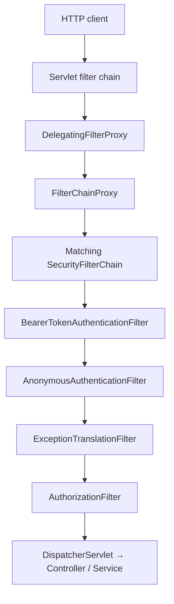
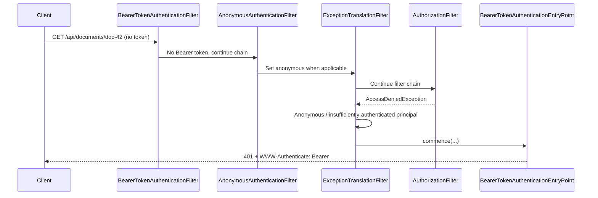
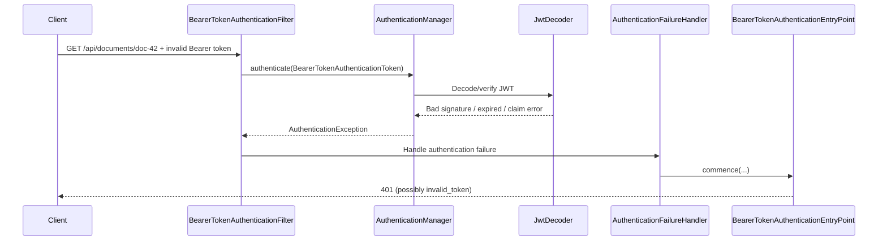
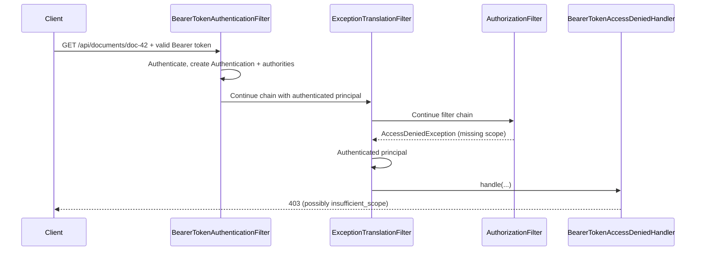
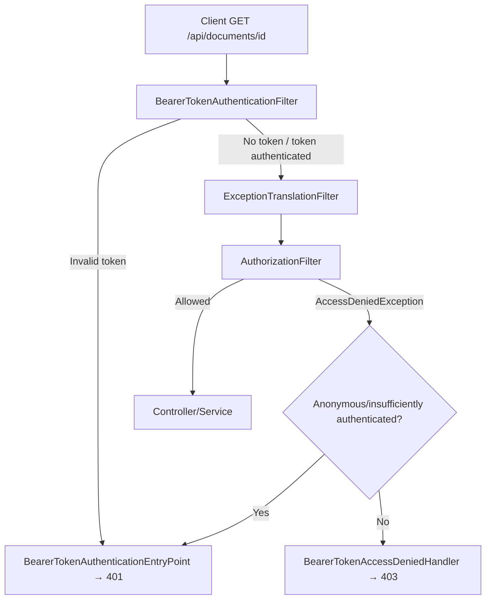

# ExceptionTranslationFilter, Entry Point, and Access Denied Handler

## 1. The Question: Why Does the Same API Sometimes Return 401 and Sometimes Return 403?

Suppose a Spring Boot REST API is configured as an **OAuth 2.0 Resource Server** with two endpoints:

- `GET /api/public/ping`: public.
- `GET /api/documents/{id}`: requires a valid access token and scope `documents.read`.

Three clients may call the same protected path:

```http
GET /api/documents/doc-42 HTTP/1.1
Host: api.example.com
Authorization: Bearer <access-token>
```

Yet the outcomes differ:

| Request | Typical status | Meaning |
|---|---|---|
| No Bearer token sent | `401 Unauthorized` | No accepted authentication credentials present |
| Bearer token with bad signature/expired | `401 Unauthorized` | Token authentication failed |
| Valid token missing `documents.read` | `403 Forbidden` | Authenticated, but insufficient permissions |
| Valid token, required scope, business access met | `200 OK` | Processed |

Spring Security provides the components responsible for turning these scenarios into HTTP responses:

- **`ExceptionTranslationFilter`:** catches and handles security exceptions thrown by components downstream of it in the filter chain.
- **`AuthenticationEntryPoint`:** initiates the authentication process when a request lacks valid authentication or authentication fails; for Bearer APIs this typically produces `401` with a `WWW-Authenticate` header.
- **`AccessDeniedHandler`:** handles access-denied situations for an already-authenticated subject; typically produces `403`.
- **`BearerTokenAuthenticationFilter`:** receives the Bearer token, attempts authentication, and has its own failure-handling mechanism.

Crucial point: **`ExceptionTranslationFilter` is not the component that decodes JWTs, verifies signatures, or grants permission to read data**. It translates security failure outcomes into proper HTTP protocol behavior. Understanding its position helps diagnose why an API returns 401, 403, or something else.

### Learning Objectives

After this lesson, you will understand:

1. Where `ExceptionTranslationFilter` sits in the Spring Security Servlet filter chain.
2. The difference between `AuthenticationException` and `AccessDeniedException`.
3. Conditions under which Spring Security invokes the entry point vs. the access denied handler.
4. Characteristics of `BearerTokenAuthenticationEntryPoint` and `BearerTokenAccessDeniedHandler` in an OAuth 2.0 Resource Server.
5. How to configure, test requests with `curl`, and interpret 401/403 responses.
6. How to avoid common mistakes such as redirecting to a login page in a REST API or swallowing security exceptions.

## 2. Servlet Context: Which Filters Does a Request Pass Through?

In a Servlet-based Spring MVC application, a client request passes through the **Servlet Filter Chain** before reaching `DispatcherServlet` and the controller.

Spring Security integrates with the Servlet container through a conceptual chain of components:



This diagram highlights the filters relevant to this lesson. Real configurations also include filters for security context, headers, CORS, CSRF, logout, and others; exact ordering depends on version and configuration. The notable feature in a typical Resource Server setup is that **the Bearer token filter sits before `ExceptionTranslationFilter`, whereas `AuthorizationFilter` sits after it**.

### 2.1. Roles Not to Confuse

| Component | Primary role |
|---|---|
| `DelegatingFilterProxy` | Bridges the Servlet container to Spring's filter bean |
| `FilterChainProxy` | Selects and executes the `SecurityFilterChain` matching the request |
| `BearerTokenAuthenticationFilter` | Extracts Bearer token; delegates validation to `AuthenticationManager` |
| `JwtDecoder` | Decodes and verifies JWTs according to configured keys/validators |
| `SecurityContextHolder` | Lets components in the request access the current `Authentication` |
| `AnonymousAuthenticationFilter` | Creates an anonymous authentication when no suitable principal exists, if anonymous is enabled |
| `ExceptionTranslationFilter` | Translates downstream `AuthenticationException`/`AccessDeniedException` into authentication initiation or denial handling |
| `AuthorizationFilter` | Enforces `authorizeHttpRequests` rules via `AuthorizationManager` |
| `AuthenticationEntryPoint` | Generates a response/challenge when authentication is required |
| `AccessDeniedHandler` | Generates a response when an authenticated subject lacks sufficient permissions |

Spring Security uses `AuthorizationFilter` in modern configurations or other authorization components in older apps/versions. Though filter details differ, the core mindset remains: **authenticate identity first, decide permissions second, and handle exceptions in context**.

### 2.2. Why Does Filter Position Affect Exception Catching?

A Servlet filter typically operates like this:

```java
doFilter(request, response, chain) {
    // Pre-processing before downstream filters.
    chain.doFilter(request, response);
    // Post-processing after downstream filters finish.
}
```

A filter can catch exceptions thrown while executing `chain.doFilter(...)`. Therefore, `ExceptionTranslationFilter` only handles security exceptions **propagating back from filters downstream of it**.

If an error occurs **before** `ExceptionTranslationFilter` is invoked, it cannot reach backward to catch it. This is a key point when analyzing invalid tokens rejected directly in `BearerTokenAuthenticationFilter`.

## 3. What Does ExceptionTranslationFilter Do?

Conceptually, `ExceptionTranslationFilter` bridges **Java exceptions inside Spring Security** and the **HTTP response** seen by the client.

It primarily cares about:

- `AuthenticationException`: authentication failed, or a component signals that authentication is required.
- `AccessDeniedException`: the subject is not permitted to perform the action.

Illustrative decision logic in readable pseudocode:

```text
try:
    continue downstream filter chain
catch security exception:
    if AuthenticationException:
        invoke AuthenticationEntryPoint
    else if AccessDeniedException:
        if current principal is anonymous
           or considered insufficiently authenticated:
            invoke AuthenticationEntryPoint
        else:
            invoke AccessDeniedHandler
    else:
        propagate error
```

This is a conceptual model, not verbatim framework source code. The real implementation also interacts with `AuthenticationTrustResolver`, `RequestCache`, `SecurityContext`, and specific exception subtypes.

### 3.1. When Catching `AuthenticationException`

When a matching `AuthenticationException` is thrown downstream, `ExceptionTranslationFilter` treats it as a need to start authentication. By default, it can save the request via `RequestCache`, clear the relevant security context, and call:

```java
authenticationEntryPoint.commence(request, response, authenticationException);
```

In form-login applications, the entry point may redirect to a login page; in Bearer-token REST APIs, the entry point typically responds with **401 and a Bearer challenge**.

Note: Not every `AuthenticationException` in the entire system passes through `ExceptionTranslationFilter`. An authentication filter sitting before it can catch the failure itself and invoke a failure handler/entry point.

### 3.2. When Catching `AccessDeniedException`

`AccessDeniedException` is typically thrown when a permission check fails. At this point, `ExceptionTranslationFilter` checks the request's **authentication state**:

- **Anonymous or insufficiently authenticated:** delegates to `AuthenticationEntryPoint` so the client knows authentication is required—typically 401 for a Bearer API.
- **Authenticated per policy:** invokes `AccessDeniedHandler`—typically 403.

For that reason, **seeing `AccessDeniedException` does not automatically mean returning 403**. For example, a request without a token hitting an endpoint requiring `SCOPE_documents.read` is denied by `AuthorizationFilter`; because the principal is anonymous, `ExceptionTranslationFilter` selects the entry point and returns 401.

### 3.3. ExceptionTranslationFilter Does Not Check JWTs or Business Permissions

It is NOT responsible for:

- Verifying RSA/ECDSA signatures on JWTs.
- Fetching JWKS from the Authorization Server.
- Validating `iss`, `aud`, `exp`, or `nbf`.
- Mapping `scope` claims into `SCOPE_...`.
- Deciding whether a user owns a specific order or document.
- Issuing tokens, verifying passwords, or serving login pages.

Those responsibilities belong to `JwtDecoder`, authentication providers, authorization components, or the business layer. `ExceptionTranslationFilter` only decides **how to report security errors to the client** once the exception reaches it.

## 4. Two Main Exception Types: AuthenticationException and AccessDeniedException

### 4.1. AuthenticationException

`AuthenticationException` is the base class for authentication-related errors in Spring Security.

Contextual examples:

- A token is rejected for an invalid signature or expiration.
- An authentication request lacks valid credentials.
- An authentication mechanism cannot produce a valid principal.

In a Resource Server, JWT processing errors may surface as `JwtException`, `OAuth2AuthenticationException`, or be converted into an `AuthenticationException` at the authentication layer. Exact routing depends on the filter/provider.

The typical HTTP status is **401 Unauthorized**. HTTP's name `Unauthorized` is famously misleading; in this context it means **the request is not validly authenticated**.

### 4.2. AccessDeniedException

`AccessDeniedException` indicates that a request is **not permitted** under the active policy.

Examples:

- Valid token lacking authority `SCOPE_documents.read`.
- Method security such as `@PreAuthorize` rejects the invocation.
- An authenticated user attempts to access a forbidden record and the service throws `AccessDeniedException`.
- Another permission check in Spring Security denies the request.

If the principal is authenticated, Spring Security normally uses **403 Forbidden**. However, when the request is anonymous or insufficiently authenticated, the framework can choose **401** by invoking the entry point.

### 4.3. Concise Comparison

| Criterion | AuthenticationException | AccessDeniedException |
|---|---|---|
| Nature | Authentication requirements not met | Access permissions not met |
| Core question | "Is this request authenticated?" | "Is this subject allowed to do this?" |
| Handled in `ExceptionTranslationFilter` via | `AuthenticationEntryPoint` | Entry point if anonymous/insufficiently authenticated; otherwise `AccessDeniedHandler` |
| Common status in Bearer APIs | `401` | `401` or `403` depending on context |
| Example | Missing valid token | Valid token missing required scope |

**Easy rule to remember:** Check the authentication state first before concluding whether an `AccessDeniedException` should produce HTTP 401 or 403.

## 5. AuthenticationEntryPoint: Initiating Authentication / Challenges

### 5.1. The AuthenticationEntryPoint Interface

Spring Security defines the interface:

```java
public interface AuthenticationEntryPoint {
    void commence(
        HttpServletRequest request,
        HttpServletResponse response,
        AuthenticationException authException
    ) throws IOException, ServletException;
}
```

`commence(...)` can write an HTTP response, add headers, or redirect the user depending on the application type.

Examples:

- `LoginUrlAuthenticationEntryPoint`: redirects browsers to the login page in form-login apps.
- `HttpStatusEntryPoint`: returns a configured HTTP status.
- **`BearerTokenAuthenticationEntryPoint`**: tailored for Bearer-token Resource Servers; responds according to HTTP Bearer challenge rules.

### 5.2. What Does BearerTokenAuthenticationEntryPoint Do by Default?

In an OAuth 2.0 Resource Server, the standard entry point is `BearerTokenAuthenticationEntryPoint`. When a request requires authentication, it typically returns:

```http
HTTP/1.1 401 Unauthorized
WWW-Authenticate: Bearer
```

`WWW-Authenticate` is a key part of the HTTP contract: it informs the client of the Bearer authentication scheme required by the API.

When a token is present but invalid, the response may include error details per RFC 6750:

```http
HTTP/1.1 401 Unauthorized
WWW-Authenticate: Bearer error="invalid_token"
```

Actual headers may also include `error_description`, `realm`, or other fields depending on the exception and configuration. Do not assume every 401 includes `invalid_token`; requests **missing a token** normally receive only a plain `Bearer` challenge without an error code.

### 5.3. An Entry Point Is Not a Login Screen

In an API accepting JWTs, the entry point **does not issue access tokens or render a login page**. The client must use an appropriate OAuth 2.0 flow with the Authorization Server—such as Authorization Code + PKCE or Client Credentials—to obtain an access token and retry the API call.

A Resource Server API built for mobile apps, frontends, or service-to-service communication should generally never unexpectedly return:

```http
HTTP/1.1 302 Found
Location: /login
```

when the client expects a Bearer API error. If you observe such a redirect, a `formLogin` configuration or another filter chain is likely selecting a form-login entry point instead of Bearer.

### 5.4. Is the Entry Point Always Invoked via ExceptionTranslationFilter for Every JWT Error?

**Not necessarily through `ExceptionTranslationFilter`.** When `BearerTokenAuthenticationFilter` attempts to validate a token and fails, it invokes an `AuthenticationFailureHandler`; by default in Resource Server, the failure handler can use `AuthenticationEntryPointFailureHandler` to call the Bearer entry point.

Consequently, a 401 response caused by an invalid JWT **does not prove `ExceptionTranslationFilter` caught the exception**. Error handling often terminates right inside the token authentication filter before the request ever reaches downstream authorization.

## 6. AccessDeniedHandler: Handling Authenticated Subjects with Insufficient Permissions

### 6.1. The AccessDeniedHandler Interface

`AccessDeniedHandler` responds when access is denied for an authenticated principal:

```java
public interface AccessDeniedHandler {
    void handle(
        HttpServletRequest request,
        HttpServletResponse response,
        AccessDeniedException accessDeniedException
    ) throws IOException, ServletException;
}
```

A general implementation such as `AccessDeniedHandlerImpl` can send status 403 or forward to an error page per configuration.

For Resource Servers, Spring Security provides **`BearerTokenAccessDeniedHandler`**, designed to produce Bearer responses.

### 6.2. BearerTokenAccessDeniedHandler and insufficient_scope

Suppose the client holds a valid access token:

```json
{
  "sub": "user-417",
  "scope": "documents.list"
}
```

while the endpoint requires `SCOPE_documents.read`. Authorization denies the request, and a Bearer-appropriate handler can return:

```http
HTTP/1.1 403 Forbidden
WWW-Authenticate: Bearer error="insufficient_scope"
```

The `insufficient_scope` code signals that the token lacks the required access privileges. Depending on the `Authentication` state and handler configuration, headers can differ; **do not assume `insufficient_scope` is present on every 403**.

`BearerTokenAccessDeniedHandler` does not re-verify signatures or add scopes. It simply translates the permission denial into an appropriate HTTP response.

### 6.3. Business-Level Permission Failures Can Also Return 403

Suppose the JWT is valid and has scope `documents.read`, yet `doc-42` belongs to another tenant. The service inspects the data and denies access:

```java
if (!document.getTenantId().equals(currentTenantId)) {
    throw new AccessDeniedException("Access denied");
}
```

If the exception propagates back through the Spring Security filter chain where `ExceptionTranslationFilter` can catch it, the handler usually returns 403 for an authenticated principal. In some designs aiming to avoid disclosing resource existence, however, an API may return 404 per business authorization policy.

Do not treat a `403` response alone as proof that tenant/ownership logic ran; verify what the actual policy checked.

## 7. Three Crucial Processing Paths in a Resource Server

### 7.1. Path A: No Bearer Token



Explanation:

1. The authentication filter finds no token and lets the request continue.
2. Anonymous authentication may be placed in the context.
3. `AuthorizationFilter` evaluates the rule requiring the scope and denies access.
4. `ExceptionTranslationFilter` determines the request lacks a suitable authenticated subject.
5. The entry point returns 401.

This is an example of **`AccessDeniedException` leading to 401** because the caller is unauthenticated.

### 7.2. Path B: Invalid Bearer Token



This is a frequently misunderstood point: JWT errors occurring inside `BearerTokenAuthenticationFilter` happen **before** `ExceptionTranslationFilter` in the typical chain. The Bearer authentication filter handles the failure right there, usually via its failure handler/entry point.

Therefore, setting a breakpoint in `ExceptionTranslationFilter` and not seeing it catch an invalid JWT does not indicate a configuration bug.

### 7.3. Path C: Valid Token, Missing Scope



`Authentication` is valid, yet lacks the authority required by the endpoint. This is the primary scenario handled by `AccessDeniedHandler`.

### 7.4. Combined Decision Table

| Condition | Component typically detecting | Action taken | Status |
|---|---|---|---|
| No token, `permitAll` endpoint | `AuthorizationFilter` permits | Controller handles | Appropriate `2xx` |
| No token, protected endpoint | `AuthorizationFilter` denies | `ExceptionTranslationFilter` → entry point | `401` |
| Malformed/bad-signature/expired Bearer token | Bearer auth filter/provider/decoder | Failure handler → entry point | `401` |
| Valid token, missing scope | `AuthorizationFilter` or method security | `ExceptionTranslationFilter` → access denied handler | `403` |
| Valid token, sufficient scope | `AuthorizationFilter` permits | Controller/Service handles | `2xx` or business result |
| Token has scope, fails record permission check | Authorization/business layer | Handler or business error handling per policy | `403` or `404` |

A request to a public endpoint **can still receive 401 if the client actively sends a broken Bearer token** and the token authentication filter tries to validate it before reaching the `permitAll` rule.

## 8. Configuring Spring Security Resource Server to Observe Default Behavior

### 8.1. Add Dependencies

Example Spring Boot app using Gradle:

```groovy
dependencies {
    implementation 'org.springframework.boot:spring-boot-starter-web'
    implementation 'org.springframework.boot:spring-boot-starter-security'
    implementation 'org.springframework.boot:spring-boot-starter-oauth2-resource-server'
}
```

### 8.2. Configure the Issuer

In `application.yml`:

```yaml
server:
  port: 8080

spring:
  security:
    oauth2:
      resourceserver:
        jwt:
          issuer-uri: https://id.example.com/realms/shop
```

The issuer address above is an example and must be replaced with your real Authorization Server's issuer. An accepted JWT access token must have a valid signature, matching issuer, unexpired timestamps, and satisfy any other validators configured by the Resource Server.

If the API has its own audience, such as `documents-api`, **add an audience validator** or configure audiences as supported by your Spring Security/Spring Boot version; a valid issuer alone does not prove the token was meant for this API.

### 8.3. Minimal SecurityFilterChain

Example for a REST API accepting only Bearer JWTs:

```java
package com.example.documents;

import org.springframework.context.annotation.Bean;
import org.springframework.context.annotation.Configuration;
import org.springframework.http.HttpMethod;
import org.springframework.security.config.Customizer;
import org.springframework.security.config.annotation.web.builders.HttpSecurity;
import org.springframework.security.config.http.SessionCreationPolicy;
import org.springframework.security.web.SecurityFilterChain;

@Configuration
public class SecurityConfig {

    @Bean
    SecurityFilterChain apiSecurity(HttpSecurity http) throws Exception {
        return http
            .csrf(csrf -> csrf.disable())
            .sessionManagement(session -> session
                .sessionCreationPolicy(SessionCreationPolicy.STATELESS))
            .authorizeHttpRequests(auth -> auth
                .requestMatchers("/api/public/**").permitAll()
                .requestMatchers(HttpMethod.GET, "/api/documents/**")
                    .hasAuthority("SCOPE_documents.read")
                .requestMatchers(HttpMethod.POST, "/api/documents/**")
                    .hasAuthority("SCOPE_documents.write")
                .anyRequest().denyAll()
            )
            .oauth2ResourceServer(oauth2 ->
                oauth2.jwt(Customizer.withDefaults()))
            .build();
    }
}
```

In this configuration:

- `permitAll()` allows public requests without a token.
- `hasAuthority("SCOPE_documents.read")` requires the authority when reading documents.
- `anyRequest().denyAll()` denies undeclared endpoints/methods.
- `oauth2ResourceServer(...jwt(...))` enables Bearer JWT validation and matching Bearer error-handling components.
- `STATELESS` avoids relying on an HTTP session to maintain login state.

`csrf.disable()` is only appropriate under the assumption of a pure Bearer-token API where tokens are explicitly attached via headers, not cookie-based authentication. If the API uses cookies/sessions, retain CSRF protection appropriate for the architecture.

Default Resource Server configurations typically register `BearerTokenAuthenticationEntryPoint` and `BearerTokenAccessDeniedHandler` for appropriate cases. With multiple authentication mechanisms or multiple `SecurityFilterChain`s, behavior also depends on which chain is actually selected and which entry points/handlers are configured there.

### 8.4. Illustrative Controller

```java
package com.example.documents;

import java.util.Map;
import org.springframework.security.core.annotation.AuthenticationPrincipal;
import org.springframework.security.oauth2.jwt.Jwt;
import org.springframework.web.bind.annotation.GetMapping;
import org.springframework.web.bind.annotation.PathVariable;
import org.springframework.web.bind.annotation.RestController;

@RestController
public class DocumentController {

    @GetMapping("/api/public/ping")
    public Map<String, String> ping() {
        return Map.of("status", "ok");
    }

    @GetMapping("/api/documents/{id}")
    public Map<String, String> read(
            @PathVariable String id,
            @AuthenticationPrincipal Jwt jwt) {

        return Map.of(
            "documentId", id,
            "subject", jwt.getSubject()
        );
    }
}
```

This example observes endpoint authentication/authorization flow; it **does not implement document ownership checks**. In a real API, query documents by tenant/owner or invoke a service enforcing object-level authorization. Without that check, someone with `SCOPE_documents.read` could still read data they do not own.

### 8.5. Handler Coordination Diagram



The diagram depicts common cases under default configuration. Each request's outcome is also influenced by method security, business permissions, and other exception handlers declared by the application.

## 9. Customizing the Entry Point and Access Denied Handler

### 9.1. When Is Customization Needed?

Usually a Resource Server can rely on the default handlers. Customize them only when you need a specific response contract, such as:

- Setting a `realm` name for the Bearer challenge.
- Standardizing a JSON error body or correlation ID.
- Performing controlled logging/auditing.
- Translating different cases into stable business error codes understood by clients.

Even when customizing, the API must uphold core protocol rules:

- Unauthenticated / invalid token → **401**.
- Authenticated but insufficient permissions → **403**.
- Bearer APIs should return appropriate `WWW-Authenticate` headers.

Never replace all errors with `200 OK` and `"success":false` or turn access token failures into redirects to a login page, as doing so breaks client protocol expectations.

### 9.2. Explicitly Configuring Both Bearer Handlers

The example below configures a `realm` and registers the handlers in both `exceptionHandling` and `oauth2ResourceServer`. The goal is applying one consistent response policy for downstream exceptions and failures during Bearer filter token validation:

```java
package com.example.documents;

import org.springframework.context.annotation.Bean;
import org.springframework.context.annotation.Configuration;
import org.springframework.http.HttpMethod;
import org.springframework.security.config.Customizer;
import org.springframework.security.config.annotation.web.builders.HttpSecurity;
import org.springframework.security.config.http.SessionCreationPolicy;
import org.springframework.security.oauth2.server.resource.web.BearerTokenAuthenticationEntryPoint;
import org.springframework.security.oauth2.server.resource.web.access.BearerTokenAccessDeniedHandler;
import org.springframework.security.web.SecurityFilterChain;

@Configuration
public class SecurityConfig {

    @Bean
    SecurityFilterChain apiSecurity(HttpSecurity http) throws Exception {
        BearerTokenAuthenticationEntryPoint entryPoint =
            new BearerTokenAuthenticationEntryPoint();
        entryPoint.setRealmName("documents-api");

        BearerTokenAccessDeniedHandler deniedHandler =
            new BearerTokenAccessDeniedHandler();
        deniedHandler.setRealmName("documents-api");

        return http
            .csrf(csrf -> csrf.disable())
            .sessionManagement(s -> s
                .sessionCreationPolicy(SessionCreationPolicy.STATELESS))
            .authorizeHttpRequests(auth -> auth
                .requestMatchers("/api/public/**").permitAll()
                .requestMatchers(HttpMethod.GET, "/api/documents/**")
                    .hasAuthority("SCOPE_documents.read")
                .anyRequest().denyAll()
            )
            .exceptionHandling(ex -> ex
                .authenticationEntryPoint(entryPoint)
                .accessDeniedHandler(deniedHandler)
            )
            .oauth2ResourceServer(oauth2 -> oauth2
                .authenticationEntryPoint(entryPoint)
                .accessDeniedHandler(deniedHandler)
                .jwt(Customizer.withDefaults())
            )
            .build();
    }
}
```

This example is an **alternative** to `SecurityConfig` in Section 8.3; do not declare two identical `SecurityFilterChain` beans simultaneously in the same project.

Configuration details:

- `exceptionHandling().authenticationEntryPoint(...)` defines how authentication-required cases routed through `ExceptionTranslationFilter` are handled.
- `exceptionHandling().accessDeniedHandler(...)` defines how downstream `AccessDeniedException`s for authenticated subjects are handled.
- `oauth2ResourceServer().authenticationEntryPoint(...)` tells Bearer authentication which entry point to invoke when token validation fails.
- `oauth2ResourceServer().accessDeniedHandler(...)` sets the denied handler for Resource Server.
- `setRealmName("documents-api")` adds the realm to Bearer challenges produced by the handlers, when applicable.

Configuring both places is not always necessary when using defaults, yet helps clarify **the two distinct error paths**.

### 9.3. Example Responses with Realm

Without a token:

```http
HTTP/1.1 401 Unauthorized
WWW-Authenticate: Bearer realm="documents-api"
```

Valid token missing scope:

```http
HTTP/1.1 403 Forbidden
WWW-Authenticate: Bearer realm="documents-api", error="insufficient_scope"
```

These are illustrative responses. Actual headers also depend on the exception, current `Authentication`, and framework version. Never build clients that assume `error_description` is always present or matches a fixed string.

### 9.4. Returning a JSON Error Body

Some REST APIs want a response body like:

```json
{
  "code": "INSUFFICIENT_SCOPE",
  "message": "Access denied"
}
```

You can write custom `AuthenticationEntryPoint` and `AccessDeniedHandler` implementations to add a body, provided you:

1. Choose the right HTTP status for the nature of the failure.
2. Preserve a valid `WWW-Authenticate` header for Bearer APIs where appropriate.
3. Use messages that never expose internal details, keys, tokens, or sensitive validation diagnostics.
4. Never write the response twice if another handler has already committed the response.
5. Verify compatibility with `SecurityFilterChain` and how exceptions reach the handlers.

A clean approach is delegating to the standard `BearerTokenAuthenticationEntryPoint` and `BearerTokenAccessDeniedHandler` to preserve the challenge and status, then writing the body only if the response is not yet committed. Avoid rewriting all Bearer protocol logic just to format JSON.

## 10. Testing the Processing Paths with curl

Assume the application runs on `http://localhost:8080` with a real configured issuer. The tokens below are placeholders.

### 10.1. Public Request Without a Token

```bash
curl -i http://localhost:8080/api/public/ping
```

Typical result:

```http
HTTP/1.1 200 OK
Content-Type: application/json

{"status":"ok"}
```

This shows the public endpoint works without credentials. Do not infer from this that private endpoints are protected.

### 10.2. Private Request Without a Token

```bash
curl -i http://localhost:8080/api/documents/doc-42
```

Typical result:

```http
HTTP/1.1 401 Unauthorized
WWW-Authenticate: Bearer
```

Explanation: `AuthorizationFilter` sees no authorization; `ExceptionTranslationFilter` identifies an anonymous caller and invokes the entry point.

### 10.3. Private Request with an Invalid Token

```bash
curl -i \
  -H 'Authorization: Bearer invalid.jwt.token' \
  http://localhost:8080/api/documents/doc-42
```

Typical result:

```http
HTTP/1.1 401 Unauthorized
WWW-Authenticate: Bearer error="invalid_token"
```

Explanation: `BearerTokenAuthenticationFilter` tries to authenticate but rejects the token. The failure is handled by the filter's authentication failure handler, which invokes the Bearer entry point; it does not necessarily go through `ExceptionTranslationFilter`.

### 10.4. Private Request with a Valid Token Missing Scope

Suppose the Authorization Server issues a real, unexpired token with `scope=documents.list`, right issuer, and right audience. Client calls:

```bash
curl -i \
  -H "Authorization: Bearer $ACCESS_TOKEN_WITHOUT_READ_SCOPE" \
  http://localhost:8080/api/documents/doc-42
```

Typical result:

```http
HTTP/1.1 403 Forbidden
WWW-Authenticate: Bearer error="insufficient_scope"
```

Explanation: the token authenticates, yet `SCOPE_documents.read` is absent from `Authentication`, so `AuthorizationFilter` denies access; `ExceptionTranslationFilter` invokes the access denied handler.

**Do not edit the `scope` claim inside a JWT to fabricate a token missing scope**: editing the payload breaks the signature, resulting in `401` instead of testing the `403` branch. Request a token with the proper scopes from the issuer or use test authentication mocking.

### 10.5. Private Request with a Valid Token and Sufficient Scope

```bash
curl -i \
  -H "Authorization: Bearer $ACCESS_TOKEN_WITH_READ_SCOPE" \
  http://localhost:8080/api/documents/doc-42
```

If the JWT is valid and includes `documents.read`, the illustrative controller returns:

```http
HTTP/1.1 200 OK
Content-Type: application/json

{"documentId":"doc-42","subject":"user-417"}
```

`subject` in the response is only an example value; real tokens will carry another subject. In real systems, permission to read record `doc-42` must also be verified by the service.

### 10.6. Summary of Expected Results

| Test | Token | Endpoint | Expected |
|---|---|---|---|
| Public | None | `/api/public/ping` | 200 |
| Protected missing token | None | `/api/documents/doc-42` | 401 |
| Protected invalid token | Invalid/expired | `/api/documents/doc-42` | 401 |
| Protected missing scope | Valid, without `documents.read` | `/api/documents/doc-42` | 403 |
| Protected sufficient scope | Valid, with `documents.read` | `/api/documents/doc-42` | 200 if other checks pass |

These responses only occur as expected if the API is running, issuer/keys are properly configured, and requests traverse the intended filter chain. Never send real tokens over plain HTTP outside localhost; always use HTTPS over networks.

## 11. Testing SecurityFilterChain with Spring Security Test

### 11.1. Why Two Types of Tests Are Needed

To distinguish failures, you typically need both:

- **Authorization tests:** using `MockMvc` and `spring-security-test` to simulate principals/authorities and verify 200/401/403 rules.
- **Real token validation tests:** using JWTs signed by an appropriate issuer, or a test setup with verification keys, to verify signature/issuer/audience/expiration checks.

A request with `with(jwt())` in Spring Security Test creates a synthetic `Authentication` for testing, **which does not mean a real JWT signature was verified by `JwtDecoder`**.

### 11.2. Test Dependencies

```groovy
dependencies {
    testImplementation 'org.springframework.boot:spring-boot-starter-test'
    testImplementation 'org.springframework.security:spring-security-test'
}
```

### 11.3. MockMvc Illustrating Each Branch

```java
package com.example.documents;

import org.junit.jupiter.api.Test;
import org.springframework.beans.factory.annotation.Autowired;
import org.springframework.boot.test.autoconfigure.web.servlet.AutoConfigureMockMvc;
import org.springframework.boot.test.context.SpringBootTest;
import org.springframework.security.core.authority.SimpleGrantedAuthority;
import org.springframework.test.web.servlet.MockMvc;

import static org.springframework.security.test.web.servlet.request
    .SecurityMockMvcRequestPostProcessors.jwt;
import static org.springframework.test.web.servlet.request
    .MockMvcRequestBuilders.get;
import static org.springframework.test.web.servlet.result
    .MockMvcResultMatchers.*;

@SpringBootTest
@AutoConfigureMockMvc
class ResourceAccessTest {

    @Autowired
    MockMvc mvc;

    @Test
    void publicEndpointAllowsAnonymous() throws Exception {
        mvc.perform(get("/api/public/ping"))
            .andExpect(status().isOk());
    }

    @Test
    void protectedEndpointWithoutTokenReturns401() throws Exception {
        mvc.perform(get("/api/documents/doc-42"))
            .andExpect(status().isUnauthorized());
    }

    @Test
    void protectedEndpointWithoutScopeReturns403() throws Exception {
        mvc.perform(get("/api/documents/doc-42")
                .with(jwt()
                    .jwt(token -> token.subject("user-417"))
                    .authorities(new SimpleGrantedAuthority(
                        "SCOPE_documents.list"))))
            .andExpect(status().isForbidden());
    }

    @Test
    void protectedEndpointWithScopeReturns200() throws Exception {
        mvc.perform(get("/api/documents/doc-42")
                .with(jwt()
                    .jwt(token -> token.subject("user-417"))
                    .authorities(new SimpleGrantedAuthority(
                        "SCOPE_documents.read"))))
            .andExpect(status().isOk())
            .andExpect(jsonPath("$.documentId").value("doc-42"));
    }
}
```

This is an illustrative example using a Spring Boot/Spring Security version supporting these annotations/imports. The test context also needs a valid `JwtDecoder`/issuer configuration. If the illustrative issuer does not exist or the context requires decoding setup at startup, provide a `JwtDecoder` test bean/mock according to your framework version.

These four tests only verify endpoint conditions; **they do not actually sign or validate JWTs**. To verify invalid tokens flowing through `BearerTokenAuthenticationFilter`, write a test configuring a `JwtDecoder` that rejects tokens or run HTTP integration tests with a real/test issuer and keys.

### 11.4. What to Check for Each Test

If `publicEndpointAllowsAnonymous` returns 401, inspect the public matcher and whether a malformed Bearer header is sent implicitly.

If `protectedEndpointWithoutTokenReturns401` returns 403, inspect anonymous authentication configuration, entry point, and handlers; `ExceptionTranslationFilter` may be handling the case unexpectedly.

If `protectedEndpointWithoutScopeReturns403` returns 200, inspect the authority required by the rule, HTTP method, path matcher, and selected `SecurityFilterChain`.

If `protectedEndpointWithScopeReturns200` returns 403, inspect the `SCOPE_` prefix, scope mapping, and other method security rules/annotations.

## 12. ExceptionTranslationFilter and Exception Handling in Controllers

Spring MVC provides `@ExceptionHandler`, `@ControllerAdvice`, or `HandlerExceptionResolver` to translate exceptions into HTTP responses. This mechanism is **distinct** from Spring Security's `ExceptionTranslationFilter`.

For example, a service may enforce business checks:

```java
Document document = documentRepository.findById(id)
    .orElseThrow(DocumentNotFoundException::new);

if (!permissionService.canRead(authentication, document)) {
    throw new AccessDeniedException("Not allowed");
}
```

If the exception propagates through Spring Security's security-handling layer, `AccessDeniedException` can be caught by `ExceptionTranslationFilter` as it unwinds through the filter chain. However, if a `@ControllerAdvice` or Spring MVC resolver **catches the exception and turns it into a response first**, the exception never propagates out for the filter to handle.

Therefore, avoid defining a catch-all `@ExceptionHandler(Exception.class)` that accidentally turns security errors into `500`, `200`, or JSON responses missing the proper status/`WWW-Authenticate` header. Design a clear boundary between security exceptions and domain exceptions.

### 12.1. Why Not Wrap Every Controller in try/catch?

Anti-pattern to avoid:

```java
try {
    return documentService.getDocument(id);
} catch (Exception ignored) {
    return Map.of("status", "ok");
}
```

This swallows authorization errors and other serious failures, losing security visibility and potentially returning fake success responses.

Let Spring Security handle authentication/authorization exceptions through its proper mechanisms; for domain errors such as record-not-found, use application error handling with appropriate HTTP status codes.

### 12.2. Method Security and Permission Exceptions

When method security is enabled and you write:

```java
@PreAuthorize("hasAuthority('SCOPE_documents.write')")
public void updateDocument(...) {
    // ...
}
```

Spring throws `AccessDeniedException` when permissions are insufficient. The HTTP response depends on where the exception arises and whether an MVC exception resolver intercepts it. In a typical Servlet Security flow, an unhandled security exception propagates out to the filter chain, where `ExceptionTranslationFilter` routes it to the appropriate entry point or handler.

`@PreAuthorize` does not automatically verify tenant/ownership of a record unless your expression and service explicitly enforce it.

## 13. RequestCache, SecurityContext, and Differences from Form Login

### 13.1. RequestCache

`ExceptionTranslationFilter` can save a request via `RequestCache` before invoking the entry point so an interactive login mechanism can replay the request after the user signs in.

Example with traditional form login:

```text
GET /admin/reports (not logged in)
    → save request
    → redirect /login
    → user logs in
    → can resume the saved request
```

For an OAuth 2.0 Resource Server API using Bearer tokens, clients normally just receive `401`, obtain a valid token, and **resend the request with an `Authorization` header**. A stateless API should not rely on requests saved in an HTTP session.

If desired, configure `NullRequestCache` for a stateless API architecture per requirements; this does not remove `ExceptionTranslationFilter` from the filter chain.

### 13.2. SecurityContext

When a token is valid, the authentication filter sets the appropriate `Authentication` for the request. `AuthorizationFilter` and business components read from the security context to verify permissions.

When re-initiating authentication, Spring Security avoids trusting stale prior authentications. `ExceptionTranslationFilter` handles context cleanup accordingly when commencing authentication.

Never rely on `SecurityContextHolder.getContext().getAuthentication() != null` alone to conclude a caller is logged in, because an `AnonymousAuthenticationToken` can occupy the context. Use `AuthenticationTrustResolver`, authorization managers, or appropriate annotations to distinguish anonymous callers from authenticated principals.

### 13.3. Form Login and Resource Server Differ on Entry Points

| Application type | Unauthenticated request | Typical entry point |
|---|---|---|
| Web MVC with form login | Redirects user to login page | `LoginUrlAuthenticationEntryPoint` |
| HTTP Basic API | Prompts client for Basic credentials | `BasicAuthenticationEntryPoint` |
| OAuth 2.0 Bearer Resource Server | Requests a Bearer access token | `BearerTokenAuthenticationEntryPoint` |

When an application enables form login, HTTP Basic, and Bearer simultaneously, behavior depends on request matchers, content negotiation, filter chain order, and entry point selection. Never conclude "Spring Security always returns 401 by default for every request" when a project mixes multiple authentication mechanisms.

## 14. Common Configuration Mistakes

### 14.1. Unexpectedly Returning 302 to /login

**Possible cause:** `formLogin` or a browser-oriented chain is handling API requests.

**Fix:** Inspect which `SecurityFilterChain` matches the request, which entry point is registered, and whether the Bearer API chain is selected properly. For REST endpoints, use a Bearer entry point to return 401 rather than unexpected redirects.

### 14.2. Fake Token Does Not Pass Through ExceptionTranslationFilter

**Common cause:** `BearerTokenAuthenticationFilter` validates Bearer tokens upstream of `ExceptionTranslationFilter` and invokes its failure handler directly.

**Fix:** Trace the authentication filter/provider/`JwtDecoder` and failure handler; do not force every JWT failure through `ExceptionTranslationFilter` merely because of its name.

### 14.3. Missing Token Returns 403 Instead of 401

**Possible causes:** Non-default exception handling configuration, customized anonymous authentication, multiple filter chains, or the request entering an authorization branch without an appropriate Bearer entry point.

**Fix:** Check anonymous/`AuthenticationTrustResolver`, entry point, endpoint rules, and selected chain. In a default Bearer API, protected endpoints missing a token typically return 401.

### 14.4. Token Has Scope, Yet Returns 403

**Possible causes:** Scope not mapped to the expected authority (e.g., missing `SCOPE_` prefix), HTTP method/path mismatch on rules, another method security check denying access, or business/tenant permissions unmet.

**Fix:** Inspect the generated authorities from the token, matching rules, and service-layer checks. Never open `permitAll()` just to hide the error.

### 14.5. Invalid Token Returns 500

**Possible causes:** Error not translated into an authentication failure properly, misconfigured `JwtDecoder`, a catch-all exception handler swallowing exceptions, or another internal error.

**Fix:** Distinguish **invalid token** errors from **system failures** such as JWKS configuration, networking, or code bugs. Inspect sanitized logs (never containing real tokens) and exception causes; never blindly map every error to 401.

### 14.6. 403 Returns JSON Without a Bearer Challenge

**Possible cause:** A custom `AccessDeniedHandler` only writes JSON and forgets `WWW-Authenticate`.

**Fix:** Consider delegating to the standard `BearerTokenAccessDeniedHandler` or ensure the handler adheres to the Bearer specification. Clients may need `insufficient_scope` to understand why the token was rejected.

### 14.7. Every Request Is Allowed

**Possible causes:** Overly broad `permitAll`, filter chain not matching the request, or authorization rules lacking access requirements.

**Fix:** Use explicit matchers, verify chain ordering, and add a default `denyAll()` or strict authentication policy for undeclared endpoints.

### 14.8. Public API with an Invalid Bearer Token Still Returns 401

This can be **expected behavior**. `permitAll` allows requests without tokens, yet does not force the framework to ignore broken tokens sent by the client. The Bearer authentication filter may attempt to validate the token and reject it before reaching the authorization rule.

To verify a public endpoint, test a request without an `Authorization` header.

## 15. Diagnosing by HTTP Status and Failure Location

| Symptom | Check first | Involved components |
|---|---|---|
| 401, no token sent | Does the endpoint properly require Authentication? | `AuthorizationFilter` → `ExceptionTranslationFilter` → entry point |
| 401, invalid token | Does the JWT have the right issuer/signature/expiration/audience? | `BearerTokenAuthenticationFilter`, `JwtDecoder`, failure handler |
| 403, valid token | Are scopes mapped properly? | `AuthorizationFilter`, `ExceptionTranslationFilter`, access denied handler |
| 403, sufficient scope but wrong owner | Does the service check ownership/tenant? | Method security and domain authorization |
| 302 redirect | Which entry point is the API using? | `SecurityFilterChain`, form login entry point |
| Response missing `WWW-Authenticate` | Did a custom handler replace the Bearer handler? | `AuthenticationEntryPoint`, `AccessDeniedHandler` |
| Handler never called | Did an MVC resolver catch the exception first? | `@ControllerAdvice` / `HandlerExceptionResolver` |
| Public request with bad token returns 401 | Is the Bearer filter validating the token? | `BearerTokenAuthenticationFilter` |

When investigating, enable Spring Security logging at an appropriate level **in development environments**, for example:

```yaml
logging:
  level:
    org.springframework.security: DEBUG
```

Do not leave verbose logging enabled long-term in production if it risks exposing sensitive information or creating high log volume; especially never log raw Bearer tokens, private keys, or client secrets. You can safely trace request IDs, HTTP methods, paths, error codes, and active filter/handler names.

## 16. Extended Scenario: One API with Multiple Filter Chains

An application sometimes needs both a form-login web UI and a Bearer API. In that case, use multiple `SecurityFilterChain`s with `securityMatcher(...)` and `@Order` to separate request groups.

Conceptual example:

```text
/api/**       → Bearer JWT Resource Server → 401 / 403
/web/**       → Form login               → redirect /login
```

Selecting the right chain determines which entry point/handler takes effect. An `/api/documents` request should never accidentally hit the form-login chain due to an overly broad matcher or incorrect chain order.

Do not duplicate `AuthenticationEntryPoint` logic inside controllers or custom interceptors when Spring Security already provides the equivalent mechanism in the right filter chain. Configure and verify which chain handles the request before overriding HTTP responses.

## 17. Self-Check Questions

**Question 1.** A Resource Server receives `GET /api/documents/doc-42` with no token, and `AuthorizationFilter` throws `AccessDeniedException`. Why can the result be 401 instead of 403?

**Answer:** `ExceptionTranslationFilter` sees that the principal is anonymous/insufficiently authenticated and selects `AuthenticationEntryPoint`. Because no accepted credentials exist yet, a Bearer API typically returns 401.

**Question 2.** A JWT with an invalid signature returns 401, yet `ExceptionTranslationFilter` is never seen catching the exception. Is that necessarily a bug?

**Answer:** No. `BearerTokenAuthenticationFilter` sits upstream, handles authentication failures itself, and invokes the Bearer entry point through its failure handler, so the request can finish before reaching `ExceptionTranslationFilter`.

**Question 3.** A token is valid yet lacks `documents.read`. Which component decides to deny access?

**Answer:** The authorization component (such as `AuthorizationFilter` using `AuthorizationManager`) determines the rule fails. `ExceptionTranslationFilter` catches the downstream exception and invokes `AccessDeniedHandler` for the authenticated principal.

**Question 4.** Does `AuthenticationEntryPoint` issue access tokens to clients?

**Answer:** No. A Resource Server entry point signals that the request requires Bearer credentials, usually via 401 and `WWW-Authenticate`. The client must obtain tokens from the appropriate Authorization Server.

**Question 5.** Is it safe to add `@ExceptionHandler(Exception.class)` returning 200 for every exception?

**Answer:** No. It can swallow security failures and mislead clients. Handle `Authentication`/`AccessDenied` with proper HTTP statuses and let security mechanisms operate as intended.

**Question 6.** Why can a public request carrying a malformed Bearer token still receive 401?

**Answer:** The Bearer authentication filter may validate the submitted token before `permitAll` is evaluated. `permitAll` permits requests without tokens; it does not require ignoring malformed tokens.

**Question 7.** Should an access denied handler return 401 for a valid token lacking scope?

**Answer:** Normally no. A valid token with insufficient permissions is 403. The Bearer handler can include the `insufficient_scope` code.

## 18. Remembering the Relationship Between the Three Components

A Servlet Resource Server API can be summarized by two questions and one coordination layer:

1. **Is the request authenticated?** `BearerTokenAuthenticationFilter` and the authentication provider/token decoder handle this. On failure in the filter, the entry point can be invoked via the failure handler.
2. **Is the authenticated subject allowed access?** `AuthorizationFilter`/method security and business rules handle this. On failure, `AccessDeniedException` is typically thrown.
3. **How are errors reported to the client?** `ExceptionTranslationFilter` handles downstream security exceptions: invoking the entry point when authentication is needed, and invoking the access denied handler when an authenticated principal lacks permissions.

For Bearer APIs, **`BearerTokenAuthenticationEntryPoint` typically produces 401**, while **`BearerTokenAccessDeniedHandler` typically produces 403** depending on the scenario passed to them. Knowing where each filter sits and how exceptions flow helps you configure properly, read logs accurately, and protect APIs without confusing an invalid token with a token lacking permissions.
