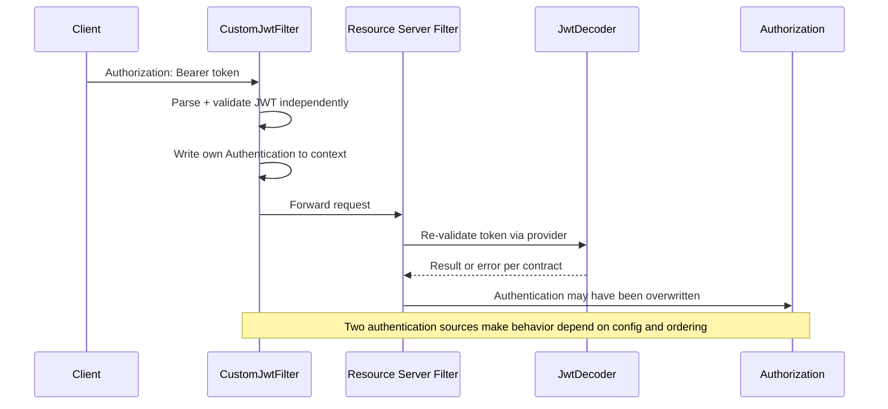
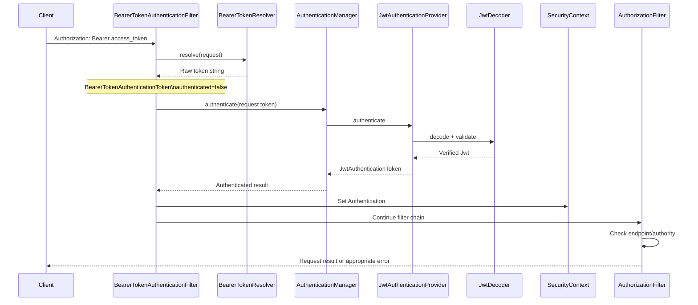

# Keeping Authentication Logic Inside Resource Server Instead of Writing a Parallel JWT Filter

## 1. The Problem in Spring Security Servlet Applications

When building REST APIs with Spring Boot and Spring Security, a common approach is creating a custom `OncePerRequestFilter`: reading the `Authorization` header, extracting the JWT string, verifying the signature, pulling username/roles, and placing an `Authentication` object into `SecurityContextHolder`. This looks straightforward, yet when the application also configures **OAuth 2.0 Resource Server**, **two Bearer token authentication mechanisms** end up running on the same HTTP request.

Spring Security already provides a dedicated pipeline for access tokens in the Servlet stack:

```text
HTTP request
    |
    v
FilterChainProxy / SecurityFilterChain
    |
    v
BearerTokenAuthenticationFilter
    |
    v
BearerTokenResolver
    |  extracts a Bearer credential from the request
    v
BearerTokenAuthenticationToken (unauthenticated)
    |
    v
AuthenticationManager / AuthenticationProvider
    |
    +---- JWT ----> JwtAuthenticationProvider ---> JwtDecoder
    |                                        verifies signature + claims
    |
    +---- opaque -> OpaqueTokenAuthenticationProvider
                                        ---> OpaqueTokenIntrospector
    |
    v
Authenticated Authentication
    |
    v
SecurityContextHolder
    |
    v
AuthorizationFilter / method security / business logic
```

**Core point of this lesson:** if an API accepts OAuth 2.0 access tokens, configure and extend `oauth2ResourceServer()` at the extension points designed for that purpose. A custom JWT filter should not simultaneously read, validate, and set `Authentication` for the same Bearer credential.

This does not forbid applications from writing Servlet filters altogether. Filters for correlation IDs, tracing, rate limiting, header normalization, or other cross-cutting concerns can be completely valid. The problem is **creating a second token authentication path** that competes with Resource Server.

## 2. Separating Responsibilities in the Processing Chain

To avoid accidentally writing an "all-in-one" filter, separate the tasks Resource Server already performs:

| Responsibility | Component designed to handle it | Core question |
|---|---|---|
| Select security chain for a URL | `FilterChainProxy`, `SecurityFilterChain`s | Which protection policy applies to this request? |
| Extract Bearer credential from HTTP | `BearerTokenResolver` | Is a token present? Was it transmitted validly? |
| Build authentication request | `BearerTokenAuthenticationFilter` | Which credential needs verification? |
| Select authentication mechanism | `AuthenticationManager` or `AuthenticationManagerResolver<HttpServletRequest>` | Which provider applies? |
| Validate JWT | `JwtAuthenticationProvider` + `JwtDecoder` | Are signature, issuer, lifetime, audience, and token profile valid? |
| Validate opaque access token | `OpaqueTokenAuthenticationProvider` + `OpaqueTokenIntrospector` | Is the token active and intended for this API? |
| Convert verified token to principal/authorities | `JwtAuthenticationConverter`, matching converter/provider | Which principal and authorities are trusted? |
| Store authentication result in request context | Resource Server filter and `SecurityContextHolder` | Which identity do downstream filters see? |
| Decide whether endpoint may be accessed | `AuthorizationFilter`, `authorizeHttpRequests`, method security | Does the authenticated token have sufficient permissions? |
| Decide access per record | Service/domain layer | May the subject read/modify this specific resource? |
| Return authentication challenge/error | `BearerTokenAuthenticationEntryPoint`, related handlers | Missing/invalid token returns 401; insufficient permissions returns what? |

A custom JWT filter often inadvertently bundles "read token," "decode JWT," "set principal," "attach roles," and "block request" into a single class. Whenever requirements change, that filter either has to reimplement framework logic or drifts out of sync with the Resource Server configuration.

### Example of Two Mechanisms Coexisting Simultaneously

```java
// DESIGN PATTERN TO AVOID: two components both authenticating the same Bearer JWT.
http
    .addFilterBefore(customJwtFilter, UsernamePasswordAuthenticationFilter.class)
    .oauth2ResourceServer(oauth2 -> oauth2.jwt(Customizer.withDefaults()));
```

If `customJwtFilter` also reads `Authorization: Bearer ...`, validates the JWT itself, and sets `Authentication`, both branches can run on one request. Adjusting filter order only changes **which mechanism runs first**—it does not resolve the duplication of responsibility.

## 3. Why Do Parallel JWT Filters Cause Bugs?

### 3.1. Two Sources Deciding Token Validity

Suppose the custom filter only checks the JWT signature and `exp`, while Resource Server's `JwtDecoder` also checks `iss`, `aud=orders-api`, and token type.

```text
Client sends JWT:
  signature = valid
  exp       = unexpired
  iss       = right provider
  aud       = billing-api      <- wrong intended recipient
  scope     = orders.read

CustomJwtFilter:
  signature + exp = OK
  => stores Authentication in SecurityContext

Resource Server:
  signature + exp + issuer + audience
  => must reject token with wrong audience
```

When both branches operate, outcomes can depend on filter order, how exceptions are caught, and how each handles an already-populated `SecurityContext`. One branch "passing" while the other "rejects" indicates the access token contract is no longer enforced consistently.

**A valid JWT signature alone does not mean the API may accept the token.** The Resource Server must also verify issuer, audience, lifetime, token profile when applicable, and resource authorization.

### 3.2. The Second Filter Can Overwrite SecurityContext

A custom filter might build:

```java
UsernamePasswordAuthenticationToken authentication =
        new UsernamePasswordAuthenticationToken(
                username, null, authorities);

SecurityContextHolder.getContext().setAuthentication(authentication);
```

If `username` and `authorities` come from insufficiently validated claims, the object is marked authenticated without going through a trusted provider. Even if the filter performs its own JWT check, a `setAuthentication` call like that can overwrite the Resource Server's result or write to the context at the wrong point in the request lifecycle.

An `Authentication` present in `SecurityContext` **is not proof that the proper Resource Server contract ran**. You must know which component created it, its authentication type, and which checks passed.

### 3.3. Inconsistent 401/403 Statuses and `WWW-Authenticate`

Resource Server handles bearer authentication failures via standard mechanisms, typically returning:

```http
HTTP/1.1 401 Unauthorized
WWW-Authenticate: Bearer error="invalid_token"
```

Meanwhile, a custom filter might do:

```java
response.setStatus(403);
response.getWriter().write("Invalid JWT");
return;
```

When the same API sometimes returns 401 and sometimes returns 403 for an expired or bad-signature JWT, clients cannot tell whether to request a new token or report insufficient permissions. Custom filters can also omit `WWW-Authenticate`, leak raw tokens into error messages, or swallow exceptions so the request proceeds as anonymous.

In the OAuth 2.0 Bearer model, **401** usually indicates missing/invalid credentials, whereas **403** usually indicates insufficient permissions after credentials were accepted. An `invalid_request` error from sending multiple tokens or malformed syntax can result in 400 per RFC 6750; actual mapping depends on Spring Security and configuration.

### 3.4. Filter Ordering and Exception Boundaries

Servlet filter chains are ordered. `ExceptionTranslationFilter` is not a global `try/catch` wrapping every filter before it; it handles exceptions thrown by eligible components downstream in the chain.

A custom filter throwing an exception outside the boundary handled by Spring Security's entry point can produce a 500 or non-contract response. If the filter calls `sendError` directly, it creates yet another divergent error path.

`BearerTokenAuthenticationFilter` is already integrated with Resource Server's failure handler/entry point. Using the right extension points avoids manually reimplementing status selection, challenges, context cleanup, and chain invocation.

### 3.5. Public Endpoints, Preflight, and Requests Missing a Token

Many hand-rolled JWT filters do something like:

```java
if (authorizationHeader == null) {
    response.sendError(401);
    return;
}
```

This can break `permitAll()` endpoints, health checks, callbacks, or CORS preflight requests, because the filter blocks every request before reaching authorization rules.

In the standard model, `BearerTokenAuthenticationFilter` **lets the request continue when no Bearer credential is found**. The rules in `authorizeHttpRequests` decide which endpoints require authentication. For CORS, configure preflight handling properly in the security chain or proxy layer.

Note the converse as well: a public endpoint with `permitAll()` that **receives an invalid Bearer token** can still fail authentication in the Resource Server filter. `permitAll` does not mean the framework ignores credentials that were explicitly sent.

### 3.6. Multiple Key Rotation Mechanisms and JWKS Caches

When the Authorization Server rotates signing keys, `JwtDecoder` uses the JWKS endpoint and caches/refreshes keys per the configured library. If a custom filter loads PEMs or JWKS separately with its own cache, one side may know the new key while the other still holds the old key.

Similarly, if a filter checks `kid` without constraining the issuer/JWKS or trusts a `jku` URL inside the token, it can introduce key-confusion vulnerabilities or fetch keys from untrusted sources.

### 3.7. Divergent Authority Mapping

A custom filter might read `roles` into `ROLE_ADMIN`, while Resource Server by default reads `scope`/`scp` into `SCOPE_orders.read`. If both exist, the same JWT can produce two different authority sets. HTTP and `@PreAuthorize` decisions then depend on whichever object ended up last in the context.

Instead of parsing the JWT a second time to add roles, customize **`JwtAuthenticationConverter`** on the already-verified JWT data.

## 4. Using Resource Server as the Primary Authentication Path

A Spring Boot Servlet API accepting JWT access tokens can start with the appropriate Spring Boot dependencies, typically `spring-boot-starter-security` and `spring-boot-starter-oauth2-resource-server`.

Example issuer configuration:

```yaml
spring:
  security:
    oauth2:
      resourceserver:
        jwt:
          issuer-uri: https://id.example.com/realms/demo
```

With an issuer supporting metadata/JWKS, Spring Security uses that trusted information to verify JWTs per configuration.

Illustrative security chain for a **stateless API accepting Bearer tokens**:

```java
import org.springframework.context.annotation.Bean;
import org.springframework.context.annotation.Configuration;
import org.springframework.http.HttpMethod;
import org.springframework.security.config.Customizer;
import org.springframework.security.config.annotation.web.builders.HttpSecurity;
import org.springframework.security.config.annotation.web.configurers.AbstractHttpConfigurer;
import org.springframework.security.config.http.SessionCreationPolicy;
import org.springframework.security.web.SecurityFilterChain;

@Configuration
public class ApiSecurityConfig {

    @Bean
    SecurityFilterChain apiSecurity(HttpSecurity http) throws Exception {
        return http
                .securityMatcher("/api/**")
                .sessionManagement(session -> session
                        .sessionCreationPolicy(SessionCreationPolicy.STATELESS))
                .csrf(AbstractHttpConfigurer::disable)
                .authorizeHttpRequests(authorize -> authorize
                        .requestMatchers(HttpMethod.GET, "/api/public/**")
                            .permitAll()
                        .requestMatchers(HttpMethod.GET, "/api/orders/**")
                            .hasAuthority("SCOPE_orders.read")
                        .requestMatchers(HttpMethod.POST, "/api/orders/**")
                            .hasAuthority("SCOPE_orders.write")
                        .anyRequest().authenticated())
                .oauth2ResourceServer(oauth2 ->
                        oauth2.jwt(Customizer.withDefaults()))
                .build();
    }
}
```

Meaning:

1. `securityMatcher("/api/**")` scopes **this security chain** to API paths, keeping it separate from browser login mechanisms if the application has multiple chains.
2. `SessionCreationPolicy.STATELESS` expresses that the Bearer API authenticates per request without relying on sessions for identity.
3. `csrf(...disable)` is only appropriate in this example API using header-sent access tokens and **not relying on sessions/cookies that automatically carry credentials**. Do not copy it to browser cookie-authenticated flows without CSRF analysis.
4. `authorizeHttpRequests` defines per-endpoint policies, which can be followed by business permission checks in services.
5. `oauth2ResourceServer().jwt()` registers the JWT Resource Server mechanism and integrates the corresponding authentication filter/provider—no need to call `addFilterBefore(new JwtFilter(), ...)`.

**Example scope limitation:** if the application also has URLs outside `/api/**`, configure another security chain or fallback policy; never assume URLs outside the matcher are protected by this chain. If the API uses opaque access tokens, replace the JWT configuration with opaque-token introspection per the issuer contract.

### 4.1. What Still Needs Additional Configuration?

Configuring `issuer-uri` supports validating the issuer, keys, and default validators, yet **does not automatically guarantee the API's audience** or every provider-specific claim is checked. For `orders-api`, add an audience validator and, when needed, verify token profiles such as `typ=at+jwt` per RFC 9068 or `token_use=access` per the issuer contract.

This is **customizing `JwtDecoder`/validators**, not a reason to add a second JWT authentication filter.

## 5. Customizing in the Right Place: Mapping Needs to Extension Points

| Need | Appropriate extension approach | What NOT to do |
|---|---|---|
| Enforce RS256 only, trusted issuer | `JwtDecoder` / `NimbusJwtDecoder`, configure JWS algorithm | Call `JWT.parse` manually in a filter |
| Enforce `aud=orders-api` | `OAuth2TokenValidator<Jwt>` in decoder | Read `aud` from unverified payload and pass through |
| Validate token type/profile | Validator/profile inside JWT Resource Server | "JWT has `sub` so it's enough" in a custom filter |
| Map `scope`, `roles`, principal name | `JwtAuthenticationConverter` or specialized converter | Build `UsernamePasswordAuthenticationToken` from raw claims |
| JWTs from multiple valid issuers | `AuthenticationManagerResolver` or multiple matching chains | Trust arbitrary token-claimed `iss` to fetch JWKS |
| Opaque access tokens | `oauth2ResourceServer().opaqueToken()`, `OpaqueTokenIntrospector` | Try decoding opaque tokens as JWTs in a filter |
| Non-default token header | `BearerTokenResolver` with clear transport policy | Write a second filter just to read one header |
| JSON format for 401/403 errors | `authenticationEntryPoint` / `accessDeniedHandler` | Block requests directly in a JWT filter |
| Tenant/owner authorization | `AuthorizationManager`, method security, or domain service | Cram DB queries/object authorization into a JWT parser |
| Request ID, tracing, audit metadata | Dedicated filter that does not authenticate tokens, or instrumentation | Replicate `AuthenticationManager` in a logging filter |
| Reject duplicate Authorization headers | `BearerTokenResolver` or gateway validation | Arbitrarily pick the first or last credential |

The right extension point receives **inputs at the right boundary**. For instance, JWT validation happens inside the decoder alongside cryptographic and claim checks; business authorization happens after a trusted principal exists.

## 6. Adding an Audience Validator Without Writing a JWT Filter

Suppose the provider's tokens are validly signed yet can target multiple APIs. `orders-api` should check the audience. Example registering `JwtDecoder`:

```java
import org.springframework.context.annotation.Bean;
import org.springframework.context.annotation.Configuration;
import org.springframework.security.oauth2.core.DelegatingOAuth2TokenValidator;
import org.springframework.security.oauth2.core.OAuth2Error;
import org.springframework.security.oauth2.core.OAuth2TokenValidator;
import org.springframework.security.oauth2.core.OAuth2TokenValidatorResult;
import org.springframework.security.oauth2.jwt.Jwt;
import org.springframework.security.oauth2.jwt.JwtDecoder;
import org.springframework.security.oauth2.jwt.JwtValidators;
import org.springframework.security.oauth2.jwt.NimbusJwtDecoder;

@Configuration
class JwtValidationConfig {

    private static final String ISSUER =
            "https://id.example.com/realms/demo";

    @Bean
    JwtDecoder jwtDecoder() {
        NimbusJwtDecoder decoder =
                NimbusJwtDecoder.withIssuerLocation(ISSUER).build();

        OAuth2TokenValidator<Jwt> issuerAndTime =
                JwtValidators.createDefaultWithIssuer(ISSUER);

        OAuth2TokenValidator<Jwt> audience = jwt ->
                jwt.getAudience().contains("orders-api")
                    ? OAuth2TokenValidatorResult.success()
                    : OAuth2TokenValidatorResult.failure(
                            new OAuth2Error(
                                    "invalid_token",
                                    "Token audience is not orders-api",
                                    null));

        decoder.setJwtValidator(
                new DelegatingOAuth2TokenValidator<>(
                        issuerAndTime, audience));
        return decoder;
    }
}
```

In this example:

- `withIssuerLocation(ISSUER)` binds the decoder to the issuer and its key discovery/JWKS source.
- `createDefaultWithIssuer` retains issuer validation and default JWT lifetime validators.
- The audience validator prevents tokens meant for `billing-api` or `web-client` from calling `orders-api`.
- `setJwtValidator` **replaces the decoder's validator set**. Therefore, when setting custom validators, preserve all required issuer, lifetime, and contract checks rather than leaving only an `aud` check.
- `JwtAuthenticationProvider` still uses the configured decoder; no extra JWT filter is needed.

This code illustrates audience validation for signed JWTs. If the issuer requires the **RFC 9068** profile, also enforce `typ=at+jwt` and profile requirements using the validators/profile support available in your Spring Security version. If the issuer uses a custom claim like `token_use=access`, only check it when explicitly contracted with the provider; do not assume that claim exists on every OAuth 2.0 access token.

### Why Not Check Audience in `OncePerRequestFilter`?

A manual filter would have to parse, verify, and re-check the JWT itself—or read claims from an unverified token. When the decoder already has a hook for `OAuth2TokenValidator`, putting the audience check there ensures one authentication outcome satisfies **a single consistent set of conditions** before producing `Authentication`.

## 7. Mapping Authorities in `JwtAuthenticationConverter`

Another need that often tempts teams into writing a custom filter is: "The provider's JWT puts roles in a claim other than `scope`, so we need to extract roles and put them in `SecurityContext` ourselves." This requirement belongs to **converting a verified JWT into an `Authentication`**, not reading the token from HTTP a second time.

Suppose the provider puts scopes in `permissions` as space-separated values, while the app wants the `SCOPE_` prefix:

```json
{
  "iss": "https://id.example.com/realms/demo",
  "sub": "user-123",
  "aud": "orders-api",
  "permissions": "orders.read orders.write",
  "exp": 1910000000
}
```

You can use a converter:

```java
import org.springframework.context.annotation.Bean;
import org.springframework.security.oauth2.server.resource.authentication
        .JwtAuthenticationConverter;
import org.springframework.security.oauth2.server.resource.authentication
        .JwtGrantedAuthoritiesConverter;

@Bean
JwtAuthenticationConverter jwtAuthenticationConverter() {
    JwtGrantedAuthoritiesConverter authorities =
            new JwtGrantedAuthoritiesConverter();
    authorities.setAuthoritiesClaimName("permissions");
    authorities.setAuthorityPrefix("SCOPE_");

    JwtAuthenticationConverter converter =
            new JwtAuthenticationConverter();
    converter.setJwtGrantedAuthoritiesConverter(authorities);
    converter.setPrincipalClaimName("sub");

    return converter;
}
```

Wire the converter into the JWT DSL:

```java
.oauth2ResourceServer(oauth2 -> oauth2
        .jwt(jwt -> jwt.jwtAuthenticationConverter(
                jwtAuthenticationConverter())))
```

The snippets in this section illustrate the extension itself; when integrating, place the bean and DSL inside your application's consistent `SecurityFilterChain` configuration.

Notes:

- The converter runs **after the JWT is verified by the decoder**; it is not responsible for signature verification.
- `JwtGrantedAuthoritiesConverter` supports common authority claim conventions; if a claim has nested structures or arrays of objects, a controlled custom `Converter<Jwt, AbstractAuthenticationToken>` may be needed.
- `sub` is not always a display username. If using `preferred_username` as the principal name, understand its stability/uniqueness guarantees per issuer and never infer permissions from display names.
- Even when a JWT carries `orders.read`, the business layer must still check whether the order belongs to the requesting account/tenant.

**Important:** the authority converter must never trust data from an unverified token. Spring Security only invokes the converter on a `Jwt` object that has passed the system's decoder and validators.

## 8. Custom `BearerTokenResolver` When Differences Are in HTTP Transport

If the actual requirement is changing how tokens are extracted from requests, customize `BearerTokenResolver` instead of building a new JWT filter.

For example, an API wants to reject requests where the Servlet container sees **two `Authorization` headers**:

```java
import java.util.Enumeration;

import org.springframework.context.annotation.Bean;
import org.springframework.http.HttpHeaders;
import org.springframework.security.oauth2.core.OAuth2AuthenticationException;
import org.springframework.security.oauth2.server.resource.BearerTokenErrors;
import org.springframework.security.oauth2.server.resource.web.BearerTokenResolver;
import org.springframework.security.oauth2.server.resource.web.DefaultBearerTokenResolver;

@Bean
BearerTokenResolver strictBearerTokenResolver() {
    DefaultBearerTokenResolver delegate =
            new DefaultBearerTokenResolver();

    return request -> {
        Enumeration<String> values =
                request.getHeaders(HttpHeaders.AUTHORIZATION);

        int count = 0;
        while (values != null && values.hasMoreElements()) {
            values.nextElement();
            if (++count > 1) {
                throw new OAuth2AuthenticationException(
                        BearerTokenErrors.invalidRequest(
                                "Multiple Authorization headers"));
            }
        }
        return delegate.resolve(request);
    };
}
```

Attach the resolver:

```java
.oauth2ResourceServer(oauth2 -> oauth2
        .bearerTokenResolver(strictBearerTokenResolver())
        .jwt(Customizer.withDefaults()))
```

The resolver's sole responsibility in this example is **reading and validating HTTP credential transport**, not validating JWTs or populating `SecurityContext`. Once the resolver returns the token string, the standard authentication path proceeds.

A reverse proxy may combine or strip duplicate headers before a request reaches the Servlet container, so gateways must enforce the same policy if original-header detection is required. Under RFC 6750, clients must not use multiple bearer token transmission methods simultaneously; Spring Security disables query/body token extraction by default unless explicitly enabled.

If an app reads an alternate header defined by an internal gateway, lock down the trust boundary so external clients cannot spoof that header. Configure `DefaultBearerTokenResolver` or a custom resolver per the gateway contract—never rewrite all of JWT validation just because the header name differs.

## 9. Separating Authentication, Authorization, and Domain Access

A custom JWT filter often goes well beyond authentication: querying the database for a user, checking roles, and rejecting requests before the controller. In reality, there are three distinct decision layers.

### 9.1. Authentication: Is the Token Trusted?

Authentication verifies the bearer token is a valid credential:

- JWT: allowed signing algorithm, valid signature using trusted issuer keys, `exp`/`nbf`, `iss`, `aud`, and required token type/profile.
- Opaque: introspection returns status and metadata satisfying the access token contract.
- Sender-constrained tokens: if DPoP/mTLS is used, verify sender-binding constraints via the corresponding mechanism.

The result is a **verified principal and authorities**. Authentication alone does not decide every domain action.

### 9.2. Authorization: Permissions for Which Endpoints?

Example:

```java
.authorizeHttpRequests(auth -> auth
        .requestMatchers(HttpMethod.GET, "/api/orders/**")
            .hasAuthority("SCOPE_orders.read")
        .requestMatchers(HttpMethod.POST, "/api/orders/**")
            .hasAuthority("SCOPE_orders.write")
        .anyRequest().authenticated())
```

An access token with read scope cannot be used to create orders. Policies can live at URL rules, method security, or a custom `AuthorizationManager`.

### 9.3. Business Ownership: Whose Data Is It?

For example, `GET /api/orders/42` requires a token with scope `orders.read`, yet must also verify order `42` belongs to a tenant/account the principal is allowed to access.

Do not stuff "order owner" logic into a JWT filter, turning it into a second business layer. Place object-level permissions in the service/domain layer, where data and business context live. This also keeps authorization consistent across REST APIs, scheduled jobs, and message consumers.

## 10. Request Processing Flow: Before and After Adopting Resource Server

### 10.1. Flow with a Parallel Custom Filter



The diagram shows a **plausible design risk**, not a claim that every custom filter overwrites the context. Actual runtime behavior depends on each application's code and Spring Security version.

### 10.2. Flow Using Resource Server



Several behavioral nuances in Servlet apps to note:

- A request without a Bearer token continues unauthenticated; `authenticated()` endpoints then deny it.
- A request with a malformed Bearer token can be rejected by the resolver **before** constructing `BearerTokenAuthenticationToken`.
- An extracted JWT with an invalid signature is rejected by the provider/decoder; no successful `JwtAuthenticationToken` is built.
- A verified JWT lacking scope is usually rejected by authorization (403), rather than rejected by the decoder as a fake token.
- Stateless APIs must authenticate every request without relying on the user having had an `Authentication` on a prior request.

## 11. Placing Error Handling Inside Resource Server

One common motive for writing a custom JWT filter is wanting uniform JSON responses for 401/403 errors. You can customize Resource Server's entry point and access denied handler **without writing token validation yourself**.

Example configuring handlers per default contract:

```java
import org.springframework.context.annotation.Bean;
import org.springframework.security.oauth2.server.resource.web
        .BearerTokenAuthenticationEntryPoint;
import org.springframework.security.oauth2.server.resource.web.access
        .BearerTokenAccessDeniedHandler;

@Bean
BearerTokenAuthenticationEntryPoint bearerEntryPoint() {
    return new BearerTokenAuthenticationEntryPoint();
}

@Bean
BearerTokenAccessDeniedHandler bearerAccessDeniedHandler() {
    return new BearerTokenAccessDeniedHandler();
}
```

When custom error JSON is needed, implement `AuthenticationEntryPoint` and `AccessDeniedHandler` appropriately and register them in the DSL:

```java
.oauth2ResourceServer(oauth2 -> oauth2
        .authenticationEntryPoint(customBearerEntryPoint)
        .accessDeniedHandler(customBearerDeniedHandler)
        .jwt(Customizer.withDefaults()))
```

This snippet illustrates attaching **already-defined handlers** to the security chain, not a complete standalone class. Custom handlers must preserve appropriate HTTP statuses, `WWW-Authenticate` Bearer challenges where needed, and never put tokens or sensitive data in responses.

Per Bearer token usage, common cases are:

| Scenario | Handling layer | Typical outcome |
|---|---|---|
| No credential, protected endpoint | Authorization / entry point | 401 with Bearer challenge |
| Invalid or expired Bearer token | Resolver or authentication provider | 401, usually `invalid_token` |
| Request uses multiple token transmission methods | Resolver/transport policy | Possibly 400 with `invalid_request` |
| Valid token, insufficient scope | Authorization / denied handler | 403, usually `insufficient_scope` |
| Business rejection in controller/service | Domain authorization | 403 or domain-policy-appropriate response |

Actual responses depend on chain configuration, exception types, and handlers. Never promise that every Bearer syntax error returns the exact same code across all versions.

## 12. When Supporting Multiple Issuers or Multiple Access Token Types

A multi-tenant application may trust access tokens from multiple issuers. The task is **selecting the right validation configuration** per request—not a reason to write a parallel JWT filter.

### 12.1. `AuthenticationManagerResolver<HttpServletRequest>`

Spring Security supports resolving an `AuthenticationManager` from the request. For multi-issuer JWTs, use the framework's multi-tenancy support, such as `JwtIssuerAuthenticationManagerResolver` in versions providing that API.

Concept:

```text
Bearer request
    |
    v
AuthenticationManagerResolver
    |
    +--> registered issuer A -> JwtDecoder/validators A
    |
    +--> registered issuer B -> JwtDecoder/validators B
    |
    +--> other issuer        -> Rejected
    |
    v
Authenticated JWT from the right trust domain
```

If a resolver must read the `iss` claim from an **unverified** JWT for routing, that value may only select among **pre-configured trusted issuers**. Once the matching decoder verifies the signature, still validate issuer, audience, and profile.

Never let a request supply an arbitrary issuer/JWKS URL, fetch keys from it, and accept the token. For each issuer, define matching audience or resource, algorithms, claims, and scope mappings.

### 12.2. JWT and Opaque Tokens in the Same System

If an API genuinely must accept both formats, explicitly model **the contract and validation branches** (using multiple security chains, resolvers, or providers per appropriate architecture). Avoid:

```java
// PSEUDOCODE TO AVOID
try {
    authenticateAsJwt(rawToken);
} catch (Exception ex) {
    authenticateAsOpaque(rawToken); // blind fallback
}
```

A "try until something passes" approach weakens policies, triggers unnecessary introspection calls, or lets a token meant for one purpose slip through the second mechanism. Establish explicit trusted source selection rules and independent policies per profile.

### 12.3. OIDC Login and Resource Server in the Same Backend

A single backend can both log users in via `oauth2Login()` (OIDC Client / Relying Party role) and protect REST APIs via `oauth2ResourceServer()`.

- **ID tokens** are used by the OIDC Client to verify login, usually with `aud=client_id`.
- **Access tokens** are used by the Resource Server to validate API requests, and must target the API's audience/resource.
- **Refresh tokens** are used at the Authorization Server's token endpoint; a Resource Server never accepts a refresh token from a client to log itself in.

If the app has both a cookie/session UI and a Bearer API, consider splitting `SecurityFilterChain`s by path so each zone has clear policies. Never lump everything into one custom JWT filter trying to interpret every cookie and token.

## 13. Migrating from a Legacy JWT Filter to Resource Server

When a project already has a custom `JwtAuthenticationFilter`, the goal is **removing the duplicate token-authentication path** after moving required features onto the proper mechanisms. Break down the legacy filter's behavior:

| Logic currently in legacy filter | Where to move it |
|---|---|
| Reading `Authorization` and stripping Bearer prefix | Default `BearerTokenResolver` |
| Reading token from a specialized internal header | Custom `BearerTokenResolver` when needed |
| Fetching public keys/JWKS | `JwtDecoder` with trusted issuer/JWK URI |
| Verifying signature/alg | `JwtDecoder` |
| Validating issuer, audience, lifetime, token purpose | `OAuth2TokenValidator<Jwt>` or matching validator/profile |
| Creating principal from `sub` | `JwtAuthenticationConverter` / principal claim |
| Converting scope/roles claims into `GrantedAuthority` | Converter for verified JWTs |
| Securing endpoints by permission | `authorizeHttpRequests`, method security |
| Blocking cross-tenant or non-owner data | Service/domain authorization |
| Returning invalid-JWT errors | Bearer entry point / authentication failure handling |
| Returning insufficient-permission errors | Bearer access denied handler |
| Recording request ID, tracing | Independent instrumentation filter that does not validate tokens |

Legacy configuration might look like:

```java
// BEFORE: conceptual example, not code to keep.
http.addFilterBefore(jwtAuthenticationFilter,
        UsernamePasswordAuthenticationFilter.class);
```

After migrating all required rules to Resource Server, configuration becomes:

```java
// AFTER: Resource Server handles Bearer authentication.
http.oauth2ResourceServer(oauth2 ->
        oauth2.jwt(Customizer.withDefaults()));
```

**Important:** remove all registrations of the old filter when migrating; removing it from the chain while leaving a bean or `FilterRegistrationBean` active can cause Spring Boot to auto-register the `Filter` directly with the Servlet container outside `FilterChainProxy`. Check whether the filter was registered via `addFilterBefore`, `FilterRegistrationBean`, or component scanning so all execution paths are cleanly removed.

### Example Separating Non-Authentication Logic

If the legacy filter did both JWT authentication and attaching a correlation ID, only the authentication part moves to Resource Server. You can keep a dedicated filter for correlation IDs, provided this filter **does not read JWTs, validate tokens, or set `Authentication`**.

```java
// PSEUDOCODE: single-responsibility instrumentation filter.
try {
    putRequestIdIntoMdc(requestId);
    chain.doFilter(request, response);
} finally {
    removeRequestIdFromMdc();
}
```

The aim is **one clear responsibility** per component. Not every custom filter is wrong; only avoid a Bearer token authentication filter running in parallel with Resource Server.

## 14. Concrete Scenarios for Choosing the Right Extension Point

### 14.1. "The Provider's JWT Has a `roles` Claim, So We Need a Separate Filter"

Not needed. Use `JwtAuthenticationConverter` or a custom converter to extract `roles` **after `JwtDecoder` verifies the token**. Outside the security chain, use `hasAuthority`/`hasRole` and method security per policy.

### 14.2. "The API Must Verify the Token Is Meant for the Right Service"

That is `JwtDecoder`'s **audience validator**, not a filter. If a token targets `billing-api`, `orders-api` rejects it during authentication.

### 14.3. "We Need to Accept Tokens from Two Authorization Servers"

Use trusted configured decoders/managers with `AuthenticationManagerResolver` or appropriate chains. Never accept arbitrary issuers based on a self-asserted `iss`.

### 14.4. "The Provider Uses Opaque Tokens"

Choose `opaqueToken()` and an introspector; do not write a filter that tries to decode tokens locally because opaque tokens do not have to be JWTs. Depending on the contract, introspection metadata may still need audience, resource, and authorization checks.

### 14.5. "We Want Different JSON When Tokens Expire"

Customize the entry point/handler to format responses while preserving proper statuses and challenges. Do not introduce a custom JWT filter merely to customize error response JSON.

### 14.6. "We Want Public Endpoints to Work Without a Token"

Configure `permitAll()` on the appropriate URLs; `BearerTokenAuthenticationFilter` does not automatically require a token on every request. If a client sends a malformed credential to a public endpoint, the authentication filter can still reject it; clients should avoid sending invalid tokens.

### 14.7. "We Need to Verify the User Still Exists in the Database"

Clarify the business requirement: a JWT is proof signed by the issuer with a finite lifetime; checking account status may belong in custom claim validation, an authorization service, or a revocation mechanism. If real-time user state checks are required, design the data model and trust boundary explicitly. Never silently turn a raw token parser into a `UserDetailsService` queried on every request without considering performance, availability, and consistency.

### 14.8. "The Gateway Already Verified the JWT; Does the Backend Still Need Resource Server?"

That depends on the trust boundary between gateway and backend. If the backend still receives bearer access tokens, it should normally enforce its own authentication/authorization contract and never trust client-controllable identity headers. If the architecture relies on gateway identity propagation, secure the transport and provenance of that identity—for example, with mTLS and ingress header stripping.

Never use a hand-rolled JWT filter as a "quick check bypass" when a backend sits behind a gateway; establish a trustworthy contract between components.

## 15. Common Pitfalls During Migration

| Symptom | Likely cause | Fix in Resource Server |
|---|---|---|
| Valid requests processed twice | Legacy custom JWT filter still registered | Remove duplicate filter registration; let Resource Server handle it |
| Valid JWT signature, yet API returns 401 | Wrong issuer, audience, token type, key rotation, or expired | Identify failing validator; fix issuer/client/token contract config |
| Token logs into UI, yet API returns 401 | Sending **ID token** instead of access token | Client must call API with an access token carrying the right audience |
| `hasRole("ADMIN")` does not work | Converter only maps `scope` to `SCOPE_`, no `ROLE_ADMIN` | Align converter and authority policies |
| `permitAll` still returns 401 when bad token sent | Bearer filter still validates submitted credentials | Fix client sending bad token; split security chains by endpoint if needed |
| `OPTIONS` preflight gets 401 | CORS or custom filter blocking missing token | Configure valid CORS/preflight handling; remove token requirement in custom filters |
| JWT errors return 500 instead of 401 | Exception/handler in filter outside boundary | Use Resource Server entry point/failure handling |
| Old/new tokens fail after key rotation | Stale JWKS cache or wrong issuer config | Use trusted JWKS and decoder key-refresh mechanisms |
| Principal in logs is the raw JWT string | Reading unverified `BearerTokenAuthenticationToken` | Use only authenticated principals and never log tokens |
| API uses old session instead of bearer | Overlapping security chains or context/session policies | Separate and explicitly define authentication mechanisms for APIs |
| Wrong-audience JWT still accepted | Missing audience validator | Enforce `aud` validation in the token acceptance contract |
| JWT has `scope`, yet action returns 403 | Scope mapping or domain permissions differ from policy | Check `JwtAuthenticationConverter` and resource-level authorization |

Even with standard Spring Security, an API can still be misconfigured. **Removing custom filters** makes the flow consistent and easier to manage, yet does not remove your responsibility to define issuer, audience, token profile, and business permissions.

## 16. Protecting SecurityContext and the Bearer Authentication Lifecycle

The `BearerTokenAuthenticationToken` created by the filter from a raw token has `isAuthenticated=false`. After `AuthenticationManager` and the provider succeed, the typical result is:

- `JwtAuthenticationToken` for validated JWT access tokens.
- `BearerTokenAuthentication` for introspected opaque access tokens.

The Resource Server filter places the authenticated result into `SecurityContext` for downstream processing. `SecurityContextHolder` is merely the access point to the context under the active strategy; it does not validate tokens itself.

For stateless APIs:

- Never "cache the previous request's `Authentication`" and treat the current token as valid.
- Never place a `UsernamePasswordAuthenticationToken` built from an unverified JWT into the context.
- Never treat `isAuthenticated=true` as a shortcut around signature verification.
- Never log `Authorization` headers or `getCredentials()` of an authentication request, because raw bearer tokens are sensitive credentials.
- When using async processing or multiple threads, propagate context via Spring Security-supported concurrency mechanisms rather than relying on a standalone custom `ThreadLocal`.

Session persistence, exception handling, and context cleanup are provided by the framework per configuration. Writing a parallel JWT filter means relearning and maintaining all those behaviors yourself even though they are not your API's business goal.

## 17. Distinguishing Resource Server from OAuth2 Client / OIDC Login

A single application can use several parts of Spring Security:

| Role | Mechanism | Token handled |
|---|---|---|
| Protect HTTP APIs | `oauth2ResourceServer().jwt()` / `opaqueToken()` | Bearer **access token** |
| Log users in via OP | `oauth2Login()` | OIDC Client **ID token**, UserInfo / login session |
| App calling other APIs | OAuth2 Client support | Obtains and presents access tokens, may refresh tokens |
| Business backend checking object-level permissions | Application/domain authorization | Based on verified principal/authorities and domain data |

Seeing "JWT" in an OIDC ID token does not mean it should be sent to a Resource Server. APIs must verify tokens have the right **purpose and audience** for the API. When combining `oauth2Login()` and Resource Server in one backend, design clear paths/security chains and session/bearer boundaries rather than letting a custom JWT filter try to interpret every cookie and token.

## 18. Scenario Matrix for a Unified Authentication Path

These are **design scenarios**, not the execution output of a test suite:

| HTTP request to `orders-api` | How Resource Server should handle it |
|---|---|
| No `Authorization`, public endpoint | Request may proceed to public endpoint |
| No `Authorization`, `authenticated()` endpoint | No Bearer authentication; typically returns 401 |
| `Authorization: Bearer` | Resolver rejects malformed Bearer |
| `Authorization: Bearer abc.def.ghi` fake JWT | Provider/decoder rejects |
| Valid JWT signature/issuer, expired | Decoder/validator rejects |
| Valid JWT signature/issuer, `aud=web-client` (ID token) | Audience/purpose validator rejects |
| Valid JWT signature/issuer, `aud=billing-api` | Audience validator rejects |
| JWT access token with `aud=orders-api`, `scope=orders.read` | Authentication succeeds; check GET and ownership |
| JWT access token with right audience, missing `orders.write` | Authentication succeeds; POST may be denied with 403 |
| Opaque bearer token on API configured with `jwt()` | Fails decoding under JWT contract |
| Opaque token on API configured with `opaqueToken()` and active introspection | Validated via metadata/contract; proceed to authorization |
| Refresh token sent to API instead of access token | Rejected per Resource Server contract |
| Valid token, order belongs to another tenant | Domain authorization denies |
| Two `Authorization` headers | Needs duplicate-rejection policy at gateway or resolver; never pick one arbitrarily |

When verifying an implementation, demonstrate that each scenario group is handled by the **right component**: resolver for transport, decoder/introspector for authentication, and authorization layer for permissions. There is no need to build a custom JWT filter to "intercept early" cases that Resource Server already handles.

## 19. Rules to Apply in Projects

1. **One Bearer credential has one primary authentication path.** Use Resource Server's `BearerTokenAuthenticationFilter`, with no second custom filter reading and verifying JWTs.
2. **Define an explicit access-token contract:** issuer, algorithm/key source, audience, lifetime, token type/profile, and required claims. Never trust a token just because it decodes.
3. **Keep JWT validation in `JwtDecoder` and validators.** When opaque tokens are required, use introspection.
4. **Keep principal and authority mapping in converters.** Never pull roles from unverified payloads and attach `Authentication` to the context yourself.
5. **Keep HTTP and domain permissions in the authorization layer.** A valid signature or present scope does not prove a user may read a specific record.
6. **Keep error handling in Resource Server's entry point/denied handler.** Never build a parallel `sendError` path for the same credentials.
7. **Use `BearerTokenResolver` to customize transport** and `AuthenticationManagerResolver` when choosing managers across multiple trusted issuers.
8. **Separate security chains by purpose when needed**, such as browser sessions vs. Bearer APIs; never let a custom JWT filter accidentally catch every endpoint.
9. **Protect raw access tokens:** never log `Authorization` headers, never store tokens as principals, and never treat client/gateway JWT decoding as proof of authentication.
10. **When migrating from a legacy filter, remove every legacy registration**, while migrating all genuinely needed validations and authority mappings to the appropriate extension points.

**Desired outcome:** a Servlet processing chain with crisp boundaries—the filter reads credentials; provider and decoder authenticate; the converter builds identity; security context holds the result; authorization decides permissions. Business customizations sit exactly where the framework provides a supported contract.

## 20. References

- **Spring Security Reference — OAuth 2.0 Resource Server (Servlet):** JWT/opaque access token processing paths and Resource Server components. https://docs.spring.io/spring-security/reference/servlet/oauth2/resource-server/index.html
- **Spring Security Reference — JWT Resource Server:** issuer configuration, JWKS, JWS algorithms, claim validation, and authorities mapping. https://docs.spring.io/spring-security/reference/servlet/oauth2/resource-server/jwt.html
- **Spring Security Reference — Servlet Authentication Architecture:** `Authentication`, `AuthenticationManager`, `AuthenticationProvider`, and `SecurityContextHolder`. https://docs.spring.io/spring-security/reference/servlet/authentication/architecture.html
- **Spring Security Reference — Servlet Architecture:** `FilterChainProxy`, `SecurityFilterChain`, and filter ordering. https://docs.spring.io/spring-security/reference/servlet/architecture.html
- **Spring Security API — `BearerTokenAuthenticationFilter`:** Resource Server authentication filter. https://docs.spring.io/spring-security/site/docs/current/api/org/springframework/security/oauth2/server/resource/web/authentication/BearerTokenAuthenticationFilter.html
- **Spring Security API — `DefaultBearerTokenResolver`:** reading bearer credentials from HTTP. https://docs.spring.io/spring-security/site/docs/current/api/org/springframework/security/oauth2/server/resource/web/DefaultBearerTokenResolver.html
- **Spring Security API — `JwtAuthenticationConverter`:** converting verified JWTs into `Authentication`. https://docs.spring.io/spring-security/site/docs/current/api/org/springframework/security/oauth2/server/resource/authentication/JwtAuthenticationConverter.html
- **RFC 6750 — OAuth 2.0 Bearer Token Usage:** token transmission and `WWW-Authenticate`. https://www.rfc-editor.org/rfc/rfc6750
- **RFC 7662 — OAuth 2.0 Token Introspection:** token status and introspection metadata. https://www.rfc-editor.org/rfc/rfc7662
- **RFC 8725 — JWT Best Current Practices:** issuer/audience validation, algorithm confusion, and token substitution. https://www.rfc-editor.org/rfc/rfc8725
- **RFC 9068 — JWT Profile for OAuth 2.0 Access Tokens:** JWT access token profile and `at+jwt`. https://www.rfc-editor.org/rfc/rfc9068
