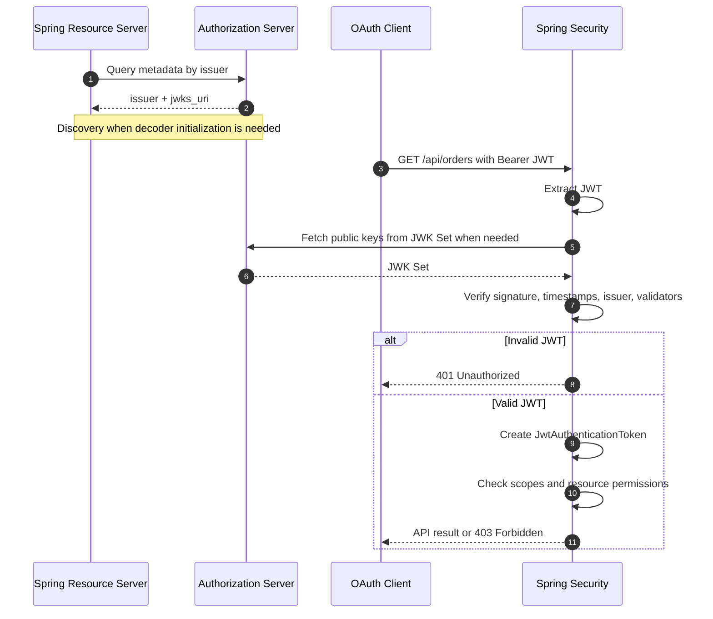
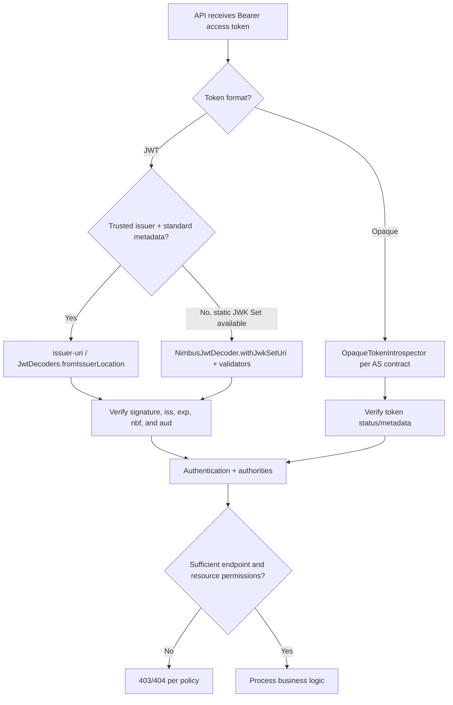

# `JwtDecoders.fromIssuerLocation` and Issuer-Based Configuration

When building a **Spring Security OAuth 2.0 Resource Server**, an application typically receives a JWT access token via the `Authorization: Bearer ...` header. To accept a token, the API must **verify the signature and validity conditions** against a trusted Authorization Server/OpenID Provider (OP). The API cannot simply Base64URL-decode the JWT and immediately trust claims such as `sub`, `scope`, or `roles`.

In Spring Security, `JwtDecoders.fromIssuerLocation(issuer)` creates a `JwtDecoder` based on an **issuer URI**. This method uses metadata published by the issuer to locate the public keys (JWK Set) and prepares a decoder for verifying JWTs. This avoids hardcoding signing keys or JWKS URLs when the system exposes standard metadata.

The most important point is that **the issuer is not merely a URL for downloading keys**. It also represents *the token-issuing authority* that the Resource Server trusts. A JWT whose signature is verified by a valid key but carries the wrong issuer, wrong audience, or is expired must still not be allowed for the API.

In this lesson, examples follow the **Spring Boot 3 and Spring Security 6** style. Class configuration, initialization behavior, and certain APIs may differ across versions; verify against the actual version in your project when applying them.

## 1. What is an issuer?

An **issuer** is the identifier of the token-issuing authority, typically represented as an HTTPS URI in the `iss` claim. For example:

```json
{
  "iss": "https://login.example.com/realms/shop",
  "sub": "user-123",
  "aud": ["orders-api"],
  "exp": 1900000000,
  "scope": "orders.read"
}
```

The JSON above is only an **illustrative payload**, not a signed JWT. If a token was issued under a different issuer, the Resource Server should not accept it merely because `sub` or `scope` looks right.

Typically, the API configures the issuer as:

```yaml
spring:
  security:
    oauth2:
      resourceserver:
        jwt:
          issuer-uri: https://login.example.com/realms/shop
```

This URI serves **two related but distinct roles**:

1. It is the starting point for the Resource Server to **discover metadata** from the issuer.
2. It is the expected value of the **`iss`** claim when verifying a token.

The issuer does not have to match the login page URL, token endpoint, or JWKS URL. For instance, the issuer might be `https://login.example.com/realms/shop` while the JWK Set is located at `https://login.example.com/realms/shop/protocol/openid-connect/certs`, depending on the OP.

> An API may trust an issuer at a specific realm/tenant. Do not substitute the identity server's root homepage or another realm's URL just because they share the same domain.

## 2. What problem does `JwtDecoders.fromIssuerLocation` solve?

To verify an asymmetrically signed JWT, the Resource Server needs to know the **correct public key of the issuer**, algorithm acceptance rules, token lifetime, and other validators. If every application manually enters keys or JWKS URLs, rotating keys, changing endpoints, and operating multiple environments become complex.

Direct Spring Security usage example:

```java
import org.springframework.security.oauth2.jwt.JwtDecoder;
import org.springframework.security.oauth2.jwt.JwtDecoders;

String issuer = "https://login.example.com/realms/shop";
JwtDecoder decoder = JwtDecoders.fromIssuerLocation(issuer);
```

When the decoder factory method runs, Spring Security performs issuer-based discovery across supported metadata formats:

1. Queries the metadata endpoint corresponding to the issuer, such as **OpenID Connect Discovery** or **OAuth 2.0 Authorization Server Metadata**.
2. Reads and verifies that the metadata describes the expected issuer.
3. Extracts necessary details such as **`jwks_uri`**, where public keys for signature verification are published.
4. Builds a decoder (typically backed by Nimbus JWT support) and configures default validators, including issuer validation per the method's setup.
5. On a Bearer JWT request, the decoder verifies the token and returns an accepted `Jwt`; verification failure causes authentication to fail.

This is **initializing token-verification configuration from an issuer**, not calling the Authorization Server to request an access token on the client's behalf, not logging in a user, and not calling OIDC UserInfo.

### Why does the method return a `JwtDecoder`?

`JwtDecoder` is Spring Security's abstraction:

```java
Jwt jwt = decoder.decode(rawJwt);
```

In this call, `rawJwt` is an unauthenticated token string. Calling `decode` does not merely split out the payload; it **verifies the token** against the configured decoder and validators. If the signature is invalid, the issuer is wrong, the token is expired, or a validator fails, the method throws a `JwtException` subtype instead of returning a trusted JWT.

In a typical Resource Server, you do not call `decode` manually from a controller: `BearerTokenAuthenticationFilter`, `AuthenticationManager`, and `JwtAuthenticationProvider` handle the token, build a `JwtAuthenticationToken`, and place the result into the `SecurityContext`.

## 3. Issuer discovery: metadata and JWK Set are two different things

OIDC and OAuth 2.0 define **metadata** publishing mechanisms so clients and Resource Servers can discover an Authorization Server's configuration. For the issuer:

```text
https://login.example.com/realms/shop
```

An illustrative OIDC discovery path is:

```text
https://login.example.com/realms/shop/.well-known/openid-configuration
```

For OAuth 2.0 Authorization Server Metadata, the specification also defines `.well-known` path forms corresponding to the issuer; for example:

```text
https://login.example.com/.well-known/oauth-authorization-server/realms/shop
```

**Do not hardcode a single path and assume every provider must use it.** How URIs are constructed, which endpoints Spring Security tries, and how endpoint errors are handled depend on the supported discovery mechanism/version. `JwtDecoders.fromIssuerLocation` lets the Resource Server perform discovery using the framework's logic.

A condensed metadata response might look like:

```json
{
  "issuer": "https://login.example.com/realms/shop",
  "jwks_uri": "https://login.example.com/realms/shop/keys",
  "authorization_endpoint": "https://login.example.com/realms/shop/authorize",
  "token_endpoint": "https://login.example.com/realms/shop/token"
}
```

The two most important fields for a JWT Resource Server:

| Field | Meaning |
| --- | --- |
| `issuer` | The issuing authority that the metadata describes; must match the configured trusted issuer. |
| `jwks_uri` | The endpoint hosting the JWK Set, providing public keys usable to verify tokens. |

`authorization_endpoint` and `token_endpoint` matter for OAuth Clients/Authorization Code flows, whereas a **Resource Server only authenticating Bearer JWTs does not run an authorization flow** on each request.

### What does a JWK Set contain?

A JWK Set may look like:

```json
{
  "keys": [
    {
      "kty": "RSA",
      "kid": "key-2026-01",
      "use": "sig",
      "alg": "RS256",
      "n": "<public-modulus>",
      "e": "AQAB"
    }
  ]
}
```

The example values are not usable production keys. This is a set of **public keys**, not private keys. For RSA-signed JWTs, the issuer signs with the private key; the Resource Server verifies with the corresponding public key.

The JWT header may contain `kid` to select a key in the JWK Set. However, **never treat `kid` or a URL embedded in the token header as a self-authenticating key source**. The decoder must select keys from the JWK Set of the configured trusted issuer/source and accept only permitted algorithms.

## 4. Processing flow from issuer to an HTTP request



The diagram distinguishes **metadata discovery**, **JWK Set retrieval**, and **per-JWT verification**. In practice, the decoder typically caches keys, so **it does not necessarily fetch the JWK Set on every request**; conversely, when keys rotate or the cache misses a key, the decoder may need to access the JWK Set again.

Metadata discovery does not mean calling metadata on every request. And verifying JWTs locally with public keys differs from opaque-token introspection, where a Resource Server usually has to query an Authorization Server endpoint for token status.

## 5. Simplest approach: configuring only `issuer-uri` in Spring Boot

In a Spring Boot project, the common approach is letting auto-configuration create a `JwtDecoder` from properties:

```gradle
dependencies {
    implementation 'org.springframework.boot:spring-boot-starter-security'
    implementation 'org.springframework.boot:spring-boot-starter-oauth2-resource-server'
}
```

```yaml
spring:
  security:
    oauth2:
      resourceserver:
        jwt:
          issuer-uri: https://login.example.com/realms/shop
```

When no matching decoder bean is supplied by the application, Spring Boot can create a `JwtDecoder` from the configuration above once auto-configuration conditions are met. In an application without a custom `SecurityFilterChain`, Boot can also provide a default Resource Server filter chain when conditions are met.

**Do not conflate these two auto-configuration branches.** Once you define a custom `SecurityFilterChain` bean, Boot typically backs off creating the default filter chain, yet it can still create the decoder from `issuer-uri`. Therefore, your custom chain must explicitly enable JWT Bearer support:

```java
import org.springframework.context.annotation.Bean;
import org.springframework.context.annotation.Configuration;
import org.springframework.http.HttpMethod;
import org.springframework.security.config.Customizer;
import org.springframework.security.config.annotation.web.builders.HttpSecurity;
import org.springframework.security.config.http.SessionCreationPolicy;
import org.springframework.security.web.SecurityFilterChain;

@Configuration
public class ApiSecurityConfig {

    @Bean
    SecurityFilterChain apiSecurity(HttpSecurity http) throws Exception {
        return http
            .securityMatcher("/api/**")
            .csrf(csrf -> csrf.disable())
            .sessionManagement(session -> session
                .sessionCreationPolicy(SessionCreationPolicy.STATELESS))
            .authorizeHttpRequests(auth -> auth
                .requestMatchers(HttpMethod.GET, "/api/orders/**")
                    .hasAuthority("SCOPE_orders.read")
                .anyRequest().denyAll())
            .oauth2ResourceServer(oauth2 -> oauth2
                .jwt(Customizer.withDefaults()))
            .build();
    }
}
```

Here:

- `.oauth2ResourceServer(...jwt(...))` enables **Bearer JWT authentication** for the filter chain.
- `hasAuthority("SCOPE_orders.read")` is an **authorization** check after authentication. Spring Security typically maps the `scope`/`scp` claim to authorities prefixed with `SCOPE_`.
- `.securityMatcher("/api/**")` scopes this chain. If the application serves other paths, configure corresponding chains/fallbacks so endpoints are not left unprotected.
- `STATELESS` suits APIs authenticating a Bearer token on every request. The `csrf.disable()` line assumes the API authenticates solely via explicit Bearer header tokens rather than browser-sent cookies/sessions; applications using cookies need an appropriate CSRF policy.

This example **does not manually define a `JwtDecoder` bean**: it lets Boot configure it from properties and has the Security DSL use the available decoder. That is the simplest setup when no custom validators, algorithms, or key sources are required.

## 6. Defining a `JwtDecoder` bean manually with `JwtDecoders.fromIssuerLocation`

If the application does not use decoder auto-configuration or wants to bind the issuer in a dedicated configuration, you can declare:

```java
import org.springframework.beans.factory.annotation.Value;
import org.springframework.context.annotation.Bean;
import org.springframework.context.annotation.Configuration;
import org.springframework.security.oauth2.jwt.JwtDecoder;
import org.springframework.security.oauth2.jwt.JwtDecoders;

@Configuration
public class DecoderConfig {

    @Bean
    JwtDecoder jwtDecoder(
        @Value("${spring.security.oauth2.resourceserver.jwt.issuer-uri}")
        String issuer
    ) {
        return JwtDecoders.fromIssuerLocation(issuer);
    }
}
```

When this bean exists, Spring Boot typically **backs off** its corresponding default decoder branch. Here, the custom bean supplies the `JwtDecoder` instance used by the Security chain. At that point, if the application alters how the decoder is initialized, it must also ensure the desired validators remain active.

In an application with one JWT filter chain and one clear decoder bean, Spring Security normally picks up that decoder when the DSL enables `.jwt(Customizer.withDefaults())`. If multiple `JwtDecoder` beans exist, decide explicitly which bean is used rather than relying on creation order.

### When is defining the bean manually unnecessary?

If you only want issuer-based JWT validation and Boot already provides matching auto-configuration, the `@Bean` snippet above usually **adds no new benefit** over `issuer-uri`. Defining a custom bean can shift initialization lifecycle responsibility and future customizations onto the developer.

Define a custom bean when there is a **specific need**, such as extra validators, customized algorithms/HTTP clients, or an explicit per-issuer/per-tenant decoder selection mechanism.

## 7. `JwtDecoders.fromIssuerLocation` vs. `NimbusJwtDecoder.withIssuerLocation`

The two APIs are closely related but serve slightly different configuration styles:

```java
JwtDecoder decoder =
    JwtDecoders.fromIssuerLocation(issuer);
```

or:

```java
NimbusJwtDecoder decoder =
    NimbusJwtDecoder.withIssuerLocation(issuer).build();
```

| API | Return type | Suitable scenario |
| --- | --- | --- |
| `JwtDecoders.fromIssuerLocation(issuer)` | `JwtDecoder` | Obtaining an issuer-based decoder with Spring Security's standard configuration. |
| `NimbusJwtDecoder.withIssuerLocation(issuer).build()` | `NimbusJwtDecoder` | Using the Nimbus decoder builder to add pre- or post-build configuration, such as validators. |
| `NimbusJwtDecoder.withJwkSetUri(uri).build()` | `NimbusJwtDecoder` | JWK Set URI is already known directly; no issuer discovery needed to locate the key endpoint. |

With a custom builder, you must actively understand **which validators are actually attached to the decoder**. In particular, a decoder built from `jwkSetUri` should not be assumed to validate the issuer simply because the JWKS URI sits under the Authorization Server's domain.

Do not cast `JwtDecoders.fromIssuerLocation(...)` to a concrete implementation just to customize it. If you want to call Nimbus's `setJwtValidator`, use the Nimbus builder explicitly as shown in the examples below.

## 8. Adding an audience check: how to preserve default validation

`issuer-uri` forms the basis for verifying the issuing authority and discovering keys. However, one issuer can issue tokens for **multiple APIs**. For example:

```json
{
  "iss": "https://login.example.com/realms/shop",
  "sub": "user-123",
  "aud": ["payments-api"],
  "scope": "payments.read"
}
```

This token may have a valid signature and issuer, yet **must not be used to call `orders-api`** if the API requires `aud` to contain `orders-api`.

A custom decoder adding an audience validator:

```yaml
spring:
  security:
    oauth2:
      resourceserver:
        jwt:
          issuer-uri: https://login.example.com/realms/shop

app:
  security:
    jwt:
      audience: orders-api
```

```java
import java.util.List;

import org.springframework.beans.factory.annotation.Value;
import org.springframework.context.annotation.Bean;
import org.springframework.context.annotation.Configuration;
import org.springframework.security.oauth2.core.DelegatingOAuth2TokenValidator;
import org.springframework.security.oauth2.core.OAuth2TokenValidator;
import org.springframework.security.oauth2.jwt.Jwt;
import org.springframework.security.oauth2.jwt.JwtClaimValidator;
import org.springframework.security.oauth2.jwt.JwtDecoder;
import org.springframework.security.oauth2.jwt.JwtValidators;
import org.springframework.security.oauth2.jwt.NimbusJwtDecoder;

@Configuration
public class JwtValidationConfig {

    @Bean
    JwtDecoder jwtDecoder(
        @Value("${spring.security.oauth2.resourceserver.jwt.issuer-uri}")
        String issuer,
        @Value("${app.security.jwt.audience}")
        String audience
    ) {
        NimbusJwtDecoder decoder =
            NimbusJwtDecoder.withIssuerLocation(issuer).build();

        OAuth2TokenValidator<Jwt> defaults =
            JwtValidators.createDefaultWithIssuer(issuer);

        OAuth2TokenValidator<Jwt> audienceValidator =
            new JwtClaimValidator<List<String>>(
                "aud",
                values -> values != null && values.contains(audience)
            );

        decoder.setJwtValidator(
            new DelegatingOAuth2TokenValidator<>(
                defaults,
                audienceValidator
            )
        );
        return decoder;
    }
}
```

Note the layers of responsibility:

1. `NimbusJwtDecoder.withIssuerLocation` discovers configuration from the issuer.
2. `JwtValidators.createDefaultWithIssuer(issuer)` preserves the default validations and enforces the issuer constraint.
3. `JwtClaimValidator` requires the `aud` claim to contain the API's audience.
4. `DelegatingOAuth2TokenValidator` combines the validators so a token must satisfy every condition.
5. Defining a custom `JwtDecoder` means Boot's default auto-configuration branch for that role backs off and does not create another decoder.

This example assumes the JWT carries `aud` as a list of strings matching the profile emitted by the issuer. If the issuer uses another token profile/claim mapping, design the validator according to the actual contract. Some Spring Boot versions support configuring audiences via properties; when using that feature, verify that Boot manages the decoder and that your version supports the requirement.

**Never omit the issuer/timestamp validators when adding a custom audience check.** Decoding and signature verification are only part of token validation.

## 9. If the JWK Set URI is known, is issuer discovery still needed?

In some environments, the Resource Server already knows a trusted JWK Set URI directly:

```yaml
spring:
  security:
    oauth2:
      resourceserver:
        jwt:
          issuer-uri: https://login.example.com/realms/shop
          jwk-set-uri: https://login.example.com/realms/shop/keys
```

Configuring both **issuer URI** and **JWK Set URI** can allow the application to avoid metadata discovery just to locate the key endpoint. In this Boot/Spring Security-supported setup, the issuer is still used to enforce the `iss` claim; the JWKS path serves as the explicitly specified key source.

This is a useful choice when:

- Metadata discovery is unavailable in some deployment environments, while the JWKS URL is stably managed.
- You want to reduce reliance on querying metadata **during decoder initialization**.
- You need to configure the key source directly per an agreement with the token issuer.

However, a direct JWKS URL **does not eliminate the need to fetch keys over the network** when the cache lacks a key; it only eliminates discovering the key location via metadata. Furthermore, direct JWKS configuration does not by itself prove all token claims are valid.

### If building a decoder solely from a JWKS URI

For example:

```java
NimbusJwtDecoder decoder =
    NimbusJwtDecoder.withJwkSetUri(
        "https://login.example.com/realms/shop/keys"
    ).build();
```

This decoder knows the **public key source**, but when the API must verify the issuer, add an explicit issuer validator:

```java
decoder.setJwtValidator(
    JwtValidators.createDefaultWithIssuer(
        "https://login.example.com/realms/shop"
    )
);
```

Then add an audience validator as in the previous section if required by the API. Do not equate “signature verified with a key from a URL” with “token issued by the right issuer and intended for the right API”.

| Configuration | Metadata discovery | Public keys | Issuer check |
| --- | --- | --- | --- |
| `issuer-uri` via standard config | Uses issuer metadata when initializing the decoder. | Fetched from discovered `jwks_uri`. | Included in standard issuer-based mechanism. |
| `issuer-uri` + `jwk-set-uri` with Boot support | Can skip locating JWKS via metadata. | Uses the specified URL. | Still required and attached via issuer in supported config. |
| Only `NimbusJwtDecoder.withJwkSetUri` | No discovery needed. | Uses the specified URL. | Must configure an issuer validator if policy requires it. |

## 10. Decoder initialization and dependency on the Authorization Server

An important operational question: **can the application start if the issuer is temporarily unreachable?**

If you define a bean manually like this:

```java
@Bean
JwtDecoder jwtDecoder() {
    return JwtDecoders.fromIssuerLocation(
        "https://login.example.com/realms/shop"
    );
}
```

the decoder factory method may **query metadata immediately when the bean is initialized**. If the issuer is not yet ready or metadata returns an error, bean creation can fail and cause ApplicationContext startup failure.

However, **do not assume every Spring Boot version with `issuer-uri` fetches metadata at startup**. Auto-configuration, lazy resolution, and bean lifecycle behavior can vary across versions. When you need a guarantee about starting up independently of the Authorization Server, verify against your actual version/configuration or use an explicit key-source strategy.

Once a `JwtDecoder` exists and the JWK Set is cached, verifying many JWTs can happen locally. Even so, when the cache expires, a new key appears, or the JWKS must be synced, the API may still need to reach the key endpoint. Therefore, **metadata-independent startup does not mean the API never depends on the network**.

### Two distinct failure modes

```text
Failure A: cannot fetch discovery metadata
    -> unknown jwks_uri / invalid metadata
    -> cannot build issuer-based decoder

Failure B: decoder exists, but cannot fetch JWK Set when needed
    -> no matching verification key / network error
    -> token cannot be authenticated on that request
```

Error handling should be considered at the right layer. Never “let tokens pass” when the Authorization Server or JWK Set is unreachable. For authentication, the sound principle is **never accept unverified credentials**.

## 11. Signing key rotation and algorithms

An issuer may rotate signing keys periodically. The JWK Set publishes multiple public keys simultaneously or switches keys on schedule:

```text
T0: JWKS contains key-A
T1: Issuer prepares key-B; JWKS contains key-A and key-B
T2: Issuer begins signing new JWTs with key-B
T3: Old JWTs expire; issuer phases out key-A
```

With `jwks_uri` from discovery, the decoder can use the public key set provided by the issuer along with its caching/refresh mechanism. Key synchronization is normally handled by the JWT library rather than application code manually fetching each public key on every request.

The Resource Server still needs to watch out for:

- **Allowed algorithms:** Do not trust an algorithm declared by the JWT header unless the decoder is properly restricted. Identify the signing algorithm the issuer actually uses and the algorithms the decoder permits.
- **Key source:** Use only the JWKS of a trusted issuer. Never fetch keys from an arbitrary URL inside a JWT.
- **Cache duration and rotation:** Refreshing the JWK Set may be necessary when a new `kid` arrives or the cache expires; set up monitoring for key-retrieval failures.
- **Token lifetime:** The issuer should retain old verification keys long enough for already-issued valid tokens if policy requires.
- **TLS security:** Metadata and JWKS must be fetched over a trusted channel; avoid insecure endpoint configurations.

In standard Spring Security/Nimbus configurations, JWT algorithms are trusted based on decoder settings rather than automatically allowing any `alg` value proposed by a token. If the issuer uses a non-default algorithm, explicitly configure the supported decoder mechanism and acceptance policy—never “allow all algorithms” just to make tokens pass.

## 12. `iss`, `aud`, `sub`, `scope`: each claim has a distinct purpose

Illustrative JWT:

```json
{
  "iss": "https://login.example.com/realms/shop",
  "sub": "user-123",
  "aud": ["orders-api"],
  "exp": 1900000000,
  "nbf": 1899990000,
  "scope": "orders.read",
  "tenant_id": "tenant-a"
}
```

| Claim | Meaning | Validation category |
| --- | --- | --- |
| `iss` | Who issued the token. | Trusted source verification. |
| `aud` | Which API/recipient the token is intended for. | Protected-resource token verification. |
| `exp`, `nbf` | Whether the token is within its allowed validity window. | Time verification. |
| `sub` | Subject identifier per issuer/token profile. | Principal mapping after authentication. |
| `scope`/`scp` | Permissions granted to the token. | Authority mapping and authorization. |
| `tenant_id` | Tenant context if emitted by the issuer under a trusted contract. | Data-level authorization, usually requiring additional checks. |

`JwtDecoders.fromIssuerLocation` establishes the foundation for issuer-based token authentication; **it does not decide which orders belong to which subject**. API access control still requires scope/role rules and owner/tenant policies.

For Client Credentials tokens, `sub` may represent a service account or application per the issuer rather than an End-User. Spring Security builds an `Authentication` from a verified token, **but does not automatically assign user/service semantics for every issuer**.

## 13. Example of reading a verified JWT in a controller

Once the filter chain protects `/api/**` and enables JWT Resource Server support, a controller can receive the authenticated `Jwt`:

```java
import java.util.Map;

import org.springframework.security.core.annotation.AuthenticationPrincipal;
import org.springframework.security.oauth2.jwt.Jwt;
import org.springframework.web.bind.annotation.GetMapping;
import org.springframework.web.bind.annotation.RestController;

@RestController
public class CallerController {

    @GetMapping("/api/caller")
    public Map<String, String> caller(@AuthenticationPrincipal Jwt jwt) {
        return Map.of(
            "issuer", jwt.getIssuer().toString(),
            "subject", jwt.getSubject()
        );
    }
}
```

This example requires an authorization rule for `/api/caller` in the chain from section 5, such as an `.authenticated()` rule placed appropriately before `anyRequest().denyAll()`.

**The controller never pulls the JWT string from the HTTP header and Base64-decodes it manually.** Spring Security has already executed `JwtDecoder` before supplying the principal to the protected endpoint. Still, return only claims that are genuinely useful and safe to expose; never place the entire token, secrets, or sensitive claims in the response.

A successfully authenticated request lacking `SCOPE_orders.read` can still receive HTTP `403` at an endpoint requiring that permission. Likewise, a token with sufficient scope can still be denied if the subject does not own the resource:

```text
Valid JWT + valid audience + sufficient scope
    -> check record owner/tenant
    -> may return 403 or 404 per API policy
```

This is **authorization**, which occurs after the decoder has verified the JWT.

## 14. Common mistakes when configuring issuer discovery

### 14.1. Using the wrong issuer URI

Suppose the JWT has:

```json
{ "iss": "https://login.example.com/realms/shop" }
```

but the application configures:

```yaml
issuer-uri: https://login.example.com
```

The two values **differ**. If the issuer metadata belongs to a specific realm, configuring the root domain can cause discovery to fail or issuer validation to reject tokens. Ensure `issuer-uri` matches the exact issuer the Authorization Server emits in tokens.

Mismatches in path, realm, scheme, trailing `/`, or public/internal hostnames can break issuer matching. Never “normalize roughly” to make the token's `iss` claim match.

### 14.2. Metadata lacks a matching `jwks_uri`

If the returned metadata omits the JWK Set URL, uses an invalid schema, or has a mismatched issuer, the decoder may fail to initialize. Inspect the metadata **of the exact issuer** and the provider contract; never pick a key URL from an untrusted source.

### 14.3. Confusing issuer URI and JWK Set URI

Wrong mental model:

```text
issuer-uri = JSON URL containing RSA keys
```

The issuer is the issuing authority identifier. The JWK Set URI is the endpoint publishing keys; the two may be related, but they are not interchangeable. Spring Boot provides `issuer-uri` and `jwk-set-uri` properties for distinct roles.

### 14.4. Checking only the signature while omitting issuer or audience

A JWT with a valid signature from a JWKS is not guaranteed to have been issued for the **current Resource Server**. If a decoder is built manually with `withJwkSetUri`, you must add issuer and audience validators per contract. A system sharing one issuer across multiple APIs especially needs an explicit audience check.

### 14.5. Using an access token from another API

A token with `aud = payments-api` does not become a token intended for `orders-api`. You must validate the audience; even identically named scopes do not guarantee the right recipient.

### 14.6. Calling discovery on every request

Do not manually implement a REST call to discovery metadata for every HTTP request. The decoder and JWK Set caching are framework-managed verification mechanisms; if near-real-time token revocation checks are needed, that is a separate design requirement. **Local JWT validation does not automatically check immediate revocation**, whereas opaque introspection can provide token status per the Authorization Server's contract.

### 14.7. Customizing `JwtDecoder` and forgetting validators

When creating a custom `JwtDecoder` bean, Boot may back off creating the default decoder. If the new bean fails to retain the desired issuer/time/audience constraints, API protection can weaken even though YAML configuration still contains `issuer-uri`. Always verify **which decoder the filter chain actually uses**.

### 14.8. `JwtDecoders.fromIssuerLocation` succeeds, yet the API still returns 401

Successful metadata discovery only means the Resource Server figured out how to construct the decoder. An individual token can still fail signature verification, have the wrong `iss`, be expired, be before `nbf`, use the wrong algorithm, or fail another validator. Distinguish **decoder creation errors** from **request authentication errors**.

## 15. HTTP statuses and identifying the failure layer

| Scenario | Failure layer | Typical outcome |
| --- | --- | --- |
| Issuer metadata unreachable when decoder must be built | Configuration/decoder initialization | Bean creation failure or config-fetch failure depending on lifecycle. |
| JWK Set temporarily unreachable when a verification key is needed | JWT decoding/authentication | Request cannot be authenticated; error depends on system handling. |
| JWT has invalid signature, wrong issuer, or is expired | Authentication | Usually `401 Unauthorized`. |
| JWT has wrong audience per configured validator | Authentication | Usually `401 Unauthorized`. |
| Valid JWT but missing `SCOPE_orders.read` | Endpoint authorization | `403 Forbidden`. |
| Valid JWT and right scope, but wrong owner/tenant | Business authorization | `403` or `404` per API contract. |
| Valid JWT, sufficient permissions, and valid data access | Processing permitted | `2xx` if business logic succeeds. |

Bearer error responses may include the `WWW-Authenticate: Bearer` header, such as `invalid_token` for invalid credentials. Never put raw tokens, credentials, or sensitive JWK details into exceptions or logs. When diagnosing, record a request ID, failure layer, expected issuer, check timestamp, and error code per logging policy.

## 16. How to observe and test issuer-based configuration

When an API rejects tokens or fails to start, distinguish three categories of technical questions:

**Issuer configuration:** Does the application have the exact `issuer-uri`? Does metadata return valid `issuer` and `jwks_uri`? Does the endpoint use TLS and is it reachable from the deployment environment?

**Token authentication:** Does the token have a valid signature against the JWK Set? Are `exp`, `nbf`, `iss`, and `aud` appropriate? Is the active decoder Boot's bean, a custom bean, or one passed directly into the DSL?

**Authorization:** What authorities does a valid token carry? Which scopes does the endpoint require? Are owner/tenant checks in the service satisfied?

Example of two testing approaches with different scopes:

```text
MockMvc + spring-security-test jwt():
  -> injects a simulated JWT principal to test authorization
  -> generally does not verify signatures with the production decoder

Integration test with a JWT signed by a test key:
  -> uses a test issuer/JWKS or a test decoder with validators
  -> verifies real tokens are accepted/rejected per issuer, aud, and timestamps
```

Therefore, a passing MockMvc `jwt()` test allowing endpoint access **does not prove** that `JwtDecoders.fromIssuerLocation` discovered metadata and verified tokens properly in deployment.

Several cases should be clearly separated when preparing tests:

| Case | Expectation |
| --- | --- |
| Valid issuer metadata, JWKS contains the key signing the token | Decoder can verify valid tokens. |
| Metadata declares an `issuer` different from the configured URI | Reject mismatched metadata configuration. |
| JWT has valid signature but different `iss` | Authentication fails. |
| JWT has valid issuer but `aud` is another API | Fails if the API has a proper audience validator. |
| JWT is expired or `nbf` is in the future beyond allowed clock skew | Authentication fails. |
| Key rotation: new token uses a different `kid` | Decoder fetches/refreshes the matching key or safely rejects if unverifiable. |
| Valid JWT but missing scope | Authentication succeeds; authorization denies. |
| Valid access token but wrong owner | Data authorization denies. |

## 17. Comparing `fromIssuerLocation` with other mechanisms

| Mechanism | Where metadata/status comes from | When to use |
| --- | --- | --- |
| `JwtDecoders.fromIssuerLocation` | Discovery via issuer, retrieves `jwks_uri` | JWT Resource Server trusting an issuer with standard metadata. |
| `NimbusJwtDecoder.withIssuerLocation` | Discovery via issuer, customizable via Nimbus builder | Need to build a decoder with specific validations/customizations. |
| `NimbusJwtDecoder.withJwkSetUri` | JWK Set URL supplied directly | Key source is known; manually ensure required claim validators are attached. |
| Opaque-token introspection | Authorization Server's introspection endpoint | Opaque access tokens or profiles requiring introspection. |
| OIDC UserInfo | OpenID Provider's UserInfo endpoint | OIDC Client needing user profile claims; **not a JWT decoder**. |
| OIDC login (`oauth2Login`) | Authorization Code flow and OIDC token processing | Application acts as a login Client, distinct from a Bearer JWT API. |

For example, in a system with a Web UI and an API: the Web UI may use `oauth2Login()` for sign-in, while the API uses `.oauth2ResourceServer().jwt()` to validate Bearer access tokens. The same issuer can serve both roles, but an ID Token meant for the Client must never automatically be treated as an access token for the API.

## 18. Workflow for choosing configuration when building a Resource Server

When starting a new API, determine each step in order:

1. **Is the access token a JWT?** If opaque, favor an introspection design rather than forcing a JWT decoder.
2. **Which issuer is trusted?** Obtain the issuer from the provider's token profile/metadata; do not guess from a login URL.
3. **Does the issuer provide standard metadata and a JWK Set?** If yes, let Boot configure `issuer-uri` or use `JwtDecoders.fromIssuerLocation`.
4. **Which audience does the API require?** Add an audience validator if not already enforced by the active configuration mechanism.
5. **Is a custom decoder needed?** For standard setups, properties are usually enough; if customizing, retain all default validations and add new validators.
6. **Which chain handles the request?** When writing a custom `SecurityFilterChain`, enable `.oauth2ResourceServer().jwt()` and define safe matchers/fallbacks.
7. **Where are access permissions enforced?** Enforce scopes/roles at endpoints and ownership/tenant checks in the domain layer.
8. **Are metadata and JWKS retrieval operationally sound?** Consider startup, network, caching, key rotation, and scenarios where the issuer is unavailable.

Mental map:



**Core takeaway:** `JwtDecoders.fromIssuerLocation` helps **discover metadata and set up a JWT decoder from a trusted issuer**. It establishes the foundation for signature and issuer verification, but does not automatically decide audience, custom scopes/roles, or business-resource permissions for every application requirement. Properly combining **issuer discovery, JWKS, token validators, SecurityFilterChain, and authorization policy** yields a clear and secure Resource Server configuration.
